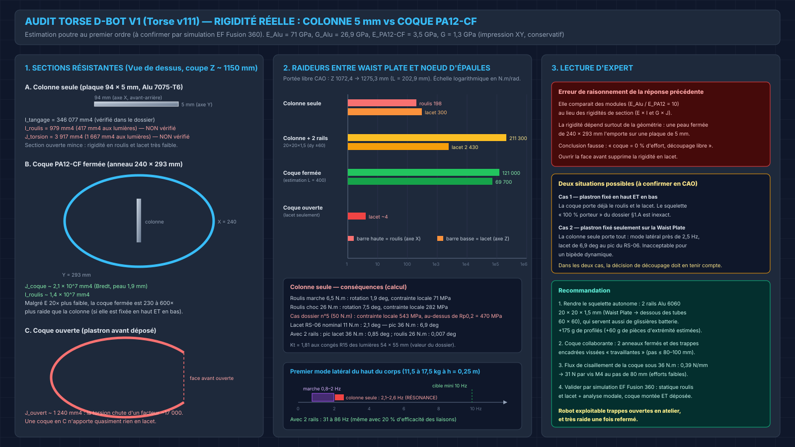
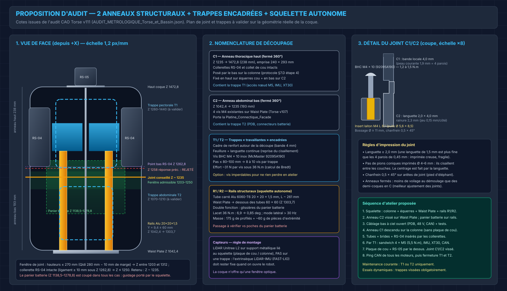

# 🔍 AUDIT — Découpage Modulaire de la Coque PA12-CF du Torse (Revue de la proposition « 4 blocs »)

> **Statut** : Document d'audit d'ingénierie (Niveau 2 — Conclu & Entériné)  
> **Date** : 11 Octobre 2026 (Consolidé le 29 Octobre 2026)  
> **Modèle CAO de référence** : Fusion 360 `Torse-123 v11` (audit métrologique certifié du 27/10/2026)  
> **Verdict d'arbitrage** : Audit conclu et intégré. La contre-proposition a abouti au consensus définitif de la **Solution C+** (Ceinture Alu 3 mm à Z = 1235 mm + Demi-fûts C1/C2 + Trappes aimantées N52 + Portique anti-lacet 7075-T6), formalisée dans [reponse_audit_11102026.md](file:///Users/Shared/Mon%20Google%20Drive%20Physique/Documentation/01_Mecanique_et_Chassis/Torse_et_Bassin/reponse_audit_11102026.md) (§12 &amp; §12.11) et entérinée dans le [Dossier Technique Torse V2](file:///Users/Shared/Mon%20Google%20Drive%20Physique/Documentation/01_Mecanique_et_Chassis/Torse_et_Bassin/DOSSIER_TECHNIQUE_Torse_Complet_D-Bot_V2.md#8-coque-secondaire-pa12-cf--impression-3d-qidi-plus-4).

---

## 📑 Sommaire

- [1. Synthèse exécutive](#1-synthèse-exécutive)
- [2. Ce qui est validé dans la réponse précédente](#2-ce-qui-est-validé-dans-la-réponse-précédente)
- [3. Points non conformes ou erronés](#3-points-non-conformes-ou-erronés)
  - [3.1 Erreur majeure : rôle structural de la coque](#31-erreur-majeure--rôle-structural-de-la-coque)
  - [3.2 Plan de coupe Z 1258 mm incompatible avec la CAO](#32-plan-de-coupe-z-1258-mm-incompatible-avec-la-cao)
  - [3.3 Détails de liaison sous-dimensionnés pour l'impression](#33-détails-de-liaison-sous-dimensionnés-pour-limpression)
  - [3.4 LiDAR sur un panneau amovible](#34-lidar-sur-un-panneau-amovible)
  - [3.5 Chiffres non justifiés](#35-chiffres-non-justifiés)
  - [3.6 Composants CAO existants ignorés](#36-composants-cao-existants-ignorés)
- [4. Analyse de rigidité chiffrée](#4-analyse-de-rigidité-chiffrée)
- [5. Contre-proposition recommandée](#5-contre-proposition-recommandée)
  - [5.1 Principe](#51-principe)
  - [5.2 Plan de joint des anneaux](#52-plan-de-joint-des-anneaux)
  - [5.3 Trappes travaillantes encadrées](#53-trappes-travaillantes-encadrées)
  - [5.4 Rails structuraux du squelette](#54-rails-structuraux-du-squelette)
  - [5.5 Séquence d'atelier](#55-séquence-datelier)
  - [5.6 Comparatif des architectures](#56-comparatif-des-architectures)
- [6. Visserie, chanfreins et couples](#6-visserie-chanfreins-et-couples)
- [7. Désynchronisations CAO et documentation détectées](#7-désynchronisations-cao-et-documentation-détectées)
- [8. Plan de validation](#8-plan-de-validation)
- [9. Questions ouvertes pour l'arbitrage](#9-questions-ouvertes-pour-larbitrage)

---

## 1. Synthèse exécutive

| Question | Verdict |
| :--- | :--- |
| Un découpage plus modulaire est-il souhaitable ? | **Oui.** L'accès au nœud d'épaules, à l'IMU et au câblage le justifie pleinement. |
| La réponse « 4 blocs » est-elle exploitable telle quelle ? | **Non.** L'idée générale tient, mais la justification structurale est fausse et le plan de coupe est mal placé. |
| Le découpage fragilise-t-il le robot ? | **Oui, s'il est fait comme proposé** (face avant ouverte = plus de rigidité en lacet). **Non, avec les règles de ce rapport.** |
| Recommandation | **2 anneaux fermés + 2 trappes travaillantes encadrées + 2 rails Alu qui rendent le squelette autonome.** |

L'erreur centrale : la réponse précédente comparait les **modules** (E_Alu / E_PA12 = 10) au lieu des **rigidités de section** (E × I, G × J). Une peau fermée de 240 × 293 mm est des centaines de fois plus raide qu'une plaque de 5 mm en roulis et en lacet. Enlever la face avant d'un tube fermé divise sa rigidité en torsion par environ 17 000.

Le calcul fait aussi ressortir un point **hors du périmètre initial mais plus important** : sans la coque, la colonne seule a un premier mode latéral d'environ **2,1 à 2,6 Hz**, soit dans la bande de fréquence de la marche, et elle se tord de **6,9 deg** sous le couple pic du RS-06. Ni le roulis ni le lacet de la colonne ne sont vérifiés dans le dossier actuel.

---

## 2. Ce qui est validé dans la réponse précédente

| Idée | Avis | Commentaire |
| :--- | :---: | :--- |
| Abandonner 2 demi-fûts sans aucun accès intérieur | ✅ | Le serrage du sandwich M5 et de l'IMU à travers l'ouverture abdominale (~200 × 160 mm) reste acrobatique. |
| Câbler et tester à ciel ouvert avant fermeture | ✅ | Bonne pratique : ping CAN de tous les moteurs avant de refermer. |
| Joint à feuillure / languette plutôt que bout à bout | ✅ | À redimensionner (voir [3.3](#33-détails-de-liaison-sous-dimensionnés-pour-limpression)). |
| Inserts laiton thermiques M4 + vis à tête bombée | ✅ | Bon choix pour des démontages répétés. Références à corriger (voir [§6](#6-visserie-chanfreins-et-couples)). |
| Respect du volume Qidi Plus 4 (280 mm en Z) | ✅ | Principe juste, mais le plan de coupe choisi entre en conflit avec la CAO. |
| Squelette métallique comme référence de montage | ✅ | À condition qu'il soit réellement autonome (voir [5.4](#54-rails-structuraux-du-squelette)). |

---

## 3. Points non conformes ou erronés

### 3.1 Erreur majeure : rôle structural de la coque

La réponse affirmait « coque = 0 % d'effort primaire, découplage structural, colonne 10 fois plus rigide ». C'est faux pour le roulis et le lacet :

- La colonne est une **section ouverte mince** (plaque 94 × 5 mm). Sa rigidité en tangage est bonne (I = 346 077 mm4, vérifiée au §2.D du dossier), mais en roulis I = 979 mm4 et en torsion J = 3 917 mm4, et seulement 417 mm4 / 1 667 mm4 au droit des lumières 54 × 55 mm.
- La coque fermée, même en PA12-CF imprimé (E ~ 3,5 GPa), a J ~ 2,1 × 10^7 mm4. Si elle est fixée en haut **et** en bas, c'est elle qui porte la quasi-totalité du roulis et du lacet.
- Une architecture « berceau dorsal + plastrons avant » transforme le tube fermé en section en C dès que le plastron est déposé, et la rigidité en lacet s'effondre.

Conclusion : soit la coque est collaborante et ses joints doivent être conçus comme des liaisons structurales, soit le squelette doit être rendu autonome. La réponse précédente n'a fait ni l'un ni l'autre.

*Blueprint d'audit. Panel 1 : sections résistantes (plaque 94 × 5 mm, anneau fermé, anneau ouvert). Panel 2 : raideurs en roulis et en lacet sur échelle logarithmique, conséquences chiffrées et premier mode latéral comparé à la bande de marche. Panel 3 : lecture d'expert, cas de fixation possibles et recommandation.*

### 3.2 Plan de coupe Z 1258 mm incompatible avec la CAO

Relevés `Torse v111` :

| Élément | Plage Z (mm) | Conflit avec Z = 1258 |
| :--- | :---: | :--- |
| Coque `Plastron_Ventral_Torse` | 1042,39 → 1472,83 | — |
| Point bas des `RS04` (carter, inclinaison incluse) | 1262,81 → 1417,89 | Ligament de collerette sous le moteur ≈ 0 à 5 mm : bande quasi inexistante |
| `Panier_Batterie_Coulissant` | 1138,50 → 1278,82 | Coupé par le joint |
| `Capot_Verrouillage_Batterie` | 1235,55 → 1281,98 | Coupé par le joint |
| `Platine_Connectique_Facade` | 1148,21 → 1292,63 | Coupée par le joint |

La hauteur annoncée « 214 / 216 mm » est juste à quelques millimètres près (430,4 mm au total), mais la position du plan n'a pas été confrontée aux composants internes.

### 3.3 Détails de liaison sous-dimensionnés pour l'impression

- **Languette 1,5 mm** : plus fine que les 4 parois du profil de tranchage (4 × ~0,45 mm). Elle serait imprimée sans remplissage et casserait au premier démontage. Minimum : **2,0 mm**, dans une bande locale épaissie à **4,0 mm**.
- **Pions coniques imprimés Ø 6 → 4 mm, h 5 mm** : sur une coque imprimée debout, ils travaillent en cisaillement entre les couches (résistance en Z réduite de 30 à 50 %). À supprimer : le centrage est assuré par la languette continue.
- **4 à 6 vis par plastron** : pas de 170 à 250 mm. Trop espacé pour un panneau qui doit reprendre du cisaillement sans glisser. Cible : pas de **80 à 100 mm**.

### 3.4 LiDAR sur un panneau amovible

La réponse plaçait le LiDAR Unitree L2 dans le plastron pectoral amovible. Or l'IMU BMI270 est vissée sur la colonne (`Z = +81,58 mm` local) et FAST-LIO dépend d'un **extrinsèque LiDAR-IMU fixe**. Chaque dépose du plastron changerait cette calibration, et la souplesse coque/colonne ajouterait du bruit. Le LiDAR doit être fixé sur un **support métallique lié au squelette**, la coque ne fournissant qu'une fenêtre optique.

### 3.5 Chiffres non justifiés

| Affirmation | Réalité |
| :--- | :--- |
| « Masse PA12-CF optimisée ~2 350 g (-450 g) » | Aucun calcul. Découper **ajoute** de la masse : bandes de joint, bossages, inserts et vis, soit environ **+100 à +150 g**. |
| « E_PA12-CF = 6,5 à 7,5 GPa » | Fiche Qidi : module de **flexion** XY ~ 6,0 GPa. Module de **traction** imprimé typique : 3 à 4 GPa en XY, 30 à 50 % de moins en Z. |
| « Dépose en 60 secondes », « fermeture en moins de 5 min » | Non mesuré. Avec 8 à 10 vis par trappe, compter 2 à 3 min par trappe. |
| Argument de dilatation différentielle Alu / PA12-CF | Marginal : 40 K × 400 mm × 17 × 10^-6 = 0,27 mm. Absorbé par les jeux de perçage. |

### 3.6 Composants CAO existants ignorés

La CAO contient déjà des coques séparées que la réponse n'a pas reprises : `Carenage_Pectoral_Haut` (194,3 g, Z 1065 → 1451), `Carenage_Lombaire_Arriere` (206,7 g, Z 1109 → 1453), `Capot_Verrouillage_Batterie` et `Platine_Connectique_Facade`. Leur rôle par rapport au `Plastron_Ventral_Torse` (sur-couche ou coque alternative ?) doit être clarifié avant tout redécoupage. Voir la [question 1](#9-questions-ouvertes-pour-larbitrage).

---

## 4. Analyse de rigidité chiffrée

Hypothèses : poutre encastrée-encastrée au premier ordre. Portée libre de la colonne entre le haut des `Equerre waist` (Z 1072,43) et le bas des `semelle éclisse` (Z 1275,34), soit **L = 202,9 mm**. Lumières : 2 × 55 mm de portée avec 2 bords de 20 mm. E_Alu = 71 GPa, G_Alu = 26,9 GPa, E_PA12-CF = 3,5 GPa, G = 1,3 GPa. Masse du haut du corps : 11,5 à 17,5 kg selon le périmètre CAO retenu, centre de masse pris à h = 0,25 m au-dessus de la taille. Script : `scratch/rdm_torse.py` (artefact de session).

| Configuration | k_roulis (N.m/rad) | k_lacet (N.m/rad) | Lacet sous 36 N.m (RS-06 pic) | Premier mode latéral |
| :--- | ---: | ---: | :---: | :---: |
| Colonne seule | 198 | 300 | **6,9 deg** ❌ | **2,1 à 2,6 Hz** ❌ |
| Colonne + 2 rails 20 × 20 × 1,5 (dy = ±60 mm, L = 261 mm) | ~211 000 | ~2 430 | **0,85 deg** ✅ | 31 à 86 Hz ✅ |
| Coque fermée seule (estimation, L = 400 mm) | ~121 000 | ~69 700 | 0,03 deg ✅ | > 50 Hz ✅ |
| Coque ouverte (face avant déposée) | — | ~4 | sans objet ❌ | — |

Contraintes dans la colonne seule au droit des lumières (Kt = 1,81, valeur du dossier) :

| Cas | Moment | Rotation | Contrainte locale | Verdict |
| :--- | :---: | :---: | :---: | :--- |
| Roulis en marche (estimation) | 6,5 N.m | 1,9 deg | 71 MPa | Tient en fatigue (130 MPa) mais trop souple |
| Roulis choc latéral (estimation) | 26 N.m | 7,5 deg | 282 MPa | Statique OK, rigidité inacceptable |
| Cas n°5 du dossier (roulis trot, K_dyn 3,5) | 50 N.m | 14,5 deg | **543 MPa** | **Dépasse Rp0,2 = 470 MPa** |

Coque fermée sous 36 N.m (formule de Bredt) : flux de cisaillement `q = T / (2 × A_m) = 36 000 / (2 × 46 650) = 0,39 N/mm`, contrainte de peau 0,2 MPa. Effort par vis M4 au pas de 80 mm : **31 N**. Les liaisons de trappe sont donc peu chargées : il suffit qu'elles soient **positives** (languette + vis), pas seulement frottantes.

> [!WARNING]
> Ce sont des ordres de grandeur. Ils suffisent à invalider la phrase « coque = 0 % d'effort », mais le dimensionnement final doit passer par la simulation EF décrite au [§8](#8-plan-de-validation).

> [!NOTE]
> Le §4.D du dossier calcule la flèche en roulis en additionnant `I_spine = 979 mm4` et `I_tube = 260 459 mm4`. Le tube 60 × 60 est horizontal (axe Y). Il ne se trouve pas dans la portée verticale taille → épaules et ne peut pas rigidifier la colonne dans ce sens. Ce calcul est à clarifier : il caractérise plutôt la flexion de la traverse d'épaule.

---

## 5. Contre-proposition recommandée

*Blueprint de la contre-proposition. Panel 1 : vue de face cotée depuis la CAO v111 (coque, colonne, tubes, RS-04, panier batterie, Waist Plate), fenêtre de joint admissible, plan conseillé Z ~ 1235 mm, plan rejeté Z 1258 mm, trappes T1/T2 et rails R1/R2. Panel 2 : nomenclature du découpage et règle de montage des capteurs. Panel 3 : détail du joint C1/C2 (languette, insert, vis), règles d'impression et séquence d'atelier.*

### 5.1 Principe

1. **Squelette autonome** : 2 rails Alu ajoutés entre la Waist Plate et les tubes d'épaule. Le robot reste sûr trappes ouvertes en atelier.
2. **Coque collaborante** : 2 anneaux fermés (C1 haut, C2 bas) reliés par un joint structural. Une fois les trappes vissées, la coque ajoute une grande rigidité gratuite.
3. **Accès par trappes** plutôt que par grands plastrons : l'ouverture est encadrée et la coque reste fermée autour.

C'est l'approche des fuselages d'avion (peau travaillante + trappes de visite à cadre de renfort) appliquée à un squelette métallique autonome, comme sur les humanoïdes industriels à cadre aluminium.

### 5.2 Plan de joint des anneaux

- **Contrainte d'impression** : hauteur ≤ 270 mm (280 mm Qidi moins 10 mm de marge), donc Z de joint entre **1203 et 1312 mm**.
- **Contrainte collerettes RS-04** : ligament ≥ 10 mm sous le point bas moteur (Z 1262,81), donc Z ≤ **1250 mm**.
- **Plan retenu : Z ~ 1235 mm**. C1 mesure 237,8 mm de haut et C2 192,6 mm.
- Le panier batterie (Z 1138,5 → 1278,8) est coupé quelle que soit la cote retenue. Son guidage doit donc être porté par le squelette (rails R1/R2), pas par la coque.
- **Emprise** : 240,5 × 292,6 mm sur un plateau de 305 mm, soit ~6 mm de marge par côté. Risque de voilage aux angles en PA12-CF : à vérifier dans OrcaSlicer, avec une rotation de 30 à 45° sur le plateau si la section est suffisamment arrondie.
- Montage de C1 : posé par le bas sur la colonne, comme au §7.D étape 4 du dossier (ouverture abdominale ~200 × 160 mm). Les collerettes restent fermées car les tubes + brides + RS-04 s'insèrent latéralement après coup.

### 5.3 Trappes travaillantes encadrées

| Trappe | Position (à valider) | Accès |
| :--- | :--- | :--- |
| **T1 pectorale** (dans C1) | Z 1260 → 1440, Y -70 → +90 | Sandwich 4 × M5 et goupilles, IMU BMI270, XT30 et CAN d'épaules, tuyères |
| **T2 abdominale** (dans C2) | Z 1070 → 1210, Y -60 → +80 | PDB, connecteurs batterie, arrivée du faisceau Waist |

Règles :
- **Cadre de renfort** de 4 mm d'épaisseur sur 12 à 15 mm de large autour de chaque découpe, avec congés d'angle R ≥ 15 mm (pas d'angle vif dans une peau travaillante).
- **Feuillure + languette continue** sur tout le pourtour pour reprendre le cisaillement entre les vis.
- **8 à 10 vis BHC M4 × 10** par trappe (pas ≤ 80 à 100 mm). En option, des vis imperdables pour éviter de perdre des vis en atelier.
- **Essais dynamiques uniquement trappes fermées** (règle d'exploitation à inscrire au protocole).

### 5.4 Rails structuraux du squelette

- **Profil** : tube carré Alu 6060-T6 20 × 20 × 1,5 mm, L ~ 261 mm (Z 1042,4 → 1303,7), à Y = 9,4 ± 60 mm.
- **Extrémités** : en bas sur la Waist Plate (9 mm, 7075-T6), en haut sous les tubes 60 × 60. Bouchons usinés 7075 et visserie à définir après validation CAO.
- **Double fonction** : glissières du `Panier_Batterie_Coulissant`. L'interférence avec les poches du panier doit être vérifiée (le panier occupe Y -94,7 → +112,1).
- **Gain** : lacet sous 36 N.m de 6,9 à 0,85 deg ; premier mode latéral de ~2,5 Hz à plus de 30 Hz.
- **Masse** : 175 g de profilés + ~60 g de pièces d'extrémité (estimation).
- **Variante si l'encombrement bloque** : rails extérieurs au panier (dy ~ ±110 mm). Plus raide, mais passage sous les RS-04 à vérifier.

### 5.5 Séquence d'atelier

1. Squelette : colonne + équerres + Waist Plate + rails R1/R2.
2. Anneau C2 vissé sur la Waist Plate (4 vis M4 existantes, Torse v107) ; panier batterie sur rails.
3. Câblage bas à ciel ouvert (PDB, 48 V, CAN) puis tests.
4. Anneau C1 descendu sur la colonne, avant la plaque de cou.
5. Tubes + brides + RS-04 insérés par les collerettes.
6. Par T1 : sandwich 4 × M5 à **5,5 N.m** (le §7.D du dossier indique 6,0 N.m, à harmoniser), IMU, XT30, CAN.
7. Plaque de cou + RS-05 par le dessus ; joint C1/C2 vissé.
8. Ping CAN de tous les moteurs, puis fermeture de T1 et T2.

### 5.6 Comparatif des architectures

| Critère | 2 demi-fûts sans trappe | 4 blocs (réponse précédente) | **2 anneaux + trappes + rails (recommandé)** |
| :--- | :---: | :---: | :---: |
| Accès nœud M5 / IMU | ❌ | ✅ | ✅ |
| Rigidité lacet, robot fermé | ✅ | ⚠️ selon joints | ✅ |
| Rigidité lacet, robot ouvert | — | ❌ | ✅ (rails) |
| Longueur totale de joint | ~0,85 m | ~2,3 m | ~2,0 m |
| Voilage à l'impression | faible (anneaux) | élevé (coques en C) | faible (anneaux) |
| Masse ajoutée | ~+40 g | ~+120 g | ~+120 g de coque + ~235 g de rails |
| Calibration LiDAR-IMU stable | ✅ | ❌ | ✅ |

---

## 6. Visserie, chanfreins et couples

| Rôle | Désignation | Réf. McMaster-Carr | Couple | Outillage |
| :--- | :--- | :---: | :---: | :--- |
| Vis de trappes et joint C1/C2 | BHC M4 × 10 mm inox 18-8 (ISO 7380) | **`92095A190`** | 1,2 à 1,5 N.m | Clé Allen 2,5 mm |
| Inserts thermiques | Insert laiton M4, L 8,1 mm, puits Ø 5,6 × 8,5 mm | Ruthex M4 standard (la réf. `94180A353` est à revoir, voir [§7](#7-désynchronisations-cao-et-documentation-détectées)) | — | Fer 260 °C + embout M4 |
| Rails R1/R2 | Visserie d'extrémité | À définir après validation CAO | — | — |

Procédure Fusion 360 pour la vis BHC : `Insert > Insert McMaster-Carr Component`, réf. `92095A190`, format STEP. Joint `Rigid` (raccourci `J`) entre la face sous tête et la face d'appui de la trappe, axe coaxial à l'insert. Répétition par `Pattern on Path` le long du cadre.

Chanfreins et cassages d'arêtes (pièces imprimées et rails usinés) :

| Élément | Spécification | Raison |
| :--- | :--- | :--- |
| Entrée des puits d'insert Ø 5,6 mm | Chanfrein 0,5 mm × 45° | Guidage de l'insert, pas de bourrelet en surface |
| Trous de passage Ø 4,5 mm dans les trappes | Chanfrein 0,3 mm × 45° | Assise plane sous la tête BHC |
| Arêtes de joint C1/C2 et de trappes | Chanfrein 0,5 mm × 45° | Compense le pied d'éléphant, facilite l'emboîtement |
| Angles intérieurs des découpes de trappe | Congé R ≥ 15 mm | Évite les amorces de fissure dans la peau |
| Rails : extrémités débitées à la scie | Cassage 0,5 mm × 45° | Ébavurage, protection des faisceaux |
| Rails : perçages lisses | Chanfrein 0,3 mm × 45° entrée / sortie | Élimination du morfil |

---

## 7. Désynchronisations CAO et documentation détectées

> [!CAUTION]
> **D8 est un risque matériel immédiat** : vérifier les vis avant toute commande ou tout montage d'une bride RS-04.

| # | Sujet | État documenté | État réel / vérifié | Action proposée |
| :---: | :--- | :--- | :--- | :--- |
| D1 | §8.B du dossier Torse (ajouté à la session précédente) | « Coque = 0 % d'effort », coupe Z ~ 1258 | Contredit par le [§3](#3-points-non-conformes-ou-erronés) et le [§4](#4-analyse-de-rigidité-chiffrée) | Avertissement ajouté en tête du §8.B ; réécriture après arbitrage |
| D2 | §1.A et §4.D du dossier Torse | Squelette porteur à 100 % ; roulis traité par I_spine + I_tube | Roulis et lacet de la colonne jamais vérifiés ; tube horizontal hors portée | Ajouter une vérification roulis/lacet de la colonne |
| D3 | Masse `Plastron_Ventral_Torse` | 2 801,37 g « 30 % gyroïde » | V = 2 760 cm3 × 1,015 = masse **pleine** : l'infill n'est pas pris en compte | Masse réelle à estimer dans OrcaSlicer |
| D4 | Matériau du bassin (CAO v111) | BOM : `Chassis_Structurel_Bassin` en PA12-CF 2 805,69 g ; supports de hanche 371 g | JSON v111 : **Aluminium 7075**, 7 655,1 g et 1 027,6 g | Réappliquer PA12-CF dans Fusion ou corriger le BOM |
| D5 | Batteries | §1.A et §6 : 2 paniers latéraux hot-swap | CAO : un seul `Panier_Batterie_Coulissant` central (Y -94,7 → +112,1) | Clarifier (question 3) |
| D6 | Inserts | « Ruthex M4, McMaster `94180A353`, puits Ø 5,6 × 8,2 » | Selon la fiche consultée, `94180A353` est un insert **conique** d'environ 5,25 mm de long, pas la géométrie Ruthex 8,1 mm | Choisir une seule référence et le puits correspondant |
| D7 | Couple du sandwich M5 | 5,5 N.m (tableaux) | 6,0 N.m au §7.D étape 4 | Harmoniser |
| D8 | Vis M4 × 12 des brides RS-04 | Réf. `91290A154` présentée comme M4 × 12 (Dossier Torse lignes ~1230 et ~1282, Dossier Bassin ligne ~733) | `91290A154` = **M4 × 16**. Avec bride de 5 mm + Nord-Lock 1,8 mm : pénétration 9,2 mm pour un trou borgne de **6,0 mm max** → la vis talonne et peut endommager le stator | Remplacer par une vraie M4 × 12 (recherche web : `91290A117`, **à confirmer sur la fiche McMaster**) |

---

## 8. Plan de validation

1. **Fixations actuelles de la coque** : relever dans Fusion 360 tous les points de fixation du `Plastron_Ventral_Torse` (haut et bas).
2. **Simulation EF statique (Fusion 360 Simulation)**, deux configurations : squelette seul, puis squelette + coque.
   - Roulis : 26 N.m et 50 N.m appliqués au nœud d'épaules, Waist Plate encastrée.
   - Lacet : 36 N.m.
   - Critères proposés : rotation en lacet < 1 deg sous 36 N.m ; contrainte de Von Mises aux lumières < 470 / 1,5 MPa.
3. **Analyse modale** : premier mode latéral > 10 Hz squelette seul (au moins 5 fois la fréquence de pas).
4. **Test physique simple** au premier montage : torse encastré à la taille, charge latérale de 50 N au nœud d'épaules, flèche mesurée au comparateur, avec et sans coque.
5. **Impression test** d'un tronçon de joint (100 mm) pour valider languette, jeu et tenue des inserts avant d'imprimer les anneaux complets.

---

## 9. Questions ouvertes pour l'arbitrage

1. **Fixation actuelle du plastron** : le `Plastron_Ventral_Torse` est-il fixé uniquement sur la Waist Plate (4 vis M4), ou aussi en haut (équerres de cou, tubes, brides) ? Et que représentent `Carenage_Pectoral_Haut` et `Carenage_Lombaire_Arriere` : des sur-coques extérieures ou des variantes ?
2. **Exploitation coque ouverte** : prévoyez-vous de faire marcher ou de tester dynamiquement le robot coque ouverte pendant la mise au point ? Si oui, les rails R1/R2 deviennent obligatoires.
3. **Batteries** : la configuration retenue est-elle 2 paniers latéraux hot-swap (dossier) ou le panier central de la CAO ? Et par où s'extrait la batterie (dessus, face avant, côté) ? Cela fixe la position de T2.
4. **Philosophie** : acceptez-vous une coque **collaborante** (raide une fois fermée), en plus d'un squelette autonome ? Ou voulez-vous rester strictement sur « coque non structurale », ce qui impose de rigidifier davantage le squelette ?
5. **D8** : voulez-vous que je corrige immédiatement les 3 occurrences de `91290A154` présentée comme M4 × 12, après confirmation de la bonne référence ?
