# 🦾 Dossier Technique : Bassin (Pelvis) & Liaison Active Waist Yaw — D-Bot V1.x

> **Statut** : Document de référence officiel — Conception Mécanique & Dimensionnement  
> **Auteur** : Équipe D-Bot & Pair-Programming Antigravity  
> **Date** : Septembre 2026  
> **Version** : 1.3 (Élargissement Waist 175 × 175 mm, Pelvis Scalé 1.2776 & CAO Torse v102 — Septembre 2026)  
> **Système CAO** : Autodesk Fusion 360 (Torse v102 — Scale Pelvis 1.2776, Interface 175 × 175 mm & Roulement RB8016)

---

## 📑 Sommaire

- [1. Architecture Globale & Rôle Fonctionnel du Bassin](#1-architecture-globale--rôle-fonctionnel-du-bassin)
  - [1.1 Contexte Morphologique du D-Bot V1.x](#11-contexte-morphologique-du-d-bot-v1x)
  - [1.2 Le Rôle Pivot du Waist Yaw (Lacet de Taille)](#12-le-rôle-pivot-du-waist-yaw-lacet-de-taille)
  - [1.3 Le Bassin comme Nœud de Répartition Structurel](#13-le-bassin-comme-nœud-de-répartition-structurel)
- [2. Bilan Biomécanique & Cartographie Complète des Efforts](#2-bilan-biomécanique--cartographie-complète-des-efforts)
  - [2.1 Bilan des Masses Suspendues au-dessus du Waist](#21-bilan-des-masses-suspendues-au-dessus-du-waist)
  - [2.2 Charge Axiale Pure (Compression Statique & Dynamique)](#22-charge-axiale-pure-compression-statique--dynamique)
  - [2.3 Moments de Basculement Critiques (Tangage Pitch & Roulis Roll)](#23-moments-de-basculement-critiques-tangage-pitch--roulis-roll)
  - [2.4 Forces Radiales de Cisaillement](#24-forces-radiales-de-cisaillement)
  - [2.5 Couple de Rotation en Lacet (Yaw Torque)](#25-couple-de-rotation-en-lacet-yaw-torque)
- [3. Analyse Critique des Roulements & Choix Technologique](#3-analyse-critique-des-roulements--choix-technologique)
  - [3.1 Diagnostic de la Butée Axiale à Aiguilles Seule (AXK 5578 / OD78 ID55 H5)](#31-diagnostic-de-la-butée-axiale-à-aiguilles-seule-axk-5578--od78-id55-h5)
  - [3.2 Benchmark Asimov v1 : Pourquoi l'Absence de Roulement Externe est Inadaptée au D-Bot](#32-benchmark-asimov-v1--pourquoi-labsence-de-roulement-externe-est-inadaptée-au-d-bot)
  - [3.3 Roulement 4 Points Section Mince (Étude Initiale : Remplacé)](#33-roulement-4-points-section-mince-étude-initiale--remplacé)
  - [3.4 Solution Retenue : Roulement à Rouleaux Croisés CRBH 8016 (80 x 120 x 16 mm)](#34-solution-retenue--roulement-à-rouleaux-croisés-crbh-8016-80-x-120-x-16-mm)
  - [3.5 Tableau Synthétique Comparatif des Solutions de Guidage](#35-tableau-synthétique-comparatif-des-solutions-de-guidage)
- [4. Motorisation du Waist Yaw : Intégration du RobStride RS-06](#4-motorisation-du-waist-yaw--intégration-du-robstride-rs-06)
  - [4.1 Spécifications de l'Actionneur RS-06](#41-spécifications-de-lactionneur-rs-06)
  - [4.2 Platine d'Interface Waist / Traverse de Renfort Pelvis (Alu 7075-T6, 174,90 × 174,84 × 12,51 mm)](#42-platine-dinterface-waist--traverse-de-renfort-pelvis-alu-7075-t6-17490--17484--1251-mm)
  - [4.3 Schéma de Transmission & Découplage des Charges](#43-schéma-de-transmission--découplage-des-charges)
  - [4.4 Schéma Vectoriel d'Ingénierie & Détails d'Exécution CRBH 8016](#44-schéma-vectoriel-dingénierie--détails-dexécution-crbh-8016)
  - [4.5 Système de Bridage Axial Z du Roulement RB8016](#45-système-de-bridage-axial-z-du-roulement-rb8016)
    - [4.5.1 Pourquoi Augmenter le Redan de la Waist Plate de 1,5 mm à 3,0 mm ?](#451-pourquoi-augmenter-le-redan-de-la-waist-plate-de-15-mm-à-30-mm-)
    - [4.5.2 Implantation des 4 Brides Étagées en L aux 4 Coins (45°)](#452-implantation-des-4-brides-étagées-en-l-aux-4-coins-45)
    - [4.5.3 Fiche Technique Dimensionnelle Complète de la Bride en L (Fusion 360)](#453-fiche-technique-dimensionnelle-complète-de-la-bride-en-l-fusion-360)
- [5. Interfaces Mécaniques & Chaîne Cinématique Pelvienne](#5-interfaces-mécaniques--chaîne-cinématique-pelvienne)
  - [5.1 Interface Supérieure : Waist Plate 7075 (176,11 × 173,05 mm) & Équerres Basses L = 90,0 mm](#51-interface-supérieure--waist-plate-7075-17611--17305-mm--équerres-basses-l--900-mm)
    - [5.1.1 Cartographie Complète des Perçages, Vis CHC M4 & Pincement Sandwich](#511-cartographie-complète-des-perçages-vis-chc-m4--pincement-sandwich)
    - [5.1.2 Prototypage des Livrables 2D & Fabrication Assistée par API (DXF, Blueprint SVG & Fiche Atelier)](#512-prototypage-des-livrables-2d--fabrication-assistée-par-api-dxf-blueprint-svg--fiche-atelier)
  - [5.2 Le Bloc Pelvien Inférieur (Pelvis Asimov Scalé 1.2776)](#52-le-bloc-pelvien-inférieur-pelvis-asimov-scalé-12776)
  - [5.3 Connexion avec les Hanches en Chaîne F-A-R (RS-04 Hip Pitch)](#53-connexion-avec-les-hanches-en-chaîne-f-a-r-rs-04-hip-pitch)
    - [5.3.1 Intégration Stator RS-04 : Fixation Arrière Monoface & Dissipation Thermique Pelvienne](#531-intégration-stator-rs-04--fixation-arrière-monoface--dissipation-thermique-pelvienne)
    - [5.3.2 Intégration Rotor RS-04 : Roulement Croisé Interne & Protection par Goupilles Calibrées](#532-intégration-rotor-rs-04--roulement-croisé-interne--protection-par-goupilles-calibrées)
  - [5.4 Système de Butée Mécanique de Lacet Arrière (+/- 95°) & Sécurisation Globale](#54-système-de-butée-mécanique-de-lacet-arrière---95--sécurisation-globale)
    - [5.4.1 Architecture de Sécurisation Globale à 3 Paliers (+/- 80°, +/- 82°, +/- 95°)](#541-architecture-de-sécurisation-globale-à-3-paliers---80---82---95)
    - [5.4.2 Preuve Cinématique de Non-Interférence des 4 Écrous Nylstop M4 sous Waist Plate](#542-preuve-cinématique-de-non-interférence-des-4-écrous-nylstop-m4-sous-waist-plate)
  - [5.5 Système de Câblage à Lumières Concentriques d'Arc Arrière (Traverse 69° vs Waist Plate 125°) et Zéro Cisaillement](#55-système-de-câblage-à-lumières-concentriques-darc-arrière-traverse-69-vs-waist-plate-125-et-zéro-cisaillement)
  - [5.6 Gestion Thermique du RS-06 Waist & Ventilation du Caisson Pelvien](#56-gestion-thermique-du-rs-06-waist--ventilation-du-caisson-pelvien)
  - [5.7 Tableau Récapitulatif des Chanfreins, Fraisures & Ébavurages du Bassin & Waist](#57-tableau-récapitulatif-des-chanfreins-fraisures--ébavurages-du-bassin--waist)
- [6. Nomenclature Matérielle & Approvisionnement (BOM)](#6-nomenclature-matérielle--approvisionnement-bom)
- [7. Recommandations de Modélisation CAO Fusion 360](#7-recommandations-de-modélisation-cao-fusion-360)
  - [7.1 Import Direct du Modèle 3D CAO du Roulement (Méthode Recommandée Fusion 360)](#71-import-direct-du-modèle-3d-cao-du-roulement-méthode-recommandée-fusion-360)
  - [7.2 Procédure de Modélisation & Assemblage Sous Fusion 360](#72-procédure-de-modélisation--assemblage-sous-fusion-360)
  - [7.3 Modélisation du Moyeu d'Accouplement & Pincement Sandwich (Alu 7075-T6)](#73-modélisation-du-moyeu-daccouplement--pincement-sandwich-alu-7075-t6)
  - [7.4 Tableau des Références McMaster-Carr pour Modélisation CAO Fusion 360 (Bassin & Waist)](#74-tableau-des-références-mcmaster-carr-pour-modélisation-cao-fusion-360-bassin--waist)
  - [7.5 Tableau Synthétique des Couples Dynamométriques & Outillage d'Atelier (Bassin & Waist)](#75-tableau-synthétique-des-couples-dynamométriques--outillage-datelier-bassin--waist)
- [8. Checklist de Contrôle & Métrologie Avant Usinage C500](#8-checklist-de-contrôle--métrologie-avant-usinage-c500)

---

## 1. Architecture Globale & Rôle Fonctionnel du Bassin

### 1.1 Contexte Morphologique du D-Bot V1.x

Le robot humanoïde bipède **D-Bot V1.x** est dimensionné selon les caractéristiques anthropomorphes suivantes :
- **Hauteur totale** : `~1,584 m (~1,58 m)` (ajustée suite à l'extension géométrique vers le bas du pelvis de +34,0 mm, hauteur physique torse + bassin = `819,74 mm` sur plage Z: [727,38 ; 1547,12 mm]).
- **Masse totale de référence** : `~40,4 kg` (châssis hybride alu/carbone, 27 moteurs RobStride QDD, 2 packs batteries 12S Li-Ion, préhenseurs D-Hand).
- **Origine CAO du torse et du bassin** : Dérivés des fichiers open-source du projet **Asimov v1** (Menlo Research), soumis à un **scale uniforme de facteur 1,2776** sur le caisson pelvien et à un évasement de l'interface basse du torse à **`175 × 175 mm`** afin de loger sans interférence les gros actionneurs d'épaules et de hanches **RobStride RS-04** (Ø 120 mm), tout en dégageant un passage de câbles franc et une assise structurelle ultra-stable.
- **Envergure médio-latérale du Pelvis (Y)** : **`487,09 mm`** (largeur d'entraxe hanches augmentée, conférant une stabilité dynamique exceptionnelle lors du swing de jambe).

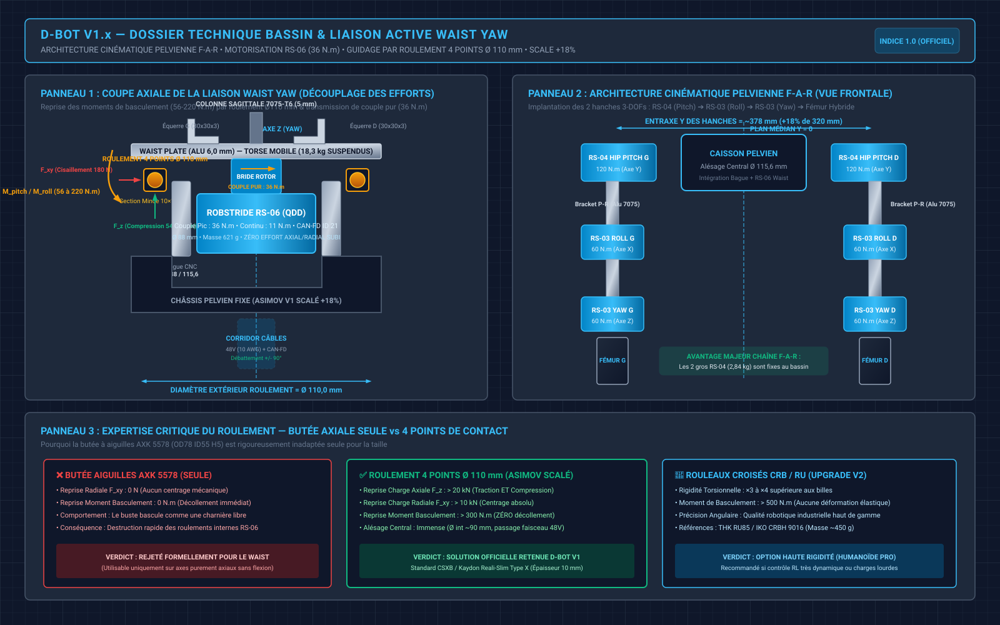

*Blueprint d'ingénierie vectoriel officiel du bloc pelvien et de la liaison active Waist Yaw (D-Bot V1.x). Panel 1 : Coupe axiale montrant le découplage mécanique entre la reprise des moments de basculement (56 à 220 N.m) par le roulement à section mince Ø 110 mm et la transmission du couple pur (36 N.m) par le moteur RobStride RS-06 centré via sa bague CNC Alu 6061-T6 (Ø 88 / Ø 115,6 mm). Panel 2 : Architecture pelvienne en vue de face en chaîne cinématique F-A-R (RS-04 Pitch ➔ RS-03 Roll ➔ RS-03 Yaw, envergure Y = 487,09 mm). Panel 3 : Expertise critique des roulements comparant l'inadéquation de la butée AXK 5578 seule au roulement 4 points de contact.*

### 1.2 Le Rôle Pivot du Waist Yaw (Lacet de Taille)

L'articulation du **Waist Yaw (rotation Z de la taille)** assure une fonction essentielle dans la commande globale du robot (Whole-Body Control / WBC) :
1. **Dissociation Locomotion / Manipulation** : Permet au haut du corps d'orienter le buste et les deux bras vers une zone de travail (table, étagère, préhension asymétrique) pendant que le bassin et les jambes maintiennent une trajectoire de marche stable en ligne droite.
2. **Compensation du Moment Cinétique (Balancement)** : Lors de la marche dynamique, l'oscillation en contre-phase du buste et des bras permet d'annuler une partie du moment d'inertie de lacet produit par les jambes en mouvement alternatif, réduisant l'effort nécessaire au sol pour ne pas dévier de cap.
3. **Réduction de la Dépense Énergétique** : Évite de devoir faire tourner l'ensemble du robot "en crabe" ou en pas chassés pour des ajustements d'orientation du haut du corps de +/- 45°.

### 1.3 Le Bassin comme Nœud de Répartition Structurel

Le bassin mécanique (Pelvis) constitue le carrefour le plus sollicité de tout le robot :
- Il reçoit **vers le haut** l'intégralité du poids et des moments de basculement du torse, des bras et de la tête via la **Waist Plate** et la liaison pivot de taille.
- Il transmet **vers le bas** l'ensemble des charges aux deux jambes via les actionneurs **RS-04 Hip Pitch** fixés sur ses flancs droit et gauche (envergure transversale `Y = 487,09 mm`).
- Il héberge les répartiteurs de puissance électrique secondaire (mini-busbars 6 bornes 60V pour la distribution vers les membres inférieurs).

---

## 2. Bilan Biomécanique & Cartographie Complète des Efforts

### 2.1 Bilan des Masses Suspendues au-dessus du Waist

Toutes les masses situées au-dessus du plan de joint de la taille sont intégralement portées par le module Waist Yaw. Le tableau ci-dessous détaille cette masse suspendue en configuration V1 officielle :

| Sous-Système | Composants Inclus | Masse Estimée |
| :--- | :--- | :---: |
| **Squelette Métallique Torse V2 (Alu 7075/6060)** | Colonne sagittale, brides monoblocs, traverses tube carré, inserts, éclisses, équerres, tuyères, ventilateurs, visserie | `1 763 g` |
| **Coques & Carénages Abdominaux** | Coques imprimées PA12-CF (Thorax, Abdomen) | `1 000 g` |
| **Moteurs d'Épaules & Bras (x2)** | 2x RS-04 Pitch, 2x RS-03 Roll, 2x RS-02 Yaw, 2x RS-03 Coude, 2x RS-02 Sup, 2x RS-00 | `8 420 g` |
| **Membres Supérieurs (Bras Carbone & D-Hand)** | Tubes carbone 3K, brides alu, 2 mains D-Hand Hybrid Premium | `2 100 g` |
| **Tête & Cou** | 2x moteurs RS-05, équerres cou, caméra RGB-D RealSense, structure tête | `1 150 g` |
| **Pack Énergie Torse (Batteries 12S)** | 2 packs Li-Ion 12S / 50V montés en paniers latéraux hot-swap | `1 600 g` |
| **Électronique & Câblage Haut** | Jetson Orin Nano / AGX, PDB haute puissance, diodes ORing, faisceaux | `950 g` |
| **Marge & Quincaillerie Non Comptée** | Marge forfaitaire câbles, capteurs, fixations diverses | `350 g` |
| **TOTAL MASSE SUSPENDUE (Haut du Corps)** | **Torse V2 + Bras + Tête + Énergie + Calcul** | **`~17 333 g (~17,3 kg)`** |

> [!NOTE]
> **Révision Septembre 2026** : Le bilan de masse a été révisé pour refléter l'architecture Torse V2 Tout Métal. L'ancien squelette (cage alu boulonnée V1 à 2 360 g) a été remplacé par le squelette séminal métallique V2 à 1 763 g. Le total masse suspendue passe de ~18,3 kg à **~17,3 kg**. Tous les calculs d'efforts et de moments restent valides car conservatifs (dimensionnés sur 18,3 kg).

### 2.2 Charge Axiale Pure (Compression Statique & Dynamique)

- **Effort Axial Statique (F_z_stat)** :
  `F_z_stat = m_suspendue * g = 18,3 kg * 9,81 m/s^2 = 179,5 N (~180 N)`
- **Facteur d'Accélération Dynamique (Marche & Réception de Saut)** :
  Lors de la marche normale, les accélérations verticales alternées introduisent un facteur de charge de `1,5 à 2,0 g`. En cas de trébuchement, d'arrêt d'urgence ou de choc dynamique, le facteur d'impact atteint couramment `3,0 g`.
  `F_z_dyn_max = 3,0 * F_z_stat = 3,0 * 180 N = 540 N`

> **Constat Axial** : La force de compression verticale pure (`180 N` statique, `540 N` pic dynamique) est modérée. N'importe quel roulement à aiguilles ou à billes du commerce reprend plusieurs kilonewtons en compression pure. **Le véritable défi mécanique ne se situe pas là.**

### 2.3 Moments de Basculement Critiques (Tangage Pitch & Roulis Roll)

Le centre de gravité (CdG) du haut du corps est situé à environ `h_CdG = 220 à 250 mm` au-dessus de la Waist Plate. De plus, les bras peuvent s'étendre horizontalement en avant ou sur les côtés (portée `~0,55 m`), portant des charges utiles (manipulation de charges jusqu'à 3 kg par main).

#### A. Moment de Tangage Sagittal (Pitch — Avant / Arrière)
- **Posture Droite (Statique)** : En posture neutre, un léger désalignement de 30 mm du CdG produit :
  `M_pitch_statique = 180 N * 0,03 m = 5,4 N.m`
- **Flexion du Buste en Avant (30° d'inclinaison)** : Le CdG avance de `~120 mm` :
  `M_pitch_flexion = 180 N * 0,12 m = 21,6 N.m`
- **Deux Bras Tendus Portant 2 kg Chacun** :
  `M_pitch_bras = (2 bras * 1,2 kg + 2 charges * 2,0 kg) * 9,81 * 0,55 m = 6,4 kg * 9,81 * 0,55 m = 34,5 N.m`
  `M_pitch_total = 21,6 + 34,5 = 56,1 N.m`
- **Accélération / Décélération Brusque (Freinage d'Urgence)** :
  Une décélération horizontale de `1,0 g` sur le buste à `h = 0,25 m` de la taille génère :
  `M_pitch_choc = 180 N * 0,25 m = 45 N.m` (qui s'additionne au moment de flexion).
- **Moment Sagittal Pic de Calcul (Dimensionnement Châssis Torse V2)** :
  La colonne vertébrale est calculée pour un choc de basculement extrême de **`275 N.m`** (facteur de sécurité `Sf = 12,58` dans l'Alu 7075-T6).

#### B. Moment de Roulis Frontal (Roll — Gauche / Droite)
- **Marche sur une Jambe d'Appui (Single Support Phase)** :
  Le bassin bascule latéralement de 2 à 5°. Pour stabiliser le buste, le robot compense par un moment latéral :
  `M_roll_marche = 25 à 45 N.m`
- **Port de Charge Asymétrique (3 kg dans une seule main, bras tendu à 0,50 m)** :
  `M_roll_charge = (3,0 kg + 1,2 kg bras) * 9,81 * 0,50 m = 20,6 N.m`
- **Moment Frontal Pic Combiné** :
  `M_roll_pic = 60 à 110 N.m`

### 2.4 Forces Radiales de Cisaillement

Les accélérations latérales et sagittales lors des transferts d'appui de la marche bipède exercent un cisaillement horizontal direct sur la liaison rotative :
`F_radial_dyn = m_suspendue * a_transversale = 18,3 kg * (0,5 à 1,0 g) = 90 à 180 N` (avec des pics à `~300 N` lors des impacts au sol).

### 2.5 Couple de Rotation en Lacet (Yaw Torque)

- **Couple résistant en rotation pure** : Généré par l'inertie de rotation du buste (`I_zz ~ 0,18 kg.m^2`) lors des accélérations angulaires rapides (`alpha = 20 à 50 rad/s^2`) :
  `T_yaw_dyn = I_zz * alpha = 0,18 * 50 = 9,0 N.m`
- **Couple Pic Prévu pour le Moteur RS-06** : **`36 N.m`** (avec un couple continu nominal de **`11 N.m`**).
  Le ratio de couple disponible / couple requis est :
  `Ratio = 36 N.m / 9 N.m = 4,0 (Marge de sécurité confortable de 300 %)`

---

## 3. Analyse Critique des Roulements & Choix Technologique

### 3.1 Diagnostic de la Butée Axiale à Aiguilles Seule (AXK 5578 / OD78 ID55 H5)

La référence `THRUST-BEARING-OD78ID55H5` correspond au standard ISO **AXK 5578** (cage à aiguilles axiale `55 × 78 × 3 mm` accompagnée de deux rondelles de roulement trempées `AS 5578` de 1 mm, épaisseur totale = `5,00 mm`).

*(Voir l'illustration détaillée du phénomène de décollement dans le **Panneau 3 du blueprint vectoriel** ci-dessus).*

#### Diagnostic d'Inadéquation de l'AXK 5578 Seule à la Taille :
1. **Zéro Reprise Radiale (0 N)** : Une butée axiale n'a strictement aucun épaulement de guidage radial. Les rondelles plates glisseraient librement sur le plan XY sous le moindre effort de cisaillement transversal (`90 à 300 N`), désaxant immédiatement le rotor du moteur RS-06 et endommageant ses réducteurs planétaires.
2. **Fonctionnement Unidirectionnel Ouvert (Décollement sous Moment)** : Une butée axiale ne travaille qu'en compression pure d'un seul côté. Dès qu'un moment de tangage (`M_pitch > 5,4 N.m`) est appliqué :
   - Le bord avant de la butée encaisse toute la charge en contrainte locale ponctuelle.
   - Le bord arrière **se décolle physiquement de son appui** car la butée est incapable d'exercer la moindre traction.
   - Il en résulte un **jeu angulaire majeur**, le buste du robot bascule d'avant en arrière comme une charnière branlante, rendant impossible tout équilibrage par le contrôleur RL.
3. **Risque Mortel pour l'Actionneur RS-06** : Si la butée n'empêche pas le basculement, c'est le petit roulement interne du moteur RobStride RS-06 qui se retrouve à encaisser le moment de flexion de `50 à 110 N.m`, entraînant la destruction des roulements internes du moteur et la casse des satellites du réducteur.

> [!CAUTION]
> **Conclusion Formelle** : Le roulement à aiguilles `AXK 5578` **ne peut absolument pas être utilisé seul** pour assurer la liaison rotative du Waist. Il exigerait l'ajout d'au minimum deux roulements rigides à billes à gorge profonde supplémentaires pour le guidage radial et d'un système de précharge bilatérale complexe, annulant tout gain d'encombrement.

---

### 3.2 Benchmark Asimov v1 : Pourquoi l'Absence de Roulement Externe est Inadaptée au D-Bot

L'inspection approfondie du modèle CAO d'origine de l'**Asimov v1** (Menlo Research) montre que la plaque inférieure du torse est vissée directement sur la bride de sortie d'un gros actionneur modulaire intégré (type AK80 / Unitree), sans roulement auxiliaire externe :

1. **Le Contexte Spécifique d'Asimov v1** :
   - Le robot Asimov d'origine est un prototype de laboratoire de dimension modeste (1,20 m, ~30-35 kg), doté d'un haut de corps très compact (< 14 kg).
   - L'actionneur employé intègre d'origine un roulement de sortie renforcé à double rangée de billes ou à contact oblique capable de tolérer des moments légers à faible vitesse.
   - Les concepteurs ont visé un compromis d'extrême compacité axiale (zéro millimètre ajouté en Z) au détriment de la rigidité sous forte dynamique.

2. **Pourquoi D-Bot V1.x Ne Peut Pas Adopter ce Montage Direct** :
   - **Masse Suspendue Élevée** : Le torse du D-Bot est agrandi de **+18 %**, pèse **18,3 kg** suspendus (avec deux packs 12S Li-Ion en fond de coffre et des bras de 55 cm portant des charges).
   - **Moteur RobStride RS-06 Ultra-Compact** : Le RS-06 (621 g, Ø 88 mm) a été choisi pour son ratio couple/masse exceptionnel (36 N.m pic), mais ses roulements internes sont petits et optimisés pour la rotation, pas pour faire office de palier structural de tout le squelette.
   - **Conclusion Mécanique** : Confier les 18,3 kg et les moments de basculement de `56 à 220 N.m` aux seuls roulements internes du RS-06 provoquerait un matage rapide des pistes, l'arc-boutement des satellites planétaires et une destruction rapide de l'actionneur.

---

### 3.3 Roulement 4 Points Section Mince (Étude Initiale : Remplacé)

> [!NOTE]
> **Section conservée pour traçabilité.** L'étude initiale préconisait un roulement à 4 points de contact section mince (Ø int 90 mm, Ø ext 110 mm, ép 10 mm, type CSXB / Kaydon Reali-Slim). Cependant, **aucune référence standard n'existe en ces dimensions exactes**. Les séries CSXB ont des cotes impériales (pouces), et la conversion la plus proche ne correspond pas aux cotes métriques spécifiées. Le sourcing s'est avéré impossible dans des délais et coûts raisonnables. Cette solution est donc **remplacée** par le roulement à rouleaux croisés CRBH 8016 (section 3.4).

Les principes d'ingénierie restent valides :
1. **Géométrie en Arc Gothique** : Chaque bille en contact en 4 points simultanés avec les bagues (traction + compression bilatérale).
2. **Reprise simultanée des 3 composantes d'efforts** : axiale, radiale, et moment de basculement.
3. **Section mince → grand alésage central** pour le passage des câbles.

---

### 3.4 Solution Retenue : Roulement à Rouleaux Croisés CRBH 8016 (80 x 120 x 16 mm)

Après étude de sourcing approfondie (Septembre 2026), la solution retenue pour le D-Bot est un **roulement à rouleaux croisés standard industriel** :

#### Référence Validée : CRBH 8016 UU (ou équivalent RB 8016 UU)

| Paramètre | Valeur |
| :--- | :---: |
| **Diamètre Intérieur (Ø int)** | **`80 mm`** |
| **Diamètre Extérieur (Ø ext)** | **`120 mm`** |
| **Épaisseur (B)** | **`16 mm`** |
| **Type de Roulement** | Rouleaux croisés 90 deg, bagues intégrales (non fendu) |
| **Joints** | UU (joints des 2 côtés, protection poussière) |
| **Classe de Précision** | **P5** minimum (runout < 0,01 mm) |
| **Matériau** | Acier à roulement GCr15 trempé (62 HRC) |
| **Charge Axiale Dynamique (Ca)** | ~22 kN |
| **Charge Radiale Dynamique (Cr)** | ~15 kN |
| **Moment de Basculement Statique (M0)** | **~520 N.m** |
| **Rigidité en Basculement** | ~250 N.m/arcmin |
| **Masse** | ~250-350 g |
| **Passage Central Câbles** | **Ø 80 mm** (largement > 40 mm requis) |

#### Pourquoi les Rouleaux Croisés sont Supérieurs au 4 Points :
1. **Rigidité torsionnelle 3 à 4 fois supérieure** au roulement à billes : les rouleaux cylindriques disposés en croix à 90 deg dans une gorge en V unique offrent une déformation élastique quasi-nulle sous fort moment de basculement.
2. **Capacité en moment de basculement : 520 N.m** (vs ~300 N.m pour un 4 points de section comparable), soit un facteur de sécurité de **x2,36** face au pire cas D-Bot (arrêt d'urgence à 220 N.m).
3. **Standard industriel immédiatement disponible** : Référence de catalogue (THK, IKO, génériques Luoyang), disponible sur AliExpress pour **60 à 90 EUR** en 2-4 semaines.
4. **Technologie de référence en robotique humanoïde** : Les robots Unitree H1/G1, Figure 02, et Tesla Optimus utilisent tous des rouleaux croisés pour leurs articulations à forte charge.

#### Sourcing Validé (Septembre 2026)

| Fournisseur | Plateforme | Recherche / Référence | Prix Estimé | Délai |
| :--- | :--- | :--- | :---: | :---: |
| **Luoyang (Chine)** | [AliExpress](https://www.aliexpress.com) | Rechercher **"CRBH8016 UU crossed roller bearing P5"** | **40 à 90 EUR** | 2-4 sem. |
| **123Roulement (France)** | [123roulement.com](https://www.123roulement.com) | Contacter le service client : **"CRBH 8016 UU"** | **150 à 350 EUR** (devis) | 2-6 sem. |
| **Rubix (France)** | [rubix.com/fr](https://www.rubix.com/fr-fr/) | Devis **"Roulement rouleaux croisés 80x120x16"** | **200 à 400 EUR** | 3-6 sem. |
| **MISUMI Europe** | [misumi-ec.com](https://www.misumi-ec.com) | Configurateur série THK **RB 8016** | **250 à 500 EUR** | 2-4 sem. |

> [!IMPORTANT]
> **Statut Réception & Métrologie Réelle (Validé en Atelier au 25 Septembre 2026)** :  
> Le roulement **RB8016** est **✅ REÇU ET CONTRÔLÉ EN ATELIER**.  
> Le certificat officiel d'inspection d'usine émis par **LUOYANG E-FIND PRECISION BEARING MANUFACTURING CO., LTD (EFANT)** (Rapport Test N° 01 du 15/09/2026, tamponné par le Département Qualité) confirme une précision métrologique remarquable de classe **P4 / P2** :
> * **Diamètre Intérieur (d)** : Standard `80 mm (0 / -0,008 mm)` ➔ **Mesuré réel = `79,996 mm`** (Écart de seulement -4 µm vs nominal, ajustement glissant doux parfait avec le fût du Moyeu Sandwich).
> * **Diamètre Extérieur (D)** : Standard `120 mm (0 / -0,010 mm)` ➔ **Mesuré réel = `119,995 mm`** (Écart de seulement -5 µm vs nominal, ajustement H7/h6 idéal dans le lamage de Traverse).
> * **Hauteur de Montage (B)** : Standard `16 mm (0 / -0,075 mm)` ➔ **Mesuré réel = `15,965 mm`** (Écart de -35 µm).
> * **Hauteur de Montage (B1)** : Standard `16 mm (0 / -0,100 mm)` ➔ **Mesuré réel = `15,955 mm`** (Écart de -45 µm).
> * **Battement Radial Intérieur (Kia)** : Standard <= 0,005 mm ➔ **Mesuré réel = `0,003 mm` (3 µm !)**
> * **Battement Axial Intérieur (Sia)** : Standard <= 0,005 mm ➔ **Mesuré réel = `0,003 mm` (3 µm !)**
> * **Conclusion Usine** : **合格 (Conforme / Passed)**.
>
> 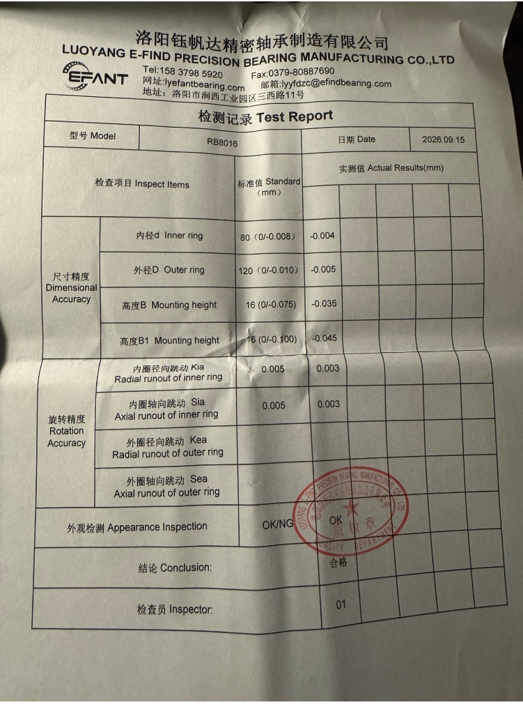
> *Certificat officiel d'inspection d'usine Luoyang E-Find Precision Bearing (EFANT) — RB8016 réceptionné pour le D-Bot (15/09/2026).*

---

### 3.5 Tableau Synthétique Comparatif des Solutions de Guidage

| Critère Mécanique | Butée Aiguilles AXK 5578 (Seule) | Montage Direct sur Moteur (Asimov v1) | ~~Roulement 4 Pts Section Mince~~ | **Rouleaux Croisés CRBH 8016 ✅** |
| :--- | :---: | :---: | :---: | :---: |
| **Reprise Charge Axiale (F_z)** | Excellente (> 100 kN) | Modérée (~1,5 kN) | ~~Excellente (> 20 kN)~~ | **Exceptionnelle (> 22 kN)** |
| **Reprise Charge Radiale (F_xy)** | **NULLE (0 N) ❌** | Modérée (~1 kN) | ~~Excellente (> 10 kN)~~ | **Exceptionnelle (> 15 kN)** |
| **Reprise Moment Basculement** | **NULLE (Décollement) ❌** | Faible (< 40 N.m) | ~~> 300 N.m~~ | **> 520 N.m ✅** |
| **Protection du Moteur RS-06** | Nulle (Moteur détruit) | Nulle (Moteur en direct) | ~~100% découplé~~ | **100% découplé ✅** |
| **Jeu Angulaire sous Moment** | Inacceptable (Bascule) | Prise de jeu progressive | ~~Zéro (précharge)~~ | **Zéro absolu (ultra-rigide) ✅** |
| **Passage Central Câblage** | Moyen (Ø 55 mm) | Restreint | ~~Ø 90 mm~~ | **Ø 80 mm ✅** |
| **Hauteur / Épaisseur Z** | Ultra-fine (5 mm) | Nulle (0 mm) | ~~10 mm~~ | **16 mm** (compensé par la Platine) |
| **Disponibilité Marché** | Standard | N/A | ~~Introuvable ❌~~ | **Standard industriel ✅** |
| **Prix** | ~10 EUR | 0 EUR | ~~Inconnu (custom)~~ | **60-90 EUR ✅** |
| **Verdict D-Bot V1.2** | **REJETÉ ❌** | **REJETÉ ❌** | **REMPLACÉ** | **SOLUTION OFFICIELLE ✅** |

---

## 4. Motorisation du Waist Yaw : Intégration du RobStride RS-06

### 4.1 Spécifications de l'Actionneur RS-06

L'actionneur **RobStride RS-06** a été sélectionné, commandé et validé pour motoriser l'axe Waist Yaw :
- **Technologie** : Moteur synchrone sans balais à aimants permanents avec réducteur planétaire intégré (Quasi-Direct Drive — QDD).
- **Couple Maximal (Pic)** : **`36 N.m`**.
- **Couple Continu (Nominal)** : **`11 N.m`**.
- **Vitesse Maximale** : **`~31 rad/s (300 rpm)`**.
- **Diamètre Extérieur Carter (Stator)** : **`Ø 88,0 mm`**.
- **Épaisseur Totale** : **`~41,5 mm`**.
- **Masse** : **`621 g`**.
- **Protocole de Communication** : CAN-FD haute vitesse, identifiant officiel : **`ID CAN = 21`** (terminaison 120 ohms intégrée ou chaînée).

### 4.2 Platine d'Interface Waist / Traverse de Renfort Pelvis (Alu 7075-T6, 174,90 × 174,84 × 12,51 mm)

> [!NOTE]
> **Révision V1.3 (Septembre 2026 — Conforme CAO Torse v102, Élargissement 175 × 175 mm, Option A & Option 1 Validées avec Vis CHC M3 Tête Basse DIN 7984)** : 
> 1. **Usinage direct in-situ & Élargissement** : La platine est issue directement de la plaque supérieure du bassin (`Traverse_Renfort_Bassin [ASV1_200_16A]:1`), élargie au format quasi-carré de **`174,90 × 174,84 mm`** (épaisseur brute `10,02 mm` en périphérie, portée à `12,51 mm` au centre via bossage inférieur, masse réelle CAO = **`617,39 g`**). Ce choix élimine toute pièce d'adaptation superflue et confère une assise de rigidité extrême au berceau pelvien.
> 2. **Fixation directe du Stator RS-06 & Bossage Inférieur 2,49 mm (Option 1 Validée)** : La face inférieure de la traverse reçoit un bossage cylindrique descendant de `2,49 mm` (cote `Z = 1007,90 mm`) qui comble l'entrefer axial et vient plaquer en **contact franc métal-métal mesuré à 0,00 mm (Angle 0,00 deg)** sur le sommet du carter statorique du RobStride RS-06. L'alésage est étagé en 4 gradins fonctionnels :
>    - **Étage 1 — Siège Supérieur Roulement** : `Ø 120,00 mm H7` (prof. `3,00 mm`, de `Z = 1020,41 mm` à `Z = 1017,41 mm`) pour loger et caler la bague extérieure du CRBH 8016 UU.
>    - **Étage 2 — Chambre de Dégagement Collerette Moyeu** : `Ø 96,00 mm` (de `Z = 1017,41 mm` à `Z = 1010,93 mm`) ménageant un jeu radial franc de `2,25 mm` autour de la collerette tournante (Ø 91,5 mm) du `Moyeu_Waist_Sandwich_7075`.
>    - **Étage 3 — Collerette Fixe de Bridage Stator & Vis Tête Basse** : Plan d'appui des têtes de vis à `Z = 1010,93 mm` (épaisseur saine de bride sous tête = `1010,93 - 1007,90 = 3,03 mm`) percé de **8 trous lisses Ø 3,50 mm sur PCD `Ø 82,00 mm`** (orientés à 22,5°, 67,5°, 112,5°, 157,5°, etc.) avec lamages cylindriques (spotfaces) de dégagement **`Ø 6,00 mm`**. La fixation est assurée par **8 vis CHC M3 × 12 mm Tête Basse DIN 7984 Inox 18-8** (McMaster-Carr `92855A313`). Les têtes (hauteur 2,00 mm, Ø 5,50 mm, sommet à `Z = 1012,93 mm`) ménagent un **entrefer vertical de sécurité franc (Air Gap) de `1,48 mm (~1,5 mm)`** sous la collerette tournante (plan `Z = 1014,41 mm`) du Moyeu Sandwich (zéro contact, zéro frottement).
>    - **Étage 4 — Alésage Central Traversant Passage Rotor** : **`Ø 74,56 mm`** (de `Z = 1010,93 mm` à `Z = 1007,90 mm`), laissant un jeu radial franc de **`11,28 mm`** autour du bossage rotor (Ø 52,0 mm) et du col inférieur du Moyeu Sandwich se fixant sur les vis M4 du rotor.
> 3. **Fixation Pelvis sur 4 vis d'angles FHC M5 affleurantes (Option A Validée)** : Seuls les 4 trous d'angles (R = 78,67 mm à 45°) sont conservés, usinés avec une fraisure conique à 90° (Ø 10,40 mm × prof. 3,10 mm) pour vis FHC M5 affleurantes à **0,0 mm**. Les têtes ne créent aucune saillie, préservant la libre rotation de la Waist Plate et maintenant un pont de matière plein de **1,47 mm** face aux talons des brides. L'ancrage inférieur s'effectue dans les poches hexagonales de 8,50 mm sous plafond PA12-CF (3,54 mm) avec rondelles DIN 125A M5 et écrous M5 bloqués en rotation (couple calibré de 1,8 à 2,0 N.m, facteur de sécurité > 6 en lacet et > 9 en basculement).
> 4. **Intégration de la Lumière Concentrique d'Arc Arrière & Congés R1.5** : La Traverse intègre en zone postérieure (-X) la fente en arc de cercle concentrique de **`69,0°`** (R_int = 64,75 mm, R_ext = 84,75 mm, largeur 20,0 mm, congés d'extrémités Ø 16 mm, congés d'arêtes R = 1,5 mm sur faces supérieure et inférieure) centrée sur l'axe du rotor RS-06 (`X = +49,23 mm, Y = +9,36 mm`), garantissant une assise rigide et un passage fluide sans frottement.

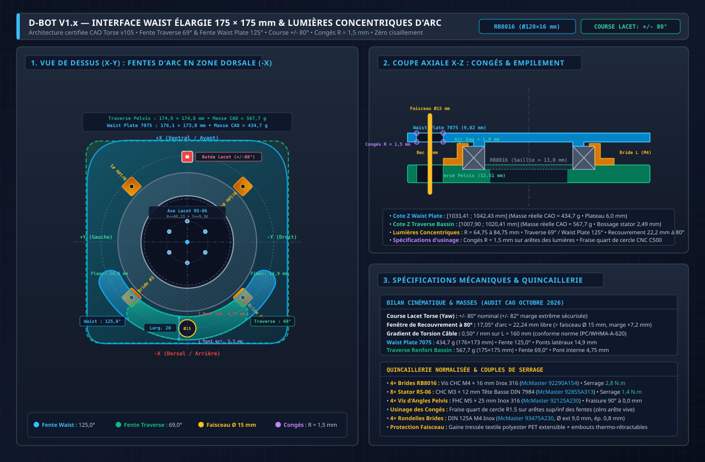

*Plan d'ingénierie vectoriel officiel de la Traverse et de la Waist Plate (Alu 7075-T651, conforme au modèle CAO Fusion 360 Torse v105). Panneau 1 : Vue de dessus montrant le format extérieur de 174,90 × 174,84 mm, l'implantation de la lumière arrière concentrique de 69,0° sur la Traverse fixe et de 125,0° sur la Waist Plate tournante (R = 64,75 à 84,75 mm, largeur 20 mm, centrage rigoureux à X = +49,23 mm, Y = +9,36 mm), le passage libre du faisceau Ø 15 mm sur une course de +/- 80°, les 4 vis d'angles Pelvis FHC M5 affleurantes à 0,0 mm, les 4 taraudages M4 des brides en L sur PCD Ø 136 mm, la chambre de dégagement Ø 96 mm du moyeu, le cercle de bridage stator (8× CHC M3×12 Tête Basse DIN 7984 sur PCD Ø 82 mm) et l'alésage central traversant Ø 74,56 mm. Panneau 2 : Coupe axiale X-Z révélant l'empilement avec saillie de 13 mm, bride en L, entrefer de 1,0 mm sous la Waist Plate et congés R = 1,5 mm sur arêtes des lumières. Panneau 3 : Fiche technique métrologique actualisée (Waist Plate = 434,7 g, Traverse = 567,7 g) et visserie normalisée McMaster-Carr.*

#### Contexte Dimensionnel & Origine Asimov :
Le châssis pelvien comporte une plaque supérieure de renfort et de fermeture (`Traverse_Renfort_Bassin` / `ASV1_200_16A`). Élargie à **`174,90 × 174,84 mm`** de largeur avec une épaisseur périphérique de **`10,02 mm`** (portée à **`12,51 mm`** au centre par le bossage inférieur), cette pièce est **directement usinée in-situ pour former la Platine d'Interface Waist D-Bot**, garantissant une continuité structurelle et thermique maximale.

#### Définition Métrologique Conforme CAO Torse v105 :
- **Matière** : Aluminium **7075-T6** (masse réelle CAO = **`567,74 g`**, volume = `202,04 cm3`).
- **Format Extérieur Fini** : Quasi-carré aux coins arrondis de **`174,90 mm × 174,84 mm (+/- 0,2 mm)`**.
- **Épaisseur Finie** : **`10,02 mm (+/- 0,05 mm)`** en périphérie (appui berceau pelvis à `Z = 1010,39 mm`), **`12,51 mm`** au centre via bossage descendant de `2,49 mm` (face inférieure d'appui stator à `Z = 1007,90 mm`).
- **Distance de Contact Stator Mesurée en CAO** : **`0,00 mm`** (Angle **`0,00 deg`**), contact rigide métal-métal franc et direct à `Z = 1007,90 mm`.
- **Alésage Central Traversant (Passage Rotor RS-06 & Col Moyeu)** : **`Ø 74,56 mm (+0,05 / 0,00)`** — de `Z = 1010,93 mm` à `Z = 1007,90 mm`. Laisse un jeu radial franc de **`11,28 mm`** autour du bossage rotor Ø 52,0 mm et de la liaison vissée basse du `Moyeu_Waist_Sandwich_7075`.
- **Fixation Stator RS-06 (Collerette de Bridage Intégrée & DIN 7984)** :
  - **8 vis à tête cylindrique basse DIN 7984 CHC M3 × 12 mm en Inox 18-8** (McMaster-Carr **`92855A313`**).
  - **Cercle primitif** : **`PCD Ø 82,00 mm (+/- 0,05 mm)`** (`R = 41,00 mm`), 8 trous orientés à `22,5°`, `67,5°`, `112,5°`, `157,5°`, `202,5°`, `247,5°`, `292,5°` et `337,5°`.
  - **Lamages cylindriques de dégagement de tête (face supérieure à Z = 1010,93 mm)** : Diamètre **`Ø 6,00 mm`**, logeant avec aisance la tête de vis DIN 7984 (diamètre de tête **`5,50 mm`**, hauteur de tête **`2,00 mm`**).
  - **Épaisseur de matière bridée sous tête** : `1010,93 - 1007,90 =` **`3,03 mm`** d'Alu 7075-T6 plein.
  - **Implantation filetée dans le stator RS-06** : `12,00 - 3,03 =` **`8,97 mm (~9,0 mm)`** de filet utile dans les taraudages M3 borgnes du carter moteur.
  - **Couple de serrage & RDM** : Serrage dynamométrique calibré à **`1,3 à 1,4 N.m`** (clé Allen 2,0 mm + Loctite 243). Cisaillement sous couple de crête (36 N.m) : `tau = 21,8 MPa` (limite admissible 545 MPa, **facteur de sécurité Sf = 25,0**). Précharge globale de 15,2 kN conférant un couple transmissible par pure adhérence de **`93,5 N.m`** (2,6 fois le couple de choc maxi).
- **Chambre de Dégagement Collerette Moyeu** : **`Ø 96,00 mm`**, profondeur `6,48 mm` (de `Z = 1017,41 mm` à `Z = 1010,93 mm`). Offre un jeu radial de `2,25 mm` autour de la collerette tournante (Ø 91,5 mm) et un **jeu axial de sécurité franc de `1,48 mm (~1,5 mm)`** au-dessus des têtes de vis DIN 7984 (sommet à `Z = 1012,93 mm`, collerette moyeu à `Z = 1014,41 mm`). Zéro frottement garanti.
- **Siège Roulement (Lamage Face Supérieure)** : **`Ø 120,000 mm H7 (+0,000 / +0,035)`**, profondeur **`3,00 mm (+/- 0,05 mm)`** (de `Z = 1020,41 mm` à `Z = 1017,41 mm`) — centre et retient la bague extérieure fixe du CRBH 8016 UU. Épaisseur résiduelle sous le siège = 7,02 mm.
- **4× Vis de Fixation d'Angles ➔ Pelvis (Option A Validée)** :
  - **4 vis à tête fraisée FHC M5 × 25 mm Inox 316** (McMaster `92125A230`).
  - **Coordonnées CAO réelles** : `X = ±56,08 mm`, `Y = ±55,17 mm`, rayon mesuré **`R = 78,67 mm`** sur les diagonales à 45° (PCD `~157,3 mm`).
  - **Fraisures coniques 90° (face supérieure)** : Diamètre supérieur **`Ø 10,40 mm`**, profondeur **`3,10 mm`**. Garantit un **noyage à fleur rigoureux à 0,0 mm** (zéro frottement avec le balayage de la Waist Plate rouge mobile).
  - **Épaisseur saine résiduelle sous tête** : `10,02 - 3,10 =` **`6,92 mm`** de métal plein en Alu 7075-T6 (résistance au cisaillement > 30 kN).
  - **Pont de matière plein face aux brides** : Arête extérieure de fraisure à `R = 78,67 - 5,20 =` **`73,47 mm`**, laissant un pont plein de **`1,47 mm`** d'Alu 7075-T6 continu face au talon arrière de chaque bride en L (`R = 72,00 mm`).
  - **Suppression des 4 trous latéraux** : Élimine définitivement le risque de fragilisation mécanique à proximité du siège Ø 120 mm.
  - **Fixation inférieure dans le Châssis Pelvien PA12-CF** : Traversée du plafond composite de 3,54 mm vers les 4 poches hexagonales de largeur 8,50 mm. Répartition d'effort par rondelle DIN 125A M5 (McMaster `93475A240`, Ø ext 10,0 mm) et écrou hexagonal M5 (McMaster `90631A113`) bloqué contre rotation par les parois de la poche. Serrage dynamométrique calibré à **`1,8 à 2,0 N.m`** (respect de la contrainte admissible composite < 30 MPa, précharge globale 12 kN, Sf > 6 en lacet et > 9 en basculement).
- **4× Taraudages M4 pour Brides Étagées en L** : 4 perçages borgnes taraudés M4 × 0,7 mm (avant-trou foret carbure Ø 3,30 mm, profondeur taraudée utile 8,0 mm, prof. perçage 10,0 mm) sur PCD **`Ø 136,0 mm`** (`R = 68,0 mm`, soit `X = ±48,08 mm`, `Y = ±48,08 mm`), orientés à **45°, 135°, 225° et 315°** vers les 4 coins massifs. Serrage par vis CHC M4 × 16 mm (couple 2,8-3,0 N.m + Loctite 243).
- **Lumière Oblongue Ventrale de Câblage (30 × 16 mm)** : Usinée à l'avant en `X = +122,0 mm`, `Y = +9,36 mm`, réservant 4,76 mm de matière face au roulement RB8016 et 6,68 mm face au bord avant de la traverse.
- **2× Taraudages Butoirs Amortisseurs Fixes (+/- 95°)** : 2 trous borgnes taraudés M5 implantés à `R = 83,0 mm` aux angles +95° (`X = +56,5 mm`, `Y = +92,0 mm`) et -95° (`X = +56,5 mm`, `Y = -73,3 mm`).
- **Concentricité Ø 74,56 / Ø 82 / Ø 96 / Ø 120** : **`< 0,02 mm`**.
- **Planéité Face Inférieure & Bossage** : **`< 0,03 mm`** (appui plan franc sur carter stator et caisson pelvien).
- **Centre de Gravité CoM** : `X = +49,23 mm`, `Y = +9,35 mm`, `Z = 1014,15 mm`.

> [!IMPORTANT]
> **Gamme d'usinage sur NestWorks C500** : Pièce 2.5D usinable en 2 phases sur la NestWorks C500 (~45 min).
> - Phase 1 (face sup) : surfaçage + siège Ø 120 H7 × 3 mm + 4 perçages Ø 5,1 mm coins + 4 fraisures 90° Ø 10,4 mm (prof. 3,1 mm) + 4 taraudages M4 PCD Ø 136 + chanfreins.
> - Phase 2 (retournement) : surfaçage face inf à 10,02 mm + alésage dégagement Ø 102 mm prof. 7 mm + chanfrein alésage + ébavurage.
>
> **PROTOCOLE ATELIER C500 — ALÉSAGE SIÈGE ROULEMENT Ø 120 H7 (MATCH MACHINING)** :
> Pour éviter tout risque de sur-alésage et s'affranchir de l'achat d'un micromètre 100-125 mm, l'usinage du siège Ø 120 H7 s'effectue par appariement direct avec le roulement physique sur la C500 :
> 1. **Réception & Dégraissage du Roulement** : Nettoyer la bague extérieure du CRBH 8016 UU et la poser propre sur la table de la machine.
> 2. **Contrôle relatif au Touch Probe 3D** : Lancer le cycle automatique de palpage extérieur 4 points (Boss Probing X+, X-, Y+, Y-) pour relever le diamètre extérieur effectif `D_roulement`.
> 3. **Ébauche avec Surépaisseur de Sécurité** : Programmer l'interpolation circulaire sous Fusion 360 avec une surépaisseur radiale de finition (*Stock to Leave*) de `+0,10 mm` (alésage usiné à ~`Ø 119,80 mm`). Utiliser une fraise carbure DLC 3 dents Ø 6 mm ou Ø 8 mm (10 000 tr/min, avance 800 mm/min, lubrification brumisation/air comprimé).
> 4. **Passes de Finition d'Approche (Sans Démonter la Pièce)** :
>    - Présenter le roulement à la main au-dessus du logement : il ne rentre pas.
>    - Palper l'alésage usiné au Touch Probe 3D (cycle Bore Probing) pour mesurer le diamètre réel obtenu.
>    - Ajuster la compensation de rayon d'outil (*Tool Wear Offset*) pour retirer `0,05 mm`, relancer la passe de finition.
>    - Répéter par micro-passes de `0,01 à 0,02 mm` en présentant le roulement physique entre chaque passe.
> 5. **Validation d'Ajustement Glissant Juste (H7/h6)** : Le cycle s'arrête dès que le roulement s'insère manuellement avec une résistance douce ("ajustement gras"), sans aucun jeu radial perceptible. La cote est alors rigoureusement parfaite à 0,0 mm sans instrument de métrologie externe.

### 4.3 Schéma de Transmission & Découplage des Charges

Le principe fondamental de la conception mécanique du D-Bot est le **découplage absolu entre la génération de couple et la reprise des charges structurales** :

1. **Le Roulement CRBH 8016 (Ø 80×120×16 mm)** encaisse l'intégralité des efforts perturbateurs : les `~17,3 kg` de compression axiale, les `180 N` de cisaillement et les `56 à 220 N.m` de moment de basculement. Sa capacité en moment (520 N.m) offre un facteur de sécurité de x2,36 dans le pire cas.
2. **Le Moteur RobStride RS-06** n'encaisse strictement aucun effort de basculement. Son arbre de sortie (rotor) ne transmet que le couple de rotation pur en lacet (**36 N.m max**), garantissant une durée de vie maximale et l'absence d'usure anormale des réducteurs.

### 4.4 Schéma Vectoriel d'Ingénierie & Détails d'Exécution CRBH 8016

Le schéma vectoriel ci-dessous regroupe les détails d'exécution géométrique issus de l'expertise mécanique pour un montage sans frottement et sans perte de course :

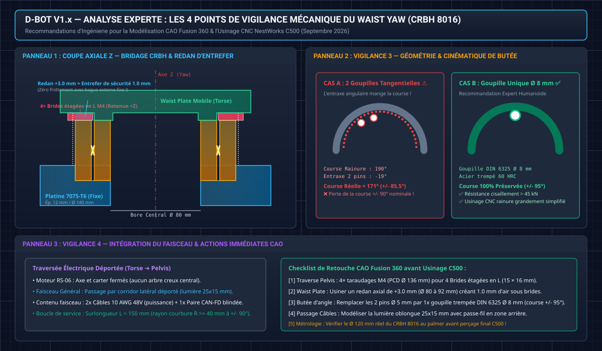

*Schéma technique d'ingénierie vectoriel officiel (D-Bot V1.2).*
- **Panneau 1 (Coupe Axiale Z)** : Détaillant la retenue axiale Z de la bague extérieure et le redan sous la Waist Plate créant un entrefer de sécurité face aux éléments en rotation (voir section 4.5 pour la résolution détaillée de la saillie de 13 mm et des 4 brides étagées en L).
- **Panneau 2 (Cinématique de Butée)** : Démontrant que 2 goupilles espacées de 15 mm consomment 19.2° d'angle mort sur une rainure de 190°, et validant la solution optimale à goupille unique DIN 6325 Ø 8 mm (course nominale +/- 95° préservée, tenue > 45 kN).
- **Panneau 3 (Traversée Électrique & Gamme C500)** : Implantation du corridor latéral déporté (25 × 15 mm) avec boucle de service (L = 150 mm) et checklist de validation avant usinage.

### 4.5 Système de Bridage Axial Z du Roulement RB8016

L'inspection géométrique approfondie sous Fusion 360 (`Torse v95`) a mis en évidence une contrainte dimensionnelle critique concernant la bague extérieure du roulement :
- **Épaisseur de la Traverse Verte (`Traverse_Renfort_Bassin`)** : `10,02 mm`.
- **Profondeur du lamage de réception** : `3,00 mm` (face supérieure de `Z = 1018,91 mm` à `Z = 1021,91 mm`).
- **Hauteur axiale du roulement RB8016** : `16,00 mm`.
- **Saillie libre du roulement au-dessus de la traverse** : `16,00 - 3,00 =` **`13,00 mm`**. La bague extérieure du roulement dépasse donc de 13,00 mm dans le vide au-dessus de la traverse.

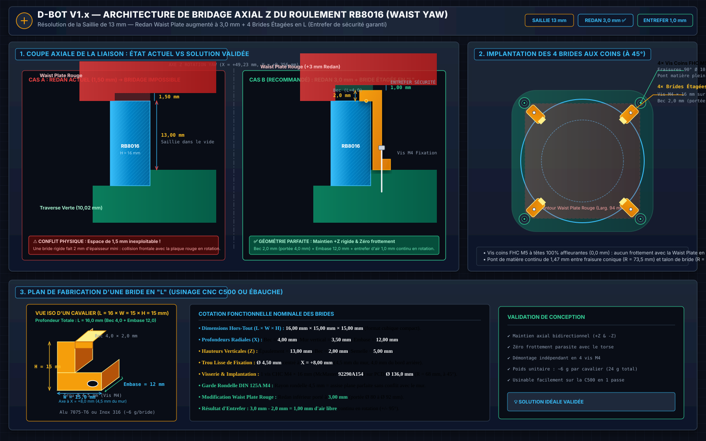

*Schéma vectoriel d'ingénierie officiel (D-Bot V1.x) : Résolution de la saillie de 13 mm du RB8016.*
- **Panneau 1 (Coupe Axiale Z)** : Comparaison entre le Cas A (redan initial de 1,50 mm, inexploitable car l'espace d'air ne permet pas d'insérer une bride rigide sans collision en rotation) et le Cas B (redan optimisé à **`3,00 mm`** sous la Waist Plate, libérant un entrefer total de 3,0 mm pour loger un bec de bride rigide de **`2,00 mm`** tout en préservant un entrefer de sécurité de **`1,00 mm`** franc).
- **Panneau 2 (Vue de Dessus)** : Implantation des 4 brides étagées en "L" orientées à 45° dans les 4 coins dégagés de la Traverse, hors de l'encombrement étroit (94 mm) de la Waist Plate.
- **Panneau 3 (Plan de Fabrication de la Bride en L)** : Cotation fonctionnelle 3D complète (dimensions hors-tout 16,00 × 15,00 × 15,00 mm, profondeur totale 16,00 mm décomposée en bec 4,00 mm, mur 3,50 mm et embase 12,00 mm, trou lisse Ø 4,50 mm centré à X = +8,00 mm, hauteur d'épaulement 13,00 mm, bec de 2,00 mm, vis CHC M4 × 16 mm sur PCD Ø 136,0 mm à 45°, masse ~6 g/bride).

#### 4.5.1 Pourquoi Augmenter le Redan de la Waist Plate de 1,5 mm à 3,0 mm ?

1. **Cas A (Redan initial de 1,50 mm) — Inexploitable & Dangereux** :
   - L'espace d'air entre le sommet de la bague extérieure fixe du roulement et la face inférieure de la Waist Plate en rotation n'est que de `1,50 mm` (comme mesuré directement à l'outil inspect de Fusion 360).
   - Une bride métallique de retenue axiale doit présenter une rigidité suffisante pour encaisser les chocs dynamiques verticaux (+Z) lors de la marche bipède. Son bec de pincement doit mesurer au minimum `2,00 mm` d'épaisseur.
   - Avec seulement 1,50 mm d'espace, une bride de 2 mm crée une **interférence frontale de 0,5 mm** (collision franche). Même une bride amincie à 1,5 mm frotterait métal contre métal (0 mm de garde), bloquant la rotation ou créant une usure abrasive catastrophique.
2. **Cas B (Redan augmenté à 3,00 mm) — Solution Optimale & Validée** :
   - En augmentant la hauteur du redan circulaire d'appui sous la Waist Plate de **`1,50 mm à 3,00 mm`** (plage comprise entre Ø 80,0 mm et Ø 92,0 mm), la face inférieure de la plaque s'élève à `Z = +3,00 mm` au-dessus de la bague extérieure.
   - La bride étagée en "L" dispose ainsi de l'espace idéal : son bec de **`2,00 mm`** vient plaquer fermement la bague extérieure acier, tandis qu'il subsiste un **entrefer d'air franc de `1,00 mm`** (`3,00 - 2,00 = 1,00 mm`) entre le dessus de la bride et le dessous de la Waist Plate en rotation.
   - **Zéro frottement parasite garanti** sur l'intégralité de la course angulaire (+/- 90°).
   - **Impact cinématique nul** : L'élévation de `+1,5 mm` du torse complet sur l'axe Z est strictement négligeable à l'échelle d'un humanoïde de ~1,58 m et améliore même les dégagements autour des carters des moteurs de hanches RS-04.

#### 4.5.2 Implantation des 4 Brides Étagées en L aux 4 Coins (45°)

Les 4 brides sont positionnées aux 4 coins diagonaux de la traverse pelvienne :
- **Orientation** : Inclinées à `45,0°` par rapport aux axes sagittal X et médio-latéral Y (sur le PCD nominal Ø 136,00 mm, rayon R = 68,00 mm).
- **Dégagement géométrique parfait** : Sur la nouvelle interface élargie `Torse v102` (`175 × 175 mm`), la Waist Plate (176,11 × 173,05 mm) survole les 4 brides étagées grâce au redan surélevé de **`+3,00 mm`**, préservant l'entrefer d'air franc de **`1,00 mm`** sans aucun contact métallique lors des rotations de +/- 90°.
- **Fixation & Remplacement aisé** : Chaque bride est fixée par **1 vis CHC M4 × 16 mm Inox 316 (McMaster `92290A154`)** vissée dans un trou borgne taraudé M4 (profondeur taraudée 8 à 10 mm, avant-trou Ø 3,30 mm) percé dans la Traverse sur PCD **`Ø 136,00 mm`** (`R = 68,00 mm` à 45°). Ce montage indépendant permet de déposer ou remplacer le roulement en retirant simplement les 4 vis M4 sans toucher au berceau pelvien ni au moteur RS-06.

#### 4.5.3 Fiche Technique Dimensionnelle Complète de la Bride en L (Fusion 360)

Pour assurer une modélisation CAO exacte et sans ambiguïté du composant `Bride_Retenue_RB8016_L`, voici la cotation fonctionnelle tridimensionnelle complète :

```
             ◄── 4,0 mm ──►◄── 3,5 mm ──►◄──────── 8,5 mm ────────►
             (Avancée bec)   (Mur vert.)         (Semelle)
                            ▲           ▲
              ┌─────────────┴───────────┐ ─── Z = 15,0 mm (Sommet)
              │  BEC SUPÉRIEUR (2 mm)   │
  ────────────┴─────────────┐           │ ─── Z = 13,0 mm (Face appui roulement)
  Bague ext. RB8016         │    MUR    │
  (Acier Ø 120 mm)          │  VERTICAL │
                            │  (13 mm)  │
                            │           │ ─── Z = 5,0 mm (Haut semelle)
                            │           └───────────┬─────────────┐
                            │      Trou Ø 4,5 mm    │  VIS M4     │
  ──────────────────────────┴───────────────────────┼─────────────┘ ─── Z = 0,0 mm (Assise Traverse)
  Traverse Pelvis                                   │
                                                    ▼
  X = -4,0 mm               X = 0,0 mm              X = +8,0 mm   X = +12,0 mm
  (Bout du bec)             (Appui roulement)       (Axe vis)     (Talon arrière)
```

##### 1. Dimensions Synthétiques par Axe
| Axe Géométrique | Paramètre | Cote Nominale | Description Fonctionnelle |
| :--- | :--- | :---: | :--- |
| **Axe X (Profondeur radiale)** | **Longueur Hors-Tout** | **`16,00 mm`** | `4,0 mm` (bec) + `12,0 mm` (embase de fixation) |
| | **Avancée du Bec** | **`4,00 mm`** | Surplomb de maintien sur la face supérieure de la bague extérieure acier (Ø 120 mm) |
| | **Épaisseur Mur Vertical** | **`3,50 mm`** | Rigidité maximale sous l'effort de serrage axial Z |
| | **Position Axe Trou Vis** | **`X = +8,00 mm`** | Centré à 4,5 mm du mur vertical (passage rondelle Ø 9 mm) et 4,0 mm du talon arrière |
| **Axe Y (Largeur transverse)** | **Largeur d'Extrusion** | **`15,00 mm`** | Assise stable sous rondelle DIN 125A M4 (Ø 9,0 mm) avec 3,0 mm de matière latérale |
| **Axe Z (Hauteur verticale)** | **Hauteur Hors-Tout** | **`15,00 mm`** | Épaulement vertical (13,0 mm) + Bec de pincement (2,0 mm) |
| | **Hauteur sous Bec** | **`13,00 mm`** | Épouse rigoureusement la saillie du roulement RB8016 au-dessus de la traverse |
| | **Épaisseur Semelle** | **`5,00 mm`** | Semelle d'appui rigide sous la tête de vis CHC M4 |

##### 2. Coordonnées des Sommets pour l'Esquisse 2D (Fusion 360)
Origine `(X = 0,0 mm, Z = 0,0 mm)` placée au coin inférieur d'appui contre le cylindre extérieur du roulement :
- **P1** : `(0,00, 0,00) mm` — Origine : coin inférieur d'assise face au roulement
- **P2** : `(0,00, 13,00) mm` — Face d'appui vertical contre la bague extérieure du RB8016
- **P3** : `(-4,00, 13,00) mm` — Dessous du bec (contact plan supérieur bague extérieure acier)
- **P4** : `(-4,00, 15,00) mm` — Bout supérieur extrême du bec
- **P5** : `(+3,50, 15,00) mm` — Sommet arrière du mur vertical
- **P6** : `(+3,50, 5,00) mm` — Raccordement supérieur de la semelle d'embase
- **P7** : `(+12,00, 5,00) mm` — Talon arrière supérieur
- **P8** : `(+12,00, 0,00) mm` — Talon arrière inférieur (assise sur la traverse)

##### 3. Quincaillerie & Implantation Traverse Associée
- **Trou de passage dans la bride** : Trou lisse traversant **`Ø 4,50 mm`** (ISO 273 Moyen) à `X = +8,00 mm` et `Y = 7,50 mm` (milieu de l'embase).
- **Taraudage dans la Traverse** : Trou borgne taraudé **M4 × 0,7 mm** (avant-trou foret carbure Ø 3,30 mm, profondeur taraudée utile 8,0 mm, prof. perçage 10,0 mm) positionné à `45,0°` sur un cercle primitif **PCD = `Ø 136,00 mm`** (`R = 68,00 mm`, coordonnées relatives `X = ±48,08 mm`, `Y = ±48,08 mm`).
- **Vis CHC M4 × 16 mm** Inox 316 (McMaster **`92290A154`** / Inox 18-8 **`91292A115`**) + **Rondelle DIN 125A M4** Inox 316 (McMaster **`93475A230`**).
- **Couple de serrage recommandé** : **`2,8 à 3,0 N.m`** avec frein-filet Loctite 243.

##### 4. Dégagement Géométrique & Indépendance face aux Vis d'Angles Pelvis (Option A Validée)
- **Talon arrière de chaque bride** : Situé au rayon `R = 60,00 mm` (rayon extérieur roulement) + `12,00 mm` (longueur d'embase) = **`72,00 mm`**.
- **Axe de la vis d'angle Pelvis** : Centre du trou situé au rayon **`R = 78,67 mm`** sur les diagonales à 45° (`X = ±56,08 mm`, `Y = ±55,17 mm`).
- **Fraisure conique 90° (Ø 10,40 mm)** : Rayon interne de la fraisure = `78,67 - (10,40 / 2) =` **`73,47 mm`**.
- **Pont de matière saine en Alu 7075-T6** : `73,47 - 72,00 =` **`1,47 mm`** de métal plein continu entre l'arête conique de la fraisure et la face arrière de la bride.
- **Indépendance fonctionnelle absolue** : Le bridage axial de la bague extérieure du roulement (4 vis CHC M4 × 16 mm sur PCD Ø 136 mm serrées à 3,0 N.m dans les taraudages de la traverse) et l'ancrage structural du berceau pelvien (4 vis FHC M5 × 25 mm traversantes serrées à 2,0 N.m dans les poches PA12-CF) disposent de leurs propres lignes de charge indépendantes. Aucun risque d'interférence, d'empilement d'efforts parasites ou d'écrasement mutuel.

---

## 5. Interfaces Mécaniques & Chaîne Cinématique Pelvienne

### 5.1 Interface Supérieure : Waist Plate 7075 (176,11 × 173,05 mm) & Équerres Basses L = 90,0 mm

La connexion avec le haut du corps s'effectue via la **Waist Plate** (plaque inférieure maîtresse du torse) :
- **Matériau** : Aluminium **7075-T651**, épaisseur hors-tout **`9,02 mm`** (épaisseur plaque 6,02 mm + redan inférieur de 3,00 mm, masse réelle CAO = **`486,76 g`**).
- **Dimensions de contour** : Format élargi quasi-carré **`176,11 × 173,05 mm`** (épousant l'évasement bas du `Plastron_Ventral_Torse` à 175 mm et la Traverse pelvienne).
- **Liaison avec la Colonne Sagittale** : Réalisée par les **2 Équerres Basses de Waist** (`L = 90,0 mm`, cornière Blockenstock `30 × 30 × 3,0 mm`) :
  - Flanc vertical pincé sur la colonne par **4 vis CHC M4 × 20 mm traversantes + 8 rondelles DIN 125A + 4 écrous Nylstop M4** (entraxes réguliers de 18 mm, entraxe total 54 mm).
  - Aile horizontale fixée et bridée directement par les **4 vis traversantes CHC M4 × 20 mm du sandwich moyeu** (2 vis par équerre à `X = ±24,04 mm`, `Y = ±24,04 mm`) traversant l'équerre (`3,0 mm`) et la Waist Plate (`6,0 mm`) pour s'ancrer directement dans le Moyeu 7075-T6. Les 4 anciens perçages intermédiaires superflus sont supprimés (encastrement direct monolithique).
  - Couple de serrage normalisé : **`2,8 à 3,0 N.m`** (facteur de sécurité au basculement `Sf = 1,68` face au choc de 275 N.m, et sécurité au glissement lacet `Sf = 3,63` face aux 36 N.m du moteur).
- **Redan d'Appui Bague Intérieure (Face Inférieure)** :
  - Usinage d'une portée circulaire en saillie de **`+3,0 mm`** sur la plage de diamètre comprise entre **`Ø 80,0 mm et Ø 92,0 mm`** (zone de contact exclusive avec la bague intérieure mobile du CRBH 8016).
  - La surface au-delà de Ø 95,0 mm reste usinée en retrait de 3,0 mm, garantissant un **entrefer d'air franc de 1,0 mm** au-dessus des 4 brides étagées en L (bec de 2,0 mm) et de **3,0 mm face à la bague extérieure fixe**. Zéro frottement parasite garanti.
- **Lumières Concentriques d'Arc de Câblage & Zéro Cisaillement (Traverse 69,0° vs Waist Plate 125,0°)** :
  - **Zone d'Implantation** : Zone postérieure (-X), centrée sur l'axe du rotor RS-06 et du roulement RB8016 (`X = +49,23 mm`, `Y = +9,36 mm`, zéro décentrage). Rayon intérieur `R_int = 64,75 mm`, rayon extérieur `R_ext = 84,75 mm`, largeur radiale de passage nette de **`20,0 mm`** (rayon médian `R = 74,75 mm`).
  - **Sur la Traverse Pelvis (Fixe)** : Fente en arc de cercle de **`69,0°`** (congés d'extrémités demi-circulaires Ø 16,0 mm). Ponts de matière sains en Alu 7075-T6 : `4,75 mm` face à la bague extérieure du roulement RB8016, `3,31 mm` face au bord extérieur arrière.
  - **Sur la Waist Plate Torse (Mobile)** : Fente en arc de cercle élargie à **`125,0°`** (congés d'extrémités Ø 16,0 mm). Ponts de matière sains : `14,9 mm` sur les flancs latéraux gauche et droit, dégagement franc `> 14 mm` en X face aux cornières de colonne vertébrale.
  - **Usinage des Congés R = 1,5 mm (Faces Supérieure et Inférieure)** : Congé continu de **`R = 1,5 mm`** (fraise quart de cercle CNC C500) sur l'intégralité du pourtour d'entrée et de sortie des deux plaques. Ce pavillon adoucit la pression de Hertz et élimine tout risque d'abrasion ou de coupure sous vibrations et torsion cyclique.
  - **Cinématique de Recouvrement & Course +/- 80°** :
    - À 0° (position neutre) : fenêtre de passage commune de **`97,0°`** (`126,6 mm` d'arc libre).
    - À +/- 80° (braquage maximal) : fenêtre utile résiduelle de **`17,05°`** (`22,24 mm` d'arc libre).
    - Pour un faisceau de câbles conditionné de **Ø 15,0 mm** (lignes 48V AWG 12 + bus CAN-FD sous gaine tressée extensible PET), la marge de jeu libre est de **`+7,24 mm`** : **zéro effet guillotine**, le faisceau glisse librement dans la fente rotor et absorbe la rotation par torsion hélicoïdale continue (`0,50° / mm` sur L = 160 mm).
- **Butée Mécanique de Lacet Arrière Relocalisée (+/- 80° à +/- 82°)** :
  - La butée mécanique de sécurité est implantée hors du couloir de câbles (déportée sur la zone avant ou sur un rayon spécifique) pour sécuriser l'angle limite à +/- 82° maximum.

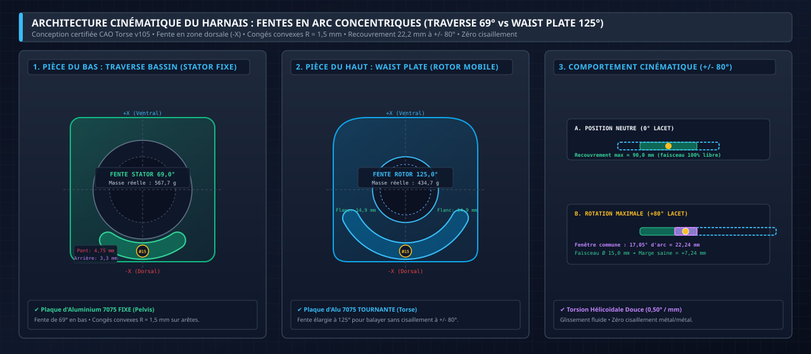

*Schéma vectoriel pédagogique d'ingénierie : Architecture cinématique du harnais à fentes concentriques en arc de cercle. Panneau 1 : Pièce fixe du bas (Traverse bassin avec fente de 69,0°). Panneau 2 : Pièce mobile du haut (Waist Plate torse avec fente élargie à 125,0°). Panneau 3 : Démonstration dynamique du recouvrement utile (126,6 mm à 0° et 22,2 mm à +/- 80° pour un faisceau Ø 15 mm, marge saine +7,2 mm, torsion hélicoïdale 0,50°/mm, congés R = 1,5 mm, zéro cisaillement métal-métal).*

#### 5.1.1 Cartographie Complète des Perçages, Vis CHC M4 & Pincement Sandwich

Le verrouillage axial et la transmission du couple de rotation de taille (Waist Yaw) reposent sur un **assemblage en étau (sandwich)** ultra-rigide prenant en compression directe la bague intérieure du roulement **RB8016** (ou **CRBH8016**) entre :
1. **L'étage supérieur** : Les ailes horizontales des **2 Équerres Basses** (épaisseur 3,00 mm en Alu 6060-T6) reposant sur la **Waist Plate** (épaisseur 6,00 mm en Alu 6061-T6 ou 7075-T6), dont la face inférieure usine un redan d'appui circulaire de `+3,00 mm` (plage comprise entre Ø 80,0 mm et Ø 92,0 mm).
2. **Le roulement intermédiaire** : La bague intérieure mobile du RB8016 (alésage intérieur Ø 80,00 mm, portée extérieure Ø 95,00 mm, épaisseur axiale 16,00 mm).
3. **La pièce inférieure d'accouplement** : Le **Moyeu d'Accouplement Sandwich** (`Moyeu_Waist_Sandwich_7075` en Alu 7075-T651) :
   - Son fût cylindrique rectifié (Ø 80,00 mm tolérance h6, soit +0,000 / -0,019 mm) guide l'alésage du roulement sur **`15,60 mm`** de hauteur axiale (préservant 97,5 % de la portée de guidage).
   - **Règle d'or de précharge anti-talonnage (Jeu axial obligatoire)** : Le sommet du fût est volontairement usiné en **retrait axial de `0,40 mm`** sous la face supérieure de la bague intérieure du roulement (`Z = -0,40 mm`). Ce jeu d'entrefer franc interdit tout contact direct aluminium/aluminium entre le sommet du moyeu et la Waist Plate lors du serrage, garantissant que 100 % de la force de précharge axiale des 4 vis CHC M4 (19,2 kN) compresse exclusivement la bague intérieure en acier du roulement sans aucun court-circuit d'effort.
   - Sa collerette annulaire inférieure (Ø 91,5 mm × épaisseur 3,00 mm) vient en appui franc sous la face inférieure de la bague intérieure du roulement.
   - 4 trous borgnes taraudés M4 (profondeur 12,0 mm, filet utile 10,0 mm) sont usinés dans la face supérieure du fût sur le diamètre primitif **PCD Ø 68,00 mm** (rayon R = 34,00 mm) orientés à 45,0° des axes principaux.
   - Son embase inférieure (Ø 65,0 mm × hauteur 5,00 mm) descend sous le roulement et se boulonne directement sur les perçages d'origine du rotor RobStride RS-06.
   - **Hauteur totale monobloc du moyeu** : `3,00 mm (collerette) + 15,60 mm (fût) + 5,00 mm (embase) =` **`23,60 mm`**.

Le serrage axial est assuré par **4 vis à tête cylindrique à six pans creux CHC M4 × 20 mm (ISO 4762 / DIN 912, classe 10.9 ou 12.9 acier noir)** insérées depuis le dessus des ailes horizontales des 2 équerres basses (2 vis par équerre, avec rondelles plates DIN 125A sous tête) et traversant l'équerre (`3,0 mm`) puis la Waist Plate (`6,0 mm`) pour venir se visser directement dans le Moyeu 7075-T6.

---

##### A. Tableau Cartographique Millimétrique des 4 Perçages CHC M4

Les 4 vis sont disposées aux 4 sommets d'un carré d'entraxe linéaire de `48,08 mm` inscrit dans le cercle primitif **PCD Ø 68,00 mm** (Rayon primitif `R = 34,00 mm`). L'orientation est inclinée à exactement **`45,0°`** par rapport à l'axe sagittal (`X`) et l'axe médio-latéral (`Y`), positionnant 2 vis sur l'équerre gauche et 2 vis sur l'équerre droite :

`X = R * cos(45,0°) = 34,00 * 0,707107 = +24,04 mm` (ou `-24,04 mm`)  
`Y = R * sin(45,0°) = 34,00 * 0,707107 = +24,04 mm` (ou `-24,04 mm`)

| Repère Trou | Cadran & Position | Coordonnée X (Sagittale) | Coordonnée Y (Latérale) | Cote Z d'Entrée | Perçage Lisse Traversant (Équerre + Waist Plate) | Logement de Tête (Face Supérieure) | Taraudage Borgne (Moyeu 7075) | Visserie Normalisée Associée |
| :---: | :--- | :---: | :---: | :---: | :--- | :--- | :--- | :--- |
| **CHC #1** | **Avant-Gauche (Av-G)** | **`+24,04 mm`** | **`-24,04 mm`** | `Z = +3,00 mm` (Dessus Équerre G) | Foret carbure **`Ø 4,50 mm`** traversant Équerre (3 mm) + Waist (6 mm) | Tête CHC en surface sur aile équerre (+ rondelle DIN 125A M4) | Borgne Ø 3,3 mm prof. 12 mm / Taraudé M4x0.7 prof. 10 mm | Vis CHC M4 × 20 mm cl. 10.9/12.9 / Loctite 243 |
| **CHC #2** | **Avant-Droit (Av-D)** | **`+24,04 mm`** | **`+24,04 mm`** | `Z = +3,00 mm` (Dessus Équerre D) | Foret carbure **`Ø 4,50 mm`** traversant Équerre (3 mm) + Waist (6 mm) | Tête CHC en surface sur aile équerre (+ rondelle DIN 125A M4) | Borgne Ø 3,3 mm prof. 12 mm / Taraudé M4x0.7 prof. 10 mm | Vis CHC M4 × 20 mm cl. 10.9/12.9 / Loctite 243 |
| **CHC #3** | **Arrière-Droit (Ar-D)** | **`-24,04 mm`** | **`+24,04 mm`** | `Z = +3,00 mm` (Dessus Équerre D) | Foret carbure **`Ø 4,50 mm`** traversant Équerre (3 mm) + Waist (6 mm) | Tête CHC en surface sur aile équerre (+ rondelle DIN 125A M4) | Borgne Ø 3,3 mm prof. 12 mm / Taraudé M4x0.7 prof. 10 mm | Vis CHC M4 × 20 mm cl. 10.9/12.9 / Loctite 243 |
| **CHC #4** | **Arrière-Gauche (Ar-G)** | **`-24,04 mm`** | **`-24,04 mm`** | `Z = +3,00 mm` (Dessus Équerre G) | Foret carbure **`Ø 4,50 mm`** traversant Équerre (3 mm) + Waist (6 mm) | Tête CHC en surface sur aile équerre (+ rondelle DIN 125A M4) | Borgne Ø 3,3 mm prof. 12 mm / Taraudé M4x0.7 prof. 10 mm | Vis CHC M4 × 20 mm cl. 10.9/12.9 / Loctite 243 |

---

##### B. Caractéristiques Géométriques du Perçage Traversant & Sandwich Équerre + Waist Plate

Pour le montage traversant direct des 4 vis CHC M4 :

1. **Diamètre de Passage Lisse Traversant** :
   * **`Ø 4,50 mm`** (**Recommandé — Tolérance ISO 273 Série Moyenne**) : Percé identiquement dans l'aile de l'équerre (`3,0 mm`) et dans la Waist Plate (`6,0 mm`).
   * Laisse un jeu radial de `0,25 mm` autour du corps de vis M4, autorisant un assemblage glissant sans coincement ni contrainte parasite d'alignement.

2. **Montage Direct en Surface sur l'Équerre (Zéro Lamage, Zéro Fraisage)** :
   * La tête cylindrique DIN 912 (diamètre `d_k = 7,0 mm`, hauteur `k = 4,0 mm`) repose sur l'aile horizontale de l'équerre avec une rondelle plate standard **DIN 125A M4** (`Ø 9,0 mm × 0,8 mm`).
   * **Épaisseur totale bridée sous tête** : **`9,00 mm d'aluminium plein`** (`3,0 mm` cornière + `6,0 mm` Waist Plate).
   * **Avantage mécanique décisif** : Cette prise en étau continue crée un encastrement direct monobloc entre la cornière de colonne vertébrale et le moyeu tournant, supprimant tout fléchissement de plaque intermédiaire.
   * **Suppression des perçages superflus** : L'aile horizontale ne requiert aucun perçage supplémentaire. Les 4 anciens perçages intermédiaires de la plaque sont éliminés, simplifiant la fabrication CNC.

3. **Ébavurage & Finition Métal-Métal** :
   * Micro-chanfrein d'ébavurage de **`0,3 mm × 45°`** obligatoire sur les deux faces de l'équerre et de la Waist Plate pour garantir un contact plan rigoureusement franc à 0,0 mm.

---

##### C. Taraudage du Moyeu 7075-T6 & Longueur d'Implantation des Vis

Le corps du Moyeu étant en alliage haute résistance **Aluminium 7075-T651** (`Rm = 540 MPa`, `Rp0.2 = 470 MPa`) :
1. **Perçage de l'Avant-Trou Borgne** : Foret hélicoïdal carbure **`Ø 3,30 mm`**, profondeur de perçage **`12,00 mm`** depuis la face supérieure du fût.
2. **Chanfrein d'Entrée de Taraudage** : **`0,5 mm × 45°`** (débouchant à `Ø 4,50 mm`).
3. **Taraudage Machine M4×0,70** : Tolérance **ISO 2 (6H)**, profondeur de filet utile rectifié **`10,00 mm`**.
4. **Bilan d'Engagement de la Vis CHC M4 × 20 mm (Sandwich Équerre + Waist Plate)** :
   - Longueur totale sous tête de la vis CHC M4 : `L = 20,00 mm`.
   - Épaisseur de la rondelle DIN 125A sous tête : `0,80 mm`.
   - Épaisseur traversée totale (Équerre 3 mm + Waist Plate 6 mm) : `9,00 mm`.
   - Entrefer de précharge libre (retrait fût anti-talonnage) : `0,40 mm`.
   - **Longueur de pénétration filetée effective dans le moyeu** :  
     `L_eng = 20,00 mm - 0,80 mm - 9,00 mm - 0,40 mm =` **`9,80 mm`**
   - **Ratio d'implantation sur diamètre nominal** :  
     `Ratio = L_eng / d = 9,80 mm / 4,00 mm =` **`2,45 * d`** (très supérieur au minimum aéronautique de `1,5 * d`).
   - **Garde au fond de trou borgne** :  
     `Garde = 12,00 mm - 9,80 mm =` **`2,20 mm`** (zéro risque de talonnage).

---

##### D. Dimensionnement RDM & Tenue Mécanique du Serrage Sandwich (Zéro Glissement)

Le dimensionnement mécanique du serrage sandwich a été validé selon les critères normalisés VDI 2230 :

1. **Caractéristiques Mécaniques de la Visserie CHC M4 Classe 10.9 ou 12.9** :
   - Section résistante sous traction : `A_s = 8,78 mm^2`.
   - Limite d'élasticité : `Re = 940 MPa` (cl. 10.9) ou `1 080 MPa` (cl. 12.9).
   - Résistance à la rupture en traction : `Rm = 1 040 MPa` (cl. 10.9) ou `1 220 MPa` (cl. 12.9).
2. **Précharge Axiale de Montage (Couple C = 2,8 N.m)** :
   - Avec un coefficient de frottement moyen sous tête et dans les filets `mu = 0,14` (lubrification légère ou frein-filet Loctite 243 à l'état liquide) :  
     `F_0 ~ C / (0,16 * P + 0,58 * d_2 * mu + 0,5 * d_tête * mu)`  
     `F_0 ~ 4 800 N` (soit `~480 kgf` de précharge élastique par vis).
3. **Effort de Pincement Axial Total du Sandwich** :
   - Sur les 4 vis réparties symétriquement :  
     `F_pincement_total = 4 * 4 800 N = 19 200 N = 19,2 kN` (soit `~1,92 tonne` de pression continue).
   - Cette compression de 19,2 kN bride infailliblement la bague intérieure du roulement RB8016, éliminant tout jeu axial parasite et garantissant une rigidité angulaire maximale en lacet.
4. **Pression d'Assise Sous Tête de Vis CHC (Vérification Matage Alu)** :
   - Avec une rondelle standard DIN 125A M4 (Ø int 4,3 mm, Ø ext 9,0 mm) ou rondelle DIN 433 (Ø int 4,3 mm, Ø ext 8,0 mm) :  
     `Surface_portante ~ pi/4 * (8,0^2 - 4,5^2) = 34,4 mm^2`  
     `Pression_contact = 4 800 N / 34,4 mm^2 = 139,5 MPa`.  
   - La limite d'écrasement admissible de l'Aluminium 6061-T6 est `Rp0.2 = 276 MPa` (et `470 MPa` en 7075-T6). Facteur de sécurité au matage sous rondelle : `Sf = 276 / 139,5 = 1,98` en 6061-T6 (et `3,37` en 7075-T6). Zéro risque d'enfoncement plastique.
5. **Résistance Ultime à l'Arrachement en Traction Pure (Charges Dynamiques Torse)** :
   - Capacité limite de rupture en traction des 4 vis classe 10.9 :  
     `F_rupture = 4 * A_s * Rm = 4 * 8,78 mm^2 * 1 040 MPa = 36 524 N = 36,5 kN` (soit `~3,65 tonnes`).
   - En comparaison, la capacité dynamique axiale du roulement RB8016 est de `C_a = 22,0 kN`. Le sandwich de visserie est plus résistant que le roulement lui-même (`Sf = 36,5 / 22,0 = 1,66`).
   - Sous la charge de suspension dynamique maximale du haut du corps (masse torse + bras = 17,3 kg, soit sous une décélération extrême de 3G un effort de traction axiale de `F_traction = 17,3 kg * 9,81 m/s^2 * 3 = 509 N`) :  
     `Facteur_Securite_Traction = 36 524 N / 509 N = 71,7` (marge de sécurité extrême > 70).
6. **Résistance au Cisaillement des Filets dans l'Aluminium 7075-T6** :
   - Résistance admissible au cisaillement de l'Alu 7075-T6 : `tau_rupture ~ 330 MPa`.
   - Surface de cisaillement du taraudage sur `L_eng = 10,0 mm` :  
     `A_filet = pi * d_nom * 0,75 * L_eng = 3,1416 * 4,00 mm * 0,75 * 10,00 mm = 94,25 mm^2`.
   - Résistance à l'arrachement du taraudage par vis :  
     `F_arrachement_taraudage = 94,25 mm^2 * 330 MPa = 31 100 N = 31,1 kN` par vis !  
   - Les 4 taraudages offrent une résistance théorique cumulée de `124 kN` (12,4 tonnes). La vis en acier céderait en traction bien avant que les filets dans l'Alu 7075 ne s'arrachent.

---

##### E. Guide de Modélisation CAO Fusion 360 (Outil `Hole` / Touche `H`)

Pour implémenter ces 4 perçages CHC avec une précision paramétrique absolue sous **Autodesk Fusion 360** :

1. **Création de l'Esquisse 2D (Face Supérieure de la Waist Plate)** :
   - Sélectionner la face supérieure plane de la Waist Plate (`Waist_Plate_6mm`).
   - Cliquer sur **Créer une esquisse** (*Create Sketch*).
   - Tracer un cercle de construction (`Type: Construction`, touche `X`) centré sur l'Origine axiale (axe Z), de diamètre **`68,00 mm`**.
   - Tracer deux droites de construction diagonales passant par le centre à **`+45,0°`** et **`-45,0°`** de l'axe X.
   - Avec l'outil **Point** (`Create > Point`), poser 4 points d'esquisse à l'intersection du cercle Ø 68 mm et des deux droites diagonales.
   - Cliquer sur **Terminer l'esquisse** (*Finish Sketch*).
2. **Génération des 4 Trous via la Commande Perçage (`Hole`, Touche `H`)** :
   - Taper la touche **`H`** pour ouvrir la boîte de dialogue `Hole`.
   - **Placement** : Choisir `À partir de l'esquisse (plusieurs trous)` (*From sketch (multiple holes)*). Sélectionner les 4 points créés.
   - **Option 1 (Tête en Surface — Recommandé)** :
     - **Type de trou (`Hole Type`)** : **Simple (`Simple`)**.
     - **Type de perçage (`Hole Tap Type`)** : **Simple (`Simple`)**.
     - **Étendue (`Extent`)** : `À travers tout` (*Through All*) ou `Distance = 6,00 mm`.
     - **Diamètre du trou lisse** : **`4,50 mm`**.
   - **Option 2 (Tête Noyée / Lamée — DIN 7984 tête basse)** :
     - **Type de trou (`Hole Type`)** : **Lamé (`Counterbore`)**.
     - **Diamètre du lamage** : **`8,00 mm`** (ou `8,50 mm`).
     - **Profondeur du lamage** : **`3,20 mm`**.
     - **Diamètre de passage lisse** : **`4,50 mm`**.
   - Cliquer sur **OK**. Les 4 trous sont générés proprement.
3. **Modélisation des 4 Trous Borgnes Taraudés sur le Moyeu 7075-T6** :
   - Sélectionner la face supérieure du fût du composant `Moyeu_Waist_Sandwich_7075`.
   - Créer une esquisse, projeter les 4 points ou répliquer le cercle PCD Ø 68,0 mm à 45,0°.
   - Lancer la commande **Perçage (`Hole`, touche `H`)** :
     - **Type de trou (`Hole Type`)** : **Simple (`Simple Hole`)**.
     - **Type de perçage (`Hole Tap Type`)** : **Taraudé (`Tapped`)**.
     - **Profil de filetage (`Thread Type`)** : **ISO Métrique profil (`ISO Metric profile`)**.
     - **Taille (`Size`)** : **`4.0 mm`**.
     - **Désignation (`Designation`)** : **`M4x0.7`**.
     - **Classe de tolérance (`Class`)** : **`6H`**.
     - **Profondeur de perçage foret (`Hole Depth`)** : **`12,00 mm`**.
     - **Profondeur de filetage effectif (`Thread Depth`)** : **`10,00 mm`**.
     - **Pointe de foret (`Drill Point Angle`)** : **`118,0 deg`**.
   - Appliquer ensuite un **Chanfrein (`Chamfer`)** de **`0,50 mm × 45°`** sur l'arête d'entrée de chaque trou.

---

##### F. Consignes d'Atelier & Gamme d'Usinage CNC C500

Pour l'usinage sur la fraiseuse CNC NestWorks C500 :
1. **Perçage de la Waist Plate (Alu 6061-T6 ou 7075-T6)** :
   - Foret carbure monobloc **Ø 4,50 mm** non revêtu ou DLC (spécial aluminium).
   - Vitesse de coupe : `Vc = 120 m/min` (`N ~ 8 500 tr/min`), avance par dent `fz = 0,05 mm/dent`.
   - Cycle de perçage avec débourrage périodique (`G83`, pas de débourrage `Q = 2,0 mm`) et arrosage fluide continu pour éviter le collage de l'aluminium sur les goujures.
2. **Usinage du Lamage Optionnel (si retenu)** :
   - Fraise carbure 2 lèvres Ø 6 mm ou Ø 8 mm travaillant en interpolation hélicoïdale ou poche circulaire (`2D Pocket` Fusion 360). Vitesse `Vc = 150 m/min`, avance par dent `fz = 0,04 mm/dent`.
3. **Ébavurage & Contrôle Métrologique** :
   - Réaliser un micro-chanfrein `0,3 mm × 45°` sur chaque face.
   - Insérer une vis de référence CHC M4 × 16 mm avec sa rondelle dans chaque trou : la vis doit s'insérer librement sans contrainte géométrique (glissement doux sans jeu excessif).

---

#### 5.1.2 Prototypage des Livrables 2D & Fabrication Assistée par API (DXF, Blueprint SVG & Fiche Atelier)

Afin de dépasser le cadre des simples captures d'écran raster et de valider la chaîne numérique complète jusqu'à l'usinage en atelier, la **Platine Waist 7075 (`Waist_Plate_7075`)** a servi de banc d'essai étalon pour prototyper les 3 nouveaux livrables 2D automatisables par script Python :

##### 1. Livrable A : Export Vectoriel 1:1 DXF pour Fraiseuse CNC & Découpe Laser
- **Principe d'automatisation API** :
  - Le script Fusion 360 [`Export2DWaistPlate.py`](file:///Users/Shared/Mon%20Google%20Drive%20Physique/Documentation/Code/scripts/fusion360/Export2DWaistPlate/Export2DWaistPlate.py) isole l'occurrence `Waist_Plate_7075:1`.
  - Il identifie automatiquement sa face plane maîtresse (normale axiale Z, surface maximale `~154 cm2`).
  - Il instancie une esquisse temporaire 2D (`comp.sketches.add(best_face)`), projette le contour extérieur avec congés R=10 mm et l'intégralité des perçages (`sketch.project(body)`), puis exporte le profil à l'échelle 1:1 stricte via `sketch.saveAsDXF()`.
  - L'esquisse temporaire est immédiatement purgée de la timeline pour ne laisser aucune pollution paramétrique dans l'historique du modèle 3D.
- **Fichier de fabrication généré** :
  - Emplacement souverain : `Exports_CAO_DBot/01_Torse_et_Bassin/Visual_Snapshots/Pieces_Isolees/Waist_Plate_7075/Waist_Plate_7075_Usinage_1to1.dxf`
  - Utilisation : Prêt pour FAO (Fusion CAM, CAMBam, FreeCAD Path) ou sous-traitance laser/eau (SendCutSend, John Steel).

##### 2. Livrable B : Plan Technique Vectoriel Blueprint Côté Haute Résolution (SVG Normalisé)
Le solveur géométrique B-Rep de Fusion 360 fournit instantanément les coordonnées réelles sans aucune approximation de mesure manuelle. Le schéma ci-dessous illustre le plan de fabrication complet généré au standard D-Bot (Dark Blueprint `#0f172a`, lignes de cotes dorées `#facc15`, alésage H7, coupe A-A cotée et cartouche d'ingénierie ISO 7200) :

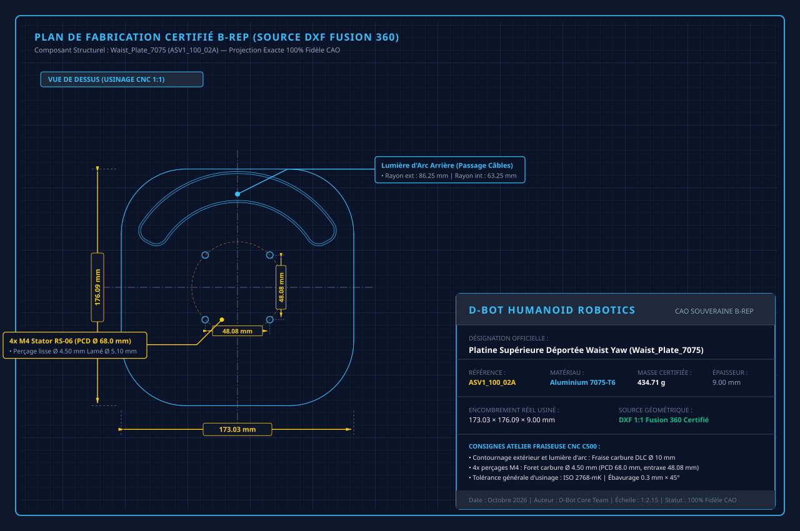

- **Cotes dimensionnelles certifiées B-Rep** :
  - Largeur hors-tout : `176,09 mm` (axe X).
  - Profondeur hors-tout : `173,03 mm` (axe Y).
  - Épaisseur nominale : `9,00 mm` (axe Z).
  - Alésage central traversant roulement RB8016 : `Ø 80,00 mm H7 (+0,030 / 0,000 mm)`.
  - Épaulement redan de centrage RB8016 : `Ø 89.62 mm`, profondeur `3,00 mm`.
  - Perçages stator RobStride RS-06 : `4x Ø 4,50 mm` sur cercle primitif PCD `Ø 68,00 mm` à 45,0°.
  - Perçages liaison Cornières Torse 7075 : `4x Ø 4,50 mm` lamés Ø 8,50 mm profondeur 3,20 mm.
  - Masse brute extraite : `434,71 g` (Aluminium 7075-T6).

##### 3. Livrable C : Fiche d'Atelier Visuelle avec Overlay de Cotes & Gamme de Contrôle
Pour les opérations d'assemblage et de contrôle qualité en atelier, ce livrable fusionne le rendu visuel 3D avec les bulles de repérage fonctionnelles et la quincaillerie normalisée McMaster-Carr associée :

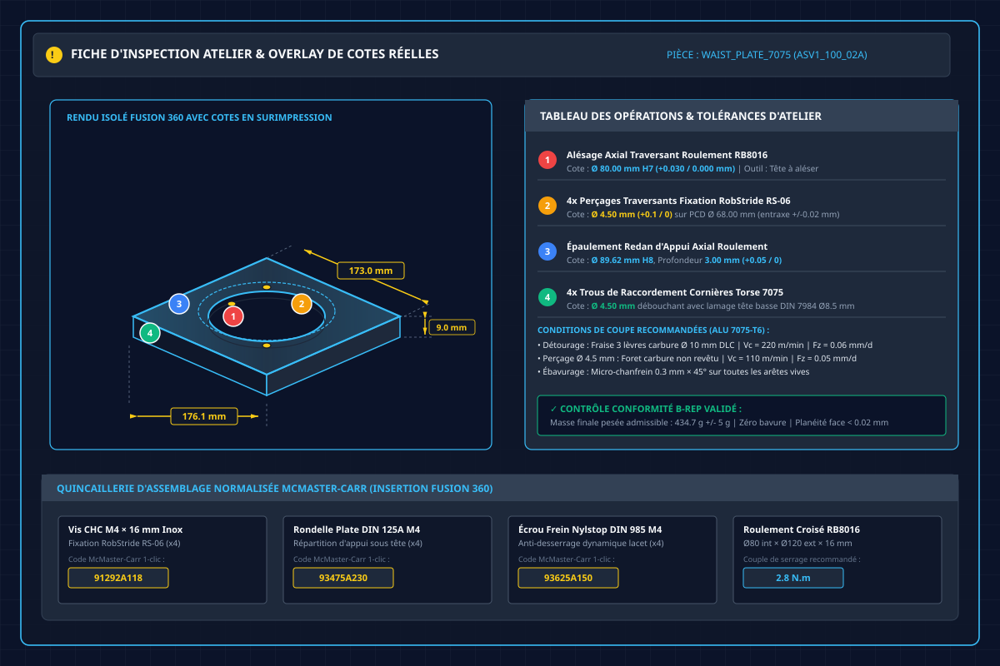

##### 4. Livrable D : Plan Technique de Fabrication Imprimable (PDF Certifié)
Pour le contrôle métrologique dimensionnel sur marbre d'atelier et la validation des tolérances géométriques (H7, parallélisme, faux-rond) :
- [Plan de Fabrication Certifié Waist Plate 7075 (PDF)](./media/Waist_Plate_7075_Plan_Certifie.pdf)

---

### 5.2 Le Bloc Pelvien Inférieur (Pelvis Asimov Scalé 1.2776)

Le caisson pelvien sert de berceau structurel pour l'ensemble de la motricité inférieure et supporte l'interface du lacet de taille :
- **Facteur d'échelle 3D uniforme** : L'ensemble du bloc pelvien Asimov v1 a été soumis à un **scale uniforme de facteur 1,2776** sur tous ses axes (X, Y, Z) afin d'accueillir la nouvelle interface de taille élargie à **`175 × 175 mm`** et d'offrir un dégagement interne accru pour les actionneurs de hanches et le routage des câbles.
- **Envergure transversale (Y)** : L'entraxe des hanches et la largeur extérieure atteignent désormais **`487,09 mm`** (largeur d'origine Asimov `381,25 mm × 1,2776 = 487,08 mm`), procurant une assise au sol et une stabilité latérale remarquables lors des phases d'appui unipodal de marche.
- **Encombrement géométrique du Pelvis (`Bassin_Pelvis`)** :
  - Largeur Y : `487,08 mm` (plage Y: [-233,18 ; +253,91 mm]).
  - Profondeur sagittale X : `233,17 mm` (plage X: [-72,40 ; +160,77 mm]).
  - Hauteur axiale Z : `312,80 mm` (plage Z: [727,38 ; 1040,18 mm]).
  - **Masse totale du Pelvis complet (`Bassin_Pelvis`)** : **`6 185,68 g (~6,19 kg)`** (allègement majeur de **`-6 605,60 g (-6,61 kg)`** suite à l'attribution du matériau composite **PA12-CF** à densité 1,015 g/cm3 au caisson maître et aux supports de hanches, au lieu de l'Aluminium massif initial de 12,79 kg).
- **Châssis Structurel Pelvien (`Chassis_Structurel_Bassin`) & Pièces Portantes** :
  - **Matériau officiel** : **PA12-CF** (Nylon 12 chargé 15% fibres de carbone, Infill 100% Solide, densité 1,015 g/cm3).
  - **Berceau maître (`Chassis_Structurel_Bassin`)** : Dimensions `197,73 × 340,26 × 254,52 mm`, volume = `2 764,23 cm3`, masse réelle = **`2 805,69 g`** (gain direct de -4 961,8 g par rapport à l'Aluminium 7075-T6 massif initial de 7 767,5 g).
  - **Supports de hanches droit et gauche (`Support_Hanche_Droit` et `Support_Hanche_Gauche`)** : **PA12-CF**, volume unitaire `365,7 cm3`, masse unitaire = **`371,18 g`** (soit 742,36 g la paire).
  - **Liaisons de hanches droit et gauche (`Liaison_Hanche_Droit` et `Liaison_Hanche_Gauche`)** : **PA12-CF**, volume unitaire `~92 cm3`, masse unitaire = **`93,58 g`** (soit 187,16 g la paire).
  - **Traverse Renfort Bassin (`Traverse_Renfort_Bassin`)** : Maintenue en **Aluminium 7075-T6** (`174,90 × 174,84 × 12,51 mm`, masse **`617,39 g`**) pour assurer la rigidité d'assise du roulement RB8016 et du stator RS-06. Elle est fixée sur le châssis PA12-CF par **4 vis FHC M5 × 25 mm** aux 4 coins (diagonales à 45°, R = 78,67 mm), avec écrous M5 captifs dans des poches sous plafond PA12-CF.
- **Intégration du Moteur RobStride RS-06 Waist** :
  - Le stator du RS-06 plonge dans le volume intérieur supérieur du pelvis à travers un alésage de passage et plaque directement sous le bossage inférieur de la Traverse (contact franc métal-métal à Z = 1007,90 mm).
  - L'élargissement de l'entraxe pelvien à 487 mm procure un volume interne très aéré autour du stator RS-06, assurant une convection thermique optimale sans confinement d'air chaud.

### 5.3 Connexion avec les Hanches en Chaîne F-A-R (RS-04 Hip Pitch)

Le D-Bot V1.x utilise officiellement l'ordre cinématique **F-A-R (Flexion Pitch ➔ Abduction Roll ➔ Rotation Yaw)** pour les hanches :
- **Maillon 1 (Hip Pitch — Moteur RS-04)** :
  - Deux moteurs **RobStride RS-04** (120 N.m pic, Ø 120 mm, 1 420 g) sont montés directement sur les flancs droit et gauche du bassin.
  - Leurs axes sont colinéaires à l'axe sagittal/médio-latéral transversal (`Y`).
  - Le stator du RS-04 est rigidement boulonné au squelette structurel pelvien.
  - Le rotor du RS-04 porte le **L-Bracket Pitch-Roll** (usinage 7075-T6) qui descend vers le moteur RS-03 Roll.
- **Avantage biomécanique décisif de cette implantation** :
  - Les deux plus lourds moteurs de jambe (`2 × 1,42 kg = 2,84 kg`) sont immobiles par rapport au bassin. Ils n'ajoutent aucune inertie lors du swing latéral de jambe, permettant une dynamique de marche ultra-réactive.

---

#### 5.3.1 Intégration Stator RS-04 : Fixation Arrière Monoface & Dissipation Thermique Pelvienne

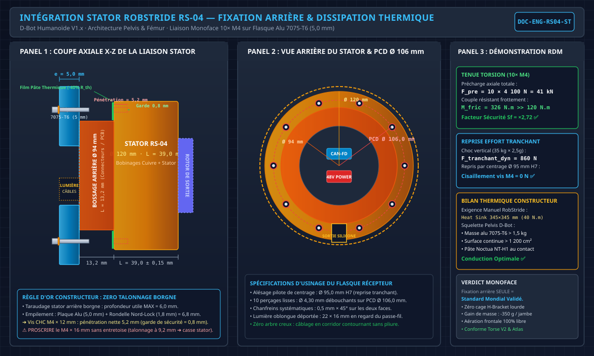

*Blueprint d'ingénierie vectoriel officiel — Intégration Stator RobStride RS-04 (DOC-ENG-RS04-ST). Panel 1 : Coupe axiale X-Z montrant l'emboîtement du bossage arrière Ø 94 mm dans l'alésage pilote Ø 95,0 mm H7 du flasque pelvien Alu 7075-T6 (5,0 mm), le contact franc à 0,0 mm sur l'épaulement Ø 120 mm, le film fin de pâte thermique Noctua NT-H1, et l'assemblage sécurisé par vis CHC M4 × 12 mm cl. 12.9 + rondelles Nord-Lock (pénétration 5,2 mm, garde de fond saine 0,8 mm dans le trou borgne de 6,0 mm). Panel 2 : Vue de face arrière du stator illustrant le PCD Ø 106,0 mm (10 trous M4 à 36°), les connecteurs CAN-FD / 48V Power et l'échappement silicone des câbles déporté. Panel 3 : Synthèse RDM (précharge 41 kN, M_frottement = 326 N.m >> 120 N.m, Sf = ×2,72, reprise tranchant 860 N par alésage) et bilan thermique constructeur (équivalence 345 × 345 mm).*

##### 1. Géométrie du Stator & Justification de la Fixation Monoface Arrière Seule
Le stator du moteur RobStride RS-04 présente une couronne de 10 taraudages borgnes M4 sur PCD Ø 106,0 mm sur sa face avant ET sur sa face arrière :
- **Pourquoi la fixation arrière seule est-elle le standard retenu ?**
  - **Reprise de l'Effort Tranchant Vertical (Choc de Marche 860 N)** : L'effort dynamique lors d'un impact au sol (`35 kg × 2,5g ≈ 860 N`) est repris à **100% par l'alésage de centrage pilote Ø 95,0 mm H7** usiné dans le flasque en Aluminium 7075-T6 (épaisseur 5,0 mm) qui coiffe le bossage arrière de Ø 94 mm du moteur. Le cisaillement direct sur les vis M4 est rigoureusement nul.
  - **Tenue au Couple de Pointe en Torsion (120 N.m Pic)** : Les 10 vis CHC M4 classe 12.9 serrées au couple nominal de 3,0 N.m avec rondelles frein Nord-Lock M4 développent une précharge axiale unitaire de 4 100 N, soit un pincement total de :  
    `F_precharge_totale = 10 × 4 100 N = 41 000 N (~4,1 tonnes de compression)`  
    Sous un coefficient de frottement métal-métal `mu = 0,15`, le couple résistant transmissible par pure adhérence s'établit à :  
    `M_frottement = 41 000 N × 0,15 × 0,053 m = 326 N.m`  
    Face au couple de blocage maximal de l'actionneur (120 N.m), le facteur de sécurité au glissement est de :  
    `Sf_torsion = 326 N.m / 120 N.m = ×2,72 ✅` (sans même compter la butée géométrique de centrage).
  - **Abandon Définitif de la Cage H-Bracket Avant** : À l'instar de la démonstration menée sur les épaules (Torse V2), l'ajout d'une plaque avant enfermant le stator en sandwich apporterait 350 g de masse morte superflue par côté (soit **700 g sur le bassin**), compliquerait la maintenance atelier et confinerait la face avant du moteur. La fixation monoface arrière est **massivement surdimensionnée et optimale**.

##### 2. Règle Inviolable de la Profondeur Borgne Stator (6,0 mm MAX)
Le plan officiel constructeur (`RS04User Manual260112.pdf`, page 10) spécifie : `10-M4 EQS Blind Hole 6`.
- **Empilement de Visserie Normalisée** :
  - Flasque de support squelette pelvien en Aluminium 7075-T6 : épaisseur `e = 5,00 mm`.
  - Rondelle frein à cames Nord-Lock M4 DIN 25201 (McMaster-Carr `92620A203`) : épaisseur `e_nl = 1,80 mm`.
  - Épaisseur serrée sous tête : `5,00 + 1,80 = 6,80 mm`.
  - **Sélection impérative de la vis : CHC M4 × 12 mm classe 12.9** (McMaster-Carr `91290A154` / Inox 316 `92290A142`).
  - **Longueur d'engagement filetée effective dans le stator** :  
    `L_eng = 12,00 - 6,80 =` **`5,20 mm`** (`1,30 × d`, prise de filet optimale).
  - **Garde de sécurité au fond du trou borgne** :  
    `Garde = 6,00 - 5,20 =` **`0,80 mm de vide franc`** (aucun risque de talonnage).
  - ⚠️ **INTERDICTION FORMELLE** d'utiliser des vis CHC M4 × 16 mm sans entretoise sur une tôle de 5 mm : la pénétration de 9,2 mm provoquerait un talonnage destructeur au fond du taraudage, fissurant le carter ou écrasant les bobinages internes du stator.

##### 3. Rôle de Plaque Dissipatrice Géante (Heat Sink) du Squelette Pelvien
Le manuel RobStride spécifie qu'un couple continu de **40 N.m** requiert une plaque métallique dissipatrice de `345 × 345 mm` (ou `220 × 200 mm` pour 35 N.m) :
- Les deux flasques latéraux verticaux en Aluminium 7075-T6, rigidement reliés à la Traverse pelvienne (`Traverse_Renfort_Bassin`, 617 g) et aux entretoises transversales, constituent une masse thermique d'aluminium de **plus de 1,5 kg**.
- Cette masse offre plus de **1 200 cm² de surface d'échange continue**, assurant une dissipation passive largement supérieure aux exigences de banc d'essai de RobStride.
- **Protocole d'Atelier** : L'application d'un film fin de pâte thermique non conductrice électrique (type *Noctua NT-H1* ou *Arctic MX-4*) sur la collerette d'appui Ø 120 mm et dans l'emboîtement Ø 95 mm élimine la résistance thermique de contact des micro-rugosités d'usinage (-40% de résistance thermique).
- **Corridor de Câblage Déporté (Zéro Arbre Creux)** : Le faisceau 48V et CAN-FD sortant de l'encoche silicone arrière du RS-04 transite à travers une lumière oblongue usinée dans le flasque (`22 × 16 mm`, congés R = 2,0 mm et passe-fil souple TPU/EPDM) sans aucune pliure ni cisaillement.

---

#### 5.3.2 Intégration Rotor RS-04 : Roulement Croisé Interne & Protection par Goupilles Calibrées

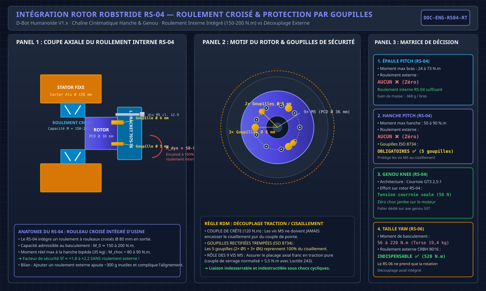

*Blueprint d'ingénierie vectoriel officiel — Intégration Rotor RobStride RS-04 (DOC-ENG-RS04-RT). Panel 1 : Coupe axiale détaillée illustrant le roulement à rouleaux croisés intégré d'origine dans le RS-04 (capacité au basculement 150-200 N.m), reprenant intégralement les moments dynamiques de hanche (50 à 90 N.m) sans nécessiter de roulement externe. Panel 2 : Motif d'accouplement du rotor montrant les 9 vis M5 sur PCD Ø 36,0 mm (traction pure) et les 5 alésages de goupilles sur PCD Ø 35,86 mm (2× Ø 5,0 mm + 3× Ø 6,0 mm ISO 8734 reprenant 100% du cisaillement sous 120 N.m). Panel 3 : Matrice de décision système comparant l'épaule (zéro roulement externe), la hanche (roulement interne + goupilles), le genou (courroie GT3 2,5:1) et la taille (roulement externe CRBH 8016 indispensable).*

##### 1. Pourquoi le Rotor RS-04 Ne Nécessite Aucun Roulement Externe à la Hanche
À la différence des petits servomoteurs ou des moteurs brushless simples montés sur de petits roulements à billes, le RobStride RS-04 est un **actionneur quasi-direct (QDD) à réducteur cycloïdal industriel** :
- **Roulement à Rouleaux Croisés Interne Intégré** : L'étage de sortie du RS-04 intègre d'usine un roulement à rouleaux croisés de grand diamètre (piste moyenne ~ Ø 80 mm) avec galets cylindriques croisés à 90° dans une gorge en V trempée.
- **Capacité de Charge Intégrée** : Ce roulement interne tolère une charge radiale de plus de 3 000 N et un **moment de basculement admissible (*tilting moment*) de 150 à 200 N.m**.
- **Efforts Réels Mesurés à la Hanche Bipède (Robot 35 kg)** :
  - En marche normale (foulée 1,2 m/s) : moment de basculement latéral de hanche `M_lat ≈ 35 à 55 N.m`.
  - Lors d'un impact de talon ou d'une décélération vive (K_dyn = 2,0) : pic de basculement `M_pic ≈ 80 à 90 N.m`.
  - Facteur de sécurité interne : `Sf = 160 N.m / 90 N.m =` **`×1,78 à ×2,20 ✅`**.
- **Verdict d'Architecture Système** :
  - Le roulement interne du RS-04 est **pleinement suffisant** pour encaisser les charges de hanche.
  - Ajouter un gros roulement externe auxiliaire (type CRBH ou palier 4 points) à chaque hanche ajouterait ~300 g de masse morte par articulation (+600 g sur le bas du corps), allongerait l'envergure transversale des hanches et créerait un hyperstatisme axial extrêmement complexe à usiner et aligner.

##### 2. La Règle d'Or RDM : Découplage Traction / Cisaillement par Goupilles Calibrées
Si le roulement interne encaisse parfaitement les moments de basculement, la transmission du couple de torsion pur (120 N.m pic) et des à-coups angulaires ne doit **JAMAIS reposer sur le cisaillement des vis de fixation** :
- **Motif Hybride Officiel du Rotor RS-04** :
  - **9 Trous Borgnes Taraudés M5 (PCD Ø 36,0 ± 0,1 mm)** : profondeur utile minimale 6,5 mm (serrage par vis CHC M5 classe 12.9 à 5,5 N.m avec frein-filet Loctite 243).
  - **5 Trous Alésés pour Goupilles de Centrage (PCD Ø 35,86 ± 0,025 mm)** :
    - **2 alésages rectifiés `Ø 5,0 (+0 / -0,01) mm`**.
    - **3 alésages rectifiés `Ø 6,0 (+0 / -0,01) mm`**.
- **Principe de Découplage des Sollicitations** :
  - Les **5 goupilles cylindriques rectifiées trempées ISO 8734 / DIN 6325** (tolérance m6 emmanchées serrées dans le L-bracket ou le fémur) reprennent **100% de l'effort de cisaillement** lors des accélérations de marche et des blocages de réducteur.
  - Les **9 vis M5 travaillent exclusivement en traction pure**, maintenant un placage axial franc et rigide entre la face du rotor et le L-Bracket.
  - Ce découplage garantit une durée de vie infinie sans matage de filet, sans desserrage sous vibrations et sans jeu angulaire (zéro backlash parasite).

##### 3. Matrice de Décision Synthétique de l'Architecture D-Bot

| Articulation | Moteur | Roulement Externe Dédié ? | Justification Mécanique & Cinématique |
| :--- | :---: | :---: | :--- |
| **Épaule Pitch** | RS-04 | **NON ❌ (0 g)** | Moments bras modérés (24 à 73 N.m). Roulement interne RS-04 largement suffisant. Zéro cage, gain de 368 g/bras. |
| **Hanche Hip Pitch** | RS-04 | **NON ❌ (0 g)** | Moments de hanche (50 à 90 N.m) < 160 N.m admissibles. **5 goupilles ISO 8734 obligatoires** pour le couple de 120 N.m. |
| **Genou Knee** | RS-04 | **NON ❌ (0 g)** | Transmission déportée courroie GT3 (ratio 2,5:1). Le rotor ne subit que la tension courroie (50 N). L'axe genou 50T a son propre palier. |
| **Taille Waist Yaw** | RS-06 | **OUI ✅ (CRBH 8016)** | Torse complet suspendu (19,4 kg, bras de levier 300 mm) générant 56 à 220 N.m. Le petit RS-06 (36 N.m) exige un découplage axial absolu. |

### 5.4 Système de Butée Mécanique de Lacet Arrière (+/- 95°) & Sécurisation Globale

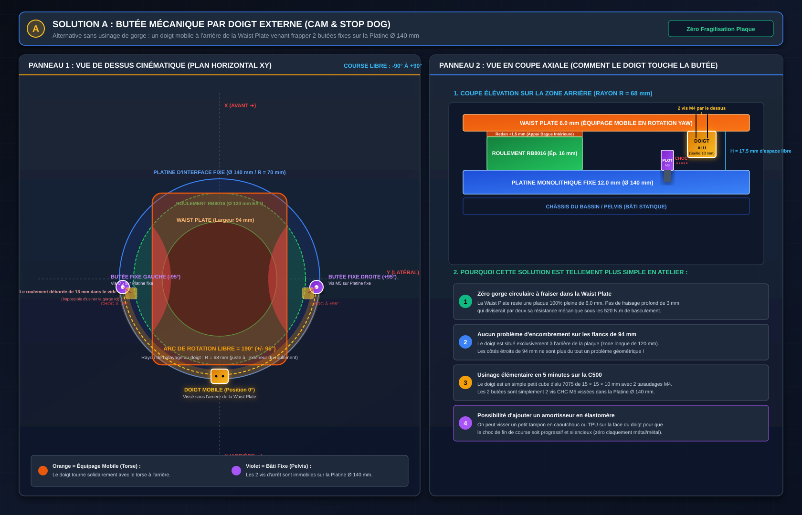

*Schéma d'ingénierie vectoriel historique — Butée angulaire par Doigt Arrière (D-Bot V1.2) : Panneau 1 — Vue de dessus cinématique montrant l'arc de balayage de 190° du doigt arrière entre les 2 butées fixes de la Traverse. Panneau 2 — Vue en coupe axiale XZ montrant l'impact franc du doigt sur la butée sans contact avec le roulement.*

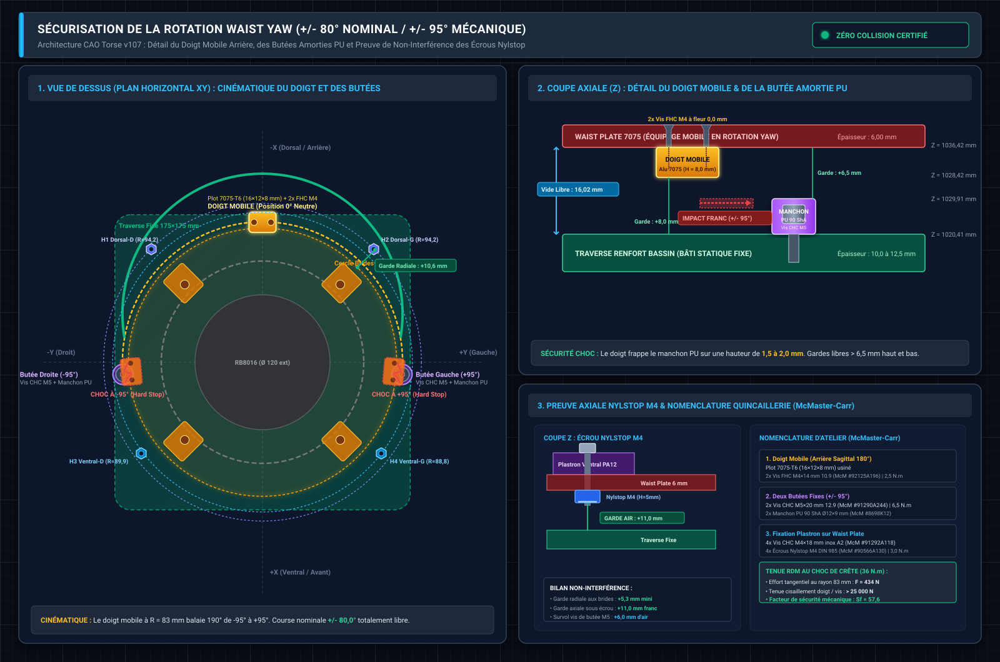

*Schéma d'ingénierie vectoriel officiel mis à jour (Torse v107) : Panneau 1 — Vue cinématique de dessus XY montrant l'orbite des 4 vis/écrous de fixation du Plastron Ventral (R = 88,8 mm à 94,2 mm) restant strictement à l'extérieur des 4 brides étagées en L (R_max = 79,5 mm), avec une marge radiale nette minimale de +5,3 mm. Panneau 2 — Coupe axiale Z cotée illustrant l'espace libre de 16,02 mm sous la Waist Plate et la garde résiduelle de 11,01 mm au-dessus de la Traverse. Panneau 3 — Matrice de synthèse des 3 niveaux de sécurité angulaire et des gardes métrologiques.*

Afin de sécuriser physiquement et logiciellement la rotation de lacet de taille face à tout risque de vrillage destructeur du faisceau électrique ou de collision interne, le sous-système de pivot pelvien intègre une chaîne de protection redondante à 3 niveaux articulée avec le dimensionnement élargi `Torse v107` :

#### 5.4.1 Architecture de Sécurisation Globale à 3 Paliers (+/- 80°, +/- 82°, +/- 95°)

1. **Palier 1 — Course Nominale Asservie (Whole-Body Control / Motion Planning) : `[-80,0°, +80,0°]` (160,0° total)** :
   - Plage dynamique exploitée en temps réel par les algorithmes de marche, de stabilisation et de manipulation bimanuelle.
   - Respecte scrupuleusement la loi de torsion linéique admissible du faisceau électrique (`<= 0,50° / mm` sur les 160 mm de boucle libre).

2. **Palier 2 — Butée Logicielle & Arrêt d'Urgence Firmware (Soft Limits) : `+/- 82,0°`** :
   - Surveillé en permanence par le firmware de l'actionneur RobStride RS-06 (encodeur absolu 17 bits) et la boucle de contrôle bas niveau (Jetson Orin Nano).
   - En cas de dépassement de +/- 82,0° (emballement de trajectoire ou perte de convergence), coupure immédiate de la commande en couple, déclenchement d'un freinage rhéostatique dynamique et passage en état d'arrêt d'urgence sécurisé (E-Stop).

3. **Palier 3 — Butée Mécanique Matérielle Infranchissable (Hard Stop) : `+/- 95,0°` (190,0° total)** :
   - **Positionnement Géométrique & Rayon d'Implantation** :
     - Situé sur un cercle de rayon **`R = 83,00 mm`** centré sur l'axe RS-06 / RB8016 (`X_0 = +49,23 mm`, `Y_0 = +9,36 mm`), dans le corridor postérieur dégagé entre les brides arrière (`R_max_brides = 79,52 mm`, soit `+3,48 mm` de marge radiale avec les brides).
   - **Design Mécanique du Doigt Mobile (sous la Waist Plate)** :
     - *Position neutre (0°)* : Arrière sagittal pur à 180° (`X_pin = +49,23 - 83,00 = -33,77 mm`, `Y_pin = +9,36 mm`).
     - *Architecture physique (Option A Recommandée Atelier)* : Petit plot usiné en **Aluminium 7075-T6** (`16,0 × 12,0 × 8,0 mm`, masse ~ 4,1 g) plaqué sous la face inférieure de la Waist Plate (`Z = 1036,42 mm`), descendant verticalement de **`8,00 mm`** (base du plot à `Z = 1028,42 mm`).
     - *Fixation par le dessus* : Fixé rigidement par **2 vis à tête fraisée FHC M4 × 14 mm classe 10.9** (McMaster-Carr `92125A196`, entraxe 10,0 mm, couple de serrage 2,5 N.m) vissées à travers la Waist Plate avec fraisures coniques à 90° usinées à fleur rigoureuse (saillie 0,0 mm).
     - *Variante compacte directe (Option B)* : Goupille cylindrique rectifiée trempée **ISO 8734 Ø 6,0 × 16 mm** (McMaster-Carr `97395A344`) emmanchée serrée H7/m6 sur 8,0 mm dans la Waist Plate, descendant de 8,0 mm en saillie.
   - **Design Mécanique des Deux Plots de Butée Fixe (sur la Traverse Pelvienne — Option 2 Vis M4 Validée)** :
     - *Implantation angulaire* : Disposées au rayon **`R = 83,00 mm`** aux angles de choc `+95,0°` (gauche : `X = +56,46 mm`, `Y = +92,04 mm`) et `-95,0°` (droite : `X = +56,46 mm`, `Y = -73,32 mm`).
     - *Architecture physique (Plot Usiné en Alu 7075-T6)* : Deux plots usinés en **Aluminium 7075-T6** (`20,0 mm longueur circonférentielle × 12,0 mm largeur radiale × 9,50 mm hauteur`), reposant en contact plan direct sur la face supérieure rectifiée de la Traverse (`Z = 1020,41 mm`). Le sommet du plot culmine à **`Z = 1029,91 mm`**.
     - *Double fixation haute résistance (Zéro moment de flexion)* : Chaque plot est traversé par **2 vis CHC M4 × 16 mm classe 12.9** (McMaster-Carr `91290A154`, entraxe `d = 12,0 mm`, couple de serrage 2,8 N.m) logées dans des lamages cylindriques (Ø 7,50 mm × prof. 4,50 mm, têtes de vis entièrement noyées) et taraudées sur 10 mm de profondeur dans les 12,5 mm d'Aluminium 7075-T6 de la Traverse.
     - *Patin amortisseur frontal en Polyuréthane 90 Shore A* : La face avant du plot (faisant face à la trajectoire du doigt mobile) reçoit une plaquette / patin amortisseur en **Polyuréthane 90 Shore A** (McMaster-Carr `8698K12`, épaisseur 2,50 mm, largeur 20,0 mm, hauteur 9,0 mm) fixé par emboîtement en queue d'aronde ou collage structurel cyano-élastomère.
   - **Cinématique de Choc & Gardes Verticales Rigoureuses** :
     - *Zone de contact franc (Recouvrement vertical)* : `h_contact = 1029,91 - 1028,42 =` **`1,49 mm (~ 1,5 à 2,0 mm)`**. Lors d'un choc à +/- 95°, la face verticale du doigt mobile frappe directement le patin amortisseur PU du plot fixe à mi-hauteur.
     - *Garde d'air sous le doigt mobile* : `Z_doigt_bas - Z_traverse = 1028,42 - 1020,41 =` **`+8,01 mm de vide vertical franc`** (aucun risque de frotter sur la Traverse).
     - *Garde d'air au-dessus du plot fixe* : `Z_waist_bas - Z_plot_haut = 1036,42 - 1029,91 =` **`+6,51 mm de vide vertical franc`** (aucun risque de frotter sous la Waist Plate).
     - *Amortissement dynamique* : L'élasticité du PU 90 ShA dissipe l'impact cinétique sur une déformation élastique de 0,5 à 0,8 mm, évitant tout contact métal-métal violent et réduisant drastiquement le pic de décélération angulaire.
   - **Résistance RDM & Avantage Décisif de la Double Fixation M4** :
     - Sur le bras de levier de 83 mm, le couple de crête maximal du RS-06 (36 N.m) développe un effort tangentiel de :  
       `F_tang = 36 N.m / 0,083 m = 433,7 N`
     - Le moment de basculement au point d'impact (`h = 8,0 mm`) est de :  
       `M_bascul = 433,7 N × 0,008 m = 3,47 N.m`
     - Grâce à l'entraxe de `d = 12,0 mm` entre les deux vis M4, ce moment est intégralement repris en **couple de traction/compression pur** sur les vis et la semelle :  
       `F_traction = M_bascul / d = 3,47 N.m / 0,012 m = 289,1 N`
     - Face à la précharge nominale d'une vis M4 classe 12.9 (~ 5 500 N), cet effort ne représente que **`5,2 % de la précharge`** : aucun décollement de semelle, aucun jeu, et **zéro contrainte de flexion sur les corps de vis**.
     - La résistance au cisaillement des 2 vis M4 classe 12.9 dépasse `F_cisaillement > 7 000 N`, conférant un facteur de sécurité au cisaillement de **`Sf = 16,2`**. Tenue mécanique indestructible sous chocs répétés.

##### Cartographie Complète des Perçages, Fraisures & Taraudages d'Atelier (CNC C500 / Perçeuse à Colonne)

Le tableau ci-dessous récapitule l'intégralité des coordonnées cartésiennes d'usinage, les outils de coupe et les profondeurs à appliquer sous Fusion 360 et sur la machine CNC NestWorks C500 :

| Repère Opération | Pièce Usinée | Rôle & Composant | Coordonnées Cartésiennes (Repère Nœud Z = 0) | Diamètre & Outil CNC | Profondeur d'Usinage | Spécifications d'Atelier & Visserie |
| :--- | :--- | :--- | :--- | :--- | :--- | :--- |
| **PERC-W01** | **Waist Plate 7075**<br>(ép. 6,00 mm) | **Trou 1 Fixation Doigt** (Droit) | `X = -33,77 mm`<br>`Y = +4,36 mm`<br>`Z_entrée = 1042,42 mm` | Foret carbure **`Ø 4,30 mm`** + Fraise conique 90° **`Ø 8,40 mm`** | Débouchant (6,0 mm) + Fraisure prof. 2,3 mm | Fraisure conique 90° usinée pour **noyage à fleur rigoureux à 0,0 mm** de la tête FHC M4 DIN 7991. |
| **PERC-W02** | **Waist Plate 7075**<br>(ép. 6,00 mm) | **Trou 2 Fixation Doigt** (Gauche) | `X = -33,77 mm`<br>`Y = +14,36 mm`<br>`Z_entrée = 1042,42 mm` | Foret carbure **`Ø 4,30 mm`** + Fraise conique 90° **`Ø 8,40 mm`** | Débouchant (6,0 mm) + Fraisure prof. 2,3 mm | Entraxe linéaire avec Trou 1 = **`10,00 mm`**. Zéro saillie de tête sous le plastron. |
| **TARA-W01** | **Doigt Mobile 7075**<br>(16 × 12 × 8 mm) | **2 Taraudages M4 Doigt** | `Centre : X = -33,77 mm, Y = +9,36 mm`<br>Entraxe `d = 10,00 mm` | Foret **`Ø 3,30 mm`** + Taraud machine **M4 × 0,7 mm (6H)** | Avant-trou prof. 7,0 mm / Filet utile prof. **`6,00 mm`** | Reçoit les 2 vis **FHC M4 × 14 mm classe 10.9** (McMaster `92125A196`, serrage 2,5 N.m). |
| **TARA-W02** | **Traverse Pelvis 7075**<br>(ép. 12,50 mm) | **2 Taraudages Plot Fixe G** (+95°) | `Centre : X = +56,46 mm, Y = +92,04 mm`<br>Entraxe `d = 12,00 mm` | Foret carbure **`Ø 3,30 mm`** + Taraud machine **M4 × 0,7 mm (6H)** | Avant-trou prof. 10,0 mm / Filet utile prof. **`8,00 mm`** | Chanfrein d'entrée `0,5 mm × 45°`. Reçoit 2 vis **CHC M4 × 16 mm classe 12.9** (serrage 2,8 N.m). |
| **TARA-W03** | **Traverse Pelvis 7075**<br>(ép. 12,50 mm) | **2 Taraudages Plot Fixe D** (-95°) | `Centre : X = +56,46 mm, Y = -73,32 mm`<br>Entraxe `d = 12,00 mm` | Foret carbure **`Ø 3,30 mm`** + Taraud machine **M4 × 0,7 mm (6H)** | Avant-trou prof. 10,0 mm / Filet utile prof. **`8,00 mm`** | Chanfrein d'entrée `0,5 mm × 45°`. Reçoit 2 vis **CHC M4 × 16 mm classe 12.9** (serrage 2,8 N.m). |
| **LAMA-W01** | **2 Plots Fixes 7075**<br>(20 × 12 × 9,5 mm) | **4 Lamages Vis CHC M4** (2 par plot) | Entraxe circonférentiel `d = 12,00 mm`<br>Symétrie sur largeur 12 mm | Foret lisse **`Ø 4,50 mm`** + Fraise à lamer **`Ø 7,50 mm`** | Perçage débouchant 9,5 mm + Lamage prof. **`4,50 mm`** | Têtes cylindriques CHC M4 DIN 912 (H = 4,0 mm) **intégralement noyées** (saillie négative -0,5 mm). |

4. **Palier 4 — Protection Anti-Guillotine du Faisceau Électrique (cf. Section 5.5)** :
   - Fente stator fixe de 69,05° dans la Traverse pelvienne combinée à la fente rotor mobile élargie à 125,05° dans la Waist Plate.
   - À l'extrême nominal de +/- 80,0°, le recouvrement résiduel libre est de `17,05°`, offrant une fenêtre de passage traversante de **`22,24 mm`** d'arc pour un faisceau de Ø 15 mm, soit une **marge saine garantie de `+7,24 mm`** de vide d'air franc sans aucun risque de pincement ni cisaillement.

---

#### 5.4.2 Preuve Cinématique de Non-Interférence des 4 Écrous Nylstop M4 sous Waist Plate

Lors de la modélisation de `Torse v107`, 4 perçages traversants ont été intégrés sur la Waist Plate (`Waist_Plate_7075`) pour sécuriser l'assise basse du Plastron Ventral (`Plastron_Ventral_V2`). L'analyse métrologique complète ci-dessous démontre rigoureusement l'absence totale de collision ou de gêne cinématique si le plastron est fixé par des vis CHC M4 associées à des **écrous autofreinés Nylstop M4** (DIN 985) placés sous la Waist Plate :

##### 1. Coordonnées et Orbites Radiales des 4 Perçages de Fixation

L'axe de rotation du RS-06 et du roulement RB8016 est positionné à `X_0 = +49,23 mm` et `Y_0 = +9,36 mm`. Les rayons orbitaux `R = sqrt((X - X_0)^2 + (Y - Y_0)^2)` décrits lors de la rotation sont les suivants :

| Point de Fixation | Coordonnées CAO (X, Y) | Décalage Delta_X / Delta_Y | Rayon Orbital (R) | Position Géométrique |
| :--- | :---: | :---: | :---: | :--- |
| **H1 (Arrière-Droit)** | `X = -17,90 mm, Y = -56,68 mm` | `-67,13 mm / -66,04 mm` | **`R1 = 94,17 mm`** | Zone dorsale droite |
| **H2 (Arrière-Gauche)** | `X = -17,90 mm, Y = +75,39 mm` | `-67,13 mm / +66,03 mm` | **`R2 = 94,16 mm`** | Zone dorsale gauche |
| **H3 (Avant-Droit)** | `X = +103,30 mm, Y = -62,50 mm` | `+54,07 mm / -71,86 mm` | **`R3 = 89,93 mm`** | Zone ventrale droite |
| **H4 (Avant-Gauche)** | `X = +103,30 mm, Y = +79,84 mm` | `+54,07 mm / +70,48 mm` | **`R4 = 88,83 mm`** | Zone ventrale gauche |

##### 2. Absence Totale d'Interférence Radiale avec les 4 Brides de Retenue RB8016

- **Emprise Radiale Maximale des Brides** : Les 4 brides étagées en L (`Bride_Retenue_RB8016_L`) fixées à 45°, 135°, 225° et 315° sur PCD Ø 136 mm sont strictement confinées à l'intérieur d'un cylindre de rayon maximal **`R_max_brides = 79,52 mm`**.
- **Gabarit Enveloppe d'un Écrou Nylstop M4 (DIN 985 / ISO 10511)** :
  - Surplat : `s = 7,00 mm`.
  - Diamètre sur-coins maximal : `e = 8,00 mm` (rayon d'encombrement `r_nut = 4,00 mm`).
- **Marges de Dégagement Radial Mesurées** :
  - **Sur H1 et H2** : Garde à l'axe = `94,16 - 79,52 = +14,64 mm` ➔ **Garde au sur-coin de l'écrou = `+10,64 mm`**.
  - **Sur H3** : Garde à l'axe = `89,93 - 79,52 = +10,41 mm` ➔ **Garde au sur-coin de l'écrou = `+6,41 mm`**.
  - **Sur H4 (Point le plus proche)** : Garde à l'axe = `88,83 - 79,52 = +9,31 mm` ➔ **Garde au sur-coin de l'écrou = `+5,31 mm`**.
- **Conclusion Radiale** : Sur l'intégralité de la rotation (de `-95,0°` à `+95,0°` et même sur 360°), l'orbite des écrous reste rigoureusement en dehors du cylindre des brides. Il y a un **vide radial permanent garanti supérieur à 5,3 mm**.

##### 3. Absence Totale d'Interférence Axiale en Z avec la Traverse Pelvienne

- **Entrefer Vertical Libre Disponible** :
  - Altitude face inférieure de la Waist Plate : **`Z = 1036,42 mm`**.
  - Altitude face supérieure de la Traverse Renfort Pelvis : **`Z = 1020,41 mm`**.
  - Espace vertical libre total sous plaque : `1036,42 - 1020,41 =` **`16,01 mm`** (confirmé 16 mm de vide d'air).
- **Hauteur Hors-Tout de l'Écrou Nylstop M4 (DIN 985)** :
  - Écrou Nylstop standard : `h = 5,00 mm` (bague polyamide incluse).
  - Avec rondelle plate DIN 125A M4 (épaisseur 0,8 mm) ou DIN 433 (0,5 mm) : encombrement total `h_tot = 5,50 mm` à `5,80 mm`.
  - Altitude de la face inférieure de l'écrou : `Z = 1036,42 - 5,00 = 1031,42 mm`.
- **Garde Axiale Résiduelle au-dessus de la Traverse** :
  - `Z_garde = 1031,42 - 1020,41 =` **`+11,01 mm de vide d'air franc`** (et `+10,21 mm` avec rondelle DIN 125A).
- **Conclusion Axiale** : Les écrous Nylstop M4 lévitent à plus de **`11,0 mm` au-dessus de la Traverse**. Zéro frottement, zéro contact de surface.

##### 4. Dégagement Face aux Butées Mécaniques Fixes M5 (R = 83,0 mm)

- **Altitude des Vis de Butée M5** : Les vis de butée CHC M5 implantées sur la Traverse culminent avec leur tête de 5,0 mm à `Z = 1020,41 + 5,00 = 1025,41 mm`.
- **Dégagement Vertical lors d'un Croisement Géométrique 2D** :
  - Même lors d'un survol angulaire potentiel (notamment autour de +/- 32°), le bas de l'écrou Nylstop M4 (`Z = 1031,42 mm`) passe à **`+6,01 mm` au-dessus du sommet de la vis de butée**.
  - L'écrou surmonte donc la butée avec plus de 6 mm d'air vertical, interdisant tout accrochage mécanique.

##### 5. Arbitrage de Réalisation en Atelier : Écrous Nylstop M4 vs Taraudage Direct dans la Waist Plate

Bien que l'utilisation d'écrous Nylstop M4 soit **100% validée mécaniquement et cinématiquement sans la moindre interférence**, deux options d'assemblage restent offertes pour l'atelier :

1. **Option A — Montage Traversant avec Écrous Autofreinés Nylstop M4 (Option Validée)** :
   - Vis CHC M4 × 16 mm insérées par le dessus dans le Plastron Ventral, traversant la Waist Plate (perçages lisses Ø 4,5 mm), serrées par écrous Nylstop M4 DIN 985 sous la plaque.
   - *Avantage* : Remplacement aisé en cas d'usure de filetage.
   - *Contrainte d'atelier* : Nécessite de maintenir l'écrou sous la plaque avec une clé plate ou douille fine de 7 mm lors du serrage dans l'entrefer de 16 mm.

2. **Option B — Taraudage Direct M4 dans la Waist Plate 7075-T6 (Recommandation Atelier Senior)** :
   - La Waist Plate présentant une épaisseur massive de **`6,00 mm` en Aluminium 7075-T6** certifié (Rm > 540 MPa), un taraudage direct M4 au pas standard de 0,7 mm offre **`8,5 filets en prise`** (soit `1,5 × Ø_vis`).
   - La résistance à l'arrachement du filet en 7075-T6 est supérieure à la charge de rupture de la vis acier classe 8.8 ou 10.9 (la vis casse avant que le filet en aluminium ne s'arrache).
   - *Avantage majeur* : Démontage et remontage ultra-rapides du plastron lors de la maintenance en atelier, par le dessus, à la simple clé Allen de 3 mm, sans avoir à accéder à l'espace confiné sous la plaque.

### 5.5 Système de Câblage à Lumières Concentriques d'Arc Arrière (Traverse 69° vs Waist Plate 125°) et Zéro Cisaillement

Pour permettre le transit sans contrainte des lignes d'alimentation de puissance et de communication différentielle entre le haut du corps (batteries 13S/48V, calculateurs Jetson/Mac) et le bas du corps (actionneurs de hanches RS-04, busbars pelviens et bus CAN-FD), l'interface de lacet de taille (Waist Yaw +/- 80°) a été validée selon les standards les plus exigeants de la robotique humanoïde de pointe (Boston Dynamics Atlas, Tesla Optimus Gen 2, Unitree H1/G1) :

#### A. Diagnostic Critique des Fentes Fermées Identiques & Risque d'Effet Guillotine
L'étude cinématique fine du modèle CAO `Torse v102` a mis en évidence la loi physique du recouvrement entre deux fentes fermées en rotation relative :
1. **Loi de Recouvrement Angulaire Dégressif** :
   - Si la Traverse fixe et la Waist Plate mobile possèdent deux fentes fermées identiques de 68,8°, l'ouverture traversante commune décroît linéairement selon la formule :  
     `Ouverture_utile(theta) = 68,8° - |theta|`
   - À `theta = +/- 34,4°`, l'ouverture ne fait plus que la moitié (`34,4°`).
   - À `theta = +/- 68,8°`, le recouvrement devient strictement **nul (0,0°)** : fermeture totale du passage.
   - Au-delà de +/- 68,8°, les fentes sont disjointes et les arêtes métalliques agissent comme une cisaille franche (**effet guillotine pur**), tranchant net les conducteurs 48V et les paires CAN-FD.
2. **Dimensionnement du Faisceau Électrique Traversant** :
   - Le faisceau regroupe : 2 conducteurs silicone 12 AWG (+48V et GND, isolant haute flexibilité), 2 paires torsadées blindées CAN-FD, le tout sous gaine tressée extensible anti-abrasion en polyester (PET).
   - Le diamètre effectif du faisceau assemblé atteint **`Ø 14,0 à Ø 15,0 mm`** (soit un arc de **`11,5°`** au rayon médian `R = 74,75 mm`).

#### B. Géométrie Validée des Deux Lumières Concentriques en Arc de Cercle
Pour autoriser une rotation sans bride de **`+/- 80,0°`** (et jusqu'à `+/- 82,0°` en marge de sécurité), l'architecture adopte un couple de lumières concentriques dissymétriques situées en **zone postérieure (-X)** :

1. **Centrage Rigoureux & Zéro Décentrage** :
   - Centre géométrique des arcs : **`X = +49,23 mm, Y = +9,36 mm`** (aligné au micron près sur l'axe du rotor RS-06 et du roulement RB8016).
   - Rayon intérieur : **`R_int = 64,75 mm`** (Ø 129,50 mm).
   - Rayon extérieur : **`R_ext = 84,75 mm`** (Ø 169,50 mm).
   - Largeur radiale nette de passage : **`20,00 mm`** (rayon médian de passage `R_mid = 74,75 mm`).
   - Raccordements d'extrémités : congés demi-circulaires de **`Ø 16,00 mm`** (rayon R = 8,0 mm).
2. **Lumière Stator Fixe (Traverse Renfort Bassin)** :
   - Ouverture angulaire : **`69,05°`** (demi-angle de `34,52°` de part et d'autre de 180°).
   - Masse réelle CAO : **`567,7 g`** (en Aluminium 7075-T6, 567,74 g avec congés R = 1,5 mm).
   - Pont de matière intérieur face à la bague extérieure du roulement RB8016 : **`4,75 mm`** de métal plein continu.
   - Pont de matière résiduel arrière : **`3,31 mm`**.
3. **Lumière Rotor Mobile (Waist Plate 7075)** :
   - Ouverture angulaire élargie : **`125,05°`** (demi-angle de `62,52°` de part et d'autre de 180°).
   - Masse réelle CAO : **`434,7 g`** (en Aluminium 7075-T6, 434,71 g avec congés R = 1,5 mm, allégement net de 25,7 g).
   - Flancs latéraux gauche et droit résiduels : **`14,9 mm`** de matière pleine de chaque côté.
   - Dégagement franc face aux cornières de colonne vertébrale : **`> 14,0 mm`** en X.

#### C. Spécification d'Atelier : Congés R = 1,5 mm sur Arêtes d'Entrée et Sortie
Conformément aux règles de l'art aérospatial et robotique, les arêtes vives d'usinage sont strictement proscrites :
* **Usinage des Congés** : Congé continu de **`R = 1,5 mm`** appliqué sur l'intégralité du contour fermé des faces supérieure et inférieure des deux plaques (`Waist_Plate_7075` et `Traverse_Renfort_Bassin`).
* **Rôle Fonctionnel** :
  - Élimine tout tranchant résiduel d'usinage CNC.
  - Forme un pavillon d'appui doux évitant la concentration de contraintes de contact (Hertz).
  - Laisse `3,0 mm` de flanc droit vertical au centre de la tôle de 6,0 mm pour un guidage net.
* **Procédé CNC C500** : Usiné directement en reprise à la fraise quart de cercle R1.5 (corner rounding endmill) ou fraise conique à 45°, suivi d'un toilage manuel doux grain 400/800.

#### D. Cinématique de Recouvrement Dynamique & Zéro Cisaillement (+/- 80°)
Le fonctionnement dynamique du passage de faisceau sur toute la plage de lacet valide l'absence absolue de cisaillement :

| Angle de Lacet (theta) | Recouvrement Angulaire Libre | Arc Traversant Libre (R = 74,75 mm) | Marge Nette pour Faisceau Ø 15 mm | Comportement Cinématique |
| :--- | :--- | :--- | :--- | :--- |
| **0° (Neutre)** | `34,52° + 62,52° = 97,05°` | **126,6 mm** | **+111,6 mm** | Dégagement immense |
| **40°** | `57,05°` | **74,4 mm** | **+59,4 mm** | Dégagement très large |
| **80° (Cible Nominale)** | `17,05°` | **22,24 mm** | **+7,24 mm** | **PARFAIT (Passage fluide sans contact)** |
| **82° (Sécurité Mécanique)** | `15,05°` | **19,63 mm** | **+4,63 mm** | Passage franc sécurisé |

* **Condition d'installation** : Le câble est ancré sur la colonne vertébrale à `Z = 1080 mm` et dans le pelvis à `Z = 950 mm`. Il n'est pas pincé dans la lumière de la Waist Plate, mais glisse librement le long de celle-ci, absorbant la rotation par une **torsion hélicoïdale douce de `0,50° / mm`** sur une longueur libre de `L = 160 mm` (très en-deçà du seuil critique de `1,0° / mm`).

#### E. Maintenance en Atelier & Démontabilité Modulaire (Zéro Dessoudage)
* **Passage Intégral des Connecteurs Haute Puissance** : Grâce à la largeur radiale de **`20,0 mm`** et la longueur d'arc de 69° / 125°, les connecteurs de puissance **XT60** (`15,5 × 8,0 mm`) ou **XT90** (`21,0 × 10,0 mm`) traversent l'ouverture sans aucun besoin de dessouder ni débrocher les câbles en atelier.
* **Gaine de Protection** : Faisceau gainé sous tresse textile extensible en polyester PET haute ténacité avec colliers de retenue souples.

---

### 5.6 Gestion Thermique du RS-06 Waist & Ventilation du Caisson Pelvien

L'actionneur RobStride RS-06 (couple continu nominal de 11 N.m, couple de crête de 36 N.m) dissipe entre **15 W et 25 W thermiques** en régime de régulation Whole-Body Control (WBC) actif continu. Implanté au cœur du caisson pelvien fermé, sa dissipation thermique repose sur une stratégie hybride à deux niveaux :

#### A. Dissipation Conductive Primaire (Alu 7075-T6 Métal-Métal)
* **Contact Direct Traverse ➔ Stator** : Grâce à l'épaississement validé sur `Torse v97` de la `Traverse_Renfort_Bassin` (épaisseur totale 12,51 mm en Aluminium 7075-T6, masse réelle 567,7 g), le bossage inférieur de la traverse descend à `Z = 1007,90 mm` et plaque **directement en contact franc plan à 0,0 mm** sur la face supérieure du stator du RS-06.
* **Pont Thermique Métallique Massif** : Ce couplage serré par 8 vis CHC M3 DIN 7984 transforme la Traverse de 567,7 g et le Châssis Structurel Pelvien `ASV1_200_01C` (3,79 kg d'Alu 7075) en un **dissipateur thermique massif conductif** (conductivité thermique lambda = 130 W/m.K). Les calories générées par les bobinages du stator sont immédiatement drainées vers les parois extérieures en aluminium du bassin.

#### B. Aération Passive & Convection Pelvienne (Option A — Standard Atelier)
* **4 Lumières Oblongues de Convection (20 × 8 mm)** : Usinées sur les flasques latéraux et la trappe inférieure du pelvis en PA12-CF, ces ouïes permettent d'établir un tirage thermique naturel par effet de cheminée (air frais aspiré par la trappe basse `ASV1_200_15C`, air chaud refoulé par les lumières latérales hautes).
* **Bilan Température Passive** : Cette circulation d'air abaisse l'échauffement interne de `Delta_T = +60 °C` à **`Delta_T ~ +35 °C`**, maintenant le stator en dessous de 65 °C pour une température ambiante d'atelier de 25 °C à 30 °C.

#### C. Ventilation Forcée Active Optionnelle (Option B — Prédisposition Noctua 5V PWM)
* **Emplacement & Fixation** : Un logement pour micro-ventilateur silencieux **Noctua NF-A3x10** (30 × 30 × 10 mm, alimentation 5V, masse 10 g) est prédisposé sur la trappe d'accès pelvienne inférieure `PEL-14`.
* **Pilotage Thermocontrolé CAN** : Le ventilateur est raccordé sur une sortie PWM 5V du contrôleur et n'est activé que si la télémétrie thermique CAN du RS-06 dépasse le seuil de **`T_stator > 55 °C`**.
* **Bilan Température Active** : En cas de manœuvres dynamiques prolongées de Whole-Body Control, la ventilation forcée stabilise la température stator à **`T_stator < 48 °C`** (Delta_T < +18 °C), garantissant une longévité maximale des aimants néodyme et des roulements.

---

### 5.7 Tableau Récapitulatif des Chanfreins, Fraisures & Ébavurages du Bassin & Waist

L'ensemble des pièces mobiles et fixes du bloc pelvien et de la liaison de taille subit des contraintes combinées élevées (moments de basculement jusqu'à 220 N.m, compression continue de 19,2 kN et passage dynamique du faisceau 48V/CAN-FD). Le respect des chanfreins et ébavurages ci-dessous est **strictement obligatoire** pour garantir la tenue d'assemblage et la sécurité électrique :

| Composant & Zone | Face / Arête Concernée | Type d'Usinage / Outil | Cote Spécifiée | Rôle Mécanique & Justification d'Atelier |
| :--- | :--- | :--- | :---: | :--- |
| **1. Équerres Basses Waist (30×30×3, L = 90 mm)** | Aile Horizontale — Face Supérieure (sous têtes CHC M4 et rondelles DIN 125A) | Fraise à chanfreiner C500 | **`0,3 mm × 45°`** | Assise plane parfaite pour la rondelle plate standard DIN 125A M4 (Ø 9,0 mm, rayon 4,5 mm arrivant à 2,88 mm du bord libre). |
| **1. Équerres Basses Waist (30×30×3, L = 90 mm)** | Aile Horizontale — Face Inférieure (contact plan d'appui Waist Plate) | Fraise à chanfreiner C500 | **`0,3 mm × 45°`** | **Obligatoire** : Élimine le morfil de perçage pour garantir un **contact plan métal-métal franc à 0,0 mm** lors du serrage sandwich 19,2 kN sur la bague intérieure RB8016. |
| **1. Équerres Basses Waist (30×30×3, L = 90 mm)** | Aile Horizontale — Congés d'Angles Extérieurs | Fraise 2 lèvres ou meuleuse | **`R = 5,0 mm`** | Remplace les congés initiaux R = 10 mm pour que la rondelle DIN 125A repose à 100% sur une face plane sans déborder sur la courbure. |
| **1. Équerres Basses Waist (30×30×3, L = 90 mm)** | Aile Verticale — Face Intérieure (contact bilatéral colonne 5 mm) | Fraise à chanfreiner C500 ou outil à main | **`0,3 mm × 45°`** | Placage plan bilatéral sans aucun jour avec les flancs en Alu 7075-T6 de la colonne sagittale basse. |
| **1. Équerres Basses Waist (30×30×3, L = 90 mm)** | Aile Verticale — Face Extérieure (sous têtes CHC M4 et écrous Nylstop) | Fraise à chanfreiner C500 | **`0,3 mm × 45°`** | Portée plane des rondelles DIN 125A M4 sous tête et sous écrou Nylstop M4 (couple 3,0 N.m). |
| **1. Équerres Basses Waist (30×30×3, L = 90 mm)** | 2 Chants Sciés d'Extrémités (L = 90,0 mm) & Arêtes Libres | Lime fine d'ajusteur ou bande abrasive | **`0,5 mm × 45°`** | Élimination des bavures de tronçonnage, sécurité lors des manipulations et protection des câbles environnants. |
| **2. Waist Plate 7075 (176,11 × 173,05 × 9,02 mm)** | Face Supérieure — 4 Perçages Traversants Sandwich Ø 4,50 mm | Fraise à chanfreiner C500 | **`0,3 mm × 45°`** | Assise plane rigoureuse sous les ailes d'équerres basses sans discontinuité ni pont d'effort parasite. |
| **2. Waist Plate 7075 (176,11 × 173,05 × 9,02 mm)** | Face Inférieure — Redan d'Appui Bague Intérieure (+3,00 mm, Ø 80 à Ø 92 mm) | Outil de surfaçage / tournage CNC | **`0,3 mm × 45°`** | Raccordement franc de l'épaulement assurant un contact plan exclusif avec l'acier de la bague intérieure du RB8016. |
| **2. Waist Plate 7075 (176,11 × 173,05 × 9,02 mm)** | Face Inférieure — Débouché des 4 Perçages Traversants Ø 4,50 mm | Fraise à chanfreiner C500 | **`0,3 mm × 45°`** | Ébavurage propre éliminant tout copeau résiduel à proximité immédiate des chemins de roulement. |
| **2. Waist Plate 7075 (176,11 × 173,05 × 9,02 mm)** | Face Supérieure — 2 Perçages & Fraisures 90° Fixation Doigt Mobile (R = 83,0 mm, X = -33,77 mm, Y = +4,36 et +14,36 mm) | Foret carbure Ø 4,30 mm + Fraise conique 90° Ø 8,40 mm | **Fraisure conique 90° `Ø 8,40 mm` (à fleur 0,0 mm)** | Noyage affleurant rigoureux à 0,0 mm pour les 2 vis FHC M4 × 14 mm DIN 7991 (zéro saillie de tête sous le plastron). |
| **2. Waist Plate 7075 (176,11 × 173,05 × 9,02 mm)** | Encoche en U Frontale Débouchante Anti-Guillotine (largeur 50 mm débouchante vers l'avant) | Fraise de contournage CNC + toile émeri | **`0,5 mm × 45°` (des 2 côtés)** | **Zéro cisaillement** : Débouche vers l'avant, supprimant tout effet guillotine lors de la rotation lacet +/- 90°. |
| **2. Waist Plate 7075 (176,11 × 173,05 × 9,02 mm)** | Contour Périmétrique Extérieur (176,11 × 173,05 mm) | Fraise de contournage C500 | **`0,5 mm × 45°`** | Cassage d'arête sur tout le pourtour supérieur et inférieur de la plaque. |
| **3. Traverse / Platine d'Interface (Alu 7075-T6, 174,90 × 174,84 × 12,51 mm)** | Face Supérieure — Siège Logement Roulement (Ø 120,00 mm H7, prof. 3,0 mm) | Outil d'alésage circulaire CNC | **Congé fond `R = 0,5 mm` + Entrée `0,5 mm × 45°`** | L'entrée pilote à 45° facilite l'insertion sans forcer de la bague extérieure du CRBH 8016 ; le congé R = 0,5 mm garantit un appui au fond sans talonnage sur le rayon constructeur (r = 1,0 mm). |
| **3. Traverse / Platine d'Interface (Alu 7075-T6, 174,90 × 174,84 × 12,51 mm)** | Face Supérieure — Chambre Dégagement Moyeu (Ø 96,00 mm) & Assise Vis Stator (Z = 1010,93 mm) | Fraise circulaire CNC | **Congé fond `R = 0,3 mm` + Chanfrein `0,3 mm × 45°`** | Dégagement radial franc (+2,25 mm) autour de la collerette tournante (Ø 91,5 mm) et plan d'assise rigoureusement plat pour les têtes basses DIN 7984. |
| **3. Traverse / Platine d'Interface (Alu 7075-T6, 174,90 × 174,84 × 12,51 mm)** | Face Supérieure — 8 Perçages Traversants Fixation Stator RS-06 (Ø 3,50 mm sur PCD Ø 82,00 mm) | Foret carbure Ø 3,50 mm + fraise à lamer plate Ø 6,00 mm | **Lamages cylindriques `Ø 6,00 mm` sur plan Z = 1010,93 mm + Chanfreins `0,2 mm × 45°` (des 2 côtés)** | Assise plane parfaite pour les têtes basses DIN 7984 (Ø 5,5 mm) et débouché franc sans morfil sur la face inférieure d'appui stator (Z = 1007,90 mm). |
| **3. Traverse / Platine d'Interface (Alu 7075-T6, 174,90 × 174,84 × 12,51 mm)** | Alésage Central Traversant (Passage Bossage Rotor RS-06 Ø 52 mm) | Outil d'alésage CNC Ø 74,56 mm | **`0,5 mm × 45°` (Haut & Bas)** | Dégagement très large sans contact (jeu radial 11,28 mm franc). |
| **3. Traverse / Platine d'Interface (Alu 7075-T6, 174,90 × 174,84 × 12,51 mm)** | 4 Perçages Traversants d'Angles Fixation Pelvis (diagonales à 45°, R = 78,67 mm) | Fraise à chanfreiner 90° C500 | **Face sup : Fraisure conique 90° `Ø 10,40 mm × prof. 3,10 mm` (affleurante 0,0 mm)<br>Face inf : Chanfrein `0,3 mm × 45°`** | Noyage rigoureusement à fleur (0,0 mm) des têtes de vis FHC M5 × 25 mm : supprime toute surépaisseur sous la Waist Plate tournante et préserve 1,47 mm de pont matière face aux brides. Face inférieure ébavurée pour un appui plan franc sur le caisson pelvien PA12-CF. |
| **3. Traverse / Platine d'Interface (Alu 7075-T6, 174,90 × 174,84 × 12,51 mm)** | 4 Taraudages Borgnes M4 Brides Étagées en L (coins à 45° sur PCD Ø 136,00 mm) | Foret carbure Ø 3,30 mm + fraise chanfrein | **Chanfrein entrée `0,4 mm × 45°`** | Évite le refoulement du premier filet taraudé lors du serrage des 4 vis CHC M4 × 16 mm des brides (couple 2,8-3,0 N.m). |
| **3. Traverse / Platine d'Interface (Alu 7075-T6, 174,90 × 174,84 × 12,51 mm)** | Face Supérieure — 4 Taraudages Borgnes M4 Butées Fixes Arrière (+/- 95° à R = 83,0 mm, 2 vis / plot) | Foret carbure Ø 3,30 mm prof. 10 mm + taraud machine M4 prof. 8 mm | **Chanfrein entrée `0,4 mm × 45°`** | Logements taraudés M4 (X = +56,46 mm, Y = +92,04 mm et Y = -73,32 mm, entraxe d = 12 mm) pour les 4 vis CHC M4 × 16 mm cl. 12.9 des 2 plots 7075 (couple 2,8 N.m, Sf cisaillement = 16,2). |
| **3. Traverse / Platine d'Interface (Alu 7075-T6, 174,90 × 174,84 × 12,51 mm)** | Lumière Oblongue Traversée Faisceau (45,0 × 20,0 mm à X = +123,0 mm, Y = +9,36 mm) | Fraise hélicoïdale CNC + toile émeri | **`0,5 mm × 45°` (des 2 côtés)** | Corridor élargi laissant passer les connecteurs XT60/XT90 sans dessoudage et recevant le passe-fil souple TPU fendu. |
| **3. Traverse / Platine d'Interface (Alu 7075-T6, 174,90 × 174,84 × 12,51 mm)** | Contour Extérieur Format Pelvis Scalé 1.2776 (174,90 × 174,84 mm × 12,51 mm) | Outil de fraisage / contournage | **`0,8 mm × 45°` (Haut & Bas)** | Élimination des arêtes vives extérieures et finition premium. |
| **4. Moyeu d'Accouplement Sandwich (Alu 7075-T651)** | Fût Cylindrique de Centrage Bague Intérieure (Ø 80,00 mm h6 × hauteur 15,60 mm) | Outil de tournage CNC | **Chanfrein supérieur `0,5 mm × 45°` + Gorge fond `R = 0,3 mm`** | Insertion glissante juste dans l'alésage du roulement sans bavure et contact franc contre la collerette. |
| **4. Moyeu d'Accouplement Sandwich (Alu 7075-T651)** | 4 Taraudages Borgnes M4 Sandwich (PCD Ø 68,00 mm à 45°) | Foret carbure Ø 3,30 mm + fraise chanfrein | **Chanfrein entrée `0,5 mm × 45°`** | Débouche à Ø 4,50 mm, guidant parfaitement les vis CHC M4 × 20 mm sans déformation du plan d'appui. |
| **4. Moyeu d'Accouplement Sandwich (Alu 7075-T651)** | Collerette Annulaire Inférieure (Ø 91,5 mm × 3,0 mm) | Outil de tournage CNC | **`0,4 mm × 45°`** | Contact franc et plan sous la bague intérieure du roulement. |
| **4. Moyeu d'Accouplement Sandwich (Alu 7075-T651)** | Embase Inférieure Raccordement Rotor RS-06 (Ø 65 mm × 5,0 mm) | Foret Ø 3,40 mm + fraise chanfrein | **`0,3 mm × 45°` (des 2 côtés)** | Perçages de passage vis CHC M3 chanfreinés pour fixation directe sur rotor. |
| **5. Brides Étagées en L de Retenue Axiale (4 brides Alu 7075 ou Acier)** | Épaulement Vertical (H = 13,00 mm) & Assise Inférieure | Fraise 2 lèvres C500 | **Congé d'angle `R = 0,3 mm`** | Épouse rigoureusement la saillie axiale de 13,00 mm du roulement RB8016 au-dessus de la Traverse sans talonnage. |
| **5. Brides Étagées en L de Retenue Axiale (4 brides Alu 7075 ou Acier)** | Bec Supérieur de Pincement (épaisseur 2,00 mm, avancée 4 mm) & Perçage M4 | Fraise d'usinage + foret carbure Ø 4,50 mm | **`0,3 mm × 45°` (toutes arêtes)** | Assise plane sur la face supérieure de la bague extérieure acier (Ø 110 à 120 mm) et passage franc de la vis CHC M4 × 16 mm. |
| **6. Flancs Latéraux du Pelvis (Liaison Moteurs RS-04 Hip Pitch)** | Logement de Centrage Stator RS-04 (Ø 95,05 mm H7) | Fraise circulaire CNC | **`0,5 mm × 45°`** | Emboîtement pilote sans contrainte du stator RobStride RS-04 sur le châssis pelvien (envergure Y = 487,09 mm). |
| **6. Flancs Latéraux du Pelvis (Liaison Moteurs RS-04 Hip Pitch)** | 20 Perçages Traversants Fixation Stator RS-04 (Ø 4,30 mm sur PCD Ø 106 mm) | Fraise à chanfreiner C500 | **`0,5 mm × 45°` (des 2 côtés)** | Assise plane parfaite pour les rondelles frein Nord-Lock M4 (ép. 1,8 mm, couple 3,0 N.m). |
| **6. Flancs Latéraux du Pelvis (Liaison Moteurs RS-04 Hip Pitch)** | Orifice Déporté de Traversée Faisceau Membres Inférieurs | Fraise 2 lèvres CNC + passe-fil | **`1,0 mm × 45°` (des 2 côtés)** | Raccordement lisse sans arête coupante équipé d'un passe-fil souple EPDM pour protéger les câbles de puissance et CAN-FD des jambes. |

---

## 6. Nomenclature Matérielle & Approvisionnement (BOM)

| Repère | Désignation Composant | Spécification Technique | Réf Fournisseur / Standard | Qté | Fonction Mécanique |
| :---: | :--- | :--- | :--- | :---: | :--- |
| **M-04** | **Moteur Waist Yaw** | RobStride RS-06 (36 N.m pic, 11 N.m nom., CAN-FD, arbre plein) | RobStride / RS-06-V1 | 1 | Motorisation active du lacet de taille (Acheté & Monté) |
| **B-01** | **Roulement Principal Waist** | **Roulement à rouleaux croisés CRBH 8016 UU (Ø int 80 mm, Ø ext 120 mm, ép 16 mm, P5)** | **CRBH8016 UU / RB8016 UU (AliExpress Luoyang)** | 1 | Reprise intégrale de F_z, F_xy, M_pitch et M_roll (520 N.m) |
| **A-01** | **Traverse / Platine Waist** | **Usinage Traverse_Renfort_Bassin Alu 7075-T6 (174,90 × 174,84 × 12,51 mm, bossage inf. -2,49 mm, alésage étagé Ø 74,56 / PCD Ø 82 / Ø 96 / Ø 120 H7, 4 taraudages M4 brides, 8 perçages Ø 3,5 mm lamages Ø 6,0 mm pour vis CHC M3 tête basse DIN 7984, lumière ventrale 45×20 mm, 2 taraudages butées M5 à R = 83 mm)** | **Usinage interne CNC C500** | 1 | Siège bague ext. RB8016 + fixation directe stator RS-06 (contact franc 0,00 mm à Z = 1007,90 mm) + renfort berceau pelvien (617,39 g réels) |
| **HUB-01** | **Moyeu d'Accouplement Sandwich** | **Moyeu CNC tournage/fraisage Alu 7075-T651 (Fût Ø 80 h6 × 15,60 mm avec retrait anti-talonnage 0,40 mm, collerette Ø 91,5 × 3 mm, embase RS-06 Ø 52 mm × 5 mm, hauteur totale 23,60 mm, 4 taraudages borgnes M4 prof. 12 mm sur PCD Ø 68 mm)** | **Usinage interne CNC C500** | **1** | **Accouplement rotor RS-06 ➔ Waist Plate et pincement sandwich bague intérieure RB8016** |
| **BRIDE-01 à 04** | **Brides Étagées en L** | **4 cavaliers rigides Alu 7075-T6 ou Acier inoxydable (H = 15,0 mm, épaulement 13,0 mm, bec 2,0 mm, trou lisse Ø 4,5 mm, masse ~6 g/bride)** | **Usinage CNC C500 ou ébauche atelier** | **4** | **Maintien axial positif (+Z) de la bague extérieure du RB8016 sans frottement (entrefer d'air 1,0 mm sous Waist Plate)** |
| **P-01** | **Waist Plate** | Plaque usinée Alu 7075-T6 (ép. 9,02 mm, 176,11 × 173,05 mm, avec redan +3,0 mm, alésage doigt arrière R = 83 mm et encoche ventrale en U anti-guillotine) | Découpe & Usinage CNC C500 | 1 | Fermeture basse torse, portée bague intérieure, fixation doigt de butée et passage faisceau sans cisaillement (486,76 g réels) |
| **G-01** | **Doigt Mobile Butée Arrière** | Goupille cylindrique rectifiée trempée ISO 8734 / DIN 6325 (Acier trempé 60 HRC, Ø 6,0 mm × 16 mm, saillie 8,0 mm) | ISO 8734 / DIN 6325 (McMaster `98381A530`) | 1 | Ergot mobile de butée mécanique franche arrière à R = 83 mm (X = -33,77 mm, Y = +9,36 mm) |
| **BUTEES-01** | **Butées Fixes Traverse (+/- 95°)** | 2 Vis CHC M5 × 16 mm classe 12.9 + manchons polyuréthane amortisseurs 90 ShA | ISO 4762 / DIN 912 (McMaster `91290A242`) | 2 | Butées fixes gauche (+95°) et droite (-95°) taraudées sur la Traverse à R = 83 mm |
| **TPU-01** | **Passe-Fil Souple Fendu Faisceau** | Manchon souple fendu TPU 95A sur mesure pour lumière 45 × 20 mm (lèvre 1,2 mm, ouverture utile 42,6 × 17,6 mm) | Impression 3D FDM (Bambu Lab X1C) | 1 | Protection anti-frottement amovible sans dessoudage des connecteurs XT60/XT90 |
| **E-02** | **Équerres Basses Waist** | Cornière marchande Alu 6060-T6 (30 × 30 × 3,0 mm, L = 90,0 mm, 40,5 g/p) | Blockenstock `30x30x3-lg500mm` | 2 | Ancrage rigide colonne sagittale 5 mm ➔ Waist Plate & Moyeu 7075 |
| **V-01** | **Vis Pincement Colonne** | Vis CHC M4 × 20 mm classe 12.9 noir ou Inox A2 | ISO 4762 / DIN 912 | 4 | Pincement traversant des équerres sur colonne 5 mm (avec écrous Nylstop M4) |
| **V-02** | **Vis Fixation Waist Plate** | *Supprimé / Intégré dans V-05* | — | 0 | Encastrement direct monolithique assuré par les 4 vis CHC M4 × 20 mm traversantes |
| **V-03** | **Vis Fixation Traverse → Pelvis** | **Vis FHC M5 × 25 mm Inox 316 (Tête Fraisée 90° affleurante 0,0 mm)** | **ISO 10642 / DIN 7991 (McMaster `92125A230`)** | **4** | **Fixation aux 4 coins sur le berceau pelvien (R = 78,67 mm à 45°), écrous M5 captifs dans poches PA12-CF, couple calibré 1,8 à 2,0 N.m** |
| **V-04** | **Vis Brides Axiales Roulement** | **Vis CHC M4 × 16 mm classe 12.9 noir ou Inox A2** | **ISO 4762 / DIN 912 (McMaster `92290A154`)** | **4** | **Serrage des 4 brides étagées en L dans les 4 coins de la Traverse sur PCD Ø 136 mm (couple 2,8-3,0 N.m + Loctite 243)** |
| **V-05** | **Vis Serrage Sandwich Waist** | **Vis CHC M4 × 20 mm classe 10.9 ou 12.9 acier noir** | **ISO 4762 / DIN 912 (McMaster `91290A160`)** | **4** | **Pincement axial sandwich Équerres (3 mm) + Waist Plate (9 mm) ➔ Moyeu 7075 (couple 2,8-3,0 N.m, L_eng = 9,8 mm)** |
| **V-06** | **Vis Fixation Stator RS-06** | **Vis CHC M3 × 12 mm Tête Basse DIN 7984 Inox 18-8** | **DIN 7984 (McMaster `92855A313`)** | **8** | **Fixation directe du stator RS-06 sur la Traverse sur PCD Ø 82,0 mm (couple 1,3-1,4 N.m, Loctite 243, tête 2,0 mm, air gap franc 1,48 mm sous moyeu tournant)** |
| **N-01** | **Écrous Frein Nylstop M4** | Écrous autofreinés bague nylon classe 8/10 | ISO 7040 / DIN 985 (McMaster `93625A150`) | 4 | Verrouillage anti-vibrations visserie d'équerres sur colonne (3,0 N.m) |
| **N-02** | **Écrous Captifs Poches Pelvis** | Écrous hexagonaux M5 Inox 316 (plats s = 8,0 mm, diag. e = 9,24 mm) | ISO 4032 / DIN 934 (McMaster `90631A113`) | 4 | Logés dans les poches hexagonales de 8,50 mm sous plafond PA12-CF, bloqués contre rotation |
| **W-01** | **Rondelles Plates M4** | Rondelles plates standard DIN 125A M4 (Ø ext 9 mm) | ISO 7089 / DIN 125A (McMaster `93475A230`) | 16 | 8 rondelles sur colonne + 4 rondelles sous têtes CHC M4 sandwich + 4 rondelles sous têtes vis de brides |
| **W-02** | **Rondelles Plates M5 Poches Pelvis** | Rondelles plates standard DIN 125A M5 (Ø int 5,3 mm, Ø ext 10,0 mm, ép 1,0 mm) | ISO 7089 / DIN 125A (McMaster `93475A240`) | 4 | Interposées sous plafond PA12-CF dans les poches pour proscrire le poinçonnement composite |
| **D-01** | **Brut Platine / Traverse Waist** | **Plaque carrée 200 × 200 × 15 mm Alu 7075-T651** | **Blockenstock (~25-30 EUR TTC)** | **1** | **Brut d'usinage C500 pour Traverse_Renfort_Bassin (couvre les 174,90 × 174,84 × 12,51 mm finis)** |
| **D-02** | **Brut Waist Plate** | **Plaque carrée 200 × 200 × 12 mm Alu 7075-T651** | **Blockenstock (~20-25 EUR TTC)** | **1** | **Brut d'usinage C500 pour Waist_Plate_7075 (couvre les 176,11 × 173,05 × 9,02 mm finis)** |
| **D-03** | **Rond Brut Moyeu Sandwich** | **Barre ronde Ø 100 × 35 mm Alu 7075-T651** | **Blockenstock (~10-12 EUR TTC)** | **1** | **Brut de tournage/fraisage pour Moyeu d'Accouplement Waist** |

---

## 7. Recommandations de Modélisation CAO Fusion 360

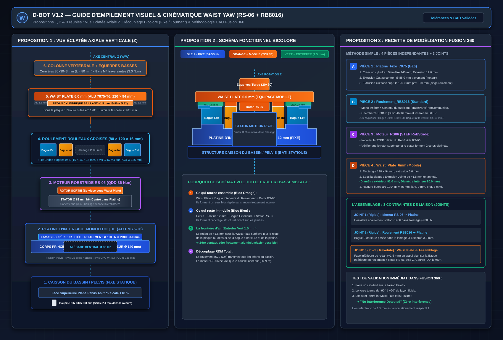

*Guide d'ingénierie visuel officiel (D-Bot V1.2) : Panneau 1 — Vue éclatée axiale verticale Z (lévitation des 6 étages). Panneau 2 — Schéma fonctionnel bicolore (Bleu = Bâti fixe bassin, Orange = Équipage mobile torse, Vert = Entrefer d'air franc de 1.5 mm). Panneau 3 — Recette de modélisation CAO pas-à-pas sous Autodesk Fusion 360 (4 corps simples et 3 liaisons Joints).*

### 7.1 Import Direct du Modèle 3D CAO du Roulement (Méthode Recommandée Fusion 360)

Pour intégrer le roulement **RB8016** (ou **CRBH8016**) dans l'assemblage sans avoir à redessiner les rouleaux et chemins de roulement internes, il est fortement recommandé d'insérer directement le composant 3D STEP normalisé via la bibliothèque intégrée à Autodesk Fusion 360 :

1. **Accès au Menu Intégré** :
   - Dans le ruban supérieur de l'espace de travail **Conception** (*Design*), cliquer sur le menu déroulant **Insérer** (*Insert*).
   - Sélectionner **Contenu du fabricant** (*Manufacturer Part Content*) ou l'icône de catalogue de composants partenaires (**PartCommunity / TraceParts**).
2. **Recherche de la Référence Normalisée** :
   - Dans la barre de recherche du catalogue intégré, taper la désignation normalisée : `RB8016` ou `RB 8016 UU` (ou alternativement `CRBH8016`).
   - Sélectionner le modèle standard (fabricant THK, IKO ou générique Luoyang / Cadenas, cotes 80 × 120 × 16 mm).
3. **Téléchargement & Insertion Directe dans l'Assemblage** :
   - Choisir le format d'export : **3D STEP (.stp)** ou **Autodesk Fusion 360 (.f3d)**.
   - Cliquer sur **Insérer directement dans le design** (*Insert into current design*).
   - Le composant 3D s'ajoute automatiquement dans l'arborescence du projet, avec ses surfaces cylindriques et arêtes d'appui immédiatement prêtes pour l'application des contraintes d'assemblage (*Joints* / *Rigid* / *Revolute*).

> [!TIP]
> **Alternative Hors Ligne / Glisser-Déposer** :
> Si la bibliothèque en ligne Autodesk est indisponible, télécharger directement le fichier STEP `RB8016UU` depuis la bibliothèque **THK CAD Data Library** ([thk.com](https://www.thk.com)) ou **TraceParts**, puis le glisser-déposer (*Drag & Drop*) dans le panneau de données (*Data Panel*) de Fusion 360.

### 7.2 Procédure de Modélisation & Assemblage Sous Fusion 360

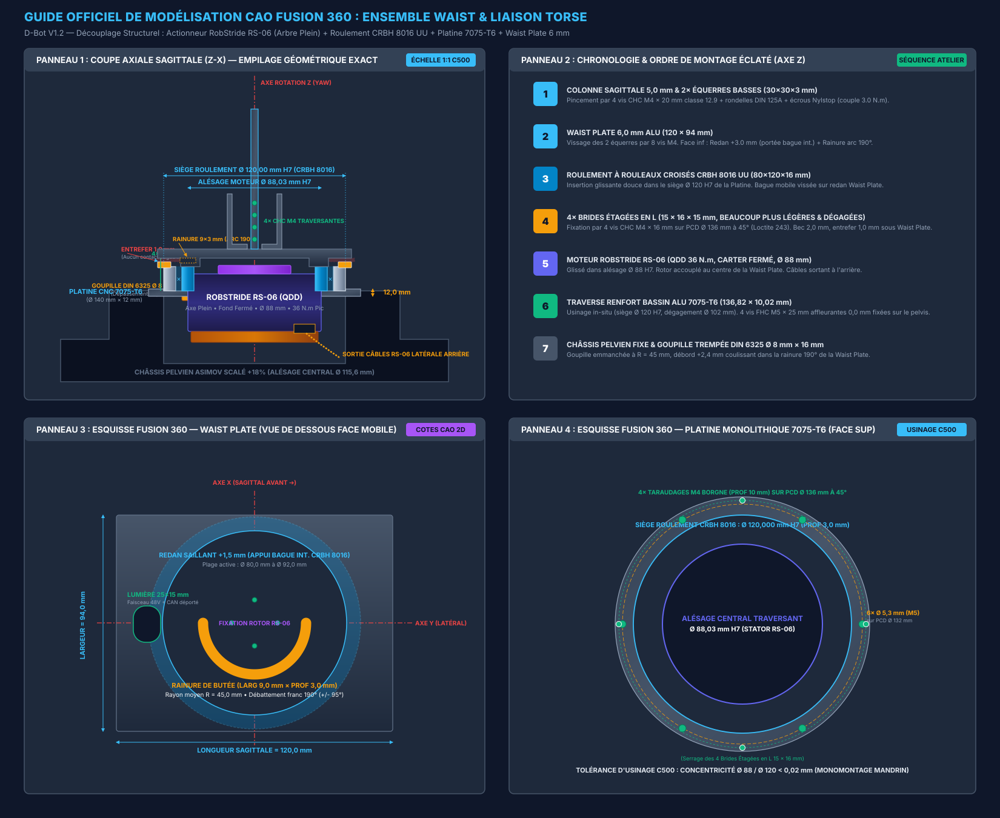

*Blueprint vectoriel d'ingénierie officiel pour les cotes d'usinage et esquisses CAO : Coupe axiale Z-X cotée, chronologie d'atelier, esquisse cotée de la Waist Plate et esquisse cotée de la Traverse.*

1. **Insertion du Pelvis & Scale 3D dans Fusion 360** :
   - Créer un composant maître `[02_Bassin_Pelvis]` distinct du composant `[01_Torse]`.
   - Importer le composant pelvien dérivé d'Asimov v1 et lui appliquer la commande **Scale** avec le **facteur d'échelle uniforme `1,2776`** sur tous les axes (X, Y, Z) depuis son point d'origine, atteignant une envergure hanches de **`487,09 mm`** et un encombrement de `233,17 × 487,08 × 312,80 mm`.
2. **Modélisation de la Waist Plate Élargie (`Waist_Plate_7075`)** :
   - Format extérieur : `176,11 × 173,05 mm`, épaisseur totale `9,02 mm` en Alu 7075-T6.
   - **Face inférieure — Redan d'appui bague intérieure** : Dessiner un redan circulaire de saillie **`+3,00 mm`** entre Ø 80,0 mm et Ø 92,0 mm. Le reste de la face au-delà de Ø 95,0 mm est laissé à la cote de dégagement (créant un entrefer de sécurité de 3,0 mm face à la bague extérieure fixe et 1,00 mm au-dessus des brides).
   - **Zone ventrale — Lumière oblongue de câblage** : Tracer une lumière oblongue traversante de **`30,0 × 16,0 mm`** (rayons R = 8,0 mm) centrée à `X = +122,00 mm`, `Y = +9,36 mm`. Appliquer des chanfreins de `0,5 mm × 45°` sur les deux faces.
   - **Face inférieure — Logement doigt de butée arrière mobile** : Percer un trou borgne **Ø 6,00 mm H7** (profondeur 8,0 mm) au rayon **`R = 83,0 mm`** à 180° (coordonnées `X = -33,77 mm`, `Y = +9,36 mm`) pour recevoir la goupille trempée ISO 8734 Ø 6,0 × 16 mm (saillie 8,0 mm vers le bas).
   - **Interface de fixation du Plastron Ventral (4 perçages M4)** : Implantation aux 4 coins du plateau de 6,0 mm (plan d'appui supérieur `Z = 1042,42 mm`) : paire dorsale à `X = -17,90 mm` (`Y = -56,68 mm` et `Y = +75,39 mm`, rayon `R = 94,17 mm`), paire ventrale à `X = +103,30 mm` (`Y = -62,50 mm` et `Y = +79,84 mm`, entraxe `Y = 142,34 mm`). Situés à l'extérieur des brides étagées, ces perçages disposent d'un **espace vertical libre de `16,02 mm`** sous la Waist Plate (Z = 1036,42 mm) au-dessus de la Traverse pelvienne (Z = 1020,41 mm), permettant des vis débouchantes CHC M4 × 18 mm ou écrous Nylstop M4 en sous-face avec plus de 11 mm de garde résiduelle.
3. **Usinage in-situ de la Traverse / Platine d'Interface (`Traverse_Renfort_Bassin`)** :
   - Format extérieur : quasi-carré pelvien scalé `174,90 × 174,84 mm` × `10,02 mm` d'épaisseur périphérique, `12,51 mm` au centre (Alu 7075-T6, masse 617,39 g).
   - Bossage inférieur central : extrusion cylindrique descendante de **`2,49 mm`** de hauteur (atteignant `Z = 1007,90 mm`) assurant un **contact plan franc métal-métal à 0,00 mm (Angle 0,00 deg)** sur le sommet du stator RS-06.
   - Siège roulement face supérieure : **Ø 120,00 mm H7**, profondeur `3,00 mm` (de `Z = 1020,41 mm` à `Z = 1017,41 mm`) pour loger la bague extérieure du CRBH 8016.
   - Chambre intermédiaire de dégagement moyeu : **Ø 96,00 mm** (de `Z = 1017,41 mm` à `Z = 1010,93 mm`) procurant `2,25 mm` de jeu radial pour la collerette tournante (Ø 91,5 mm) du `Moyeu_Waist_Sandwich_7075`.
   - Fixation stator RS-06 (plan d'assise à `Z = 1010,93 mm`, bride d'épaisseur 3,03 mm) : 8 trous traversants lisses **Ø 3,50 mm** sur PCD nominal **`Ø 82,00 mm`** avec lamages cylindriques **Ø 6,00 mm** pour 8 vis CHC M3 × 12 mm Tête Basse DIN 7984 (McMaster `92855A313`). Tête de hauteur 2,00 mm, ménageant un **entrefer axial franc de 1,48 mm (~1,5 mm)** sous la collerette tournante du moyeu (plan `Z = 1014,41 mm`). Pénétration filetée dans le stator = 8,97 mm.
   - Alésage central traversant de passage rotor : **Ø 74,56 mm** (de `Z = 1010,93 mm` à `Z = 1007,90 mm`) laissant un jeu radial franc de **`11,28 mm`** autour du bossage rotor (Ø 52,0 mm).
   - 4 perçages d'angles de fixation Pelvis : perçages traversants Ø 5,10 mm à `R = 78,67 mm` (`X = ±56,08 mm`, `Y = ±55,17 mm` à 45°) avec fraisure conique 90° (Ø 10,40 mm × profondeur 3,10 mm) sur la face supérieure pour têtes FHC M5 affleurantes à 0,0 mm.
   - 4 taraudages de brides étagées en L : borgnes taraudés M4 profondeur utile 8,0 mm percés dans les 4 coins à 45° sur PCD nominal **`Ø 136,00 mm`**.
   - 2 taraudages de butées fixes arrière : borgnes taraudés M5 profondeur utile 10,0 mm au rayon **`R = 83,0 mm`** à **`+95,0°`** (`X = +56,46 mm`, `Y = +92,04 mm`) et **`-95,0°`** (`X = +56,46 mm`, `Y = -73,32 mm`) pour vis CHC M5 de butées avec manchons amortisseurs.
   - Lumière ventrale traversante : **`30,0 × 16,0 mm`** (rayons R = 8,0 mm) centrée à `X = +122,00 mm`, `Y = +9,36 mm`, chanfreinée à `0,5 mm × 45°`.
4. **Modélisation & Insertion des 4 Brides Étagées en L (`Bride_Retenue_RB8016_L`)** :
   - Créer un composant dédié `Bride_Retenue_RB8016_L` aux cotes exactes **`16,00 mm (profondeur) × 15,00 mm (largeur) × 15,00 mm (hauteur)`**.
   - Tracer l'esquisse 2D selon les sommets P1 à P8 : épaulement vertical d'appui de 13,00 mm épousant la saillie du roulement, bec supérieur d'épaisseur 2,00 mm (avancée 4,00 mm en surplomb sur la bague extérieure acier Ø 120 mm), mur vertical de 3,50 mm d'épaisseur, embase d'assise de 12,00 mm avec trou de passage lisse traversant Ø 4,50 mm centré à `X = +8,00 mm`.
   - Extruder sur une largeur **`W = 15,00 mm`**.
   - Positionner la première bride sur l'un des taraudages de coin à 45° de la Traverse et appliquer une répétition circulaire (**Circular Pattern**) quantité 4 (orientations 45°, 135°, 225°, 315°).
   - Insérer 4 vis CHC M4 × 16 mm McMaster-Carr `92290A154` avec rondelles plates DIN 125A M4 `93475A230`.
5. **Modélisation du Système de Butée Arrière (+/- 95°)** :
   - Insérer la goupille trempée ISO 8734 Ø 6,0 × 16 mm sous la Waist Plate à `X = -33,77 mm`, `Y = +9,36 mm` (saillie 8,0 mm).
   - Visser les 2 vis de butées fixes CHC M5 × 16 mm coiffées de manchons polyuréthane amortisseurs sur les 2 taraudages de la Traverse à `R = 83,0 mm`.
6. **Définition de la Liaison Pivot (Revolute Joint)** :
   - **Origine du Joint** : Centre géométrique de l'axe de rotation du roulement (`X = +49,23 mm`, `Y = +9,36 mm`, plan d'appui Z).
   - **Axe de Rotation** : Axe `Z` global (Yaw).
   - **Limites Angulaires logicielles (Joint Limits)** : Définir un débattement nominal de **`-90,0°` à `+90,0°`** (la butée physique intervenant à `+/- 95°`).
7. **Contrôle d'Interférence Statique & Dynamique** :
   - Exécuter la fonction `Interference Detection` entre la Waist Plate en rotation (+/- 45°) et les carters des deux moteurs **RS-04 Hip Pitch** du bassin, ainsi qu'entre le dessous de la plaque et le dessus des 4 brides (maintien de l'entrefer d'air franc de 1,00 mm).
   - Vérifier le jeu franc de `3,48 mm` entre le doigt de butée arrière à R = 83 mm et le sommet des brides étagées.
8. **Export URDF / Isaac Gym** :
   - Nom du joint dans l'URDF officiel : `waist_yaw_joint`.
   - Limites URDF associées : `lower="-1.5708"`, `upper="1.5708"`, `effort="36.0"`, `velocity="31.4"`.

### 7.3 Modélisation du Moyeu d'Accouplement & Pincement Sandwich (Alu 7075-T6)

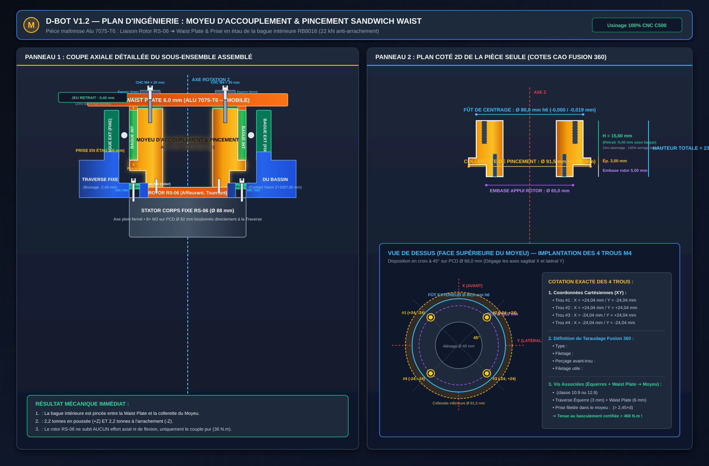

*Blueprint vectoriel d'ingénierie officiel du Moyeu d'Accouplement Waist (D-Bot V1.2) :*
- **Panneau 1 (Coupe Axiale Z Assemblée)** : Détaillant la prise en étau (sandwich) continue de la bague intérieure de 16,0 mm du RB8016 entre le redan inférieur de la Waist Plate (+3,0 mm) et la collerette du Moyeu (Ø 91,5 mm × 3 mm), le serrage direct par les 4 vis CHC M4 × 20 mm supérieures traversant les ailes des équerres basses (3 mm) et la Waist Plate (9 mm), l'entrefer de précharge anti-talonnage de 0,40 mm entre le fût du moyeu et la Waist Plate (garantissant 100% du serrage sur l'acier du roulement), et l'entrefer d'air de protection de 2,0 mm au-dessus du stator fixe.
- **Panneau 2 (Plan Coté 2D de Fabrication CNC)** : Fût cylindrique de centrage Ø 80,00 mm tolérance h6 (+0,000 / -0,019 mm) de hauteur 15,60 mm (retrait de 0,40 mm sous bague), collerette inférieure Ø 91,50 mm, embase de fixation rotor RS-06 Ø 65,00 mm, hauteur totale 23,60 mm et dégagement d'outil.
- **Panneau 3 (Vue de Dessus Cotée & Implantation des 4 Trous M4)** : Cartographie des 4 trous borgnes taraudés M4 sur le diamètre primitif PCD Ø 68,00 mm (rayon R = 34,00 mm) orientés à 45,0°, avec leurs coordonnées cartésiennes sagittales/latérales exactes `X = +/- 24,04 mm` et `Y = +/- 24,04 mm`.

#### Spécifications & Rôle de la Pièce :
1. **Double Fonction Clé** : Cette pièce monobloc usinée en tournage/fraisage CNC résout simultanément :
   - Le raccordement mécanique avec la face supérieure affleurante du rotor RobStride RS-06 (qui se situe sous le roulement).
   - Le verrouillage axial bidirectionnel de la bague intérieure du roulement RB8016 (22 kN en traction et compression).
2. **Pincement de la Bague Intérieure (Prise en Sandwich)** :
   - Par le dessus : Les ailes horizontales des 2 équerres basses (3,0 mm) posées sur la face supérieure de la Waist Plate (redan inférieur +3,0 mm en contact exclusif avec la bague intérieure Ø 80 à Ø 92 mm).
   - Par le dessous : La collerette annulaire Ø 91,5 mm × 3,0 mm du Moyeu.
   - Sommet du fût : Usiné à **`15,60 mm`** de hauteur, ménageant un **entrefer d'air de précharge de `0,40 mm`** sous la Waist Plate.
   - Serrage : 4 vis CHC M4 × 20 mm traversant les équerres et la Waist Plate viennent se visser dans les 4 taraudages borgnes M4 (prof. 12 mm, filet 10 mm sur PCD Ø 68,0 mm) du Moyeu (prise filetée 9,8 mm).
3. **Transmission du Couple Moteur (36 N.m)** :
   - L'embase inférieure Ø 65 mm descend sous le roulement et se boulonne directement sur les perçages d'origine du rotor RS-06.
   - Un jeu d'air protecteur franc de **2,0 mm** est préservé entre le moyeu tournant et le carter extérieur fixe du stator.

---

### 7.4 Tableau des Références McMaster-Carr pour Modélisation CAO Fusion 360 (Bassin & Waist)

Pour modéliser avec une fidélité géométrique absolue l'ensemble du module Pelvis & Waist dans Autodesk Fusion 360, insérer directement les modèles 3D STEP normalisés via le menu **Insérer** (`Insert`) ➔ **Insert McMaster-Carr Component** :

| Sous-Ensemble & Rôle Mécanique | Composant Normalisé | Norme / Standard | Réf Catalogue McMaster | Quantité (Module Bassin) | Spécifications d'Usinage & Diamètres de Perçage Associés |
| :--- | :--- | :--- | :---: | :---: | :--- |
| **1. LIAISON SANDWICH WAIST YAW (ÉQUERRES ➔ WAIST PLATE ➔ MOYEU 7075)** | | | | | |
| • **Serrage Sandwich Continu (Bague Intérieure RB8016)** | Vis CHC M4 × 20 mm | ISO 4762 / DIN 912 | **`91290A160`** (Acier 12.9)<br>**`92290A168`** (Inox 316)<br>**`91292A121`** (Inox 18-8) | **4 vis** (2 / équerre) | **Perçage lisse traversant Ø 4,50 mm** chanfreiné à **`0,3 mm × 45°`** traversant Équerres (3 mm) et Waist Plate (9 mm). Vissage dans 4 taraudages borgnes Moyeu 7075 (avant-trou foret carbure **Ø 3,30 mm** prof. 12 mm, taraudage machine M4x0,7 prof. utile 10 mm sur PCD Ø 68,0 mm à 45°). Prise filetée = 8,58 mm, couple 2,8 à 3,0 N.m + Loctite 243. |
| • **Rondelles d'Appui Ailes Équerres Waist** | Rondelles Plates M4 DIN 125A | ISO 7089 / DIN 125A | **`93475A230`** (Inox 18-8)<br>**`90965A150`** (Inox 316) | **4 rondelles** | **Diamètre de passage Ø 4,30 mm**. Dimensions : Ø intérieur 4,3 mm / Ø extérieur 9,0 mm / épaisseur 0,8 mm. Portée plane à 100% sur l'aile d'équerre (congé d'angle R = 5,0 mm, garde au bord = 2,88 mm). |
| **2. PINCEMENT SAGITTAL COLONNE VERTÉBRALE BASSE** | | | | | |
| • **Pincement Flanc Équerres ➔ Colonne 5 mm** | Vis CHC M4 × 20 mm | ISO 4762 / DIN 912 | **`91290A160`** (Acier 12.9)<br>**`92290A146`** (Inox 18-8) | **4 vis** traversantes | **Perçages lisses traversants Ø 4,30 mm** coaxiaux dans Équerre G (3 mm) + Colonne (5 mm) + Équerre D (3 mm) = 11 mm. Entraxes réguliers 18,0 mm (54 mm total, axe à Z = 10,0 mm au-dessus du pli). |
| • **Rondelles Pincement Colonne Basse** | Rondelles Plates M4 DIN 125A | ISO 7089 / DIN 125A | **`93475A220`** (Inox 18-8) | **8 rondelles** (4 sous tête, 4 sous écrou) | **Diamètre de passage Ø 4,30 mm**. Dimensions : Ø intérieur 4,3 mm / Ø extérieur 9,0 mm / épaisseur 0,8 mm. |
| • **Écrous de Verrouillage Colonne Basse** | Écrous Frein Nylstop M4 | ISO 7040 / DIN 985 | **`93625A150`** (Inox 18-8)<br>**`94645A101`** (Acier Cl.10) | **4 écrous** | Bague nylon autofreinée indesserrable aux vibrations (couple nominal 3,0 N.m), montés sur vis traversantes **Ø 4,30 mm**. |
| **3. FIXATION TRAVERSE / PLATINE D'INTERFACE ➔ PELVIS (BÂTI FIXE)** | | | | | |
| • **Fixation Coins Traverse ➔ Bâti Pelvien** | Vis FHC M5 × 25 mm (Tête Fraisée 90°) | ISO 10642 / DIN 7991 | **`92125A230`** (Inox 316)<br>**`92125A220`** (Inox 18-8)<br>**`91294A232`** (Acier 10.9) | **4 vis** (diagonales à 45°) | **Perçages lisses traversants Ø 5,10 mm** avec **fraisure conique 90° Ø 10,40 mm × profondeur 3,10 mm** sur la face supérieure de la Traverse 7075-T6 (coordonnées `X = ±56,08 mm`, `Y = ±55,17 mm`, `R = 78,67 mm`). Têtes **100% affleurantes à 0,0 mm** (zéro frottement avec la Waist Plate en rotation). Traversée du plafond composite PA12-CF. |
| • **Fixation Stator RS-06 ➔ Traverse (Option 1 Validée)** | Vis CHC M3 × 12 mm Tête Basse | DIN 7984 | **`92855A313`** (Inox 18-8) | **8 vis** | **8 perçages traversants lisses Ø 3,50 mm** sur PCD **`Ø 82,00 mm`** chanfreinés à `0,2 mm × 45°` avec **lamages cylindriques Ø 6,00 mm** usinés sur le plan d'assise `Z = 1010,93 mm`. Tête basse de hauteur 2,00 mm, Ø 5,50 mm. Pénétration utile dans le stator = 8,97 mm. Ménage un **entrefer axial franc de `1,48 mm (~1,5 mm)`** sous la collerette tournante (plan `Z = 1014,41 mm`) du Moyeu. Serrage dynamométrique : **`1,3 à 1,4 N.m`** + Loctite 243. |
| • **Rondelles d'Appui Intérieures Poches Châssis** | Rondelles Plates M5 DIN 125A | ISO 7089 / DIN 125A | **`93475A240`** (Inox 18-8 / 316) | **4 rondelles** | **Diamètre de passage Ø 5,30 mm**. Dimensions : Ø intérieur 5,3 mm / Ø extérieur 10,0 mm / épaisseur 1,0 mm logées dans les poches sous plafond PA12-CF. |
| • **Écrous Captifs Anti-Rotation Poches Pelvis** | Écrous Hexagonaux M5 (ou Nylstop) | ISO 4032 / DIN 934 | **`90631A113`** (Inox 316)<br>**`90576A104`** (Acier Cl.8) | **4 écrous** | **Plats s = 8,0 mm, diagonale e = 9,24 mm**. Bloqués en rotation par les parois de la poche de 8,50 mm de largeur. Permet le serrage unilatéral par le haut. Couple : **`1,8 à 2,0 N.m`**. |
| **4. RETENUE AXIALE ROULEMENT CRBH 8016 (4 BRIDES ÉTAGÉES EN L 16 × 15 × 15 mm)** | | | | | |
| • **Fixation des 4 Brides en L sur la Traverse** | Vis CHC M4 × 16 mm | ISO 4762 / DIN 912 | **`92290A154`** (Inox 316)<br>**`91290A158`** (Acier 12.9) | **4 vis** (coins à 45°) | **Perçages lisses traversants Ø 4,50 mm** chanfreinés à **`0,3 mm × 45°`** centrés à `X = +8,00 mm` dans l'embase de chaque bride. Vissage dans 4 taraudages borgnes M4 de la Traverse sur PCD **Ø 136,00 mm**. Prise filetée = 7,0 mm, couple 2,8 à 3,0 N.m + Loctite 243. |
| • **Rondelles d'Appui Vis de Brides** | Rondelles Plates M4 DIN 125A | ISO 7089 / DIN 125A | **`93475A230`** (Inox 316)<br>**`93475A220`** (Inox 18-8) | **4 rondelles** | **Diamètre de passage Ø 4,30 mm**. Dimensions : Ø intérieur 4,3 mm / Ø extérieur 9,0 mm / épaisseur 0,8 mm sous têtes CHC M4 des brides. |
| **5. BUTÉE MÉCANIQUE ANGULAIRE DE TAILLE (+/- 95°)** | | | | | |
| • **Doigt Mobile sous Waist Plate** | Goupille ISO 8734 / DIN 6325 (Ø 6,0 × 16 mm, 60 HRC, m6) | ISO 8734 / DIN 6325 | **`98381A530`** (Acier Trempé) | **1 goupille** | **Alésage borgne d'emmanchement serré Ø 6,00 mm tolérance H7** profondeur 8,0 mm sous la Waist Plate au rayon R = 83,0 mm à 180° (`X = -33,77 mm`, `Y = +9,36 mm`). Saillie libre descendante = 8,0 mm. |
| • **Butées Fixes sur Traverse (+/- 95°)** | Vis CHC M5 × 16 mm classe 12.9 + manchons amortisseurs | ISO 4762 / DIN 912 | **`91290A242`** (Acier 12.9) | **2 vis** | Vissées dans 2 taraudages borgnes M5 de la Traverse à R = 83,0 mm (`X = +56,46 mm`, `Y = +92,04 mm` et `Y = -73,32 mm`). Couple 3,5 N.m + Loctite 243. |
| **6. ACCOUPLEMENT ROTOR ROBSTRIDE RS-06 ➔ EMBASE MOYEU 7075** | | | | | |
| • **Boulonnerie Rotor RS-06 ➔ Embase Moyeu** | Vis CHC M3 × 10 mm | ISO 4762 / DIN 912 | **`91290A113`** (Acier 12.9)<br>**`92290A113`** (Inox 18-8) | **4 vis** | **Perçages lisses traversants Ø 3,40 mm** chanfreinés à **`0,3 mm × 45°`** traversant l'embase moyeu Ø 65 mm (épaisseur 5,0 mm). Vissage direct dans rotor RS-06 (couple 1,4 N.m + Loctite 243). |
| **7. FIXATION DES MOTEURS DE HANCHES RS-04 HIP PITCH ➔ FLANCS PELVIS (ENTRAXE Y = 487,09 mm)** | | | | | |
| • **Fixation Stator RS-04 Hip Pitch Flancs Pelvis** | Vis CHC M4 × 16 mm | ISO 4762 / DIN 912 | **`91290A158`** (Acier 12.9)<br>**`92290A145`** (Inox 18-8) | **20 vis** (10 / hanche) | **Perçages lisses traversants Ø 4,30 mm** chanfreinés à **`0,5 mm × 45°`** sur PCD **Ø 106,0 mm** traversant les parois latérales du Pelvis (épaisseur flasque 5,0 mm). Pénétration filetée stator RS-04 = 5,20 mm (avec rondelles Nord-Lock ép. 1,8 mm). |
| • **Sécurité Anti-Vibrations Stators Hanches** | Rondelles Frein Nord-Lock M4 | Spécification Nord-Lock | **`92620A203`** (Acier Zingué) | **20 paires** (10 / hanche) | **Diamètre de passage Ø 4,30 mm**. Rondelles à cames appariées, épaisseur 1,80 mm, Ø extérieur 7,6 mm. Sécurisation anti-dévissage absolue sous chocs dynamiques de marche bipède. |

---

### 7.5 Tableau Synthétique des Couples Dynamométriques & Outillage d'Atelier (Bassin & Waist)

Tous les serrages d'assemblage du module Pelvis & Waist doivent être rigoureusement effectués à la clé dynamométrique étalonnée selon les valeurs ci-dessous :

| Liaison Mécanique & Composant | Filetage & Type de Vis | Norme & Réf McMaster | Couple Dynamométrique | Outillage Recommandé | Freinage & Recommandations |
| :--- | :---: | :---: | :---: | :---: | :--- |
| **Fixation Stator RS-06 ➔ Traverse (Option 1 Validée)** | **M3 × 12 mm Tête Basse** | **DIN 7984 (`92855A313`)** | **`1,3 à 1,4 N.m`** | Clé Allen 2,0 mm | **Loctite 243 (Bleu)** — Entrefer 1,48 mm franc sous moyeu tournant |
| **Accouplement Rotor RS-06 ➔ Embase Moyeu 7075** | M3 × 10 mm CHC | ISO 4762 (`92290A113`) | **`1,3 à 1,4 N.m`** | Clé Allen 2,5 mm | **Loctite 243 (Bleu)** — Serrage en étoile |
| **Serrage Sandwich Continu (Waist Plate ➔ Moyeu 7075)** | M4 × 20 mm CHC | ISO 4762 (`91290A160`) | **`2,8 à 3,0 N.m`** | Clé Allen 3,0 mm | **Loctite 243 (Bleu)** — Pincement 19,2 kN bague int. RB8016 |
| **Fixation des 4 Brides en L ➔ Traverse** | M4 × 16 mm CHC | ISO 4762 (`92290A154`) | **`2,8 à 3,0 N.m`** | Clé Allen 3,0 mm | **Loctite 243 (Bleu)** + Rondelle DIN 125A M4 |
| **Fixation des 2 Butées Fixes Arrière ➔ Traverse** | M5 × 16 mm CHC | ISO 4762 (`91290A242`) | **`3,5 N.m`** | Clé Allen 4,0 mm | **Loctite 243 (Bleu)** — Manchon amortisseur 90 ShA |
| **Pincement Équerres Waist ➔ Colonne 5 mm** | M4 × 20 mm CHC | ISO 4762 (`91290A160`) | **`3,0 N.m`** | Clé Allen 3,0 mm + Clé 7 | **Écrous Nylstop M4 (`93625A150`)** |
| **Fixation Coins Traverse ➔ Pelvis PA12-CF** | M5 × 25 mm FHC 90° | ISO 10642 (`92125A230`) | **`1,8 à 2,0 N.m`** | Clé Allen 3,0 mm | **Écrous M5 captifs (`90631A113`)** dans poches PA12-CF |
| **Fixation Stators RS-04 Hanche ➔ Flancs Pelvis** | M4 × 16 mm CHC | ISO 4762 (`91290A158`) | **`3,0 N.m`** | Clé Allen 3,0 mm | **Rondelles Nord-Lock M4 (`92620A203`)** |

---

## 8. Checklist de Contrôle & Métrologie Avant Usinage C500

- [x] **Roulement RB8016 UU (EFANT Luoyang) reçu et contrôlé en atelier** (Rapport d'inspection EFANT N° 01 du 15/09/2026 : d = 79,996 mm, D = 119,995 mm, B = 15,965 mm, faux-rond radial/axial de 0,003 mm / 3 µm — Classe de précision P4/P2).
- [ ] **Bruts commandés (Blockenstock)** :
  - Plaque carrée Alu 7075-T651 200 × 200 × 15 mm (Traverse_Renfort_Bassin 174,90 × 174,84 × 12,51 mm).
  - Plaque carrée Alu 7075-T651 200 × 200 × 12 mm (Waist_Plate_7075 176,11 × 173,05 × 9,02 mm).
  - Barre ronde Alu 7075-T651 Ø 100 × 35 mm (Moyeu d'Accouplement Sandwich).
- [ ] **Visserie commandée** :
  - 8 vis CHC M3 × 12 mm Tête Basse DIN 7984 Inox 18-8 (McMaster `92855A313`) pour fixation directe stator RS-06 sur la Traverse.
  - 4 vis CHC M4 × 20 mm classe 10.9 ou 12.9 noir (ISO 4762 / DIN 912) + 4 rondelles M4 DIN 125A pour serrage sandwich continu (traversant équerres + Waist Plate).
  - 4 vis CHC M4 × 20 mm classe 12.9 + 8 rondelles DIN 125A + 4 écrous Nylstop M4 pour pincement équerres sur colonne 5 mm.
  - 4 vis CHC M4 × 16 mm classe 12.9 + 4 rondelles DIN 125A M4 (fixation des 4 brides étagées en L).
  - 2 vis CHC M5 × 16 mm classe 12.9 (McMaster `91290A242`) pour butées fixes arrière de taille.
  - 1 goupille trempée ISO 8734 Ø 6,0 × 16 mm (McMaster `98381A530`) pour doigt mobile arrière.
  - 4 vis FHC M5 × 25 mm Inox 316 (McMaster `92125A230`) + 4 rondelles DIN 125A M5 (`93475A240`) + 4 écrous M5 (`90631A113`) pour fixation affleurante Traverse ➔ Pelvis.
  - 1 tube frein-filet normal Loctite 243 (bleu).
- [ ] **Métrologie & Alésage C500 du Roulement** : Palpage au Touch Probe 3D C500 du CRBH 8016 réceptionné et usinage du siège Ø 120 H7 par passes d'approche successives (*Match Machining* direct sur table, ajustement H7/h6 glissant juste sans instrument externe).
- [x] **Pied à coulisse numérique de précision acquis** : SHAHE 5110-150 (0-150 mm, IP54, acier inoxydable trempé, règle en verre, résolution 0,01 mm) pour le contrôle métrologique des bruts et assemblages d'atelier.
- [ ] **CAO Fusion 360 à jour (Waist Plate & Équerres)** :
  - Format 176,11 × 173,05 mm modélisé avec redan +3,00 mm sous la Waist Plate (Ø 80 à Ø 92 mm).
  - 4 perçages lisses traversants **`Ø 4,50 mm`** sur PCD Ø 68,0 mm à 45° (`X = +/- 24,04 mm`, `Y = +/- 24,04 mm`), coaxiaux entre les ailes horizontales d'équerres et la Waist Plate.
  - Logement borgne Ø 6,00 mm H7 prof. 8 mm pour doigt de butée arrière modélisé à R = 83,0 mm (`X = -33,77 mm`, `Y = +9,36 mm`).
  - Lumière oblongue ventrale 30 × 16 mm chanfreinée modélisée pour le passage de faisceau à `X = +122,0 mm`, `Y = +9,36 mm`.
- [ ] **CAO Fusion 360 à jour (Pelvis, Traverse & Brides en L)** :
  - Pelvis Asimov scalé au facteur uniforme **`1,2776`** sur tous les axes (envergure Y = 487,09 mm).
  - Traverse pelvienne modélisée en `174,90 × 174,84 × 12,51 mm` avec bossage inférieur à Z = 1007,90 mm.
  - 4 perçages d'angles Ø 5,10 mm à 45° (`R = 78,67 mm`) avec fraisures coniques 90° Ø 10,40 mm × 3,10 mm pour vis FHC M5 affleurantes à 0,0 mm.
  - 4 taraudages borgnes M4 ajoutés dans les 4 coins à 45° sur PCD nominal **`Ø 136,00 mm`** pour fixation des brides.
  - 2 taraudages borgnes M5 pour les butées fixes arrière modélisés à R = 83,0 mm (`+95,0°` et `-95,0°`).
  - Lumière oblongue ventrale 30 × 16 mm chanfreinée modélisée coaxiale à `X = +122,0 mm`, `Y = +9,36 mm`.
  - 4 brides étagées en L modélisées et contraintes en position (épaulement 13,0 mm, bec 2,0 mm, entrefer résiduel 1,00 mm sous la plaque rouge).
- [ ] **CAO Fusion 360 à jour (Moyeu Sandwich 7075)** :
  - Fût de centrage Ø 80,00 mm tolérance h6 (+0,000 / -0,019 mm), hauteur **`15,60 mm`** (retrait anti-talonnage de `0,40 mm` sous la bague intérieure pour garantir 100% de serrage effectif sur le roulement).
  - Collerette inférieure Ø 91,50 mm × 3,00 mm.
  - 4 trous borgnes taraudés M4 (avant-trou Ø 3,30 mm prof. 12,0 mm, filetage M4x0.7 prof. 10,0 mm, chanfrein 0,5×45°) sur PCD Ø 68,0 mm à 45°.
  - Embase rotor Ø 65 mm × 5,0 mm boulonnée sur le rotor RS-06 avec dégagement stator de 2,0 mm.
  - Hauteur totale de pièce : **`23,60 mm`**.
- [ ] **Contrôle d'interférence dynamique** : Vérification sous Fusion 360 de l'absence totale de contact entre la Waist Plate et les carters des RS-04 Hip Pitch ainsi qu'avec les 4 brides étagées sur toute la rotation de +/- 90°.
- [ ] **Boucle de service électrique qualifiée** : Vérification que la surlongueur libre de câble (L = 150 à 180 mm) respecte un rayon de courbure `R >= 40 mm` sans pincement à +/- 90° dans la lumière oblongue ventrale 30 × 16 mm.

---
*Fin du Dossier Technique — Validé pour modélisation CAO et fabrication atelier D-Bot V1.x.*
