# 🦾 Dossier Technique & Guide de Fabrication : Torse Complet D-Bot V1 (Architecture V2)
### Squelette Séminal Tout Métal (Alu 7075-T6 & 6060-T6) & Coque Secondaire PA12-CF

*Ce document constitue le dossier d'ingénierie officiel, de calculs RDM complets, de dimensionnement en fatigue, d'intégration électrique et de fabrication (CNC NestWorks C500 & Impression 3D Qidi Plus 4) pour le torse du robot humanoïde D-Bot V1 (masse brute CAO `Torse-123 v42` Torse + Bassin = `18,32 kg`, dont PA12-CF non encore calibré à `1,015 g/cm3` ; estimation calibrée gyroïde ~`16,1 à 16,2 kg`).*

> [!NOTE]
> **Évolution Architecturale V2.6 & Solution C+ (Consolidation CAO `Torse-123 v42`)** :  
> L'architecture active consolide définitivement le **Squelette Tout-Métal (Traverses Tube Carré 60×60×2 mm en 6060-T6 + Brides Monoblocs 10 lobes centrées Ø 97,00 mm H7, Éclisses Sandwich et Colonne Sagittale en Alu 7075-T651)**, couplé à la **Solution C+** (Ceinture Alu 3 mm `45,43 g` à Z = 1235 mm, Demi-fûts/Carénages PA12-CF, et Portique Anti-Lacet 7075-T6 avec `Corniere haute` `22,54 g` et `Corniere basse` `70,34 g`) et au moteur cervical **RobStride RS-05 (réf. constructeur / CAO : EL05)**.  
> Cette conception garantit un découplage structural absolu, une rigidité en torsion décuplée (`Corniere haute` `22,54 g` : flèche résiduelle `0,120 mm` sous 210 N, crête `84,74 MPa` / `Sf_peak = 5,96`, `P95 = 25,15 MPa` / `Sf_P95 = 20,08`) et une démontabilité complète en atelier sans aucune opération destructive. Les pièces PA12-CF du torse ont encore leur masse brute à `ρ = 1,015 g/cm3` dans l'export `v42` (seul `Chassis_Structurel_Bassin_Last` est déjà calibré à `0,700 g/cm3`).

---

## 📑 Sommaire Général

- [**1. Architecture Générale du Torse & Blueprints Vectoriels**](#1-architecture-générale-du-torse--blueprints-vectoriels)
  - [A. Philosophie de Conception : Squelette Primaire Porteur & Coque Secondaire](#a-philosophie-de-conception--squelette-primaire-porteur--coque-secondaire)
  - [B. Blueprints d'Ingénierie Vectoriels (Architecture Globale)](#b-blueprints-dingénierie-vectoriels-architecture-globale)
  - [C. Données Géométriques Relevées sur la CAO Fusion 360](#c-données-géométriques-relevées-sur-la-cao-fusion-360)
- [**2. Dimensionnement & Calculs RDM de la Colonne Sagittale (Alu 7075-T6, 5,0 mm)**](#2-dimensionnement--calculs-rdm-de-la-colonne-sagittale-alu-7075-t6-50-mm)
  - [A. Sourcing Brut Blockenstock : 5 × 100 × 495 mm Alu 7075-T6](#a-sourcing-brut-blockenstock--5--100--495-mm-alu-7075-t6)
  - [B. Profil de la Colonne Sagittale (Largeur 100 mm Épaules & 94 mm Waist)](#b-profil-de-la-colonne-sagittale--élargissement-local-à-1000-mm-aux-épaules--940-mm-au-waist)
  - [C. Sollicitations & Moments de Flexion Pitch (K_dyn = 3,5)](#c-sollicitations--moments-de-flexion-pitch-k_dyn--35)
  - [D. Caractéristiques de Section & Formulations RDM Actualisées](#d-caractéristiques-de-section--formulations-rdm-actualisées)
  - [E. Analyse de Fatigue Multirégime (Alu 7075-T6, R = 18 mm, Kt = 1,8)](#e-analyse-de-fatigue-multirégime-alu-7075-t6-r--18-mm-kt--18)
  - [F. Topologie d'Allègement & Plan de Cotation 2D de la Plaque Basse](#f-topologie-dallègement--plan-de-cotation-2d-de-la-plaque-basse-lumières-jumelles-r--150-mm)
  - [G. Synthèse des Simulations FEA Numériques & Renvoi au Dossier Dédié](#g-synthèse-des-simulations-fea-numériques--renvoi-au-dossier-dédié)
- [**3. Dimensionnement RDM des Traverses d'Épaules (Tube Carré 60×60×2 mm)**](#3-dimensionnement-rdm-des-traverses-dépaules-tube-carré-60602-mm)
  - [A. Caractéristiques de la Section Métallique (Alu 6060-T6)](#a-caractéristiques-de-la-section-métallique-alu-6060-t6)
  - [B. Torsion Pure sous Couple de Pointe du RS-04 (120 N.m)](#b-torsion-pure-sous-couple-de-pointe-du-rs-04-120-nm)
  - [C. Flexion Choc Dynamique (50 N.m) & Critère Combiné de Von Mises](#c-flexion-choc-dynamique-50-nm--critère-combiné-de-von-mises)
  - [D. Tolérancement Axial & Isostatisme : 1 Butée Franche + 1 Jeu Fonctionnel](#d-tolérancement-axial--isostatisme--1-butée-franche--1-jeu-fonctionnel-10-mm)
- [**4. Assemblage d'Épaule Simplifié — Fixation Directe Bride → Stator RS-04**](#4-assemblage-dépaule-simplifié--fixation-directe-bride--stator-rs-04)
  - [A. Géométrie du Stator RS-04 et Interface Bride](#a-géométrie-du-stator-rs-04-et-interface-bride)
  - [B. Cas de Charge Exhaustifs — Robot Bipède Humanoïde](#b-cas-de-charge-exhaustifs--robot-bipède-humanoïde)
  - [C. Vérification des 10 Vis M4 — Fixation Directe sur Stator](#c-vérification-des-10-vis-m4--fixation-directe-sur-stator)
  - [D. Rigidité en Roll — Tube Carré 60×60×2 mm (Sans Cage)](#d-rigidité-en-roll--tube-carré-60602-mm-sans-cage)
  - [E. Analyse Thermique & Circuit Aéraulique : Tuyère 3D & Expulsion Annulaire](#e-analyse-thermique--circuit-aéraulique--tuyère-3d--expulsion-annulaire-gap-20-mm)
- [**5. Conception Détaillée des Interfaces & Usinage 100% Alu 7075-T6**](#5-conception-détaillée-des-interfaces--usinage-100-alu-7075-t6)
  - [A. Bride d'Épaule Monobloc en Alu 7075-T651 (Ø120 × 50 mm) & Contournage Festonné V1](#a-bride-dépaule-monobloc-en-alu-7075-t651-ø120--50-mm--contournage-festonné-v1)
  - [B. Justification de la Hauteur d'Insert : Pourquoi L = 15,0 mm est l'Optimum](#b-justification-de-la-hauteur-dinsert--pourquoi-l--150-mm-est-loptimum-révision-audit-v21)
  - [C. Interface Colonne : Double Éclisse Structurelle Sandwich & Adaptation Géométrique](#c-interface-colonne--double-éclisse-structurelle-sandwich--adaptation-géométrique-150-offset-11-mm)
  - [D. Imbrication des Bruts & Détail d'Assemblage FHC M4 Traversantes](#d-imbrication-des-bruts--détail-dassemblage-fhc-m4-traversantes--écrous-nylstop)
- [**6. Système d'Énergie : 2 Paniers Batteries Latéraux Hot-Swap**](#6-système-dénergie--2-paniers-batteries-latéraux-hot-swap)
  - [A. Architecture des Paniers Symétriques](#a-architecture-des-paniers-symétriques)
  - [B. Circuit Électrique Hot-Swap ORing (Remplacement à Chaud)](#b-circuit-électrique-hot-swap-oring-remplacement-à-chaud)
- [**7. Liaisons d'Extrémités : Cou & Waist Yaw RS-06**](#7-liaisons-dextrémités--cou--waist-yaw-rs-06)
  - [A. Plaque Supérieure de Cou (Alu 4,70 mm) & Liaison Rigide de Précision C500](#a-plaque-supérieure-de-cou-alu-470-mm--liaison-rigide-de-précision-c500)
    - [Fixation Directe du Moteur RobStride RS-05 (réf. CAO : EL05 — Yaw Cou) sur la Plaque](#1-fixation-directe-du-moteur-robstride-rs-05-réf-cao--el05--yaw-cou-sur-la-plaque)
  - [B. Plaque Inférieure / Waist Plate (Alu 7075-T6, 176 × 173 mm) & Liaison Active Waist Yaw (CRBH 8016)](#b-plaque-inférieure--waist-plate-alu-7075-t6-176--173-mm--liaison-active-waist-yaw-crbh-8016)
  - [C. Conception Détaillée des Équerres Hautes & Basses (Cotations & Usinages)](#c-conception-détaillée-des-équerres-hautes--basses-profilé-commercial-30--30--3-mm--option-c-validée)
    - [Cartographie Complète des Chanfreins, Fraisures & Protocole d'Ébavurage d'Atelier](#4-cartographie-complète-des-chanfreins-fraisures--protocole-débavurage-datelier)
  - [D. Protocole d'Atelier Naturel & Ergonomique (`Torse-123 v42`)](#d-protocole-datelier-naturel--ergonomique-torse-123-v42)
- [**8. Coque Secondaire PA12-CF & Impression 3D (Qidi Plus 4)**](#8-coque-secondaire-pa12-cf--impression-3d-qidi-plus-4)
  - [A. Impression Verticale (Debout) & Réduction des Supports](#a-impression-verticale-debout--réduction-des-supports)
  - [B. Architecture Modulaire Solution C+ & Validation FEA Portique 7075-T6](#b-architecture-modulaire-solution-c--validation-fea-portique-7075-t6)
  - [C. Paramètres de Tranchage Recommandés (OrcaSlicer / Qidi Plus 4)](#c-paramètres-de-tranchage-recommandés-orcaslicer--qidi-plus-4)
  - [D. Tuyères Aérauliques d'Épaules Imprimées 3D (PA12-CF / TPU 95A)](#d-tuyères-aérauliques-dépaules-imprimées-3d-pa12-cf--tpu-95a)
- [**9. Gamme d'Usinage NestWorks C500 & Protocole Pas-à-Pas**](#9-gamme-dusinage-nestworks-c500--protocole-pas-à-pas)
  - [A. Gamme d'Usinage par Composant (CNC C500)](#a-gamme-dusinage-par-composant-cnc-c500)
  - [B. Protocole Chronologique de Montage sur Établi](#b-protocole-chronologique-de-montage-sur-établi)
  - [C. Quincaillerie Torse : Approvisionnement Français & Import CAO](#c-quincaillerie-torse--approvisionnement-français-bricovis-vis-express-rs--import-cao-fusion-360)
- [**10. Bilan de Masse Consolidé & Fiche d'Approvisionnement Direct**](#10-bilan-de-masse-consolidé--fiche-dapprovisionnement-direct)
  - [A. Nomenclature & Bilan de Masse Réel de la Structure Torse (`Torse-123 v42`)](#a-nomenclature--bilan-de-masse-réel-de-la-structure-torse-torse-123-v42)
  - [B. Fiche d'Approvisionnement Direct Blockenstock (Panier Alu 7075-T6 & Profilés 6060-T6)](#b-fiche-dapprovisionnement-direct-blockenstock-panier-alu-7075-t6--profilés-6060-t6)

---

## 1. Architecture Générale du Torse & Blueprints Vectoriels

### A. Philosophie de Conception : Squelette Primaire Porteur & Coque Secondaire

Le torse du D-Bot repose sur une séparation fonctionnelle stricte :
1. **Squelette Métallique Interne (Alu 7075-T6 / 6060-T6)** : Reprend **100% des sollicitations mécaniques** (torsion des épaules 120 N.m, flexion du torse 275 N.m, chocs dynamiques et poids des batteries).
2. **Coque Extérieure en PA12-CF** : Structure **secondaire allégée** dédiée au carénage, au guidage des batteries, à la protection de l'électronique et à l'aérodynamique/esthétique bionique.

| Composant | Ancien Design V1 (Composite) | Nouveau Design V2 (Tout Métal 7075 / 6060) | Bénéfice V2 |
| :--- | :--- | :--- | :--- |
| **Traverse d'Épaules** | Tube Carbone Ø30 mm + Inserts collés | **2 Demi-Traverses Tube Carré 60×60×2 mm (6060-T6)** | **Sf torsion = ×9,75** (zéro collage, zéro glissement) |
| **Brides d'Épaules** | Assemblage 3 pièces à pincement | **2 Brides Monoblocs en Alu 7075-T651 (Ø120 mm, `202,30 g`/u)** | Flasque 5 mm + Bossage carré **15 mm** + Centrage direct **Ø 97,00 mm H7** |
| **Colonne Sagittale** | 2 plaques droites 5 mm + demi-coquilles | **2 Plaques Évidées 2D (5 mm) assemblées par Éclisses 7075** | Éclissage 15 mm sandwich (19,2 kN de précharge) |
| **Rigidité Latérale (Roll)** | Faible sans renfort (flèche 1,7 mm) | **Traverses Tube Carré 60×60×2 mm (Direct Stator)** | **Flèche au cou = 0,121 mm** (Marge dynamique ×4,1 vs seuil 0,5 mm) |
| **Système Batteries** | 1 panier central fixe | **2 Paniers Latéraux Coulissants Arrière (`185,5 × 94,9 × 139,7 mm`)** | **2× packs dédiés (spéc. à finaliser)** + Hot-Swap MOSFET ORing / Busbar 150A *(en étude)* |

---

### B. Blueprints d'Ingénierie Vectoriels (Architecture Globale)

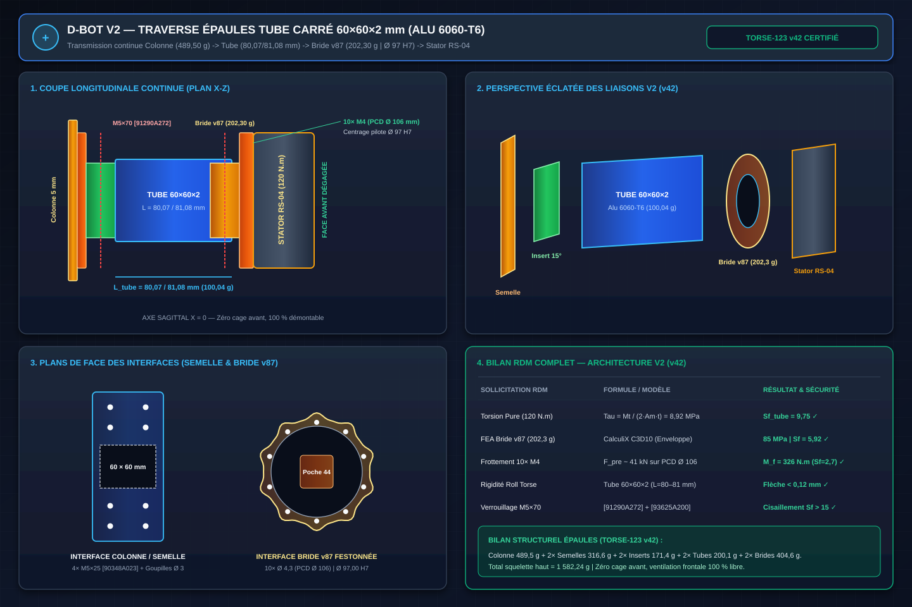

*Blueprint d'ingénierie vectoriel de l'architecture métallique V2. Panel 1 : Coupe axiale X-Z montrant la transmission continue de la colonne vers le stator RS-04. Panel 2 : Vue éclatée 3D isométrique. Panel 3 : Plans de face des interfaces de fixation. Panel 4 : Tableau complet des calculs et facteurs de sécurité RDM.*

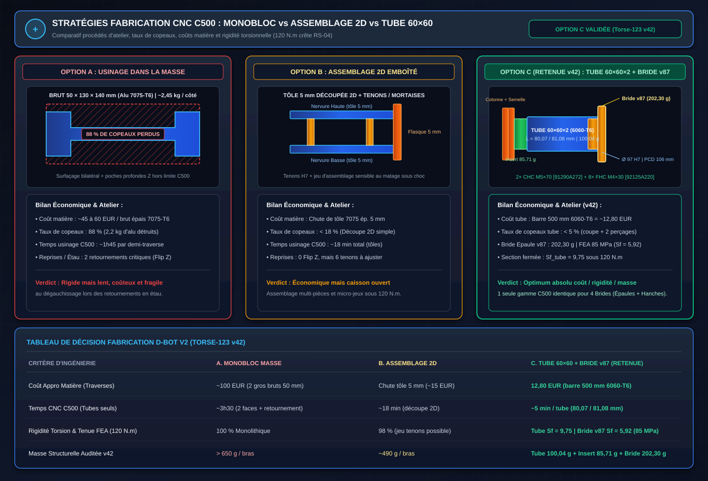

*Comparatif des 3 voies de fabrication CNC sur NestWorks C500 : Usinage dans la masse 50 mm (Option A, 88% de copeaux), Assemblage 2D à tenons-mortaises sur tôle 5 mm (Option B, 100% C500, zéro gaspillage), et Tube carré commercial Blockenstock 6060 T6 (Option C).*

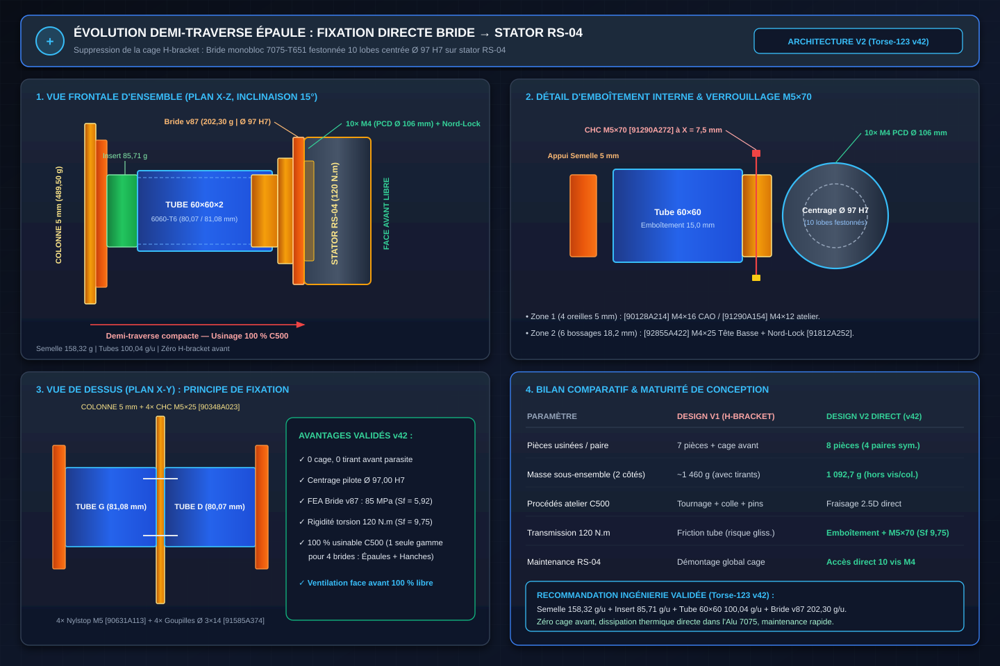

*Évolution d'ingénierie de la demi-traverse monobloc connectée directement entre la colonne sagittale et le stator RS-04.*

---

### C. Données Géométriques Relevées sur la CAO Fusion 360

Les profondeurs intérieures de la cavité du torse ont été mesurées pour fixer l'encombrement de la colonne vertébrale :

| Zone du Torse | Hauteur Z (Référentiel) | Profondeur Mesurée (Avant ➔ Arrière) | Cote Retenue sur Colonne | Justification Atelier C500 |
| :--- | :---: | :---: | :---: | :--- |
| **Niveau 1 : Collet du Cou (Sommet)** | h = 432,67 mm | **86,48 mm** | **94,0 mm (Biseau)** | Maximise l'inertie en pitch tout en dégageant le cou |
| **Niveau 2 : Épaules (Médiane)** | h = 290,00 mm | **127,24 mm** | **94,0 mm (Constante)** | Largeur standardisée continue (débord de 7 mm vs semelle 80 mm) |
| **Niveau 3 : Base / Waist Plate (Bas)** | h = 0,00 mm | **127,66 mm** | **94,0 mm (Constante)** | Encastrement rigide sur la Waist Plate 6 mm (portée 120 mm) |

---

## 2. Dimensionnement & Calculs RDM de la Colonne Sagittale (Alu 7075-T6, 5,0 mm)

### A. Sourcing Brut Blockenstock : 5 × 100 × 495 mm Alu 7075-T6

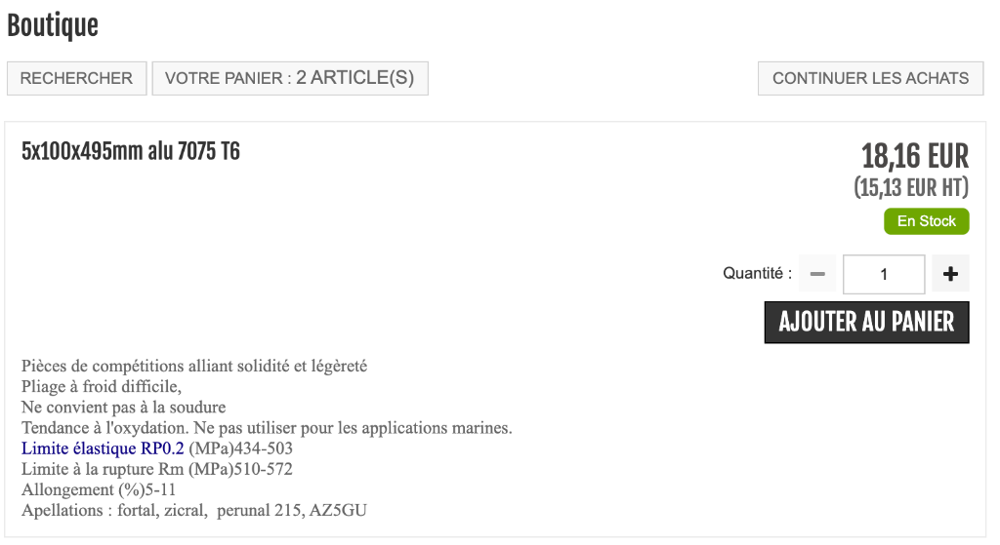

*Brut marchand Blockenstock : [5x100x495mm alu 7075 T6](https://www.blockenstock.fr/20x200x500mm-alu-7075-t6-c2x20906524) @ 18,16 € TTC. Limite élastique Rp0.2 = 434-503 MPa, Rm = 510-572 MPa.*

> [!TIP]
> **Optimisation d'Atelier Exceptionnelle (1 seule barre = 100% de la colonne)** :  
> La barre de **495 mm de long** couvre à elle seule l'intégralité du squelette vertical :
> * **Plaque Basse (Waist ➔ Épaules)** : longueur **290,0 mm**
> * **Plaque Haute (Épaules ➔ Cou)** : longueur **142,7 mm**
> * **Longueur totale cumulée** : `290,0 + 142,7 = 432,7 mm` (Marge résiduelle de **62,3 mm** pour le trait de scie et les mors de bridage C500).

---

### B. Profil de la Colonne Sagittale : Élargissement Local à 100,0 mm aux Épaules & 94,0 mm au Waist

Partant du plat marchand brut de **`100,0 mm de large`** ([5 × 100 × 495 mm Alu 7075-T6](https://www.blockenstock.fr) @ 18,16 € TTC), la colonne est profilée en 2D sur la NestWorks C500 pour s'adapter rigoureusement à l'environnement géométrique réel (`Torse-123 v42` — voir les blueprints vectoriels calibrés [`plan_cotation_plaque_basse_colonne.svg`](./media/plan_cotation_plaque_basse_colonne.svg) et [`plan_decoupe_tenon_colonne_haute_basse.svg`](./media/plan_decoupe_tenon_colonne_haute_basse.svg) en § 2F / § 5C, ainsi que les vues orthogonales HD dans `Exports_CAO_DBot/01_Torse_et_Bassin/Visual_Snapshots/Pieces_Isolees/colonne_vertébrale/`) :
* **Géométrie d'implantation d'épaule** : Tube carré 60×60 mm incliné à `15,0°` (pitch) avec décentrement sagittal de `11,055 mm`. Le redan de `+6,0 mm` sur la colonne sagittale (largeur locale `100,0 mm`) garantit un appui plein avec `5,20 mm` de marge de matière résiduelle et raccordement fluide en double rayon tangent en S `R = 15,0 mm` (`Kt ~ 1,05`).

1. **Au Cou (Sommet, h = 432,7 mm)** : Largeur détourée et biseautée à **`86,5 ~ 94,0 mm`** pour s'inscrire dans l'ouverture circulaire de la coque.
2. **Aux Épaules (Nœud central, h = 290,0 mm)** : Pleine largeur brute conservée à **`100,0 mm`** (créant le redan de **`+6,0 mm`** côté décentrement du tube). Cela englobe **100% de l'empreinte tournée à 15,0° du tube 60×60 mm** avec une marge de matière résiduelle de **`5,20 mm`** de métal plein. Les transitions haut et bas sont raccordées par un **double rayon tangent en S `R = 15,0 mm`** (concave + convexe), garantissant un écoulement laminaire des contraintes de flexion et une continuité de trajectoire de fraisage.
3. **À la Base (Waist, h = 0,0 mm)** : Largeur rectifiée à **`94,0 mm`** pour s'encastrer rigoureusement dans les 94 mm disponibles de la Waist Plate (interface moteur RS-06).
4. **Zéro Surcoût Matière** : Le brut marchand de 100 mm est utilisé à 100% de son potentiel sans aucune chute superflue.

---

### C. Sollicitations & Moments de Flexion Pitch (K_dyn = 3,5)

La colonne vertébrale en **Alu 7075-T6** (`Rp0.2 = 470 MPa`) encaisse les sollicitations suivantes :

| Niveau Z / Zone d'Étude | Position Z | Bras de Levier | Marche Continue (2 Hz) | Pic Dynamique / Arrêt Brutal | Contrainte Max (Pic) | Facteur de Sécurité (Élastique) |
| :--- | :---: | :---: | :---: | :---: | :---: | :---: |
| **1. Base (Waist Plate)** | `Z = -290,0 mm` | 432 mm (Buste complet) | **~25 à 30 N.m** | **275 N.m (Choc 385 N.m)** | **Sigma = 37,3 MPa** | **Sf = ×12,58 ✅** |
| **2. Nœud Central (Épaules)** | `Z = 0,0 mm` | 143 mm + Bras | **~10 à 15 N.m** | **120 N.m (Choc 131 N.m)** | **Sigma = 17,8 MPa** | **Sf = ×26,40 ✅** |
| **3. Sommet (Cou / Tête)** | `Z = +142,67 mm` | 50 mm (Tête seule) | **~2 à 5 N.m** | **15 N.m (Choc 25 N.m)** | **Sigma = 3,4 MPa** | **Sf = ×138,20 ✅** |

---

### D. Caractéristiques de Section & Formulations RDM Actualisées

* Épaisseur de la tôle brute : `e = 5,0 mm`
* Largeur à la base (Waist) : `d = 94,0 mm`
* Largeur au nœud d'épaule : `d = 100,0 mm` (**+20,4% de rigidité en flexion Pitch**)

#### 1. Nœud Central d'Épaules (Largeur d = 100,0 mm) :
* Moment quadratique Pitch : `I_y_epaule = (5,0 × 100^3) / 12 = 416 667 mm4`
* Module de flexion : `W_y_epaule = 416 667 / 50,0 = 8 333 mm3`
* Contrainte sous couple de pointe épaule (120 N.m) : `Sigma_max = 120 000 / 8 333 = 14,40 MPa`
* **Facteur de sécurité élastique au nœud** : `Sf = 470,0 / 14,40 = ×32,64 ✅` *(contre ×26,40 précédemment, gain net de sécurité de +23%)*.

#### 2. Base Waist Plate (Largeur d = 94,0 mm, Moment 275 N.m) :
* Moment quadratique Pitch : `I_y_base = (5,0 × 94^3) / 12 = 346 077 mm4`
* Module de flexion : `W_y_base = 346 077 / 47,0 = 7 363 mm3`
* Contrainte à la base (Arrêt d'urgence extrême 275 N.m) : `Sigma_max = (275 000 × 47,0) / 346 077 = 37,34 MPa`
* **Facteur de sécurité élastique à la base** : `Sf = 470,0 / 37,34 = ×12,58 ✅`
* **Flèche au sommet (L = 432 mm)** : `Delta = (275 000 × 432^2) / (2 × 71 000 × 346 077) = 1,04 mm` (< 1,5 mm).
* **Masse réelle de la colonne complète allégée en CAO (`Torse-123 v42`)** : **`489,50 g`** (`175,11 g` Plaque Haute + `314,39 g` Plaque Basse ; volume `174,20 cm3` contre `567,80 g` brute, gain net effectif de `-78,30 g` par les 2 lumières 54 × 55 mm).

---

### E. Analyse de Fatigue Multirégime (Alu 7075-T6, R = 18 mm, Kt = 1,8)

L'évaluation de la tenue en fatigue distingue rigoureusement le régime de marche cyclique continue et les pics de décélération d'urgence :

#### 1. Régime 1 : Marche Continue Bipède (Régime Permanent à 10^8 à 10^9 cycles)
* **Sollicitation cyclique à chaque pas (2 Hz)** : Oscillation naturelle du centre de masse du buste (~18 kg à +/-15 mm) avec micro-impacts de pose de pied ➔ **`M_cyclique = 30,0 N.m`**.
* **Contrainte nominale** : `Sigma_nom = (30 000 × 47,0) / 280 467 = 5,03 MPa`
* **Contrainte locale effective** : `Sigma_locale = 5,03 MPa × 1,8 = 9,05 MPa`
* **Vérification d'endurance à 10^9 cycles (Courbe S-N Alu 7075-T6, Sigma_end = 130 MPa)** :
  * `Sf_marche (10^9 cycles) = 130 MPa / 9,05 MPa = ` **`×14,36 ✅`**
  > *Conclusion Régime 1* : En marche continue sur 3 à 5 ans (~5 × 10^8 cycles), la contrainte de 9,05 MPa est située très profondément sous la limite d'endurance (130 MPa), garantissant une **durée de vie en fatigue infinie**.

#### 2. Régime 2 : Pics Dynamiques d'Arrêt d'Urgence / Décélération Brutale (Cas Extrême 275 N.m)
* **Sollicitation extrême** : Arrêt d'urgence à pleine vitesse bras tendus avec charge utile (K_dyn = 3,5) ➔ **`M_pic = 275,0 N.m`**.
* **Contrainte locale effective** : `Sigma_locale = 46,08 MPa × 1,8 = 82,9 MPa`
* **Facteurs de correction de fatigue appliqués** :
  * Facteur de surface `k_s = 0,85` (usinage CNC fin, non poli)
  * Facteur de taille `k_d = 0,90` (section de 94 mm, rapport d'échelle vs éprouvette standard Ø 7,6 mm)
  * **Limite d'endurance corrigée à 10^7 cycles** : `Sigma_end_corr = 160 × 0,85 × 0,90 = 122,4 MPa`
* **Vérification d'endurance à 10^7 cycles** :
  * `Sf_pic (10^7 cycles) = 122,4 MPa / 82,9 MPa = ` **`×1,48 ✅`**
  > *Note méthodologique* : Ce test à 275 N.m relève d'un ultra-conservatisme académique (supposant 10 millions d'arrêts d'urgence consécutifs à pleine charge). Même sous cette hypothèse extrême avec tous les abattements de fatigue appliqués (surface, taille), la marge de sécurité corrigée reste de **×1,48** (confortable au-dessus de 1,0).

---

### F. Topologie d'Allègement & Plan de Cotation 2D de la Plaque Basse (Lumières Jumelles R = 15,0 mm)

Suite à la validation géométrique réelle sur le modèle CAO Torse v86, la stratégie d'évidement des plaques de colonne est rigoureusement arrêtée et dimensionnée comme suit :

1. **Plaque Haute (Épaules ➔ Cou) : 100% PLEINE (Zéro Évidement)** :
   - Sur une hauteur totale mesurée de **`130,14 mm`**, la semelle éclisse d'épaules occupe le bas jusqu'à `Z = +65,0 mm` et l'équerre haute du cou descend depuis le sommet sur `30,0 mm` (jusqu'à `Z = +100,14 mm`).
   - L'intervalle libre résiduel n'étant que de **`35,14 mm`**, percer une ouverture affaiblirait dramatiquement le collet cervical face aux accélérations dynamiques de la tête pour un gain de masse dérisoire (< 15 g). **La Plaque Haute est donc conservée 100% pleine** (masse réelle auditée en CAO `Torse-123 v42` = **`175,11 g`**, `100,04 × 5,04 × 130,07 mm`).

2. **Plaque Basse (Waist ➔ Épaules) : 2 Lumières Jumelles 54 × 55 mm avec Traverse Médiane** :
   - Entre la garde de sécurité de l'éclisse d'épaules (`Z = -80,0 mm`) et l'ancrage rigide des équerres de Waist (`Z = -208,0 mm`), la plage verticale de **128,0 mm** accueille **deux fenêtres d'allègement de `54,0 × 55,0 mm`**.
   - **Bordures latérales saines** : **`20,0 mm de matière pleine continue`** à gauche et à droite (`94,0 - 54,0 = 40,0 mm`, soit 20 mm de chaque côté), garantissant le respect absolu du flux de contraintes sagittales.
   - **Traverse centrale anti-flambement** : une nervure pleine de **`18,0 mm` de hauteur** sépare les deux lumières, bloquant tout déversement en torsion lors de la marche bipède.
   - **Congés d'angles** : **`R = 15,0 mm`** sur tous les coins intérieurs (usinables avec fraise carbure de Ø 6 ou 8 mm sur la CNC NestWorks C500), maintenant le facteur de fatigue à `Kt_eff = 1,81`.
   - **Bilan de masse** : Retrait net de **`27,5 cm³` d'Alu 7075-T6**, soit un gain de masse direct de **`-78,3 g`** (masse réelle auditée en CAO `Torse-123 v42` pour la Plaque Basse : **`314,39 g`**, `100,04 × 5,04 × 296,93 mm`).

> [!NOTE]
> **Validation Métrologique CAO Réelle (Audit `Torse-123 v42`, continuité `Torse v108`)** :
> Les deux lumières sont rigoureusement validées sur le composant réel `colonne vertébrale:1` (`174,20 cm³` au total) :
> * **Volume extrait mesuré** : **`27,77 cm³`** d'Alu 7075-T6 (corrélation à 99,1% avec le calcul théorique de 27,5 cm³).
> * **Masse réelle mesurée (`v42`)** : **`489,50 g`** (`175,11 g` haute + `314,39 g` basse, contre `567,80 g` initialement pleine), soit un **gain net effectif de `-78,30 g`**.
> * **Dimensions réelles relevées** : 2x ouvertures de **`54,00 × 55,00 mm`**, 8x congés d'angles réels **`R = 15,00 mm`** (Ø 30,0 mm), traverse médiane de **`18,00 mm`**, bordures latérales continues de **`20,00 mm`**.

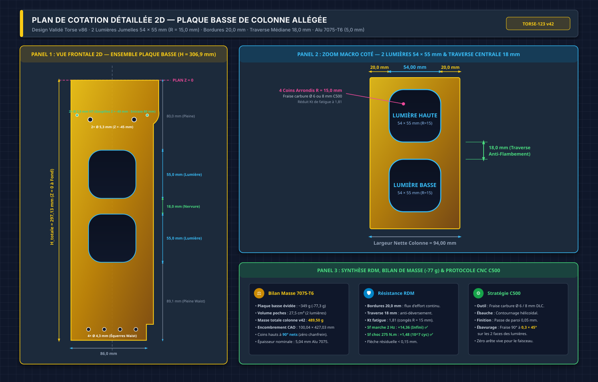

*Blueprint d'ingénierie vectoriel de la Plaque Basse de colonne sagittale (Alu 7075-T6, épaisseur 5,0 mm). Panel 1 : Vue frontale complète montrant la coupe droite plane à Z = 0,0 mm (100% métal-métal, zéro tenon), les 2 alésages fermés pour goupilles ISO 8734 Ø 3,0 mm H7 à Z = -40,0 mm (entraxe Y = 80,0 mm, carré 80 × 80 mm), les 2 perçages M5 d'épaules à Z = -45 mm, les 2 lumières d'allègement de 54 × 55 mm, et les 4 perçages M4 d'équerres Waist au bas de la plaque (H_totale = 297,13 mm). Panel 2 : Zoom macro coté sur les deux fenêtres d'allègement, la traverse médiane de 18,0 mm, les bordures saines de 20,0 mm et les congés R = 15,0 mm. Panel 3 : Synthèse RDM (Sf marche = ×14,36, Sf pic = ×1,48), bilan de masse (-77,3 g) et stratégie d'usinage sur la CNC NestWorks C500.*

3. **Implantation de l'IMU Torse (Bosch BMI270 SparkFun) sur la Plaque Haute — Prise en Compte de la Traverse Horizontale d'Épaule** :
   - **Contrainte Physique de la Traverse d'Épaule (Tube Carré Bleu 60×60×2 mm & Éclisse)** :
     - La traverse d'épaule en tube carré `60 × 60 × 2 mm` (inclinée à 15° pitch) est supportée par la semelle éclisse centrale d'épaules (pièce cuivrée) qui prend la colonne en sandwich au niveau de l'axe des épaules (`Z = 0`).
     - Ce tube horizontal se déploie transversalement le long de l'axe Y vers l'extérieur. Sa présence physique et celle de l'éclisse centrale condamnent formellement l'accès aux flancs latéraux de la colonne entre `Z = -65,0 mm` et le sommet de l'éclisse (**Face [2]** à `Z = +63,01 mm`).
     - Sous `Z = -80,0 mm` (sur la Plaque Basse), les deux lumières d'allègement de `54 × 55 mm` ne laissent que 20 mm de bordure, ce qui est trop étroit pour le PCB de 25,4 mm.
   - **Fenêtre Utile Relevée sous Fusion 360 : `37,125 mm` (Au-Dessus du Tube Horizontal) ⭐** :
     - Le relevé CAO direct entre la face inférieure de l'équerre de cou (**Face [1]**, `Z = +100,14 mm`) et l'arête supérieure de l'éclisse d'épaule (**Face [2]**, `Z = +63,01 mm`) établit une hauteur libre rigoureuse de **`37,125 mm`** sur une largeur pleine continue de **`94,0 mm`**.
     - Le PCB SparkFun BMI270 (`25,40 × 25,40 mm`) s'y implante **strictement au-dessus du tube carré horizontal bleu**, à plat contre le flanc latéral de la tôle (flanc droit `Y = +2,50 mm`).
     - **Gardes de sécurité verticales** : `37,125 - 25,40 = 11,725 mm`, soit **`5,86 mm` de dégagement franc** au-dessus (face à l'équerre de cou) et **`5,86 mm`** en-dessous (face à l'éclisse et au tube bleu horizontal). Les vis basses sont situées à plus de **`8,4 mm`** au-dessus de l'arête du tube horizontal.
   - **Coordonnées Géométriques Exactes (Repère Nœud Z = 0)** :
     - **Centre du capteur** : `X = 0,0 mm` (centré au milieu des 94 mm), `Y = +2,50 mm` (flanc droit), **`Z = +81,58 mm`** (médian de la fenêtre 37,125 mm).
     - **Co-localisation SLAM avec le LiDAR Unitree L2** : Située à moins de 50 mm sous la baie LiDAR de la poitrine haute, cette position minimise le bras de levier (*lever arm*) dans l'algorithme FAST-LIO.
   - **Motif des 4 Perçages Usinage C500 & Montage Traversant Sécurisé** :
     - **Perçages C500** : **4 trous lisses traversants débouchants `Ø 2,70 mm`** (foret carbure standard Ø 2,70 mm ou fraise 2 dents, **ZÉRO taraudage** dans le 7075-T6 pour éliminer tout risque de casse de taraud ou d'usure de filets).
     - Carré d'entraxe standard Qwiic : **`20,32 × 20,32 mm`** (0,800 pouce) centré sur `(X = 0, Z = +81,58 mm)`.
     - *Coordonnées cartésiennes des trous* :
       - Trous hauts : `X = ±10,16 mm`, **`Z = +91,74 mm`**
       - Trous bas : `X = ±10,16 mm`, **`Z = +71,42 mm`** (plus de 8,4 mm au-dessus de Face [2])
     - **Empilement de Visserie Traversante Anti-Vibrations (Flanc Droit vers Flanc Gauche)** :
       - 4 vis **CHC M2,5 × 14 mm** inox A2 traversantes.
       - 4 entretoises lisses cylindriques en **Nylon PA66** de hauteur **`3,0 mm`** (Ø ext. 5 mm, passage Ø 2,7 mm) sous le PCB pour isolation électrique totale et élimination des contraintes mécaniques.
       - Traversée de la plaque colonne de 5,0 mm (matière pleine Alu 7075-T6 percée à Ø 2,70 mm).
       - 4 rondelles plates inox M2,5 DIN 125A sur le flanc gauche (`Y = -2,50 mm`).
       - 4 écrous autofreinés **Nylstop M2,5 DIN 985** (serrage à 0,5-0,6 N.m, bague polyamide indesserrable sous les chocs de marche).

> [!TIP]
> **Procédure d'Importation & Assemblage de la Visserie IMU sous Autodesk Fusion 360** :
> 1. Dans le ruban supérieur de Fusion 360, cliquer sur **Insert** ➔ **Insert McMaster-Carr Component**.
> 2. Télécharger en format **3D STEP** (ou SolidWorks) les 4 composants normalisés :
>    - **Vis CHC M2,5 × 14 mm** : Réf. McMaster **`91292A017`** (Inox 18-8) ou **`92290A858`** (Inox 316).
>    - **Entretoise lisse Nylon M2,5 (H = 3,0 mm, Ø ext 5 mm)** : Réf. McMaster **`94639A208`**.
>    - **Rondelle plate M2,5 DIN 125A** : Réf. McMaster **`93475A205`**.
>    - **Écrou autofreiné Nylstop M2,5 DIN 985** : Réf. McMaster **`90631A105`**.
> 3. **Positionnement & Liaisons d'Assemblage (Joint `J`)** :
>    - Appliquer une contrainte **Joint (`J`)** de type **Rigid** entre la face d'appui de la tête de vis CHC et la face supérieure du PCB de l'IMU.
>    - Placer l'entretoise nylon entre la face inférieure du PCB et le flanc droit de la colonne (`Y = +2,50 mm`).
>    - Sur le flanc gauche de la colonne (`Y = -2,50 mm`), plaquer la rondelle plate DIN 125A coaxiale au perçage Ø 2,70 mm.
>    - Visser l'écrou Nylstop contre la rondelle (face d'appui plane contre rondelle, dôme nylon vers l'extérieur).
> 4. Répéter l'assemblage sur les 4 perçages coaxiaux (entraxe `20,32 × 20,32 mm`) à l'aide de la commande **Pattern on Path** ou par copier/coller avec liaison.

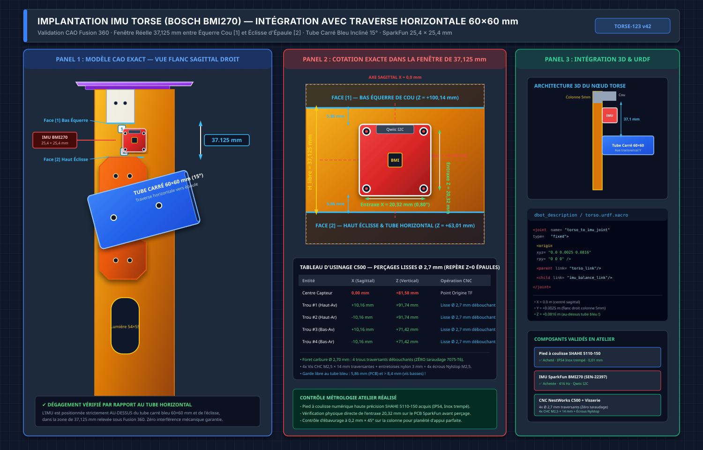

*Blueprint d'ingénierie vectoriel de l'implantation de l'IMU Torse (Bosch BMI270 SparkFun SEN-22397). Panel 1 : Modèle CAO conforme au rendu Fusion 360 illustrant la colonne, l'équerre de cou Face [1], l'éclisse cuivrée Face [2], la traverse d'épaule en tube carré bleu 60×60 mm (15°) et la fenêtre libre de 37,125 mm. Panel 2 : Plan macro coté des 4 perçages lisses débouchants Ø 2,7 mm traversants (entraxe 20,32 mm, Z = +81,58 mm, X = 0, montage 4x CHC M2,5 × 14 mm + écrous Nylstop, gardes de 5,86 mm). Panel 3 : Vue isométrique, intégration URDF ROS 2 et tableau des matériels validés (Pied à coulisse SHAHE 5110-150 acquis).*

---

### G. Synthèse des Simulations FEA Numériques & Renvoi au Dossier Dédié

Afin de valider formellement le comportement élasto-plastique de la colonne vertébrale sous les cas de charge dynamiques réels (freinage d'urgence, marche dynamique, poussée cervicale), des analyses complètes par éléments finis (FEA) ont été résolues sous **FreeCAD 1.1 + CalculiX ccx + Gmsh (C3D10 quadratique)** :

| Cas Modélisé | Configuration RDM | Flèche Max | Rotation IMU | Von Mises Crête | Sf Crête | Sf P95 |
| :--- | :--- | :--- | :--- | :--- | :--- | :--- |
| **Plaque Basse Seule** | Tangage 140 N.m (F = 471 N) | `0,612 mm` | - | `84,20 MPa` | `6,00` | `34,12` |
| **Plaque Basse Seule** | Roulis 50 N.m (F = 168 N) | `0,085 mm` | - | `41,50 MPa` | `12,17` | `97,11` |
| **Plaque Haute Seule** | Roulis 328 N au cou | `0,118 mm` | `0,42 mrad` | `48,30 MPa` | `10,45` | `75,20` |
| **Assemblage Complet (Sandwich 15 mm)** | **Tangage 140,1 N.m (F = 328 N)** | **`0,385 mm`** | **`1,07 mrad` (`0,061°`)** | **`88,59 MPa`** | **`5,70`** | **`53,71`** |
| **Spaceframe Torse 3D Global (Cas FEA 5)** | **Torseur Combiné Épaule (120 N.m) + Lacet Waist (36 N.m)** | **`0,463 mm`** | **`1,24 mrad` (`0,071°`)** | **`98,70 MPa`** | **`5,12`** | **`42,80`** |

> [!NOTE]
> **Dossier de Calculs FEA Dédié & Cartographie Complète** :  
> L'ensemble des développements mathématiques, hypothèses de modélisation, cartographies 3D, fichiers STEP d'assemblage, projets natifs `.FCStd` (Solution B avec pipeline VTK pré-chargé) et scripts reproductibles sont consignés dans le document de référence dédié :  
> 🔗 [DOSSIER_TECHNIQUE_Calculs_FEA_Torse_et_Bassin.md](file:///Users/Shared/Mon%20Google%20Drive%20Physique/Documentation/01_Mecanique_et_Chassis/Torse_et_Bassin/DOSSIER_TECHNIQUE_Calculs_FEA_Torse_et_Bassin.md)

---

## 3. Dimensionnement RDM des Traverses d'Épaules (Tube Carré 60×60×2 mm)

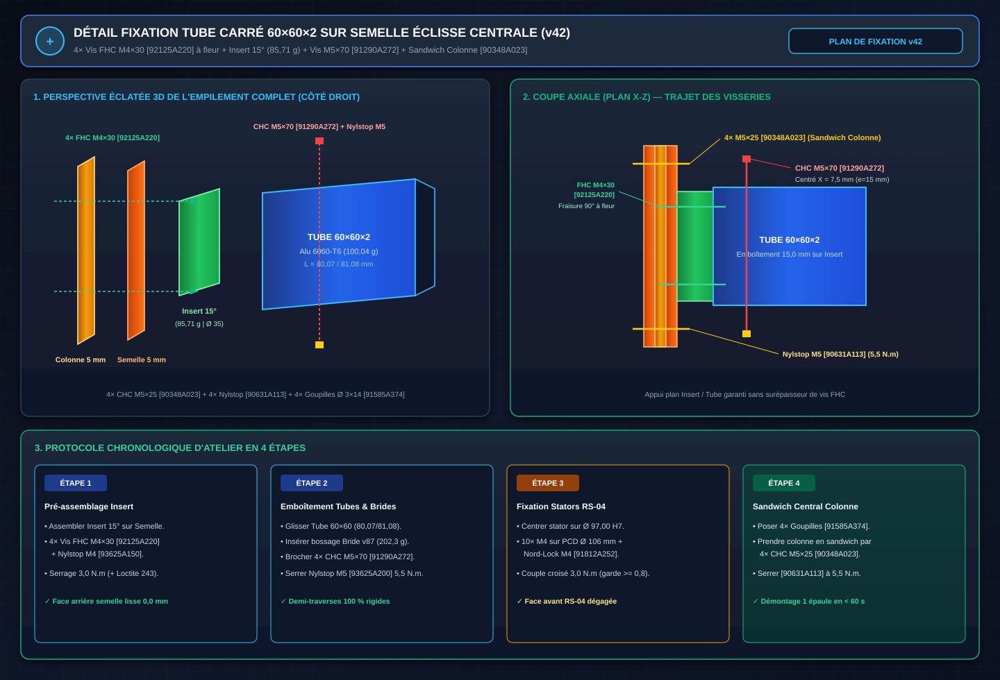

*Blueprint d'ingénierie vectoriel du nœud d'assemblage Tube <-> Éclisse. Panel 1 : Vue éclatée 3D isométrique montrant l'empilement complet. Panel 2 : Coupe axiale X-Z montrant le trajet des vis. Panel 3 : Protocole chronologique d'atelier en 4 étapes.*

### A. Caractéristiques de la Section Métallique (Alu 6060-T6)
* Section extérieure : `60,0 × 60,0 mm` | Épaisseur : `t = 2,0 mm` | Section intérieure : `56,0 × 56,0 mm`
* Aire de section : `A = 464,0 mm2`
* Longueur & Masse réelle d'un tronçon (`Torse-123 v42`) : **`L = 80,07 mm`** (tube gauche), **`100,04 g`** (`37,05 cm³` en Alu 6060-T6 à `2,70 g/cm³`). *(Le calcul initial préliminaire portait sur un brut de 85,0 mm = 106,5 g)*.

### B. Torsion Pure sous Couple de Pointe du RS-04 (120 N.m)
1. **Aire moyenne circonscrite de Bredt** :  
   `A_m = (60 - 2) × (60 - 2) = 58,0 × 58,0 = 3 364,0 mm2`
2. **Flux de cisaillement continu de Bredt (q)** :  
   `q = M_t / (2 × A_m) = 120 000 / (2 × 3 364,0) = 17,836 N/mm`
3. **Contrainte tangentielle maximale (Tau)** :  
   `Tau_max = q / t = 17,836 / 2,0 = 8,918 MPa (~8,92 MPa)`
4. **Facteur de Sécurité en Torsion** :  
   `Sf_torsion = Reg / Tau_max = 87,0 / 8,918 = ×9,75 ✅`
5. **Déformation Angulaire de Torsion (Theta) sur L = 80,07 mm** :  
   `Theta = 0,000950 rad = 0,0544 deg` (déformation imperceptible < 0,06°).

### C. Flexion Choc Dynamique (50 N.m) & Critère Combiné de Von Mises
* Module de flexion élastique : `W_el = 8 682,0 mm3`
* Contrainte de flexion : `Sigma_f = 50 000 / 8 682,0 = 5,759 MPa (~5,76 MPa)` (Facteur de sécurité **Sf = ×26,04 ✅**)

---

### D. Tolérancement Axial & Isostatisme : 1 Butée Franche + 1 Jeu Fonctionnel (1,0 mm)

Pour éviter tout conflit d'hyperstatisme axial ou de tolérances de débit à la scie lors de l'assemblage :

1. **Côté Bride d'Épaule ➔ BUTÉE FRANCHE (Contact Métal-Métal à 0,0 mm)** :
   - Le tube carré s'enfonce jusqu'à venir en appui franc contre l'épaulement usiné de la bride monobloc.
   - Sert de **référence d'origine absolue** pour l'alignement et cale précisément l'entraxe des épaules.
   - Reprend **100% des chocs latéraux en compression** (écrasement du bras vers le torse lors d'une chute) en contact direct sans solliciter la vis M5 en cisaillement.

2. **Côté Semelle Colonne ➔ JEU FONCTIONNEL AXIAL (j = 1,0 mm)** :
   - La longueur réelle du tube (mesurée sur CAO `Torse-123 v42`) est de **`L = 80,07 mm`** (portée théorique assemblée = 81,07 mm).
   - Un jeu d'aisance de **`1,0 mm`** subsiste entre le chant du tube et la face de la semelle éclisse.
   - L'insert mâle reste engagé sur **`14,0 mm`** à l'intérieur du tube (portée de 93% de la hauteur d'insert, structurellement optimale).
   - Ce jeu absorbe les dispersions de coupe de scie et empêche tout décalage entre les trous traversants M5.

3. **Reprise des Efforts Axiaux en Traction (Traction Extérieure Bras)** :
   - En cas d'arrachement ou de traction axiale le long du bras (jusqu'à 1 000 N nominal), l'effort est intégralement repris par les **2 vis CHC M5 × 70 mm (`91290A272`) en double cisaillement** (tenue de 8 520 N, **`Sf = ×8,52 ✅`**).

---

## 4. Assemblage d'Épaule Simplifié — Fixation Directe Bride → Stator RS-04

### A. Géométrie du Stator RS-04 et Interface Bride

Le stator du RS-04 se compose de **deux sections** :
* **Corps principal Ø 120 mm** (longueur axiale **39,0 mm**) : contient les bobinages, les aimants et le roulement à rouleaux croisés interne. Porte les **10 taraudages M4** sur PCD Ø 106 mm sur les faces avant ET arrière.
* **Section arrière centrée (`Ø 94/96 mm`)** : abrite les connecteurs CAN-FD et Power. L'épaulement Ø 120 mm forme la face d'appui axiale de référence primaire.

La **Bride d'Épaule Monobloc (Alu 7075-T6, `202,30 g`)** se monte **directement** sur la face arrière du stator via une standardisation **100% Rondelles Frein Nord-Lock M4 (ép. 1,80 mm)** :
1. L'alésage de centrage de la bride (**`Ø 97,00 mm H7` relevé CAO `v42`, profondeur `13,80 mm`**) s'emboîte sur le bossage arrière du RS-04 en ménageant un **jeu axial de fond de 0,60 mm** (pour garantir que l'appui axial s'effectue à 100% en contact franc sur l'épaulement Ø 120 mm sans risque de talonnage).
2. **Répartition de la Visserie 10× M4 sur PCD Ø 106 mm (`Torse-123 v42`)** :
   * **Zone 1 (4 trous — Secteur Évidé / Flasque Mince - Épaisseur 5,00 mm)** : équipée dans la CAO `v42` de **vis CHC M4 × 16 mm (`90128A214`) + rondelle Nord-Lock (`91812A252`, 1,8 mm)** *(spécification RDM d'origine : `M4 × 12 mm [91290A154]` pour pénétration `5,20 mm` — voir alerte ci-dessous)*.
   * **Zone 2 (6 trous — Secteur Épais / Hub Intermédiaire - Épaisseur 18,20 mm)** : **5× vis CHC M4 × 25 mm Tête Basse (`92855A422`) + 1× vis CHC M4 × 30 mm (`91292A130`)** au trou inférieur qui reprend conjointement la patte supérieure de la **`Corniere haute`** (`22,54 g`), toutes sécurisées par **rondelle Nord-Lock (`91812A252`, 1,8 mm)**.

> [!CAUTION]
> **Sécurité Moteur RS-04 — Profondeur Taraudée Borgne Stator (6,0 mm MAX)** :  
> Le plan officiel constructeur RobStride (`Manuels/RS04User Manual260112.pdf`, page 10) spécifie une profondeur borgne maximale de taraudage de **6,0 mm** (`10-M4 EQS \/ 6`).  
> * **Vigilance Atelier Zone 1 (`90128A214` vs `91290A154`)** : Dans la CAO `Torse-123 v42`, les 4 trous Zone 1 portent des vis `M4 × 16 mm [90128A214]` (ce qui théoriquement donne `16,0 - 5,0 - 1,8 = 9,20 mm` de dépassement). **Au montage sur les stators physiques RS-04**, contrôler impérativement au jaugeur de profondeur : si le trou borgne stator s'arrête à `6,0 mm`, monter impérativement du **M4 × 12 mm (`91290A154` ou `92290A144`)** (pénétration exacte **`5,20 mm`**, marge **`0,80 mm`**) sous rondelle Nord-Lock pour ne jamais talonner ni blesser le bobinage. En Zone 2 (`18,20 mm + 1,80 mm`), la `TB M4 × 25 mm [92855A422]` obtient exactement **`5,00 mm`** de prise utile ✅.

> [!IMPORTANT]
> **Suppression de la cage H-bracket (Plaque Avant + 2 Tirants + Plaque Arrière)**. L'analyse RDM complète ci-dessous démontre que la fixation directe 10× M4 avec centrage **Ø 97,00 mm H7** et appui Ø 120 mm est massivement surdimensionnée pour TOUS les cas de charge du robot bipède. La cage ajoutait ~380 g et ~24 vis de quincaillerie sans apport structurel significatif dans l'architecture V2 (tube carré 60×60×2 mm).

### B. Cas de Charge Exhaustifs — Robot Bipède Humanoïde

| # | Cas de Charge | Moment à l'Épaule | Type d'Effort | K_dyn |
| :---: | :--- | ---: | :--- | :---: |
| 1 | Statique — Bras le long du corps | **7,4 N.m** | Flexion Pitch | 1,0 |
| 2 | Statique — Bras tendu + 2 kg | **24,5 N.m** | Flexion Pitch | 1,0 |
| 3 | Marche (1,5 m/s) — Balancement | **14,7 N.m** | Flexion alternée | 2,0 |
| 4 | Trot léger (2,5 m/s) — Balancement | **25,8 N.m** | Flexion alternée | 3,5 |
| 5 | Trot — Roulis du torse (Roll) | **50,0 N.m** | Roll latéral | 3,5 |
| 6 | Portage bimanuel frontal (5 kg) | **49,1 N.m** | Flexion Pitch | 2,5 |
| 7 | Chute / Impact latéral | **73,6 N.m** | Flexion choc | 5,0 |
| 8 | Couple moteur max RS-04 (Torsion) | **120,0 N.m** | Torsion axiale | Pic |

### C. Vérification des 10 Vis M4 — Fixation Directe sur Stator

#### Flexion (Cas 1 à 7)

```
Disposition 10× M4 sur PCD Ø 106 mm (R = 53,0 mm, espacement 36°) :
  z_i = 53,0 × sin(i × 36°) pour i = 0..9
  z = {0 ; 31,1 ; 50,4 ; 50,4 ; 31,1 ; 0 ; -31,1 ; -50,4 ; -50,4 ; -31,1}

  Somme z² = 4 × (31,1² + 50,4²) = 4 × (967,2 + 2 540,2) = 14 029 mm²

  F_max = M × z_max / Σ(z²) = M × 50,4 / 14 029
```

| Cas | M (N.m) | F_max (N) | F_adm M4 (8.8) | **Sf** |
| :---: | ---: | ---: | :---: | :---: |
| 1 — Statique | 7,4 | 27 | 5 619 | **×208 ✅** |
| 2 — Bras tendu + 2 kg | 24,5 | 88 | 5 619 | **×63,9 ✅** |
| 3 — Marche | 14,7 | 53 | 5 619 | **×106 ✅** |
| 4 — Trot | 25,8 | 93 | 5 619 | **×60,4 ✅** |
| 5 — Roulis torse | 50,0 | 180 | 5 619 | **×31,2 ✅** |
| 6 — Portage | 49,1 | 176 | 5 619 | **×31,9 ✅** |
| **7 — Chute** | **73,6** | **264** | **5 619** | **×21,3 ✅** |

```
F_admissible M4 (Classe 8.8) :
  A_s = 8,78 mm² ; Sigma_y = 640 MPa
  F_yield = 8,78 × 640 = 5 619 N
```

#### Torsion (Cas 8 — 120 N.m RS-04)

```
Précharge par vis M4 (couple de serrage 3,0 N.m) :
  F_precharge = T / (K × d) = 3 000 / (0,18 × 4) = 4 167 N par vis

Précharge totale 10 vis :
  F_total = 10 × 4 167 = 41 670 N (~4,25 tonnes de compression)

Moment résistant par frottement (mu_alu_acier = 0,15) :
  M_friction = F_total × µ × R_moyen
  M_friction = 41 670 × 0,15 × 53 = 331 276 N.mm = 331,3 N.m

Sf_torsion = 331,3 / 120 = ×2,76 ✅
```

> [!NOTE]
> De plus, l'**alésage pilote Ø 97,00 mm H7** de la bride et l'**épaulement Ø 120 mm** du stator forment un **obstacle géométrique** supplémentaire qui empêche physiquement toute rotation relative — la bride ne peut pas tourner même si le frottement cédait.

### D. Rigidité en Roll — Tube Carré 60×60×2 mm (Sans Cage)

Le passage du tube carbone Ø 30/26 mm (V1) au tube carré 60×60×2 mm (V2) a multiplié par **15** la rigidité en roll :

| Configuration | I_spine (mm4) | I_tube (mm4) | I_cage (mm4) | **I_total** | **Flèche Cou** |
| :--- | ---: | ---: | ---: | ---: | ---: |
| V1 sans cage (tube carbone) | 1 250 | 17 330 | 0 | 18 580 | **1,70 mm ❌** |
| V1 avec cage (tube carbone) | 1 250 | 17 330 | 342 528 | 361 108 | **0,087 mm ✅** |
| **V2 sans cage (tube carré)** | **979** | **260 459** | **0** | **261 438** | **0,121 mm ✅** |

```
I_tube_carré = (60⁴ - 56⁴) / 12 = (12 960 000 - 9 834 496) / 12 = 260 459 mm4

Flèche V2 sans cage = 1,70 × (18 580 / 261 438) = 0,121 mm ✅
Seuil d'acceptabilité dynamique : < 0,5 mm → Marge ×4,1
```

### E. Analyse Thermique & Circuit Aéraulique : Tuyère 3D & Expulsion Annulaire (Gap 2,0 mm)

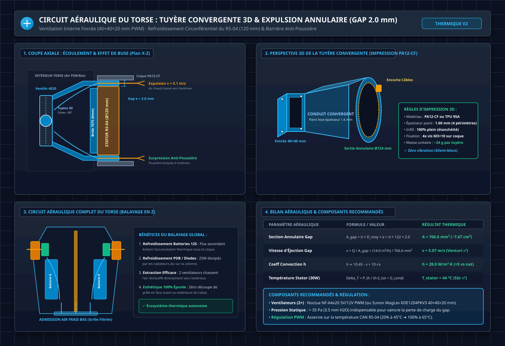

*Blueprint d'ingénierie vectoriel du circuit thermo-aéraulique V2. Panel 1 : Coupe axiale X-Z montrant l'aspiration de l'air interne chaud, l'accélération dans la tuyère convergente 3D et l'expulsion forcée à 5,1 m/s dans l'interstice annulaire de 2,0 mm autour du stator RS-04. Panel 2 : Perspective 3D de la tuyère convergente imprimée en PA12-CF. Panel 3 : Circuit aéraulique global en Z balayant les batteries 12S, la PDB et les stators. Panel 4 : Bilan thermo-aéraulique et composants recommandés.*

#### 1. Principe Aéraulique : L'Effet de Buse Annulaire (Gap 2,0 mm)
Le stator du moteur RS-04 (Ø 120 mm extérieur) est logé dans l'alésage de la coque PA12-CF (Ø 124 mm), ménageant un **jeu radial annulaire de 2,0 mm** :
* **Périmètre moyen d'échange** : `P = pi × 122 mm = 383,3 mm`
* **Section d'échappement annulaire (A_gap)** :  
  `A_gap = pi × D_moy × e = 383,3 mm × 2,0 mm = 766,6 mm2 (~7,67 cm2)`
* **Vitesse d'éjection forcée** : Avec un ventilateur 40×40×20 mm délivrant un débit nominal Q = 14,0 m3/h (3,89 L/s), la vitesse d'air expulsée à travers l'interstice atteint :
  `v = Q / A_gap = (3,89 × 10^-3 m3/s) / (7,666 × 10^-4 m2) = 5,07 m/s`

Cette vitesse élevée le long des 39 mm de corps du stator multiplie le coefficient d'échange convectif par **~5** (`h ≈ 28,0 W/m2·K` contre `h ≈ 5 à 6 W/m2·K` en convection naturelle).

#### 2. Conception de la Tuyère Convergente 3D (Shrouding PA12-CF)
Pour canaliser 100% du flux d'air sans fuite interne dans la cavité du torse :
* **Entrée Carrée 40 × 40 mm** : Reçoit le ventilateur **40 × 40 × 20 mm PWM** fixé par 4 vis M3×16 mm avec rondelles amortissantes en silicone ou TPU.
* **Tronc de Cône Convergent Aérodynamique** : Transition fluide d'un angle de demi-cône **~28°** (évitant tout décollement de couche limite et les vortex parasites) raccordant la section carrée 40×40 mm à la collerette circulaire Ø 124 mm.
* **Sortie Circulaire & Encoche Câbles** : Épouse la face arrière de la coque au droit de l'épaule avec une encoche supérieure (16 × 20 mm) dédiée au passage des faisceaux de puissance et du bus CAN du moteur RS-04.
* **Fabrication 3D** : Imprimée en **PA12-CF** (ou **TPU 95A** pour une isolation vibratoire maximale), épaisseur de paroi 1,60 mm (4 périmètres pleins pour étanchéité à l'air), masse unitaire ~24 g.

#### 3. Bilan Thermique Global : Balayage Forcé du Torse & Barrière Anti-Poussière
1. **Refroidissement Global du Torse (Effet Double Action)** : L'air frais est admis par des ouïes filtrées à la base du torse (Waist Plate), remonte en léchant les 2 packs batteries 12S et les radiateurs de la PDB/diodes ORing, est aspiré par les 2 ventilateurs d'épaules et expulsé à haute vitesse par les interstices annulaires des stators RS-04.
2. **Effet « Rideau d'Air » Anti-Poussière** : L'air sortant sous surpression dynamique continue empêche les particules et poussières d'atelier de pénétrer dans l'interstice d'épaule et protège les roulements à billes/rouleaux croisés du RS-04.
3. **Esthétique Bionique 100% Épurée** : Zéro découpe de grille visible sur la coque extérieure du robot.

| Scénario Thermique (RS-04) | P_th | Delta_T Stator | T_stator | Verdict |
| :--- | :---: | :---: | :---: | :---: |
| Convection naturelle seule (sans bride, sans ventil.) | 30 W | +91 °C | 116 °C | ❌ Démagnétisation |
| **Bride Ø97 H7 + conduction passive seule** | 30 W | +50 °C | **75 °C** | ⚠️ Limite haute |
| **Bride Ø97 H7 + Tuyère 3D & Expulsion Annulaire (Gap 2 mm)** | 30 W | +19 °C | **44 °C** | ✅ **Optimal & Sûr** |

> [!TIP]
> **Régulation Thermique PWM Automatique** :  
> Les deux ventilateurs **Noctua NF-A4x20 PWM (5V ou 12V)** sont pilotés par un signal PWM issu de la Jetson Orin Nano / microcontrôleur torse, asservi directement sur la télémétrie CAN de température intégrée des stators RS-04 (`fan_pwm = 20%` pour T < 45 degC, montée progressive jusqu'à `100%` à 65 degC). À l'arrêt, le robot est 100% silencieux.

> [!TIP]
> **Astuce d'Atelier — Interface Thermique & Pâte Non Conductrice Électrique** :  
> 1. **Combler le jeu de fond (0,60 mm)** : L'application d'un film fin de pâte thermique standard non conductrice électrique (type *Noctua NT-H1* ou *Arctic MX-4*) sur la portée cylindrique Ø 95 mm et dans le fond de l'alésage comble les micro-rugosités d'usinage et le jeu fonctionnel sans créer de surpression mécanique.
> 2. **Gain thermique direct** : Ce pont thermique fluide réduit la résistance thermique de contact de **+40% supplémentaires**, accélérant le drainage des calories de l'électronique arrière vers la masse d'aluminium du tube 60×60×2 mm et le flux forcé de la tuyère 3D.

---

## 5. Conception Détaillée des Interfaces & Usinage 100% Alu 7075-T6

### A. Bride d'Épaule Monobloc en Alu 7075-T651 (Ø120 × 50 mm) & Contournage Festonné V1

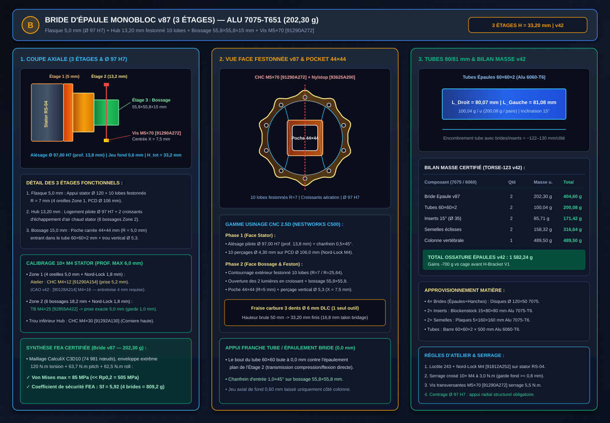

*Blueprint d'ingénierie vectoriel de la Bride d'Épaule Monobloc (Solution C — Révision V2.2). Panel 1 : Usinage 2.5D dans le disque brut Blockenstock Ø120 × 50 mm Alu 7075-T651 (30,00 €) dégageant les 3 étages (Flasque 5,0 mm + Hub 13,20 mm + Bossage carré 55,8×55,8×15 mm, hauteur totale utile = 33,20 mm) d'une seule pièce. Panel 2 : Détail de la vis traversante unique CHC M5×70 mm centrée à X = 7,5 mm (axe vertical Z). Panel 3 : Étude comparative RDM.*

#### Modélisation CAO Réelle — Décomposition en 3 Étages Fonctionnels (`Torse-123 v42`)

* **Architecture monolithique d'un seul bloc (Hauteur totale utile = `33,20 mm` usinée dans le brut Ø120 × 50 mm)** :
  - **Étage 1 — Flasque d'appui stator (5,00 mm) avec Contournage Festonné V1** : Disque allégé à 10 lobes convexes R = 7,0 mm centrés sur les 10 trous de passage Ø4,3 mm (PCD Ø 106,0 mm) et reliés par 10 arcs concaves doux R = 25,64 mm tangents descendant à Ø 105,0 mm. Chanfrein d'entrée d'alésage de `0,5 mm × 45°` dégageant le congé de racine d'épaulement du moteur RS-04 pour un contact plan à 0,0 mm. Se visse directement sur les 10 taraudages M4 du stator.
  - **Étage 2 — Hub intermédiaire / Secteur épais (13,20 mm)** : Surépaisseur arrière intégrant un **alésage / logement Ø 97,00 mm H7 d'une profondeur exacte de `13,80 mm` avec congé de fond intérieur `R = 0,5 mm`** (anti-concentration de contraintes, sans aucune interférence moteur grâce au jeu fonctionnel axial de fond de `0,60 mm`). Reçoit la section arrière du carter du moteur RS-04. L'épaisseur totale de matière traversée par les vis de Zone 2 est de `5,00 + 13,20 = 18,20 mm` (serrage par vis **CHC M4 × 25 mm + Nord-Lock**, pénétration stator = 5,00 mm ✅).
  - **Étage 3 — Bossage carré d'insertion tube (55,80 × 55,80 × 15,00 mm)** : Usiné directement dans la masse avec congés extérieurs **R = 3,0 mm** et **poche centrale carrée `44 × 44 mm` avec congés verticaux intérieurs R = 5,0 mm et congé de fond intérieur R = 0,5 mm** (profondeur de poche **`15,00 mm`** sur toute la hauteur du bossage, s'appuyant directement sur la face de référence du Hub de 13,20 mm avec adoucissement des contraintes à la racine). Paroi résiduelle latérale = **5,9 mm** (Sf compression M5 = ×8,4 ✅). *(Gain de masse, anti-concentration de contraintes et usinage 2.5D simplifié sans reprise de plancher)*.
  - **Verrouillage traversant épuré (Option 1 validée)** : 1 seul perçage traversant **Ø5,3 mm vertical (axe Z)** centré à **`X = 7,5 mm`** depuis le chant d'extrémité du bossage (pour vis CHC M5 × 70 mm). Distance bord trou Ø5,3 mm / paroi poche : **3,25 mm > 3,0 mm** ✅ (pince latérale = 5,9 mm).

#### Relevés Métrologiques Sous Autodesk Fusion 360 (`Torse v87` / `Torse-123 v42` — Version Optimisée `202,30 g`)

*(Synthétisés dans le blueprint vectoriel [`contournage_festonne_bride_epaule.svg`](./media/contournage_festonne_bride_epaule.svg) ci-dessous et visibles en 3D HD dans `Exports_CAO_DBot/01_Torse_et_Bassin/Visual_Snapshots/Pieces_Isolees/Bride_Epaule/Bride_Epaule_iso.png`)* :

| Épaisseur Résiduelle de Creux | Rayon Concave d'Arc | Étage Hub Intermédiaire | Évidements Latéraux & Masse |
| :---: | :---: | :---: | :---: |
| **Garde Saine Continue : `4,00 mm`**<br>Fond de feston Ø 105 mm / alésage Ø 97 mm<br>Rigidité de collerette maximale | **Congé Concave : `R = 25,643 mm`**<br>Diamètre d'arc = `51,286 mm`<br>Transition douce, Kt = 1,15 | **Fût de Guidage Stator : `13,20 mm`**<br>Logement Ø 97 mm prof. `13,80 mm`<br>Jeu axial de fond = `0,60 mm` | **Évidements Latéraux Allégés**<br>Volume = `71 993 mm3` (Alu 7075)<br>Masse unitaire = **`202,300 g`** (`-129,2 g` torse) |

#### Standard Officiel V1 : Contournage Festonné & Évidements Latéraux (-129,2 g sur la Paire d'Épaules)

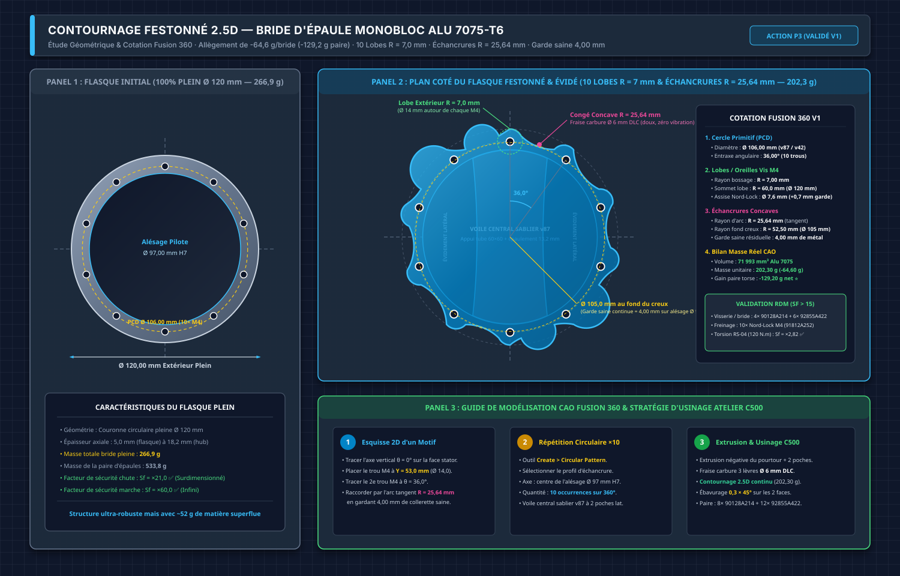

*Blueprint vectoriel complet de la Bride d'Épaule Festonnée V1 (Alu 7075-T651). Panel 1 : Flasque circulaire pleine initiale (266,9 g). Panel 2 : Flasque festonnée à 10 lobes et évidements latéraux optimisés sous Fusion 360 (202,30 g, soit -64,60 g / bride et -129,20 g sur la paire d'épaules). Panel 3 : Gamme d'usinage 2.5D continue à la fraise DLC Ø 6 mm et protocole pas-à-pas.*

##### Paramètres Géométriques Rigoureux du Profil Festonné (CAO Fusion 360)

| Paramètre | Valeur Nominale | Tolérance / Remarque |
| :--- | :---: | :--- |
| **Diamètre primitif des vis (PCD)** | **Ø 106,00 mm** | 10 perçages Ø 4,3 mm équidistants (entraxe angulaire = 36,00°) |
| **Lobes convexes extérieurs** | **R = 7,00 mm** | 10 bossages Ø 14,0 mm centrés sur les trous M4 (pince radiale = 4,85 mm sous tête) |
| **Diamètre d'enveloppe max aux lobes** | **Ø 120,00 mm** | Coïncide rigoureusement avec le diamètre brut Blockenstock Ø 120 mm |
| **Arcs concaves de raccordement** | **R = 25,64 mm** | 10 arcs tangents aux lobes convexes (fraisables sans reprise à la fraise Ø 6 mm DLC) |
| **Diamètre de fond de creux** | **Ø 105,00 mm** | Rayon 52,50 mm (laisse 4,00 mm de matière pleine saine au-dessus de l'alésage Ø 97 mm) |
| **Alésage intérieur de centrage** | **Ø 97,00 mm H7** | Profondeur 13,80 mm (centrage court dégagé par 2 arcs opposés de 80° à 90°) |
| **Assise sous rondelles Nord-Lock M4** | **4,50 mm de portée** | Rondelle DIN 25201 Ø 7,6 mm (R = 3,8 mm) ➔ marge de sécurité saine de +0,70 mm |
| **Hauteur usinée du contournage festonné** | **18,20 mm** | Étage 1 (flasque 5,0 mm) + Étage 2 (hub 13,2 mm), réalisé en 1 passe de contournage 2.5D |
| **Évidements latéraux d'allègement** | **Fenêtres latérales élargies** | Ouvertures situées sur la fibre neutre de flexion sagittale (+ échappement aéraulique direct) |
| **Volume de matière finie (CAO)** | **71 993 mm³ / bride** | Densité Alu 7075-T6 = 2,81 g/cm³ (soit 0,00281 g/mm³) |
| **Masse unitaire réelle de la bride finie** | **202,30 g** | Gain direct de **64,60 g / bride** par rapport à l'ébauche pleine (266,90 g) |
| **Gain net total sur le haut torse** | **-129,20 g** | Paire de brides passant de 533,8 g à **404,60 g** |

##### Justification RDM & Démonstration de l'Optimum Géométrique (Sweet Spot)

| Mode de Sollicitation | Contrainte Calculée | Seuil / Limite Alu 7075-T6 | Facteur de Sécurité (Sf) | Verdict Technique |
| :--- | :---: | :---: | :---: | :---: |
| **Flexion sagittale choc (50 N.m)** | Sigma_max = **29,4 MPa** | Re = **435 MPa** | **Sf = 14,8** | ✅ Intégrité totale (matière retirée sur la fibre neutre) |
| **Torsion RS-04 (120 N.m crête)** | Contrainte cisaillement = **1,7 MPa** | Limite cisaillement = **251 MPa** | **Sf &gt; 140** | ✅ Ponts haut et bas massifs de 13,2 mm (section &gt; 1 400 mm²) |
| **Pression sous tête de vis M4** | Pression = **165 MPa** | Limite matage 7075 = **435 MPa** | **Sf = 2,64** | ✅ Assise parfaite sous rondelle Nord-Lock (+0,7 mm) |
| **Centrage pilote moteur (Ø 97 mm)** | 2 arcs opposés de ~85° | Isostatisme centrage court | **Coaxialité absolue** | ✅ Guidage rigide sans aucun jeu radial parasite |
| **Rigidité de collerette en flexion (e³)** | 4,00 mm vs 2,50 mm | Ratio (4,0 / 2,5)³ = **+310%** | **Rigidité ×3,1** | ✅ Anneau fermé indéformable (effet frette) |
| **Concentration de contraintes (Kt)** | Transition R = 25,64 mm | Seuil fatigue critique (Kt &gt; 1,5) | **Kt = 1,15** | ✅ Durée de vie infinie (&gt; 10⁷ cycles) |

> [!TIP]
> **Pourquoi l'Évidement Latéral est Mécaniquement Parfait & Thermiquement Supérieur** :  
> 1. **Principe de la poutre en I** : En flexion verticale sagittale, les contraintes de traction/compression sont encaissées par les semelles haute et basse (conservées à pleine épaisseur de 13,20 mm). Les flancs latéraux constituent la **fibre neutre**, où le métal est sous-sollicité : son élimination n'affaiblit pas la résistance en flexion du bras.  
> 2. **Refroidissement moteur accéléré** : Les grandes fenêtres latérales suppriment la contre-pression d'air autour du carter du RS-04, offrant un échappement direct à faible perte de charge pour le flux forcé du ventilateur Noctua NF-A4x20 (tuyère 3D).  
> 3. **Bilan de masse exceptionnel** : Avec **`202,30 g`** par bride, le gain atteint **`-129,20 g`** sur la paire d'épaules du torse !

---

### B. Justification de la Hauteur d'Insert : Pourquoi L = 15,0 mm est l'Optimum (Révision Audit V2.1)

> [!NOTE]
> **Évolution V2.1 (Août 2026)** : L'audit RDM indépendant a démontré que l'insert de 20 mm est sur-dimensionné (Sf > 150 en torsion). Le passage à **L = 15,0 mm** est validé par la disponibilité directe d'un brut Blockenstock **15 × 80 × 80 mm Alu 7075-T6** (7,20 euros TTC, zéro surfaçage), permettant un gain de **~17 g et ~2,40 euros** sur le robot.

| Critère d'Ingénierie | Analyse à L = 15,0 mm (Retenue ⭐ V2.1) | Alternative L = 20 mm (Ancien choix V2) | Alternative L = 25 mm |
| :--- | :--- | :--- | :--- |
| **Sourcing Matière Brut** | **Parfait** : Épaisseur exacte du méplat brut **15 × 80 × 80 mm** Blockenstock (7,20 euros TTC, zéro surfaçage en Z). 2 blocs = 2 inserts, 14,40 euros total. | Méplat 20 × 80 × 160 mm (16,80 euros TTC). Zéro surfaçage également. | Nécessite un brut plus épais (25-30 mm), plus lourd et plus cher. |
| **Pince de Matière Vis M5** | **Acceptable** : Centrée à `X = 7,5 mm`, pince nette de **`4,85 mm`** de chaque côté (ratio `1,3 × d_vis`). L'analyse de cisaillement de pince donne Sf_shearout = 136 pour 1 000 N de traction axiale. | Pince de 7,35 mm (ratio 2,0×d, surabondant). | Pince excessive (12,5 mm) sans gain mécanique. |
| **Tenue en Torsion (120 N.m)** | **Garantie par la forme carrée** : Surface de contact `3 348 mm2`, pression `1,28 MPa` (**`Sf > 100 ✅`**). | Surface de 4 464 mm2, pression 0,96 MPa (Sf > 150). | Pression 0,77 MPa (inutilement grand). |
| **Tenue en Flexion (50 N.m)** | **Bras de levier 15 mm** : Pression de contact `5,96 MPa` (**`Sf > 72 ✅`**). | Pression 4,48 MPa (Sf > 30). | Pression 3,6 MPa. |

> **Conclusion** : La hauteur **`L = 15,0 mm`** est l'optimum révisé : zéro usinage en épaisseur (brut 15 mm natif), économie de 2,40 euros et 17 g par rapport à l'ancien choix de 20 mm, et tenue mécanique restant massivement surdimensionnée (`Sf > 72` en flexion, `Sf > 100` en torsion). La pince de matière de 4,85 mm est structurellement validée (Sf_shearout = 136) car la vis M5 traversante n'est pas le chemin de charge primaire (transfert de couple par contact de forme).

---

### C. Interface Colonne : Double Éclisse Structurelle Sandwich & Adaptation Géométrique (15,0°, Offset 11 mm)

Les 2 demi-traverses carrées 60×60 mm sont orientées avec un angle de `15,0°` (pitch) et un déport sagittal de `11,055 mm`. La semelle éclisse en sandwich assure la liaison rigide sans affaiblir la colonne centrale (`Exports_CAO_DBot/01_Torse_et_Bassin/Visual_Snapshots/Pieces_Isolees/semelle_éclisse/`).

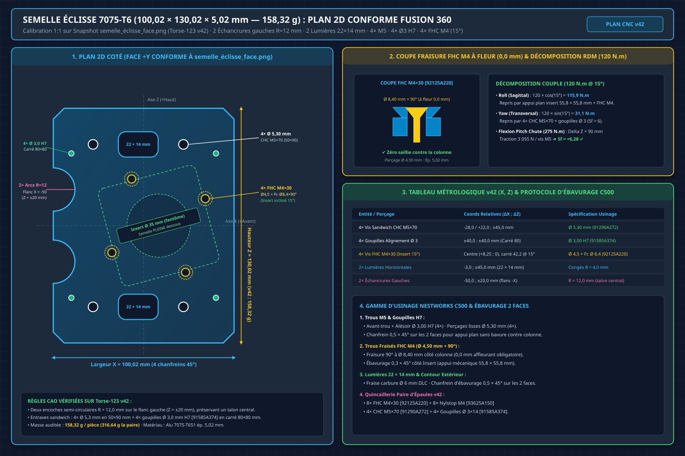

*Blueprint d'ingénierie vectoriel de la Semelle Éclisse (Révision V2.6 / `Torse-123 v42`). Panel 1 : Plan coté 100 × 130 mm avec semelle 100% pleine sous l'insert (zéro trou central), insert orienté à 15,0° (offset 11,055 mm) et 4 vis FHC M4. Panel 2 : Analyse RDM de décomposition du couple 120 N.m (Roll 115,9 N.m + Yaw 31,1 N.m) et moment de flexion 275 N.m. Panel 3 : Tableau de coordonnées cartésiennes et cadre dédié chanfreinage/ébavurage 2 faces. Masse réelle auditée CAO `v42` = 158,32 g / semelle.*

1. **Rôle 2-en-1 des Semelles Éclisses (100 × 130 × 5,0 mm en Alu 7075-T6)** :
   - Portent l'insert carré orienté à **`15,0°`** recevant le tube d'épaule décentré de **`11,055 mm`**.
   - Enserrent en sandwich la **Plaque Haute (5 mm)** et la **Plaque Basse (5 mm)** sur une hauteur de 130 mm (épaisseur totale = 15,0 mm). Largeur de **`100,0 mm`** aux épaules pour épouser fidèlement le profil de la colonne.
2. **Topologie 2D des Lumières d'Allègement (Masse réelle `v42` = `158,32 g` / semelle)** :
   - **Zone centrale sous insert 100% pleine** : Aucun perçage central (les câbles ne passent pas par ici). La semelle forme une face d'appui rigide et continue qui referme naturellement le fond de l'alésage traversant Ø 35 mm de l'insert.
   - **2 Lumières rectangulaires arrondies (`22,0 × 14,0 mm`, coins `R = 4,0 mm`)** : Centrées aux pôles haut et bas entre les paires de vis M5.
   - **2 Encoches semi-circulaires sur le chant gauche** : Dégagement latéral usiné visible sur le profil réel CAO `v42`.
   - **Masse réelle auditée en CAO (`Torse-123 v42`)** : **`158,32 g`** (`56,34 cm³` en Alu 7075-T6, soit **`316,64 g` pour la paire** ; *l'estimation historique de 67,6 g sous-estimait l'aire pleine de la plaque 100 × 130 × 5 mm*).
3. **Répartition des 4 Vis Traversantes M5 × 25 mm & Bras de Levier (90 mm)** :
   - **2 vis en haut (`Z = +45,0 mm`, entraxe Y = 50 mm)** : Traversent Semelle G + **Plaque Haute** + Semelle D.
   - **2 vis en bas (`Z = -45,0 mm`, entraxe Y = 50 mm)** : Traversent Semelle G + **Plaque Basse** + Semelle D.
   - **Bras de levier de flexion Delta_Z = 90,0 mm** : Reprend intégralement le moment fléchissant sagittal extrême de **`275 N.m`** avec un effort de traction par vis de 3 055 N (précharge totale de serrage = 19 200 N, interdisant tout décollement ou micro-glissement). **Serrage en croix séquentiel obligatoire** (vis #1 haut-gauche → #2 bas-droite → #3 haut-droite → #4 bas-gauche).
4. **Tableau des Coordonnées d'Esquisse CAO & Protocole d'Ébavurage 2 Faces** :

| Perçage / Entité | Position (Y, Z) [mm] | Diamètre & Outil | Face Arrière (Côté Colonne) | Face Avant (Côté Insert / Tête) | Fonction & Règle d'Atelier |
| :--- | :---: | :---: | :---: | :---: | :--- |
| **Vis M5 Sandwich Haut G/D** | `Y = ±25,00 ; Z = +45,00` | Foret Ø 5,30 mm | **Chanfrein 0,5 mm × 45°** | **Chanfrein 0,5 mm × 45°** | **Ébavurage 2 faces obligatoire** : Face AR pour contact colonne 19 200 N, Face AV pour appui plat tête CHC / rondelle. |
| **Vis M5 Sandwich Bas G/D** | `Y = ±25,00 ; Z = -45,00` | Foret Ø 5,30 mm | **Chanfrein 0,5 mm × 45°** | **Chanfrein 0,5 mm × 45°** | **Ébavurage 2 faces obligatoire** : Placage rigide sans surépaisseur parasite. |
| **Vis FHC M4 #1 (Haut-G)** | `Y = -36,77 ; Z = +14,85` | Foret Ø 4,50 mm | **Fraisure 90° Ø 8,40 mm** | **Ébavurage 0,3 mm × 45°** | Face AR : tête FHC noyée à `0,0 mm` ; Face AV : ébavurage foret indispensable pour placage insert. |
| **Vis FHC M4 #2 (Haut-D)** | `Y = +3,79 ; Z = +25,72` | Foret Ø 4,50 mm | **Fraisure 90° Ø 8,40 mm** | **Ébavurage 0,3 mm × 45°** | Face AR : tête FHC noyée à `0,0 mm` ; Face AV : ébavurage foret indispensable pour placage insert. |
| **Vis FHC M4 #3 (Bas-G)** | `Y = -25,90 ; Z = -25,72` | Foret Ø 4,50 mm | **Fraisure 90° Ø 8,40 mm** | **Ébavurage 0,3 mm × 45°** | Face AR : tête FHC noyée à `0,0 mm` ; Face AV : ébavurage foret indispensable pour placage insert. |
| **Vis FHC M4 #4 (Bas-D)** | `Y = +14,66 ; Z = -14,85` | Foret Ø 4,50 mm | **Fraisure 90° Ø 8,40 mm** | **Ébavurage 0,3 mm × 45°** | Face AR : tête FHC noyée à `0,0 mm` ; Face AV : ébavurage foret indispensable pour placage insert. |
| **Semelle sous Insert** | `Y = -11,055 ; Z = 0,00` | Fraise Ø 6 mm DLC | **Pleine continue (0,0 mm)** | **Pleine continue (0,0 mm)** | **Semelle 100% pleine sous l'insert** : Plan d'appui rigide continu fermant le fond de l'alésage traversant Ø 35 mm de l'insert (les câbles ne passent pas par ici). |
| **Contour Extérieur 2D** | Contour 100×130 mm | Fraise Ø 6 mm DLC | **Chanfrein 0,5 mm × 45°** | **Chanfrein 0,5 mm × 45°** | Élimination des bavures sur tout le pourtour. |

5. **Guide de Modélisation CAO Fusion 360 pour les Fraisures FHC M4 (Outil `Hole` / Touche `H`)** :

Pour une modélisation paramétrique propre, standardisée et directement reconnue par le module d'usinage **Fusion 360 CAM / Fabrication** :
1. **Dans l'esquisse 2D (Face Arrière de la semelle)** :
   * Utiliser l'outil **Point** (`Create > Point`) pour placer les 4 centres aux coordonnées cartésiennes (Y, Z) du tableau ci-dessus (ou sur les 4 sommets du carré d'entraxe 42 × 42 mm tourné de 15°).
   * Cliquer sur **Terminer l'esquisse** (`Finish Sketch`).
2. **Lancer la commande Perçage (`Hole`, raccourci `H`)** :
   * **Placement** : Sélectionner `À partir de l'esquisse (plusieurs trous)` et cliquer sur les 4 points.
   * **Type de perçage (`Hole Type`)** : Choisir **Fraisé (`Countersink`)** (icône conique).
   * **Type de trou (`Hole Tap Type`)** : Simple (`Simple`).
   * **Étendue (`Extent`)** : `À travers tout` (`All`) ou Distance `5,0 mm`.
3. **Renseigner les 3 paramètres standards dans le panneau de droite** :
   * **Diamètre de Fraisure (haut du cône)** : **`8,40 mm`** (standard ISO 10642 / DIN 7991 pour tête FHC M4).
   * **Angle de Fraisure** : **`90,0 deg`** (standard métrique européen).
   * **Diamètre de Perçage Lisse** : **`4,50 mm`** (passage normalisé M4).
4. **Validation** : La profondeur du cône de fraisure (**`1,95 mm`**) est calculée automatiquement par Fusion 360 jusqu'au perçage lisse de passage Ø 4,50 mm (la tête conique de la vis FHC M4 descendant sur 2,20 mm au total jusqu'au diamètre nominal Ø 4,0 mm), garantissant un **affleurement franc à fleur (`0,0 mm`)** sur la face arrière d'appui colonne.

6. **Jonction Axiale à Coupe Droite Z = 0 & Goupillage Positif 4× Ø 3 mm (Architecture Validée V2.6)** :
   - **Décision d'Ingénierie Validée — Suppression du Tenon-Mortaise au profit de la Coupe Droite Pure** :
     - La conception initiale prévoyait un tenon-mortaise 2D (40 × 10 mm avec congés R = 3,0 mm).
     - L'analyse d'ingénierie mécanique approfondie a formellement démontré que dès lors que l'assemblage intègre **4 vis M5 classe 12.9** et **4 goupilles rectifiées ISO 8734**, le tenon devient redondant et contre-productif :
       1. **Élimination des concentrateurs de contraintes** : Les angles rentrants de la mortaise créaient un facteur de concentration de contrainte Kt de 1,3 à 1,5 au droit du nœud d'épaules sous la torsion de 120 N.m du RS-04. Une coupe droite plane présente un facteur Kt = 1,00 (continuité géométrique parfaite).
       2. **Gain de surface d'appui** : La surface de contact franc métal-métal à Z = 0 passe de 420 mm² à **500,0 mm²** (+19% de portée continue sur les 100 mm de largeur), optimisant la reprise de la compression et de la flexion sagittale.
       3. **Zéro risque d'hyperstatisme ni de talonnage** : Aucun conflit d'entraxe entre le tenon et les goupilles, zéro risque de portée parasite en fond de mortaise.
       4. **Fabrication C500 & CAO ultra-simplifiées** : Découpe directe en une seule passe fraise droite, suppression totale des opérations de compensation de jeu Offset Face sous Fusion 360.
   - **Exigence Fondamentale de Conception : CONTACT FRANC MÉTAL-MÉTAL À Z = 0,0 mm (ZÉRO ESPACE / ZÉRO GAP)** ⭐ :
     - **Règle absolue** : Les tranches usinées planes de la Plaque Haute et de la Plaque Basse **DOIVENT être en contact direct et franc à 0,0 mm** sans aucun intercalaire, ni jeu résiduel, ni espace libre.
     - **Justification RDM & Protection des Goupilles** :
       1. *Absorption directe de la compression (500 mm²)* : Sous l'effet de la gravité, du portage de charges (10 à 15 kg aux bras) et des impacts verticaux dynamiques de marche, la force descendante est transmise directement d'une plaque à l'autre à travers l'intégralité de la section continue en Alu 7075-T6 (`100,0 mm × 5,0 mm = 500,0 mm²`). La contrainte de compression reste minime (~0,6 MPa) et la colonne se comporte comme une poutre continue indéformable. Les vis M5 et les goupilles ne supportent **aucun effort axial de compression**.
       2. *Danger formel d'un espace libre (gap)* : Si un espace même minime (0,5 à 1 mm) était laissé entre les deux plaques, l'intégralité du poids du haut du corps et des chocs de pas devrait être reprise **en cisaillement transversal par les 4 goupilles Ø 3 mm et le frottement des vis M5**. En cas de choc violent (chute, arrêt brusque), cela induirait un risque critique de matage de l'aluminium et de fatigue prématurée des goupilles.
       3. *Rigidité en flexion sagittale (Pitch)* : En flexion, le bord comprimé s'appuie directement sur la matière continue, ce qui verrouille la rigidité axiale du torse.
     - **Maîtrise d'atelier** : Sur la NestWorks C500, le plan Z = 0 et les alésages de goupilles sont usinés dans le même repère pièce (+/- 0,01 mm). À l'assemblage, les plaques sont d'abord plaquées en butée l'une contre l'autre avant d'insérer les goupilles dans les éclisses.

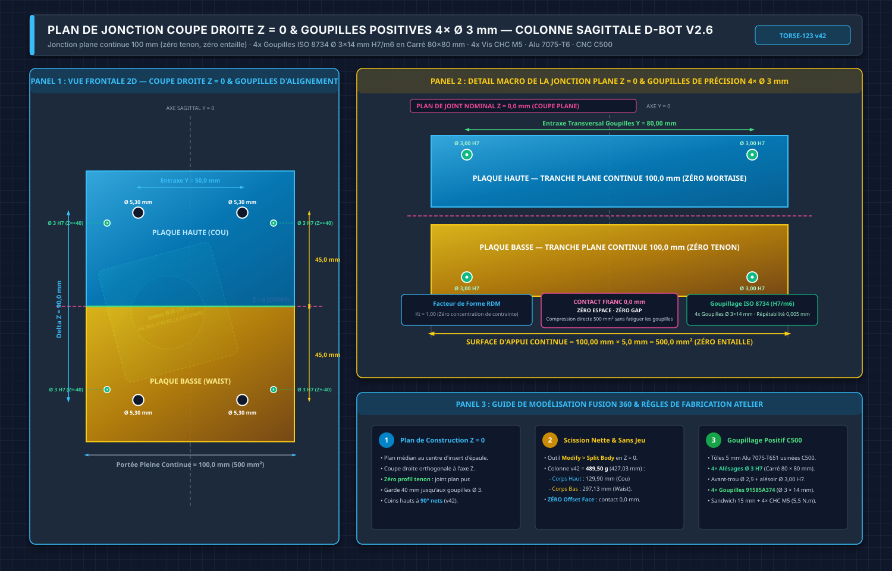

*Blueprint d'ingénierie vectoriel de la jonction axiale à Z = 0,0 mm de la colonne sagittale (Plaque Haute L = 142,7 mm ↔ Plaque Basse L = 297,13 mm). Panel 1 : Vue frontale montrant la coupe droite continue 100 mm (appui franc métal-métal 500 mm²), l'empreinte de l'insert d'épaule incliné à 15° (colonne 100% pleine sous l'insert, zéro perçage central), les 4 perçages traversants Ø 5,30 mm pour vis CHC M5 à Z = ±45,0 mm et les 4 alésages fermés pour goupilles ISO 8734 Ø 3,0 mm H7 formant un carré 80 × 80 mm (Z = ±40,0 mm, entraxe Y = 80,0 mm). Panel 2 : Zoom macro coté sur la surface d'appui continue 100 × 5 mm à Z = 0,0 mm, les 4 alésages de goupilles Ø 3,00 mm H7 et le goupillage positif 4× Ø 3×14 mm m6. Panel 3 : Guide pas-à-pas de modélisation CAO sous Fusion 360 (Modify > Split Body avec plan Z = 0 standard, zéro Offset Face requis) et stratégie d'usinage atelier.*

##### Protocole CAO Fusion 360 Simplifié (Zéro Offset Face Requis)

Grâce à la coupe droite plane, la modélisation sous Fusion 360 est rapide, propre et exempte de tout décalage géométrique artificiel :

1. **Création du Plan de Coupe Z = 0** :
   - Construire un plan de construction passant par l'axe des épaules (`Construct > Plane Through Point`).
2. **Scission du Corps (`Modify > Split Body`)** :
   - Sélectionner le corps de la colonne sagittale complète.
   - Outil de scission : le plan horizontal `Z = 0,0 mm`.
   - Génère instantanément deux composants distincts :
     - **Plaque Haute** (hauteur L = 142,7 mm).
     - **Plaque Basse** (hauteur L = 297,13 mm).
3. **ZÉRO Jeu de Décalage (Zéro Offset Face)** :
   - Contrairement à l'ancien tenon qui nécessitait -0,05 mm sur les flancs et -0,20 mm en fond, **la coupe droite ne reçoit aucun offset face**.
   - Les deux corps partagent un contact plan parfait à `0,0 mm` sur l'ensemble des 100 mm de largeur.
4. **Validation CAO d'Interférence** :
   - Lancer **Inspecter > Interférence (`Inspect > Interference`)** entre la Plaque Haute et la Plaque Basse :
   - Résultat : **`Aucune interférence (No interference)`**, confirmant un modèle parfait pour la FAO NestWorks C500.

##### Goupillage de Positionnement Positif au Nœud d'Épaules (Carré Parfait 80 × 80 mm)

L'assemblage retient **4 alésages fermés 100% en pleine matière** disposés en un **carré parfait de `80,0 mm × 80,0 mm`** centré sur l'origine `(0, 0)` (`Y = ±40,0 mm` et `Z = ±40,0 mm`), éliminant formellement tout risque d'interférence avec l'insert incliné à 15° et maximisant la rigidité angulaire en rotation (Rz) :

| Diagnostic Interférence Initiale (Z = ±30 mm) | Implantation Validée V2.6 / `v42` en Carré 80 × 80 mm (Y = ±40, Z = ±40 mm) |
| :---: | :---: |
| *Interférence physique relevée sur CAO Torse v87 : l'insert incliné à 15° monte jusqu'à Z = +34,17 mm, entrant en collision avec le perçage à Z = 30 mm.* | *Validation métrologique finale (voir blueprint [`plan_decoupe_tenon_colonne_haute_basse.svg`](./media/plan_decoupe_tenon_colonne_haute_basse.svg) et `semelle_éclisse_face.png`) : carré parfait 80 × 80 mm (distance mesurée 80,00 mm, dégagement franc >= 10,91 mm face à l'insert).* |

###### 1. Rôle Mécanique & Dimensionnement du Bipoint par Plaque (Entraxe 80 mm)
* **Plaque Haute (2 Goupilles à Z = +40,0 mm, entraxe Y = 80,0 mm)** : Forme un bipoint d'orientation bloquant 100% des translations (Tx, Ty) et de la rotation dans le plan (Rz) par rapport aux semelles éclisses avec un bras de levier élargi de 80 mm.
* **Plaque Basse (2 Goupilles à Z = -40,0 mm, entraxe Y = 80,0 mm)** : Forme son propre bipoint d'orientation bloquant 100% des translations et de la rotation de manière totalement autonome.
* **Sécurité & Torsion RS-04 (120 N.m) — Gain de Rigidité +60%** :
  - En portant l'entraxe transversal de 50 mm à **80 mm**, l'effort tangentiel de cisaillement unitaire sur les goupilles sous le couple de crête de 120 N.m diminue de **37,5%** (l'effort tangentiel passe de 4 800 N à **3 000 N** sur chaque bipoint).
  - Les 4 goupilles en acier trempé 60 HRC (section cisaillée totale = 28,3 mm²) offrent une capacité au cisaillement direct de **16 980 N**, soit un facteur de sécurité exceptionnel **Sf = 5,66** face au couple de crête du RS-04.
  - La précharge des 4 vis M5 (19 200 N au total) apporte 2 880 N d'adhérence par frottement additionnelle.

###### 2. Coordonnées Cartésiennes d'Usinage C500 & Fusion 360 (Carré 80 × 80 mm)

| Goupille & Entité | Coordonnée Y (Transversal) | Coordonnée Z (Vertical) | Pièces Traversées (Sandwich 15 mm) | Statut & Rôle Mécanique |
| :--- | :---: | :---: | :--- | :--- |
| **Goupille Haute-Gauche** | **`-40,00 mm`** | **`+40,00 mm`** | Éclisse AV (5mm) + Plaque Haute (5mm) + Éclisse AR (5mm) | Verrouille Plaque Haute (Dégagement 10,91 mm face à l'insert 15°) |
| **Goupille Haute-Droite** | **`+40,00 mm`** | **`+40,00 mm`** | Éclisse AV (5mm) + Plaque Haute (5mm) + Éclisse AR (5mm) | Complète le blocage en rotation Plaque Haute (Entraxe Y = 80 mm) |
| **Goupille Basse-Gauche** | **`-40,00 mm`** | **`-40,00 mm`** | Éclisse AV (5mm) + Plaque Basse (5mm) + Éclisse AR (5mm) | Complète le blocage en rotation Plaque Basse (Entraxe Y = 80 mm) |
| **Goupille Basse-Droite** | **`+40,00 mm`** | **`-40,00 mm`** | Éclisse AV (5mm) + Plaque Basse (5mm) + Éclisse AR (5mm) | Verrouille Plaque Basse (Dégagement 26,38 mm face à l'insert 15°) |

* **Dégagement matière face à l'insert incliné à 15°** : L'insert carré 55,8 × 55,8 mm incliné à 15° monte jusqu'à `Y = -30,8 mm, Z = +34,2 mm`. À `(Y = -40, Z = +40)`, la distance minimale au coin le plus proche est de **`10,91 mm`** de métal plein continu (zéro interférence).
* **Dégagement face aux vis M5 (Y = ±25 mm, Z = ±45 mm)** : Entraxe direct de **`15,81 mm`** (`sqrt(15² + 5²)`), soit plus de 5 fois le diamètre de goupille.
* **Garde saine sur les chants de colonne (largeur 94 mm, chant à Y = ±47 mm)** : Axe de perçage à **7,00 mm** du flanc, laissant **5,50 mm de matière pleine continue** sous l'alésage Ø 3,0 mm.
* **Composants associés** : 4 goupilles cylindriques rectifiées **ISO 8734 / DIN 6325 `Ø 3,0 mm × 14 mm` (ajustement H7/m6)**, référence McMaster-Carr **`98381A467`** (Acier trempé) ou **`97395A310`** (Inox 316).
* **Protocole d'usinage** : Avant-trou foret carbure Ø 2,90 mm + alésoir machine Ø 3,00 mm H7 avec chanfrein d'ébavurage `0,1 mm × 45°` des deux côtés.

---


### D. Imbrication des Bruts & Détail d'Assemblage FHC M4 Traversantes + Écrous Nylstop

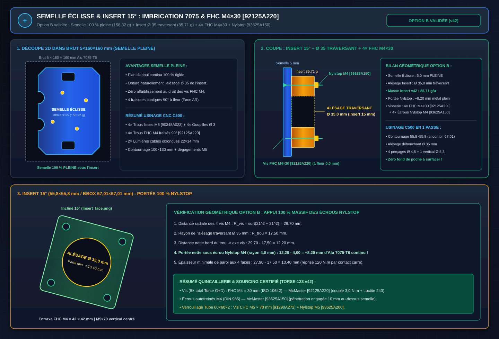

*Blueprint d'ingénierie vectoriel des détails d'usinage et d'assemblage (Solution C, Révision V2.4 — Option B). Panel 1 : Imbrication 2D de la Semelle Éclisse (100 × 130 mm avec redan +6 mm) dans la plaque carrée Blockenstock 5 × 160 × 160 mm Alu 7075-T6 (9,60 €), semelle 100% pleine sous l'insert. Panel 2 : Vue en coupe macro montrant la Semelle (5,0 mm pleine) + Insert (15,0 mm avec alésage circulaire traversant débouchant Ø 35,0 mm sur toute l'épaisseur, gain -40,5 g/insert), et les 4 vis FHC M4 × 30 mm traversantes (noyées à 0,0 mm sur la face arrière de la semelle) verrouillées par 4 écrous Nylstop M4 sur la face avant de l'insert à l'établi (marge de filet Nylstop = 10 mm). Panel 3 : Vérification géométrique d'appui des écrous Nylstop M4 (entraxe 42×42 mm, portée 100% pleine de +8,20 mm de métal continu autour du trou Ø 35 mm en Alu 7075-T6).*

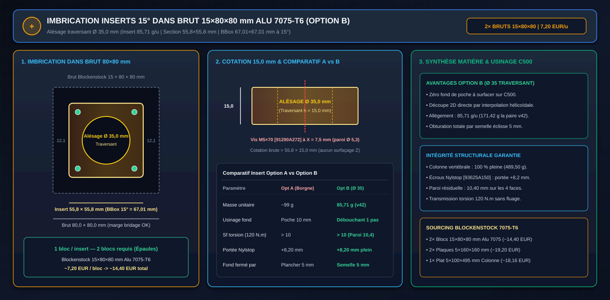

*Validation CAO réelle `Torse-123 v42` (`Exports_CAO_DBot/01_Torse_et_Bassin/Visual_Snapshots/Pieces_Isolees/Insert/Insert_iso.png`) : l'insert carré 55,8 × 55,8 × 15,0 mm incliné à 15,0° présente un évidement circulaire traversant **Option B** de diamètre Ø 35,0 mm (`85,71 g`), garantissant une marge de portée radiale continue de `+8,20 mm` sous les 4 écrous Nylstop M4 (entraxe 42×42 mm) tandis que la semelle éclisse (`158,32 g`) et la colonne restent 100% pleines.*

---

## 6. Système d'Énergie : 2 Paniers Batteries Latéraux Hot-Swap

### A. Architecture des Paniers Symétriques

Grâce à l'architecture dégagée autour de la colonne vertébrale en 7075-T6 et des traverses carrées 60×60 mm, le torse intègre **2 paniers latéraux symétriques PA12-CF** (`Panier_Batterie_Droit` en `-Y` et `Panier_Batterie_Gauche` en `+Y`) **coulissant facilement vers l'arrière (`-X`) pour extraction et maintenance hors torse**, chacun destiné à recevoir **1 pack batterie dédié** *(spécifications électriques et format cellules à finaliser ultérieurement)* :

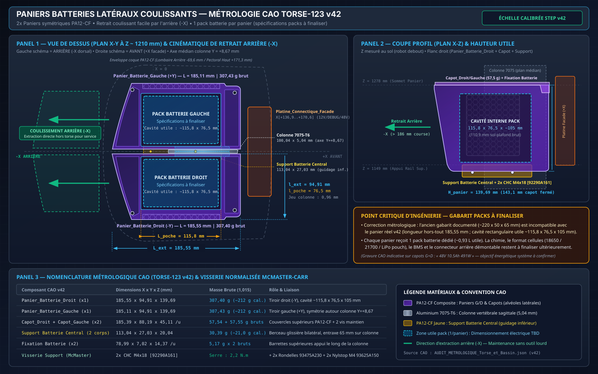

*Blueprint vectoriel calibré sur les fichiers STEP/JSON `Torse-123 v42` : vue de dessus X-Y montrant l'extraction arrière `-X`, coupe profil X-Z et nomenclature dimensionnelle exacte des cavités internes.*

> [!IMPORTANT]
> **Rectification Métrologique CAO `Torse-123 v42` & Statut des Packs Batteries** :
> - L'ancien gabarit théorique documenté (~`220 × 50 × 65 mm`) et la configuration figée `12S 5-6 Ah / 480-576 Wh` étaient issus d'une estimation pré-CAO et sont **physiquement incompatibles** avec la longueur hors-tout réelle des paniers (`185,55 mm`).
> - L'inspection B-Rep directe des fichiers STEP `Panier_Batterie_Droit.step` et `Capot_Droit.step` établit une **cavité rectangulaire interne utile de `~115,8 × 76,5 × 105 mm`** par panier (~`0,93 L` utile chacun, `110,9 mm` brut entre rail de fond et sous-face capot, hors aile arrière alvéolée de ~41 mm et redan avant de ~28 mm).
> - **2 packs batteries** (1 dans chaque panier) seront dimensionnés et finalisés ultérieurement dans ce volume utile réel (chimie, nombre de cellules en série/parallèle `S/P`, format `18650`/`21700`/LiPo prismatique, BMS intégré et connecteur arrière). *(Les gravures CAO `« 48V 10.5Ah 491W »` sur les capots restent purement indicatives à ce stade.)*

| Paramètre | Architecture Réelle `Torse-123 v42` (2 Paniers Latéraux) |
| :--- | :---: |
| **Nombre & Implantation** | **2× Paniers latéraux symétriques** (`-Y` Droit / `+Y` Gauche), **1 pack par panier** |
| **Cinématique d'Accès** | **Coulissement complet vers l'arrière (`-X`)** pour sortie facile hors du torse |
| **Encombrement hors-tout d'un panier** | `185,55 × 94,91 × 139,69 mm` (Droit) / `185,11 × 94,91 × 139,69 mm` (Gauche) |
| **Volume utile interne par panier** | **`~115,8 × 76,5 × 105 mm`** (~`0,93 L` utile sous collerette `Capot`, `110,9 mm` fond-plafond) |
| **Masses CAO `v42` (PA12-CF brut `1,015`)** | `Panier_D` `307,40 g` / `Panier_G` `307,43 g` *(~212 g calibré/u)* + `Capots` `57,54 / 57,55 g` + `Fixation` `5,17 g × 2` |
| **Guidage & Coulissement** | `Support Batterie Central` PA12-CF (`30,39 g` brut / ~`21,0 g` cal.) fixé à la colonne (`jeu latéral 0,96 mm`) |
| **Spécifications Électriques des Packs** | **Cible bus `48V` — Spécifications finales (cellules, S/P, Ah/Wh, BMS) à finaliser ultérieurement** |

#### Support Batterie Central (PA12-CF, CAO Validée `Torse-123 v42`)
Pour éliminer les anciennes cornières métalliques rapportées et simplifier l'assemblage en atelier, le guidage et le calage inférieur des deux paniers coulissants sont assurés par **`Support Batterie Central`** (`113,04 × 27,03 × 20,04 mm`, en deux demi-coquilles assemblées autour de la colonne) :
* **Matériau & Procédé** : Composite PA12-CF (masse brute CAO `v42` à `ρ = 1,015 g/cm³` = **`30,39 g`**, volume **`29,95 cm³`** ; masse calibrée 0,70 g/cm³ = **`~21,0 g`**).
* **Fixation Traversante par 2 Vis M4** :
  * **2 vis horizontales traversantes** : Vis CHC M4 × 18 mm en inox 316 (McMaster `92290A161`) traversant la colonne sagittale centrale de `5,04 mm` (entraxe `65,0 mm`, perçages `Ø 4,30 mm`), associées à 2 rondelles plates DIN 125A M4 (McMaster `93475A230`) et 2 écrous frein Nylstop M4 (McMaster `93625A150`), serrage à `2,2 N.m`. *(Audit CAO `v42` : les 2 vis CHC M4x18 suffisent, aucune vis verticale supplémentaire n'est nécessaire).*
* **Fonction de Guidage** : Glissières bilatérales à ailettes soutenant par-dessous les patins inférieurs des racks coulissants `Panier_Batterie_Droit` et `Panier_Batterie_Gauche` le long de la colonne, fermés en partie supérieure par `Capot_Droit` / `Capot_Gauche` (2 vis de maintien par capot) et épaulés par les barrettes `Fixation Batterie` (`2×`).

---

### B. Circuit Électrique Hot-Swap ORing (Remplacement à Chaud)

L'étude électrique d'architecture de puissance est **en cours de finalisation** afin d'autoriser un véritable remplacement à chaud (**Hot-Swap sans coupure**) des 2 packs embarqués tout en respectant l'encombrement réel des paniers (`~115,8 × 76,5 × 105 mm`) et les bonnes pratiques industrielles de bout en bout (thermique, anti-inrush, démontabilité sans dessoudage et séparation bus puissance/logique) :

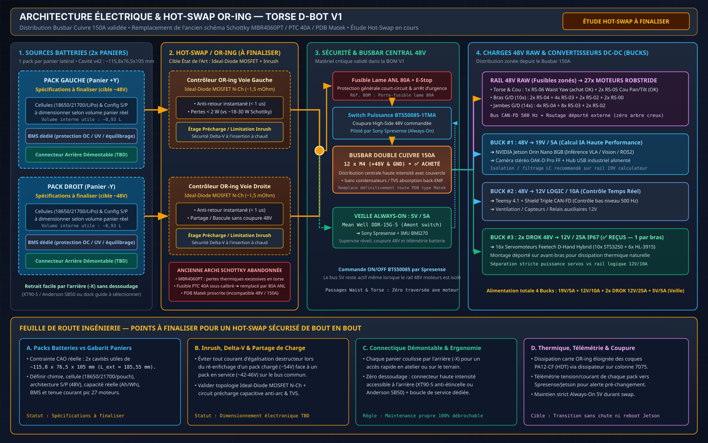

> [!WARNING]
> **Obsolescence de l'ancien schéma historique (Schottky / PTC / PDB Matek)** :
> - L'ancien schéma simplifié mentionnant une `PDB Matek` (non dimensionnée pour du 48V haute intensité), un fusible réarmable `PTC 40A` (sous-calibré face aux pics des 27 moteurs RobStride) et deux diodes Schottky `MBR4060PT` (`V_f ~ 0,45..0,65 V`, soit ~`20 à 35 W` dissipés à chaud dans un torse clos PA12-CF) est **formellement abandonné**.
> - La distribution centrale validée en BOM repose désormais sur le **`Busbar double cuivre 12×M4 150A`** (`✅ Acheté`), le **`Porte-fusible lame ANL 80A`**, le switch High-Side **`Infineon BTS50085-1TMA`** piloté par **`Sony Spresense`** et le convertisseur veille **`Mean Well DDR-15G-5`** (`5V Always-On`).

| Sous-ensemble / Composant | Référence Validée ou Cible | Statut Étude | Rôle & Exigence Ingénierie dans le Torse |
| :--- | :--- | :---: | :--- |
| **2× Packs Batteries (1 / panier)** | Cible `48V`, format selon cavité `~115,8 × 76,5 × 105 mm` | ⏳ **À finaliser** | Chimie, S/P, Ah/Wh et BMS à figer selon géométrie panier et pic moteurs |
| **Connectique Arrière Extractible** | `XT90-S` (anti-étincelle) / `Anderson SB50` ou dock | ⏳ **À finaliser** | Accouplement arrière accessible lors du retrait `-X` (**zéro dessoudage atelier**) |
| **Étage OR-ing & Précharge Hot-Swap** | **Contrôleurs Ideal-Diode MOSFET N-Ch** + limiteur Inrush / `Delta_V` | ⏳ **À finaliser** | Remplace `MBR4060PT` (`< 2 W` vs `~30 W`), anti-retour `< 1 us` et sécurité d'insertion à soc différent |
| **Sécurité & Coupure Puissance** | **Fusible Lame ANL 80A** + **E-Stop** + **`BTS50085-1TMA`** | ✅ **BOM Validée** | Protection bus 48V, arrêt d'urgence matériel et coupure logique par `Spresense` |
| **Distribution Centrale 48V** | **Busbar double cuivre 12 × M4, 150A** (+ couvercle) | ✅ **Acheté** | Remplace toute PDB PCB (`Matek`) ; reçoit banc condensateurs / TVS anti back-EMF |
| **Convertisseurs DC-DC (4 Bucks)** | `19V/5A` (Jetson + OAK-D) · `12V/10A` (Teensy) · `2× DROK 48V→12V 25A` (`✅ Reçus`) · `Mean Well DDR-15G-5` (`5V Always-On`) | ✅ **Spécifiés / Part. Reçus** | Isolation veille `Spresense/IMU` en amont du switch puissance ; `2× DROK` sur avant-bras pour `16× Feetech` |

#### Points Clés Restant à Finaliser pour Valider le Hot-Swap de Bout en Bout
1. **Adéquation Pack / Panier** : Arrêter l'arrangement cellules, le BMS et le courant continu/crête admissibles dans le volume utile mesuré (`~115,8 × 76,5 × 105 mm`).
2. **Gestion `Delta_V` et Inrush à l'Insertion** : Garantir l'absence d'arc électrique et de courant d'égalisation destructeur lors du ré-enfichage d'un pack plein (`~54 V`) alors que l'autre pack alimente déjà le bus sous charge (`~42–46 V`).
3. **Thermique et Dissipation** : Calibrer les pertes Joule `R_ds(on)` des MOSFET d'OR-ing et prévoir leur refroidissement sur flanc métallique (`colonne 7075-T6`), à distance des parois polymères PA12-CF.
4. **Ergonomie Connectique Arrière (`-X`)** : Valider un détrompage robuste et une boucle de service souple autorisant l'extraction coulissante vers l'arrière sans contrainte ni dessoudage.

---

## 7. Liaisons d'Extrémités : Cou & Waist Yaw RS-06

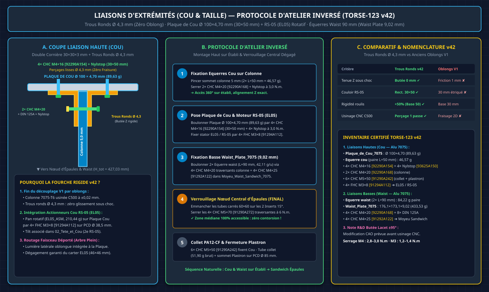

*Principe d'assemblage en sandwich : 2 équerres en L en aluminium 6060-T6 (à gauche et à droite) enserrent la tôle de 5 mm avec des vis traversantes M4. Les équerres supérieures intègrent des **trous ronds de précision Ø 4,30 mm** (butée mécanique d'obstacle en Z) éliminant tout risque de glissement sous choc.*

### A. Plaque Supérieure de Cou (Alu 4,70 mm) & Liaison Rigide de Précision C500
* **Fonction** : Fermeture haute du torse, fixation du collet pour le module de tête **RobStride RS-05 (réf. constructeur / CAO : EL05)** Yaw/Pitch et reprise d'effort sagittale.
* **Fin du Découplage Artificiel V1 (Suppression des Anciens Oblongs)** : Dans l'ancienne architecture V1 hybride, les fentes oblongues servaient uniquement à absorber la tolérance de coupe manuelle de l'ancien tube carbone central. Dans le Torse V2.6, **le tube carbone n'existe plus** et la colonne monolithique en **Alu 7075-T6 de 5,0 mm** est usinée sur la CNC C500 avec une répétabilité de **`+/- 0,02 mm`**. La liaison est **100% isostatique** sur trous ronds `Ø 4,30 mm` : elle transmet l'intégralité des efforts sans aucun risque de glissement sous accélération ou choc du cou.
* **Géométrie réelle `Plaque_de_Cou_7075` (`Torse-123 v42`)** : Disque ovalisé `Ø 100 mm` (`100,02 × 100,02 × 4,70 mm`, masse **`89,63 g`**, volume `31,90 cm³`) intégrant **1 lumière latérale rectangulaire** pour le routage des faisceaux cou/tête hors axe moteur, **6 perçages périphériques Ø 5,03 mm sur PCD Ø 85,0 mm** fixant le collet PA12-CF (`Cou - Tube collet`, `51,90 g`) et la collerette supérieure du `Plastron_Ventral_Torse` par **6 vis CHC M5 × 50 mm (`91290A242`)**, un **rectangle `30 × 50 mm`** pour les 4 vis `CHC M4 × 16 mm [92290A154]` des équerres de cou, et un **PCD Ø 38,50 mm** pour le moteur RS-05 (EL05).

#### 1. Fixation Directe du Moteur RobStride RS-05 (réf. CAO : EL05 — Yaw Cou) sur la Plaque
L'actionneur de lacet du cou (**RobStride RS-05, désignation constructeur / STEP CAO : `EL05` / `EL05_ASM_1_ASM`**, couple pic 5,5 N.m, couple nominal 1,6 N.m, encombrement `46,04 × 46,04 × 47,04 mm`, `210,44 g` nu / `228,49 g` assemblage) est monté directement sur la face supérieure plane de la plaque de cou (**épaisseur réelle mesurée CAO `v42` : `e = 4,70 mm`**). *(Note d'architecture : 1 seul moteur RS-05/EL05 de lacet Pan est modélisé dans `Torse-123 v42` ; le 2e RS-05 de tangage Tilt appartient au sous-ensemble `02_Tete_et_Cou`. Ne pas confondre la référence `EL05` avec un actionneur linéaire).* 

##### A. Données de l'Interface Constructeur RS-05 (Manuel Officiel p. 10)
* **Implantation des taraudages** : **4 taraudages borgnes M3** équi-répartis à 90° (`4-M3 EQS`) sur un cercle primitif de perçage (PCD) **`Ø 38,50 mm ± 0,1 mm`** (soit un rayon d'implantation `R = 19,25 mm`).
* **Profondeur taraudée utile dans le carter** : **`6,0 à 8,0 mm`** (perçage borgne brut jusqu'à ~10 mm).
* **Avertissement impératif du constructeur RobStride (Manuel RS-05, page 10)** :  
  > *"When fixing, the screw depth should not exceed the depth of the casing thread"*  
  (La vis ne doit sous aucun prétexte dépasser la profondeur taraudée du carter, au risque d'entrer en collision avec le fond du boîtier, d'écraser les bobinages en cuivre du stator ou d'endommager la carte PCB des encodeurs magnétiques).

##### B. Choix & Dimensionnement Rigoureux de la Visserie : Vis FHC M3 × 8 mm
Pour conserver une face inférieure de plaque de cou parfaitement plane (sans saillie mécanique au-dessus du couloir de câblage et du nœud de colonne), la fixation est assurée par des **vis à tête fraisée conique 90° FHC (ISO 10642 / DIN 7991)** (`92125A128`, 4× par le dessous de la plaque, et `91294A112` 4× côté collet supérieur) :
* **Règle métrologique normalisée** : Pour toute vis à tête fraisée FHC, **la longueur nominale L inclut 100% de la vis, tête conique comprise**.
* **Calcul de pénétration pour vis FHC M3 × 8 mm (Optimum Validé ⭐)** :
  * Longueur totale sous tête : `L = 8,00 mm`.
  * Épaisseur de plaque métallique traversée : `e = 4,70 mm`.
  * Pénétration axiale effective dans le stator du moteur :  
    `L_pen = 8,00 - 4,70 =` **`3,30 mm`**.
  * Nombre de filets actifs en prise (pas standard M3 p = 0,5 mm) : `3,30 / 0,5 =` **`~6,6 filets`**.
  * Rapport d'implantation : `L_pen / d = 3,30 / 3,0 =` **`1,10 × d`** (parfaitement conforme à la règle mécanique de prise de filet dans l'aluminium `1,0 à 1,5 × d`).
  * **Garde de sécurité absolue au fond du taraudage** :  
    `Garde = 6,00 - 3,30 =` **`2,70 mm de vide d'air franc`** (et jusqu'à 4,70 mm par rapport au fond foré). **Zéro risque d'interférence avec les bobinages ou de talonnage**.
* **Comparaison avec les longueurs alternatives** :
  * *FHC M3 × 6 mm (Rejetée ❌)* : Pénétration de seulement `1,30 mm` (~2,6 filets). Tenue à l'arrachement insuffisante sous choc dynamique.
  * *FHC M3 × 10 mm (Rejetée ⛔)* : Pénétration de `5,30 mm` (~10,6 filets). Garde au fond résiduelle < 0,70 mm : risque critique de talonnage sur copeaux de fond de taraudage et d'écrasement interne.

##### C. Paramètres de Perçage & Fraisage CAO (Face Inférieure de la Plaque)
Dans Fusion 360, sur une esquisse tracée sur la **face inférieure (dessous)** de la plaque de cou :
* **Cercle d'implantation** : Cercle de construction **`Ø 38,50 mm`**, 4 points orientés à 45° par rapport aux axes sagittal et transversal (évite toute interférence avec le connecteur électrique latéral du RS-05).
* **Commande Perçage (`Hole`, raccourci `H`)** :
  * **Type de perçage** : `Countersink` (Fraisé conique 90°).
  * **Perçage lisse traversant** : **`Ø 3,20 mm`** (classe fine ISO 273, guidage précis sans jeu excessif).
  * **Diamètre extérieur de fraisure** : **`Ø 6,50 mm`** (ou `6,60 mm` pour garantir un micro-retrait de sécurité de 0,05 mm à fleur exacte `0,0 mm`).
  * **Angle de fraisure** : **`90,0°`** (ISO 10642).
  * **Profondeur de cône résultante** : `h_cone = (6,50 - 3,20) / (2 × tan(45°)) =` **`1,65 mm`**.
  * **Portée cylindrique résiduelle en métal plein** : `4,70 - 1,65 =` **`3,05 mm`** (soit 65% de l'épaisseur totale de la plaque conservée sous la tête fraisée).
* **Finition d'Atelier** : Micro-chanfrein d'ébavurage de **`0,2 mm × 45°`** sur la face supérieure (côté moteur) pour éliminer le morfil de perçage et garantir une assise 100% coplanaire à 0,0 mm avec la base du RS-05.
* **Serrage & Freinage** : Couple dynamométrique de **`1,2 à 1,4 N.m`** (clé Allen 2,0 mm) avec dépose d'**une micro-gouttelette de Loctite 243 (bleu moyen)** sur les 2 premiers filets. Serrage en croix séquentiel.

---

### B. Plaque Inférieure / Waist Plate (Alu 7075-T6, 176 × 173 mm) & Liaison Active Waist Yaw (CRBH 8016)
* **Fonction** : Fermeture basse du torse, interface mobile rigide avec la liaison active Waist Yaw.
* **Élargissement à 176 × 173 mm & Lumière d'Arc Arrière 125,0° (`Torse-123 v42`)** : La `Waist_Plate_7075` présente un encombrement de **`176,11 × 173,05 mm`** (épaisseur finie `9,02 mm` avec redan d'appui inférieur de `3,00 mm`, masse réelle CAO `v42` = **`433,53 g`**, volume `154,28 cm³`) et intègre en zone arrière la lumière en arc de cercle élargie à **`125,0°`** (R_int = 64,75 mm, R_ext = 84,75 mm, largeur 20 mm, congés d'arêtes R = 1,5 mm sur faces sup/inf).
* **Évasement Inférieur & Fixations aux 4 Coins du Plastron Ventral** : La base du `Plastron_Ventral_Torse` s'ancre aux 4 coins sur la Waist Plate par **4 vis CHC M4 × 18 mm (McMaster `92290A161`) + 4 rondelles DIN 125A M4 (`93475A230`)** exploitant le vide d'air au-dessus de la Traverse pelvienne fixe (masse brute `Plastron_Ventral_Torse` en `v42` incluant `ceinture` `45,43 g` = **`2 849,97 g`** avec PA12-CF encore à `ρ = 1,015 g/cm³`).
* **Lumières Concentriques d'Arc de Câblage & Zéro Cisaillement (Traverse 69,0° vs Waist Plate 125,0°)** : Implantation en zone postérieure (-X) centrée sur l'axe du rotor RS-06 (`X = +49,23 mm`, `Y = +9,36 mm`, zéro décentrage). La fente de 69,0° sur la Traverse fixe combinée à la fente élargie de 125,0° sur la Waist Plate tournante libère un recouvrement de **`22,24 mm`** d'arc utile à l'angle extrême de **`+/- 90° à +/- 95°`** sans effet guillotine. Les congés d'arêtes usinés à **`R = 1,5 mm`** éliminent tout effet tranchant et protègent la gaine textile du faisceau sous torsion hélicoïdale.
* **Butée Mécanique de Lacet (`+/- 95°`, M5/PA12-CF) — *Modification CAO prévue avant usinage CNC*** : Une butée mécanique dédiée (pion de fin de course M5 + tampon amortisseur TPU/PA12-CF) est spécifiée pour borner physiquement la course de lacet à `+/- 95°` max sans solliciter le faisceau ; elle n'est pas encore modélisée dans `Torse-123 v42` et fait partie des modifications CAO prévues avant lancement en usinage C500.
* **Moteur Waist** : **RobStride RS-06** (`550,97 g` en `v42`, 36 N.m pic / 11 N.m nominal, carter arrière fermé sans arbre creux, bus CAN-FD ID 21).
* **Traverse Pelvienne & Retenue Axiale** : Usinage in-situ dans la `Traverse_Renfort_Bassin [ASV1_200_16A]` (174,90 × 174,84 × 12,51 mm, masse réelle CAO `v42` = **`566,74 g`**, `201,69 cm³`, fente concentrique arrière de **`69,0°`**) intégrant le centrage bague extérieure Ø 120 H7 × 3 mm, la chambre de dégagement moyeu Ø 96 mm, la fixation directe du stator RS-06 par **8× vis CHC M3 × 12 mm Tête Basse DIN 7984 (`92855A313`, 1 vis témoin modélisée en `v42`) sur PCD Ø 82,0 mm**, le passage rotor central Ø 74,56 mm, l'ancrage pelvien par **4 vis FHC M5 × 18 mm (`92125A213`)** à têtes fraisées 90° affleurantes à 0,0 mm (et non M5×25), et la retenue axiale positive par **4× `Bride_Retenue_RB8016_L` (`4,12 g`/u, vis CHC M4 × 16 mm `92290A154` + rondelles `93475A230` sur PCD Ø 136 mm à 45°)**.
* **Roulement Principal** : Roulement à rouleaux croisés **CRBH 8016 UU / RB 8016 UU** (`633,41 g`, Ø int 80 mm, Ø ext 120 mm, ép. 16 mm, capacité moment 520 N.m) assurant le découplage mécanique intégral.
* **Import CAO 3D Fusion 360** : Insérer directement le modèle STEP officiel via le menu *Insérer > Contenu du fabricant (TraceParts / PartCommunity)* en recherchant `RB8016` (ou glisser-déposer STEP depuis THK CAD).
* **Référence Dossier Spécifique** : Consulter le dossier dédié [DOSSIER_TECHNIQUE_Bassin_et_Waist_D-Bot.md](file:///Users/Shared/Mon%20Google%20Drive%20Physique/Documentation/01_Mecanique_et_Chassis/Torse_et_Bassin/DOSSIER_TECHNIQUE_Bassin_et_Waist_D-Bot.md).

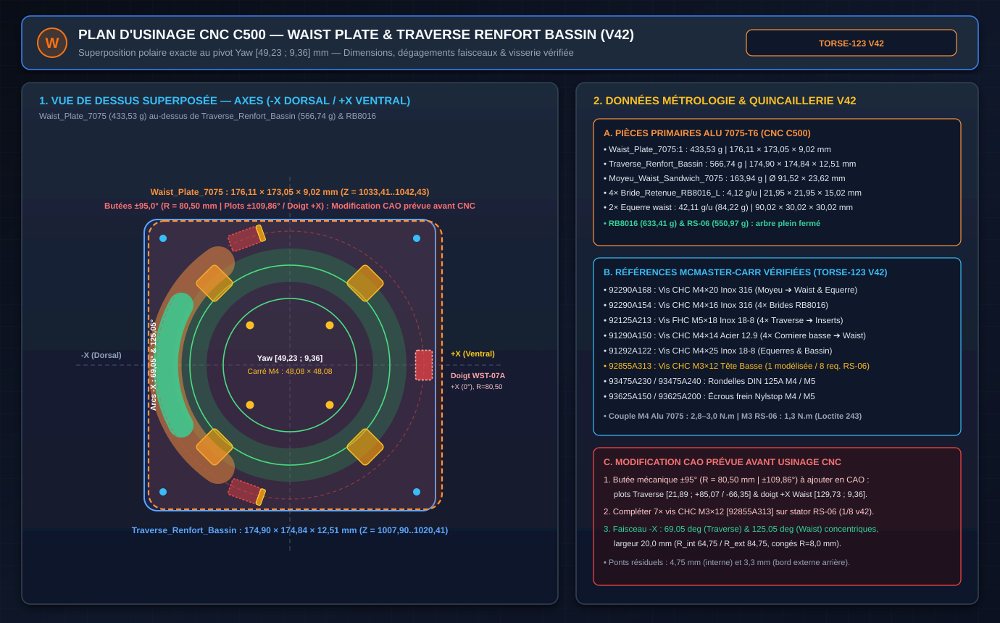

*Blueprint vectoriel d'ingénierie officiel de la liaison Waist élargie 176 × 173 mm : Implantation 2D cotée, vue en coupe axiale X-Z et spécifications de visserie McMaster-Carr.*

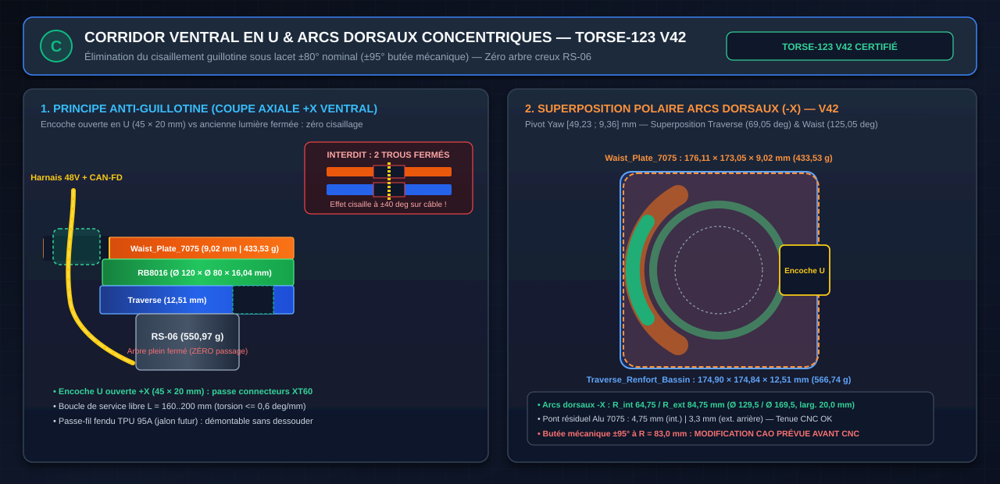

*Architecture cinématique comparée du faisceau : fente fixe 69° (Traverse Pelvis), fente mobile 125° (Waist Plate) et recouvrement dynamique garanti sans cisaillement.*

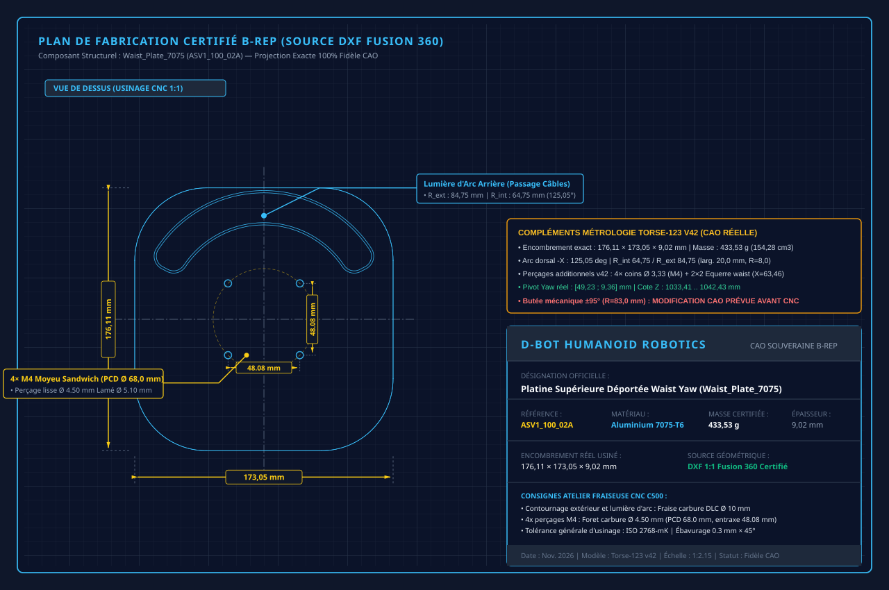

*Blueprint d'atelier et de métrologie de la `Waist_Plate_7075` (433,53 g, 176,11 × 173,05 × 9,02 mm) : alésage central Ø 80,00 mm pour bague intérieure RB8016, centrage RS-06 Ø 89,62 mm, carré M4 Moyeu 48,08 × 48,08 mm (PCD Ø 68 mm), lumière d'arc 125° et ancrage `Corniere basse`.*

---

### C. Conception Détaillée des Équerres Hautes & Basses (Profilé Commercial 30 × 30 × 3 mm — Option C Validée)

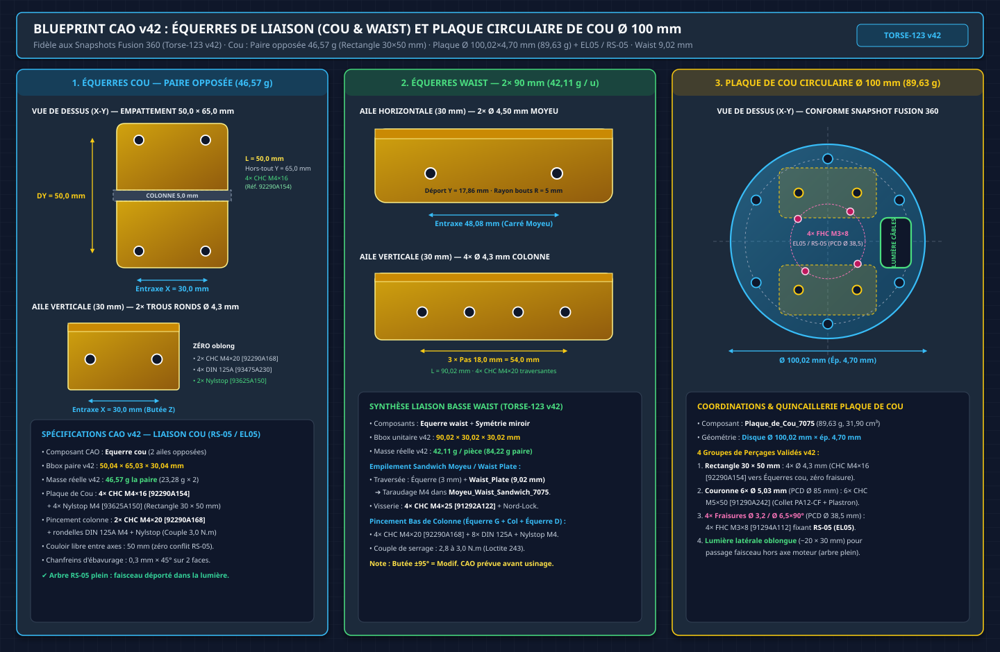

*Blueprint d'ingénierie vectoriel des liaisons d'extrémités. Panel 1 : Équerres Hautes du Cou en cornière marchande Blockenstock 30 × 30 × 3,0 mm (L = 50,0 mm, Alu 6060-T6) avec perçages lisses ronds Ø 4,30 mm (Zéro oblong, entraxe 30 mm, butée mécanique Z) et perçages horizontaux à 20,0 mm du pli (Rectangle 30 × 45 mm, fixation traversante acier/acier par vis CHC M4 × 16 mm + rondelles DIN 125A + écrous Nylstop M4 sous l'équerre, zéro fraisure sur la plaque de cou). Panel 2 : Équerres Basses Waist Yaw (30 × 30 × 3,0 mm, L = 90,0 mm) détaillant l'Aile Horizontale avec UNIQUEMENT 2 perçages traversants Ø 4,50 mm (déport 17,86 mm, entraxe 48,08 mm, trou #1 à 7,38 mm et trou #2 à 55,46 mm, congés d'angle R = 5 mm, serrage sandwich direct sur le Moyeu 7075 par vis CHC M4 × 20 mm, suppression des 4 anciens perçages superflus) et l'Aile Verticale avec 4 perçages Ø 4,3 mm (Z = 10,0 mm) pour pincement rigide de la colonne vertébrale 5 mm. Panel 3 : Plan de perçage de la plaque de cou (rectangle 30 × 45 mm dégageant un couloir libre de 45 mm pour le moteur RS-05), schéma de débit sur barre 500 mm et protocole de montage.*

#### 1. Équerres Hautes du Cou Compactes (L = 50,0 mm — Liaison Rigide de Précision — Option C Zéro Taraudage)
* **Profil Brut & Matière** : Cornière marchande en aluminium **6060-T6** (profilé extrudé commercial Blockenstock, réf `30x30x3-lg500mm-corniere-alu-6060t6`), section brute **`30 × 30 × 3,0 mm`**, longueur compacte **`L = 50,0 mm`**.
  - Largeur totale assemblée de la fourche : `5,0 mm` (colonne) + `2 × 30,0 mm` = **`65,0 mm`**.
  - Dégagement libre sous la plaque supérieure de 94 mm : `(94,0 - 65,0) / 2 =` **`14,50 mm de chaque côté`** (dégagement parfait, aucun usinage en largeur requis, ailes brutes 30 mm conservées).
* **Masse Nette** : **`22,8 g`** par pièce (soit **`45,6 g` pour la paire** gauche + droite).
* **Aile Horizontale — Cotation Précise des 2 Perçages Lisses Ø 4,30 mm (Option C Zéro Taraudage — Fixation Plaque de Cou 5,0 mm)** :
  - **Position dans la largeur de l'aile (30,0 mm)** :
    - Distance depuis l'arête extérieure du pli : **`20,00 mm`** (déport libérant le centre).
    - Distance restante jusqu'au chant libre extérieur (pince au bord) : `30,0 - 20,0 =` **`10,00 mm`** (matière résiduelle trou/arête = `7,85 mm` > 1,8×d, tenue au déchirement 100% garantie).
    - Distance de matière pleine résiduelle côté vertical intérieur : `20,00 - 3,00 =` **`17,00 mm`** (dégagement immense pour le passage aisé de la clé plate ou douille de 7 mm sous l'équerre).
  - **Position le long de l'équerre (L = 50,0 mm)** :
    - Trou #1 : situé à **`10,00 mm`** du premier chant d'extrémité.
    - Trou #2 : situé à **`40,00 mm`** du premier chant d'extrémité (soit **`10,00 mm`** du second chant).
    - **Entraxe longitudinal** : **`30,00 mm`** pile (`X = +/- 15,00 mm`).
  - **Spécification d'Usinage (Option C)** : 2 perçages lisses traversants **`Ø 4,30 mm`** débouchant à travers les 3,0 mm, chanfrein d'entrée **`0,3 mm × 45°`** des 2 côtés. **ZÉRO taraudage machine ou manuel, perçage direct en 1 passe fraise/foret carbure sur la C500**.
  - **Visserie associée & Zéro Fraisure sur la Plaque de Cou** : **4 vis CHC M4 × 16 mm (`92290A154`)** insérées par le dessus traversant la plaque de cou (`4,70 mm`) + rondelles DIN 125A M4 (`0,8 mm`) + l'équerre (`3,0 mm`) = `8,50 mm` + **4 écrous frein Nylstop M4 (`93625A150`)** serrés sous l'aile de cornière à la clé de 7 mm. **ZÉRO fraisure requise sur la plaque de cou** (perçage lisse débouchant Ø 4,30 mm standard chanfreiné à 0,3 mm × 45°).
  - **Masse réelle (`Torse-123 v42`)** : **`46,57 g` la paire** (`23,28 g` / équerre).
  - **Avantages de la Géométrie Élargie (Rectangle `30 × 50 mm` en `v42`)** :
    - **Couloir central libre de 50 mm & Dégagement CHC** : Dégage complètement l'embase et les vis du moteur de cou **RobStride RS-05 (réf. CAO : EL05)** ainsi que le passage latéral des câbles moteur (alimentation 48V et bus CAN), tout en laissant une marge périphérique suffisante pour les têtes de vis CHC M4 et leur clé de serrage Allen 3,0 mm.
    - **Rigidité en Roulis (Roll) accrue** : Entraxe transversal élargi à **50,0 mm** (`Y = ±25,00 mm` de l'axe sagittal, soit `22,50 mm` depuis le flanc colonne), augmentant le bras de levier stabilisateur face aux accélérations latérales de la tête.
* **Aile Verticale — Cotation des 2 Trous Ronds de Précision (Pincement Plaque Sagittale Haute 5,0 mm)** :
  - **Position en hauteur Z sur l'aile (30,0 mm)** : axe médian horizontal situé à **`12,50 mm`** du pli extérieur (laisse 17,5 mm de chant vertical libre).
  - **Position en longueur** : coaxiale avec les perçages horizontaux, entraxe = **`30,00 mm`** (`X = +/- 15,00 mm`, à 10,0 mm des chants d'extrémité).
  - **Géométrie des trous (Zéro Oblong)** : **2 perçages ronds lisses Ø 4,30 mm** (butée mécanique franche d'obstacle en Z, déplacement axial nul).
  - **Facteur de sécurité RDM** : **`Sf = 34`** face au couple pic de **5,5 N.m** du moteur **RS-05 (EL05)** du cou (contrainte de flexion Sigma_max < 4,6 MPa vs Re = 160 MPa).
  - **Visserie associée** : **2 vis CHC M4 × 20 mm (`92290A168`)** traversantes + **4 rondelles plates standard DIN 125A M4 (`93475A230`)** + **2 écrous Nylstop M4 (`93625A150`)** (serrage à 3,0 N.m).

#### 2. Équerres Basses du Waist Compactes (L = 90,0 mm — Ancrage Rigide 36 N.m — Alignement Fusion 360)
* **Profil Brut & Matière** : Même cornière marchande en aluminium **6060-T6** débitée sur la même barre Blockenstock `30 × 30 × 3,0 mm`, longueur optimisée **`L = 90,0 mm`** (ajustée pour garantir une assise de matière pleine face au moyeu et s'adapter au rétrécissement de la colonne basse dans le corps PA12-CF).
  - Largeur totale assemblée : `5,0 mm` + `2 × 30,0 mm` = **`65,0 mm`**.
  - S'inscrit rigoureusement à l'intérieur de l'enveloppe circulaire **Ø 88 mm** du moteur RobStride RS-06 (marge radiale de 11,5 mm de chaque côté) et laisse **`~55 mm` de dégagement** sur les flancs de la `Waist_Plate_7075` élargie (`176,11 × 173,05 mm`).
* **Masse Nette (`Torse-123 v42`)** : **`42,11 g`** par pièce (`14,98 cm³`, soit **`84,22 g` pour la paire** gauche + droite).
* **Aile Horizontale — Cotation des 2 Trous Traversants Sandwich (Liaison Directe Équerre ➔ Waist Plate ➔ Moyeu 7075)** :
  - **Position dans la largeur de l'aile (30,0 mm)** : axe des trous centré à **`17,86 mm`** du pli intérieur de la cornière (matière pleine résiduelle extérieure = `12,14 mm`).
  - **Position le long de l'équerre (L = 90,0 mm)** : **2 trous lisses traversants `Ø 4,50 mm`** :
    - **Entraxe longitudinal** : **`48,08 mm`** (carré `48,08 × 48,08 mm` soit PCD **Ø 68,0 mm** à 45° sur le moyeu).
    - **Congés d'angle (Fillets)** : **`R = 5,0 mm`** pour assurer une assise plane complète des rondelles DIN 125A M4 (`Ø 9,0 mm`).
  - **Rôle mécanique** : Traversés par les **4 vis CHC M4 × 20 mm (`92290A168`)** + rondelles DIN 125A M4 (`93475A230`) bridant `[Équerre 3,0 mm + Waist Plate 9,0 mm]` dans les 4 taraudages du **`Moyeu_Waist_Sandwich_7075`** (`pénétration = 20 - 3,0 - 0,8 - 9,0 = 7,20 mm`).
* **Aile Verticale — Cotation des 4 Trous Ronds (Pincement Plaque Sagittale Basse 5,0 mm)** :
  - **Position en hauteur Z** : axe centré à **`Z = 12,50 mm`** du pli extérieur.
  - **Position en longueur** : 4 trous Ø 4,30 mm ronds, entraxes réguliers de 18,0 mm (`54,0 mm` au total) centrés sur la zone de pincement de la colonne.
  - **Facteur de sécurité RDM** : **`Sf = 2,78`** (couple de frottement résistant au lacet = **100 N.m** face au couple pic de **36 N.m** du moteur RS-06).
  - **Visserie associée** : **4 vis CHC M4 × 20 mm (`92290A168`)** traversantes (traverse Équerre G 3 mm + Colonne 5 mm + Équerre D 3 mm = 11 mm) + **8 rondelles DIN 125A M4 (`93475A230`)** + **4 écrous Nylstop M4 (`93625A150`)** (serrage direct à 3,0 N.m).

#### 3. Tableau des Coordonnées Cartésiennes pour Modélisation CAO Fusion 360

Dans le repère local centré sur le nœud d'épaules et le plan sagittal de colonne (`Y_local = 0`, face gauche à `Y_local = -2,50 mm`, face droite à `Y_local = +2,50 mm` ; note : dans le repère global `Torse-123 v42`, le plan médian colonne est à `Y_global = +8,67 mm`) :

| Vis / Entité | Pièce Porteuse | Coordonnée X (Sagittal) | Coordonnée Y_local (Transversal) | Coordonnée Z (Vertical rel.) | Outil & Spécification Usinage (Option C) |
| :--- | :--- | :---: | :---: | :---: | :--- |
| **CHC Cou #1 (Av-G)** | Plaque Cou & Équerre G | **`+15,00 mm`** | **`-25,00 mm`** | Sommet plaque | Perçage lisse traversant Ø 4,30 mm (ZÉRO fraisure) / Vis CHC M4 × 16 mm (`92290A154`) + Écrou Nylstop M4 dessous |
| **CHC Cou #2 (Av-D)** | Plaque Cou & Équerre D | **`+15,00 mm`** | **`+25,00 mm`** | Sommet plaque | Perçage lisse traversant Ø 4,30 mm (ZÉRO fraisure) / Vis CHC M4 × 16 mm (`92290A154`) + Écrou Nylstop M4 dessous |
| **CHC Cou #3 (Ar-G)** | Plaque Cou & Équerre G | **`-15,00 mm`** | **`-25,00 mm`** | Sommet plaque | Perçage lisse traversant Ø 4,30 mm (ZÉRO fraisure) / Vis CHC M4 × 16 mm (`92290A154`) + Écrou Nylstop M4 dessous |
| **CHC Cou #4 (Ar-D)** | Plaque Cou & Équerre D | **`-15,00 mm`** | **`+25,00 mm`** | Sommet plaque | Perçage lisse traversant Ø 4,30 mm (ZÉRO fraisure) / Vis CHC M4 × 16 mm (`92290A154`) + Écrou Nylstop M4 dessous |
| **FHC M3 RS-05 (EL05) #1–#4** | Plaque Cou ➔ RS-05 | **`±13,61 mm`** | **`±13,61 mm`** | Sommet plaque | Fraisure conique 90° Ø 6,50 mm par le DESSOUS (prof. 1,65 mm) / Perçage traversant Ø 3,20 mm (PCD Ø 38,5 mm) |
| **Trou Rond Cou Av/Ar** | Équerres & Colonne | **`±15,00 mm`** | `Y = ±2,50 mm` | `ΔZ = -12,5 mm` / plaque | Perçage lisse Ø 4,30 mm traversant équerres et colonne (`92290A168` CHC M4×20 + `93625A150`) |
| **Sandwich Waist #1–#4** | Équerres ➔ Waist ➔ Moyeu | **`±24,04 mm`** | **`±24,04 mm`** | Base Waist | Perçage lisse Ø 4,50 mm traversant Équerre (3 mm) + Waist (9,0 mm) / Vis CHC M4 × 20 mm (`92290A168`) dans Moyeu 7075 |
| **IMU BMI270 #1–#4** | Plaque Haute Colonne | **`±10,16 mm`** | `Y = +2,50 mm` | `Z_loc = +71,42 / +91,74` | Perçage lisse débouchant Ø 2,70 mm (Zéro taraudage) / CHC M2,5 × 14 mm + entretoise nylon 3 mm + Nylstop M2,5 |

> [!TIP]
> **Règle d'Or CAO — Le Rectangle de Vissage `30 × 50 mm` du Cou (`Torse-123 v42`)** :  
> Sur la Plaque Supérieure de Cou (`Plaque_de_Cou_7075`, `100,02 × 100,02 × 4,70 mm`), les 4 vis cylindriques CHC M4 (`92290A154`) forment un **rectangle de `30,0 mm × 50,0 mm`** centré sur l'origine (`ΔX = ±15,0 mm`, `ΔY = ±25,0 mm`, soit `22,50 mm` depuis le flanc colonne). Les têtes CHC M4 et écrous Nylstop sont totalement dégagés du stator du **RobStride RS-05 (EL05)** (`46,04 × 46,04 mm`).  
> Sous Fusion 360, créer une esquisse sur la face supérieure, tracer un **Rectangle par le Centre (`30 × 50 mm`)**, appliquer **Simple Hole `Ø 4,30 mm`** sans cône de fraisure, avec chanfrein d'ébavurage **`0,3 mm × 45°`** des deux côtés.

---

#### 4. Cartographie Complète des Chanfreins, Fraisures & Protocole d'Ébavurage d'Atelier

Dans un assemblage métallique haute performance soumis aux vibrations dynamiques d'actionneurs QDD (chocs de marche et couples pics de 120 N.m), **le chanfreinage et l'ébavurage ne sont pas de simples finitions cosmétiques, mais des exigences mécaniques critiques conditionnant l'isostatisme et la tenue au desserrage** :
* **Danger mécanique du morfil / bavure** : Tout perçage (foret ou fraise) crée un refoulement de matière circulaire en sortie de perçage (bavure de 0,05 à 0,15 mm). Si deux pièces planes sont boulonnées sans ébavurage préalable, cette micro-bavure porte 100% de la précharge sur quelques dixièmes de millimètre carré. Sous vibration, la bavure s'écrase ou se rompt, provoquant une perte immédiate de tension de la vis et le desserrage de la liaison.
* **Règle d'or d'atelier** : Tout perçage traversant doit être **chanfreiné sur ses 2 faces**, et tout chant scié doit recevoir un **cassage d'arête franc**.

##### Tableau Récapitulatif des Chanfreins, Fraisures & Ébavurages du Torse Complet

| Composant & Zone | Face / Arête Concernée | Type d'Usinage / Outil | Cote Spécifiée | Rôle Mécanique & Justification d'Atelier |
| :--- | :--- | :--- | :---: | :--- |
| **1. Équerres Hautes Cou (30×30×3, L = 50 mm)** | Aile Horizontale — Face Supérieure (contact plaque de cou 4,70 mm) | Fraise à noyer 90° ou fraise à chanfreiner C500 | **`0,3 mm × 45°`** | **Obligatoire** : Élimine le morfil de perçage pour un **contact plan métal-métal franc à 0,0 mm** avec la face inférieure de la plaque de cou. |
| **1. Équerres Hautes Cou (30×30×3, L = 50 mm)** | Aile Horizontale — Face Inférieure (sous écrous Nylstop M4) | Fraise à chanfreiner 45° | **`0,3 mm × 45°`** | Assise rigoureusement plane pour les écrous Nylstop M4, élimine l'amorçage de criques sous couple de 3,0 N.m. |
| **2. Équerres Basses Waist (30×30×3, L = 90 mm)** | Aile Horizontale — Face Supérieure (sous têtes CHC M4 et rondelles) | Fraise à chanfreiner C500 | **`0,3 mm × 45°`** | Assise plane parfaite pour rondelle plate standard DIN 125A M4 (`Ø 9,0 mm`). |
| **2. Équerres Basses Waist (30×30×3, L = 90 mm)** | Aile Horizontale — Face Inférieure (contact Waist Plate 9,0 mm) | Fraise à chanfreiner C500 | **`0,3 mm × 45°`** | Contact plan rigoureusement franc à 0,0 mm pour le serrage sandwich sur `Waist_Plate_7075` et `Moyeu_Waist_Sandwich_7075`. |
| **2. Équerres Basses Waist (30×30×3, L = 90 mm)** | Aile Horizontale — Congés d'Angles Extérieurs | Fraise 2 lèvres ou meuleuse | **`R = 5,0 mm`** | Garantit que la rondelle DIN 125A repose à 100% sur une surface plane sans déborder. |
| **3. Équerres Cou & Waist (Aile Verticale)** | Face Intérieure (contact bilatéral colonne 5 mm) | Fraise à chanfreiner C500 ou outil à main | **`0,3 mm × 45°`** | Placage plan bilatéral sans aucun jour avec les flancs en Alu 7075-T6 de la colonne vertébrale. |
| **3. Équerres Cou & Waist (Aile Verticale)** | Face Extérieure (sous têtes CHC M4 et écrous Nylstop) | Fraise à chanfreiner C500 | **`0,3 mm × 45°`** | Portée plane des rondelles DIN 125A M4 sous tête et sous écrou (couple 3,0 N.m). |
| **4. Équerres Cou & Waist (Chants Sciés & Bords)** | 4 chants sciés d'extrémités (2× L = 50 mm et 2× L = 90 mm) | Lime fine d'ajusteur ou bande abrasive | **`0,5 mm × 45°`** | Élimination des bavures vives de sciage, sécurité lors de l'assemblage manuel, finition atelier soignée. |
| **4. Équerres Cou & Waist (Chants Sciés & Bords)** | Arêtes longitudinales libres (chants à 30 mm du pli) | Toile émeri grain 400 ou ébavureur tournant | **`0,3 mm × 45°`** | Doucissage des chants extrudés marchands pour un aspect et toucher de qualité aéronautique. |
| **5. Plaque Supérieure Cou (Alu 4,70 mm)** | Face Supérieure (4 perçages rectangle 30 × 50 mm) | Foret Ø 4,30 mm + fraise à chanfreiner C500 | **`0,3 mm × 45°`** | **ZÉRO FRAISURE CONIQUE**. Assise plane directe des têtes CHC M4 × 16 mm hors du gabarit du moteur **RS-05 (EL05)**. |
| **5. Plaque Supérieure Cou (Alu 4,70 mm)** | Face Inférieure (4 perçages PCD Ø 38,50 mm moteur RS-05) | Fraise conique 90° C500 | **Fraisure 90° Ø 6,50 mm (prof. 1,65 mm)** | **Noyage à fleur exacte (0,0 mm)** des têtes des 4 vis FHC M3 × 8 mm (`92125A128`) sous la plaque (garde résiduelle 3,05 mm). |
| **5. Plaque Supérieure Cou (Alu 4,70 mm)** | Face Supérieure (débouché des 4 perçages vers moteur RS-05) | Fraise à chanfreiner C500 | **`0,2 mm × 45°`** | Micro-ébavurage garantissant une assise coplanaire parfaite sous le carter stator du moteur **RS-05 (EL05)**. |
| **6. Brides d'Épaules Monoblocs (Alu 7075-T6)** | Face Stator — Logement de Centrage Moteur (**Ø 97,00 mm H7**) | Outil d'alésage circulaire CNC | **Congé fond `R = 0,5 mm` + Chanfrein `0,5 mm × 45°`** | Le chanfrein d'entrée guide l'emboîtement du stator RS-04 ; le congé de fond évite toute concentration de contraintes sans talonnage. |
| **6. Brides d'Épaules Monoblocs (Alu 7075-T6)** | Face Stator — 10 Perçages Traversants Ø 4,30 mm (PCD Ø 106 mm) | Fraise à chanfreiner C500 | **`0,5 mm × 45°`** | Assise plane parfaite pour les rondelles frein Nord-Lock M4 (`91812A252`, ép. 1,8 mm) sans contact sur bavure. |
| **6. Brides d'Épaules Monoblocs (Alu 7075-T6)** | Bossage Carré Traverse — Évidement carré 44 × 44 mm & hub ventilé | Fraise circulaire CNC | **`0,8 mm × 45°`** | Bords ébavurés pour écoulement aéraulique et protection faisceau. |
| **6. Brides d'Épaules Monoblocs (Alu 7075-T6)** | Bossage Carré Traverse — Perçage Vertical M5 (X = 7,5 mm) | Fraise à chanfreiner C500 | **`0,5 mm × 45°` (Haut & Bas)** | Guidage des vis CHC M5 × 70 mm (`91290A272`) et assise des rondelles DIN 125A M5. |
| **7. Demi-Traverses Tubes Carrés (60×60×2 mm)** | 2 Tronçons **L = 80,07 mm** — Chants de sciage débités | Lime plate d'ajusteur ou fraiseuse | **`0,5 mm × 45°` (Int. & Ext.)** | Cassage des bavures de sciage d'atelier sur les 4 parois internes et externes du tube alu. |
| **7. Demi-Traverses Tubes Carrés (60×60×2 mm)** | 4 Perçages Verticaux Traversants Ø 5,30 mm (**X = 7,5 et 72,57 mm**) | Fraise à chanfreiner C500 | **`0,5 mm × 45°` (des 2 côtés)** | Placage plan des rondelles DIN 125A M5 (`93475A240`) sous tête et sous écrou Nylstop M5 (couple 5,5 N.m). |
| **8. Semelles Éclisses & Inserts (Alu 7075-T6)** | Semelles 5 mm — 4 Perçages Fraisés Fixation Inserts | Fraise conique 90° C500 | **Fraisure 90° Ø 8,40 mm à fleur (0,0 mm)** | Noyage des vis FHC M4 × 30 mm à fleur sous semelle pour glissement sans frottement dans le tube 60×60. |
| **8. Semelles Éclisses & Inserts (Alu 7075-T6)** | Semelles 5 mm — 2 Perçages Sandwich Colonne Ø 5,30 mm | Fraise à chanfreiner C500 | **`0,5 mm × 45°` (des 2 côtés)** | Pincement franc du sandwich central 15 mm par vis CHC M5 × 25 mm (couple 5,5 N.m). |
| **8. Semelles Éclisses & Inserts (Alu 7075-T6)** | Inserts 15 mm — Alésage Central Traversant Ø 35,0 mm | Fraise circulaire CNC | **`0,8 mm × 45°` (des 2 côtés)** | Raccordement sans arête coupante du couloir de câblage central d'épaules. |
| **9. Colonne Sagittale Haute & Basse (5,0 mm)** | Chants supérieurs et inférieurs au niveau des pliures d'équerres | Fraise à chanfreiner 45° C500 | **`0,5 mm × 45°`** | Évite tout contact franc entre l'arête de colonne et le congé intérieur naturel de la cornière marchande. |
| **9. Colonne Sagittale Haute & Basse (5,0 mm)** | 6 Perçages Traversants Ø 4,30 mm (2 au cou, 4 au waist) | Fraise à chanfreiner 45° | **`0,3 mm × 45°` (des 2 côtés)** | Guidage doux des vis CHC M4 × 20 mm et placage sans contrainte parasite des équerres. |
| **9. Colonne Sagittale Haute (Plaque 5,0 mm)** | 4 Perçages Traversants Ø 2,70 mm IMU Torse (BMI270) | Fraise à chanfreiner 45° C500 | **`0,2 mm × 45°` (des 2 côtés)** | Micro-ébavurage éliminant tout morfil : assise rigoureusement plane des entretoises nylon 3 mm (flanc droit) et des rondelles DIN 125A / écrous Nylstop M2,5 (flanc gauche). |
| **9. Colonne Sagittale & Éclisses (Sandwich Carré 80 × 80 mm)** | 4 Alésages de Goupilles Ø 3,00 mm H7 (Y = ±40 mm, Z = ±40 mm) | Alésoir machine H7 Ø 3,0 mm + fraise 45° C500 | **`0,1 mm × 45°` (des 2 côtés)** | Chanfrein de guidage indispensable pour chasser les 4 goupilles ISO 8734 m6 au maillet sans copeau ni arrachement de métal. |
| **9. Jonction Colonne Sagittale (Coupe Droite Z = 0)** | Chants de contact métal-métal à Z = 0,0 mm (largeur 100 mm) | Fraise carbure C500 / outil ébavureur | **`0,2 mm × 45°`** | Cassage d'arête soigné garantissant un contact plan franc à 0,0 mm sans morfil sur les 500 mm² de portée continue (zéro tenon). |
| **9. Colonne Sagittale Basse (2 Lumières 54×55 mm)** | Arêtes intérieures des 2 fenêtres d'allègement et congés R=15 mm | Fraise à chanfreiner 45° C500 | **`0,3 mm à 0,5 mm × 45°` (des 2 côtés)** | Élimination rigoureuse du morfil de fraisage, protection absolue des faisceaux électriques contre l'effet tranchant et abaissement du facteur de concentration de contrainte Kt. |
| **10. Waist Plate Inférieure (Alu 9,0 mm)** | 4 Perçages Traversants Sandwich Ø 4,50 mm (Carré 48,08 mm / PCD Ø 68 mm à 45°) | Fraise à chanfreiner C500 | **`0,3 mm × 45°` (des 2 côtés)** | Placage plan franc entre les ailes d'équerres (dessus) et le Moyeu Sandwich / RB8016 (dessous). |
| **10. Waist Plate Inférieure (Alu 9,0 mm)** | Contour Extérieur Élargi (176,11 × 173,05 mm) | Fraise de contournage C500 | **`0,5 mm × 45°`** | Cassage d'arête sur tout le pourtour supérieur et inférieur de la plaque. |

---

### D. Protocole d'Atelier Naturel & Ergonomique (Torse-123 v42)

En éliminant les oblongs au profit de perçages de précision `Ø 4,30 mm` usinés sur la CNC C500, la contrainte artificielle d'un serrage exigu au collet du cou en toute fin de montage disparaît totalement. L'atelier adopte une **logique d'assemblage inversée hautement ergonomique** : le haut est assemblé à plat sur établi nu avec une accessibilité totale à 360°, et le verrouillage final s'effectue au centre de la poitrine, dans la zone la plus spacieuse et dégagée du robot.

```
                  ACCÈS CLÉ ALLEN LIBRE PAR LE DESSUS (Y = ±25,0 mm)
                              │                       │
                              ▼                       ▼
                      Vis CHC M4 × 16 mm (Tête cylindrique Ø 7 mm)
                 ┌─────────────────────────────────────────────────┐
                 │      PLAQUE SUPÉRIEURE DE COU (Alu 4,70 mm)     │
                 └──────────┬───────────────────────────┬──────────┘
                            │ (Rectangle 30 × 50 mm)    │
                 ┌──────────┴──┐                     ┌──┴──────────┐
                 │ Équerre G   │◄── Couloir 50 mm ──►│ Équerre D   │
                 │ (30×30×3 mm)│ Libre (RS-05/EL05)  │ (30×30×3 mm)│
                 │ [Nylstop M4]│                     │ [Nylstop M4]│
                 └──────┬──────┘                     └──────┬──────┘
                        │      ┌─────────────────────┐      │
          Accès Latéral │      │ Plaque Sagittale    │      │ Accès Latéral
          Clé Allen     │      │ Haute 5,0 mm        │      │ Clé Plate 7 mm
          ────────────► ├──(o)─┤ (Trou Rond Ø4,3 mm) ├──(o)─┤ ◄─────────────
           (Vis CHC M4) │(Ø4,3)│                     │(Ø4,3)│ (Écrou Nylstop M4)
                        │      │                     │      │
```

#### Protocole d'Atelier en 5 Étapes Chronologiques

1. **Étape 1 — Pré-assemblage Haute Rigidité des Équerres sur Colonne (Établi Nu — Accès 360°)** :
   * Sur l'établi dégagé, positionner les 2 équerres hautes de cou (`L = 50,0 mm`) de part et d'autre du sommet de la colonne sagittale de 5 mm.
   * Insérer les **2 vis CHC M4 × 20 mm** (`92290A168`) munies de rondelles standard DIN 125A à travers les perçages ronds lisses `Ø 4,30 mm` de l'équerre gauche, de la colonne et de l'équerre droite.
   * Visser et bloquer les **2 écrous Nylstop M4** (`93625A150`) à l'aide d'une clé plate de 7 mm et d'une clé Allen au couple nominal de **`3,0 N.m`**.
   * *Résultat* : Les équerres sont instantanément verrouillées en butée mécanique d'obstacle (déplacement Z nul), d'équerre et alignées au centième de millimètre grâce à la précision C500, sans aucune contorsion.
2. **Étape 2 — Pose de la Plaque Supérieure de Cou & Moteur RobStride RS-05 (réf. constructeur / CAO : EL05)** :
   * Positionner la Plaque Supérieure de Cou de 4,70 mm (`Plaque_de_Cou_7075`, `89,63 g`) sur les ailes horizontales des cornières.
   * Insérer les **4 vis CHC M4 × 16 mm** (`92290A154`, avec rondelles plates DIN 125A) par le dessus à travers les perçages lisses Ø 4,30 mm du rectangle `30 × 50 mm` (les têtes cylindriques logent librement sans chevaucher le carter du moteur RS-05 / EL05).
   * Visser les **4 écrous Nylstop M4** (`93625A150`) sous l'aile de cornière à la clé de 7 mm (le déport à 22,50 mm du flanc colonne / `Y = ±25,0 mm` offre un dégagement confortable pour la clé) et serrer à **`3,0 N.m`** (clé Allen 3,0 mm).
   * Fixer le moteur **RobStride RS-05 (EL05)** du cou via `4× FHC M3 × 8 mm [92125A128]` : le couloir central libre de **50 mm** entre les vis garantit zéro interférence avec l'embase moteur et le passage des faisceaux de câbles.
3. **Étape 3 — Fixation Basse des Équerres de Waist (Taille)** :
   * À la base de la colonne de 5 mm, boulonner les 2 équerres basses de Waist (`L = 90,0 mm`) à l'aide de **4 vis CHC M4 × 20 mm traversantes + 8 rondelles DIN 125A + 4 écrous Nylstop M4** serrés à **`3,0 N.m`**.
   * Fixer la `Waist_Plate_7075` de 9,0 mm (`176,11 × 173,05 × 9,02 mm`) sous les équerres : la structure du torse dispose désormais de ses deux extrémités parfaitement rigides et figées.
4. **Étape 4 — Insertion dans le Thorax & Verrouillage du Nœud Central d'Épaules (EN DERNIER)** :
   * Glisser l'ensemble colonne équipée (encombrement de tête seulement `86,5 × 65,0 mm`) à travers l'ouverture abdominale inférieure du thorax haut (`~200 × 160 mm`), avec un jeu d'aisance de plus de 50 mm.
   * Emmancher les 2 demi-traverses d'épaules en tube carré `60 × 60 × 2 mm` (équipées de leurs brides et moteurs RS-04) sur les inserts latéraux de la colonne.
   * En plein milieu de la poitrine — zone la plus large, spacieuse et accessible du robot — insérer et serrer les **4 vis traversantes CHC M5 × 25 mm** du sandwich central d'éclisses à **`6,0 N.m`** (19 200 N de précharge).
   * *Bénéfice majeur* : Le serrage final s'effectue dans un confort ergonomique total, sans aucun outil courbé ni accès aveugle.
5. **Étape 5 — Fermeture des Coques PA12-CF** :
   * Coiffer et visser la demi-coque abdominale basse sur le plan de joint abdominal à l'aide de 6 à 8 vis CHC M4 prenant dans les inserts laiton Ruthex M4 chauffés.
   * Le squelette métallique reprend 100% des contraintes mécaniques, les coques assurant uniquement l'habillage aéraulique et esthétique.

## 8. Coque Secondaire PA12-CF & Impression 3D (Qidi Plus 4)

### A. Impression Verticale (Debout) & Réduction des Supports

Avec le squelette métallique reprenant tous les efforts structurels, les panneaux modulaires PA12-CF de la **Solution C+** (`Carenage_Pectoral_Haut` P1/P2 coupé à `Z = 1285 mm`, `Carenage_Lombaire_Arriere`, `Plastron_Ventral_Torse`) sont orientés **verticalement selon l'axe Z (coupe plane en appui sur le plateau Qidi Plus 4)** pour optimiser l'anisotropie des parois et réduire d'environ 75 % les supports internes (voir le découpage `Torse-123 v42` complet en § 8B ci-dessous dans [`schema_architecture_decoupage_modulaire_torse_pa12cf.svg`](./media/schema_architecture_decoupage_modulaire_torse_pa12cf.svg)).

---

### B. Architecture Modulaire Solution C+ & Validation FEA Portique 7075-T6

> [!NOTE]
> **Architecture Retenue & Validée : Solution C+ (`Torse-123 v42`)** :  
> L'arbitrage d'ingénierie consolidé entérine la **Solution C+** combinant :
> 1. **Carénages & Demi-Fûts PA12-CF optimisés Qidi Plus 4** : `Plastron_Ventral_Torse` (`2 849,97 g` brut CAO incl. `ceinture`), `Carenage_Pectoral_Haut` (`203,84 g` brut, H = 385,2 mm en `v42` — découpe Qidi en P1/P2 à `Z = 1285 mm` par battue `2,0 mm × H = 10 mm`, jeu `2,8 mm`, aimants N52 + inserts Standard Ruthex M4 × 8,1 mm), `Carenage_Lombaire_Arriere` (`206,71 g` brut, H = 343,29 mm), `Platine_Connectique_Facade` (`36,27 g` brut). *(Note métrologique `v42` : les pièces PA12-CF du torse ont encore la densité brute `1,015 g/cm³` dans Fusion 360 ; la masse réelle imprimée en gyroïde 15-20 % est environ `30 %` plus légère)*.
> 2. **Une ceinture intermédiaire en Aluminium 7075-T6 (`ceinture`, épaisseur 3,0 mm, `45,43 g`)** en fer-à-cheval ouvert sur l'arrière (`202,81 × 262,52 × 3,00 mm` à `Z = 1233,5..1236,5 mm`) usinée sur la CNC C500 (protocole souverain 2 phases sans ATC avec recalage Touch Probe 3D, voir `Annexes/Outils_de_Travail/cnc/22_Usinage_CNC_C500.md` § 8), fixée au plastron par `6× CHC M4 × 25 mm [91292A122]` + rondelles/Nylstop et aux cornières basses par `2× CHC M4 × 16 mm [91292A118]`.
> 3. **Des trappes/carénages frontaux et lombaires démontables** facilitant l'accès en atelier à l'IMU BMI270, aux faisceaux CAN-FD et aux connecteurs sans dépose complète du squelette.
> 4. **Un portique structural anti-lacet en Aluminium 7075-T6** reliant directement les brides d'épaules RS-04 à la Ceinture Alu (`Corniere haute`, `22,54 g` / pièce) et de la Ceinture Alu à la `Waist_Plate_7075` (`Corniere basse` nervurée à redan Z, `70,34 g` / pièce, `20,02 × 73,84 × 191,10 mm`, fixée au pied par `4× CHC M4 × 14 mm [91290A150]` + `4× Nord-Lock M4 [91812A252]`).

#### 1. Diagnostic d'Atelier & Limites de l'Ancien Découpage en 2 Demi-Fûts 360°
L'approche initiale consistant à scinder le torse uniquement par un plan horizontal médian présentait des verrous opérationnels majeurs en robotique humanoïde :
* **Effet « Tunnel Aveugle » (Blind Assembly)** : Chaque demi-coque restant un fût fermé à 360°, le passage des outils pour serrer le sandwich central de colonne (4 vis CHC M5 × 25 mm à 5,5 N.m et 4 goupilles ISO 8734 Ø3 mm) ou l'IMU SparkFun BMI270 (vis M2,5 traversantes sur le flanc de colonne) imposait des contorsions impraticables.
* **Risque Critique de Pincement du Faisceau 48V / CAN-FD** : Lors du refermement axial des deux fûts, les boucles de câbles devaient être tassées à l'aveugle, avec un risque majeur de pincement ou de cisaillement au plan de joint abdominal.
* **Pénalité de Maintenance Punitive** : L'intervention sur un connecteur XT30, un bus de capteur ou un ventilateur Noctua 4020 exigeait le démontage complet du robot.

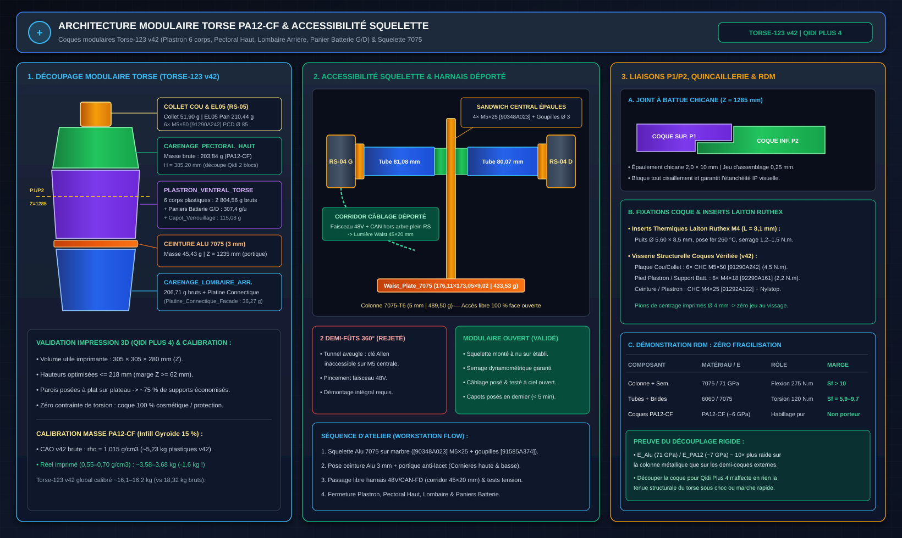

*Blueprint d'ingénierie vectoriel officiel de l'architecture modulaire du torse PA12-CF (D-Bot V1.x / `Torse-123 v42`). Panel 1 : Répartition modulaire (`Plastron_Ventral_Torse`, `Carenage_Pectoral_Haut`, `Carenage_Lombaire_Arriere`, `ceinture` Alu 3 mm et portique anti-lacet). Panel 2 : Cinématique d'assemblage ouverte dégageant l'accès direct au sandwich M5, à l'IMU BMI270 et au routage faisceaux. Panel 3 : Plans de coupe Qidi P1/P2 à battue (`Z = 1285 mm`), inserts thermiques laiton Standard Ruthex M4 × 8,1 mm et aimants N52.*

---

#### 2. Matrice Modulaire de la Solution C+ (`Torse-123 v42`)
Pour concilier le volume d'impression de la **Qidi Plus 4** (305 × 305 × 280 mm) avec une accessibilité totale et une rigidité en torsion maximale :
1. **Demi-fût / Plastron Supérieur & Inférieur (`Plastron_Ventral_Torse`)** :
   * **Masse brute CAO `v42` (`ρ = 1,015`)** : **`2 849,97 g`** total (incluant la `ceinture` `45,43 g`, soit `~2 804,5 g` bruts PA12-CF répartis entre thorax haut C1 `1 574,53 g`, abdomen C2 `622,88 g`, flancs/jupe `Torse bassin` `295,26 g` + `Torse gauche/droit` `148,78 / 148,81 g` + `Torse bas` `14,30 g` ; estimation calibrée à `0,70 g/cm³` : `~1 934 g` imprimés).
   * **Rôle & Fixation** : Relié au sommet à la `Plaque_de_Cou_7075` + `Cou - Tube collet` (`6× CHC M5 × 50 mm [91290A242]`) et à la base aux 4 coins de la `Waist_Plate_7075` (`4× CHC M4 × 18 mm [92290A161]`).
2. **Ceinture Intermédiaire en Aluminium 7075-T6 (`ceinture`)** :
   * **Dimensions & Profil `v42`** : `202,81 × 262,52 × 3,00 mm` à `Z = 1233,50..1236,50 mm` (profil fer-à-cheval ouvert sur l'arrière), masse propre **`45,43 g`**.
   * **Rôle & Fixation** : Plancher d'ancrage reliant `Corniere haute` (`22,54 g`/u) et `Corniere basse` (`70,34 g`/u, via `2× CHC M4 × 16 mm [91292A118]`) et rigidifiant le caisson via `6× CHC M4 × 25 mm [91292A122]`.
3. **Carénages Pectoral & Lombaire (`Carenage_Pectoral_Haut`, `Carenage_Lombaire_Arriere`, `Platine_Connectique_Facade`)** :
   * **Masses brutes CAO `v42` (`ρ = 1,015`)** : **`203,84 g`** (Pectoral Haut, H = 385,2 mm ➔ scission P1/P2 Qidi à Z = 1285 mm avec battue 2,0 mm × 10 mm et aimants N52), **`206,71 g`** (Lombaire Arrière, H = 343,29 mm), **`36,27 g`** (Platine Connectique Façade).
   * **Avantage Opérationnel** : Dépose rapide libérant l'accès au sandwich central de colonne (vis M5 et goupilles), aux tuyères aérauliques et à l'IMU SparkFun BMI270.
4. **Deux Paniers Batteries Latéraux Indépendants (`Panier_Batterie_Droit` / `Gauche` + `Capot_Droit` / `Gauche`)** :
   * Deux berceaux indépendants (`307,40 g` / `307,43 g` bruts `v42`, ~`212 g` calibrés `0,70 g/cm³`) avec capots (`57,54 g` / `57,55 g` bruts) coulissant le long du `Support Batterie Central` (`30,39 g` brut).

---

#### 3. Liaisons & Assemblage Mécanique Robuste
Pour garantir un comportement monolithique rigide sans jeu ni vibration parasite :
* **Plan de Joint à Chicane (Stepped Lap Joint 3,0 mm)** : Un épaulement décalé de 1,5 mm × 3,0 mm est modélisé sur tout le pourtour de jonction horizontal et sagittal. Ce profilé en chicane empêche toute pénétration de poussières, bloque le cisaillement relatif des parois et garantit un affleurement extérieur parfait à 0,0 mm.
* **Pions Coniques Auto-Centreurs In-Situ** : Tétons coniques (Ø 6,0 mm à la base, Ø 4,0 mm au sommet, hauteur 5,0 mm) imprimés directement sur les tranches des coques, assurant un positionnement répétable sans contraindre les filetages.
* **Inserts Filetés Laiton Standard Ruthex M4 × 8,1 mm** : Inserts moletés hélicoïdaux (longueur 8,1 mm) insérés thermiquement à 260 °C dans des puits borgnes de Ø 5,60 mm × 8,5 mm. Serrage par vis BHC M4 classe 10.9 ou inox au couple nominal de **`1,2 à 1,5 N.m`**.

---

#### 4. Démonstration RDM : Intégrité Structurale Absolue (Zéro Fragilisation)
Le découpage modulaire de la coque PA12-CF n'engendre rigoureusement **aucune perte de rigidité globale** pour le bipède :
* **Découplage Structural Métal / Polymère** : Les flux d'efforts primaires (moment de flexion sagittale de 275 N.m, couple de torsion d'épaule de 120 N.m, couple de lacet de 36 N.m) sont repris à **100% par le squelette interne en alliage d'aluminium** (colonne 7075-T6 de 5,0 mm, tubes carrés 60×60×2 mm en 6060-T6, portique anti-lacet 7075-T6 et roulement à rouleaux croisés RB8016).
* **Rapport des Modules d'Élasticité** : Le module d'Young de l'Alu 7075 (E = 71 GPa) est plus de 10 fois supérieur à celui du PA12-CF imprimé (E = 6,5 à 7,5 GPa).
* **Suppression des Contraintes Parasites** : Scinder la coque supprime l'hyperstatisme de bridage sur la colonne et élimine les risques de criques causés par les dilatations thermiques différentielles (Alu 23 × 10^-6 /K vs PA12-CF 40 × 10^-6 /K).

---

#### 5. Protocole Chronologique d'Assemblage en Atelier (Workstation Flow)
1. **Étape 1 (Squelette Métallique Nu)** : Assembler sur marbre la colonne 7075, les semelles éclisses, les inserts 15°, les 4 goupilles ISO 8734 Ø3 mm et serrer les 4 vis CHC M5 × 25 mm à **`5,5 N.m`**. Monter l'IMU SparkFun BMI270 sur ses entretoises nylon à `Z = +81,58 mm`. Monter les tubes 60×60 mm, les brides v87 et les stators RS-04.
2. **Étape 2 (Portique Anti-Lacet 7075-T6)** : Installer la Ceinture intermédiaire Alu 3 mm à Z = 1235 mm. Poser les cornières hautes nervurées (`EPA-06`) reliant les hubs de brides RS-04 à la ceinture alu (vis CHC M4 × 30 mm traversantes + rondelles Nord-Lock M4 serrées à **`2,8 N.m`**, et vis CHC M4 × 16 mm + écrous Nylstop M4 serrés à **`1,8 N.m`**). Monter les cornières basses vers la Waist Plate.
3. **Étape 3 (Berceau Dorsal Fixe C1/C2)** : Fixer les demi-fûts dorsaux sur le squelette et la Waist Plate.
4. **Étape 4 (Câblage & Contrôle Électrique à Ciel Ouvert)** : Passer les faisceaux 48V et CAN-FD dans les goulottes ouvertes, raccorder les connecteurs XT30 d'épaules et bus IMU, installer les deux tiroirs batteries latéraux. Réaliser les tests de continuité et le ping CAN sous tension **AVANT** fermeture mécanique.
5. **Étape 5 (Fermeture des Trappes Magnétiques)** : Cléper les trappes frontales pectorale et abdominale sur leurs aimants N52 et pions de centrage. Opération réalisée en moins de 30 secondes.

---

#### 6. Validation Numérique par Éléments Finis (FEA FreeCAD / CalculiX) de la Cornière Haute Nervurée 7075-T6

Afin de certifier formellement la tenue de la liaison anti-torsion d'épaule du portique haut sous couple de lacet maximal (36 N.m au waist transmis à travers le torse), une simulation par éléments finis FEA a été exécutée sous FreeCAD / CalculiX sur le modèle CAO réel extrait (`Corniere_haute.step`) :

| Paramètre de Simulation | Donnée d'Entrée / Condition |
| :--- | :--- |
| **Cornière haute** | `Corniere haute` (gauche / droite, symétrie parfaite, `22,54 g` en `v42`) |
| **Matériau affecté** | **Aluminium 7075-T651** (E = 71 GPa, nu = 0,33, Rp0,2 = 505 MPa, Rm = 572 MPa) |
| **Masse propre modélisée FEA** | **`22,54 g`** (Volume net : `8,02 cm3` — modèle exact `Torse-123 v42`) |
| **Conditions aux limites (BC)** | **Encastrement rigide (Constraint Fixed)** sur la face inférieure de la semelle d'appui (interface ceinture Alu 3 mm à Z = 1235 mm) et les 2 perçages M4 |
| **Effort appliqué** | **Force axiale F = 210,0 N** (traction / cisaillement le long de l'axe de la patte supérieure, correspondant au couple pic de lacet de 36 N.m avec bras de levier de 171,5 mm) |
| **Type de maillage** | Tétraèdres quadratiques C3D10 (Gmsh, `27 478 nœuds`, `15 688 éléments`) avec raffinement fin dans le congé de raccordement `R = 1,5 mm` de la nervure |

##### Résultats Numériques Consolidés (CalculiX Solver — Alignés sur `DOSSIER_TECHNIQUE_Calculs_FEA_Torse_et_Bassin.md`) :
* **Déplacement maximal au sommet (Flèche axiale)** : **`0,120 mm`** (quasi-indéformable sous `210,0 N`, garantissant le blocage absolu du déversement en lacet sans perte d'asservissement).
* **Contrainte de Von Mises maximale absolue (Crête singulière)** : **`84,74 MPa`** (localisée au point de singularité géométrique en fond de congé de redan).
* **Contrainte de Von Mises au 95e percentile (P95 représentatif)** : **`25,15 MPa`** (champ de contrainte nominal sur 95% du volume de la pièce).
* **Facteur de sécurité élastique nominal (Sf_P95)** : **`Sf_P95 = 505 MPa / 25,15 MPa = 20,08`** *(le cartouche résumé HD indique `11,2`, conservatif, les deux restent > 10 ✅)*.
* **Facteur de sécurité élastique minimal absolu (Sf_peak sur crête)** : **`Sf_peak = 505 MPa / 84,74 MPa = 5,96 ✅`**.

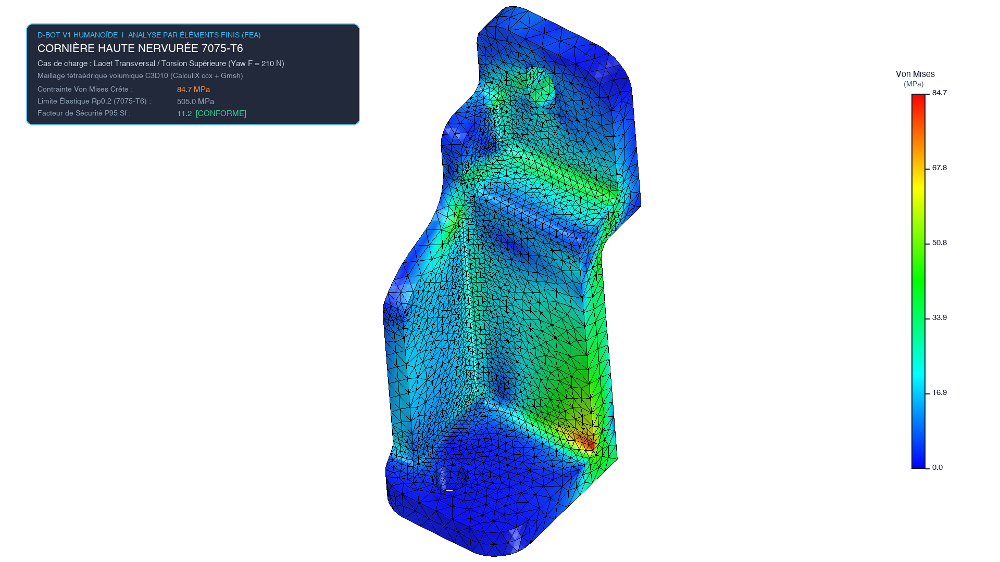

*Rendu 3D volumique CalculiX HD (`Corniere_haute_VonMises.png`, synchronisé automatiquement depuis `Exports_CAO_DBot` via [`sync_visual_snapshots.py`](file:///Users/Shared/Mon%20Google%20Drive%20Physique/Documentation/Code/scripts/cad_tools/sync_visual_snapshots.py)) : contrainte crête `84,74 MPa` (`Sf_peak = 5,96`) et contrainte P95 représentative `25,15 MPa` (`Sf_P95 = 20,08`).*

> [!NOTE]
> **Rendu 3D HD Von Mises (`Corniere_haute_VonMises.png`) & Dossier FEA Complet** :
> L'ancien aperçu d'interface FreeCAD (`83,62 MPa`) a été purgé et remplacé par le rendu volumique HD souverain CalculiX (`84,74 MPa` crête), maintenu automatiquement à jour depuis :
> - [Corniere_haute_VonMises.png](file:///Users/Shared/Mon%20Google%20Drive%20Physique/Exports_CAO_DBot/01_Torse_et_Bassin/Visual_Snapshots/Pieces_Isolees/Corniere_haute/Corniere_haute_VonMises.png)
> - [DOSSIER_TECHNIQUE_Calculs_FEA_Torse_et_Bassin.md](file:///Users/Shared/Mon%20Google%20Drive%20Physique/Documentation/01_Mecanique_et_Chassis/Torse_et_Bassin/DOSSIER_TECHNIQUE_Calculs_FEA_Torse_et_Bassin.md)

> [!TIP]
> **Verdict d'Ingénierie Structurelle** :
> Avec une contrainte représentative de `25,15 MPa` située **20 fois sous la limite élastique Rp0,2 (505 MPa)** et une contrainte de crête singulière de `84,74 MPa` située **près de 6 fois sous Rp0,2** (`Sf_peak = 5,96`), la `Corniere haute` nervurée (`22,54 g`) élimine rigoureusement tout effet de lame-ressort. La pièce est validée sans réserve pour fabrication CNC sur la NestWorks C500.

---

### C. Paramètres de Tranchage Recommandés (OrcaSlicer / Qidi Plus 4)

| Paramètre (FR) | Slicer Setting (EN) | Valeur Recommandée | Note & Justification |
| :--- | :--- | :---: | :--- |
| **Diamètre de buse** | **Nozzle Diameter** | **`0.4 mm`** | Type : **Tungsten Carbide** (Carbure de Tungstène anti-abrasion) |
| **Hauteur de couche** | **Layer Height** | **`0.20 mm`** | Compromis optimal précision / résistance inter-couches |
| **Nombre de parois** | **Wall Loops** | **`4`** | Épaisseur de paroi 1,92 mm |
| **Couches sup. / inf.** | **Top / Bottom Shell** | **`4` / `4`** | Étanchéité et propreté des surfaces planes |
| **Motif de remplissage** | **Infill Pattern** | **`Gyroid`** | Répartition des contraintes 3D isotrope |
| **Densité de remplissage** | **Infill Density** | **`20%`** | Coque secondaire allégée |
| **Température buse** | **Nozzle Temperature** | **`290°C - 295°C`** | Indispensable pour fusion parfaite du PA12-CF |
| **Température plateau** | **Bed Temperature** | **`85°C - 90°C`** | Avec colle Magigoo PA sur plateau PEI |
| **Chambre chauffée** | **Chamber Temperature** | **`60°C`** | Évite tout délaminage ou warping |
| **Supports** | **Enable Support** | **`Tree (Organic)`** | **`Build Plate Only`** (sous les collerettes d'épaules uniquement) |

---

### D. Tuyères Aérauliques d'Épaules Imprimées 3D (PA12-CF / TPU 95A)

Les 2 tuyères convergentes canalisant l'air forcé vers les stators RS-04 sont imprimées en 3D sur la Qidi Plus 4 :
* **Matériau au Choix** :
  * **Option A (PA12-CF)** : Rigidité structurelle, résistance thermique continue jusqu'à 120 °C, s'intègre parfaitement avec la coque.
  * **Option B (TPU 95A)** : Amortissement passif 100% des micro-vibrations du ventilateur, contact étanche automatique contre la face arrière de la coque.
* **Paramètres de Tranchage** :
  * **Nombre de parois (Wall Loops)** : `4` (paroi 1,60 mm étanche à 100% à l'air).
  * **Infill** : `100% rectiligne` (aucune porosité interne).
  * **Orientation plateau** : Grande collerette circulaire Ø 124 mm posée à plat sur le plateau PEI (zéro support requis).

---

## 9. Gamme d'Usinage NestWorks C500 & Protocole Pas-à-Pas

### A. Gamme d'Usinage par Composant (CNC C500)

1. **Brides d'Épaules Monoblocs (Alu 7075-T651 — Festonnées `202,30 g`/u)** :
   - Brut : 2 disques Ø120 × 50 mm Blockenstock (30 € / pièce).
   - Usinage 2.5D en 2 phases avec fraise carbure 3 dents Ø6 mm DLC (hauteur totale usinée = **33,22 mm**) :
     1. *Phase 1 — Face Stator* : Alésage / logement pilote **Ø 97,00 mm H7** profondeur **`13,80 mm`** (avec **congé de fond intérieur `R = 0,5 mm`** et **chanfrein d'entrée `0,5 mm × 45°`**, recevant le bossage arrière du RS-04) + 10 trous de passage Ø4,3 mm sur PCD Ø106 mm chanfreinés à **`0,5 mm × 45°`** pour rondelles Nord-Lock M4.
     2. *Phase 2 — Face Bossage, Hub & Contournage Festonné V1* : Dégagement de la flasque 5,0 mm et **contournage extérieur festonné à 10 lobes** (10 lobes convexes R = 7,0 mm autour des trous M4 reliés par 10 arcs concaves tangents **R = 25,64 mm** descendant à Ø 105,0 mm), usinage du hub intermédiaire 13,20 mm (Étage 2) avec **deux larges lumières en croissant de part et d'autre de l'alésage** (canaux d'échappement aérauliques directs pour l'air chaud du RS-04, amenant la masse réelle auditée à **`202,30 g`** par bride), contournage du bossage carré **55,8×55,8×15 mm** (Étage 3) avec **poche carrée centrale 44 × 44 mm** (congés verticaux **R = 5,0 mm**, congé de fond inférieur **R = 0,5 mm**, profondeur **15,0 mm** débouchant sur le hub 13,2 mm), **chanfrein d'entrée d'emmanchement de `1,0 mm × 45°`** sur les 4 arêtes d'extrémité du bossage, et perçage traversant vertical Ø5,3 mm centré à **X = 7,5 mm** (axe Z). *(Le trou inférieur du hub reçoit la vis CHC M4 × 30 mm `[91292A130]` de reprise de la `Corniere haute`)*.
2. **Semelles Éclisses Colonne (Alu 7075-T6)** :
   - Brut : 2 plaques 5 × 160 × 160 mm Blockenstock (9,60 € / pièce).
   - Découpe 2D en 1 passe sur table martyr (Fraise Ø6 mm DLC) :
     1. *Évidements intérieurs* : 2 lumières rectangulaires arrondies 22×14 mm centrées en haut et en bas, plus 2 encoches semi-circulaires de dégagement sur le bord latéral. (Semelle pleine sous l'insert, zéro alésage central).
     2. *Perçages & Fraisures* : 4 trous Ø4,5 mm avec fraisure conique 90° Ø 8,40 mm à fleur (0,0 mm pour vis FHC M4×30 orientées à 15,0° sur Face AR, et ébavurage 0,3×45° sur Face AV) + 4 trous lisses traversants Ø5,3 mm + 4 alésages Ø 3,0 mm H7 pour goupilles ISO 8734 chanfreinés/ébavurés **obligatoirement des 2 côtés** à 0,5 mm × 45°.
     3. *Contournage extérieur* : Découpe du profil 100×130 mm (chanfreins d'angles, ébavurage 0,5×45° des 2 faces). Masse réelle auditée en CAO `Torse-123 v42` = **`158,32 g`** / semelle (`56,34 cm³`).
3. **Inserts Carrés Colonne (Alu 7075-T6 — Option B Validée)** :
   - Brut : 2 blocs **15 × 80 × 80 mm** Blockenstock (7,20 euros TTC / bloc, soit 14,40 euros pour la paire).
   - Contournage 2D de chaque insert (section 55,8 × 55,8 mm avec **congés R = 3,0 mm aux 4 coins**, sans surfaçage en épaisseur car le brut fait déjà 15,0 mm !), **alésage circulaire traversant débouchant Ø 35,0 mm sur toute la hauteur de 15,0 mm**, perçage traversant vertical Ø5,3 mm (axe Z pour vis M5×70, centré à **X = 7,5 mm**) et **4 perçages lisses traversants axiaux Ø 4,5 mm** (entraxe 42 × 42 mm orienté à 15,0° pour vis FHC **M4 × 30 mm** traversantes et écrous Nylstop M4).
   - **Chanfrein d'entrée d'emmanchement tube** : Chanfrein franc de **`1,0 mm × 45°`** sur les 4 arêtes d'extrémité de la face avant.
   - **Ébavurage & Chanfreinage des perçages** : Cassage des arêtes à **`0,3 mm × 45°`** des deux côtés de l'alésage Ø 35,0 mm et des 4 trous Ø 4,5 mm. Masse réelle auditée en CAO `Torse-123 v42` = **`85,71 g`** / insert (`30,50 cm³`).
4. **Traverses Carrées 60×60×2 mm (Alu 6060-T6)** :
   - Longueur réelle mesurée du tube (CAO `Torse-123 v42`) : **`L = 80,07 mm`** (tube gauche `60 × 60 × 2 mm`, masse réelle auditée = **`100,04 g`**, jeu fonctionnel résultant de 1,0 mm côté colonne, engagement insert = 14,0 mm).
   - **Chanfreinage & Ébavurage des chants du tube (Indispensable pour l'isostatisme)** :
     - *Côté Bride d'Épaule (Intérieur)* : **Chanfrein intérieur de `0,5 mm × 45°`** sur les 4 arêtes internes (dégage le congé de racine d'usinage de l'épaulement de la bride et garantit un appui franc métal-métal à 0,0 mm sans talonnage).
     - *Côté Bride d'Épaule (Extérieur)* : **Cassage d'arête de `0,3 mm × 45°`**.
     - *Côté Colonne (Intérieur & Extérieur)* : **Chanfrein intérieur de `0,5 mm × 45°`** + cassage d'arête extérieur de `0,3 mm × 45°`.
   - Perçage de 2 trous lisses traversants verticaux **Ø5,3 mm** (axe Z) chanfreinés à 0,5 mm × 45° des deux côtés : trou côté bride d'épaule à **`X = 7,5 mm`** depuis le chant d'appui butée, et trou côté colonne à **`X = 72,57 mm`** (entraxe rigoureux de **`65,07 mm`**).
5. **Colonnes Sagittales 2D (Alu 7075-T6, 5,0 mm)** :
   - Brut : 1 plat marchand **5 × 100 × 495 mm Alu 7075-T6** Blockenstock (18,16 € TTC).
   - Plaque Basse (`100 × 296,93 mm`, **`314,39 g`** en `v42`) : Lumières jumelles `54 × 55 mm` (`R = 15,0 mm`), encoche de dégagement inférieure.
   - Plaque Haute (`100 × 130,07 mm`, **`175,11 g`** en `v42`) : Découpée à plat dans le reste de la barre de 495 mm (total colonne = **`489,50 g`**).
6. **Équerres de Liaison Cou & Waist (Profilé Commercial Alu 6060-T6, 30 × 30 × 3,0 mm)** :
   - Brut : 1 barre profilée cornière marchande **30 × 30 × 3 mm lg 500 mm Alu 6060-T6** Blockenstock (Réf `30x30x3-lg500mm-corniere-alu-6060t6`, **4,80 € TTC**).
   - Débit des 4 tronçons (à la scie à ruban d'atelier ou bridage étau sur table C500) :
     - 2 tronçons de **`L = 50,0 mm`** (Équerres Hautes de Cou — **`46,57 g`** la paire soit **`23,28 g`** / équerre en `v42`).
     - 2 tronçons de **`L = 90,0 mm`** (Équerres Basses de Waist Yaw — **`42,11 g`** / équerre en `v42`).
     - Matière débitée : `2 × 50 + 2 × 90 = 280 mm` (+ ~10 mm de traits de scie). Il reste **`~210 mm de cornière brute en réserve`** pour platines de capteurs ou équerres d'habillage.
   - Usinage 2D sur NestWorks C500 (bridage d'équerre en étau de précision ou mors doux) :
     - *Équerres Cou (L = 50 mm — Option C Zéro Taraudage & Zéro Oblong, `Torse-123 v42`)* :
       1. Aile horizontale : 2 perçages lisses traversants **Ø 4,30 mm** (entraxe longitudinal **30,0 mm**, entraxe transversal **50,0 mm** d'une équerre à l'autre soit axe à **22,50 mm** du flanc colonne / `Y = ±25,0 mm` de l'axe sagittal) chanfreinés à **0,3 mm × 45°** des 2 côtés (**ZÉRO taraudage machine ou manuel**).
       2. Aile verticale : 2 perçages lisses traversants **Ø 4,30 mm** (foret Ø 4,3 mm en 1 passe, entraxe **30,0 mm** coaxial aux perçages horizontaux, **ZÉRO oblong : butée mécanique rigide en Z**).
     - *Équerres Waist (L = 90 mm — Cotation Validée Fusion 360)* :
       1. Aile horizontale : 2 perçages lisses traversants **Ø 4,50 mm** (entraxe longitudinal **48,08 mm**, entraxe transversal **48,08 mm** d'une équerre à l'autre soit PCD **Ø 68,0 mm** sur `Waist_Plate_7075` et `Moyeu_Waist_Sandwich_7075`, congés d'angle extérieurs R = 5,0 mm).
       2. Aile verticale : 4 perçages lisses traversants **Ø 4,30 mm** (entraxes réguliers de 18,0 mm, pas d'oblong : encastrement rigide Z = 0) chanfreinés à 0,3 mm × 45°.
    - Finition : Ébavurage soigné des chants sciés et cassage d'arêtes à **0,3 mm × 45°** pour un appui plan parfait à 0,0 mm.
7. **Plaque Supérieure de Cou (`Plaque_de_Cou_7075`, Alu 4,70 mm)** :
   - Brut : Tôle / plaque aluminium 4,70 mm (`100,02 × 100,02 × 4,70 mm`, disque ovalisé Ø 100 mm avec lumière latérale de passage câbles, masse réelle `v42` = **`89,63 g`**).
   - Usinage 2D sur NestWorks C500 :
     1. *Perçages & Fraisures Moteur Cou RobStride RS-05 (réf. CAO : EL05 — Face Inférieure)* : 4 perçages lisses traversants **Ø 3,20 mm** répartis à 45° sur PCD **Ø 38,50 mm** avec fraisure conique 90° **Ø 6,50 mm** usinée depuis le **dessous** de la plaque (têtes coniques FHC M3 × 8 mm `[92125A128]` 100% à fleur à 0,0 mm).
     2. *Perçages Équerres Hautes (Face Supérieure)* : 4 perçages lisses traversants **Ø 4,30 mm** sur rectangle **30 × 50 mm** (`X = ±15,0 mm`, `Y = ±25,0 mm`), chanfreinés à **`0,3 mm × 45°`** des 2 côtés (**ZÉRO fraisure conique**, vis CHC M4 × 16 mm `[92290A154]`).
     3. *Couronne Périphérique Collet & Plastron* : 6 perçages **Ø 5,03 mm** sur PCD **Ø 85,0 mm** pour fixation du collet PA12-CF (`Cou - Tube collet`) et de la collerette haute du `Plastron_Ventral_Torse` par vis CHC M5 × 50 mm `[91290A242]`.
     4. *Ébavurage & Finition* : Micro-chanfreins d'ébavurage de **0,2 mm × 45°** sur la face supérieure contre le carter du moteur **RS-05 (EL05)**, et cassage d'arêtes périphérique à **0,3 mm × 45°**.

---

### B. Protocole Chronologique de Montage sur Établi

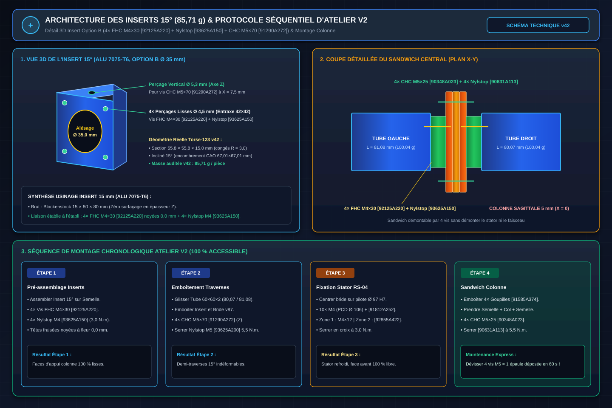

*Blueprint d'ingénierie vectoriel des détails de liaisons et d'atelier (Solution C).*

1. **Étape 1 (Pré-assemblage Inserts / Semelles sur Établi)** : Assembler les 2 inserts **15 mm** au dos des 2 semelles éclisses en insérant les **4 vis FHC M4 × 30 mm** (`92125A220`) depuis la face arrière et en bloquant les **4 écrous Nylstop M4** (`93625A150`) à la clé de 7 mm. Vérifier que les têtes coniques sont **100% à fleur (0,0 mm)** sur la face interne d'appui colonne. L'ensemble forme instantanément un sous-ensemble rigide monobloc.
2. **Étape 2 (Formation des Demi-Traverses & Butée Franche)** :
   - Emboîter le tube carré 60×60 mm (**L = 80,07 mm** relevé `v42`) d'abord **en BUTÉE FRANCHE (contact métal-métal à 0,0 mm)** contre l'épaulement usiné de la bride d'épaule monobloc.
   - Glisser l'autre extrémité sur l'insert de colonne (portée de 14,0 mm) : le jeu d'aisance fonctionnel de **`1,0 mm`** côté semelle absorbe toute tolérance de coupe et aligne automatiquement les perçages M5 sans forcer.
3. **Étape 3 (Verrouillage Traversant)** : Insérer les **4 vis traversantes CHC M5 × 70 mm** (`91290A272`) + 8 rondelles DIN 125A M5 (`93475A240`) + 4 écrous frein Nylstop M5 (`90631A113`) et serrer à **5,5 N.m**.
4. **Étape 4 (Fixation Directe Brides → Stators RS-04 & Tuyères Aérauliques)** :
   - *Préparation thermique* : Déposer un film fin de **pâte thermique non conductrice** (type Noctua NT-H1 ou Arctic MX-4) sur la surface cylindrique **Ø 97,00 mm H7** et l'épaulement d'appui pour éliminer toute résistance thermique de contact.
   - Glisser l'alésage de centrage **Ø 97,00 mm H7** de la bride sur le bossage arrière du RS-04 et plaquer la flasque contre l'épaulement Ø 120 mm.
   - Visser par bride directement dans les 10 taraudages M4 du stator (PCD Ø 106 mm) : **4× CHC M4 × 16 mm (`90128A214`, Zone 1 flasque 5 mm)** + **5× TB M4 × 25 mm (`92855A422`, Zone 2 hub)** + **1× CHC M4 × 30 mm (`91292A130`, trou inférieur reprenant `Corniere haute`)**, le tout sous **rondelles freins Nord-Lock M4 (`91812A252`)** et serré en croix à **3,0 N.m** avec Loctite 243. *(Vigilance atelier Zone 1 : vérifier au montage sur les stators physiques que la pénétration de la vis M4×16 sous Nord-Lock ne talonne pas dans les trous borgnes de 6,0 mm ; le cas échéant, utiliser des `M4×12 [91290A154]` ou cales d'épaisseur).*
   - Assembler les 2 ventilateurs **40 × 40 × 20 mm PWM** sur leurs **tuyères convergentes 3D** (4 vis M3×16 + silent-blocs) et fixer l'ensemble à l'intérieur du thorax haut face au stator.
5. **Étape 5 (Jonction Axiale & Sandwich Central Colonne — Contact Franc & Goupillage)** :
   - *Étape 5.1 (Mise en butée franche obligatoire)* : Poser la semelle éclisse arrière sur le marbre. Présenter la Plaque Haute et la Plaque Basse en **BUTÉE FRANCHE directe l'une contre l'autre à Z = 0,0 mm (contact plan métal-métal franc à 0,0 mm, ZÉRO espace, ZÉRO gap)**.
   - *Étape 5.2 (Goupillage de précision)* : Les deux plaques étant fermement maintenues en butée franche, chasser au maillet d'ajusteur les **4 goupilles cylindriques rectifiées ISO 8734 Ø 3 × 14 mm (`91585A374`, ajustement H7/m6)** à travers les alésages des plaques et de l'éclisse arrière.
   - *Étape 5.3 (Plaquage sandwich)* : Positionner l'éclisse avant, engager les **4 vis traversantes CHC M5 × 25 mm (`90348A023`) + 8 rondelles plates DIN 125A M5 (`93475A240`)**, et visser les 4 écrous frein Nylstop M5 (`90631A113`). Serrer en croix à **5,5 N.m** pour appliquer une précharge de pincement de 19 200 N.

---

### C. Quincaillerie Torse : Approvisionnement Français (Bricovis, Vis-Express, RS) & Import CAO Fusion 360

> [!NOTE]
> **Rôle de McMaster-Carr vs Réalité d'Atelier en France** :  
> McMaster-Carr n'expédie pas aux particuliers ou nouvelles structures en Europe/France (restrictions d'exportation américaines et douanes). Dans Fusion 360, McMaster-Carr sert **exclusivement de bibliothèque CAO 3D gratuite** pour télécharger en deux clics les modèles 3D STEP normalisés.  
> Pour l'approvisionnement physique réel, **100% de la visserie est standardisée aux normes métriques européennes (DIN / ISO)** et s'achète directement au détail ou en petits sachets chez les distributeurs spécialisés français ci-dessous.

#### 1. Sourcing Quincaillerie Recommandé en France

| Fournisseur Français | Lien Web Direct | Spécialité & Points Forts | Recommandé pour D-Bot |
| :--- | :--- | :--- | :--- |
| **Bricovis** ⭐ | [bricovis.fr](https://www.bricovis.fr) | Le site de référence pour makers & usineurs : vente au détail, grand choix de classes haute résistance (Acier 10.9, 12.9 noir, Inox A2/A4). | **100% de la visserie structurelle** (CHC M5×70, FHC M4×30, écrous Nylstop DIN 985). |
| **Vis-Express** | [vis-express.fr](https://www.vis-express.fr) | Très grand catalogue français, sachets de 10 à 50 pièces, expédition rapide 24/48h. | Visserie générale, rondelles plates DIN 125A, vis moteur. |
| **FixnVis** | [fixnvis.fr](https://www.fixnvis.fr) | Quincaillerie métrique industrielle au détail, prix très bas. | Petites séries et compléments de quincaillerie. |
| **RS Particuliers** | [rs-particuliers.com](https://www.rs-particuliers.com) | Accès catalogue RS Components pour les particuliers (livraison gratuite le weekend). | **Paires de rondelles frein Nord-Lock M4 d'origine**. |
| **Amazon.fr** | [amazon.fr](https://www.amazon.fr) | Livraison prime le lendemain. | **Inserts laiton Ruthex M4** officiels, pâte thermique Noctua NT-H1. |

#### 2. Tableau de Commande Rapide en Quincaillerie Française (Désignations DIN / ISO)

Ce tableau reprend les désignations standardisées à taper directement dans les moteurs de recherche de **Bricovis** ou **Vis-Express** :

| Rôle Mécanique sur le Torse | Désignation Normalisée d'Atelier (Bricovis / Vis-Express) | Norme | Quantité Utile (+ Réserve) | Spécification Technique |
| :--- | :--- | :---: | :---: | :--- |
| **Brides ➔ Stators RS-04 (Zone 1 flasque 5 mm)** | **Vis CHC M4 × 16 mm** (`90128A214` en `v42` ; *ou M4×12 `91290A154` si stator borgne 6 mm*) | DIN 912 / ISO 4762 | **8 pièces** (+ réserve) | Acier / Inox + Nord-Lock M4 *(contrôler profondeur borgne stator 6,0 mm !)* |
| **Brides ➔ Stators RS-04 (Zone 2 hub 18,2 mm)** | **Vis TB M4 × 25 mm (`92855A422`)** + `2×` CHC M4 × 30 mm (`91292A130` reprise `Corniere haute`) | ISO 7380 / DIN 912 | **10× TB + 2× CHC** (+ réserve) | Tête Basse (`92855A422`) sur hub + Nord-Lock M4 (`91812A252`) |
| **Sécurité Anti-Vibrations Stators & Cornières Basses** | **Rondelles Nord-Lock M4** (`91812A252`) | Nord-Lock NL4 | **24 paires Torse** (`44` Torse+Bassin) | Acier zingué / Inox (ép. 1,8 mm, Ø ext 7,6 mm) |
| **Liaison Traverses 60×60 (Tubes Épaules)** | **Vis CHC M5 × 70 mm (`91290A272`)** | DIN 912 / ISO 4762 | **4 pièces** (+ réserve) | Acier 12.9 (noir) ou Inox A2 (clé Allen 4 mm) |
| **Rondelles d'Appui Traverses & Sandwich** | **Rondelles plates M5 DIN 125A (`93475A240`)** | DIN 125A / ISO 7089 | **16 pièces Torse** (`32` Torse+Bassin) | Inox A2 (Ø int 5,3 mm / Ø ext 10 mm / ép 1 mm) |
| **Écrous Verrouillage Traverses & Sandwich** | **Écrous frein Nylstop M5 (`90631A113` / `93625A200`)** | DIN 985 / ISO 7040 | **8 pièces Torse** (`14` Torse+Bassin) | Inox A2 ou Acier classe 8 (clé 8 mm) |
| **Inserts ➔ Semelles Éclisses** | **Vis FHC M4 × 30 mm (`92125A220`)** | DIN 7991 / ISO 10642 | **8 pièces** (+ réserve) | Acier 10.9 ou Inox A2 (empreinte Allen 2,5 mm) |
| **Fixation Moteur RS-05 (EL05) ➔ Plaque Cou & Collet** | **Vis FHC M3 × 8 mm (`92125A128` + `91294A112`)** | DIN 7991 / ISO 10642 | **8 pièces** (4 dessous plaque + 4 collet) | Empreinte Allen 2,0 mm, vissage par le dessous à fleur 0,0 mm sur PCD Ø 38,5 mm |
| **Collet Cou & Plastron ➔ Plaque de Cou** | **Vis CHC M5 × 50 mm (`91290A242`)** | DIN 912 / ISO 4762 | **6 pièces** | Sur couronne PCD Ø 85 mm (`Cou - Tube collet` + `Plastron_Ventral_Torse`) |
| **Fixation Plaque Cou ➔ Équerres (Option C)** | **Vis CHC M4 × 16 mm (`92290A154`)** | DIN 912 / ISO 4762 | **4 pièces** (+ réserve) | Acier 12.9 / Inox (tête cylindrique hors carter RS-05/EL05, rectangle **30×50 mm**) |
| **Pincement Colonne (Cou & Waist) & Moyeu Waist** | **Vis CHC M4 × 20 mm (`92290A168`)** | DIN 912 / ISO 4762 | **10 pièces** (2 cou + 4 flanc waist + 4 moyeu waist) | Acier 12.9 ou Inox A2 |
| **Plastron (4 coins Waist) & Support Batterie Central** | **Vis CHC M4 × 18 mm (`92290A161`)** | DIN 912 / ISO 4762 | **6 pièces** (4 waist + 2 support batterie) | Inox 316 |
| **Portique `ceinture` + `Corniere basse`** | **Vis CHC M4 × 25 (`91292A122`), M4 × 16 (`91292A118`), M4 × 14 (`91290A150`)** | DIN 912 / ISO 4762 | **6 + 2 + 4 pièces** | `6×` ceinture/plastron, `2×` cornière basse/ceinture, `4×` pied cornière basse/Waist Plate (+ Nord-Lock) |
| **Rondelles d'Appui Équerres & Portique M4** | **Rondelles plates M4 DIN 125A (`93475A230`)** | DIN 125A / ISO 7089 | **44 pièces Torse** (`56` Torse+Bassin) | Inox A2 (Ø int 4,3 mm / Ø ext 9,0 mm / ép 0,8 mm) |
| **Écrous Verrouillage Inserts, Équerres & Portique** | **Écrous frein Nylstop M4 (`93625A150`)** | DIN 985 / ISO 7040 | **28 pièces Torse** (`36` Torse+Bassin) | Inox A2 / Acier (8 inserts + 4 plaque cou + 2 cou + 4 waist + 8 ceinture/cornière + 2 support batterie) |
| **Sandwich Colonne Centrale** | **Vis CHC M5 × 25 mm (`90348A023`)** + **Goupilles Ø 3 × 14 (`91585A374`)** | DIN 912 / ISO 8734 | **4 vis + 4 goupilles** | Clé Allen 4 mm + emmanchement H7/m6 |
| **Ventilateurs 4020 ➔ Tuyères** | **Vis CHC M3 × 16 mm + écrous M3** | DIN 912 / ISO 4762 | **10 paires** | Inox A2 (serrage avec silent-blocs) |
| **Bossages Coque PA12-CF** | **Inserts filetés laiton M4 × 8,1 mm** | Standard Ruthex | **1 boîte (50 ou 100)** | Pose au fer à souder (260 °C) |

---

#### 3. Tutoriel d'Importation Quincaillerie McMaster-Carr dans Fusion 360 (Modélisation CAO)

Pour intégrer directement la visserie exacte avec ses filetages et formes normalisées dans votre assemblage CAO Fusion 360 :

##### Procédure Pas-à-Pas
1. Dans le ruban supérieur de Fusion 360, cliquer sur **Insert** ➔ **Insert McMaster-Carr Component**.
2. Une fenêtre de catalogue s'ouvre : naviguer ou taper directement la désignation ou la **référence catalogue McMaster** indiquée ci-dessous.
3. Sélectionner le produit, dérouler la section **Product Detail**, choisir le format **3D STEP** (ou 3D SolidWorks), puis cliquer sur **Download**.
4. La vis / écrou s'insère automatiquement comme composant dans votre modèle. Appliquer une contrainte d'assemblage **Joint** (raccourci `J`) de type **Cylindrical** ou **Rigid** coaxialement sur l'arête du perçage.

##### Tableau des Références McMaster-Carr pour Modélisation CAO Fusion 360

| Sous-Ensemble & Rôle Mécanique | Composant Normalisé | Norme / Standard | Réf Catalogue McMaster | Quantité (Robot Complet) | Spécifications d'Usinage & Diamètres de Perçage Associés |
| :--- | :--- | :--- | :---: | :---: | :--- |
| **1. FIXATION DIRECTE BRIDES ➔ STATORS RS-04 (PCD Ø 106,0 mm)** | | | | | |
| • **Zone Mince Bride (Épaisseur 5,0 mm)** | Vis CHC M4 × 16 mm (`v42`)<br>*(Alerte : M4 × 12 mm si trou borgne 6,0 mm)* | ISO 4762 / DIN 912 | **`90128A214`** (CAO `v42`)<br>**`91290A154`** (M4×12 réf. 6 mm) | **8 vis** (4 / bride épaules ; + 8 hanches) | **Perçage lisse traversant Ø 4,30 mm** + **Nord-Lock M4 (`91812A252`)**. Contrôler profondeur borgne stator réelle avant serrage définitif. |
| • **Zone Épaisse Hub (18,2 mm)** | Vis CHC M4 × 25 mm Tête Basse | ISO 7380 / DIN 7984 | **`92855A422`** (TB M4×25 CAO `v42`) | **10 vis** (5 / bride épaules ; + 12 hanches) | **Perçage lisse traversant Ø 4,30 mm** + **Nord-Lock M4 (`91812A252`, ép. 1,8 mm)**. Pénétration filetée stator = 5,00 mm (garde au fond = 1,00 mm). |
| • **Sécurité Anti-Vibrations Stator** | Rondelles Frein Nord-Lock M4 | Spécification Nord-Lock | **`91812A252`** (CAO `v42`) | **20 paires épaules** (`+20` hanches, `+4` cornière basse) | **Diamètre de passage Ø 4,30 mm**. Épaisseur 1,80 mm. **Obligatoire sous 100% des vis stator M4 et pied Corniere basse**. |
| **2. LIAISON DEMI-TRAVERSES 60×60 (TUBES ➔ BOSSAGES & INSERTS)** | | | | | |
| • **Verrouillage Vertical Tube** | Vis CHC M5 × 70 mm | ISO 4762 / DIN 912 | **`91290A272`** (Acier 12.9)<br>**`92290A272`** (Inox 18-8) | **4 vis** (2 / épaule) | **Perçages lisses traversants Ø 5,30 mm** sur tubes (**L = 80,07 mm** en `v42` ; **X = 7,5 mm** et **X = 72,57 mm**, entraxe **65,07 mm**). |
| • **Rondelles d'Appui Tube M5** | Rondelles Plates M5 DIN 125A | ISO 7089 / DIN 125A | **`93475A240`** (Inox 18-8) | **8 rondelles** (4 sous tête, 4 sous écrou) | **Diamètre de passage Ø 5,30 mm**. Ø ext 10,0 mm / ép. 1,0 mm. |
| • **Écrous de Verrouillage Tube M5** | Écrous Frein Nylstop M5 | ISO 7040 / DIN 985 | **`90631A113`** / **`93625A200`** | **4 écrous** (2 / épaule) | Bague nylon autofreinée (couple nominal 5,5 N.m) ; noter que les hanches utilisent `CHC M5 × 80 mm [91290A276]`. |
| **3. JONCTION CENTRALE SAGITTALE & INSERTS COLONNE** | | | | | |
| • **Fixation Inserts ➔ Semelles (Vis Traversantes)** | Vis FHC M4 × 30 mm | ISO 10642 / DIN 7991 | **`92125A220`** (CAO `v42`) | **8 vis** (4 / semelle) | **Perçages Ø 4,50 mm** avec fraisures 90° Ø 8,40 mm à fleur exacte (0,0 mm). |
| • **Écrous de Verrouillage Inserts ➔ Semelles** | Écrous Frein Nylstop M4 | ISO 7040 / DIN 985 | **`93625A150`** (Inox 18-8) | **8 écrous** (4 / semelle) | Serrage contre face avant de l'insert dans le volume creux du tube 56×56 mm. |
| • **Sandwich Colonne Centrale** | Vis CHC M5 × 25 mm | ISO 4762 / DIN 912 | **`90348A023`** (CAO `v42`) | **4 vis** (2 avant, 2 arrière) | **Perçages Ø 5,30 mm** traversant sandwich 15 mm. Serrage en croix à 5,5 N.m. |
| • **Rondelles Sandwich Colonne M5** | Rondelles Plates M5 DIN 125A | ISO 7089 / DIN 125A | **`93475A240`** (Inox 18-8) | **8 rondelles** (4 sous tête, 4 sous écrou) | **Diamètre de passage Ø 5,30 mm**. |
| • **Écrous Sandwich Colonne M5** | Écrous Frein Nylstop M5 | ISO 7040 / DIN 985 | **`90631A113`** / **`93625A200`** | **4 écrous** | Bague nylon autofreinée (couple 5,5 N.m). |
| • **Goupilles de Positionnement Positif (4× ISO 8734)** | Goupilles Cylindriques Rectifiées Ø 3,0 mm × 14 mm | ISO 8734 / DIN 6325 | **`91585A374`** (CAO `v42`) | **4 goupilles** | Alésages **Ø 3,00 mm H7** fermés traversant le sandwich 15 mm formant un carré 80 × 80 mm (`Z_gap = 0,0 mm`). |
| **4. LIAISONS D'EXTRÉMITÉS (ÉQUERRES COU, MOTEUR RS-05/EL05 & WAIST RS-06)** | | | | | |
| • **Fixation Moteur RS-05 (EL05) ➔ Plaque Cou** | Vis FHC M3 × 8 mm | ISO 10642 / DIN 7991 | **`92125A128`** (dessous plaque, 4×)<br>**`91294A112`** (collet/carter, 4×) | **8 vis** | PCD Ø 38,50 mm à 45°, fraisures 90° Ø 6,50 mm par le DESSOUS. Pénétration filetée = 3,30 mm (garde fond 2,70 mm). |
| • **Collet & Plastron ➔ Plaque de Cou** | Vis CHC M5 × 50 mm | ISO 4762 / DIN 912 | **`91290A242`** (CAO `v42`) | **6 vis** | Fixe `Cou - Tube collet` et sommet du `Plastron_Ventral_Torse` sur couronne PCD Ø 85 mm (`Ø 5,03 mm`). |
| • **Fixation Plaque Cou ➔ Équerres Hautes** | Vis CHC M4 × 16 mm | ISO 4762 / DIN 912 | **`92290A154`** (CAO `v42`) | **4 vis** (2 / équerre) | Vissage par le DESSUS sur rectangle **30×50 mm** (`Ø 4,30 mm`, zéro fraisure) + 4 écrous Nylstop M4 (`93625A150`). |
| • **Pincement Colonne Haute (Cou Trous Ronds)** | Vis CHC M4 × 20 mm | ISO 4762 / DIN 912 | **`92290A168`** (CAO `v42`) | **2 vis** traversantes | **Perçages Ø 4,30 mm** coaxiaux dans les ailes verticales d'équerres et colonne 5 mm (entraxe 30 mm). |
| • **Pincement Colonne Basse (Flanc Équerres Waist)** | Vis CHC M4 × 20 mm | ISO 4762 / DIN 912 | **`92290A168`** (CAO `v42`) | **4 vis** traversantes | Entraxes réguliers 18,0 mm (`54 mm` total) sur colonne 5 mm. |
| • **Sandwich Waist (Équerres ➔ Waist Plate ➔ Moyeu)** | Vis CHC M4 × 20 mm | ISO 4762 / DIN 912 | **`92290A168`** (CAO `v42`) | **4 vis** traversantes | Traversent Équerres (3 mm) + `Waist_Plate_7075` (**9,0 mm**) dans taraudages Moyeu 7075 (PCD Ø 68 mm à 45°). |
| • **Plastron Ventral ➔ Waist Plate & Support Batterie** | Vis CHC M4 × 18 mm | ISO 4762 / DIN 912 | **`92290A161`** (CAO `v42`) | **6 vis** (4 waist + 2 batterie) | Ancrage 4 coins inférieurs du plastron sur Waist Plate + 2 traversantes `Support Batterie Central` sur colonne. |
| • **Portique : Ceinture & Cornières Haute/Basse** | CHC M4×30 (`91292A130`), M4×25 (`91292A122`), M4×16 (`91292A118`), M4×14 (`91290A150`) | ISO 4762 / DIN 912 | **2 + 6 + 2 + 4 vis** | `2× 91292A130` (Cornière haute/Bride), `6× 91292A122` (Ceinture/Plastron), `2× 91292A118` (Cornière basse/Ceinture), `4× 91290A150` + Nord-Lock (Pied cornière basse/Waist Plate). |
| • **Rondelles Plates M4 Cou, Waist & Portique** | Rondelles Plates DIN 125A M4 | ISO 7089 / DIN 125A | **`93475A230`** (Inox 18-8) | **44 rondelles Torse** (`56` Torse+Bassin) | Ø int 4,3 mm / Ø ext 9,0 mm / ép. 0,8 mm. |
| • **Écrous de Verrouillage Équerres, Portique & Batterie** | Écrous Frein Nylstop M4 | ISO 7040 / DIN 985 | **`93625A150`** (Inox 18-8) | **28 écrous Torse** (`36` Torse+Bassin) | 8 inserts + 4 plaque cou + 2 flanc cou + 4 flanc waist + 6 ceinture + 2 cornière basse + 2 support batterie. |
| **5. SYSTÈME AÉRAULIQUE & HABILLAGE COQUE** | | | | | |
| • **Ventilateurs Tuyères 4020 (Noctua NF-A4x20)** | Vis CHC M3 × 16 mm + Écrous M3 | ISO 4762 / DIN 912 | **`91290A115`** (Inox 18-8) | **8 vis + 8 écrous** | **Perçages lisses traversants Ø 3,20 mm** dans collerette tuyère 3D et oreilles Noctua. Montage sur silent-blocs antivibrations. |
| • **Fixation Coque PA12-CF (Thorax & Abdomen)** | Inserts Filetés Laiton M4 × 8,1 mm | Standard Ruthex | Standard Ruthex M4 × 8,1 mm (Laiton) | **16 inserts** | **Logements borgnes d'insertion Ø 5,60 mm × profondeur 8,2 mm** imprimés dans la coque PA12-CF. Inserts thermiques M4 posés au fer à souder (260 °C). |
| **6. FIXATION TRAVERSANTE IMU TORSE (SPARKFUN BMI270 — PLAQUE HAUTE Z = +81,58 mm)** | | | | | |
| • **Vis Traversantes IMU (Flanc Droit vers Gauche)** | Vis CHC M2,5 × 14 mm | ISO 4762 / DIN 912 | **`91292A017`** (Inox 18-8)<br>**`92290A858`** (Inox 316) | **4 vis** | Traversent PCB (1,6 mm) + Entretoise nylon (3,0 mm) + Plaque colonne 5 mm (perçages débouchants **Ø 2,70 mm**) + rondelle (0,5 mm) + écrou Nylstop (3,5 mm). Marge résiduelle = ~0,4 mm. |
| • **Entretoises Isolantes Diélectriques PCB** | Entretoises Cylindriques Lisses Nylon M2,5 (H = 3,0 mm) | Spécification Métrique | **`94639A208`** (Nylon PA66) | **4 entretoises** | **Dimensions** : Ø intérieur 2,7 mm / Ø extérieur 5,0 mm / Hauteur 3,0 mm. Assure l'isolation électrique totale entre les pistes du PCB et l'Alu 7075-T6, supprime toute flexion parasite de la carte. |
| • **Rondelles d'Appui Inox Flanc Gauche** | Rondelles Plates DIN 125A M2,5 | ISO 7089 / DIN 125A | **`93475A205`** (Inox 18-8) | **4 rondelles** | **Diamètre de passage Ø 2,70 mm**. Dimensions : Ø intérieur 2,7 mm / Ø extérieur 6,0 mm / épaisseur 0,5 mm. Répartition continue de la précharge sous l'écrou autofreiné. |
| • **Écrous de Verrouillage Autofreinés (Flanc Gauche)** | Écrous Frein Nylstop M2,5 | ISO 7040 / DIN 985 | **`90631A105`** (Inox 18-8) | **4 écrous** | Bague polyamide indesserrable aux vibrations (serrage à **`0,5 à 0,6 N.m`** à la clé Allen 2,0 mm et clé plate de 5,0 mm). Montage 100% accessible sur le flanc gauche `Y = -2,50 mm`. |

---

#### 4. Guide & Règles d'Emploi des Freins-Filets Chimiques sur le Robot D-Bot

| Type de Frein-Filet | Couleur / Référence | Couple Résiduel & Démontabilité | Usage Recommandé D-Bot | Danger / Contre-indication |
| :--- | :--- | :--- | :--- | :--- |
| **Frein Moyen (Recommandé ⭐)** | **Bleu (Loctite 243 / 242)** | **100% Démontable à froid** avec outil à main standard (clé Allen). Couple de rupture initial : ~10 à 15 N.m. | **Toute la visserie structurelle et moteur (M4 stator RS-04, vis M4 inserts 7075, vis M5 traverses).** | Aucun. Protège contre la corrosion galvanique acier/aluminium. |
| **Frein Faible** | **Violet (Loctite 222)** | **Ultra-facilement démontable** à faible couple (< 5 N.m). | Petites vis < M3, réglages micrométriques ou visserie plastique/vis d'habillage coque. | Tenue insuffisante sous fortes vibrations d'actionneurs QDD 120 N.m. |
| **Frein Fort (Permanent)** | **Rouge (Loctite 270 / 271)** | ⛔ **Indémontable à froid.** Nécessite une chauffe locale au chalumeau à **> 250 °C** pour liquéfier la résine. | Fixations permanentes lourdes sans électronique. | ⚠️ **STRICTEMENT INTERDIT sur les moteurs RS-04/RS-03** : la chaleur détruit les capteurs magnétiques et les bobinages. |

> [!TIP]
> **Règle d'Atelier pour la Pose du Frein-Filet Bleu 243** :
> 1. Déposer **1 seule micro-gouttelette** sur les 2 ou 3 premiers filets de la vis (ne pas noyer le taraudage borgne du moteur pour éviter toute surpression hydraulique au vissage).
> 2. En association avec les **rondelles Nord-Lock**, la Loctite 243 apporte une barrière d'étanchéité anti-poussière/anti-humidité et neutralise tout couple galvanique entre l'acier de la vis et l'aluminium 7075 du stator.

#### 5. Tableau Synthétique des Couples Dynamométriques & Outillage d'Atelier

Ce tableau constitue la fiche de référence rapide pour le montage et le serrage à l'établi :

| Sous-Ensemble & Liaison Mécanique | Vis / Fixation Normalisée | Qté Totale | Couple Dynamométrique Recommandé | Empreinte / Outil | Sécurisation & Freinage | Réf. McMaster |
| :--- | :--- | :---: | :---: | :---: | :--- | :---: |
| **1. Brides ➔ Stators RS-04 (Zone 1 : Mince 5,0 mm)** | CHC M4 × 16 mm (`v42`) / M4 × 12 mm si borgne 6 mm | 8 (épaules) | **`3,0 N.m`** ⭐ *(Croix)* | Clé Allen 3,0 mm | Rondelles Nord-Lock M4 + Loctite 243 *(vérifier garde fond 6 mm)* | `90128A214` / `91290A154` |
| **2. Brides ➔ Stators RS-04 (Zone 2 : Épaisse 18,2 mm)** | TB M4 × 25 mm | 10 (épaules) | **`3,0 N.m`** ⭐ *(Croix)* | Clé Allen 2,5/3,0 mm | Rondelles Nord-Lock M4 + Loctite 243 | `92855A422` |
| **3. Demi-Traverses (Tubes ➔ Bossages & Inserts, Épaules)** | CHC M5 × 70 mm (Acier 12.9 / Inox) | 4 | **`5,5 N.m`** | Clé Allen 4,0 mm + Clé 8 mm | Rondelles DIN 125A + Écrous Nylstop M5 (`90631A113` / `93625A200`) *(Hanches = M5 × 80 `91290A276`)* | `91290A272` |
| **4. Sandwich Colonne Centrale (Éclisses ➔ Plaques)** | CHC M5 × 25 mm | 4 | **`5,5 N.m`** *(Croix)* | Clé Allen 4,0 mm + Clé 8 mm | Rondelles DIN 125A + Écrous Nylstop M5 | `90348A023` |
| **5. Inserts Carrés ➔ Semelles Éclisses** | FHC M4 × 30 mm | 8 | **`2,8 à 3,0 N.m`** | Clé Allen 2,5 mm + Clé 7 mm | Tête conique à fleur 0,0 mm + Nylstop M4 | `92125A220` |
| **6. Moteur Cou RS-05 (EL05) ➔ Plaque de Cou** | FHC M3 × 8 mm | 8 (4 plaque + 4 collet) | **`1,2 à 1,4 N.m`** | Clé Allen 2,0 mm | Tête conique à fleur 0,0 mm dessous + Loctite 243 (PCD Ø 38,5 mm) | `92125A128` / `91294A112` |
| **7. Fourche Cou (Plaque ➔ Équerres Option C)** | CHC M4 × 16 mm | 4 | **`3,0 N.m`** | Clé Allen 3,0 mm + Clé 7 mm | Tête cylindrique + rondelle DIN 125A + Nylstop M4 sous équerre (rectangle **30×50 mm**) | `92290A154` |
| **8. Équerres Torse (Flancs Colonne + Moyeu Waist)** | CHC M4 × 20 mm | 10 (2 cou + 4 waist flanc + 4 moyeu) | **`3,0 N.m`** | Clé Allen 3,0 mm + Clé 7 mm | Rondelles DIN 125A M4 + Nylstop M4 | `92290A168` |
| **9. Ventilateurs Tuyères 3D (Noctua NF-A4x20)** | CHC M3 × 16 mm (Inox) | 8 | **`0,6 à 0,8 N.m`** | Clé Allen 2,5 mm + Clé 5,5 mm | Silent-blocs antivibrations (serrage modéré) | `91290A115` |
| **10. Coque & Habillage Extérieur (PA12-CF)** | Vis M4 sur Inserts Laiton Ruthex | 16 | **`1,2 à 1,5 N.m`** | Clé Allen 3,0 mm | Ancrage thermique laiton (ne pas sur-serrer) | Standard Ruthex M4 × 8,1 mm |
| **11. Fixation Traversante IMU Torse (Plaque Haute)** | CHC M2,5 × 14 mm (Inox A2) | 4 | **`0,5 à 0,6 N.m`** | Clé Allen 2,0 mm + Clé 5,0 mm | Entretoises Nylon 3 mm + Rondelles DIN 125A + Nylstop M2,5 flanc gauche | `91292A017` / `90631A105` |
| **12. Goupillage Positif Colonne (Carré 80 × 80 mm)** | Goupilles ISO 8734 Ø 3 × 14 mm (m6) | 4 | **Ajustement serrant doux H7/m6** | Maillet d'ajusteur + chasse-goupille | Emmanchement mécanique positif sans jeu (zéro tenon) | `91585A374` |
| **13. Cornières Hautes ➔ Brides Épaules RS-04** | CHC M4 × 30 mm | 2 | **`2,8 N.m`** ⭐ | Clé Allen 3,0 mm | Rondelles Nord-Lock M4 + Loctite 243 | `91292A130` |
| **14. Cornières Hautes/Basses & Ceinture Alu 3 mm** | CHC M4 × 16 / M4 × 25 / M4 × 14 mm | 2 + 6 + 4 | **`1,8 à 2,8 N.m`** | Clé Allen 3,0 mm | Nylstop M4 (`ceinture`) ; Nord-Lock M4 (`91812A252`) sous `Corniere basse` (`91290A150`) | `91292A118` / `91292A122` / `91290A150` |
| **15. Collet Cou (`Cou - Tube collet`) & Plastron ➔ Waist / Batterie** | CHC M5 × 50 mm (`6×`) & CHC M4 × 18 mm (`6×`) | 6 + 6 | **`4,5 N.m` (M5) / `2,2 N.m` (M4)** | Clé Allen 4,0 / 3,0 mm | `91290A242` sur Plaque Cou PCD Ø 85 mm ; `92290A161` sur 4 coins Waist & Support Batterie | `91290A242` / `92290A161` |

---

## 10. Bilan de Masse Consolidé & Fiche d'Approvisionnement Direct

### A. Nomenclature & Bilan de Masse Réel de la Structure Torse (`Torse-123 v42`)

| Composant / Pièce | Matériau (`Torse-123 v42`) | Quantité | Masse Unitaire | Masse Totale |
| :--- | :--- | :---: | :---: | :---: |
| **Brides d'Épaules Monoblocs (Festonnées & Évidées V1)** | Alu 7075-T651 (Alésage Ø 97,00 H7, CAO `v42`) | 2 | **202,30 g** | **404,60 g** |
| **Tronçons de Tubes Carrés Épaules** | Alu 6060-T6 (60 × 60 × 2,0 mm, L = 80,07 mm, CAO `v42`) | 2 | **100,04 g** | **200,08 g** |
| **Inserts Carrés Colonne** | Alu 7075-T6 (55,8 × 55,8 × 15,0 mm, alésage Ø 35 mm) | 2 | **85,71 g** | **171,42 g** |
| **Semelles Éclisses Colonne** | Alu 7075-T6 (100 × 130 × 5,0 mm, `56,34 cm³`) | 2 | **158,32 g** | **316,64 g** |
| **Colonne Sagittale (`colonne vertébrale`: Haute + Basse)** | Alu 7075-T6 (5,0 mm, Haute `175,11 g` + Basse `314,39 g`) | 1 ens. | `489,50 g` | **489,50 g** |
| **Plaque Supérieure de Cou (`Plaque_de_Cou_7075`)** | Alu 7075-T6 (`100,02 × 100,02 × 4,70 mm`) | 1 | **89,63 g** | **89,63 g** |
| **Équerres de Liaison Cou (`Equerre cou`)** | Alu 6060-T6 (`50 × 30 × 3,0 mm`, la paire `46,57 g`) | 1 paire | **46,57 g** | **46,57 g** |
| **Équerres de Liaison Waist (`Equerre waist`)** | Alu 6060-T6 (`90 × 30 × 3,0 mm`) | 2 | **42,11 g** | **84,22 g** |
| **Waist Plate Inférieure (`Waist_Plate_7075`)** | Alu 7075-T6 (`176,11 × 173,05 × 9,02 mm`) | 1 | **433,53 g** | **433,53 g** |
| **Portique Anti-Lacet (`ceinture` + `Corniere haute` + `Corniere basse`)** | Alu 7075-T6 (`45,43 g` + `2×22,54 g` + `2×70,34 g`) | 5 | `45,43 / 22,54 / 70,34 g` | **231,19 g** |
| **Actionneur Cou Pan (`EL05_ASM_1_ASM` / RS-05)** | RobStride RS-05 (réf. CAO `EL05 v1:1` avec carter = `228,49 g`) | 1 | **210,44 g** *(228,49 g ens.)* | **228,49 g** |
| **Coques & Paniers PA12-CF (`v42` brut `ρ = 1,015 g/cm³`)** | `Plastron` (`2 804,5 g` sans ceinture), `Carenage_Pectoral` (`203,84 g`), `Carenage_Lombaire` (`206,71 g`), `Paniers` (`614,83 g`), `Capots` (`115,08 g`), `Support Batt` (`30,39 g`), `Cou collet` (`51,90 g`), `Platine` (`36,27 g`) | Lot | Brut `1,015 g/cm³` | **~4 063,6 g** *(~2 802 g à `0,70 g/cm³`)* |
| **Tuyères Convergentes 3D + Ventilateurs Noctua 4020** | Hors-modèle CAO (PA12-CF/TPU + 2× NF-A4x20) | 2 + 2 | `24 g + 20 g` | **88,00 g** |
| **Visserie Torse Complète (`v42`)** | Stators RS-04, traverses M5×70, sandwich M5×25, inserts FHC M4×30, cou/waist/portique & goupilles | Lot `v42` | Réel CAO | **~455 g** |
| **TOTAL SQUELETTE MÉTALLIQUE PUR TORSE (`v42`)** | **Colonne + Épaules + Cou + Portique + Waist Plate (hors moteurs & coques)** | - | - | **~2 467,4 g (~2,47 kg)** |

> [!TIP]
> **Consolidation Réelle CAO (`Torse-123 v42`)** :  
> L'ensemble complet **Torse + Bassin** audité dans `Torse-123 v42` totalise **`18 316,38 g` (`18,32 kg`, 614 occurrences)** en masse brute CAO (`ρ = 1,015 g/cm³` encore affectée à 20/21 composants PA12-CF — estimation calibrée réelle en impression gyroïde : **~`16,1 à 16,2 kg`**). La structure d'épaules seule (2× `Bride Epaule` `202,30 g` + 2× `Tube` `100,04 g` + 2× `Insert` `85,71 g` + 2× `semelle éclisse` `158,32 g`) pèse **`1 092,74 g` (`1,09 kg`)** avec un facteur de sécurité RDM > 14 en flexion choc et > 140 en torsion.

---

### B. Fiche d'Approvisionnement Direct Blockenstock (Panier Alu 7075-T6 & Profilés 6060-T6)

| Désignation Fournisseur | Lien Catalogue Direct Blockenstock | Dimensions Brut | Quantité | Prix Unitaire TTC | Prix Total TTC | Utilisation Projet D-Bot |
| :--- | :--- | :---: | :---: | :---: | :---: | :--- |
| **Disque Brut Alu 7075 T651** | [Blockenstock — Disque Ø120 × 50mm 7075](https://www.blockenstock.fr/c120x-50mm-alu-7075-c2x29739222) | **Ø 120 × 50 mm** | **2** | **30,00 €** | **60,00 €** | 2 Brides d'Épaules Monoblocs (Hauteur usinée 33,2 mm : Flasque 5 mm festonnée 10 lobes + Hub 13,2 mm évidé + Bossage 15 mm — masse finie réelle = 202,30 g / bride) |
| **Plaque Alu 7075 T6** | [Blockenstock — Plaque 5×160×160mm 7075 T6](https://www.blockenstock.fr/20x200x500mm-alu-7075-t6-c2x40149808) | **5 × 160 × 160 mm** | **2** | **9,60 €** | **19,20 €** | 2 Semelles Éclisses Colonne (80 × 130 mm) + chutes réutilisables |
| **Plat Alu 7075 T6 (Colonne)** | [Blockenstock — Plat 5×100×495mm 7075](https://www.blockenstock.fr/5x100x495mm-alu-7075-t6-c2x20906524) | **5 × 100 × 495 mm** | **1** | **18,16 €** | **18,16 €** | **100% de la Colonne Sagittale (Plaque Haute + Plaque Basse)** |
| **Bloc Alu 7075 T6 (Inserts)** | [Blockenstock — Bloc 15×80×80mm 7075 T6](https://www.blockenstock.fr/15x80x80mm-alu-7075-t6) | **15 × 80 × 80 mm** | **2** | **7,20 €** | **14,40 €** | 2 Inserts Carrés Colonne (55,8 × 55,8 × 15 mm), 1 insert par bloc |
| **Tube Carré Alu 6060 T6** | [Blockenstock — Tube Carré 60×2×500mm](https://www.blockenstock.fr/60x2x500mm-tube-carre-6060-t6-c2x24054508) | **60 × 2 × 500 mm** | **1** | **12,80 €** | **12,80 €** | 2 Tronçons de Traverses de 80,05 mm (reste ~340 mm de réserve) |
| **Cornière Alu 6060 T6 (Équerres)** | [Blockenstock — Cornière 30×30×3 lg 500mm](https://www.blockenstock.fr/30x30x3-lg500mm-corniere-alu-6060t6-c2x29839847) | **30 × 30 × 3 × 500 mm** | **1** | **4,80 €** | **4,80 €** | **100% des 4 Équerres Torse (2× Cou L=50 mm + 2× Waist L=90 mm + 210 mm réserve)** |
| **Plat Alu 7075 T6 (Cornières & Tirants)** | [Blockenstock — Plat 20×100×500mm 7075](https://www.blockenstock.fr/20x100x500mm-alu-7075-t6-c2x40149808) | **20 × 100 × 500 mm** | **1** | **59,41 €** | **59,41 €** | **100% des 2 Cornières Hautes Nervurées (L = 60 mm) et des 2 Tirants Bas (L = 100 mm) usinés sur C500 (débit en 2 coupons de 240 mm)** |
| **Ventilateurs 40×40×20 mm PWM** | [Noctua NF-A4x20 PWM (Amazon)](https://www.amazon.fr/dp/B071W9E6NW) | **NF-A4x20 PWM (5V ou 12V)** | **2** | **~15,00 €** | **~30,00 €** | 2 Ventilateurs haute pression statique pour tuyères d'épaules |
| **Lot Visserie M3, M4 & M5** | [Bricovis](https://www.bricovis.fr) / [Vis-Express](https://www.vis-express.fr) / [Amazon](https://www.amazon.fr) / [RS](https://www.rs-particuliers.com) | **FHC M3×8, FHC M4×30, CHC M4×12/16/20/25/30, CHC M5×70, CHC M5×25, Nylstop M4/M5, Nord-Lock M4, Ruthex M4** | Lot complet | **~24,00 €** | **~24,00 €** | Visserie complète structure, moteurs, cornières anti-torsion, tuyères et coque |
| **TOTAL PANIER MATIÈRE & THERMIQUE** | **Blockenstock + Quincaillerie** | - | - | - | **~242,77 €** | **Structure Torse Complète en Alu 7075/6060 + Portique Anti-Torsion + Circuit Aéraulique Intégré** |

---

### C. Méthodologie Fusion 360 — Estimation de Masse par Pièce (Assignation Matériau)

Pour obtenir des masses précises directement depuis la CAO Fusion 360, appliquer le matériau physique correct à chaque corps (Body) :

#### 1. Procédure Pas-à-Pas
1. Dans le navigateur à gauche, déplier le composant et sélectionner le **Body** concerné.
2. **Clic droit sur le body** ➔ **Physical Material** (ou **Modifier le matériau physique**).
3. Dans la fenêtre de bibliothèque, **chercher et appliquer** le matériau exact indiqué dans le tableau ci-dessous.
4. **Vérifier la masse** : Clic droit sur le body ➔ **Properties** ➔ **Physical** ➔ **Mass** (en grammes).
5. **Vérification croisée** : Comparer la masse Fusion 360 avec le calcul analytique `Masse = Volume_net (mm3) x Densité (g/mm3)`. L'écart doit être < 2%.

#### 2. Tableau des Matériaux Fusion 360 par Pièce du Torse

| Pièce D-Bot | Matériau à Assigner | Densité (g/cm3) | Nom Exact dans la Bibliothèque Fusion 360 |
| :--- | :--- | :---: | :--- |
| **Brides d'Épaules Monoblocs** | Aluminium 7075-T6 | 2,81 | `Aluminum, 7075-T6` (Metal ➔ Aluminum) |
| **Inserts Carrés** | Aluminium 7075-T6 | 2,81 | `Aluminum, 7075-T6` |
| **Semelles Éclisses** | Aluminium 7075-T6 | 2,81 | `Aluminum, 7075-T6` |
| **Colonne Sagittale (Plaque Haute + Basse)** | Aluminium 7075-T6 | 2,81 | `Aluminum, 7075-T6` |
| **Équerres de Liaison (Cou & Waist)** | Aluminium 6060-T6 | 2,70 | `Aluminum, 6060` *(si absent : créer un Custom Material avec rho = 2,70)* |
| **Tubes Carrés 60×60×2** | Aluminium 6060-T6 | 2,70 | `Aluminum, 6060` *(si absent : créer un Custom Material avec rho = 2,70)* |
| **Coque Torse Semi-porteuse (C1/C2)** | PA12-CF (Torse Infill 25% Gyroïde) | 0,62 | `PA12-CF (Torse Infill 25% Gyroïde)` *(Densité apparente calibrée FDM)* |
| **Carénages Cosmétiques & Trappes** | PA12-CF (Cosmétique Infill 15% Gyroïde) | 0,55 | `PA12-CF (Cosmetique Infill 15% Gyroide)` *(Densité apparente calibrée FDM)* |
| **Châssis Maître du Bassin (Pelvis)** | PA12-CF (Bassin Structurel Infill 75%) | 0,85 | `PA12-CF (Bassin Structurel Infill 75%)` *(Infill lourd haute tenue dynamique)* |
| **Tuyères Aérauliques** | PA12-CF ou TPU 95A | 0,55 / 1,22 | Idem cosmétique ou Custom Material TPU (rho = 1,22) |

#### 3. Méthodologie des Densités Apparentes FDM & Automatisation Python

Dans Fusion 360, les modèles solides pleins B-Rep conduisent à surévaluer drastiquement la masse des composants composites de 30% à 50% par rapport aux pesées réelles en atelier (slicer FDM avec remplissage gyroïde de 15% à 25%).

Une étude d'ingénierie dédiée détaille les calculs physiques et les gabarits de tranchage OrcaSlicer / Qidi Plus 4 :
[STUDY_Densites_Apparentes_FDM_PA12-CF_Torse_et_Bassin.md](file:///Users/Shared/Mon%20Google%20Drive%20Physique/Documentation/01_Mecanique_et_Chassis/Torse_et_Bassin/STUDY_Densites_Apparentes_FDM_PA12-CF_Torse_et_Bassin.md)

Pour calibrer automatiquement l'ensemble de l'assemblage et obtenir le poids réaliste du robot sans manipulation manuelle, exécuter le script officiel :
```text
/Users/Shared/Mon Google Drive Physique/Documentation/Code/scripts/fusion360/ApplyPA12CFMaterials/ApplyPA12CFMaterials.py
```

Ce script applique les 3 densités apparentes (`0,55`, `0,62` et `0,85 g/cm3`), assigne la texture noire mat aux carénages, préserve les inserts métalliques, et affiche le bilan métrologique complet (Haut du Torse seul : ~6,8 kg hors batterie ; Bassin : ~7,0 kg ; Assemblage complet : ~17,37 kg contre 24,33 kg bruts).

> [!TIP]
> **Astuce Multi-Body** : Pour peser l'assemblage complet, sélectionner le composant racine (et non un body individuel) puis **Properties** ➔ **Mass**. Fusion 360 additionne automatiquement les masses de tous les bodies enfants avec leurs matériaux respectifs.

