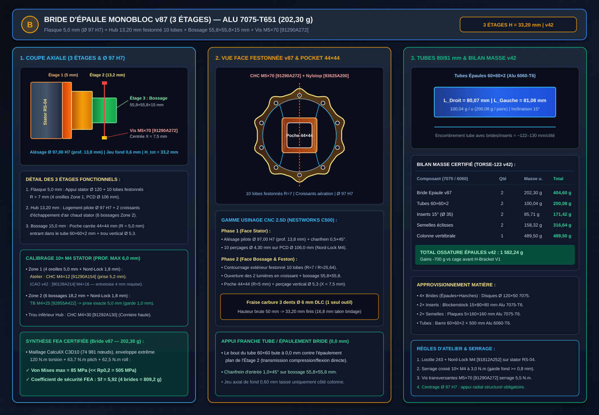
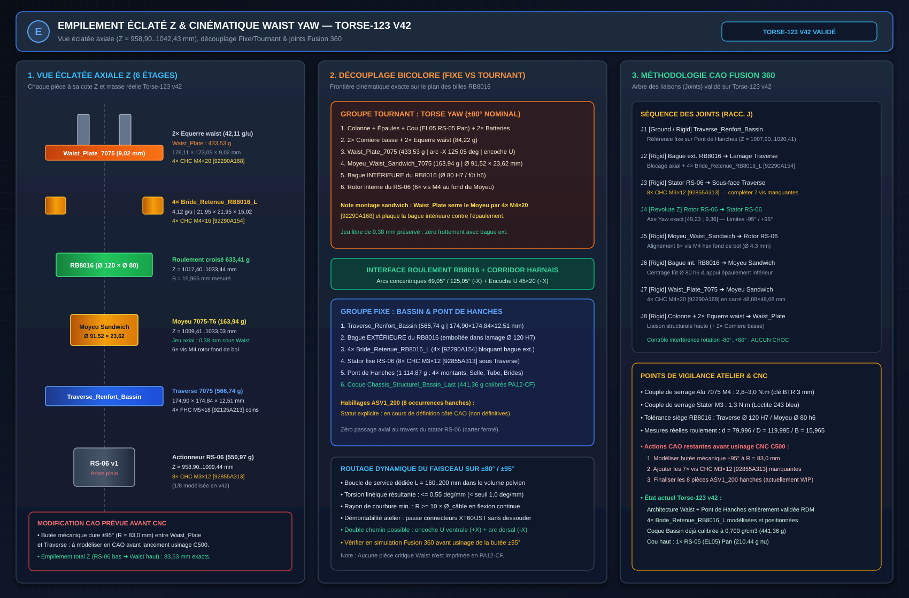
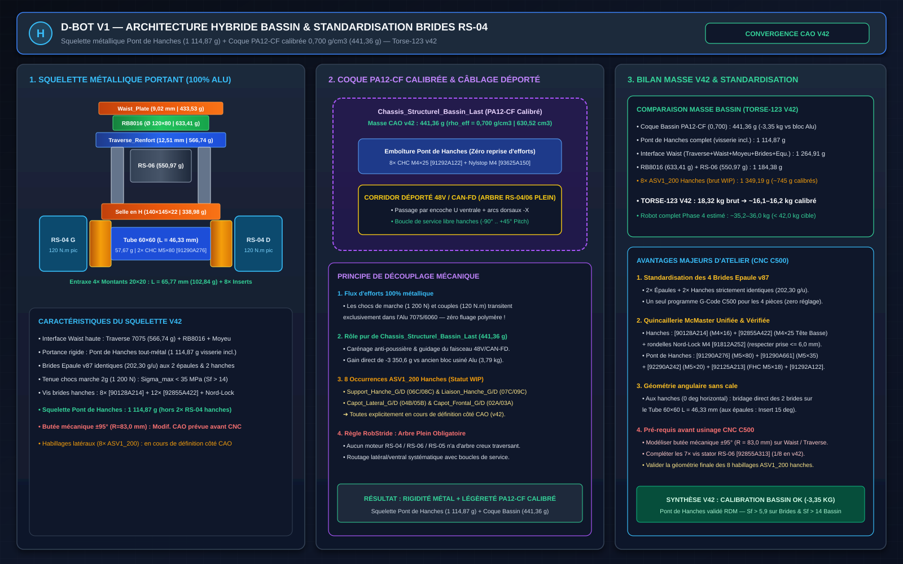
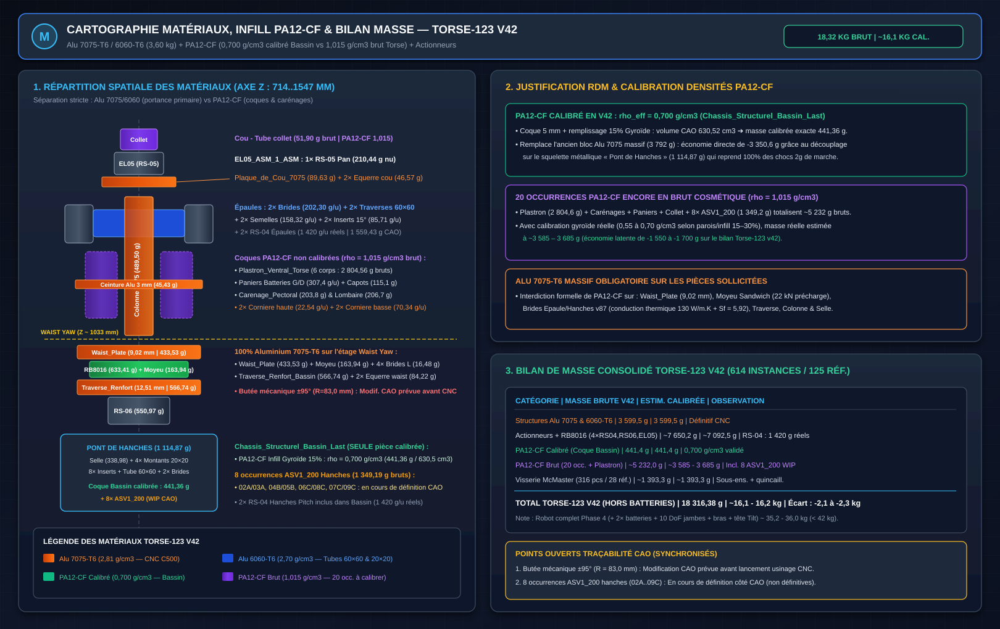

# 📋 NOMENCLATURE EXHAUSTIVE (BOM) — TORSE & BASSIN / WAIST D-BOT V1

> **Statut** : Document de Référence Actif (Niveau 1 — Vérité Terrain)  
> **Date de mise à jour** : 13 Novembre 2026  
> **Modèle CAO de référence** : Autodesk Fusion 360 `Torse-123 v42` (`AUDIT_METROLOGIQUE_Torse_et_Bassin.json` du 13/11/2026 — 614 instances, 125 références BOM)  
> **Architecture** : Torse V2.6 Tout-Métal (Jonction Z=0, Goupillage 80 × 80 mm) & Liaison Active Waist Yaw V1.3, Solution C+ (Ceinture Alu 3 mm) & Pont de Hanches (`Squelette Pelvien`)  

---

## 📑 Sommaire Général

- [1. Synthèse Générale et Budget de Masse](#1-synthèse-générale-et-budget-de-masse)
  - [Bilan de Masse Consolidé (Source CAO Active : Fusion 360 `Torse-123 v42` — Audit Métrologique Certifié)](#bilan-de-masse-consolidé-source-cao-active--fusion-360-torse-123-v42--audit-métrologique-certifié)
- [2. Nomenclature Détaillée — Partie 1 : Torse Complet](#2-nomenclature-détaillée--partie-1--torse-complet)
  - [2.1 Structure Principale & Colonne Sagittale](#21-structure-principale--colonne-sagittale)
  - [2.2 Liaison d'Épaules RS-04 & Traverses](#22-liaison-dépaules-rs-04--traverses)
  - [2.3 Liaison Haute de Cou `RobStride RS-05` (`EL05`)](#23-liaison-haute-de-cou-robstride-rs-05-el05)
  - [2.4 Carénages, Plastrons & Coques (`Torse-123 v42`)](#24-carénages-plastrons--coques-torse-123-v42)
  - [2.5 Quincaillerie & Visserie McMaster-Carr du Torse (`Torse-123 v42` Vérifié)](#25-quincaillerie--visserie-mcmaster-carr-du-torse-torse-123-v42-vérifié)
- [3. Nomenclature Détaillée — Partie 2 : Bassin & Waist Yaw](#3-nomenclature-détaillée--partie-2--bassin--waist-yaw)
  - [3.1 Liaison Active Waist Yaw (RS-06 & Roulement CRBH 8016)](#31-liaison-active-waist-yaw-rs-06--roulement-crbh-8016)
  - [3.2 Pièces Structurelles Pelviennes (« Pont de Hanches ») et Habillages WIP](#32-pièces-structurelles-pelviennes--pont-de-hanches--et-habillages-wip)
  - [3.3 Architecture Pont de Hanches du Bassin et Standardisation Bride RS-04](#33-architecture-pont-de-hanches-du-bassin-et-standardisation-bride-rs-04)
  - [3.4 Quincaillerie & Visserie McMaster-Carr du Bassin (`Torse-123 v42` Vérifié)](#34-quincaillerie--visserie-mcmaster-carr-du-bassin-torse-123-v42-vérifié)
  - [3.5 Actionneurs des Membres Inférieurs & Projection Robot Complet (Phase 4)](#35-actionneurs-des-membres-inférieurs--projection-robot-complet-phase-4)
- [4. Cartographie des Matériaux et Infill 3D (PA12-CF)](#4-cartographie-des-matériaux-et-infill-3d-pa12-cf)
  - [4.1 Matrice des Matériaux Utilisés (`Torse-123 v42`)](#41-matrice-des-matériaux-utilisés-torse-123-v42)
  - [4.2 Justification Technique RDM : Pourquoi ce Matériau et cet Infill ?](#42-justification-technique-rdm--pourquoi-ce-matériau-et-cet-infill-)
  - [4.3 Densité Apparente et Intégration Fusion 360](#43-densité-apparente-et-intégration-fusion-360)
- [5. Tableau des Couples Dynamométriques & Outillage d'Atelier](#5-tableau-des-couples-dynamométriques--outillage-datelier)
- [6. Procédure d'Assemblage sous Fusion 360 (Joints & DDL)](#6-procédure-dassemblage-sous-fusion-360-joints--ddl)

---

## 1. Synthèse Générale et Budget de Masse

Le robot humanoïde D-Bot V1 sépare structurellement le corps supérieur en trois sous-ensembles fonctionnels :
1. **Le Torse Complet** : Colonne sagittale, cou pan `RobStride RS-05 (EL05_ASM_1_ASM)` (le 2e RS-05 Tilt appartient à `02_Tete_et_Cou`), traverses d'épaules `60×60 mm`, articulations d'épaules `RS-04` complètes symétrisées (G/D), plastrons (`Plastron_Ventral_Torse` 6 corps + ceinture Alu `3 mm`), carénages et les 2 packs batteries latéraux 48V (`Panier_Batterie_Droit` / `Gauche`).
2. **La Liaison Active Waist Yaw** : Pivot de lacet de taille, roulement à rouleaux croisés `RB8016` (`633,41 g`), actionneur `RS-06` (`550,97 g`), `Moyeu_Waist_Sandwich_7075` (`163,94 g`), `Waist_Plate_7075` (`433,53 g`, `176,11 × 173,05 × 9,02 mm`), arc dorsal `69,05° / 125,05°` (`-X`, anti-guillotine) et butée mécanique `±95,0°` à `R = 80,50 mm` (doigt côté `+X` `0°`, plots à `±109,86°`, **Modification CAO prévue avant usinage CNC** — non encore modélisée dans `Torse-123 v42`).
3. **Le Bassin & Squelette Pelvien (`Bassin_Pelvis`)** : `Traverse_Renfort_Bassin` en **Aluminium 7075-T6** (`566,74 g`), squelette porteur **« Pont de Hanches »** (`1 114,87 g` avec ses 2 `Bride Epaule` `RS-04` de hanches, `Selle de Pont Pelvis` `338,98 g`, `Tube transverse Hanches` `60×60` `L = 46,33 mm`, 4 `Montant de Hanche` et 8 `Insert`), coque `Chassis_Structurel_Bassin_Last` calibrée PA12-CF (`441,36 g` à `0,700 g/cm3`), plus 8 occurrences d'habillage/support de hanche `ASV1_200` actuellement **en cours de définition côté CAO (non définitives)**.

### Bilan de Masse Consolidé (Source CAO Active : Fusion 360 `Torse-123 v42` — Audit Métrologique Certifié)

| Sous-Ensemble / Répartition `v42` | Masse Mesurée CAO (`v42`) | Estimation Calibrée PA12-CF (`rho_eff`) | Observations Métrologiques Certifiées |
| :--- | :---: | :---: | :--- |
| **Structure Aluminium (7075-T6 & 6060-T6)** | **3 599,5 g** | **3 599,5 g** | Colonne, équerres, brides (×4), traverse bassin, waist plate, moyeu, selle & montants, traverses 60×60 |
| **Actionneurs & Roulements (`4× RS-04` + `RS-06` + `EL05` + `RB8016`)** | **~7 650,2 g** | **~7 092,5 g** | En CAO `v42` les 4 `RS-04` (`1 559,43 g`/u) sont en acier massif (`~1 420 g`/u réels) ; `EL05` (`210,44 g` nu / `228,49 g` cont.) ; `RS06` (`550,97 g`) ; `RB8016` (`633,41 g`) |
| **Pièces PA12-CF Calibrées (`Chassis_Structurel_Bassin_Last`)** | **441,36 g** | **441,36 g** | Seule pièce pelvienne déjà calibrée en CAO à `rho = 0,700 g/cm3` (`630,52 cm3`) |
| **Pièces PA12-CF Non Calibrées (`20` instances + `6` corps Plastron à `rho = 1,015`)** | **~5 232 g** | **~3 585 – 3 685 g** | `Plastron` (`2 804,5 g` plastiques), carénages, paniers batteries, cou collet, support batterie + **8 habillages hanches `ASV1_200` (`1 349,2 g` bruts non définitifs)** |
| **Visserie & Quincaillerie McMaster (`316` pcs / `28` réf.)** | **~1 393 g** *(avec sous-ensembles)* | **~1 393 g** | 316 composants McMaster-Carr modélisés en CAO `Torse-123 v42` |
| **TOTAL HAUT DU CORPS (`Torse-123 v42` Exporté)** | **`18 316,38 g` (`18,32 kg`)** | **`~16,1 – 16,2 kg`** *(hors 2× packs 48V, avec calib. gyroïde + RS-04 réels)* | `CoM v42 = [61,065 ; 8,032 ; 1128,748] mm` ; Enveloppe feuilles `242,97 × 487,06 × 832,95 mm` *(conteneur vide `Ensemble hanche:1` portant bbox globale à `890,76 mm`)* |

> [!NOTE]
> **Actualisation CAO Souveraine (`Torse-123 v42` — Calibration PA12-CF & Habillages WIP)** :
> Dans l'export souverain [`SYNTHESE_METROLOGIQUE_Torse_et_Bassin.md`](file:///Users/Shared/Mon%20Google%20Drive%20Physique/Documentation/01_Mecanique_et_Chassis/Torse_et_Bassin/SYNTHESE_METROLOGIQUE_Torse_et_Bassin.md) (`18 316,38 g`, **614 instances**, **125 références BOM**), **1 seule pièce PA12-CF sur 21** (`Chassis_Structurel_Bassin_Last`, `441,36 g`) est calibrée à `0,700 g/cm3` ; les 20 autres occurrences et corps plastiques restent temporairement à la densité cosmétique brute `1,015 g/cm3`. Une calibration complète vers l'infill gyroïde réel (et la masse constructeur réelle de `1 420 g` pour chacun des 4 `RS-04`) ramène l'ensemble `Torse-123 v42` à **`~16,1 – 16,2 kg`** (gain de **`-2,1` à `-2,3 kg`**). Les 8 pièces d'habillage de hanches `ASV1_200` (`02A, 03A, 04B, 05B, 06C, 07C, 08C, 09C`) restent incluses comme jalons **en cours de définition côté CAO (non définitives)**.

---

## 2. Nomenclature Détaillée — Partie 1 : Torse Complet

### 2.1 Structure Principale & Colonne Sagittale

| Réf. Pièce | Désignation CAO Fusion 360 | Matériau Appliqué | Procédé / Infill | Qté | Masse Unitaire | Masse Totale | Rôle Fonctionnel |
| :--- | :--- | :--- | :--- | :---: | :---: | :---: | :--- |
| **TOR-01** | `colonne vertébrale` | Aluminium 7075 | Usinage CNC C500 (2 lumières 54×55 mm) | 1 | 489,50 g | 489,50 g | Poutre maîtresse sagittale allégée (`100,04 × 5,04 × 427,03 mm`) |
| **TOR-02** | `semelle éclisse` *(D & G)* | Aluminium 7075 | Usinage CNC C500 (Massif) | 2 | 158,32 g | 316,64 g | Éclisses sandwich symétriques (`100,02 × 5,02 × 130,02 mm`) avec 4 fraisures FHC M4 |
| **TOR-03** | `Insert` (15°) *(D & G)* | Aluminium 7075 | Usinage CNC C500 (Massif) | 2 | 85,71 g | 171,42 g | Cales d'inclinaison 15° des traverses d'épaules (`67,01 × 15,02 × 67,01 mm`) |
| **TOR-04** | `Goupille cylindrique ISO 8734 Ø3x14` (`91585A374`) | Acier inox 18-8 | Rectification (ISO 8734) | 4 | 0,78 g | 3,12 g | Goupilles de centrage absolu sur le sandwich colonne / éclisses |
| **TOR-05** | `Support_IMU_Torse` *(Jalon futur)* | PA12-CF | Impression 3D *(à modéliser)* | 1 | 4,20 g *(est.)* | 4,20 g *(est.)* | Non encore modélisé dans `Torse-123 v42` (jalon intégration IMU BMI270) |

---

### 2.2 Liaison d'Épaules RS-04 & Traverses



| Réf. Pièce | Désignation CAO Fusion 360 | Matériau Appliqué | Procédé / Infill | Qté | Masse Unitaire | Masse Totale | Rôle Fonctionnel |
| :--- | :--- | :--- | :--- | :---: | :---: | :---: | :--- |
| **EPA-01** | `Bride Epaule` (v87 festonnée) | Aluminium 7075 | Usinage CNC C500 (Massif) | 2 | 202,30 g | 404,60 g | Brides monoblocs 10 lobes R=7 mm, alésage Ø 97 mm, garde 4 mm (+ 2 aux hanches) |
| **EPA-02** | `Tube transverse Epaules droit` & `gauche` | Aluminium 6060-T6 | Profilé tube carré 60×60 | 2 | 100,04 g | 200,08 g | Demi-traverses rigides en torsion (`L = 80,07` / `81,08 mm`, inclinaison 15°) |
| **EPA-03** | `RS04 droit` & `RS04 gauche` (`04_ASM`) | RobStride RS-04 | Moteur QDD Actuator | 2 | 1 420,0 g réels *(1 559,43 g CAO)* | 2 840,0 g *(3 118,87 g CAO)* | Actionneurs d'épaules Pitch (120 N.m pic, 40 N.m cont., arbre plein fermé) |
| **EPA-04** | `Tuyere_Aerodynamique_RS04` *(Jalon futur)* | PA12-CF | Impression 3D *(à modéliser)* | 2 | 32,50 g *(est.)* | 65,00 g *(est.)* | Conduit de ventilation forcée (non encore modélisé dans `Torse-123 v42`) |
| **EPA-05** | `Capot_Protection_Epaule` *(Jalon futur)* | PA12-CF | Impression 3D *(à modéliser)* | 2 | 28,00 g *(est.)* | 56,00 g *(est.)* | Coques de carénage connectique (non encore modélisées dans `Torse-123 v42`) |
| **EPA-06** | `Corniere haute` (`Corniere_Haute_7075`) | Aluminium 7075 | Usinage CNC C500 | 2 | 22,54 g | 45,08 g | Liaison anti-torsion haute Ceinture Alu ➔ Bride Épaule (`20,02 × 30,02 × 60,02 mm`) |
| **EPA-07** | `Corniere basse` (`Corniere_Basse_7075`) | Aluminium 7075 | Usinage CNC C500 | 2 | 70,34 g | 140,68 g | Tirant vertical rigide Waist Plate ➔ Ceinture Alu (`20,02 × 73,84 × 191,10 mm`, remplace l'ancien projet `EPA-08` supprimé) |

---

### 2.3 Liaison Haute de Cou `RobStride RS-05` (`EL05`)

| Réf. Pièce | Désignation CAO Fusion 360 | Matériau Appliqué | Procédé / Infill | Qté | Masse Unitaire | Masse Totale | Rôle Fonctionnel |
| :--- | :--- | :--- | :--- | :---: | :---: | :---: | :--- |
| **COU-01** | `Plaque_de_Cou_7075` (`ASV1_100_03A`) | Aluminium 7075 | Usinage CNC C500 (Massif) | 1 | 89,63 g | 89,63 g | Plaque supérieure (`100,02 × 100,02 × 4,70 mm`) avec lumière ovale `30 × 50 mm` déportée et 4 fraisures FHC M3 |
| **COU-02** | `Equerre cou` (Paire Gauche + Droite) | Aluminium 7075 | Usinage / Cornière `30×30` | 1 paire *(2 corps)* | 23,28 g | 46,57 g | Cornières `L = 50,0 mm` (`50,04 × 65,03 × 30,04 mm` ensemble), couloir central libre `45 mm` |
| **COU-03** | `EL05_ASM_1_ASM` (Conteneur `EL05 v1`) | **RobStride RS-05** | Moteur QDD Actuator | **1** en `v42` *(+1 Tilt en `02_Tete_et_Cou`)* | 210,44 g nu *(228,49 g cont.)* | 210,44 g *(Pan seul `v42`)* | Actionneur rotatif Pan de cou (`46,04 × 46,04 × 47,04 mm`, arbre plein ; le 2e `RS-05` Tilt est porté par `02_Tete_et_Cou`) |
| **COU-04** | `Cou - Tube collet` | PA12-CF | Impression 3D *(à calibrer)* | 1 | 51,90 g brut *(~28,6 g cal.)* | 51,90 g brut | Embase / collet support rotatif tête (`Ø 99,78 × 70,04 mm`, densité brute `1,015 g/cm3`) |
| **COU-05** | `Guide_Cables_Cou` *(Jalon futur)* | PA12-CF | Impression 3D *(à modéliser)* | 1 | 18,50 g *(est.)* | 18,50 g *(est.)* | Passe-fil déporté non encore modélisé dans `Torse-123 v42` |

---

### 2.4 Carénages, Plastrons & Coques (`Torse-123 v42`)

| Réf. Pièce | Désignation CAO Fusion 360 | Matricule / Code | Matériau Appliqué | Procédé / Infill | Qté | Masse CAO (`Torse-123 v42`) | Rôle Fonctionnel |
| :--- | :--- | :--- | :--- | :--- | :---: | :---: | :--- |
| **CAR-01** | `Plastron_Ventral_Torse` *(6 corps plastiques)* | `ASV1_100_01` | PA12-CF | Impression 3D *(brut `1,015`)* | 1 | **`2 804,56 g` brut** *(dont `C1 = 1 574,53 g`, `C2 = 622,88 g`)* | Coque pectorale & ventrale multi-corps (`240,54 × 292,56 × 430,45 mm` avec ceinture `CAR-07`) |
| **CAR-02** | `Platine_Connectique_Facade` | `ASV1_100_05C_v1` | PA12-CF | Impression 3D *(brut `1,015`)* | 1 | **`36,27 g` brut** | Panneau frontal des ports et interrupteurs (`33,74 × 129,38 × 144,42 mm`) |
| **CAR-03** | `Panier_Batterie_Droit` | `Panier_Batterie_Droit` | PA12-CF | Impression 3D *(brut `1,015`)* | 1 | **`307,40 g` brut** | Rack latéral droit coulissant arrière `-X` pour 1 pack batterie *(spéc. à finaliser ; cavité utile `~115,8 × 76,5 × 105 mm`, hors-tout `185,55 × 94,91 × 139,69 mm`)* |
| **CAR-04** | `Panier_Batterie_Gauche` | `Panier_Batterie_Gauche` | PA12-CF | Impression 3D *(brut `1,015`)* | 1 | **`307,43 g` brut** | Rack latéral gauche coulissant arrière `-X` pour 1 pack batterie *(spéc. à finaliser ; cavité utile `~115,8 × 76,5 × 105 mm`, hors-tout `185,11 × 94,91 × 139,69 mm`)* |
| **CAR-05** | `Carenage_Pectoral_Haut` | `ASV1_100_04C` | PA12-CF | Impression 3D *(brut `1,015`)* | 1 | **`203,84 g` brut** | Plastron supérieur sous épaules et cou (`112,10 × 281,43 × 385,20 mm`) |
| **CAR-06** | `Carenage_Lombaire_Arriere` | `ASV1_100_06C_v1` | PA12-CF | Impression 3D *(brut `1,015`)* | 1 | **`206,71 g` brut** | Coque dorsale protégeant la colonne et les harnais (`198,16 × 272,08 × 343,29 mm`) |
| **CAR-07** | `ceinture` *(corps dans `Plastron_Ventral_Torse`)* | `ceinture` | Aluminium 7075 | Usinage CNC C500 (Tôle 3,0 mm) | 1 | **`45,43 g`** | Ceinture horizontale à `Z = 1235 mm` (`202,81 × 262,52 × 3,0 mm`) ancrant cornières hautes & basses |
| **CAR-08** | `Support Batterie Central` *(2 corps)* | `Support Batterie Central` | PA12-CF | Impression 3D *(brut `1,015`)* | 1 | **`30,39 g` brut** | Berceau bicorps gauche/droite (`15,20 g` × 2) guidant les batteries (`113,04 × 27,03 × 20,04 mm`) |
| **CAR-09** | `Capot_Verrouillage_Batterie` (`Capot_D` + `G`) & `Fixation Batterie` (×2) | `ASV1_100_12C` | PA12-CF | Impression 3D *(brut `1,015`)* | 2+2 | **`115,08 g`** + **`10,34 g` brut** | Capots supérieurs de verrouillage (`57,54` + `57,55 g`) et loquets (`5,17 g` × 2) |

---

### 2.5 Quincaillerie & Visserie McMaster-Carr du Torse (`Torse-123 v42` Vérifié)

| Réf. Pièce | Désignation Normalisée | Réf. McMaster-Carr | Matière / Classe | Qté (`Torse v42`) | Couple | Emplacement d'Assemblage Vérifié (Cote Z CAO) |
| :--- | :--- | :---: | :--- | :---: | :---: | :--- |
| **VIS-T01** | Vis CHC M4 × 16 mm | **`90128A214`** | Acier zingué cl. 8.8 | 8 *(+8 hanches = 16)* | 3,0 N.m | Fixation Brides Épaules ➔ Stator `RS-04` (`Z = 1311..1369 mm`) |
| **VIS-T02** | Vis CHC M4 × 25 mm Tête Basse | **`92855A422`** | Inox 18-8 / DIN 7984 | 10 *(+12 hanches = 22)* | 3,0 N.m | Fixation couronne Brides Épaules ➔ Stator `RS-04` (`Z = 1291..1391 mm`) — **respecter engagement 6,0 mm min.** |
| **VIS-T03** | Rondelles Nord-Lock M4 | **`91812A252`** | Acier trempé NL4 | 24 *(+20 hanches = 44)* | — | Sous vis épaules (`18`), cornières hautes (`2`) et cornières basses (`4`) |
| **VIS-T04** | Vis CHC M4 × 16 mm | **`92290A154`** | Inox 316 / ISO 4762 | 4 *(+4 waist = 8)* | 3,0 N.m | Fixation Plaque de Cou ➔ Équerres cou (`Z = 1470 mm`) |
| **VIS-T05** | Vis FHC M3 × 8 mm | **`91294A112`** / **`92125A128`** | Inox 18-8 / ISO 10642 | 4 + 4 | 1,2 N.m | Stator `EL05 (RS-05)` ➔ `Plaque_de_Cou_7075` & `Cou - Tube collet` (`Z = 1475,5` & `1481,2 mm`) |
| **VIS-T06** | Vis CHC M5 × 50 mm | **`91290A242`** | Inox 18-8 / ISO 4762 | **6** | 5,0 N.m | Traversées haut de colonne / Équerres cou (`Z = 1453,6..1460,0 mm`) |
| **VIS-T07** | Vis FHC M4 × 30 mm | **`92125A220`** | Inox 18-8 / ISO 10642 | **8** | 3,0 N.m | Vissage des 2 `semelle éclisse` ➔ 2 `Insert` 15° (`Z = 1314,5..1366,2 mm`) |
| **VIS-T08** | Vis CHC M5 × 70 mm | **`91290A272`** | Acier 12.9 / Inox | 4 | 5,5 N.m | Traversées verticales Brides Épaules ➔ Traverses `60×60` (`Z = 1340,8 mm`) |
| **VIS-T09** | Vis CHC M5 × 25 mm Noir | **`90348A023`** | Inox 18-8 Noir | 4 | 5,5 N.m | Traversées sandwich `colonne` + `semelles éclisses` (`Z = 1295,3` & `1385,3 mm`) |
| **VIS-T10** | Écrous frein Nylstop M5 | **`90631A113`** | Inox 18-8 / DIN 985 | 8 | 5,5 N.m | Verrouillage sandwich colonne (`4`) + traverses épaules (`4`) |
| **VIS-T11** | Goupilles cylindriques Ø 3 × 14 mm | **`91585A374`** | Inox 18-8 / ISO 8734 | 4 | — | Centrage de précision sandwich colonne & semelles éclisses (`Z = 1300..1380 mm`) |
| **VIS-T12** | Vis CHC M4 × 30 mm | **`91292A130`** | Inox 18-8 / ISO 4762 | 2 | 2,8 N.m | Fixation supérieure `Corniere haute` ➔ `Bride Epaule` (`Z = 1289,2 mm`) |
| **VIS-T13** | Vis CHC M4 × 16 mm | **`91292A118`** | Inox 18-8 / ISO 4762 | 2 | 1,8 N.m | Fixation inférieure `Corniere haute` ➔ `ceinture` 3 mm (`Z = 1235,1 mm`) |
| **VIS-T14** | Vis CHC M4 × 14 mm | **`91290A150`** | Acier cl. 12.9 Noir | 4 | 3,0 N.m | Fixation pied `Corniere basse` ➔ `Waist_Plate_7075` (`Z = 1043,5 mm`) |
| **VIS-T15** | Vis CHC M4 × 25 mm | **`91292A122`** | Inox 18-8 / ISO 4762 | 6 *(+8 pelv = 14)* | 2,0 N.m | Fixations haut `Corniere basse` / `ceinture` / `Plastron` (`Z = 1233,3 mm`) |
| **VIS-T16** | Vis CHC M4 × 18 mm | **`92290A161`** | Inox 316 / ISO 4762 | 6 | 2,5 N.m | `Support Batterie Central` (`2×`, `Z = 1136 mm`) & pied `Plastron / Waist` (`4×`, `Z = 1046..1048 mm`) |
| **VIS-T17** | Vis CHC M4 × 20 mm | **`92290A168`** | Inox 316 / ISO 4762 | 10 | 2,8 N.m | `Waist_Plate_7075` / `Equerre waist` / `Plastron` / `Cou` (`Z = 1038..1459 mm`) |
| **VIS-T18** | Rondelles & Nylstop M4 / M5 (Torse) | **`93475A230`** / **`93625A150`** / **`93475A240`** | Inox 18-8 | 44 rond. M4 + 28 Nylstop M4 + 16 rond. M5 | — | Appuis et freinage visserie torse (`Z >= 1033 mm`) |

---

## 3. Nomenclature Détaillée — Partie 2 : Bassin & Waist Yaw

### 3.1 Liaison Active Waist Yaw (RS-06 & Roulement CRBH 8016)



| Réf. Pièce | Désignation CAO Fusion 360 | Matériau Appliqué | Procédé / Infill | Qté | Masse Unitaire | Masse Totale | Rôle Fonctionnel |
| :--- | :--- | :--- | :--- | :---: | :---: | :---: | :--- |
| **WST-01** | `Moyeu_Waist_Sandwich_7075` | Aluminium 7075 | Tournage/Fraisage CNC | 1 | 163,94 g | 163,94 g | Fût Ø 80 h6, collerette Ø 91,52 mm (`Z = 1009,41..1033,03 mm`, jeu `0,38 mm`) |
| **WST-02** | `Waist_Plate_7075` (`ASV1_100_02A`) | Aluminium 7075 | Usinage CNC C500 (Massif) | 1 | 433,53 g | 433,53 g | Plaque mobile (`176,11 × 173,05 × 9,02 mm`), côté `+X` pleine matière (porte doigt `WST-07A`) et lumière d'arc arrière `125,05°` anti-guillotine |
| **WST-03** | `Traverse_Renfort_Bassin` (`ASV1_200_16A`) | Aluminium 7075 | Tournage/Fraisage CNC | 1 | 566,74 g | 566,74 g | Platine d'interface allégée (`174,90 × 174,84 × 12,51 mm`), siège Ø 120 H7, alésage central |
| **WST-04** | `Bride_Retenue_RB8016_L` | Aluminium 7075 | Usinage CNC C500 | 4 | 4,12 g | 16,48 g | 4 brides étagées en L (`21,95 × 21,95 × 15,02 mm` à 45°) de retenue bague extérieure |
| **WST-05** | `RB8016` (CRBH 8016 UU) | Acier GCr15 (62 HRC) | Luoyang EFANT Precision | 1 | 633,41 g | 633,41 g | **Reçu & Contrôlé (15/09/2026)** : `d = 79,996 mm`, `D = 119,995 mm`, `B = 15,965 mm`, faux-rond `0,003 mm` |
| **WST-06** | `RS06 v1` | RobStride RS-06 | Moteur QDD Actuator | 1 | 550,97 g | 550,97 g | Actionneur de lacet Waist Yaw (`85,31 × 83,58 × 50,54 mm`, 36 N.m pic, 11 N.m nom., arbre plein) |
| **WST-07** | `Doigt_Butee_Waist` (`WST-07A`) & Plots `±95°` (`WST-07B/C`) *(Prévu)* | Alu 7075 + capuchons **TPU 95A** | **Modification CAO prévue avant usinage CNC** | 1 + 2 | — | — | Butée `±95,0°` à `R = 80,50 mm` : Doigt `+X` (`10×18×8 mm`) + 2 Plots `±109,86°` (`10×18×11,5 mm` + `3 mm` TPU) **non encore modélisée dans `v42`** |

---

### 3.2 Pièces Structurelles Pelviennes (« Pont de Hanches ») et Habillages WIP

En architecture `Torse-123 v42`, l'ensemble `Bassin_Pelvis [ASV1_200]` est porté par le squelette métallique **« Pont de Hanches »** (`1 114,87 g`) et la coque `Chassis_Structurel_Bassin_Last` déjà calibrée en PA12-CF à `0,700 g/cm3` (`441,36 g`). Les 8 pièces périphériques `ASV1_200` de support/capotage latéral de hanche sont explicitement en cours de définition CAO :

| Réf. Pièce | Désignation CAO Fusion 360 | Matricule / Code | Matériau Appliqué (`v42`) | Procédé / Infill | Qté | Masse CAO (`Torse-123 v42`) | Rôle & Statut CAO |
| :--- | :--- | :--- | :--- | :--- | :---: | :---: | :--- |
| **PEL-01** | `Chassis_Structurel_Bassin_Last` | `Chassis_Structurel_Bassin_Last` | **PA12-CF calibré (`0,700`)** | Coque 5 mm Infill 15% Gyroïde | 1 | **`441,36 g`** | Coque pelvienne centrale calibrée (`207,75 × 313,03 × 225,34 mm`, `630,52 cm3`) |
| **PEL-02** | `Traverse_Renfort_Bassin` | `ASV1_200_16A` | Aluminium 7075 | Usinage CNC | 1 | **`566,74 g`** | Platine d'interface waist / hanches (`174,90 × 174,84 × 12,51 mm`, `Z = 1007,90..1020,41`) |
| **PEL-03** | `Selle de Pont Pelvis` | `ASV1_200_10` | Aluminium 7075 | Usinage CNC | 1 | **`338,98 g`** | Poutre en H supérieure (`140,04 × 145,04 × 22,03 mm`, `Z = 922,64..944,67`) |
| **PEL-04** | `Tube transverse Hanches [60x60]` | `Tube_Transverse_Hanches_60x60` | Aluminium 6060-T6 | Profilé carré `60×60` | 1 | **`57,67 g`** | Entretoise centrale inter-brides (`60,02 × 46,33 × 60,02 mm`, `L = 46,33 mm`) |
| **PEL-05** | `Montant de Hanche` *(Av/Ar G & D)* | `ASV1_200_11` | Aluminium 6060-T6 | Profilé carré `20×20` | 4 | **`25,71 g`/u (`102,84 g`)** | 4 colonnes verticales (`20,02 × 20,02 × 65,77 mm`, `Z = 944,64..1010,41`) |
| **PEL-06** | `Insert Hanche Bas` & `Haut` | `ASV1_200_12` / `13` | Aluminium 7075 | Usinage CNC | 4 + 4 | **`9,25 g`/u (`74,00 g`)** | 8 inserts taraudés emmanchés aux extrémités des montants (`15,82 × 15,82 × 15,02 mm`) |
| **PEL-07** | `Bride Epaule` *(Hanches G & D)* | `Bride Epaule` | Aluminium 7075 | Usinage CNC C500 | 2 | **`202,30 g`/u (`404,60 g`)** | 2 brides `RS-04` hanches identiques aux épaules (`Ø 97 mm`, 4 brides usinables en série) |
| **PEL-08** | `Equerre waist` *(Droite & Gauche)* | `Equerre waist` | Aluminium 7075 | Usinage / Cornière `30×30` | 2 | **`42,11 g`/u (`84,22 g`)** | Cornières `90,02 × 30,02 × 30,02 mm` liant `colonne` ➔ `Waist_Plate_7075` |
| **PEL-09** | `Support_Hanche_Gauche` & `Droit` | `ASV1_200_06C` / `08C` | PA12-CF *(brut `1,015`)* | Impression 3D | 2 | **`371,19 g` + `371,16 g` brut** | **En cours de définition côté CAO (non définitives)** |
| **PEL-10** | `Liaison_Hanche_Gauche` & `Droit` | `ASV1_200_07C` / `09C` | PA12-CF *(brut `1,015`)* | Impression 3D | 2 | **`93,98 g` + `93,18 g` brut** | **En cours de définition côté CAO (non définitives)** |
| **PEL-11** | `Capot_Lateral_Hanche_Gauche` & `Droit` | `ASV1_200_04B` / `05B` | PA12-CF *(brut `1,015`)* | Impression 3D | 2 | **`135,53 g` × 2 brut** | **En cours de définition côté CAO (non définitives)** |
| **PEL-12** | `Capot_Protection_Hanche_Frontal_G` & `D` | `ASV1_200_02A` / `03A` | PA12-CF *(brut `1,015`)* | Impression 3D | 2 | **`74,31 g` × 2 brut** | **En cours de définition côté CAO (non définitives)** |
| **PEL-13** | `Passe_Fil_Faisceau_Waist` *(Jalon futur)* | — | TPU 95A | Impression 3D *(à modéliser)* | 1 | **~8,50 g *(est.)*** | Manchon souple fendu corridor ventral (non encore modélisé dans `Torse-123 v42`) |
| **PEL-14** | `Support_Ventilateur_RS06` *(Jalon futur)* | — | PA12-CF | Impression 3D *(à modéliser)* | 1 | **~16,00 g *(est.)*** | Berceau ventilateur `RS-06` (non encore modélisé dans `Torse-123 v42`) |

---

### 3.3 Architecture Pont de Hanches du Bassin et Standardisation Bride RS-04

> **Architecture Retenue en CAO (`Torse-123 v42`)** : Squelette porteur **« Pont de Hanches »** (`Aluminium 7075 / 6060-T6`, **`1 114,87 g`** visserie incluse) reprenant intégralement les charges de marche, combiné à la coque non porteuse `Chassis_Structurel_Bassin_Last` calibrée PA12-CF (`441,36 g`).



#### A. Principe du Découplage Mécanique
1. **Flux d'Efforts 100% Métallique (« Pont de Hanches »)** :
   * Les chocs verticaux d'impact de marche (`1 200 N`) et les couples de hanches (`120 N.m` pic par `RS-04`) transitent exclusivement par la chaîne rigide métallique :
     `2× RS-04 Hanches ➔ 2× Brides Epaule 7075 ➔ Tube 60×60 (L = 46,33 mm) ➔ Selle de Pont 7075 ➔ 4× Montants 20×20 + 8× Inserts 7075 ➔ Traverse_Renfort_Bassin 7075`.
   * **Zéro fluage plastique** : Le module d'élasticité de l'aluminium (`70 GPa`) élimine toute déformation sous choc là où une liaison purement polymère fléchirait.
2. **Rôle de la Coque `Chassis_Structurel_Bassin_Last` (`441,36 g` calibrés)** :
   * Imprimée en **PA12-CF (Coque 5 mm + Infill 15% Gyroïde, `rho = 0,700 g/cm3`)**, elle passe de `~3,79 kg` (ancienne version bloc Alu) à **`441,36 g`** dans `Torse-123 v42`.
   * Elle sert exclusivement d'habillage aérodynamique, de guidage interne pour le routage déporté du faisceau 48V/CAN (règle RobStride arbre plein) et de support aux carénages WIP (`ASV1_200`).

#### B. Standardisation de la `Bride Epaule` v87 pour la Hanche Pitch
* **Réutilisation Directe Sans Retouche CAO** :
  * Chaque `RS-04` de Hanche Pitch (alésage pilote `Ø 97,00 mm H7`, 10 taraudages M4 sur `PCD Ø 106,0 mm`) est fixé sur une `Bride Epaule` v87 (`202,30 g`), strictement identique aux 2 brides d'épaules (un seul programme d'usinage CNC C500 pour **4 brides**).
  * **Serrage moteur ➔ Bride (Hanches `v42`)** : **`8× CHC M4 × 16 mm (90128A214)`** + **`12× CHC M4 × 25 mm Tête Basse (92855A422)`** + **`20× rondelles Nord-Lock M4 (91812A252)`** — sur les vis `M4×25` (filetage de sortie bride), veiller à limiter la profondeur d'engagement dans le stator à **`<= 6,0 mm`** (entretoise/épaulement bride de ~19 mm requis, éviter tout talonnage bobinage).
  * **Traversée Pont de Hanches (`v42`)** : La `Bride Epaule` + `Selle de Pont Pelvis` (`Z = 934,64 mm`, empilement `69,0 mm`) sont serrées verticalement sur le `Tube transverse Hanches [60x60]` (`L = 46,33 mm`) par **`2× CHC M5 × 80 mm (91290A276)`** + **`4× rondelles DIN 125A M5 (93475A240)`** + **`2× Nylstop M5 (93625A200)`**.
* **Synthèse RDM** :
  * Couple pic de hanche : `120 N.m` ➔ Effort de cisaillement par vis M4 = `267 N` (marge visserie `Sf > 18`).
  * Choc dynamique de marche à 2g (`1 200 N`) ➔ `Sigma_max < 35 MPa` dans l'Alu 7075 (`Rp0.2 = 505 MPa`, **facteur de sécurité `Sf > 14`**).

#### C. Bilan de Masse Réel Bassin & Pont de Hanches (`Torse-123 v42`)

| Sous-Ensemble Bassin (`Torse-123 v42`) | Composants Inclus | Masse Mesurée (`v42`) | Statut CAO / Calibration |
| :--- | :--- | :---: | :--- |
| **Squelette porteur « Pont de Hanches »** | `Selle` (`338,98 g`) + `Tube 60x60` (`57,67 g`) + `4× Montants` (`102,84 g`) + `8× Inserts` (`74,00 g`) + `2× Brides` (`404,60 g`) + visserie M4/M5 (`136,78 g`) | **`1 114,87 g`** | **Définitif & Certifié CAO** |
| **Interface Waist / Équerres Bassin** | `Traverse_Renfort_Bassin` (`566,74 g`) + `Waist_Plate_7075` (`433,53 g`) + `Moyeu` (`163,94 g`) + `4× Brides L` (`16,48 g`) + `2× Equerre waist` (`84,22 g`) | **`1 264,91 g`** | **Définitif & Certifié CAO** (`RB8016` `633,41 g` et `RS-06` `550,97 g` en sus) |
| **Coque Pelvienne Centrale** | `Chassis_Structurel_Bassin_Last` (gain `-3 350,6 g` vs bloc Alu 3,79 kg) | **`441,36 g`** | **Calibrée PA12-CF (`0,700 g/cm3`)** |
| **8 Occurrences Habillage Hanches `ASV1_200`** | `Support_Hanche_G/D` (`06C/08C`), `Liaison_Hanche_G/D` (`07C/09C`), `Capot_Lateral_G/D` (`04B/05B`), `Capot_Frontal_G/D` (`02A/03A`) | **`1 349,19 g` bruts** *(est. ~745 g calibrés)* | **En cours de définition côté CAO (non définitives)** |

> [!NOTE]
> **Note métrologique sur `Ensemble hanche:1`** :
> Dans l'arbre Fusion 360 `Torse-123 v42`, l'occurrence parent `Ensemble hanche:1` (`bodies = 0`) comporte une esquisse/origine interne étendant la boîte englobante globale à `564,84 × 487,07 × 890,76 mm` (`Z = 656,36..1547,12 mm`), alors que l'enveloppe physique réelle des corps visibles (« feuilles » `len(bodies) > 0`) s'établit à **`242,97 × 487,06 × 832,95 mm`** (`Z = 714,17..1547,12 mm`).

---

### 3.4 Quincaillerie & Visserie McMaster-Carr du Bassin (`Torse-123 v42` Vérifié)

| Réf. Pièce | Désignation Normalisée | Réf. McMaster-Carr | Matière / Classe | Qté (`Bassin v42`) | Couple | Emplacement d'Assemblage Vérifié (Cote Z CAO) |
| :--- | :--- | :---: | :--- | :---: | :---: | :--- |
| **VIS-W01** | Vis CHC M4 × 20 mm | **`92290A168`** | Inox 316 / ISO 4762 | 8 *(+2 Cou = 10)* | 2,8 à 3,0 N.m | Serrage `Moyeu_Waist_Sandwich_7075` ➔ `Waist_Plate_7075` & `Equerre waist` (`Z = 1038..1059 mm`) |
| **VIS-W02** | Vis FHC M5 × 18 mm | **`92125A213`** | Inox 18-8 / ISO 10642 | **4** | 4,0 N.m | Fixation affleurante `Traverse_Renfort_Bassin` ➔ `4× Insert Hanche Haut` (`Z = 1011,3 mm`) |
| **VIS-W03** | Vis CHC M4 × 16 mm | **`92290A154`** | Inox 316 / ISO 4762 | 4 *(+4 Cou = 8)* | 2,8 à 3,0 N.m | Serrage des `4× Bride_Retenue_RB8016_L` sur `Traverse_Renfort_Bassin` (`Z = 1020,0 mm`) |
| **VIS-W04** | Vis CHC M3 × 12 mm Tête Basse | **`92855A313`** | Inox 18-8 / DIN 7984 | **1** en `v42` *(8 req. finale)* | 1,3 à 1,4 N.m | Fixation Stator `RS-06` ➔ `Traverse_Renfort_Bassin` (`Z = 1005,8 mm`) — 1 modélisée en `v42`, 8 requises |
| **VIS-W05** | Vis CHC M3 × 10 mm | **`91292A113`** | Inox 18-8 / ISO 4762 | **1** | 1,3 N.m | Fixation complémentaire interface `RS-06` / flasque (`Z = 1013,9 mm`) |
| **VIS-W06** | Vis CHC M5 × 35 mm | **`91290A661`** | Acier cl. 12.9 Noir | **4** | 5,5 N.m | Traversées structurelles Pont de Hanches (`Selle` / `Montants`, `Z = 930,5 mm`) |
| **VIS-W07** | Vis CHC M5 × 20 mm | **`92290A242`** | Inox 316 / ISO 4762 | **4** | 4,5 N.m | Serrage `Selle de Pont Pelvis` ➔ `4× Insert Hanche Bas` (`Z = 941,3 mm`) |
| **VIS-W08** | Vis CHC M5 × 80 mm | **`91290A276`** | Acier cl. 12.9 Noir | **2** | 5,5 N.m | Traversées verticales `Brides Epaule` hanches + `Selle` ➔ `Tube 60×60` (`Z = 898,0 mm`) |
| **VIS-W09** | Vis CHC M4 × 25 mm | **`91292A122`** | Inox 18-8 / ISO 4762 | 8 *(+6 Torse = 14)* | 2,5 N.m | Liaisons Pont de Hanches / `Chassis_Structurel_Bassin_Last` (`Z = 956,1..998,9 mm`) |
| **VIS-W10** | Vis CHC M4 × 16 mm (Hanches) | **`90128A214`** | Acier zingué cl. 8.8 | 8 *(+8 Ép. = 16)* | 3,0 N.m | Fixation `Brides Epaule` hanches ➔ Stators `RS-04` (`Z = 845,5..946,3 mm`) |
| **VIS-W11** | Vis CHC M4 × 25 mm Tête Basse (Hanches) | **`92855A422`** | Inox 18-8 / DIN 7984 | 12 *(+10 Ép. = 22)* | 3,0 N.m | Fixation couronne `Brides Epaule` hanches ➔ Stators `RS-04` (`Z = 864,7..927,0 mm`) |
| **VIS-W12** | Rondelles Nord-Lock M4 (Hanches) | **`91812A252`** | Acier trempé NL4 | 20 *(+24 Torse = 44)* | — | Anti-desserrage sous les 20 vis M4 des brides de hanches |
| **VIS-W13** | Rondelles & Nylstop M4 / M5 (Pelvis) | **`93475A230`** / **`93475A240`** / **`93625A150`** / **`93625A200`** | Inox 18-8 | 12 rond. M4 + 16 rond. M5 + 8 Nylstop M4 + 6 Nylstop M5 | — | Appuis et freinage visserie Pont de Hanches & Waist (`Z < 1033 mm`) |
| **VIS-W14** | Visserie Butée `±95°` (`91290A150` + `93475A230`) *(Prévue)* | **`91290A150`** (`6×`) + **`93475A230`** (`2×`) | Acier 12.9 / Inox — **Mod. CAO avant CNC** | **6 + 2** | **2,8 N.m** | `6× CHC M4×14 mm` (2 Doigt par dessous + 4 Plots Traverse) + `2× rondelles DIN 125A M4` à `R = 80,50 mm` |

---

### 3.5 Actionneurs des Membres Inférieurs & Projection Robot Complet (Phase 4)

La motorisation des membres inférieurs est acquise à l'atelier (**12 DoF** au total). Attention en bilan de masse : les **2 actionneurs `RS-04` de Hanche Pitch (`2 840 g` réels)** étant déjà intégrés dans `Torse-123 v42` (sous `Bassin_Pelvis`), ils ne doivent pas être comptés deux fois au-delà de l'assemblage `Torse-123 v42`.

| Réf. Sous-Ensemble | Articulation / DoF | Réf. Actionneur RobStride | Qté | Masse Unitaire | Masse Totale | Couple Continu | Couple Crête (Peak) | Intégration `Torse-123 v42` |
| :--- | :--- | :--- | :---: | :---: | :---: | :---: | :---: | :--- |
| **JAM-01** | Hanche Pitch (Gauche & Droit) | **RobStride RS-04** | 2 | 1 420 g | **2 840 g** | 40 N.m | 120 N.m | **Déjà inclus dans `Torse-123 v42`** (`3 118,87 g` brut acier en CAO) |
| **JAM-02** | Hanche Roll (Gauche & Droit) | **RobStride RS-03** | 2 | 880 g | **1 760 g** | 20 N.m | 60 N.m | Phase 4 — Membres inférieurs |
| **JAM-03** | Hanche Yaw (Gauche & Droit) | **RobStride RS-03** | 2 | 880 g | **1 760 g** | 20 N.m | 60 N.m | Phase 4 — Membres inférieurs |
| **JAM-04** | Genou Pitch (Gauche & Droit) | **RobStride RS-04** | 2 | 1 420 g | **2 840 g** | 40 N.m | 120 N.m | Phase 4 — Membres inférieurs |
| **JAM-05** | Cheville Pitch (Gauche & Droit) | **RobStride RS-03** | 2 | 880 g | **1 760 g** | 20 N.m | 60 N.m | Phase 4 — Membres inférieurs |
| **JAM-06** | Cheville Roll (Gauche & Droit) | **RobStride RS-03** | 2 | 880 g | **1 760 g** | 20 N.m | 60 N.m | Phase 4 — Membres inférieurs |
| **JAM-07** | Structure jambes (tubes, brackets, pieds) | Aluminium 7075-T6 / Visserie | — | — | **~1 200 g** | — | — | Phase 4 — Membres inférieurs |
| **SOUS-TOTAL RESTANT JAMBES (10 DoF hors Hanches Pitch)** | — | **2× RS-04 + 8× RS-03 + struct.** | **10** | — | **~11 080 g (~11,08 kg)** | — | — | À ajouter à `Torse-123 v42` |

> [!TIP]
> **Consolidation Masse Globale D-Bot V1 (`Torse-123 v42` + Sous-Ensembles Phase 4)** :
> * **`Torse-123 v42` calibré (Torse + Waist + Bassin + `4× RS-04` + `RS-06` + `EL05 Pan` + `RB8016`, hors 2× batteries 48V)** : **`~16,1 – 16,2 kg`** (`18,32 kg` bruts avant calibration PA12-CF).
> * **Sous-ensembles hors `Torse-123 v42`** : Packs batteries 48V + Jetson/électronique (`~1,51 kg` packs + PCBA) + **10 DoF restants jambes** (`~11,08 kg`) + **Bras, Mains D-Hand & Tête (`RS-05 Tilt` inclus)** (`~6,50 kg`).
> * **Projection Robot Complet Debout** : **`~35,2 – 36,0 kg`** (marge confortable sous le plafond cible de `42,0 kg`).

---

## 4. Cartographie des Matériaux et Infill 3D (PA12-CF)

### 4.1 Matrice des Matériaux Utilisés (`Torse-123 v42`)



| Catégorie | Matériau Appliqué | Procédé / Traitement | Densité Apparente CAO | Composants Concernés (`Torse-123 v42`) |
| :--- | :--- | :--- | :---: | :--- |
| **Métal Primaire Porteur** | **Aluminium 7075** | Usinage CNC C500 (Massif 100%) | **`2,81 g/cm3`** | Colonne, semelles éclisses (×2), inserts 15° (×2), brides épaules/hanches (×4), `Equerre cou`, `Equerre waist` (×2), `Waist_Plate_7075`, `Moyeu`, `Brides RB8016` (×4), `Traverse_Renfort_Bassin`, `Selle de Pont`, `Inserts Hanche` (×8), `Plaque_de_Cou_7075`, `ceinture`, `Corniere haute/basse` |
| **Métal Secondaire Profilé** | **Aluminium 6060-T6** | Profilé tube carré marchand | **`2,70 g/cm3`** | Traverses d'épaules `60×60` (G/D), `Tube transverse Hanches [60x60]` (`L = 46,33 mm`), `4× Montant de Hanche [20x20]` |
| **Quincaillerie, Roulements & Moteurs CAO** | **Acier 100Cr6 / 12.9 / Inox 18-8 & 316** | Rectifié / Trempé / Usiné | **`7,85` – `7,95 g/cm3`** | Roulement `RB8016`, `RS06`, `EL05`, modèles CAO `RS04` (surchargés en acier dans `v42`), goupilles `91585A374`, 316 vis/écrous/rondelles McMaster |
| **PA12-CF Calibré (Coque Pelvis)** | **PA12-CF (Coque 5 mm Infill 15% Gyroïde)** | Impression FDM calibrée | **`0,700 g/cm3`** | `Chassis_Structurel_Bassin_Last` (`441,36 g` pour `630,52 cm3` — **seule pièce PA12-CF calibrée à ce jour dans `v42`**) |
| **PA12-CF Non Calibré (Cosmétique)** | **PA12-CF (Cosmetique Infill 15% Gyroïde)** | Impression FDM *(à calibrer)* | **`1,015 g/cm3`** *(brut)* | `Plastron_Ventral_Torse` (6 corps plastiques), `Panier_Batterie_G/D`, `Capot_G/D`, `Carenage_Pectoral_Haut`, `Carenage_Lombaire_Arriere`, `Platine_Connectique_Facade`, `Support Batterie Central`, `Fixation Batterie`, `Cou - Tube collet`, **8 habillages hanches `ASV1_200` (WIP)** |

---

### 4.2 Justification Technique RDM : Pourquoi ce Matériau et cet Infill ?

#### 1. Pourquoi l'Aluminium 7075 Massif (Zéro Plastique) sur les Pièces Primaires ?
* **Colonne Sagittale & Semelles Éclisses** : Le module d'élasticité de l'Alu 7075 (`E ~ 71 GPa`) garantit une flèche minimale sous accélérations dynamiques de marche tout en offrant une référence rigide aux goupilles `91585A374` (`Ø 3×14 mm`).
* **Brides d'Épaules & Hanches (`Bride Epaule` v87)** : Les moteurs `RS-04` délivrent des couples de choc jusqu'à `120 N.m`. L'Alu 7075 (`Rp0.2 = 505 MPa`) garantit un coefficient de sécurité élevé et dissipe la chaleur du stator par conduction thermique (`~130 W/m.K` vs `~0,3 W/m.K` pour un polymère).
* **Moyeu Waist Sandwich 7075** : La précharge axiale pour pincer la bague intérieure du `RB8016` interdit tout thermoplastique (risque de fluage sous contrainte et perte de jeu nul). L'Alu 7075 est impératif.

#### 2. Pourquoi le PA12-CF à Infill Gyroïde (15–30%) sur les Carénages et Coques Non Porteuses ?
* **Gain de masse maximal** : Le passage d'un massif Alu 7075 (`3 792 g`) à la coque `Chassis_Structurel_Bassin_Last` (`441,36 g` à `rho = 0,700 g/cm3`) économise plus de **`3,35 kg`**.
* **Isotropie Gyroïde & Tenue Thermique** : La structure gyroïde amortit les résonances acoustiques sans fragilité directionnelle et conserve une tenue thermique adaptée (HDT élevée après recuit PA12-CF).

---

### 4.3 Densité Apparente et Intégration Fusion 360

Pour que Fusion 360 calcule les masses et inerties réalistes sans modéliser les micro-alvéoles gyroïdes dans la géométrie B-Rep, l'étude dédiée [`STUDY_Densites_Apparentes_FDM_PA12-CF_Torse_et_Bassin.md`](file:///Users/Shared/Mon%20Google%20Drive%20Physique/Documentation/01_Mecanique_et_Chassis/Torse_et_Bassin/STUDY_Densites_Apparentes_FDM_PA12-CF_Torse_et_Bassin.md) définit la densité apparente équivalente :

```text
Formule de Densité Apparente (Slicer -> CAO) :
rho_apparente = rho_solide * [ f_infill * (1 - V_parois / V_total) + (V_parois / V_total) ]

Statut Fusion 360 Torse-123 v42 :
- Piece calibree (coque 5 mm, infill 15% gyroide) : rho = 0,700 g/cm3 (Chassis_Structurel_Bassin_Last)
- Pieces non calibrees (20 instances + 6 corps Plastron) : rho = 1,015 g/cm3 (Calibration en cours : delta -2,1 a -2,3 kg avec RS-04 reels)
```

Dans l'écosystème de scripts Python (`Code/scripts/fusion360/`), les scripts d'harmonisation appliquent les matériaux puis **`AuditTorse.py`** régénère en une passe les JSON sous `Audits/`, la synthèse Markdown [`SYNTHESE_METROLOGIQUE_Torse_et_Bassin.md`](file:///Users/Shared/Mon%20Google%20Drive%20Physique/Documentation/01_Mecanique_et_Chassis/Torse_et_Bassin/SYNTHESE_METROLOGIQUE_Torse_et_Bassin.md) et les vues PNG.

---

## 5. Tableau des Couples Dynamométriques & Outillage d'Atelier

Tous les serrages doivent être effectués à la clé dynamométrique étalonnée selon les valeurs ci-dessous :

| Filetage | Classe / Réf. McMaster-Carr | Couple de Serrage Recommandé | Outillage Recommandé | Frein-Filet / Freinage | Composants Concernés (`v42`) |
| :---: | :---: | :---: | :---: | :---: | :--- |
| **M3** | Inox 18-8 DIN 7984 (`92855A313`) / ISO 4762 (`91292A113`) | **`1,3 à 1,4 N.m`** | Clé Allen 2,0 mm *(ou 2,5)* | **Loctite 243 (Bleu)** | Stator `RS-06` ➔ `Traverse_Renfort_Bassin` (8 vis finales requises ; 1 `92855A313` + 1 `91292A113` en `v42`) |
| **M3** | Inox 18-8 FHC (`91294A112`, `92125A128`) | **`1,2 N.m`** | Clé Allen 2,0 mm | **Loctite 243 (Bleu)** | `Plaque_de_Cou_7075` ➔ `EL05 (RS-05)` & `Cou - Tube collet` |
| **M4** | Acier 8.8 / Inox DIN 7984 (`90128A214`, `92855A422`) | **`3,0 N.m`** | Clé Allen 3,0 mm | **Nord-Lock M4 (`91812A252`)** | Fixation `4× Bride Epaule` (2 Épaules + 2 Hanches) ➔ Stators `RS-04` (attention engagement `<= 6 mm` sur `92855A422`) |
| **M4** | Inox 18-8 (`91292A130`, `91292A118`, `91290A150`) | **`1,8 à 3,0 N.m`** | Clé Allen 3,0 mm | **Nord-Lock M4** / Nylstop `93625A150` | `Corniere haute` (`2,8 N.m` / `1,8 N.m` sur `ceinture`) & `Corniere basse` (`3,0 N.m` sur `Waist_Plate_7075`) |
| **M4** | Inox 18-8 FHC (`92125A220`) | **`3,0 N.m`** | Clé Allen 2,5 mm | **Loctite 243 (Bleu)** | Vissage 2 `semelle éclisse` ➔ 2 `Insert` 15° (`8× M4×30`) |
| **M4** | Inox 316 (`92290A154`, `92290A161`, `92290A168`) | **`2,5 à 3,0 N.m`** | Clé Allen 3,0 mm | Loctite 243 / Nylstop `93625A150` | `Plaque_de_Cou_7075`, `Brides RB8016`, `Waist_Plate_7075`, `Equerre waist`, `Support Batterie`, `Plastron` |
| **M5** | Inox 18-8 FHC (`92125A213`) | **`4,0 N.m`** | Clé Allen 3,0 mm | **Loctite 243 (Bleu)** | Fixation `Traverse_Renfort_Bassin` ➔ `4× Insert Hanche Haut` |
| **M5** | Inox / Acier 12.9 (`90348A023`, `91290A242`, `91290A272`, `91290A276`, `91290A661`, `92290A242`) | **`4,5 à 5,5 N.m`** | Clé Allen 4,0 mm + Clé plate 8 | Nylstop `90631A113` / `93625A200` + `93475A240` | Sandwich colonne (`M5×25`), haut colonne/cou (`M5×50`), traversées Épaules (`M5×70`), Pont de Hanches (`M5×80`, `M5×35`, `M5×20`) |

---

## 6. Procédure d'Assemblage sous Fusion 360 (Joints & DDL)

Pour garantir une maquette numérique 100% cinématique et conforme aux exports URDF :

1. **Liaisons Rigides d'Assemblage (*Rigid Joints*)** :
   * Activer l'outil `Joint` (raccourci **`J`**).
   * Type de liaison : sélectionner **`Rigid`**.
   * **Sandwich Colonne & Éclisses** : Centrer sur les 4 goupilles rectifiées `91585A374` (`Ø 3×14 mm`) et verrouiller avec `4× 90348A023` + `90631A113` (`Offset = 0,0 mm`).
   * **Visserie & Rondelles** : Sélectionner l'arête circulaire sous tête de vis et l'arête chanfreinée du perçage. Pour les écrous Nylstop (`90631A113`, `93625A150`, `93625A200`), orienter impérativement le dôme polyamide vers l'extérieur (loin de la surface d'appui).
2. **Liaison Pivot de Taille (*Revolute Joint `J_Waist_Yaw`*)** :
   * Type : **`Revolute`**.
   * Composant 1 : Arête centrale inférieure du `Moyeu_Waist_Sandwich_7075`.
   * Composant 2 : Arête supérieure du lamage `Ø 120 H7` de la `Traverse_Renfort_Bassin`.
   * Axe de rotation : Axe **Z** vertical.
   * **Limites angulaires** : Définir l'asservissement à `-90,0 deg / +90,0 deg` (`Rest = 0,0 deg`) ; la **butée mécanique `±95,0°` (`R = 80,50 mm`, doigt `+X` / plots `±109,86°`) fait l'objet d'une modification CAO prévue avant usinage CNC**.
3. **Liaisons Pivot de Cou & Épaules / Hanches** :
   * `J_Neck_Pan` : `Revolute` axe **Z** sur `EL05_ASM_1_ASM` (`RobStride RS-05` Pan monté dans `Torse-123 v42`).
   * `J_Neck_Tilt` : `Revolute` axe **Y** sur le 2e `RobStride RS-05` Tilt (assemblé dans le sous-ensemble `02_Tete_et_Cou`).
   * `J_Shoulder_Pitch` / `J_Hip_Pitch` : `Revolute` axe **Y** sur les `4× RS-04` (2 épaules + 2 hanches).
4. **Vérification d'Interférence** :
   * Exécuter `Inspect > Interference` après chaque ajout d'habillage définitif sur le Pont de Hanches et avant validation de la butée `±95°`.

---

*Fin de la Nomenclature Officielle (BOM) — Document de référence aligné sur `Torse-123 v42`.*
