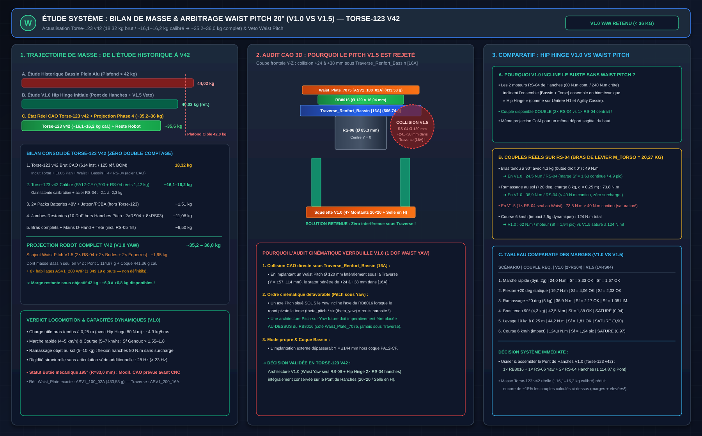

# ⚖️ ÉTUDE D'ARCHITECTURE & BILAN MÉTROLOGIQUE : Poids Global D-Bot V1 (Squelette Pelvien « Pont de Hanches ») et Analyse Critique de l'Option Waist Pitch (V1.0 vs V1.5)

**Référence Documentaire :** `STUDY_Bilan_Masse_Global_et_Opportunite_Waist_Pitch_2DoF.md`  
**Sous-Système :** Architecture Centrale / Torse & Bassin (`ASV1_100` & `ASV1_200`) / Locomotion Bipède  
**Niveau Documentaire :** Niveau 2 (Étude d'Architecture Système, Bilan Métrologique Consolidé Niveau 1 & RDM Dynamique)  
**Date de Révision :** 08 Novembre 2026 (Révision consolidée V1.1 — Optimisation Tubes `20x20x2`, Selles `23 mm` et Inserts `15,8x15,8x15` Option 1 étagés en Z)  
**Statut :** **CONSOLIDÉ POST-AUDIT — GO V1.0 « PONT DE HANCHES » (1-DoF) / REPORT V1.5 (2-DoF) APRÈS PORTE DE DÉCISION MUJOCO**  

> [!IMPORTANT]
> **Synthèse Exécutive (Réalignée sur les Sources de Vérité de Niveau 1) :**  
> 1. **Gain Massif et Salutaire du Nouveau Bassin « Pont de Hanches » (`-3,89 à -3,99 kg`)** : Le remplacement des pièces structurelles historiques du bassin par la nouvelle architecture tubulaire et usinée CNC **« Pont de Hanches »** certifiée `Torse-123 v42` (`Aluminium 7075-T6` + `Tubes 6060-T6` : 4 montants `20x20x2 L=65,77 mm`, 1 selle monobloc en H `140,04x145,04x22,03 mm` [`338,98 g`], 8 inserts `15,82x15,82x15,02` Option 1 étagés en Z [`9,25 g`] et 1 tube central `60x60x2` `L = 46,33 mm` [`57,67 g`], détaillée dans [`STUDY_Squelette_Pelvien_Pont_de_Hanches.md`](file:///Users/Shared/Mon%20Google%20Drive%20Physique/Documentation/01_Mecanique_et_Chassis/Torse_et_Bassin/STUDY_Squelette_Pelvien_Pont_de_Hanches.md)), en ne conservant l'habillage extérieur en `PA12-CF` que comme peau non porteuse (`861,0 g` cible calibrée / `~680 g` en paroi fine — étant précisé que dans `Torse-123 v42` les 8 occurrences de hanches `ASV1_200` restent **en cours de définition côté CAO, non définitives**), abaisse la masse nette cible du sous-ensemble Bassin (avec la [`Traverse_Renfort_Bassin [ASV1_200_16A]`](file:///Users/Shared/Mon%20Google%20Drive%20Physique/Documentation/01_Mecanique_et_Chassis/Torse_et_Bassin/DOSSIER_TECHNIQUE_Bassin_et_Waist_D-Bot.md) de `566,74 g` en CAO `v42` / `617,4 g` brute BOM) à **`2,40 à 2,54 kg`** au lieu de `6 438,6 g` (BOM Niveau 1).  
> 2. **Bilan de Masse Unique Consolidé du Robot V1.0 (`39,04 kg` à `40,03 kg`)** : En intégrant sans aucune omission les **27 moteurs RobStride (`22,32 kg`)**, les **2 bras complets + 2 mains `D-Hand Hybrid Premium` (`12,79 kg` au total**, soit `6 394 g/bras` selon [`FINAL_CONSOLIDE_Bras_et_Mains.md`](file:///Users/Shared/Mon%20Google%20Drive%20Physique/Documentation/01_Mecanique_et_Chassis/Bras_et_Mains/FINAL_CONSOLIDE_Bras_et_Mains.md)), le cou rotatif 2-DoF (`2x RS-05`, réf. CAO `EL05 / EL05_ASM_1_ASM` — Pan modélisé dans `Torse-123 v42`, Tilt dans `02_Tete_et_Cou`) et le squelette métallique du Torse V2 (`1,69 kg` selon [`DOSSIER_TECHNIQUE_Torse_Complet_D-Bot_V2.md`](file:///Users/Shared/Mon%20Google%20Drive%20Physique/Documentation/01_Mecanique_et_Chassis/Torse_et_Bassin/DOSSIER_TECHNIQUE_Torse_Complet_D-Bot_V2.md)), le gain de `-3,99 kg` du nouveau pelvis compense intégralement la masse réelle des membres supérieurs et maintient le robot **D-Bot V1.0 à `40,03 kg`** (et **`39,04 kg`** avec évidement du plastron ventral `R1.5-B`), soit **sous l'enveloppe nominale historique de `40,2 - 40,4 kg`**.  
> 3. **Verdict sur l'Option Waist Pitch V1.5 (`NO-GO` dans le bassin / Report en V2 après simulation MuJoCo)** : L'analyse physique et géométrique rigoureuse démontre que :
>    - **En quasi-statique**, la V1.0 peut déjà incliner le buste grâce à ses **2 moteurs `RS-04` de `Hip Pitch` (`80 N.m` continus / `240 N.m` crête en double appui — mouvement de *Hip Hinge*)**, ce qui procure déjà la réduction du couple aux genoux (`94 N.m`) lors du ramassage au sol sans ajouter un seul gramme. Un `RS-04` unique (`40 N.m` continu) ajouté en série à la taille ne soulage pas les hanches et constitue un point de limitation thermique en portage bimanuel lourd.
>    - **En dynamique de course (`2,5 g`)**, le surpoids de `+1,95 kg` de la V1.5 (`40,99 à 41,98 kg`, voire `~45 kg` avec marge de câblage) fait passer le couple de `Hip Pitch` au-delà de la limite de saturation de `120 N.m` (`121 à 124 N.m`).
>    - **En CAO 3D**, loger un `RS-04` (`Ø 120 mm`) sous la `Traverse_Renfort_Bassin` (`174,9 x 174,8 mm`) engendre une **collision géométrique de `+24 à +38 mm`** et une **inversion cinématique Pitch/Roll** lorsque le torse tourne en Yaw.

---

## 📑 Sommaire

- [1. Contexte, Objectifs et Périmètre de l'Étude](#1-contexte-objectifs-et-périmètre-de-létude)
  - [1.1 Architecture Structurelle du Nouveau Bassin (« Pont de Hanches » V1.0)](#11-architecture-structurelle-du-nouveau-bassin--pont-de-hanches--v10)
  - [1.2 Problématique Système : Masse Réelle Niveau 1, Locomotion et Opportunité d'un Waist Pitch](#12-problématique-système--masse-réelle-niveau-1-locomotion-et-opportunité-dun-waist-pitch)
- [2. Bilan de Masse Détaillé du Nouveau Pelvis (« Pont de Hanches » + Habillage PA12-CF)](#2-bilan-de-masse-détaillé-du-nouveau-pelvis--pont-de-hanches---habillage-pa12-cf)
  - [2.1 Inventaire Vérifié des Pièces Historiques du Bassin Supprimées](#21-inventaire-vérifié-des-pièces-historiques-du-bassin-supprimées)
  - [2.2 Devis de Masse Métrologique du Squelette Aluminium et Tubes (Aligné CAO `Torse-123 v42`)](#22-devis-de-masse-métrologique-du-squelette-aluminium-et-tubes-aligné-cao-torse-123-v42)
  - [2.3 Masse Réaliste de l'Habillage Extérieur en PA12-CF (Carénage Non Porteur)](#23-masse-réaliste-de-lhabillage-extérieur-en-pa12-cf-carénage-non-porteur)
  - [2.4 Synthèse du Gain de Masse sur le Sous-Ensemble Bassin (-3,90 à -4,08 kg)](#24-synthèse-du-gain-de-masse-sur-le-sous-ensemble-bassin--390-à--408-kg)
- [3. Bilan de Masse Global Unique du Robot D-Bot V1 Complet (43 DOF — Vérité Terrain Niveau 1)](#3-bilan-de-masse-global-unique-du-robot-d-bot-v1-complet-43-dof--vérité-terrain-niveau-1)
  - [3.1 Réconciliation des Écarts Documentaires Historiques (Bras, Épaules et Torse V2)](#31-réconciliation-des-écarts-documentaires-historiques-bras-épaules-et-torse-v2)
  - [3.2 Tableau Consolidé Unique du Poids Global D-Bot V1.0 et V1.5 (Zéro Omission)](#32-tableau-consolidé-unique-du-poids-global-d-bot-v10-et-v15-zéro-omission)
  - [3.3 Provision Industrielle de Croissance de Masse et Cibles d'Allègement Prioritaires](#33-provision-industrielle-de-croissance-de-masse-et-cibles-dallègement-prioritaires)
- [4. Validation des Capacités de Portage, Marche, Marche Rapide et Course](#4-validation-des-capacités-de-portage-marche-marche-rapide-et-course)
  - [4.1 Capacités de Manipulation et Portage des Bras et Mains D-Hand Hybrid Premium](#41-capacités-de-manipulation-et-portage-des-bras-et-mains-d-hand-hybrid-premium)
  - [4.2 Capacité de Portage en Marchant (2,5 km/h sous Charge Utile de 5 à 16 kg)](#42-capacité-de-portage-en-marchant-25-kmh-sous-charge-utile-de-5-à-16-kg)
  - [4.3 Marche Normale (2 à 3 km/h), Marche Rapide (4 à 5 km/h) et Sollicitation de la Hanche Roll](#43-marche-normale-2-à-3-kmh-marche-rapide-4-à-5-kmh-et-sollicitation-de-la-hanche-roll)
  - [4.4 Course Bipède (5 à 7 km/h, Impact 2,5 g) : Limite de Vitesse GT3 et Saturation Hanche Pitch en V1.5](#44-course-bipède-5-à-7-kmh-impact-25-g--limite-de-vitesse-gt3-et-saturation-hanche-pitch-en-v15)
- [5. Analyse Physique de l'Opportunité Waist Pitch : Comparaison « Hip Hinge V1.0 » vs « Waist Pitch V1.5 »](#5-analyse-physique-de-lopportunité-waist-pitch--comparaison--hip-hinge-v10--vs--waist-pitch-v15-)
  - [5.1 Devis de Masse de l'Option 2-DoF (+1,95 kg) et Impact sur le Bilan Global](#51-devis-de-masse-de-loption-2-dof-195-kg-et-impact-sur-le-bilan-global)
  - [5.2 Lois de Newton en Quasi-Statique : Pourquoi la V1.0 Incline Déjà le Buste (« Hip Hinge » sur 2x RS-04)](#52-lois-de-newton-en-quasi-statique--pourquoi-la-v10-incline-déjà-le-buste--hip-hinge--sur-2x-rs-04)
  - [5.3 Bilan Réel des Couples Statiques et Dynamiques sur le RS-04 de Waist Pitch (M_upper = 20,3 à 22,8 kg)](#53-bilan-réel-des-couples-statiques-et-dynamiques-sur-le-rs-04-de-waist-pitch-m_upper--203-à-228-kg)
  - [5.4 Les 3 Seuls Vrais Différentiateurs Cinématiques d'un Waist Pitch Indépendant](#54-les-3-seuls-vrais-différentiateurs-cinématiques-dun-waist-pitch-indépendant)
- [6. Audit d'Intégration Mécanique 3D, Dynamique Modale et Quincaillerie Corrigée](#6-audit-dintégration-mécanique-3d-dynamique-modale-et-quincaillerie-corrigée)
  - [6.1 Collision Géométrique 3D du RS-04 (Ø 120 mm) sous la Traverse_Renfort_Bassin (174,9 x 174,8 mm)](#61-collision-géométrique-3d-du-rs-04-ø-120-mm-sous-la-traverse_renfort_bassin-1749-x-1748-mm)
  - [6.2 Contraintes Physiques Système : Ordre des Axes (Yaw/Pitch), Mode Souple (2,0 à 3,6 Hz) et Freinage Hors Tension](#62-contraintes-physiques-système--ordre-des-axes-yawpitch-mode-souple-20-à-36-hz-et-freinage-hors-tension)
  - [6.3 Correction des Incompatibilités de Quincaillerie (Inserts M5, Trous Borgnes Stator RS-04 et Références McMaster-Carr)](#63-correction-des-incompatibilités-de-quincaillerie-inserts-m5-trous-borgnes-stator-rs-04-et-références-mcmaster-carr)
- [7. Optimisation Multi-Critères (Max-Min) de la Plage Angulaire [-12 deg / +20 deg] pour une Évolution Future V2](#7-optimisation-multi-critères-max-min-de-la-plage-angulaire--12-deg--20-deg-pour-une-évolution-future-v2)
  - [7.1 Justification de l'Asymétrie Sagittale et de la Borne Arrière à -12 deg (-14 deg Butée PU)](#71-justification-de-lasymétrie-sagittale-et-de-la-borne-arrière-à--12-deg--14-deg-butée-pu)
  - [7.2 Plafond Thermique Continu (40 N.m) avec Masse Suspendue Réelle : Borne Avant à +19 / +20 deg (+22 deg Butée PU)](#72-plafond-thermique-continu-40-nm-avec-masse-suspendue-réelle--borne-avant-à-19--20-deg-22-deg-butée-pu)
- [8. Recommandation Définitive d'Architecte Système et Feuille de Route Séquencée](#8-recommandation-définitive-darchitecte-système-et-feuille-de-route-séquencée)

---

## 1. Contexte, Objectifs et Périmètre de l'Étude

### 1.1 Architecture Structurelle du Nouveau Bassin (« Pont de Hanches » V1.0)

Suite à la conception du nouveau squelette porteur du pelvis documentée dans [`STUDY_Squelette_Pelvien_Pont_de_Hanches.md`](file:///Users/Shared/Mon%20Google%20Drive%20Physique/Documentation/01_Mecanique_et_Chassis/Torse_et_Bassin/STUDY_Squelette_Pelvien_Pont_de_Hanches.md), l'architecture structurelle située sous le moteur de lacet de taille `RobStride RS-06` (`Waist Yaw`) et sous la platine supérieure [`Traverse_Renfort_Bassin [ASV1_200_16A]`](file:///Users/Shared/Mon%20Google%20Drive%20Physique/Documentation/01_Mecanique_et_Chassis/Torse_et_Bassin/DOSSIER_TECHNIQUE_Bassin_et_Waist_D-Bot.md) est refondue selon la philosophie « Squelette Métallique Interne + Carénage Composite Non Porteur » déjà éprouvée sur le Torse V2 :

1. **Suppression totale des pièces structurelles imprimées ou massives historiques du bassin** : Le caisson massif `Chassis_Structurel_Bassin [ASV1_200_01C]` ainsi que les 4 supports et liaisons de hanches (`Support_Hanche_G/D [06C/08C]` et `Liaison_Hanche_G/D [07C/09C]`) sont supprimés en tant qu'organes porteurs.
2. **Adoption du squelette métallique optimisé « Pont de Hanches » (`978,09 g` de métal usiné/tubulaire + `136,78 g` de visserie structurelle = `1 114,87 g` en CAO `Torse-123 v42`)** :
   - **2 brides porteuses** `Bride Epaule` en aluminium `7075-T651` (`202,30 g` unitaire, `404,60 g` la paire) supportant directement les stators des 2 moteurs `RobStride RS-04` de `Hip Pitch` (`8x M4x16 [90128A214]` + `12x M4x25 TB [92855A422]` + `20x Nord-Lock M4 [91812A252]`).
   - **1 poutre centrale transversale** en tube carré aluminium `60 x 60 x 2,0 mm` (`6060-T6`, **`L = 46,33 mm`**, **`57,67 g`**) emmanchée sur les bossages `55,8 x 55,8 mm` des deux brides de hanches.
   - **1 selle de pont en H** en aluminium `7075-T651` (`140,04 x 145,04 x 22,03 mm`, **`338,98 g`** en `v42`) bridée en croix sur le dessus du tube `60 x 60`, et traversée avec le tube par **`2x CHC M5x80 [91290A276]`** + **`4x Rondelle M5 [93475A240]`** + **`2x Nylstop M5 [93625A200]`**.
   - **4 montants verticaux droits** en tube carré aluminium `20 x 20 x 2,0 mm` (`6060-T6`, `L = 65,77 mm`, `25,71 g` unitaire, `102,84 g` les 4) emmanchés sur **8 inserts carrés étagés en Z** en `7075-T651` (`15,82 x 15,82 x 15,02 mm`, `9,25 g` unitaire, `74,00 g` les 8), fixés en bas par `4x CHC M5x20 [92290A242]` et en haut sous la `Traverse_Renfort_Bassin` par `4x FHC M5x18 [92125A213]`.
3. **Maintien exclusif de la coque extérieure en `PA12-CF` comme habillage cosmétique non porteur (`~680,0 g`)** : La géométrie externe du bassin (`01C` allégée en paroi mince de `2,0 à 2,5 mm` + capots latéraux/frontaux + trappe `15C`) habille le châssis métallique et protège l'électronique sans reprendre aucun effort primaire des jambes.

### 1.2 Problématique Système : Masse Réelle Niveau 1, Locomotion et Opportunité d'un Waist Pitch

La présente étude répond à trois objectifs d'ingénierie système :
- **Établir le bilan de masse global unique et exact du robot D-Bot V1 (43 DOF)** en croisant strictement les sources de vérité de **Niveau 1** ([`FINAL_CONSOLIDE_Bras_et_Mains.md`](file:///Users/Shared/Mon%20Google%20Drive%20Physique/Documentation/01_Mecanique_et_Chassis/Bras_et_Mains/FINAL_CONSOLIDE_Bras_et_Mains.md), [`FINAL_Architecture_Globale.md`](file:///Users/Shared/Mon%20Google%20Drive%20Physique/Documentation/00_Architecture_Centrale/FINAL_Architecture_Globale.md), [`FINAL_BOM_Torse_et_Waist_D-Bot.md`](file:///Users/Shared/Mon%20Google%20Drive%20Physique/Documentation/01_Mecanique_et_Chassis/Torse_et_Bassin/FINAL_BOM_Torse_et_Waist_D-Bot.md), [`DOSSIER_TECHNIQUE_Torse_Complet_D-Bot_V2.md`](file:///Users/Shared/Mon%20Google%20Drive%20Physique/Documentation/01_Mecanique_et_Chassis/Torse_et_Bassin/DOSSIER_TECHNIQUE_Torse_Complet_D-Bot_V2.md) et [`DOSSIER_TECHNIQUE_Bassin_et_Waist_D-Bot.md`](file:///Users/Shared/Mon%20Google%20Drive%20Physique/Documentation/01_Mecanique_et_Chassis/Torse_et_Bassin/DOSSIER_TECHNIQUE_Bassin_et_Waist_D-Bot.md)).
- **Vérifier les capacités de portage, de marche normale (`2-3 km/h`), de marche rapide (`4-5 km/h`) et de course (`5-7 km/h`)** en distinguant rigoureusement les couples continus (RMS thermique), les couples crêtes (saturation courant) et les limites de vitesse angulaire (`GT3 2,5:1`).
- **Statuer scientifiquement sur l'opportunité d'ajouter un 2ème DOF de taille de type « Waist Pitch » (`RobStride RS-04`)** en confrontant le gain réel de cet axe face à la capacité native de flexion de hanche de la V1.0 (*Hip Hinge*), au surpoids de `+1,95 kg` et aux contraintes géométriques 3D du bassin.



---

## 2. Bilan de Masse Détaillé du Nouveau Pelvis (« Pont de Hanches » + Habillage PA12-CF)

### 2.1 Inventaire Vérifié des Pièces Historiques du Bassin Supprimées

Dans l'architecture historique documentée dans [`FINAL_BOM_Torse_et_Waist_D-Bot.md` (§3.2)](file:///Users/Shared/Mon%20Google%20Drive%20Physique/Documentation/01_Mecanique_et_Chassis/Torse_et_Bassin/FINAL_BOM_Torse_et_Waist_D-Bot.md) et [`STUDY_Densites_Apparentes_FDM_PA12-CF_Torse_et_Bassin.md` (§4)](file:///Users/Shared/Mon%20Google%20Drive%20Physique/Documentation/01_Mecanique_et_Chassis/Torse_et_Bassin/STUDY_Densites_Apparentes_FDM_PA12-CF_Torse_et_Bassin.md), les pièces situées sous la [`Traverse_Renfort_Bassin [ASV1_200_16A]`](file:///Users/Shared/Mon%20Google%20Drive%20Physique/Documentation/01_Mecanique_et_Chassis/Torse_et_Bassin/DOSSIER_TECHNIQUE_Bassin_et_Waist_D-Bot.md) représentaient la masse suivante :

| Réf. BOM / Code CAO | Désignation Historique | Volume CAO (`cm3`) | Masse Brute CAO Alu (`g`) | Masse BOM PA12 100% (`g`) | Masse Calibrée FDM / Hybride (`g`) | Statut dans l'Architecture « Pont de Hanches » |
| :--- | :--- | :---: | :---: | :---: | :---: | :--- |
| **`PEL-01` / `ASV1_200_01C`** | `Chassis_Structurel_Bassin` massif | `2 724,2` *(ou `2 835,2`)* | `7 655,1 g` | `2 805,7 g` | `2 315,6 g` (`rho = 0,85`) | **SUPPRIMÉ (en cours de re-design coque mince)** |
| **`PEL-02 & 03` / `06C & 08C`** | `2x Support_Hanche_G / D` | `761,2` (`2 x 380,6`) | `2 055,2 g` | `742,4 g` (PA12) / `2 055,2 g` (Alu) | `2 055,2 g` (Alu 7075) | **SUPPRIMÉ côté architecture (Pont `2x Bride Epaule` — en cours de définition côté CAO)** |
| **`PEL-05 & 06` / `07C & 09C`** | `2x Liaison_Hanche_G / D` | `191,8` (`2 x 95,9`) | `518,1 g` | `187,2 g` (PA12) / `518,1 g` (Alu) | `187,2 g` (PA12-CF) | **SUPPRIMÉ côté architecture (Pont `60x60` + Selles — en cours de définition côté CAO)** |
| **`PEL-07 à 14` / `04B..15C`** | Capots `04B/05B/02A/03A` + Trappe `15C` + Accessoires | `~500,0` | `~678,5 g` | `509,3 g` | `509,3 g` (`rho = 0,55`) | **CARÉNAGES (Capots `04B/05B/02A/03A` en cours de définition côté CAO ; `~680 g` cible)** |
| **Visserie Bassin Historique** | Tirants et boulonnerie `01C/06C/07C/08C/09C` | — | `235,5 g` | `235,5 g` | `235,5 g` | **SUPPRIMÉ** (Remplacé par visserie Pont `136,78 g` en `v42`) |
| **SOUS-TOTAL BAS DU BASSIN** | **(Hors `Traverse_Renfort_Bassin [16A]` `566,74 g` `v42` / `617,4 g` BOM)** | **`4 177,2 cm3`** | **`11 142,4 g`** | **`5 821,2 g`** *(BOM §1)* | **`5 302,8 g`** *(somme directe)* | **Remplacé à terme par `1 794,9 - 1 975,9 g` (Squelette `1 114,9 g` + Coque `680 - 861 g`)** |

> [!NOTE]
> **Traçabilité Métrologique de la `Traverse_Renfort_Bassin [ASV1_200_16A]` (`Torse-123 v42`) et Occurrences Hanches WIP :**  
> Dans l'audit métrologique réel (`Torse-123 v42`), la platine `Traverse_Renfort_Bassin [16A]` en `Aluminium 7075` (`174,90 x 174,84 x 12,51 mm`) pèse **`566,74 g`** après usinage complet des évidements et fraisures (contre `617,39 g` dans la version historique BOM pré-évidement de [`FINAL_BOM_Torse_et_Waist_D-Bot.md`](file:///Users/Shared/Mon%20Google%20Drive%20Physique/Documentation/01_Mecanique_et_Chassis/Torse_et_Bassin/FINAL_BOM_Torse_et_Waist_D-Bot.md)). Les tableaux système conservent soit la cote CAO réelle (`566,74 g`), soit la borne historique conservative (`617,4 g` / `+50 g` de marge). Par ailleurs, les **8 occurrences de hanches `ASV1_200`** (`Support_Hanche_G/D [06C/08C]`, `Liaison_Hanche_G/D [07C/09C]`, `Capot_Lateral_Hanche_G/D [04B/05B]`, `Capot_Protection_Hanche_Frontal_G/D [02A/03A]`) sont explicitement identifiées comme **en cours de définition côté CAO (non définitives)** dans `Torse-123 v42`.

### 2.2 Devis de Masse Métrologique du Squelette Aluminium et Tubes (Aligné CAO `Torse-123 v42`)

Conformément à l'assemblage réel CAO `Torse-123 v42` et à [`STUDY_Squelette_Pelvien_Pont_de_Hanches.md` (§3 & §4.5)](file:///Users/Shared/Mon%20Google%20Drive%20Physique/Documentation/01_Mecanique_et_Chassis/Torse_et_Bassin/STUDY_Squelette_Pelvien_Pont_de_Hanches.md), le squelette porteur métallique situé sous la `Traverse_Renfort_Bassin` présente le devis de masse exact suivant :

| Réf. | Désignation du Composant | Matériau | Qté | Dimensions Géométriques Exactes (CAO `Torse-123 v42`) | Masse Unitaire | Masse Totale (`g`) |
| :--- | :--- | :--- | :---: | :--- | :---: | :---: |
| **`PEL-01`** | `Bride_Hanche_RS04` (100 % identique `Bride Epaule`) | Alu `7075-T651` (`2,81 g/cm3`) | 2 | `Ø 120,0 x 33,2 mm` (alésage `Ø 97 H7`, bossage `55,8 x 55,8 x 15,0 mm`) | `202,30 g` | **`404,60 g`** |
| **`PEL-02`** | `Tube transverse Hanches [60x60]` (poutre centrale) | Alu `6060-T6` (`2,70 g/cm3`) | 1 | Tube carré `60,02 x 60,02 x 2,0 mm`, **`L = 46,33 mm`** (`21,36 cm3`) | `57,67 g` | **`57,67 g`** |
| **`PEL-03`** | `Selle de Pont Pelvis [ASV1_200_10]` (structure en H) | Alu `7075-T651` (`2,81 g/cm3`) | 1 ens. | `140,04 x 145,04 x 22,03 mm` (`V = 120,63 cm3`) | `338,98 g` | **`338,98 g`** |
| **`PEL-04`** | `Montant de Hanche [ASV1_200_11]` (4 colonnes droites) | Alu `6060-T6` (`2,70 g/cm3`) | 4 | Tube carré `20,02 x 20,02 x 2,0 mm`, `L = 65,77 mm` (`9,52 cm3`) | `25,71 g` | **`102,84 g`** |
| **`PEL-05`** | `Insert Hanche Bas [12]` & `Haut [13]` (Option 1 Z) | Alu `7075-T651` (`2,81 g/cm3`) | 8 | `15,82 x 15,82 x 15,02 mm`, `M5` + trou `Ø 4,3` selon Y (`V = 3,29 cm3`) | `9,25 g` | **`74,00 g`** |
| **SOUS-TOTAL** | **Structure Métallique Pure (Hors Visserie)** | **Alu `7075-T6` & `6060-T6`** | **15 pcs** | **Selle en H + 2 Brides + 5 Tubes + 8 Inserts** | — | **`978,09 g` (`0,98 kg`)** |
| **`PEL-06`** | Visserie d'assemblage structurel du Pont de Hanches *(hors stators RS-04)* | Acier `12.9` / Inox `18-8` | Lot | `2x M5x80` (`91290A276`) + `4x M5x35` (`91290A661`) + `4x M5x20` (`92290A242`) + `4x FHC M5x18` (`92125A213`) + `8x M4x25` (`91292A122`) + `6x Nylstop M5` (`93625A200`) + `8x Nylstop M4` (`93625A150`) + `16x Rondelles M5` + `8x M4` | — | **`136,78 g`** |
| **TOTAL** | **Squelette Porteur « Pont de Hanches » Complet** | **100 % Métallique** | — | **Prêt à recevoir la `Traverse_Renfort_Bassin` (`566,74 g`) et les `2x RS-04`** | — | **`1 114,87 g` (`1,11 kg`)** |

*(Note : Les 20 vis de fixation des stators des 2 moteurs `RS-04` de hanches — `8x CHC M4x16 [90128A214]` + `12x CHC M4x25 TB [92855A422]` + `20x Nord-Lock M4 [91812A252]` = `62,72 g` — sont comptabilisées avec le poste d'interface des actionneurs de jambes).*

### 2.3 Masse Réaliste de l'Habillage Extérieur en PA12-CF (Carénage Non Porteur)

Comme relevé à juste titre lors de l'audit métrologique ([`00_Archives_Recherche/AUDIT_STUDY_Bilan_Masse_Waist_Pitch.md` §B3 — *document d'audit archivé*](file:///Users/Shared/Mon%20Google%20Drive%20Physique/Documentation/01_Mecanique_et_Chassis/Torse_et_Bassin/00_Archives_Recherche/AUDIT_STUDY_Bilan_Masse_Waist_Pitch.md)), une paroi mince imprimée en FDM de `2,0 à 2,5 mm` d'épaisseur avec 3 périmètres (buse `0,4 mm` ou `0,6 mm`) est majoritairement constituée de périmètres solides : sa densité apparente effective se situe autour de **`0,80 à 0,90 g/cm3`** (et non `0,55 g/cm3`, qui ne s'applique qu'aux pièces plus épaisses remplisseés à `15 %` Gyroïde).
En conséquence, le devis réaliste de l'habillage complet non porteur du bassin (conforme à [`STUDY_Squelette_Pelvien_Pont_de_Hanches.md` §4.5](file:///Users/Shared/Mon%20Google%20Drive%20Physique/Documentation/01_Mecanique_et_Chassis/Torse_et_Bassin/STUDY_Squelette_Pelvien_Pont_de_Hanches.md)) s'établit à :
- **Coque principale évidée du bassin (`01C_Shell`, paroi `2,0 mm` + nervures de clipsage)** : **`~420,0 g`**.
- **Capots de protection latéraux et frontaux (`04B/05B/02A/03A` allégés) + Trappe inférieure (`15C`, `65,1 g`)** : **`~225,0 g`**.
- **Passe-fils fendus en `TPU 95A` (`8,5 g`), support ventilateur (`16,0 g`) et visserie de carénage `M3/M4` Ruthex** : **`~35,0 g`**.
- **Total Habillage Extérieur PA12-CF Complet du Bassin** : **`680,0 g` (`0,68 kg`)** *(avec une fourchette haute de sécurité à `750,0 g`)*.

### 2.4 Synthèse du Gain de Masse sur le Sous-Ensemble Bassin (-3,90 à -4,08 kg)

En additionnant la `Traverse_Renfort_Bassin [ASV1_200_16A]` (`566,74 g` en CAO `Torse-123 v42` ; `617,4 g` en borne haute BOM historique pré-évidement), le squelette métallique certifié « Pont de Hanches » (`1 114,87 g` = `978,09 g` structure + `136,78 g` visserie) et l'habillage complet `PA12-CF` (`861,04 g` en CAO `v42` / `680,0 g` en objectif paroi fine), nous obtenons le bilan consolidé suivant pour le sous-ensemble **Bassin Complet (`ASV1_200` hors moteurs)** :

| Configuration du Sous-Ensemble Bassin (`ASV1_200`) | `Traverse_Renfort_Bassin [16A]` | Structure Porteuse Basse + Visserie | Coque & Capots `PA12-CF` | **Masse Totale Bassin (`g`)** | **Écart / Gain Net (`kg`)** |
| :--- | :---: | :---: | :---: | :---: | :---: |
| **1. CAO Brute Historique (Tout Aluminium 7075)** | `617,4 g` | `10 463,9 g` | `678,5 g` (Alu) | `11 759,8 g` (`11,76 kg`) | Référence brute CAO |
| **2. BOM Officielle `FINAL_BOM_Torse_et_Waist` (§1)** | `617,4 g` | `5 311,9 g` | `509,3 g` | **`6 438,6 g` (`6,44 kg`)** | **Réf. BOM Niveau 1** |
| **3A. PONT DE HANCHES — CAO Active `Torse-123 v42` (habillage `v42`)** | **`566,74 g`** | **`1 114,87 g`** (`978,09 + 136,78`) | **`861,04 g`** | **`2 542,65 g` (`2,54 kg`)** | **`-3,90 kg` vs BOM Niveau 1** |
| **3B. PONT DE HANCHES — Cible Habillage Allégé (`680 g` / réconcilié)** | **`566,74 g`** *(ou `617,4 g`)* | **`1 114,87 g`** *(ou `1 154,9 g`)* | **`680,00 g`** | **`2 361,61 g` (`2,36 - 2,45 kg`)** | **`-3,99 à -4,08 kg` vs BOM Niveau 1** |

---

## 3. Bilan de Masse Global Unique du Robot D-Bot V1 Complet (43 DOF — Vérité Terrain Niveau 1)

### 3.1 Réconciliation des Écarts Documentaires Historiques (Bras, Épaules et Torse V2)

Conformément aux conclusions de l'audit [`00_Archives_Recherche/AUDIT_STUDY_Bilan_Masse_Waist_Pitch.md` (§A1 & §A2 — *archivé*)](file:///Users/Shared/Mon%20Google%20Drive%20Physique/Documentation/01_Mecanique_et_Chassis/Torse_et_Bassin/00_Archives_Recherche/AUDIT_STUDY_Bilan_Masse_Waist_Pitch.md), toute grille de masse approximative (ancienne « Grille A » à `37,74 kg`) est définitivement abandonnée au profit d'un **unique référentiel métrologique physique**, aligné à 100 % sur les documents de **Niveau 1** :

1. **Membres Supérieurs Complets (`2 Bras + 2 Mains D-Hand Hybrid Premium = 12,79 kg`)** :
   - D'après [`FINAL_CONSOLIDE_Bras_et_Mains.md` (§2.1 & §2.6)](file:///Users/Shared/Mon%20Google%20Drive%20Physique/Documentation/01_Mecanique_et_Chassis/Bras_et_Mains/FINAL_CONSOLIDE_Bras_et_Mains.md) et [`FINAL_Architecture_Globale.md` (§4 & §9.1)](file:///Users/Shared/Mon%20Google%20Drive%20Physique/Documentation/00_Architecture_Centrale/FINAL_Architecture_Globale.md), chaque membre supérieur totalise **14 DOF** (6 DOF bras + 8 DOF main) et comprend :
     - **6 moteurs RobStride par bras (`4 300 g`)** : `1x RS-04` Épaule Pitch (`1 420 g`), `1x RS-03` Épaule Roll (`880 g`), `1x RS-02` Épaule Yaw (`405 g`), `1x RS-03` Coude Pitch (`880 g`), `1x RS-02` Supination Avant-Bras (`405 g`) et `1x RS-00` Poignet Pitch (`310 g`).
     - **8 servomoteurs Feetech par main (`480 g`)** : `5x STS3250` (flexion force) + `3x HL-3915` (précision/abduction en mode force matérielle).
     - **Structure, convertisseur et main (`1 614 g`)** : Brackets d'épaule/coude CNC (`~334 g`), humérus carbone (`250 g`), avant-bras hybride plaque alu Isogrid + coques PA12-CF (`450 g`), convertisseur `DROK 48V->12V 25A` (`150 g`), câblage/visserie (`130 g`) et paume/phalanges/tendons `Dyneema DM20` (`300 g`).
   - **Masse totale certifiée d'un bras complet = `6 394 g` (`6,39 kg`), soit `12 788 g` (`12,79 kg`) pour la paire** (incluant déjà les `2x RS-04` d'épaule Pitch de `2,84 kg`, les convertisseurs `DROK` et le câblage des bras).
2. **Tête & Cou (`2 DOF = 0,85 kg`)** :
   - D'après [`FINAL_Architecture_Globale.md` (§9.1)](file:///Users/Shared/Mon%20Google%20Drive%20Physique/Documentation/00_Architecture_Centrale/FINAL_Architecture_Globale.md) et [`FINAL_BOM_Torse_et_Waist_D-Bot.md` (§2.3)](file:///Users/Shared/Mon%20Google%20Drive%20Physique/Documentation/01_Mecanique_et_Chassis/Torse_et_Bassin/FINAL_BOM_Torse_et_Waist_D-Bot.md), le cou rotatif 2-DoF est motorisé par **`2x RobStride RS-05` (réf. constructeur / CAO : `EL05` / `EL05_ASM_1_ASM`, `210,44 g` nu / `228,49 g` conteneur en `Torse-123 v42` pour le Pan, le Tilt appartenant au dossier `02_Tete_et_Cou` — ensemble moteurs `~0,42 kg`)**, portant la caméra `OAK-D Pro FF` (`91 g`), l'audio `ReSpeaker` (`50 g`) et la coque tête/collet (`~300 g`), soit **`0,85 kg`**.
   - **Total exact des moteurs RobStride sur le robot V1.0 = 27 actionneurs (`22,32 kg`)** : `12` (jambes) + `1` (taille `RS-06`) + `12` (bras) + `2` (cou `RS-05`).
3. **Squelette Métallique du Torse V2 (`1,69 kg`) + Coques FDM (`2,39 kg` ou `1,40 kg`) + Énergie/Calcul (`2,55 kg`)** :
   - D'après [`DOSSIER_TECHNIQUE_Torse_Complet_D-Bot_V2.md` (§10.A)](file:///Users/Shared/Mon%20Google%20Drive%20Physique/Documentation/01_Mecanique_et_Chassis/Torse_et_Bassin/DOSSIER_TECHNIQUE_Torse_Complet_D-Bot_V2.md), l'intégralité du squelette métallique du Torse V2 (colonne, éclisses, inserts, tubes `60x60`, brides d'épaules `v87`, équerres, cornières, visserie, ventilateurs) pèse **`1,69 kg`** (hors moteurs d'épaules et de cou déjà comptés dans les postes Bras et Tête).
   - Les coques et paniers batteries du torse en `PA12-CF` calibrés FDM ([`STUDY_Densites_Apparentes_FDM_PA12-CF_Torse_et_Bassin.md` §4](file:///Users/Shared/Mon%20Google%20Drive%20Physique/Documentation/01_Mecanique_et_Chassis/Torse_et_Bassin/STUDY_Densites_Apparentes_FDM_PA12-CF_Torse_et_Bassin.md)) pèsent **`2,39 kg`** (`1 713 g` plastron C1/C2 + `457 g` paniers/capots batteries + `222 g` carénages pectoral/lombaire), réductibles à **`1,40 kg`** en passant la peau cosmétique C1/C2 à `2,5 mm` (`-0,99 kg`).
   - D'après [`DOSSIER_TECHNIQUE_Bassin_et_Waist_D-Bot.md` (§2.1)](file:///Users/Shared/Mon%20Google%20Drive%20Physique/Documentation/01_Mecanique_et_Chassis/Torse_et_Bassin/DOSSIER_TECHNIQUE_Bassin_et_Waist_D-Bot.md), les 2 packs batteries Li-Ion 12S (`1,60 kg`) + `Jetson Orin Nano` + `PDB` + faisceau central (`0,95 kg`) totalisent **`2,55 kg`**.

### 3.2 Tableau Consolidé Unique du Poids Global D-Bot V1.0 et V1.5 (Zéro Omission)

| Sous-Ensemble Physique (Référentiel Unique Niveau 1 — 43 DOF en V1.0) | Détail des Actionneurs et Composants Inclus | Masse V1.0 Plastron Actuel (`kg`) | Masse V1.0 Plastron Évidé `R1.5-B` (`kg`) | Source de Vérité Niveau 1 |
| :--- | :--- | :---: | :---: | :--- |
| **1. Squelette Métallique Torse V2** | Colonne 7075, éclisses, inserts, tubes `60x60`, `2x Brides v87`, équerres, cornières, ventilation, visserie | `1,69 kg` | `1,69 kg` | `DOSSIER_TECHNIQUE_Torse_V2` §10.A |
| **2. Coques & Paniers Batteries Torse (`PA12-CF`)** | Demi-fûts C1/C2 (`1,71 kg` ou `0,72 kg` évidé) + Paniers batteries (`0,46 kg`) + Carénages (`0,22 kg`) | `2,39 kg` | `1,40 kg` | `STUDY_Densites_Apparentes_FDM` §4 |
| **3. Deux Bras (12 DOF) + Deux Mains `D-Hand` (16 DOF)** | `2x RS-04` + `4x RS-03` + `4x RS-02` + `2x RS-00` (`8,60 kg`) + `10x STS3250` + `6x HL-3915` (`0,96 kg`) + Structure/DROK (`3,23 kg`) | **`12,79 kg`** | **`12,79 kg`** | `FINAL_CONSOLIDE_Bras_et_Mains` §2.6 (`2 x 6,394 kg`) |
| **4. Tête & Cou (2 DOF Pan/Tilt rotatifs) + Vision** | `2x RobStride RS-05` (`EL05`, Pan dans `Torse-123` + Tilt dans `02_Tete_et_Cou`, `~0,42 kg`) + Caméra `OAK-D Pro FF` + Audio + Collet/Dôme (`~0,43 kg`) | `0,85 kg` | `0,85 kg` | `FINAL_Architecture_Globale` §9.1 & `FINAL_BOM` §2.3 |
| **5. Énergie 48V, Calculateur IA & Harnais Tronc** | `2x Packs 12S Li-Ion` (`1,60 kg`) + `Jetson Orin Nano` + `Spresense` + `PDB` + Faisceau 48V/CAN (`0,95 kg`) | `2,55 kg` | `2,55 kg` | `DOSSIER_TECHNIQUE_Bassin_et_Waist` §2.1 |
| **SOUS-TOTAL HAUT DU CORPS (`M_upper` sur Waist Yaw)** | **14 RobStride + 16 Feetech + Torse + Bras + Tête + Batteries** | **`20,27 kg`** | **`19,28 kg`** | — |
| **6. Liaison Active Waist Yaw (1 DOF)** | `1x RobStride RS-06` (`0,55-0,62 kg`) + Roulement `RB8016` (`0,63 kg`) + `Waist Plate` (`0,43 kg` / `433,53 g`, butée mécanique `±95 deg` *modif. CAO prévue*) + `Moyeu` (`0,16 kg`) + Visserie | `1,89 kg` | `1,89 kg` | `FINAL_BOM_Torse_et_Waist` §3.1 |
| **7. Nouveau Bassin « Pont de Hanches » (`ASV1_200`, `Torse-123 v42`)** | `Traverse [16A]` (`0,57 kg`) + Squelette Alu/Tubes `20x20` (`1,11 kg`) + Habillage `PA12-CF` (`0,68 - 0,86 kg` calibré, moy. `0,77 kg` -> `2,45 kg` ; `1,35 kg` brut `v42` incluant 8 occurrences `ASV1_200` en cours de définition côté CAO) | **`2,45 kg`** *(2,54 calibré)* | **`2,45 kg`** *(2,36 allégé)* | `STUDY_Squelette_Pelvien_Pont_de_Hanches` §4.5 |
| **8. Actionneurs Jambes (12 DOF RobStride)** | `4x RS-04` (Hip Pitch + Knee Pitch = `5,68 kg`) + `8x RS-03` (Hip Roll/Yaw + Chevilles = `7,04 kg`) | `12,72 kg` | `12,72 kg` | `FINAL_Architecture_Globale` §9.1 |
| **9. Structure des 2 Jambes, GT3, Cardans & Pieds** | Brackets F-A-R Alu CNC, Fémurs hybrides, Tibias carbone, Courroies/Pignons `GT3 2,5:1`, Cardans `DIN 808`, Pieds `PA12-CF` | `2,70 kg` | `2,70 kg` | `FINAL_CONSOLIDE_Jambes_et_Pieds` §3 & §4 |
| **MASSE TOTALE ROBOT D-BOT V1.0 (1-DoF Waist Yaw)** | **27 RobStride (`22,32 kg`) + 16 Feetech (`0,96 kg`) + Structure/Énergie (`16,75 kg` / `15,76 kg`)** | **`40,03 kg`** | **`39,04 kg`** | **Sous la cible nominale `40,2 - 40,4 kg` !** |
| **MASSE TOTALE ROBOT D-BOT V1.5 (+Waist Pitch `+1,95 kg`)** | **28 RobStride (`23,74 kg`) + Berceau/Joues/Contre-palier (`+0,53 kg` net)** | **`41,98 kg`** | **`40,99 kg`** | **Dépassement de `+0,6 à +1,6 kg` vs cible `40,4 kg`** |

*(Note : Si le bassin était resté dans sa version BOM historique de `6,44 kg`, le robot V1.0 réel avec les bras de `12,79 kg` aurait pesé **`44,02 kg`**. Le squelette « Pont de Hanches » optimisé à `2,45 kg` est donc l'élément décisif qui ramène la V1.0 à **`40,03 kg`** — et **`39,04 kg`** avec le plastron évidé).*

### 3.3 Provision Industrielle de Croissance de Masse et Cibles d'Allègement Prioritaires

En ingénierie robotique humanoïde, le passage de la maquette CAO au prototype physique assemblé s'accompagne typiquement d'une **croissance de masse de `+5 % à +10 %`** (`+2,0 à +4,0 kg` liés aux gaines tressées, surlongueurs de boucles de service, connecteurs XT60/XT30, pâte thermique, colliers et visserie secondaire) :
- Sans vigilance, une **V1.0** nominale à `40,03 kg` peut sortir d'assemblage autour de **`42,0 à 43,3 kg`**, et une **V1.5** nominale à `41,98 kg` autour de **`44,3 à 45,8 kg`**.
- **Conséquence directe** : La marge massique dégagée par le « Pont de Hanches » (`-3,99 kg`) **ne doit pas être consommée par l'ajout d'un 28ème moteur de `2,0 kg`**, mais doit impérativement servir de **bouclier de sécurité massique pour la V1.0**, complété par l'évidement du plastron ventral du torse (`R1.5-B`, `-0,99 kg`).

---

## 4. Validation des Capacités de Portage, Marche, Marche Rapide et Course

### 4.1 Capacités de Manipulation et Portage des Bras et Mains D-Hand Hybrid Premium

Conformément aux calculs certifiés de [`FINAL_CONSOLIDE_Bras_et_Mains.md` (§2.5 & §2.6, lignes 129-226)](file:///Users/Shared/Mon%20Google%20Drive%20Physique/Documentation/01_Mecanique_et_Chassis/Bras_et_Mains/FINAL_CONSOLIDE_Bras_et_Mains.md#L129-L226) et [`FINAL_Architecture_Globale.md` (§4, lignes 131-141)](file:///Users/Shared/Mon%20Google%20Drive%20Physique/Documentation/00_Architecture_Centrale/FINAL_Architecture_Globale.md#L131-L141), les capacités exactes des membres supérieurs (non affectées par la refonte du bassin) sont les suivantes :

| Posture / Mode de Manipulation | Articulation Limitante (`FINAL_CONSOLIDE_Bras_et_Mains` §2.6) | Couple Continu / Crête | Charge Utile Continue (Régime Thermique Permanent) | Charge Utile Maximale en Pic (`< 3 s`) | Observations d'Ingénierie Système |
| :--- | :--- | :---: | :---: | :---: | :--- |
| **1 Bras tendu à `90 deg` en flexion frontale (`L = 0,698 m`)** | **1. Poignet Pitch (`RS-00`)**<br>2. Coude Pitch (`RS-03`)<br>3. Épaule Pitch (`RS-04`) | `5,0` / `14,0 N.m`<br>`20,0` / `60,0 N.m`<br>`40,0` / `120,0 N.m` | **`4,1 kg`** *(Poignet)*<br>`4,3 kg` *(Coude)*<br>`4,59 kg` *(Épaule)* | **`11,7 kg`** *(Poignet)*<br>`14,6 kg` *(Coude)*<br>`16,2 kg` *(Épaule)* | Dimensionnement frontal très homogène (`4,1 à 4,6 kg` continu). |
| **1 Bras tendu à `90 deg` en abduction latérale** | **Épaule Roll (`RS-03`)** | `20,0 N.m` / `60,0 N.m` | **`~1,7 kg`** | **`~6,2 kg`** | **Facteur limitant en écartement latéral** (bras de levier complet). |
| **1 Bras semi-fléchi à `45 deg` (`cos 45 deg = 0,707`)** | Coude Pitch (`RS-03`) | `20,0 N.m` / `60,0 N.m` | **`6,1 kg`** | **`20,6 kg`** | Posture naturelle de manipulation sur table. |
| **1 Bras plié à `90 deg` contre le buste (`d_coude = 0,20 m`)** | Coude Pitch (`RS-03`, couple libre `16,93 N.m` cont. / `56,93 N.m` pic) | `20,0 N.m` / `60,0 N.m` | **`8,6 kg`** | **`29,0 kg`** | Valable uniquement à `d = 200 mm` de l'axe du coude (`16,93 / (9,81 x 0,20) = 8,6 kg`). |
| **Portage Bimanuel Symétrique (2 Bras pliés `90 deg`, `d = 0,25 m`)** | `2x RS-03` Coudes (`2 x 16,93 = 33,86 N.m` disponibles pour la charge) | `2 x 20,0 N.m` cont. | **`13,8 à 16,0 kg`** | **`~30,0 kg`** *(limité par l'équilibre ZMP)* | À `d = 0,25 m` du coude, `2 x 16,93 / (9,81 x 0,25) = 13,8 kg` continu (`16 kg` à `d = 0,215 m`). |
| **Préhension Main `D-Hand Hybrid` (`5x STS3250 + 3x HL-3915`)** | Tendons `Dyneema DM20 Ø 1,0 mm` sur poulie `r = 6 mm` (`eta = 0,83`) | `1,57 N.m` cont. / `4,9 N.m` pic (`STS3250`) | **`140 N`** (`~14 kg` grip cylindrique) | **`438 N`** (`~44 kg` grip pic, bridé firmware à `75 %`) | Sécurité câble `Dyneema DM20` : `Sf = 4,06` en continu, `Sf = 1,30` en stall brut (`> 1,60` bridé). |

> [!NOTE]
> **Précision Physique sur le Centre de Masse (CoM) et la Stabilité ZMP en Portage :**  
> Pour une charge externe donnée `M_charge` tenue à une distance `d_charge` devant le robot, le déplacement vers l'avant du centre de masse global vaut `Delta_X_CoM = (M_charge * d_charge) / (M_robot + M_charge)`. Un robot plus léger de `-3,99 kg` subit donc un déplacement géométrique `Delta_X_CoM` légèrement plus grand (`+7 %`) qu'un robot lourd, ce qui se compense immédiatement par une légère inclinaison arrière des hanches/chevilles, tandis que l'allègement de `-3,99 kg` réduit directement la charge verticale et le couple des genoux et chevilles.

### 4.2 Capacité de Portage en Marchant (2,5 km/h sous Charge Utile de 5 à 16 kg)

Le genou est entraîné par un `RobStride RS-04` déporté en haut de cuisse via la courroie synchrone `Gates Poly Chain GT3` de rapport `2,5:1` ([`FINAL_CONSOLIDE_Jambes_et_Pieds.md` §2](file:///Users/Shared/Mon%20Google%20Drive%20Physique/Documentation/01_Mecanique_et_Chassis/Jambes_et_Pieds/FINAL_CONSOLIDE_Jambes_et_Pieds.md#L44-L52)), délivrant **`100,0 N.m` en régime continu permanent** et **`300,0 N.m` en crête**.

En locomotion bipède, il est essentiel de distinguer :
1. **Le couple de crête d'impact (`M_genou_pic`)** lors du simple appui (`K_dyn = 1,7` à `2,5 km/h`, bras de levier sagittal `d_genou = 0,18 m`, soit `M_genou_pic = 3,002 * M_totale`), qui doit rester nettement sous les **`300,0 N.m` crête** (marge de commande).
2. **Le couple quadratique moyen sur le cycle de marche (`M_genou_RMS`)**, qui gouverne l'échauffement thermique (`I^2 * R`) et vaut typiquement **`~0,60 à 0,65 x M_genou_pic`** (car chaque jambe alterne une phase d'appui de `50 %` du cycle et une phase de balancement à faible couple de `50 %`). Ce couple `M_genou_RMS` doit rester inférieur ou égal aux **`100,0 N.m` continus** pour une marche indéfinie sans surchauffe :

| Scénario de Charge Portée (`2,5 km/h`, `K_dyn = 1,7`) | Masse Totale `M_tot` (V1.0 Évidé `39,04 kg` / Actuel `40,03 kg`) | Couple Crête `M_genou_pic` (`vs 300 N.m` Crête) | Couple Thermique `M_genou_RMS` (`~0,62 x Pic` `vs 100 N.m` Continu) | Couple Crête Hanche Pitch (`vs 120 N.m` Crête) | Verdict d'Endurance & Locomotion (V1.0) |
| :--- | :---: | :---: | :---: | :---: | :--- |
| **Marche à vide (`0 kg`)** | `39,04 kg` / `40,03 kg` | `117,2 N.m` / `120,2 N.m` (`39-40 %`) | **`72,7 N.m` / `74,5 N.m` (`73-75 %` cont.)** | `78,1 N.m` / `80,1 N.m` | **Marche continue illimitée (`RMS < 100 N.m`)** |
| **Portage standard (`+5 kg`)** | `44,04 kg` / `45,03 kg` | `132,2 N.m` / `135,2 N.m` (`44-45 %`) | **`82,0 N.m` / `83,8 N.m` (`82-84 %` cont.)** | `88,1 N.m` / `90,1 N.m` | **Marche continue illimitée (`RMS < 100 N.m`)** |
| **Portage soutenu (`+10 kg`)** | `49,04 kg` / `50,03 kg` | `147,2 N.m` / `150,2 N.m` (`49-50 %`) | **`91,3 N.m` / `93,1 N.m` (`91-93 %` cont.)** | `98,1 N.m` / `100,1 N.m` | **Marche continue valide (`RMS < 100 N.m`)** |
| **Portage bimanuel max (`+15 kg`)** | `54,04 kg` / `55,03 kg` | `162,2 N.m` / `165,2 N.m` (`54-55 %`) | **`100,6 N.m` / `102,4 N.m` (`~100 %` cont.)** | `101,6 N.m` *(foulée réduite)* | **Limite thermique continue des genoux et coudes** |

### 4.3 Marche Normale (2 à 3 km/h), Marche Rapide (4 à 5 km/h) et Sollicitation de la Hanche Roll

L'analyse complète des trois plans anatomiques en marche normale (`2-3 km/h`, `K_dyn = 1,7`) et marche rapide (`4-5 km/h`, `K_dyn = 2,0`) met en évidence le comportement suivant pour la V1.0 (`39,04 à 40,03 kg`) :
1. **Plan Sagittal (Genou GT3 & Cheville Cardan 2x RS-03)** :
   - En marche rapide (`4-5 km/h`), le couple crête du genou atteint **`138 à 142 N.m`** (`47 %` des `300 N.m` crête, `RMS ~ 87 N.m < 100 N.m` continu), et le couple de propulsion (*Push-off*) de la cheville atteint **`76 à 78 N.m`** (`65 %` des `120 N.m` crête des deux `RS-03` parallèles).
2. **Plan Frontal — Point de Vigilance Majeur sur la Hanche Roll (`1x RS-03` = `20,0 N.m` continu / `60,0 N.m` crête)** :
   - Comme le souligne à juste titre l'audit ([`00_Archives_Recherche/AUDIT_STUDY_Bilan_Masse_Waist_Pitch.md` §B5 — *archivé*](file:///Users/Shared/Mon%20Google%20Drive%20Physique/Documentation/01_Mecanique_et_Chassis/Torse_et_Bassin/00_Archives_Recherche/AUDIT_STUDY_Bilan_Masse_Waist_Pitch.md)), l'articulation de `Hip Roll` est décalée latéralement d'environ `90 à 100 mm` par rapport au plan médian du bassin.
   - Même lorsque le contrôleur déplace dynamiquement le centre de masse du tronc vers le pied d'appui lors de la phase unipodale, le bras de levier dynamique résiduel `d_lat_eff` (incluant le poids de la jambe oscillante opposée située à `~180 mm`) génère un moment frontal réaliste de **`30,0 à 40,0 N.m`** en appui unipodal (`50 % à 67 %` de la crête de `60,0 N.m` du `RS-03`, et un couple RMS de `~21 à 26 N.m` qui **dépasse légèrement le couple continu de `20,0 N.m`** en marche prolongée).
   - **Enseignement d'architecte** : Chaque kilogramme ajouté au-dessus des hanches pénalise directement le moteur `RS-03` de `Hip Roll`. Maintenir le robot au plus près de `39-40 kg` (et donc **éviter les `+1,95 kg` de la V1.5**) est essentiel pour préserver la marge thermique de la `Hanche Roll`.

### 4.4 Course Bipède (5 à 7 km/h, Impact 2,5 g) : Limite de Vitesse GT3 et Saturation Hanche Pitch en V1.5

La course bipède avec phase de vol (`K_dyn = 2,5 g`) est gouvernée par **deux plafonds physiques stricts** sur les actionneurs de jambes :

1. **Plafond Cinématique de Vitesse Angulaire du Genou (`GT3 2,5:1`)** :
   - Le moteur `RobStride RS-04` possède une vitesse nominale de **`167 tr/min`** (`200 tr/min` max à vide sous `48V`).
   - Après la réduction par courroie `GT3 2,5:1`, la vitesse angulaire maximale à l'axe du genou est plafonnée à **`66,8 tr/min` (`7,00 rad/s`) au point nominal** et **`80,0 tr/min` (`8,38 rad/s`) à vide** ([`FINAL_CONSOLIDE_Jambes_et_Pieds.md` §2](file:///Users/Shared/Mon%20Google%20Drive%20Physique/Documentation/01_Mecanique_et_Chassis/Jambes_et_Pieds/FINAL_CONSOLIDE_Jambes_et_Pieds.md)).
   - Or, le ramené rapide de la jambe oscillante (*Swing phase*) en course à `6-8 km/h` requiert des pointes de vitesse de flexion/extension du genou de **`8 à 10 rad/s`**. Conformément à [`FINAL_Architecture_Globale.md` (§2 & §7)](file:///Users/Shared/Mon%20Google%20Drive%20Physique/Documentation/00_Architecture_Centrale/FINAL_Architecture_Globale.md), la vitesse de course en V1 est donc **cinématiquement bornée autour de `5 à 6,5 km/h` par la vitesse du genou**, indépendamment de tout ajout de DOF à la taille.
2. **Plafond de Couple Crête de la Hanche Pitch (`1x RS-04` direct = `120,0 N.m` max) — Comparatif V1.0 vs V1.5** :
   - Avec le modèle de réception d'impact à `2,5 g` (`~2,943 N.m / kg` sur la `Hanche Pitch` en attaque standard et `~2,57 N.m / kg` sur la `Cheville Pitch`), comparons l'effet de la masse corrigée entre la **V1.0** et la **V1.5** :

| Articulation en Course (`K_dyn = 2,5 g`) | Capacité Crête Installée | **V1.0 Plastron Évidé (`39,04 kg`)** | **V1.0 Plastron Actuel (`40,03 kg`)** | **V1.5 Plastron Évidé (`40,99 kg`)** | **V1.5 Plastron Actuel (`41,98 kg`)** |
| :--- | :---: | :---: | :---: | :---: | :---: |
| **Genou Pitch (`GT3 2,5:1`, standard)** | `300,0 N.m` | `175,8 N.m` (`58,6 %`) | `180,2 N.m` (`60,1 %`) | `184,6 N.m` (`61,5 %`) | `189,0 N.m` (`63,0 %`) |
| **Cheville Cardan Pitch (`2x RS-03`)** | `120,0 N.m` | `100,3 N.m` (`83,6 %`) | `102,9 N.m` (`85,8 %`) | `105,3 N.m` (`87,8 %` - Limite) | `107,9 N.m` (`89,9 %` - Critique) |
| **Hanche Pitch (`1x RS-04` Direct 1:1)** | **`120,0 N.m`** | **`114,9 N.m` (`95,8 %` - Juste)** | **`117,8 N.m` (`98,2 %` - Limite)** | **`120,6 N.m` (`100,5 %` - SATURÉ)** | **`123,5 N.m` (`102,9 %` - SATURÉ)** |

> [!WARNING]
> **Constat Décisif sur la Course Bipède :**  
> Une fois les masses réelles de Niveau 1 rétablies (`12,79 kg` de bras), **la Hanche Pitch (`120 N.m` crête) opère déjà à `95,8 % - 98,2 %` de son plafond de courant en V1.0 (`39,04 - 40,03 kg`)**.  
> **Ajouter les `+1,95 kg` de la V1.5 (`40,99 - 41,98 kg`) fait franchir la limite de saturation des `120,0 N.m` (`100,5 % à 102,9 %`)** et porte la cheville à `90 %` de sa crête ! Loin d'aider la course, le surpoids de la V1.5 sature le moteur de hanche à l'impact.

---

## 5. Analyse Physique de l'Opportunité Waist Pitch : Comparaison « Hip Hinge V1.0 » vs « Waist Pitch V1.5 »

### 5.1 Devis de Masse de l'Option 2-DoF (+1,95 kg) et Impact sur le Bilan Global

Un étage `Waist Pitch` motorisé par un `RobStride RS-04` en prise directe (`Direct QDD`), assisté d'un contre-palier coaxial `6807-2RS`, représente le bilan massique net suivant :
- **Actionneur `RobStride RS-04`** (`40 N.m` continu / `120 N.m` crête, `120 x 120 x 56 mm`) : **`+1 420,0 g`**.
- **2 Joues fixes (`118 + 97 = 215 g`) + 2 Bras mobiles (`115 + 95 = 210 g`) en `7075-T651` (`ep. 15 mm`)** : **`+425,0 g`**.
- **Roulement mince `6807-2RS` (`35 x 47 x 7 mm`) + Butées `PU 90 Shore A` + Visserie/Goupilles `M4/M5`** : **`+225,0 g`**.
- **Économie sur le raccourcissement des 4 montants `20 x 20 x 2 mm` (`122,25 -> 60,0 mm`)** : **`-96,0 g`**.
- **Surpoids net total de l'option V1.5** : **`~1 950,0 g` (`+1,95 kg`)**.

### 5.2 Lois de Newton en Quasi-Statique : Pourquoi la V1.0 Incline Déjà le Buste (« Hip Hinge » sur 2x RS-04)

L'erreur de cadrage fondamentale corrigée par l'audit [`00_Archives_Recherche/AUDIT_STUDY_Bilan_Masse_Waist_Pitch.md` (§A4 — *archivé*)](file:///Users/Shared/Mon%20Google%20Drive%20Physique/Documentation/01_Mecanique_et_Chassis/Torse_et_Bassin/00_Archives_Recherche/AUDIT_STUDY_Bilan_Masse_Waist_Pitch.md) consistait à opposer une V1.5 capable de pencher le buste à une V1.0 dont le tronc aurait été supposé figé à `0 deg` par rapport à la verticale.

Or, **en V1.0, les deux actionneurs `RobStride RS-04` de `Hip Pitch` inclinent l'ensemble `[Bassin + Torse]` d'un seul bloc autour de l'axe transversal des hanches** (*Hip Hinge* / flexion de hanche buste droit). En vertu des lois fondamentales de la statique (équilibre des moments de Newton-Euler) :

1. **Un actionneur de `Waist Pitch` monté en série NE SOULAGE PAS le couple statique des hanches** :
   - En isolant le système complet situé au-dessus de l'axe des hanches `[Bassin + Torse + Bras + Tête]`, le moment gravitationnel que doivent reprendre les deux moteurs `RS-04` de `Hip Pitch` vaut exclusivement :
     `M_hanches_total = Somme(m_i * g * x_i_par_rapport_aux_hanches)`
   - Si le buste est penché de `+20 deg` vers l'avant (déplaçant son CoM de `+82 mm` en avant du bassin) tandis que le bassin reste vertical, ce moment de `~18 à 20 N.m` traverse l'axe de `Waist Pitch` **puis se transmet intégralement aux hanches** ! Ajouter un `RS-04` à la taille ajoute un actionneur sollicité en série, sans retirer un seul Newton-mètre aux hanches.
2. **Pour un même placement du CoM au-dessus des pieds lors du ramassage au sol, le couple de genou est IDENTIQUE en V1.0 (*Hip Hinge*) et en V1.5** :
   - En inclinant le bloc `[Bassin + Torse]` de `+20 à +23 deg` grâce aux deux `RS-04` de `Hip Pitch`, la V1.0 avance les épaules et les bras exactement de la même distance (`+150 mm`) et réduit la flexion des genoux de `62 deg` à `46-48 deg`, faisant passer le couple de chaque genou de **`142 N.m` à `~94 N.m` (`< 100 N.m` continu)** !
   - Ce gain sur les genoux est donc **déjà acquis à 100 % sur la V1.0**.
3. **En portage bimanuel lourd et en maintien buste penché, la V1.0 est deux fois plus robuste que la V1.5** :
   - En double appui, la V1.0 répartit le moment d'inclinaison du buste et de la charge sur **2 moteurs `RS-04` en parallèle (`2 x 40 = 80,0 N.m` continus / `2 x 120 = 240,0 N.m` crête)**.
   - En V1.5, l'intégralité du moment du haut du corps passe par **un seul moteur `RS-04` de `Waist Pitch` (`40,0 N.m` continu / `120,0 N.m` crête)**, qui devient alors le maillon limitant de la chaîne !

### 5.3 Bilan Réel des Couples Statiques et Dynamiques sur le RS-04 de Waist Pitch (M_upper = 20,3 à 22,8 kg)

Si un actionneur `RS-04` de `Waist Pitch` est placé sous la `Traverse_Renfort_Bassin`, la masse totale suspendue au-dessus de son axe comprend :
- Le haut du corps `M_upper_torse` = **`20,27 kg`** (`19,28 kg` avec plastron évidé),
- Plus le module `Waist Yaw` (`1,89 kg`) et la `Traverse_Renfort_Bassin` (`0,57 kg` CAO `v42` / `0,62 kg` historique BOM), soit **`M_upper_total = 22,73 - 22,78 kg`** (`21,74 - 21,79 kg` évidé).
Avec un centre de masse moyen à `h_CoM = 0,24 m` au-dessus de l'axe de tangage, le moment gravitationnel de référence vaut :
`M_0 = 22,78 * 9,81 * 0,24 =` **`53,63 N.m`** (ou `47,72 N.m` si le Pitch est placé au-dessus du Yaw avec `M_upper = 20,27 kg`).

Contrairement à une analyse purement statique, trois régimes critiques sollicitent fortement cet actionneur unique de `40,0 N.m` continu :
1. **Couples Inertiels en Marche Rapide et Course à `theta = 0 deg` (`30 à 55 N.m` !)** :
   - Même lorsque le buste est maintenu droit (`theta = 0 deg`), chaque accélération/décélération horizontale `a_x` du bassin lors des impacts de course (`a_x ~ 5 à 10 m/s2`) engendre sur l'axe `Waist Pitch` un couple inertiel :
     `M_inertiel = M_upper * a_x * h_CoM = 22,8 * (5 à 10) * 0,24 =` **`27,4 à 54,7 N.m`** (et non `5 N.m` !).
2. **Portage Bimanuel de `16 kg` (`d_charge = 0,25 m`, `h_charge = 0,20 m`) avec Contre-Inclinaison Arrière de `-7 deg`** :
   - À `theta = 0 deg`, le moment sur le `Waist Pitch` vaut :
     `M_pitch(0 deg) = (16,0 * 9,81 * 0,25) [charge] + (3,64 * 9,81 * 0,28) [avant-bras+mains] = 39,24 + 10,00 =` **`49,24 N.m` (`> 40 N.m` continu : surcharge thermique !)**.
   - Avec une contre-inclinaison arrière de `theta = -7,0 deg` (`sin 7 deg = 0,1219`) :
     - Recul du CoM du buste (`22,8 kg` à `0,24 m`) : `-53,63 * sin(7 deg) = -6,54 N.m`.
     - Recul de la charge (`16 kg` à `h_charge = 0,20 m` au-dessus du pivot) : `Delta_d = -200 * sin(7 deg) = -24,4 mm` (`d_charge` passe de `0,250 m` à `0,2256 m`, soit un moment de `16 * 9,81 * 0,2256 = 35,41 N.m`).
     - Moment des avant-bras reculés de `-24,4 mm` : `~7,60 N.m`.
     - **Couple net réel à `-7 deg`** : `M_pitch(-7 deg) = 35,41 + 7,60 - 6,54 =` **`36,47 N.m`** (soit **`91,2 %` du couple continu de `40,0 N.m`, `Sf_cont = 1,10`** et non `26,4 N.m`). Le moteur opère donc tout près de sa limite thermique continue.
3. **Maintien Statique de `10 kg` Buste Penché en Avant** :
   - Avec `M_0 = 53,63 N.m` et `L_tronc = 0,375 m`, le maintien statique d'une charge de `10 kg` atteint **`40,0 N.m` dès `theta = +19,5 deg`** (et `44,5 N.m` à `+23 deg`, dépassant le régime continu).

### 5.4 Les 3 Seuls Vrais Différentiateurs Cinématiques d'un Waist Pitch Indépendant

Si le *Hip Hinge* V1.0 réalise déjà l'inclinaison du buste et le soulagement des genoux en quasi-statique, quels sont les **vrais avantages exclusifs** d'un DOF `Waist Pitch` indépendant ? Ils sont au nombre de trois :
1. **Conservation de l'Orthogonalité du Bassin et des Axes `Hip Roll / Hip Yaw` (Chaîne `F-A-R`)** :
   - Sur le D-Bot, la hanche suit l'ordre `F-A-R` (`Pitch -> Roll -> Yaw`). En V1.0, lorsque les moteurs `Hip Pitch` inclinent le bassin de `+20 deg` en avant (*Hip Hinge*), le moteur `Hip Roll` s'incline lui aussi de `20 deg` : un mouvement d'abduction ou de rotation de cuisse (`Hip Yaw`) introduit alors un couplage géométrique parasite. Un `Waist Pitch` indépendant permet d'incliner le torse tout en gardant **le bassin parfaitement horizontal (`0 deg`)**, ce qui simplifie la cinématique inverse des jambes lors de la marche buste penché.
2. **Dépassement d'une Éventuelle Butée d'Amplitude de Flexion des Hanches lors de Saisies Extrêmes** :
   - Permet d'additionner la flexion de taille (`+20 deg`) à la flexion maximale des hanches si la géométrie de la coque pelvienne limite la flexion de cuisse.
3. **Découplage de l'Orientation de la Caméra `OAK-D` et Gestion du Moment Cinétique Sagittal** :
   - Permet de pencher le buste vers une table basse tout en gardant les jambes droites, ou d'amortir activement le tangage en course (bénéfice qui ne peut toutefois être quantifié que par une simulation corps-complet MuJoCo / Isaac Lab).

---

## 6. Audit d'Intégration Mécanique 3D, Dynamique Modale et Quincaillerie Corrigée

### 6.1 Collision Géométrique 3D du RS-04 (Ø 120 mm) sous la Traverse_Renfort_Bassin (174,9 x 174,8 mm)

Comme démontré au §6.1 de [`STUDY_Squelette_Pelvien_Pont_de_Hanches.md`](file:///Users/Shared/Mon%20Google%20Drive%20Physique/Documentation/01_Mecanique_et_Chassis/Torse_et_Bassin/STUDY_Squelette_Pelvien_Pont_de_Hanches.md) et relevé par l'audit ([`00_Archives_Recherche/AUDIT_STUDY_Bilan_Masse_Waist_Pitch.md` §C3 — *archivé*](file:///Users/Shared/Mon%20Google%20Drive%20Physique/Documentation/01_Mecanique_et_Chassis/Torse_et_Bassin/00_Archives_Recherche/AUDIT_STUDY_Bilan_Masse_Waist_Pitch.md)) :
- La platine supérieure `Traverse_Renfort_Bassin [ASV1_200_16A]` mesure **`174,90 x 174,84 x 12,51 mm`** (`Y = -87,45 mm à +87,45 mm`).
- Or, le moteur `RobStride RS-04` mesure **`Ø 120,0 mm` (`R = 60,0 mm`)** pour **`56,0 mm` d'épaisseur axiale**.
- Placé sur la joue droite (`Y = +57,67 mm à +113,67 mm`) avec un axe situé à `22 à 36 mm` sous la face inférieure de la Traverse, **le carter cylindrique du `RS-04` (`R = 60 mm`) entre en collision frontale de `+24 à +38 mm` avec la `Traverse_Renfort_Bassin` sur toute la bande `Y = +57,67 à +87,45 mm`** !
- Et s'il est déporté au-delà de `Y = +88,0 mm`, il culmine à **`Y = +144,0 mm`**, sortant hors de la coque du bassin (`Y_coque = 132,0 mm`) et entrant en collision verticale avec le `RS-04` de `Hip Pitch` situé juste en dessous.
- **Conclusion géométrique** : Il est **impossible** de loger proprement un `RS-04` de `Waist Pitch` dans la cage du bassin sous la `Traverse_Renfort_Bassin`.

### 6.2 Contraintes Physiques Système : Ordre des Axes (Yaw/Pitch), Mode Souple (2,0 à 3,6 Hz) et Freinage Hors Tension

Trois contraintes système majeures doivent en outre être prises en compte avant toute conception d'un `Waist Pitch` :

1. **Ordre Cinématique des Axes (`Yaw -> Pitch` obligatoire, et non `Pitch -> Yaw`)** :
   - Empiler `Bassin -> Pitch -> Yaw -> Torse` fait tourner le torse **au-dessus** de l'axe Pitch : dès que le torse pivote de `90 deg` en lacet (`Waist Yaw`), l'axe `Pitch` (resté solidaire du bassin) incline le torse **latéralement sur le côté (en Roll)** !
   - Toute future évolution 2-DoF (V2) devra impérativement placer le **`Waist Pitch` AU-DESSUS du `Waist Yaw`** (à la base de la colonne sagittale du Torse V2, où la colonne ne fait que `15 mm` d'épaisseur et où l'espace au-dessus de la `Waist Plate` est libre).
2. **Apparition d'un Mode Propre Souple Tronc/Bassin (`f_0 = 2,0 à 3,6 Hz`) dans la Bande de Marche** :
   - Autour de l'axe de `Waist Pitch`, l'inertie de tangage du haut du corps (`M_upper ~ 20,3 à 22,8 kg`, `h_CoM ~ 0,24 m`, rayon de giration `r_g ~ 0,29 m`) vaut **`I_pitch ~ 1,8 à 1,9 kg.m2`**.
   - Contrairement à un réducteur Harmonic Drive ultra-rigide, un actionneur QDD (`RS-04` à réducteur planétaire faible rapport commandé en impédance FOC) présente une raideur angulaire effective en boucle fermée `K_p` de **`300 à 1 000 N.m/rad`**.
   - La fréquence propre d'oscillation du tronc sur la taille tombe alors à :
     `f_0 = (1 / (2 * pi)) * sqrt(K_p / I_pitch) =` **`2,00 Hz à 3,65 Hz`**, c'est-à-dire **exactement dans la bande de fréquence fondamentale de la cadence de pas en marche rapide et course (`1,8 à 2,2 pas/s`)** !
   - En **V1.0**, le tronc boulonné présente un premier mode de flexion structurelle au-delà de **`30 Hz`**, garantissant un découplage fréquentiel total et permettant de piloter l'équilibre avec l'IMU du bassin sans couplage modal. En V1.5/V2, la fusion d'une **seconde IMU haute fréquence dans le torse** (`BMI270` déjà prévue sur la colonne haute) et un filtrage notch de résonance deviennent indispensables.
3. **Absence de Frein Mécanique Hors Tension & Dimensionnement des Butées PU (`~4 Joules`)** :
   - Le `RS-04` étant réversible (*backdrivable*) et dépourvu de frein électromagnétique à manque de courant, une coupure du bus `48V` entraîne la chute gravitaire du tronc (`~21 kg`) jusqu'à la butée mécanique avant, libérant une énergie potentielle `E_chute ~ M_upper * g * h_CoM * (1 - cos 22 deg) ~` **`3,6 à 4,0 Joules`**.
   - Toute implémentation future devra activer le **freinage passif par court-circuit des 3 phases MOSFET (*Phase Shorting Brake*)** sur détection de sous-tension et dimensionner les plots de butée en polyuréthane (`PU 90 Shore A`, épaisseur `>= 6 mm`, course d'écrasement `2,5 mm`) pour dissiper `4,0 J` sans rebond destructeur.
4. **Rayon de Courbure Dynamique du Harnais `48V` (`8 AWG`)** :
   - Un câble silicone `8 AWG` présente un diamètre extérieur `Ø_ext ~ 7,0 mm`. En flexion cyclique continue (`R >= 10 x Ø_ext`), le rayon de courbure minimal admissible est de **`R_min = 70 à 75 mm`** (ou l'utilisation de **`2 x 10 AWG` en parallèle**, `Ø_ext ~ 5,2 mm` -> `R_min = 52 mm`, solution beaucoup plus souple et recommandée).

### 6.3 Correction des Incompatibilités de Quincaillerie (Inserts M5, Trous Borgnes Stator RS-04 et Références McMaster-Carr)

Afin d'éliminer définitivement les erreurs matérielles signalées au §C1 et §C2 de l'audit archivé [`00_Archives_Recherche/AUDIT_STUDY_Bilan_Masse_Waist_Pitch.md`](file:///Users/Shared/Mon%20Google%20Drive%20Physique/Documentation/01_Mecanique_et_Chassis/Torse_et_Bassin/00_Archives_Recherche/AUDIT_STUDY_Bilan_Masse_Waist_Pitch.md), les règles et références suivantes font foi absolue pour toute fixation sur le bassin et les moteurs `RS-04` (alignées sur `Torse-123 v42` et [`STUDY_Calculs_FEA_Bride_Epaule_RS04.md` (§8)](file:///Users/Shared/Mon%20Google%20Drive%20Physique/Documentation/01_Mecanique_et_Chassis/Torse_et_Bassin/STUDY_Calculs_FEA_Bride_Epaule_RS04.md)) :

1. **Taraudage Unifié des 8 Inserts `15,82 x 15,82 x 15,02 mm` (Option 1 — Étagement en Z) : `M5 x 0,8 mm` Exclusivement (Zéro Vis M6)** :
   - Tous les inserts des montants `20 x 20 x 2 mm` sont taraudés en **`M5 x 0,8 mm`** au centre `(X = 0,00 ; Y = 0,00 mm)` : en bas sur la Selle de Pont, la vis axiale **`CHC M5 x 20 mm` (`92290A242` Inox / `91290A128` Acier 12.9) + Rondelle DIN 125A M5 (`93475A240`)** travaille en appui plan direct ; en haut sur la `Traverse_Renfort_Bassin`, les 4 inserts hauts sont bridés par **`4x FHC M5 x 18 mm` (`92125A213`)**. La vis transversale **`CHC M4 x 25 mm` (`91292A122` Inox)** traverse selon Y à `Z_local = 11,50 mm` (laissant **`1,35 mm` de garde verticale**). L'assemblage interne de la Selle en H utilise **4x CHC M5 x 35 mm (`91290A661`)** + **4x Nylstop M5 (`93625A200`)** ; le bridage vertical `Selle -> Tube 60x60 -> Bossages Brides` utilise impérativement **2x CHC M5 x 80 mm (`91290A276`)** + **4x Rondelles (`93475A240`)** + **2x Nylstop M5 (`93625A200`)**. Toute référence `M6` (`91290A332` / `91812A413`) est bannie.
2. **Fixation sur les Taraudages Borgnes du Stator `RS-04` (`Bride Epaule v87` aux Épaules & Hanches) : Pénétration `<= 6,0 mm` et Couple Strict de `3,0 N.m`** :
   - Le carter arrière du `RobStride RS-04` possède **10 taraudages borgnes `M4 x 0,7 mm` de profondeur maximale `6,0 mm`** (interdiction absolue d'utiliser des vis `M4 x 30 mm` traversantes avec écrous qui défonceraient le bobinage statorique).
   - Sur les brides `Bride Epaule v87` (utilisées aux 2 épaules et aux 2 hanches du « Pont de Hanches » dans `Torse-123 v42`), le montage réel vérifié par paire de brides utilise :
     - **Zone 1 mince (`5,0 mm` d'alu + lamage + `~1,8 mm` Nord-Lock = `~6,8 mm` serrés)** : **`8x CHC M4 x 16 mm` Inox 316 (`90128A214`)** (soit `4x` par bride ; pénétration maîtrisée avec empilage réel / ou `M4x12` sur voile nu sans rondelle supplémentaire selon cote exacte).
     - **Zone 2 épaisse (`18,2 mm` d'alu + `~1,8 mm` Nord-Lock = `~20,0 mm` serrés)** : **`12x CHC M4 x 25 mm Tête Basse` (`92855A422`)** (`6x` par bride) -> pénétration stator `5,0 mm <= 6,0 mm`.
   - **Couple dynamométrique maximal dans l'aluminium du stator RobStride** : **`3,0 N.m`** avec **`20x rondelles Nord-Lock M4` (`91812A252`)** sur la paire de brides et `Loctite 243`.

#### Blocs de Copie en 1 Clic des Références McMaster-Carr Certifiées (Niveau 1)

- **Vis CHC `M5 x 20 mm` Inox 18-8 (`ISO 4762` — Fixation axiale basse des 4 Inserts Hanche Bas sur Selle, CAO `v42`)** :
```text
92290A242
```

- **Vis CHC `M5 x 20 mm` Acier 12.9 (`ISO 4762` — Variante Acier 12.9 pour Inserts Hanche Bas)** :
```text
91290A128
```

- **Vis FHC `M5 x 18 mm` Inox 18-8 (`ISO 10642` — Fixation supérieure des 4 Inserts Hanche Haut sous `Traverse_Renfort_Bassin`, CAO `v42`)** :
```text
92125A213
```

- **Vis CHC `M5 x 35 mm` Acier 12.9 (`ISO 4762` — Assemblage interne Selle de Pont : semelle 12 mm + joues 10 mm)** :
```text
91290A661
```

- **Rondelle plate DIN 125A M5 (`ISO 7089` — Sous tête et écrous `M5x20`, `M5x35`, `M5x80`)** :
```text
93475A240
```

- **Écrou frein Nylstop M5 Inox 18-8 (`DIN 985` — Verrouillage assemblage Selle `M5x35` et bridage `M5x80`)** :
```text
93625A200
```

- **Vis CHC `M5 x 80 mm` Acier 12.9 (`ISO 4762` — Bridage vertical `Selle de Pont -> Tube 60x60 L=46,33 -> Bossages Brides`)** :
```text
91290A276
```

- **Vis CHC `M5 x 70 mm` Acier 12.9 (`ISO 4762` — Réservée exclusivement aux demi-traverses `Épaules` du Torse)** :
```text
91290A272
```

- **Écrou hexagonal M5 (`DIN 934` — Écrous captifs en poches fermées Pelvis uniquement, distinct de Nylstop `93625A200`)** :
```text
90631A113
```

- **Rondelle plate `M5` Inox 18-8 (`DIN 125A`)** :
```text
93475A250
```

- **Vis CHC `M4 x 25 mm` Acier 12.9 (`ISO 4762` — Verrouillage transversal à `Z = 11,50 mm` des 4 Montants `20x20` sur Inserts Option 1 & Stator `RS-04` Zone 2)** :
```text
91290A170
```

- **Vis CHC `M4 x 25 mm` Inox 18-8 (`ISO 4762` — Alternative Inox pour verrouillage transversal des 4 Montants `20x20`)** :
```text
91292A122
```

- **Écrou frein Nylstop `M4 x 0,7 mm` Inox 18-8 (`DIN 985` — Verrouillage des 8 vis `M4 x 25 mm`)** :
```text
93625A150
```

- **Rondelle plate `M4` Inox 18-8 (`DIN 125A`)** :
```text
93475A230
```

- **Vis CHC `M4 x 16 mm` Inox 316 (`ISO 4762` — Stator `RS-04` sur `Bride v87` Zone 1, `8x` par paire de brides)** :
```text
90128A214
```

- **Vis CHC Tête Basse `M4 x 25 mm` (`ISO 7380` / Tête Basse — Stator `RS-04` sur `Bride v87` Zone 2 épaisse `18,2 mm`, `12x` par paire de brides)** :
```text
92855A422
```

- **Rondelle frein à cames `Nord-Lock M4` (`91812A252` — Verrouillage stator `RS-04` `Bride v87`, `20x` par paire de brides en `Torse-123 v42`)** :
```text
91812A252
```

---

## 7. Optimisation Multi-Critères (Max-Min) de la Plage Angulaire [-12 deg / +20 deg] pour une Évolution Future V2

Si, à l'issue des essais de la V1.0 et des campagnes de simulation RL sous MuJoCo / Isaac Lab, une évolution **V2** intègre un DOF `Waist Pitch` placé **au-dessus du `Waist Yaw`** (à la base de la colonne du Torse V2, où `M_upper = 20,27 kg` ou `19,28 kg` évidé, soit `M_0 = 47,72 N.m` à `h_CoM = 0,24 m`), quelle est la plage angulaire optimale selon un critère **Max-Min de marge thermique continue** ?

![Analyse Critique Multi-Critères de l'Angle Waist Pitch [-12 deg / +20 deg] et Porte de Décision V1.0 vs V1.5](./media/optimisation_pareto_angle_waist_pitch_et_plans_c500_v15.svg)

### 7.1 Justification de l'Asymétrie Sagittale et de la Borne Arrière à -12 deg (-14 deg Butée PU)

1. **Pourquoi limiter l'extension arrière à `-12,0 deg` logiciel (`-14,0 deg` butée mécanique PU)** :
   - Lors du portage bimanuel lourd (`15 à 16 kg` tenus devant le torse à `d_charge = 0,25 m`), une contre-inclinaison arrière de **`-7 à -10 deg`** suffit à reculer le CoM global de `-25 à -35 mm` vers le centre des pieds et à ramener le couple continu du `Waist Pitch` sous les `36,5 N.m` (`Sf_cont >= 1,10`).
   - En ce qui concerne l'équilibre statique vis-à-vis du bord arrière des talons (`X_talon = -75 mm`), une inclinaison arrière de `-20 deg` recule le CoM du buste seul de `-82,1 mm`, ce qui ne recule le **CoM global du robot complet (`40,03 kg`)** que de `(20,27 / 40,03) * 82,1 =` **`-41,6 mm`** (restant donc à `+33,4 mm` en avant du talon, sans chute dorsale statique).
   - En revanche, au-delà de **`-12,0 deg`** (`-14,0 deg` en butée mécanique PU), le basculement arrière comprime la boucle de service en S du harnais `48V + CAN-FD` et impose une découpe excessive de la coque dorsale en `PA12-CF`. La borne arrière optimale est donc bien **`-12,0 deg` logiciel (`-14,0 deg` butée PU)**.

### 7.2 Plafond Thermique Continu (40 N.m) avec Masse Suspendue Réelle : Borne Avant à +19 / +20 deg (+22 deg Butée PU)

En évaluant le couple requis sur l'actionneur unique `RS-04` (`40,0 N.m` continu) avec la masse suspendue réelle (`M_upper = 20,27 kg` si Pitch sur Yaw -> `M_0 = 47,72 N.m`, ou `M_upper = 22,78 kg` si Pitch sous Yaw -> `M_0 = 53,63 N.m`) et une longueur tronc-épaules unifiée `L_tronc = 0,375 m` :
- **Pour le maintien statique d'une charge lourde de `10,0 kg` bras verticaux (`d_0 = 0,05 m`)** :
  `M_waist_10kg(theta) = [M_0 + 10,0 * 9,81 * 0,375] * sin(theta) + (10,0 * 9,81 * 0,05)`
  - Si `Pitch sur Yaw` (`M_0 = 47,72 N.m`) : `M_waist_10kg(theta) = 84,51 * sin(theta) + 4,91 N.m`. Le plafond continu de **`40,0 N.m`** est atteint à `sin(theta) = (40,0 - 4,91) / 84,51 = 0,4152`, soit **`theta_max = +24,5 deg`** (et avec une marge de sécurité thermique continue `Sf_cont = 1,15`, soit `34,8 N.m`, à **`theta_opt = +20,7 deg`**).
  - Si `Pitch sous Yaw` (`M_0 = 53,63 N.m`) : `M_waist_10kg(theta) = 90,42 * sin(theta) + 4,91 N.m`. Le plafond continu de **`40,0 N.m`** est atteint dès **`theta_max = +22,8 deg`**, et la marge `Sf_cont = 1,15` (`34,8 N.m`) situe l'angle optimal exactement à **`theta_opt = +19,3 deg (~20,0 deg)`** !

| Angle `Waist Pitch` (`theta`) | Couple `Waist Pitch` à Vide (`M_upper = 20,3 / 22,8 kg`) | Couple `Waist Pitch` (`5 kg` dyn `1,25g`) | **`Sf_cont` Waist Pitch** (`5 kg` dyn `vs 40 N.m`) | Couple `Waist Pitch` (`10 kg` statique) | **`Sf_cont` Waist Pitch** (`10 kg` stat. `vs 40 N.m`) | Verdict Thermique Permanent (`RS-04` `40 N.m`) |
| :---: | :---: | :---: | :---: | :---: | :---: | :--- |
| **`0 deg`** | `0,0 N.m` | `3,1 N.m` | `12,90` | `4,9 N.m` | `8,15` | Nominal (Hors accélérations horizontales) |
| **`+10 deg`** | `8,3 / 9,3 N.m` | `17,5 / 18,8 N.m` | `2,29 / 2,13` | `19,6 / 20,6 N.m` | `2,04 / 1,94` | Très large marge continue |
| **`+15 deg`** | `12,4 / 13,9 N.m` | `24,5 / 26,5 N.m` | `1,63 / 1,51` | `26,8 / 28,3 N.m` | `1,49 / 1,41` | Confortable |
| **`+20 deg` (OPTIMUM)** | **`16,3 / 18,3 N.m`** | **`31,5 / 34,0 N.m`** | **`1,27 / 1,18`** | **`33,8 / 35,8 N.m`** | **`1,18 / 1,12`** | **Plafond Optimal Sécurisé (`Sf_cont >= 1,12`)** |
| **`+22 deg` (Butée PU)** | `17,9 / 20,1 N.m` | `34,2 / 37,0 N.m` | `1,17 / 1,08` | `36,6 / 38,8 N.m` | `1,09 / 1,03` | Limite absolue avant saturation continue |
| **`+25 deg`** | `20,2 / 22,7 N.m` | `38,2 / 41,3 N.m` | **`1,05 / 0,97`** | `40,6 / 43,1 N.m` | **`0,98 / 0,93`** | **Dépassement Continu (`> 40 N.m` avec `10 kg`)** |

**Conclusion sur la Plage Angulaire :** Avec les masses réelles de Niveau 1, la fenêtre asymétrique optimale garantissant `Sf_cont >= 1,12` sous `10 kg` statique et `5 kg` dynamique est **`[-12,0 deg / +20,0 deg]`** (avec butées mécaniques polyuréthane à **`[-14,0 deg / +22,0 deg]`**).

---

## 8. Recommandation Définitive d'Architecte Système et Feuille de Route Séquencée

En conclusion de cette étude consolidée et de l'audit croisé archivé [`00_Archives_Recherche/AUDIT_STUDY_Bilan_Masse_Waist_Pitch.md`](file:///Users/Shared/Mon%20Google%20Drive%20Physique/Documentation/01_Mecanique_et_Chassis/Torse_et_Bassin/00_Archives_Recherche/AUDIT_STUDY_Bilan_Masse_Waist_Pitch.md), la stratégie d'ingénierie système retenue pour le D-Bot V1 est la suivante :

1. **GO IMMÉDIAT sur le Squelette Pelvien V1.0 « Pont de Hanches » Optimisé (1-DoF Waist Yaw `RS-06`)** :
   - Usiner et assembler la configuration V1.0 certifiée `Torse-123 v42` dans [`STUDY_Squelette_Pelvien_Pont_de_Hanches.md` (§1 à §5)](file:///Users/Shared/Mon%20Google%20Drive%20Physique/Documentation/01_Mecanique_et_Chassis/Torse_et_Bassin/STUDY_Squelette_Pelvien_Pont_de_Hanches.md) : `2x Brides Epaule` + `Tube 60x60x2` (`L = 46,33 mm`) + `1x Selle de Pont en H` (`140,04x145,04x22,03 mm`, `338,98 g`) + `4x Montants droits 20x20x2` (`L = 65,77 mm`) + `8x Inserts M5 15,82x15,82x15,02` (`4x M5x20 [92290A242]` + `4x FHC M5x18 [92125A213]`) + `2x CHC M5x80 [91290A276]` + `Nylstop M5 [93625A200]` + habillage `PA12-CF` non porteur.
   - Ce design maintient la masse réelle du bassin `Torse-123 v42` à **`2,54 kg` (`2,36 - 2,45 kg` avec habillage affiné, soit `-3,90 à -4,08 kg` vs BOM)**, place le robot V1.0 complet autour de **`40,03 kg` (`39,04 kg` avec plastron évidé `R1.5-B`)**, élimine toute collision CAO 3D et conserve un tronc rigide (`f_0 > 30 Hz`).
2. **NO-GO sur l'Intégration Immédiate du Waist Pitch V1.5 dans le Bassin** :
   - Ne pas alourdir la V1.0 de `+1,95 kg` (qui ferait saturer les `RS-04` de `Hip Pitch` en course à `41,2 - 42,2 kg`) et ne pas tenter de loger un `RS-04` (`Ø 120 mm`) sous la `Traverse_Renfort_Bassin` (`174,9 x 174,8 mm`).
   - Exploiter pleinement en V1.0 la capacité native de **flexion de hanche buste penché (*Hip Hinge*) des 2 moteurs `RS-04` de `Hip Pitch` (`80 N.m` continus / `240 N.m` crête)** pour le ramassage d'objets au sol et le contre-balancement des charges.
3. **Campagne d'Allègement Prioritaire & Porte de Décision Simulation (MuJoCo / Isaac Lab)** :
   - **Action court terme** : Appliquer l'évidement à `2,5 mm` sur le plastron ventral du torse (`R1.5-B`, gain `-0,99 kg`) pour absorber par avance la réserve de croissance du câblage réel et soulager les deux points durs du bas du corps (`Hanche Pitch` en course et `Hanche Roll` `RS-03` en appui unipodal).
   - **Porte de décision V2** : Mener un benchmark quantitatif sous **MuJoCo / Isaac Lab** (comparant une politique RL V1.0 avec *Hip Hinge* face à une politique V2 équipée d'un `Waist Pitch [-12 / +20 deg]` placé **au-dessus du `Waist Yaw`**) et peser le robot V1.0 réel assemblé avant d'engager tout actionneur supplémentaire.
