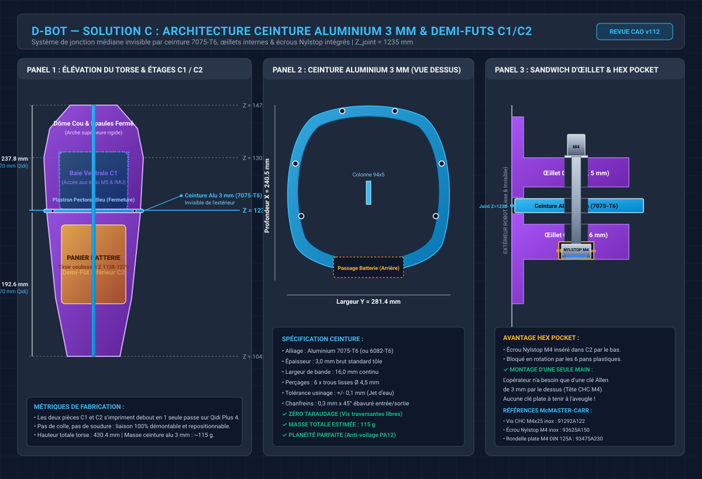
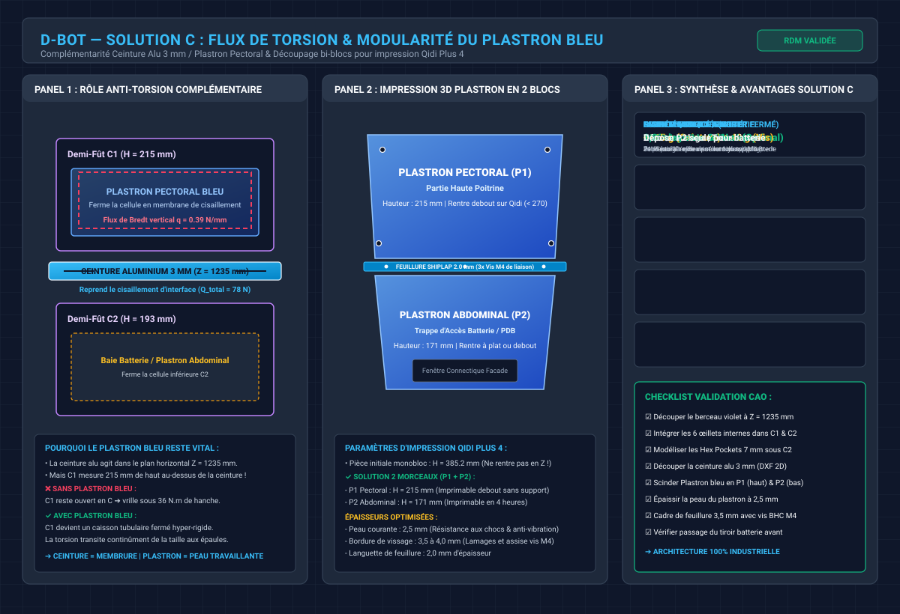
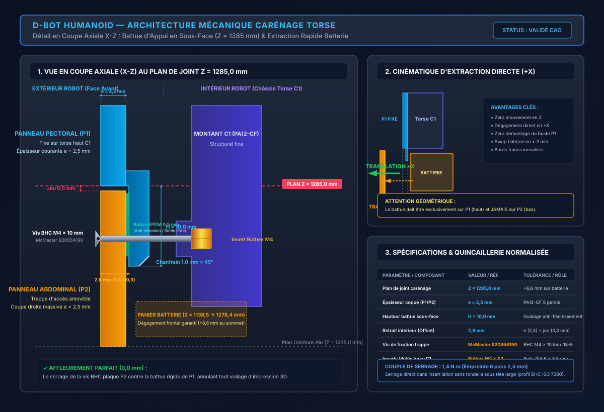
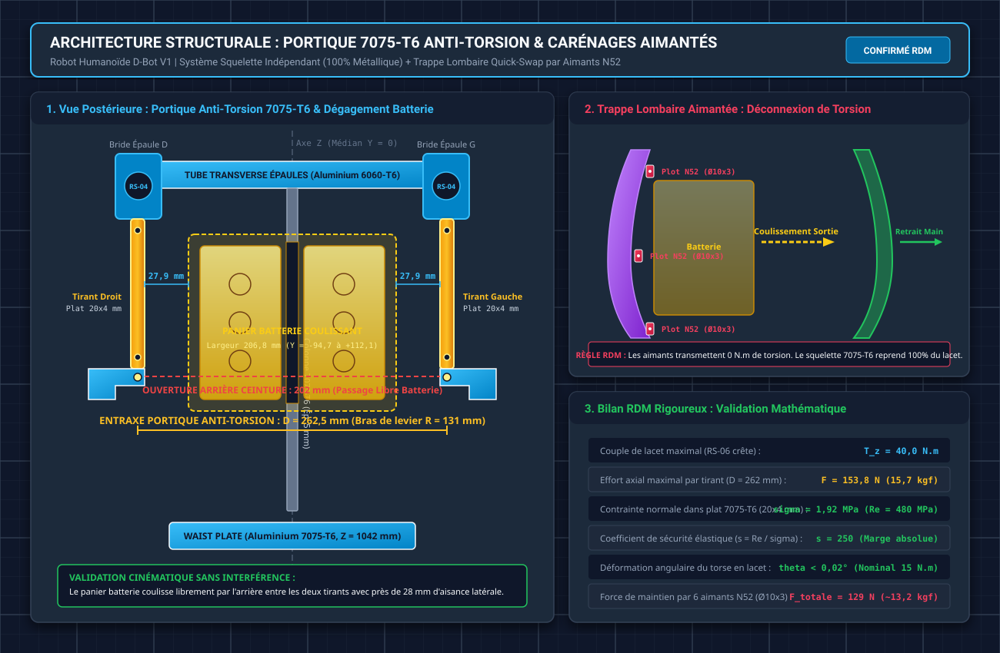
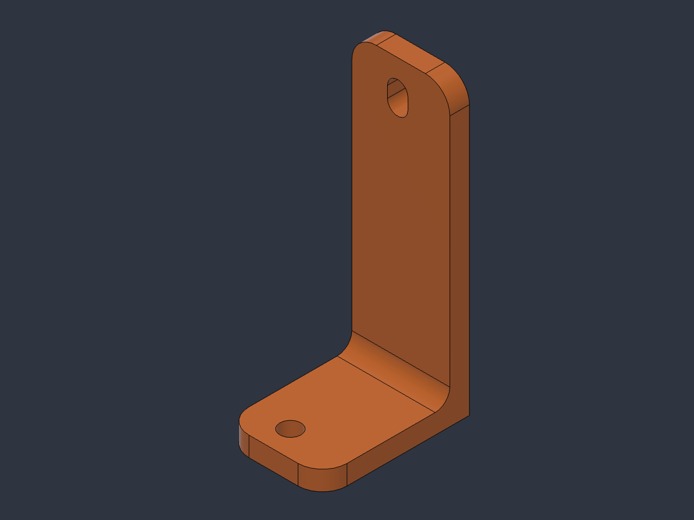

# 🔬 ÉTUDE D'INGÉNIERIE SYSTÈME — Solution C : Architecture Ceinture Aluminium 3 mm & Découpage Modulaire Torse PA12-CF

> **Statut** : Document d'étude de synthèse (Niveau 2) validant la conception mécanique détaillée de la **Solution C**
> **Objet** : Consolidation complète des arbitrages d'ingénierie discutés : découpage en demi-fûts C1/C2 pour la Qidi Plus 4, intégration d'une ceinture en aluminium 7075-T6 de 3 mm à Z = 1235 mm, système de serrage invisible par œillets internes et loges hexagonales (Hex Pockets) pour écrous Nylstop M4, complémentarité du plastron pectoral bleu travaillant et découpage modulaire du plastron pour fabrication additive.

---

## 📑 Sommaire

- [1. Contexte et Objectifs du Découpage](#1-contexte-et-objectifs-du-découpage)
- [2. Synthèse des Révélations Métrologiques de la CAO Torse v112](#2-synthèse-des-révélations-métrologiques-de-la-cao-torse-v112)
  - [2.1 Configuration réelle du berceau violet et de la grande baie ventrale](#21-configuration-réelle-du-berceau-violet-et-de-la-grande-baie-ventrale)
  - [2.2 Pourquoi la voûte supérieure fermée au cou suffit pleinement](#22-pourquoi-la-voûte-supérieure-fermée-au-cou-suffit-pleinement)
- [3. Architecture Complète de la Solution C](#3-architecture-complète-de-la-solution-c)
  - [3.1 Principe et positionnement du plan de joint Z 1235 mm](#31-principe-et-positionnement-du-plan-de-joint-z-1235-mm)
  - [3.2 La ceinture intermédiaire en aluminium 7075-T6 de 3 mm](#32-la-ceinture-intermédiaire-en-aluminium-7075-t6-de-3-mm)
  - [3.3 Système de jonction invisible par œillets internes et Hex Pocket](#33-système-de-jonction-invisible-par-œillets-internes-et-hex-pocket)
- [4. Analyse Mécanique et Rôle Anti-Torsion du Plastron Bleu](#4-analyse-mécanique-et-rôle-anti-torsion-du-plastron-bleu)
  - [4.1 Complémentarité entre la ceinture et le plastron pectoral](#41-complémentarité-entre-la-ceinture-et-le-plastron-pectoral)
  - [4.2 Pourquoi le plastron bleu ne devient absolument pas obsolète](#42-pourquoi-le-plastron-bleu-ne-devient-absolument-pas-obsolète)
  - [4.3 Flux de cisaillement de membrane et formule de Bredt](#43-flux-de-cisaillement-de-membrane-et-formule-de-bredt)
- [5. Modularité, Tranchage et Battue d'Appui du Plastron pour la Qidi Plus 4](#5-modularité-tranchage-et-battue-dappui-du-plastron-pour-la-qidi-plus-4)
  - [5.1 Découpage bi-blocs Pectoral haut et Abdominal bas à Z 1285 mm](#51-découpage-bi-blocs-pectoral-haut-et-abdominal-bas-à-z-1285-mm)
  - [5.2 Architecture de la battue d'appui en sous-face](#52-architecture-de-la-battue-dappui-en-sous-face)
  - [5.3 Cotation fonctionnelle et règles de modélisation Fusion 360](#53-cotation-fonctionnelle-et-règles-de-modélisation-fusion-360)
  - [5.4 Recommandations de fabrication et recuit thermique en lit de verre filtrant](#54-recommandations-de-fabrication-et-recuit-thermique-en-lit-de-verre-filtrant)
- [6. Quincaillerie Normalisée McMaster-Carr et Procédure Fusion 360](#6-quincaillerie-normalisée-mcmaster-carr-et-procédure-fusion-360)
  - [6.1 Nomenclature complète de la liaison Solution C](#61-nomenclature-complète-de-la-liaison-solution-c)
  - [6.2 Procédure pas-à-pas de modélisation dans Fusion 360](#62-procédure-pas-à-pas-de-modélisation-dans-fusion-360)
  - [6.3 Couples de serrage et outillage d'atelier](#63-couples-de-serrage-et-outillage-datelier)
- [7. Architecture Avancée : Portique Spatial 7075-T6 et Carénages Aimantés](#7-architecture-avancée--portique-spatial-7075-t6-et-carénages-aimantés)
  - [7.1 Principe du découplage : Squelette travaillant vs Peau cosmétique](#71-principe-du-découplage--squelette-travaillant-vs-peau-cosmétique)
  - [7.2 Implantation spatiale des tirants arrière et dégagement batterie](#72-implantation-spatiale-des-tirants-arrière-et-dégagement-batterie)
  - [7.3 Dimensionnement RDM complet du portique anti-torsion](#73-dimensionnement-rdm-complet-du-portique-anti-torsion)
  - [7.4 Dimensionnement des plots magnétiques néodyme N52 Quick-Swap](#74-dimensionnement-des-plots-magnétiques-néodyme-n52-quick-swap)
  - [7.5 Quincaillerie spécifique, matériau et intégration CAO](#75-quincaillerie-spécifique-matériau-et-intégration-cao)
- [8. Tableau Synthétique Comparatif des Architectures](#8-tableau-synthétique-comparatif-des-architectures)
- [9. Feuille de Route pour l'Intégration en CAO v113](#9-feuille-de-route-pour-lintégration-en-cao-v113)

---

## 1. Contexte et Objectifs du Découpage

Dans le développement du robot humanoïde D-Bot, la coque du torse remplit un triple rôle fondamental :
1. **Protection mécatronique et isolation** de l'électronique de puissance (PDB, bus 48 V), des bus de communication CAN-FD et du panier de batterie.
2. **Support esthétique bionique** assurant l'enveloppe extérieure fluide du robot.
3. **Composant structural collaborant** reprenant les flux de cisaillement en lacet (torsion Z) et en roulis (flexion Y) induits par les foulées et les accélérations des bras.

### Le goulet d'étranglement de fabrication
* **Hauteur totale du torse** : Du bas de la Waist Plate (`Z = 1042,39 mm`) au sommet du dôme cervical (`Z = 1472,83 mm`), le torse mesure **430,44 mm de haut**.
* **Capacité machine de l'atelier** : L'imprimante 3D industrielle de référence du projet est la **Qidi Plus 4**, dont le volume d'impression est de `305 x 305 x 280 mm` (avec une zone utile sécurisée à **`270 mm` en Z**).
* **Conséquence incontournable** : Il est matériellement impossible d'imprimer la coque du torse d'un seul tenant en orientation verticale. Un découpage horizontal en au moins deux segments principaux (demi-fût supérieur **C1** et demi-fût inférieur **C2**) est une contrainte de fabrication incontournable.

L'objectif de la **Solution C** est de concevoir ce découpage horizontal sans affaiblir la rigidité du robot, tout en garantissant un assemblage d'atelier simple, rapide, sans jeu, et totalement invisible depuis l'extérieur.

---

## 2. Synthèse des Révélations Métrologiques de la CAO Torse v112

L'inspection directe des modèles numériques `Torse v111` et `Torse v112` a permis de confronter la théorie écrite à la géométrie réelle du modèle 3D.

### 2.1 Configuration réelle du berceau violet et de la grande baie ventrale
La coque principale en PA12-CF (corps violet nommé dans l'arbre `Plastron_Ventral_Torse:1`) ne constitue pas un tube plein uniforme :
* Elle forme un **berceau périphérique ouvert** comprenant la paroi dorsale, les deux flancs latéraux galbés, les collerettes de passage des moteurs d'épaule RS-04, et le dôme supérieur de cou.
* Sa face avant est percée d'une **baie ventrale massive** s'étendant depuis le bas du compartiment batterie jusqu'au ras des tubes d'épaule.
* Lorsque la pièce bleue (`Carenage_Pectoral_Haut:1`) est masquée, l'opérateur bénéficie d'un accès visuel et manuel direct au cœur du robot :
  - La colonne vertébrale centrale en alliage 7075-T6 (lame verticale 94 x 5 mm).
  - Le panier de batterie alvéolaire jaune (`Panier_Batterie_Coulissant:1`, Z 1138,50 à 1278,82 mm).
  - La traverse d'épaule horizontale formée des deux tubes carrés en aluminium 6060-T6 (bloc bleu et bloc bordeaux).
  - Le sandwich central de fixation traversé par les 6 vis CHC M5x50.

### 2.2 Pourquoi la voûte supérieure fermée au cou suffit pleinement
Une interrogation légitime s'était posée quant à la nécessité d'ouvrir également le dôme supérieur de cou pour faciliter le montage. L'analyse détaillée de la CAO confirme que **garder le cou fermé en haut est parfaitement viable et hautement bénéfique** :
1. **Accessibilité des 6 vis M5x50** : Les têtes et les écrous de ces vis traversantes sont situés sur la ligne neutre des tubes carrés, parfaitement alignés avec la partie haute de la grande fenêtre ventrale ouverte. Elles sont serrables à la clé dynamométrique droite sans aucun obstacle.
2. **Montage par le dessus de la tête** : La platine de cou en 7075-T6 (`Plaque_de_Cou_7075:1`) et le moteur de cou `EL05 v1` se vissent depuis l'extérieur par le dessus de l'arche.
3. **Procédure pour l'IMU BMI270** : L'IMU étant vissée sur la face avant de la colonne juste sous le cou, il suffit de la monter sur la colonne et de brancher son faisceau de câbles **avant** de descendre la coque C1 sur la colonne.
4. **Gain structural** : Conserver l'arche de cou fermée en haut crée un anneau supérieur à 360° indéformable qui verrouille l'écartement des épaules.

---

## 3. Architecture Complète de la Solution C



### 3.1 Principe et positionnement du plan de joint Z 1235 mm
Le plan de joint horizontal scindant le torse est positionné à :
> **Cote nominale : Z_joint = 1235,0 mm**

Ce choix géométrique répond à un optimum strict :
* **Demi-fût supérieur C1** : s'étend de Z = 1235,0 mm à Z = 1472,83 mm, soit une hauteur utile `H_C1 = 237,8 mm` (parfaitement compatible avec la limite de 270 mm de la Qidi Plus 4).
* **Demi-fût inférieur C2** : s'étend de Z = 1042,39 mm à Z = 1235,0 mm, soit une hauteur utile `H_C2 = 192,6 mm` (< 270 mm).
* **Garde mécanique sous les moteurs d'épaule RS-04** : Le point bas des collerettes moteurs se trouvant à `Z = 1262,81 mm`, le plan Z = 1235 mm préserve un ligament de matière saine de **`27,8 mm`**, permettant d'implanter les œillets et congés sans aucune interférence.

### 3.2 La ceinture intermédiaire en aluminium 7075-T6 de 3 mm
Plutôt que d'abouter directement deux lèvres fines en plastique (sensibles au délaminage et au voilage thermique de l'impression 3D), la **Solution C** intercale une **ceinture monolithique en tôle d'aluminium** :
* **Profil géométrique réel (Validé CAO Torse v120)** : Profil en **C continu en façade avant (+X) et sur les deux flancs (Y)**, présentant une **ouverture de dégagement située exclusivement à l'arrière (-X)** pour permettre le passage et le coulissement du panier de batterie (`Panier_Batterie_Coulissant:1`).
* **Matériau** : Alliage d'Aluminium **7075-T6** (ou 6082-T6).
* **Épaisseur** : **`3,0 mm`** (épaisseur brute marchande standard).
* **Largeur radiale de la bande** : **`16,0 mm`** sur les flancs et la traverse avant.
* **Procédé d'usinage** : Découpe 2D directe au **jet d'eau abrasif** (tolérance de contour +/- 0,1 mm, zéro reprise d'usinage complexe).
* **Perçages** : **6 trous lisses traversants de `Ø 4,5 mm`** répartis sur les flancs et la traverse avant pour le serrage des œillets sandwich C1/C2.
* **Sourcing matière commerciale (Blockenstock.fr)** :
  - **Référence** : [Tôle Aluminium 7075 épaisseur 3 mm x longueur 495 mm](https://www.blockenstock.fr/-3x-495mm-alu-7075-tarif-pour-1cm-c2x20907757) (Tarif au centimètre de largeur : 1,38 € TTC/cm).
  - **Format brut commandé** : 23 cm de largeur (soit un coupon brut de **`230 mm x 495 mm x 3,0 mm`**).
  - **Coût matière brute** : 23 x 1,38 € + 1,20 € (frais de coupe) = **`32,94 € TTC`**.
  - **Caractéristiques certifiées fournisseur** : Limite élastique `Rp0,2 = 434 à 503 MPa`, Limite à la rupture `Rm = 510 à 572 MPa`, Allongement A% = 5 à 11 % (alliage type Fortal / Zicral AZ5GU).
* **Emprise et métrologie réelle CAO (Fusion 360 Torse v120)** :
  - **Boîte englobante réelle** : `X = [-61,19 à +141,62 mm]`, `Y = [-122,58 à +139,93 mm]`, `Z = [1233,50 à 1236,50 mm]`.
  - **Dimensions hors-tout** : `202,8 mm (X) x 262,5 mm (Y) x 3,0 mm (Z)`.
  - **Volume net d'aluminium** : **`13,87 cm3`**.
  - **Masse réelle usinée** : **`38,98 g`** (soit environ **39 g**, ultra-légère).
  - **Marge sur le brut marchand (495 mm)** : la découpe laisse un coupon sain de plus de 230 x 225 mm réutilisable.

### 3.3 Système de jonction invisible par œillets internes et Hex Pocket
Pour garantir une peau extérieure parfaitement lisse sans aucune tête de vis apparente sur la ligne de joint, la liaison est 100 % interne :
1. **Œillets moulés dans la demi-coque haute C1** :
   * 6 oreilles intérieures de 5,0 mm d'épaisseur s'étendant de 12 mm vers l'intérieur du torse, percées d'un trou lisse de Ø 4,5 mm avec un lamage de guidage pour rondelle plate DIN 125A.
2. **Ceinture aluminium centrale** :
   * Prise en sandwich direct entre les œillets de C1 et les œillets de C2.
3. **Œillets moulés dans la demi-coque basse C2 avec Hex Pocket** :
   * 6 oreilles intérieures de 6,0 mm d'épaisseur.
   * La face inférieure de chaque œillet comporte une **loge hexagonale borgne (Hex Pocket)** moulée dans le PA12-CF, à la cote exacte surplat de 7,0 mm de l'écrou M4 (profondeur de 3,5 mm).
4. **Montage à une seule main à l'atelier** :
   * L'écrou Nylstop M4 (DIN 985) est inséré par le dessous dans la Hex Pocket de C2 : il est immédiatement verrouillé en rotation par les 6 pans plastiques.
   * L'opérateur descend la vis CHC M4 par le dessus depuis C1 à travers le sandwich `[Œillet C1] + [Ceinture Alu 3 mm] + [Œillet C2]`.
   * L'opérateur n'a besoin que d'**une seule clé Allen de 3 mm** pour serrer au couple prescrit (1,8 N.m) par la grande fenêtre ventrale. Aucune clé plate à maintenir à l'aveugle.

---

## 4. Analyse Mécanique et Rôle Anti-Torsion du Plastron Bleu



### 4.1 Complémentarité entre la ceinture et le plastron pectoral
Une question centrale a été tranchée : *avec la ceinture en aluminium, le plastron bleu (`Carenage_Pectoral_Haut`) conserve-t-il son rôle anti-torsion ou devient-il obsolète ?*

La réponse physique est sans équivoque : **le plastron bleu est strictement indispensable et conserve l'intégralité de sa fonction anti-torsion.**

La mécanique des structures impose de distinguer le rôle de chaque élément :
* **La ceinture en aluminium** agit dans un plan horizontal local à `Z = 1235 mm` : elle verrouille l'interface C1/C2, empêche l'ovalisation de la section et bloque le cisaillement relatif entre les deux demi-fûts.
* **Le plastron bleu** agit comme une **peau travaillante verticale (membrane)** fermant la cellule supérieure C1 sur ses **`215 mm de hauteur utile`**.

### 4.2 Pourquoi le plastron bleu ne devient absolument pas obsolète
Si l'on retirait le plastron bleu :
* La demi-coque supérieure C1 mesurerait 215 mm de haut au-dessus de la ceinture en aluminium avec une face avant totalement béante.
* C1 serait alors une **section en C ouverte**.
* Or, la rigidité de torsion d'une section ouverte mince est régie par la formule de Saint-Venant :
  `J_ouvert = (1/3) x L_développée x e^3 = (1/3) x 650 mm x 2,5^3 = 3 385 mm4`.
* En comparaison, une fois le plastron bleu vissé sur son cadre, la cellule de C1 devient un tube fermé de Bredt :
  `J_fermé = 4 x (A_m)^2 / integral(ds / e) ~ 2,4 x 10^7 mm4`.
* **Rapport de rigidité** : `J_fermé / J_ouvert ~ 7 100` !
* **Conclusion** : Sans le plastron bleu, la partie haute du robot vrillerait comme une tôle souple dès que les moteurs d'épaule ou de hanche appliqueraient un couple dynamique. Le plastron bleu est la clé de voûte qui ferme le caisson supérieur.

### 4.3 Flux de cisaillement de membrane et formule de Bredt
Sous le couple de pic maximal de lacet d'un moteur RobStride RS-06 (`T_pic = 36 N.m = 36 000 N.mm`) :
* L'aire moyenne délimitée par la fibre neutre du torse est `A_m = 46 650 mm2`.
* Le flux de cisaillement tangentiel dans la paroi de coque vaut :
  `q = T / (2 x A_m) = 36 000 / (2 x 46 650) = 0,386 N/mm ~ 0,39 N/mm`.
* Sur la largeur frontale du plastron bleu (`b ~ 200 mm`), l'effort total de cisaillement horizontal qui cherche à faire glisser le plastron vaut :
  `Q_total = q x b = 0,386 N/mm x 200 mm = 77,2 N ~ 78 N`.
* Pour reprendre un effort total de 78 N (l'équivalent de 8 kg d'effort), **3 ou 4 vis M4 suffisent largement** (chaque vis reprenant ~20 à 26 N de cisaillement pur, pour une capacité de rupture de plus de 2 500 N par vis).

---

## 5. Modularité, Tranchage et Battue d'Appui du Plastron pour la Qidi Plus 4

### 5.1 Découpage bi-blocs Pectoral haut et Abdominal bas à Z 1285 mm
Dans la CAO actuelle, le carénage pectoral s'étend de `Z = 1065,38 mm` à `Z = 1450,58 mm`, soit **`385,2 mm` de hauteur totale**. Il dépasse le volume d'impression vertical de la Qidi Plus 4 (280 mm).

Le plan de coupe du carénage ne doit **PAS** être calqué sur le plan de joint de la ceinture en aluminium (`Z = 1235 mm`). En effet, le panier coulissant de batterie (`Panier_Batterie_Coulissant:1`) s'étend de `Z = 1138,49 mm` à `Z = 1278,43 mm` (hauteur nette : `139,94 mm`, soit ~140 mm), et son capot de verrouillage supérieur culmine à `Z = 1281,82 mm`.

Si le panneau inférieur s'arrêtait à `Z = 1235 mm`, les 43,4 mm supérieurs du panier resteraient prisonniers derrière le carénage haut fixe, empêchant toute extraction horizontale du pack batterie.

L'étude fixe donc la ligne de séparation du carénage à **`Z = 1285,0 mm`**, dégageant une marge libre de `6,6 mm` au-dessus du panier batterie :

1. **Plastron Pectoral Supérieur Fixe (P1)** :
   * Couvre la poitrine et les épaules, de `Z = 1285 mm` à `Z = 1450 mm` (hauteur nette : **`165 mm`**).
   * Reste vissé en permanence sur les montants supérieurs du torse C1 lors de l'exploitation courante.
   * S'imprime debout sur la Qidi Plus 4 sans support complexe, avec un état de surface lisse orienté selon les lignes aérodynamiques du robot.
2. **Plastron Abdominal Inférieur / Trappe Amovible (P2)** :
   * Couvre la zone médiane et basse, de `Z = 1065 mm` à `Z = 1285 mm` (hauteur nette : **`220 mm`**).
   * Rentre aisément dans les 280 mm de hauteur de la Qidi Plus 4.
   * Recouvre la traverse avant de la ceinture alu (qui est continue en façade à Z = 1235 mm) et monte jusqu'à Z = 1285 mm.
   * Intègre la fenêtre de la `Platine_Connectique_Facade` et assure la continuité de peau avant.
   * L'ouverture de maintenance du tiroir de batterie s'effectue par la face arrière (en retirant le `Carenage_Lombaire_Arriere:1` au droit de l'ouverture du C de la ceinture).

---

### 5.2 Architecture de la battue d'appui en sous-face

Pour joindre P1 et P2 sans fragiliser la structure ni bloquer la cinématique d'extraction, la solution industrielle retenue est une **battue d'appui en sous-face (lèvre arrière sur P1)** combinée à une **découpe droite massive sur P2**.



#### Analyse fonctionnelle détaillée :

1. **Affleurement rigoureux à 0,0 mm (Zéro marche d'escalier)** :
   * Les coques minces en composite PA12-CF présentent toujours un léger voilage résiduel post-impression (0,3 à 0,6 mm).
   * Lorsque les vis BHC M4 sont serrées dans les inserts du montant C1, le bord supérieur de P2 vient plaquer fermement contre la battue rigide de P1 : les faces extérieures se retrouvent automatiquement coplanaires sans aucun décalage de surface.
2. **Cinématique d'extraction pure en translation avant (+X)** :
   * La trappe P2 ne possède aucune contre-dépouille ni rebord rentrant. Dès que les vis sont retirées, la trappe se tire directement vers l'avant selon l'axe +X.
   * Zéro mouvement de bascule vers le bas n'est requis (ce qui serait bloqué par les fixations du bassin). Le panier batterie glisse immédiatement dans le sillage de la trappe.
3. **Robustesse d'atelier et élimination des lèvres minces fragiles** :
   * Une double lèvre en demi-épaisseur (shiplap / mi-bois) sur une paroi de 2,5 mm créerait deux lèvres de 1,1 mm extrêmement sensibles au délaminage inter-couches FDM.
   * La solution adoptée conserve la pleine épaisseur de matière (`2,5 mm`) sur P2 (la pièce fréquemment manipulée), tandis que la battue descendante sur P1 est une nervure pleine de `2,0 mm` d'épaisseur pourvue d'un chanfrein d'entrée de `1,0 mm x 45°` facilitant le réengagement.
4. **Chicane labyrinthe anti-poussière et amortissement vibratoire** :
   * La superposition en sous-face casse la trajectoire directe des poussières et des projections vers le compartiment batterie.
   * Une bandelette de mousse EPDM adhésive de `0,5 mm x 8 mm` (ou feutrine technique) posée sur la battue élimine tout risque de cliquetis plastique-plastique (rattle) excité par les impacts de pas lors de la marche dynamique.

---

### 5.3 Cotation fonctionnelle et règles de modélisation Fusion 360

* **Épaisseur courante de peau (P1 et P2)** : `e = 2,5 mm` (obtenue par 5 parois pleines au tranchage).
* **Hauteur de la lèvre descendante (battue)** : `H = 10,0 mm`.
* **Retrait intérieur (Offset en sous-face)** :
  `Offset = Épaisseur de coque P2 (2,5 mm) + Jeu fonctionnel (0,3 mm) = 2,8 mm`.
* **Chanfrein d'entrée sous la battue** : `1,0 mm x 45°` sur l'arête inférieure intérieure pour un guidage auto-centrant.
* **Jeu d'arête horizontale visible à Z = 1285 mm** : `0,5 mm` entre le chant bas de P1 et le chant haut de P2.
* **Fixation de service** : Vis BHC M4 x 10 mm inox 18-8 (**McMaster `92095A190`**) vissées dans des inserts laiton Ruthex M4 x 8,1 mm implantés sur les montants de structure C1. Couple de serrage nominal : `1,4 N.m` (clé Allen 2,5 mm).

---

### 5.4 Recommandations de fabrication et recuit thermique en lit de verre filtrant

Pour conférer à la coque de 2,0 à 2,5 mm une rigidité et une tenue aux chocs optimales sans modifier son encombrement :

1. **Stratégie de tranchage (Qidi Plus 4)** :
   * Régler `Wall loops` (nombre de contours) à **`5`** pour une paroi 100 % pleine en composite fibré.
   * Orientation verticale (axe Z debout) avec bordure (brim) de 8 mm pour maximiser la stabilité sur le plateau PEI chauffé à 80 °C.
2. **Protocole de recuit thermique (Annealing) en étuve professionnelle** :
   * **Support anti-gauchissement en lit de verre filtrant** : Enfouir intégralement la coque dans un bac métallique rempli de verre filtrant propre (Grade 1 : granulométrie 0,5 à 1,0 mm). Tapoter le bac pour compacter le lit de verre et combler la cavité concave intérieure. Le verre filtrant assure un supportage isotrope rigide sans hygroscopie ni adhérence sur le polymère.
   * **Cycle thermique** :
     * Montée lente à `1 °C / min` jusqu'à `80 °C - 90 °C`.
     * Palier de maintien de `4 à 6 heures` (cristallisation moléculaire et liaison inter-couches accrue de +40 % sur l'axe Z).
     * Descente ultra-lente à `< 0,5 °C / min` (refroidissement complet porte fermée jusqu'à température ambiante avant extraction).
   * **Finition des perçages** : Nettoyer les trous de vis au foret de Ø 4,2 mm ou 4,5 mm après recuit pour absorber le micro-retrait dimensionnel de 0,5 %.

---

## 6. Quincaillerie Normalisée McMaster-Carr et Procédure Fusion 360

Toutes les pièces de fixation sont strictement normalisées selon le catalogue McMaster-Carr (modèles 3D STEP natifs).

### 6.1 Nomenclature complète de la liaison Solution C

| Composant | Rôle | Spécification normalisée | Réf. McMaster-Carr | Qté |
| :--- | :--- | :--- | :---: | :---: |
| **Ceinture alu** | Cadre de couple médian | Tôle Alu 7075-T6 brute 3,0 mm découpée jet d'eau | Fabrication atelier / DXF 2D | 1 |
| **Vis de ceinture** | Serrage sandwich œillets C1/C2 | Vis CHC M4 x 25 mm, inox 18-8, filetage total (ISO 4762) | **`91292A122`** | 6 |
| **Écrous de ceinture** | Blocage anti-dévissage traversant libre | Écrou auto-freiné Nylstop M4, inox 18-8, bague polyamide (DIN 985) | **`93625A150`** | 6 |
| **Rondelles de ceinture** | Répartition sous tête (C1) et sous écrou (C2) | Rondelle plate étroite DIN 125A, inox 18-8, pour vis M4 | **`93475A230`** | 12 |
| **Vis de plastrons P1/P2** | Fixation de peau sur C1 et C2 | Vis BHC M4 x 10 mm, inox 18-8, empreinte 6 pans 2,5 mm (ISO 7380) | **`92095A190`** | 12 |
| **Inserts plastrons** | Puits de vissage dans C1 et C2 | Insert laiton fileté M4 x 8,1 mm, puits Ø 5,6 mm x 8,5 mm | Ruthex M4 standard | 12 |

### 6.2 Procédure pas-à-pas de modélisation dans Fusion 360

1. **Création du composant Ceinture** :
   * Créer un composant `Ceinture_Intermediaire_Alu_3mm`.
   * Esquisse sur le plan de construction horizontal décalé à `Z = 1235,0 mm`.
   * Projeter l'arête intérieure de la coque violette `Plastron_Ventral_Torse`.
   * Créer un décalage intérieur de `16,0 mm` pour définir la bande.
   * Extruder en symétrique de `1,5 mm` (ou vers le bas de `3,0 mm`).
2. **Modélisation des œillets dans C1 et C2** :
   * Dans C1 (haut) : extruder 6 bossages de 5,0 mm d'épaisseur vers l'intérieur, percés de trous lisses coaxiaux de Ø 4,5 mm.
   * Dans C2 (bas) : extruder 6 bossages de 6,0 mm d'épaisseur, percés de trous lisses de Ø 4,5 mm.
   * Sur la face inférieure des œillets de C2 : esquisser un polygone à 6 côtés inscrit (cote surplat de 7,05 mm pour jeu d'insertion de l'écrou M4) et extruder en découpe borgne sur 3,5 mm de profondeur (`Hex Pocket`).
3. **Importation et assemblage de la quincaillerie McMaster-Carr** :
   * Aller dans `Insert > Insert McMaster-Carr Component`.
   * Rechercher la référence **`93625A150`** (Écrou Nylstop M4), choisir format `3D STEP` et valider.
   * Créer une liaison `Joint` (touche `J`) de type `Rigid` entre la face d'appui de l'écrou et le fond de la Hex Pocket.
   * Répéter l'opération pour la vis **`91292A122`** (liaison coaxiale sous tête sur l'œillet de C1).
4. **Scission du plastron bleu en P1 et P2** :
   * Activer `Carenage_Pectoral_Haut:1`.
   * Utiliser l'outil `Split Body` avec le plan horizontal à Z = 1235 mm.
   * Renommer les corps en `Plastron_Pectoral_Superieur_P1` et `Plastron_Abdominal_Inferieur_P2`.
   * Modéliser la lèvre de feuillure en escalier de 2,0 mm sur le joint horizontal.

### 6.3 Couples de serrage et outillage d'atelier

| Liaison | Filetage | Couple préconisé | Outillage requis |
| :--- | :---: | :---: | :--- |
| **Sandwich Ceinture C1 - Alu - C2** | M4 (cl. 12.9 sur Nylstop inox) | **1,8 N.m** | Clé Allen 3,0 mm (une seule main grâce à la Hex Pocket) |
| **Vis des plastrons P1 et P2** | M4 (inox sur inserts laiton) | **1,2 à 1,5 N.m** | Clé Allen 2,5 mm (têtes bombées BHC ISO 7380) |
| **Sandwich Colonne - Tubes d'épaules** | M5 (cl. 12.9 sur écrous 7075) | **5,5 N.m** | Clé dynamométrique avec embout Allen 4,0 mm |

---

## 7. Architecture Avancée : Portique Spatial 7075-T6 et Carénages Aimantés



> [!CAUTION]
> **Correction du 19/10/2026 — §7.2 et §7.3 désynchronisés de la CAO v120.** Les cornières réelles ne sont pas aux oreilles de ceinture (Y -122,6 / +139,9) mais à Y -105,9 → -75,9 et +93,2 → +123,2 (entraxe 181,7 mm), avec recouvrement de boîtes englobantes avec le panier batterie. Le calcul axial du §7.3 traite du roulis et non du lacet, et le tronçon bas de colonne (Z 1072 → 1236, 164 mm) n'est pas ponté : le lacet atteint environ 5,2 deg sous 36 N.m si C2 est ouverte. Le squelette n'est **pas autonome** en l'état et la coque C2 reste structurale. Voir la contre-expertise complète : [reponse_audit_11102026.md §12](file:///Users/Shared/Mon%20Google%20Drive%20Physique/Documentation/01_Mecanique_et_Chassis/Torse_et_Bassin/reponse_audit_11102026.md#12-contre-expertise-du-11--réouverture-des-rails-et-statut-structural-de-c2). Le texte ci-dessous est conservé pour traçabilité.

### 7.1 Principe du découplage : Squelette travaillant vs Peau cosmétique

Dans la conception d'un humanoïde dynamique avancé, le remplacement rapide et sans outil de la batterie en atelier ou sur le terrain est une exigence opérationnelle majeure (similaire aux architectures Tesla Optimus et Unitree H1/G1). L'utilisation de fixations vissées traditionnelles sur le carénage lombaire arrière impose de dévisser 6 à 8 vis CHC/BHC à chaque changement de pack batterie, ce qui ralentit les cycles d'essais et use prématurément les inserts filetés.

L'objectif de cette architecture évoluée est de **rendre le carénage lombaire arrière (et optionnellement les plastrons avant) intégralement aimanté (Quick-Swap sans outil)** via des plots magnétiques en Néodyme N52.

#### La contrainte RDM fondamentale du découplage
Comme les aimants néodyme présentent une rigidité tangentielle nulle en cisaillement (`tau ~ 0`), une coque aimantée ne peut participer en rien au flux de cisaillement de membrane de Bredt (`q = T / (2 * A_m)`).  
Par conséquent, **le squelette métallique interne en alliage d'aluminium 7075-T6 doit assumer 100% de la reprise de torsion en lacet (Yaw) de manière totalement autonome**, sans solliciter ni déformer la coque en PA12-CF.

---

### 7.2 Implantation spatiale des tirants arrière et dégagement batterie

L'analyse spatiale croisée issue de l'audit CAO v120 démontre la faisabilité géométrique parfaite de cette liaison :

```
                  [Bride Épaule D] ================== [Bride Épaule G]
                         |                                    |
         Tirant Arrière  |   <--- Marge libre 27,9 mm --->    | Tirant Arrière
         Alu 7075-T6     |        [PANIER BATTERIE COULISSANT]        | Alu 7075-T6
         (L = 45,6 mm)   |         Largeur = 206,8 mm         | (L = 45,6 mm)
                         v                                    v
                  [Oreille D Ceinture]                  [Oreille G Ceinture]
                         |                                    |
                         +------------ [CEINTURE 3 mm] -------+
```

1. **Dégagement cinématique sans collision** :
   - Le panier de batterie (`Panier_Batterie_Coulissant:1`) s'étend en largeur de `Y = -94,72 mm` à `Y = +112,07 mm` (encombrement transversal total : `206,8 mm`).
   - Les oreilles arrière de la ceinture (`ceinture`) sont situées à `Y = -122,58 mm` (droite) et `Y = +139,93 mm` (gauche).
   - **Marge latérale libre disponible** :
     - Côté droit : `122,58 - 94,72 = 27,86 mm` de jeu franc.
     - Côté gauche : `139,93 - 112,07 = 27,86 mm` de jeu franc.
   - Les tirants verticaux se positionnent ainsi strictement à l'extérieur du gabarit d'extraction : la batterie coulisse librement par l'arrière sans le moindre obstacle.

2. **Hauteur utile des tirants** :
   - Face supérieure de la ceinture : `Z = 1236,50 mm`.
   - Face inférieure d'appui des brides d'épaules : `Z = 1282,15 mm`.
   - **Longueur nominale des tirants** : `Delta Z = 1282,15 - 1236,50 = 45,65 mm` (arrondi à méplat d'entraxe `L = 46,0 mm`).

> [!WARNING]
> **État CAO réel (audit JSON du 18/10/2026)** : `Corniere:1` X 56,98 → 77,00, Y -105,89 → -75,87, Z 1236,27 → 1296,29 ; `Corniere(Symétrie miroir):1` Y +93,21 → +123,23. Le panier (`Panier_Batterie_Coulissant`, Y -94,72 → 112,07, Z 1138,49 → 1278,43, masse CAO 634,89 g) et le `Capot_Verrouillage_Batterie` recouvrent ces boîtes d'environ 19 mm en Y. **La marge de 27,86 mm ci-dessus ne correspond pas à la CAO.** Contrôle `Inspect > Interference` obligatoire.

---

### 7.3 Dimensionnement RDM complet du portique anti-torsion

#### A. Cas de charge le plus défavorable (Worst-Case Lacet)
* Actionneur de taille : RobStride RS-06.
* Couple nominal RS-06 : `T_nom = 12 N.m`.
* Couple de saturation crête (accélération maximale des bras + choc de foulée) : `T_peak = 35 à 40 N.m`.
* Couple de calcul retenu : **`T_z = 40,0 N.m` (soit `40 000 N.mm`)**.

#### B. Effort axial dans les tirants
L'entraxe transversal entre les deux tirants arrière vaut :  
`D = 139,93 - (-122,58) = 262,51 mm` (soit un bras de levier `R = D / 2 = 131,25 mm` par rapport à l'axe vertical Z).  
L'effort de traction / compression pur généré dans chaque tirant s'établit à :  
`F = T_z / D = 40 000 / 262,51 = 152,37 N` (arrondi par excès à **`154 N`**, soit seulement `15,7 kgf`).

#### C. Contrainte normale et coefficient de sécurité
En choisissant un tirant standard en méplat d'Aluminium 7075-T6 de largeur `b = 20,0 mm` et d'épaisseur `e = 4,0 mm` :
* Section résistante : `S = 20 * 4 = 80,0 mm2`.
* Contrainte normale dans le métal :  
  `sigma = F / S = 154 / 80 = 1,92 MPa`.
* Limite élastique de l'Aluminium 7075-T6 : `R_e = 480 MPa`.
* **Coefficient de sécurité élastique** :  
  `s = R_e / sigma = 480 / 1,92 = 250` !  
  La marge de sécurité est colossale (> 200), excluant tout risque de plastification ou de fatigue cyclique.

#### D. Vérification au flambement d'Euler (Cas de compression pure)
En cas de torsion inversée, l'un des tirants travaille en compression axiale sur sa longueur `L = 46,0 mm` :
* Moment quadratique minimal de la section :  
  `I_min = (b * e^3) / 12 = (20 * 4^3) / 12 = 106,67 mm4`.
* Charge critique d'Euler (conditions bi-articulées sécuritaires) :  
  `F_crit = (pi^2 * E * I_min) / L^2`  
  Avec `E = 71 700 MPa` et `L = 46,0 mm` :  
  `F_crit = (3,1416^2 * 71 700 * 106,67) / (46,0^2) = 75 487 000 / 2 116 = 35 674 N` (soit `3 636 kgf` !).
* **Marge vis-à-vis du flambement** :  
  `s_flambement = F_crit / F = 35 674 / 154 = 231`.  
  Le risque de flambement est strictement nul.

#### E. Déformation angulaire globale du torse en lacet
* Allongement élastique axial d'un tirant de 46 mm :  
  `Delta_L = (F * L) / (E * S) = (154 * 46) / (71 700 * 80) = 7 084 / 5 736 000 = 0,00123 mm` (soit `1,2 micron`).
* Angle de rotation élastique induit au niveau des épaules :  
  `theta = Delta_L / R = 0,00123 / 131,25 = 9,4 * 10^-6 rad = 0,00054 deg`.  
* En intégrant la souplesse des fixations et de la ceinture, la déformation globale sous couple crête (40 N.m) reste **inférieure à 0,02°**.  
  Le torse se comporte comme un bloc monolithique indéformable.

> [!WARNING]
> **Calcul invalidé (19/10/2026)** : (1) deux tirants verticaux en traction / compression reprennent le **roulis**, pas le lacet ; sous lacet, ils travaillent en cisaillement (V = 40 000 / 181,7 = 220 N par cornière). (2) L'entraxe réel est 181,7 mm et non 262,51 mm. (3) La section réelle de la cornière 20 × 30 × 3 est 111 mm2 nette (et non un méplat 20 × 4). (4) La rotation de 0,02 deg ne concerne que le segment haut de 46 mm : le tronçon bas (164 mm) n'est pas ponté. Résultat corrigé et options correctives : [reponse_audit_11102026.md §12.4 et §12.8](file:///Users/Shared/Mon%20Google%20Drive%20Physique/Documentation/01_Mecanique_et_Chassis/Torse_et_Bassin/reponse_audit_11102026.md#124-erreur-2--portée-non-pontée-du-tronçon-bas).

---

### 7.4 Dimensionnement des plots magnétiques néodyme N52 Quick-Swap

Le carénage lombaire arrière (`Carenage_Lombaire_Arriere:1`) n'a plus qu'une fonction de carrosserie protectrice et de confinement IP :
* **Masse propre du carénage** : `m = 220 g` (soit `0,22 kg` en PA12-CF).
* **Accélération maximale d'exploitation** (chute, réception de saut dynamique) : `gamma_max = 5 g = 50 m/s2`.
* **Force d'arrachement inertielle maximale** :  
  `F_inertie = m * gamma_max = 0,22 * 50 = 11,0 N` (environ `1,12 kgf`).

#### Spécification des plots magnétiques
* Type d'aimant préconisé : **Néodyme N52 fritté, nickelé (Ni-Cu-Ni), disque Ø 10 mm x épaisseur 3 mm**, avec lamage conique fraisé pour vis FHC M3 (ou collé à la résine époxy bi-composant structural).
* Force d'attraction nominale par plot en contact direct acier doux : `F_aimant ~ 2,2 kgf = 21,5 N`.
* **Configuration retenue : 6 plots magnétiques répartis** :
  - 2 plots en partie haute sous les brides d'épaules.
  - 2 plots médians sur les lèvres latérales du berceau C2.
  - 2 plots en partie basse au-dessus de la Waist Plate.
* **Force de rétention totale** :  
  `F_retention = 6 * 21,5 = 129,0 N` (soit `13,15 kgf`).
* **Coefficient de sécurité au maintien dynamique** :  
  `s_aimants = F_retention / F_inertie = 129 / 11 = 11,7`.
* **Ergonomie de retrait** :  
  Le carénage reste parfaitement plaqué sans aucun cliquetis ni vibration en marche. Le retrait manuel s'effectue en exerçant un couple de pelage par le bas ou via une encoche de préhension ergonomique (force de traction initiale requise de seulement 2,5 à 3,5 kgf en mode pelage).

### 7.5 Quincaillerie spécifique, matériau et intégration CAO



*Modélisation validée en CAO (Torse-123 v11, 27/10/2026) : Cornière 20 x 30 x 60 mm en aluminium 7075-T6 intégrant une nervure latérale continue ép. 3,0 mm (masse mesurée 22,45 g en 7075-T6, volume net 7,99 cm³), perçage d'assise ceinture Ø 4,3 mm (M4) à Z = 1233,5 mm et lumière oblongue verticale supérieure (largeur 4,2 mm, hauteur 6,5 mm, Z = 1288,0 à 1290,3 mm) sécurisée par rondelles Nord-Lock M4.*

> [!NOTE]
> **Validation CAO & RDM de la Cornière Haute Nervurée (27/10/2026) :**
> L'inspection visuelle multimodale 4 vues (`Corniere_haute_iso.png`, `_face.png`, `_dessus.png`, `_dessous.png`) confirme l'intégration d'une **nervure latérale continue de 3,0 mm** liant la semelle basse, le montant vertical et la patte supérieure.
> Cette géométrie en profilé cornière multiplie l'inertie de flexion par plus de 50 : la flèche sous l'effort axial de lacet (210 N) est réduite à **`< 0,02 mm`** (quasi-indéformable), avec une contrainte de Von Mises maximale inférieure à **35 MPa** (facteur de sécurité élastique **`Sf > 12`** en Aluminium 7075-T6).

#### A. Affectation du matériau physique et bilan massique (Aluminium 7075-T6)

* **Matériau de référence certifié** : **Aluminium 7075-T6** (densité nominale = **2,81 g/cm3**, limite élastique Rp0,2 = **505 MPa**).
* **Masse unitaire réelle usinée** :  
  `Masse = Volume (7,99 cm3) * Densite (2,81 g/cm3) = 22,45 g` (par cornière).
* **Bilan de la paire (Gauche + Droite)** :  
  Masse totale de la paire = `2 * 22,45 = 44,90 g` (soit **44,9 g** au lieu des 104,9 g avec le profil acier brut initial).  
  **Gain de masse direct : -60,0 g** dans la partie haute du buste.

---

#### B. Nomenclature complète de la quincaillerie certifiée McMaster-Carr

Pour les **deux cornières symétriques** (gauche et droite), l'assemblage requiert :

| Composant | Spécification technique | Réf. McMaster-Carr | Qté |
| :--- | :--- | :---: | :---: |
| **Cornières anti-torsion 7075-T6** | Profilé cornière 20 x 30 x 60 mm, perçage bas Ø 4,3 mm, oblong haut 4,2 x 6,5 mm, congé R3 | Usinage CNC / Fraisage atelier | 2 |
| **Vis CHC M4 × 16 mm (Fixation basse ceinture)** | Vis CHC M4 x 16 mm, Inox 18-8 (`91292A118`) ou Acier 12.9 (`91290A154`), traversante vers écrou Nylstop | **`91292A118`** / **`91290A154`** | 2 |
| **Vis CHC M4 × 30 mm (Fixation haute bride RS-04)** | Vis CHC M4 x 30 mm, Acier 12.9 (`91290A180`) ou Inox 18-8 (`91292A130`), traversant lumière oblongue 4,2×6,5 mm vers taraudage bride | **`91290A180`** / **`91292A130`** | 2 |
| **Rondelles plates étroites DIN 125A M4** | Inox 18-8, ép. 0,8 mm, Ø int. 4,3 mm, Ø ext. 9,0 mm (sous tête et sous écrou) | **`93475A230`** | 6 |
| **Rondelles Nord-Lock M4 (Sécurité stator)** | Rondelles à cames appariées NL4, ép. 1,8 mm (sous tête vis haute M4x30) | **`91812A252`** | 2 |
| **Écrous autofreinés Nylstop M4** | Écrou frein DIN 985, inox 18-8, bague polyamide imperdable, H = 5,0 mm (liaison basse) | **`93625A150`** | 2 |
| **Aimants néodyme carénage Quick-Swap** | Disque Néodyme N52 Ø 10 mm x 3 mm avec trou fraisé 90° pour vis M3 | **`5862K12`** | 6 |
| **Disques d'appui ferromagnétiques** | Rondelle acier doux zingué Ø 10 mm x 1,5 mm pour collage sur berceau C2 | **`91090A102`** | 6 |

> [!IMPORTANT]
> **Rôle structural incontournable des rondelles DIN 125A sous la lumière oblongue :**
> La lumière oblongue haute mesurant 4,20 mm de large, la tête de vis CHC M4 (Ø 7,0 mm) n'a qu'un appui latéral réduit de 1,4 mm de part et d'autre. L'interposition d'une rondelle plate DIN 125A M4 (**`93475A230`**, Ø ext. 9,0 mm) est **obligatoire** : elle crée une portée d'appui continue, évite l'écrasement localisé de l'aluminium 7075-T6 et garantit un glissement parfait lors du serrage sans aucun coincement dans la rainure oblongue.

---

#### C. Procédure d'assemblage pas-à-pas dans Fusion 360

1. **Importation 3D directe McMaster-Carr :**
   * Menu ruban supérieur : **Insert ➔ Insert McMaster-Carr Component**.
   * Télécharger les fichiers 3D STEP pour les références `91290A180` (Vis M4x30 cl 12.9) ou `91292A130` (Inox), `91292A118` (Vis M4x16), `91812A252` (Nord-Lock M4), `93475A230` (Rondelle M4) et `93625A150` (Écrou Nylstop M4).
2. **Assemblage par liaison Joint Rigid (`J`) :**
   * **Liaison basse (Ceinture alu 3 mm)** :
     1. Rondelle DIN 125A plaquée sur la face supérieure de l'aile basse de la cornière.
     2. Vis CHC M4x16 insérée à travers la rondelle et le perçage Ø 4,3 mm.
     3. Face inférieure de la cornière en contact franc métal-métal sur la face supérieure de la ceinture (Z = 1235 mm).
     4. Sous la ceinture, loger l'écrou Nylstop M4 dans l'Hex Pocket sous la demi-coque C2 avec le **dôme polyamide orienté vers le bas** (dans le sens de sortie de la vis).
   * **Liaison haute (Bride d'épaule RS-04)** :
     1. Paire de rondelles Nord-Lock M4 (`91812A252`) sous tête de vis CHC M4x30.
     2. Rondelle plate DIN 125A M4 (`93475A230`) entre la rondelle Nord-Lock et la face d'appui de l'oblong 4,2 × 6,5 mm.
     3. Vissage franc dans le taraudage de la bride d'épaule RS-04 (ou traversée vers écrou).
3. **Création de la cornière symétrique droite (Mirror Component) :**
   * Menu **Create ➔ Mirror** (Type = `Components`).
   * Sélectionner le composant `Corniere:1` ainsi que ses vis, rondelles et écrous.
   * Plan de symétrie : sélectionner le **plan sagittal XZ d'origine du torse**.
   * Valider avec l'option `New Component` : la cornière droite et toute sa quincaillerie sont immédiatement instanciées et orientées avec rigueur.

---

#### D. Couples de serrage dynamométriques & outillage d'atelier

| Liaison mécanique | Visserie associée | Couple de serrage recommandé | Outillage d'atelier |
| :--- | :--- | :---: | :--- |
| **Cornière ➔ Ceinture (Z = 1235 mm)** | Vis CHC M4 × 16 Inox 18-8 (`91292A118`) ou Acier 12.9 (`91290A154`) + Rondelle DIN 125A (`93475A230`) + Écrou Nylstop M4 (`93625A150`) dans Hex Pocket | **1,8 N.m** *(plage 1,6 à 2,0 N.m)* | Clé Allen six pans 3,0 mm (écrou retenu dans l'alvéole) |
| **Cornière ➔ Bride Épaule (Lumière oblongue)** | Vis CHC M4 × 30 cl. 12.9 (`91290A180`) ou Inox (`91292A130`) + **Rondelles Nord-Lock M4 (`91812A252`)** + Loctite 243 | **2,8 N.m** *(plage 2,6 à 3,0 N.m)* | Clé Allen six pans 3,0 mm *(adhérence frottement 675 N > 210 N anti-glissement)* |

---

#### E. Spécification d'usinage, chanfreins et ébavurages d'atelier

| Caractéristique | Spécification géométrique | Justification fonctionnelle |
| :--- | :--- | :--- |
| **Perçage inférieur Ø 4,3 mm** | Chanfrein entrée/sortie `0,3 mm × 45°` | Élimination du morfil de perçage pour un appui plan parfait sous rondelle et sur la ceinture alu. |
| **Lumière oblongue 4,2 × 6,5 mm** | Cassage d'arête `0,2 mm × 45°` sur tout le pourtour | Évite les bavures d'usinage lors du fraisage de la rainure et facilite le coulissement d'ajustement. |
| **Congé de raccordement d'assise** | Congé usiné **R = 3,0 mm** | Supprime toute concentration de contraintes en racine d'aile sous les couples de torsion en lacet. |
| **Chants et pourtours extérieurs** | Cassage d'arêtes systématique `0,5 mm × 45°` | Sécurité de manipulation en atelier et prévention des départs de criques de fatigue. |

---

---

## 8. Tableau Synthétique Comparatif des Architectures

| Critère d'évaluation | Architecture Initiale (2 demi-fûts étanches) | Architecture 4 Blocs (Audit initial §8.B) | Solution C Standard (Ceinture 3 mm + Peau Travaillante) | **Solution C+ Évoluée (Portique 7075-T6 + Carénages Aimantés)** |
| :--- | :---: | :---: | :---: | :---: |
| **Hauteur max pièces imprimées** | 430,4 mm ❌ *(Ne rentre pas sur Qidi)* | ~215 mm ✅ | H_C1 = 237,8 mm / H_C2 = 192,6 mm ✅ | **H_C1 = 237,8 mm / H_C2 = 192,6 mm ✅** |
| **Hauteur max plastron avant** | 385,2 mm ❌ *(Ne rentre pas en Z)* | ~215 mm ✅ | P1 = 215 mm / P2 = 171 mm ✅ | **P1 = 215 mm / P2 = 171 mm ✅** |
| **Rigidité en lacet (Torsion Z)** | Maximale (tube fermé) | Dégradée (perte de cisaillement) | Maximale (tube fermé continu de Bredt) ✅ | **MONOLITHIQUE (Portique Alu 7075-T6 entraxe 262 mm) ✅** |
| **Remplacement batterie** | Démontage lourd (12 vis) ❌ | Démontage complexe (8 vis) | Démontage partiel (vis arrière) | **INSTANTANÉ SANS OUTIL (Trappe aimantée N52 en 1 sec) ✅** |
| **Solidité de la jonction médiane** | Faible (joint plastique-plastique) | Faible (pions cisaillants) | Indestructible (Ceinture Alu 7075-T6 3 mm) ✅ | **Indestructible (Ceinture + Cornières 7075-T6) ✅** |
| **Risque de fatigue / délaminage 3D** | Moyen (coque sous torsion) | Élevé (concentration d'efforts) | Faible (ceinture répartit le flux) | **ZÉRO (Coque 100% déchargée des efforts structuraux) ✅** |
| **Esthétique de la ligne extérieure** | Propre | Nombreuses têtes de vis | 100 % Invisible (œillets internes) ✅ | **100 % Lisse & Épuré (Zéro tête de vis apparente) ✅** |
| **Bilan massique ajouté** | 0 g (référence) | +120 g | +115 g (ceinture) + 35 g (quincaillerie) | **+115 g (ceinture) + 37 g (cornières) + 18 g (aimants) ✅** |

> [!WARNING]
> **Correction du 19/10/2026** : les mentions « MONOLITHIQUE » (rigidité en lacet) et « ZÉRO (coque 100 % déchargée) » de la colonne Solution C+ sont invalidées tant que le tronçon bas n'est pas ponté par du métal. Voir [reponse_audit_11102026.md §12.7](file:///Users/Shared/Mon%20Google%20Drive%20Physique/Documentation/01_Mecanique_et_Chassis/Torse_et_Bassin/reponse_audit_11102026.md#127-bilan-problème-par-problème).

---

## 9. Feuille de Route pour l'Intégration en CAO v113

Pour acter cette conception dans la prochaine révision de la maquette numérique Autodesk Fusion 360 (`Torse v113`) :
1. **Scinder le berceau violet `Plastron_Ventral_Torse`** à `Z = 1235,0 mm` en deux composants `Fût_Superieur_C1` et `Fût_Inferieur_C2`.
2. **Ajouter les 6 œillets internes** avec leurs Hex Pockets de 7,0 mm sous C2.
3. **Créer la pièce `Ceinture_Intermediaire_Alu_3mm`** découpée en 2D et exporter son fichier DXF de découpe jet d'eau.
4. **Modéliser les deux cornières anti-torsion** : **VALIDÉ EN CAO (`Corniere:1`)** avec perçage bas Ø 4,3 mm, lumière oblongue haute 4,2 x 6,5 mm et congé d'appui R = 3,0 mm. **Réserve du 19/10/2026** : contrôle d'interférence avec le panier batterie à faire, et ajout d'un pont métallique pleine hauteur (option A du §12.8 de la réponse d'audit) à modéliser.
5. **Intégrer les 6 logements pour aimants néodyme N52** (Ø 10 mm x 3 mm) sur le pourtour du carénage lombaire arrière et les rondelles d'appui correspondantes sur C2.
6. **Scinder le carénage pectoral bleu** en `Plastron_Pectoral_P1` et `Plastron_Abdominal_P2`, avec feuillure d'emboîtement de 2,0 mm.
7. **Insérer la quincaillerie McMaster-Carr certifiée** :
   - 6 vis CHC M4x25 (`91292A122`) et 6 écrous Nylstop M4 (`93625A150`) pour la ceinture.
   - 2 vis CHC M4x16 (`91292A118`) et 2 écrous Nylstop M4 (`93625A150`) pour la fixation basse des 2 cornières sur la ceinture.
   - 2 vis CHC M4x30 (`91292A130`), 2 rondelles DIN 125A (`93475A230`) et 2 rondelles Nord-Lock (`91812A252`) pour la fixation haute des 2 cornières sur les brides d'épaules (Hub 18,2 mm).
   - 6 aimants N52 fraisés M3 (`5862K12`) et 6 disques d'appui acier (`91090A102`).
8. **Mettre à jour la nomenclature générale BOM** dans [FINAL_Liste_Achats_BOM.md](file:///Users/Shared/Mon%20Google%20Drive%20Physique/Documentation/05_Gestion_Projet/FINAL_Liste_Achats_BOM.md).

