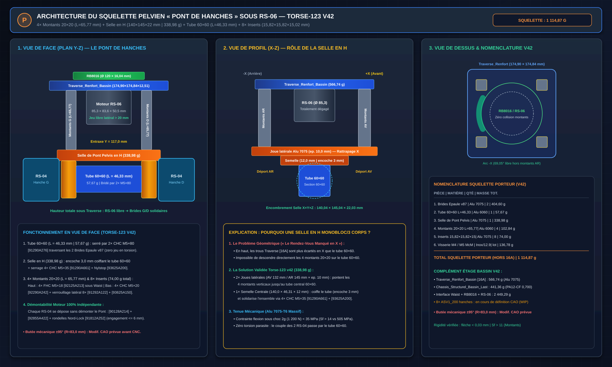
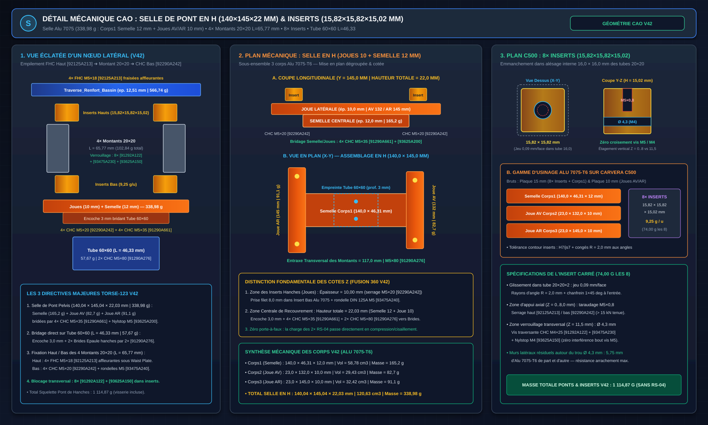
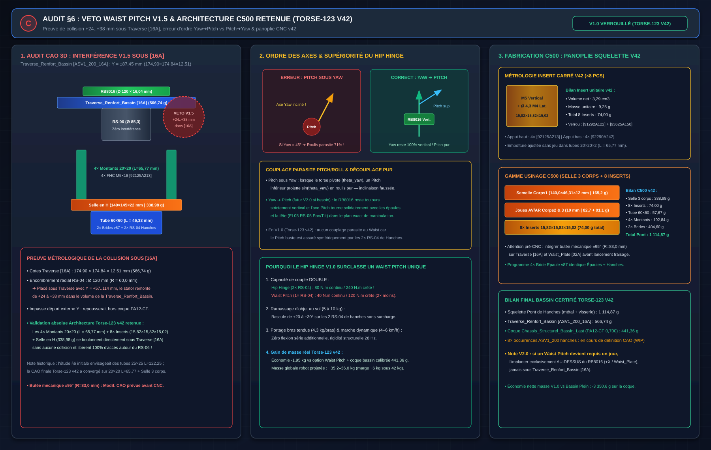

# 🦾 Étude d'Architecture & Dimensionnement RDM : Squelette Pelvien Porteur « Pont de Hanches » sous Actionneur RS-06

> **Statut** : Étude d'Ingénierie & R&D Active (Niveau 2 — Architecture CAO Réalignée `Torse-123 v42`, Zéro Lamage & Zéro Fraisure)  
> **Date de mise à jour** : 12 Novembre 2026  
> **Sous-système** : Bassin / Pelvis Mécanique (`Bassin_Pelvis`) — Jonction entre `Traverse_Renfort_Bassin` (sous `RS-06` Waist Yaw) et les 2 Actionneurs de Hanches `RobStride RS-04` (Hip Pitch)  
> **Philosophie** : Squelette Tubulaire Fermé en Boîte (« Pont de Hanches » Alu 7075-T6 & 6060-T6 : Montants `20x20x2` L=65,77 mm [`25,71 g`], Tube central `60x60x2` L=46,33 mm [`57,67 g`], Selle de Pont H=22,03 mm [`338,98 g`], Inserts Hanche `15,82x15,82x15,02` [`9,25 g`], Perçages Lisses Ø 5,30 mm Zéro Lamage / Zéro Fraisure, Bridage `CHC M5x80 [91290A276]` + `FHC M5x18 [92125A213]`) + Standardisation `Bride Epaule` + Carénage PA12-CF Non Porteur  

---

## 📑 Sommaire

- [1. Contexte Architectural & Analyse Critique de la Proposition Initiale](#1-contexte-architectural--analyse-critique-de-la-proposition-initiale)
  - [1.1 Objectif : Transposer la Philosophie « Squelette Métal + Coque Cosmétique » au Bassin](#11-objectif--transposer-la-philosophie--squelette-métal--coque-cosmétique--au-bassin)
  - [1.2 Ce qui est Validé dans l'Approche Proposée (Effet Boîte & Réutilisation Bride v87)](#12-ce-qui-est-validé-dans-lapproche-proposée-effet-boîte--réutilisation-bride-v87)
  - [1.3 Les 2 Vetos d'Ingénierie Système & la Réserve sur les Profilés](#13-les-2-vetos-dingénierie-système--la-réserve-sur-les-profilés)
- [2. Architecture Retenue : Le Squelette « Pont de Hanches » & Explication Détaillée des « Selles de Pont »](#2-architecture-retenue--le-squelette--pont-de-hanches---explication-détaillée-des--selles-de-pont-)
  - [2.1 Vue d'Ensemble des 5 Étages Fonctionnels](#21-vue-densemble-des-5-étages-fonctionnels)
  - [2.2 Comprendre Visuellement le Design de la « Selle de Pont » (140 x 145 x 22 mm, Semelle 12 mm + Joues 10 mm)](#22-comprendre-visuellement-le-design-de-la--selle-de-pont--140-x-145-x-22-mm-semelle-12-mm--joues-10-mm)
  - [2.3 Double Avantage Cinématique : Alignement Vertical Absolu (0,0 deg) & Traversée Directe du Bossage Bride v87](#23-double-avantage-cinématique--alignement-vertical-absolu-00-deg--traversée-directe-du-bossage-bride-v87)
- [3. Conception Détaillée des Composants & Plans d'Usinage CNC NestWorks C500](#3-conception-détaillée-des-composants--plans-dusinage-cnc-nestworks-c500)
  - [3.1 La Selle de Pont en Alu 7075-T6 (140,0 x 145,0 x 22,0 mm - Zéro Lamage et Zéro Fraisure)](#31-la-selle-de-pont-en-alu-7075-t6-1400-x-1450-x-220-mm---zéro-lamage-et-zéro-fraisure)
  - [3.2 Les 8 Inserts Carrés Option 1 Étagés en Z en Alu 7075-T6 (15,80 x 15,80 x 15,00 mm)](#32-les-8-inserts-carrés-option-1-étagés-en-z-en-alu-7075-t6-1580-x-1580-x-1500-mm)
  - [3.3 Les 4 Montants Verticaux en Tube Carré Alu 6060-T6 (20 x 20 x 2,0 mm, L = 65,75 mm)](#33-les-4-montants-verticaux-en-tube-carré-alu-6060-t6-20-x-20-x-20-mm-l--6575-mm)
  - [3.4 Le Tube Central Pont de Hanches (60 x 60 x 2,0 mm) & les 2 Brides v87](#34-le-tube-central-pont-de-hanches-60-x-60-x-20-mm--les-2-brides-v87)
  - [3.5 Stratégie d'Usinage C500, Zéro Lamage / Zéro Fraisure et Cartographie des Perçages Lisses Ø 5,30 mm](#35-stratégie-dusinage-c500-zéro-lamage--zéro-fraisure-et-cartographie-des-perçages-lisses-ø-530-mm)
- [4. Justification RDM Complète (Traction-Compression, Flexion, Cisaillement & Flèche)](#4-justification-rdm-complète-traction-compression-flexion-cisaillement--flèche)
  - [4.1 Cas de Charge Dimensionnants à la Hanche Bipède](#41-cas-de-charge-dimensionnants-à-la-hanche-bipède)
  - [4.2 Travail en Treillis des 4 Montants 20 x 20 x 2 mm (Traction / Compression / Flexion)](#42-travail-en-treillis-des-4-montants-20-x-20-x-2-mm-traction--compression--flexion)
  - [4.3 Tenue en Flexion et Cisaillement de la Selle de Pont (Hauteur Z = 22,0 mm / Joue 10,0 mm)](#43-tenue-en-flexion-et-cisaillement-de-la-selle-de-pont-hauteur-z--220-mm--joue-100-mm)
  - [4.4 Tenue en Roulis et Torsion du Tube Central 60 x 60 x 2 mm](#44-tenue-en-roulis-et-torsion-du-tube-central-60-x-60-x-2-mm)
  - [4.5 Synthèse des Facteurs de Sécurité & Bilan de Masse Comparatif](#45-synthèse-des-facteurs-de-sécurité--bilan-de-masse-comparatif)
- [5. Quincaillerie Normalisée McMaster-Carr, Couples de Serrage & Assemblage Fusion 360](#5-quincaillerie-normalisée-mcmaster-carr-couples-de-serrage--assemblage-fusion-360)
  - [5.1 Nomenclature des Fixations & Codes McMaster-Carr 1 Clic (Certifiés `Torse-123 v42`)](#51-nomenclature-des-fixations--codes-mcmaster-carr-1-clic-certifiés-torse-123-v42)
  - [5.2 Tableau Synthétique des Couples Dynamométriques & Outillage d'Atelier](#52-tableau-synthétique-des-couples-dynamométriques--outillage-datelier)
  - [5.3 Procédure Pas-à-Pas d'Assemblage sous Autodesk Fusion 360](#53-procédure-pas-à-pas-dassemblage-sous-autodesk-fusion-360)
- [6. Audit d'Ingénierie Système sur l'Option Waist Pitch (V1.5) : Veto d'Implantation sous Traverse et Verrouillage de la V1.0](#6-audit-dingénierie-système-sur-loption-waist-pitch-v15--veto-dimplantation-sous-traverse-et-verrouillage-de-la-v10)
  - [6.1 Preuve Métrologique de la Collision 3D d'un RS-04 (Ø 120 mm) sous la Traverse_Renfort_Bassin (174,9 x 174,8 mm)](#61-preuve-métrologique-de-la-collision-3d-dun-rs-04-ø-120-mm-sous-la-traverse_renfort_bassin-1749-x-1748-mm)
  - [6.2 Inversion Cinématique Pitch / Roll (Ordre des Axes Pitch sous Yaw vs Pitch sur Yaw)](#62-inversion-cinématique-pitch--roll-ordre-des-axes-pitch-sous-yaw-vs-pitch-sur-yaw)
  - [6.3 Capacité Native de Flexion du Tronc (« Hip Hinge ») par les 2 RS-04 de Hanches en V1.0 (80 N.m Continus / 240 N.m Crête)](#63-capacité-native-de-flexion-du-tronc--hip-hinge--par-les-2-rs-04-de-hanches-en-v10-80-nm-continus--240-nm-crête)
  - [6.4 Décision d'Architecture Certifiée : Verrouillage du Squelette V1.0 (10 Pièces en Plaque de 15,0 mm) et Porte de Décision MuJoCo](#64-décision-darchitecture-certifiée--verrouillage-du-squelette-v10-10-pièces-en-plaque-de-150-mm-et-porte-de-décision-mujoco)

---

## 1. Contexte Architectural & Analyse Critique de la Proposition Initiale

### 1.1 Objectif : Transposer la Philosophie « Squelette Métal + Coque Cosmétique » au Bassin

Dans l'architecture du Torse V2 ([DOSSIER_TECHNIQUE_Torse_Complet_D-Bot_V2.md](file:///Users/Shared/Mon%20Google%20Drive%20Physique/Documentation/01_Mecanique_et_Chassis/Torse_et_Bassin/DOSSIER_TECHNIQUE_Torse_Complet_D-Bot_V2.md)), le remplacement du caisson composite porteur par un squelette interne 100% métallique (Aluminium 7075-T651 usiné en 2.5D sur la fraiseuse CNC NestWorks C500 + profilés tubulaires marchands 6060-T6) a permis de diviser la masse structurelle tout en multipliant par 15 la rigidité d'ensemble.

Au niveau du bassin ([DOSSIER_TECHNIQUE_Bassin_et_Waist_D-Bot.md](file:///Users/Shared/Mon%20Google%20Drive%20Physique/Documentation/01_Mecanique_et_Chassis/Torse_et_Bassin/DOSSIER_TECHNIQUE_Bassin_et_Waist_D-Bot.md)), la problématique géométrique sous la platine supérieure `Traverse_Renfort_Bassin` (`174,90 x 174,84 x 12,51 mm`, Alu 7075-T6) présente une contrainte centrale majeure :
- Le moteur de lacet de taille **RobStride RS-06** (`Ø 85,31 x 50,54 mm`, `551 g`) plonge verticalement **au centre exact** sous la `Traverse_Renfort_Bassin` (de `Z = 1009,44 mm` jusqu'à `Z = 958,90 mm`).
- Cette occupation centrale interdit de faire descendre une colonne vertébrale unique au milieu du bassin.
- Le chemin d'efforts reliant la `Traverse_Renfort_Bassin` (en haut) aux deux moteurs de hanches **RobStride RS-04 Hip Pitch** (`120 N.m` pic, en bas à gauche et à droite) doit donc impérativement **contourner le moteur RS-06 par la périphérie** sous forme d'une cage ou d'un portique tubulaire à 4 colonnes.

---

### 1.2 Ce qui est Validé dans l'Approche Proposée (Effet Boîte & Réutilisation Bride v87)

La proposition initiale repose sur trois intuitions mécaniques d'une grande justesse :
1. **La fermeture en « Boîte » (Cadre Spatial à 4 Montants + Base Fermée)** :  
   En reliant le plafond rigide (`Traverse_Renfort_Bassin`) à une base rigide fermée par 4 montants verticaux (2 à droite, 2 à gauche), on constitue une **poutre-échelle / boîte spatiale (Box Truss)**. Au lieu de faire plier chaque tube individuellement en flexion sous le couple de tangage des hanches (`120 N.m`), le moment est décomposé en un **couple de forces axiales pures (traction sur le montant avant, compression sur le montant arrière)**. La rigidité angulaire augmente d'un ordre de grandeur.
2. **La Réutilisation Directe de la `Bride Epaule` (v87 Festonnée, 202,3 g)** :  
   Le moteur de hanche Pitch étant le même **RobStride RS-04** qu'à l'épaule ([STUDY_Calculs_FEA_Bride_Epaule_RS04.md](file:///Users/Shared/Mon%20Google%20Drive%20Physique/Documentation/01_Mecanique_et_Chassis/Torse_et_Bassin/STUDY_Calculs_FEA_Bride_Epaule_RS04.md)), la reprise à l'identique de la `Bride Epaule v87` en Aluminium 7075-T651 (avec son alésage pilote `Ø 97,0 mm H7`, ses 10 bossages M4 et son bossage arrière carré `55,80 x 55,80 x 15,00 mm`) permet d'usiner **4 pièces 100% identiques** (2 épaules + 2 hanches) avec le même programme CNC C500.
3. **La Décorrélation Coque / Structure** :  
   Dès lors que le squelette tubulaire reprend 100% des efforts entre le Waist et les deux RS-04 de hanches, le volumineux caisson `Chassis_Structurel_Bassin` (`ASV1_200_01C`) et ses capots ne jouent plus qu'un rôle d'habillage cosmétique et de guidage de câbles (imprimables en parois fines avec remplissage Gyroïde 15%).

---

### 1.3 Les 2 Vetos d'Ingénierie Système & la Réserve sur les Profilés

En tant qu'architecte système en robotique humanoïde bipède, deux points de l'esquisse initiale font l'objet d'un **veto technique formel** :

> [!CAUTION]
> **VETO N°1 (Absolu) — Interdiction de Faire Traverser les Tubes par les 3 Vis M4 du Stator RS-04** :
> 1. **Déficit Critique d'Adhérence (Glissement sous Choc)** : 3 vis M4 serrées à `3,0 N.m` développent une précharge de `3 x 4 100 N = 12 300 N`. Avec un coefficient de frottement `mu = 0,15`, l'effort tangentiel maximal avant glissement est de `12 300 x 0,15 = 1 845 N`. Or, lors d'un impact dynamique combiné au couple crête de `120 N.m`, un montant encaisse jusqu'à **`1 750 à 2 100 N`** : le facteur de sécurité au glissement tombe à **`Sf = 0,88 à 1,05`** ! Le tube glisserait par micro-déplacements à chaque foulée, cisaillant les vis M4 en fatigue.
> 2. **Écrasement des Parois Minces & Perte de Précharge Moteur** : Serrer des vis M4 longues (`L = 45 à 50 mm`) à travers un tube creux à paroi de `2,0 mm` fait fléchir la paroi, provoque une relaxation plastique (fluage sous tête) et détruit la précharge des 10 vis du stator RS-04.
> 3. **Risque Mortel pour le Bobinage du Stator RS-04 (Trous Borgnes 6,0 mm Max)** : La profondeur taraudée du carter arrière RS-04 est limitée à `6,0 mm` (`RS04 User Manual p. 10`). Empiler un tube + un jeu + une bride rend la maîtrise de la pénétration de filet hasardeuse (risque de talonnage sur les enroulements cuivre).
> 4. **Maintenance Atelier Impossible** : Si les vis du stator tiennent les tubes, déposer un moteur RS-04 désassemble la structure porteuse du bassin.  
> **Règle d'Or** : **Les 10 vis M4 du stator RS-04 fixent exclusivement le moteur sur la Bride v87. Le squelette tubulaire s'accouple uniquement sur le bossage carré `55,8 x 55,8 mm` de la Bride v87.**

> [!WARNING]
> **VETO N°2 (Absolu) — Zéro Tube Cintré ou en Baïonnette (« Dog-Leg »)** :
> Un tube vertical soumis à `2 100 N` de compression qui présenterait un coude ou un décalage latéral de `30 mm` subirait un moment de flexion parasite de `2 100 N x 0,030 m = 63 N.m`, faisant bondir la contrainte de `14,6 MPa` (compression pure) à plus de `90 MPa` avec une souplesse élastique multipliée par 8. **Les 4 montants verticaux doivent être 100% droits et strictement verticaux.**

> [!IMPORTANT]
> **OPTIMISATION GÉOMÉTRIQUE CERTIFIÉE (CAO `Torse-123 v42`) — Tube Carré `20 x 20 x 2,0 mm` (`L = 65,77 mm`) + Tube Central `60 x 60 x 2,0 mm` (`L = 46,33 mm`) + Selle de Pont (`H = 22,03 mm`, Masse `338,98 g`) + Inserts Hanche `15,82 x 15,82 x 15,02 mm` (`9,25 g`) + Vis `CHC M5x80 [91290A276]` & `FHC M5x18 [92125A213]`** :
> L'évaluation RDM, métrologique et CAO réelle (`Torse-123 v42`) confirme qu'un profilé carré en Aluminium 6060-T6 de **`20,0 x 20,0 x 2,0 mm`** raccourci à **`L = 65,77 mm`** (`A = 144,0 mm2`, `I = 7 872 mm4`, `W = 787,2 mm3`, charge critique de flambement d'Euler `P_cr = 1,24 MN`) associé à une **Selle de Pont de hauteur totale `Z = 22,03 mm` (encombrement `140,04 x 145,04 x 22,03 mm`, masse réelle CAO = `338,98 g` en Alu 7075)** et à **8 inserts de `15,82 x 15,82 x 15,02 mm` étagés en Z (`4x Bas [ASV1_200_12]` + `4x Haut [ASV1_200_13]`, masse unitaire `9,25 g`)** :
> 1. **Suppression Totale des Lamages et Fraisures inférieures (Zéro Lamage & Zéro Fraisure sur Selle)** : Tous les perçages de fixation M5 de la Selle de Pont sont de simples **perçages lisses débouchants `Ø 5,30 mm`** sur faces planes (`FHC M5x18 [92125A213]` réservées au plafond affleurant de la `Traverse_Renfort_Bassin`). Cela élimine tout affaiblissement de matière sur la Selle, offre un appui plan parfait sous tête et rondelle DIN 125A, et simplifie l'usinage CNC sur la NestWorks C500.
> 2. **Visserie Standardisée Robuste & Dépassement Fileté Validé CAO (`v42`)** :
>    - Les 4 inserts hanche bas sont fixés par-dessous à travers la joue de `10,0 mm` de la selle par **4 vis `CHC M5 x 20 mm` Inox (`92290A242`, `4,47 g`)** *(variante Acier 12.9 : `91290A128`)* + **4 rondelles `DIN 125A M5` (`93475A240`)** ; les 4 inserts hanche haut sont bridés depuis la face supérieure de la `Traverse_Renfort_Bassin` par **4 vis `FHC M5 x 18 mm` (`92125A213`, `2,83 g`)**.
>    - La selle de pont est solidarisée par **4 vis `CHC M5 x 35 mm` (`91290A661`, `6,62 g`)** + **8 rondelles `DIN 125A M5` (`93475A240`)** + **4 écrous freins `Nylstop M5` (`93625A200`, `1,48 g`)**.
> 3. **Résout l'alignement direct sur le bossage de `15,0 mm` des 2 `Bride Epaule` (`L_pont = 46,33 mm`)** : le tube central `Tube transverse Hanches [60x60]` coupé à **`L = 46,33 mm`** (`57,67 g`) relie directement les 2 bossages de `15,0 mm` (`Bride` Droit et Gauche) sous la semelle de la Selle de Pont (`Z = 925,66..934,66 mm`). L'empilement vertical total mesure **`69,00 mm`** (haut appui rondelle `Z = 934,64 mm` ➔ bas tube `Z = 865,64 mm`), portant à **`~76,0 mm`** avec 2 rondelles + écrou Nylstop `M5` (`5,0 mm`) : le bridage vertical exige impérativement **2 vis `CHC M5 x 80 mm` (`91290A276`, `14,03 g`)** + **4 rondelles `93475A240`** + **2 écrous `Nylstop M5` (`93625A200`)** *(les vis `M5x70` étant réservées au torse/épaules car trop courtes de `~6 mm` sur les hanches)*.

---

## 2. Architecture Retenue : Le Squelette « Pont de Hanches » & Explication Détaillée des « Selles de Pont »

### 2.1 Vue d'Ensemble des 5 Étages Fonctionnels

L'architecture retenue conserve intégralement le concept de « boîte tubulaire à 4 montants + base fermée », tout en résolvant les liaisons basses grâce à la réutilisation de l'assemblage d'épaule (`Bride Epaule v87` + `Tube Carré 60 x 60 x 2 mm` `L = 46,33 mm`) couplé à la structure d'interface compacte appelée **« Selle de Pont » (`140,04 x 145,04 x 22,03 mm`, masse CAO `v42` `338,98 g`)** :



*Blueprint vectoriel d'ingénierie (DOC-STUDY-PELVIS-V2.2) — Vue de Face (Plan Y-Z), Vue de Profil Sagittale (Plan X-Z) et Vue de Dessus (Plan X-Y) du Squelette Pelvien « Pont de Hanches » réaligné CAO `Torse-123 v42` (Tube 60x60 `L = 46,33 mm`, vis `M5x80 [91290A276]` & `FHC M5x18 [92125A213]`).*

| Étage / Sous-Ensemble | Composant & Matériau | Dimensions Finies | Qté | Fonction Mécanique dans la « Boîte » |
| :--- | :--- | :---: | :---: | :--- |
| **1. Plafond Rigide (Haut)** | `Traverse_Renfort_Bassin [ASV1_200_16A]` (Alu 7075-T6) | `174,90 x 174,84 x 12,51 mm` (`566,74 g`) | 1 | Reçoit le roulement `RB8016` (dessus), le stator `RS-06` (dessous au centre) et ancre les 4 montants via **4 vis `FHC M5x18 [92125A213]`** dans les 4 `Insert Hanche Haut [ASV1_200_13]` (entraxe sagittal `117,0 mm`, entraxes Y Avant `109,0 mm` / Arrière `122,0 mm`). |
| **2. Liaisons d'Extrémités Montants** | `Insert Hanche Bas [ASV1_200_12]` & `Haut [ASV1_200_13]` (Alu 7075) | **`15,82 x 15,82 x 15,02 mm`** (`9,25 g`) | **8** | **Option 1 étagée en Z** (`74,00 g` au total) : 4 vissés sur les joues de la Selle par `CHC M5x20 [92290A242]` + 4 vissés sous la Traverse par `FHC M5x18 [92125A213]`, plus **8x `CHC M4x25 [91292A122]`** transversales selon Y. |
| **3. Colonnes Verticales** | `Montant_de_Hanche [ASV1_200_11]` (Tube carré Alu 6060-T6) | **`20,02 x 20,02 x 65,77 mm`** | **4** | 4 tubes droits verticaux travaillant en traction/compression pure (`25,71 g` unitaire, `102,84 g` les 4). Dégagent le moteur RS-06 central. |
| **4. Structure Basse Sagittale (X)** | **`Selle de Pont Pelvis [ASV1_200_10]`** (Alu 7075-T651) | **`140,04 x 145,04 x 22,03 mm`** (Semelle `12 mm` + Joues `10 mm`) | **1 Ens.** | **Structure de liaison basse en H** (`338,98 g` en Alu 7075) : posée en croix sur le tube `60 x 60`, elle recueille les pieds des montants Avant et Arrière. **Zéro lamage / Zéro fraisure**. Assemblée par `4x CHC M5x35 [91290A661]` + `4x Nylstop M5 [93625A200]`. |
| **5. Pont Central Transversal (Y) & Brides** | `Tube transverse Hanches [60x60]:2` (6060-T6) + 2x `Bride Epaule` (7075) | Tube `60,02 x 46,33 x 60,02 mm` (`57,67 g`) + 2 Brides (`202,30 g`) | 1 + 2 | **Ferme les côtés Gauche-Droite (axe Y) du pont** : les bossages `15,0 mm` des 2 Brides s'emmanchent aux extrémités du tube et sont bridés verticalement avec la Selle par **2x `CHC M5x80 [91290A276]` + `Nylstop M5 [93625A200]`**. |

---

### 2.2 Comprendre Visuellement le Design de la « Selle de Pont » (140 x 145 x 22 mm, Semelle 12 mm + Joues 10 mm)

Pourquoi ne peut-on pas faire descendre directement les 4 montants verticaux `20 x 20 mm` sur le gros tube horizontal `60 x 60 mm` qui relie les deux hanches ?  
L'examen du **Panneau 2 (Vue de Profil X-Z)** du schéma ci-dessus et de la vue éclatée ci-dessous rend la réponse immédiate :



*Blueprint vectoriel d'atelier — Panneau 1 : Vue éclatée d'emboîtement vertical d'un côté (Option 1 étagée en Z, Zéro Lamage / Zéro Fraisure). Panneau 2 : Plan de cotation CNC C500 de la Selle de Pont (Hauteur Z = 22,0 mm : Semelle 12 mm + Joues 10 mm, perçages lisses débouchants Ø 5,30 mm). Panneau 3 : Plan de cotation de l'Insert hanche Option 1 (15,8 x 15,8 x 15 mm, masse 9,31 g).*

#### A. Le Problème Géométrique (« Le Rendez-Vous Manqué en X »)
1. **En haut (`Traverse_Renfort_Bassin`)** :  
   Les 4 trous d'angles existants sont placés aux 4 coins de la plaque, à **`X = +56,08 mm` (Avant)** et **`X = -56,08 mm` (Arrière)** par rapport à l'axe central du robot. L'entraxe Avant-Arrière entre le montant Avant et le montant Arrière d'un même côté est donc de **`112,16 mm`**.
2. **En bas (au niveau de l'axe des moteurs RS-04 de Hanches)** :  
   Le gros tube carré `60 x 60 x 2 mm` (qui s'emmanche sur le bossage carré `55,8 x 55,8 mm` de la Bride v87 de droite et de la Bride v87 de gauche) traverse le bassin de gauche à droite (le long de l'axe Y).  
   Mais dans le sens Avant-Arrière (axe X), ce tube `60 x 60 mm` ne mesure que **`60,0 mm` de large** (il s'étend seulement de **`X = -30,0 mm` à `X = +30,0 mm`**) !
3. **Conséquence** :  
   Comme les deux montants verticaux descendent tout droit à `X = -56,08 mm` (Arrière) et `X = +56,08 mm` (Avant), leurs axes arrivent à **`26,08 mm` devant la face avant** et **`26,08 mm` derrière la face arrière** du tube `60 x 60 mm` ! Sans pièce intermédiaire, les tubes verticaux passeraient à côté du tube `60 x 60 mm` dans le vide.

#### B. La Solution Mécanique Optimisée : La « Selle de Pont » en H (Joues 10 mm + Semelle 12 mm, Encombrement 140 x 145 x 22 mm)
Pour relier les pieds des montants Avant (`X_c = +113,34 mm`) et des montants Arrière (`X_c = -3,66 mm`, entraxe `117,00 mm`) au-dessus du tube central `60 x 60 mm` (`X = 24,63 à 84,65 mm`), on pose **en croix par-dessus le tube `60 x 60 mm`** une structure robuste en Aluminium 7075-T651 de **hauteur totale `Z = 22,03 mm` (encombrement `140,04 x 145,04 x 22,03 mm`, masse réelle CAO `v42` `338,98 g`)** :
1. **Pourquoi s'appelle-t-elle une « Selle » ?**  
   Parce que sa géométrie enfourche (chevauche comme une selle de cheval) les faces du tube central `60 x 60 mm` :
   - La semelle centrale d'embase repose sur la face supérieure du tube `60 x 60 mm` (`Z = 922,64 à 934,64 mm`, largeur entre joues `46,33 mm`).
   - Les deux joues latérales (épaisseur `10,0 mm`, jusqu'à `Z = 944,67 mm`) encadrent et reçoivent les pieds des 4 montants `20 x 20` (entraxe Y Avant `109,00 mm`, Arrière `122,00 mm`).
   - La structure est **bloquée positivement en translation Avant-Arrière (axe X)** et **en rotation (lacet Rz)**.
2. **Bridage Vertical Traversant `Selle + Tube 60x60 + Bossages Brides` par 2 Vis `CHC M5 x 80 mm` (`91290A276`)** :  
   - **Accise parfaite des montants `20 x 20 mm`** : Aux quatre extrémités des joues, la face supérieure plane offre une portée complète sous chaque tube vertical `20,02 x 20,02 mm`.
   - **Traversée directe des bossages de `15,0 mm` des 2 `Bride Epaule` par les vis `CHC M5 x 80 mm` (`91290A276`)** :  
     Le tube central `60 x 60 x 2 mm` mesure **`L_pont = 46,33 mm`** (`Y = -14,49 à +31,83 mm`, masse `57,67 g`) et reçoit de part et d'autre les bossages `55,8 x 55,8 x 15,0 mm` des brides de hanches.  
     Les 2 trous verticaux `Ø 5,30 mm` (`X = 54,74 mm`, `Y = -7,98 mm` et `Y = +25,32 mm`, soit à `~7,51 mm` de chaque bout de bossage) traversent l'empilement de **`69,00 mm`** (appui rondelle supérieure `Z = 934,64 mm` ➔ bas du tube `Z = 865,64 mm`). Avec 2 rondelles `93475A240` et l'écrou frein **`Nylstop M5` (`93625A200`)** sous le tube (`Z = 859,64..864,72 mm`), l'assemblage requiert impérativement **2 vis `CHC M5 x 80 mm` (`91290A276`)** *(longueur totale `85,32 mm` hors tête/fût)*.
3. **Comment reçoit-elle les pieds des montants Avant et Arrière sans aucun lamage ni fraisure ?**  
   Sur la face supérieure plane de chaque extrémité de joue, on fixe un **`Insert Hanche Bas [ASV1_200_12]` (`15,82 x 15,82 x 15,02 mm`, masse `9,25 g`)** à l'aide d'une **vis `CHC M5 x 20 mm` (`92290A242` Inox / `91290A128` Acier 12.9)** et d'une **rondelle `DIN 125A M5` (`93475A240`)** insérée **par-dessous** à travers un simple **perçage lisse débouchant `Ø 5,30 mm`** :
   - **Épaisseur traversée** : `10,00 mm` de métal plein + `1,00 mm` de rondelle = `11,00 mm` sous tête (`Z_vis = 928,64..953,96 mm`).
   - **Prise de filet dans l'insert** : `20,00 - 11,00 =` **`9,00 mm`** (prise effective `8,00 mm`), laissant une **garde verticale de sécurité de `1,35 mm`** sous le perçage transversal M4 (`Z_local = 11,50 mm`) !
   - Les montants verticaux `20 x 20 x 2 mm` (`L = 65,77 mm`) s'emmanchent ensuite sur ces inserts et s'appuient à plat sur les joues planes.
4. **Assemblage Interne du Pont de Selle (`4x CHC M5x35 [91290A661]`)** :  
   La semelle centrale d'embase et les deux joues latérales sont fermement solidarisées par **4 vis `CHC M5 x 35 mm` (`91290A661`)**, **8 rondelles `DIN 125A M5` (`93475A240`)** et **4 écrous freins `Nylstop M5` (`93625A200`)** (`Z = 910,34..950,66 mm`), créant un caisson indéformable de `22,03 mm` de haut.

---

### 2.3 Double Avantage Cinématique : Alignement Vertical Absolu (0,0 deg) & Traversée Directe du Bossage Bride v87

Ce design à « Pont Central `60 x 60` + Selle de Pont en H (`22,03 mm`) + 4 Montants `20 x 20` » procure trois avantages décisifs :
1. **Alignement Vertical Parfait des 4 Montants en X ET en Y (`0,00 mm` de déport)** :  
   Les entraxes entre les 4 trous de la `Traverse_Renfort_Bassin` (`X_avant - X_arriere = 117,00 mm`, `Y_avant = 109,00 mm`, `Y_arriere = 122,00 mm`) correspondent au centième de millimètre aux 4 perçages de la `Selle de Pont`. Les 4 montants `20 x 20 x 2 mm` descendent donc **strictement à la verticale (`Angle X = 0,0 deg`, `Angle Y = 0,0 deg`)**.
2. **Zéro Modification des `Bride Epaule` & Traversée Directe du Bossage (`L_pont = 46,33 mm`)** :  
   En alignant les 2 perçages verticaux de la Selle à `Y = -7,98 mm` et `Y = +25,32 mm` (centrés sur les bossages `15,0 mm` des deux `Bride Epaule`), les **2 vis verticales `CHC M5 x 80 mm` (`91290A276`)** traversent simultanément la **Selle de Pont + le Tube `60 x 60` + le Bossage (`15,0 mm`) des Brides** jusqu'aux écrous `Nylstop M5 [93625A200]`. Le bossage massif (`55,8 x 55,8 mm`) sert lui-même d'entretoise anti-écrasement indéformable.
3. **Liberté Totale de Réglage de l'Entraxe Y des Hanches (Mode Élargi)** :  
   Si, lors des essais dynamiques, vous souhaitez modifier l'entraxe Y entre les deux moteurs `RS-04` (par exemple `L_tube = 200 mm` ou `240 mm`), **aucune pièce usinée ne change** : vous coupez simplement un tronçon de tube `60 x 60 x 2 mm` plus long.

---

## 3. Conception Détaillée des Composants & Plans d'Usinage CNC NestWorks C500

### 3.1 La Selle de Pont en Alu 7075-T6 (140,0 x 145,0 x 22,0 mm - Zéro Lamage et Zéro Fraisure)

La structure `Selle de Pont Pelvis [ASV1_200_10]:1` validée dans l'audit métrologique CAO `Torse-123 v42` est réalisée en Aluminium **7075-T651** (`rho = 2,81 g/cm3`) avec les caractéristiques dimensionnelles suivantes :
- **Dimensions extérieures hors-tout** : Longueur `X = 140,04 mm` (`X = -15,18..124,86`) x Largeur `Y = 145,04 mm` (`Y = -63,85..81,19`) x Hauteur totale `Z = 22,03 mm` (`Z = 922,64..944,67`).
- **Volume total & Masse réelle CAO (`Torse-123 v42`)** :
  - Volume total : **`120,63 cm3`**.
  - Masse totale en Aluminium 7075-T651 : **`338,98 g`**.
- **Suppression Totale des Lamages et Fraisures inférieures (Zéro Lamage & Zéro Fraisure sur Selle)** :
  - Tous les trous de passage de vis M5 sont des **perçages lisses débouchants `Ø 5,30 mm`** (rayon `2,65 mm`), réalisés sur faces rigoureusement planes.
  - **Zéro fraisure conique à 90°** : aucune fragilisation de l'arête d'entrée, aucune réduction locale d'épaisseur de paroi.
  - **Zéro lamage cylindrique à fond plat** : la joue conserve l'intégralité de son épaisseur brute de **`10,00 mm`** et la semelle conserve ses **`12,00 mm`** pleins.
  - **Avantages d'atelier & d'assemblage** :
    1. Usinage direct sur la NestWorks C500 avec un simple foret carbure `Ø 5,30 mm` et ébavurage léger `0,2 mm x 45°` (gain de temps d'usinage, zéro reprise d'outil de forme, zéro vibration).
    2. Répartition uniforme de la pression de contact sous les rondelles plates `DIN 125A M5` (`93475A240`), sans concentration de contraintes en fond de lamage.
- **Assemblage Structurel de la Selle (4 Vis Traversantes M5)** :
  - 4 perçages lisses `Ø 5,30 mm` traversent conjointement la semelle centrale (`12 mm`) et les joues (`10 mm`) pour recevoir **4 vis `CHC M5 x 35 mm` (`91290A661`)**, **8 rondelles `DIN 125A M5` (`93475A240`)** et **4 écrous freins `Nylstop M5` (`93625A200`)**.
- **Perçages d'Ancrage des Inserts aux Extrémités** :
  - Entraxe sagittal exact : **`117,00 mm`** (`X_arriere = -3,66 mm`, `X_avant = +113,34 mm`), entraxes Y `109,00 mm` (Avant) et `122,00 mm` (Arrière).
  - Perçage lisse débouchant `Ø 5,30 mm` à travers la joue de `10,0 mm`.
  - Fixation de l'Insert Hanche Bas par vis **`CHC M5 x 20 mm` (`92290A242` Inox / `91290A128` Acier 12.9)** + rondelle `DIN 125A M5` (`93475A240`) : pénétration de `9,0 mm` dans l'insert (prise de filet `8,0 mm`, garde `1,35 mm` sous la vis M4).

---

### 3.2 Les 8 Inserts Carrés Option 1 Étagés en Z en Alu 7075-T6 (15,80 x 15,80 x 15,00 mm)

Les 8 inserts (`4 en haut` sous la `Traverse_Renfort_Bassin` + `4 en bas` sur les `Selles de Pont`) sont **100% identiques**, adoptent l'**Option 1 (Étagement en Z — 100% centré à `Y_local = 0,00 mm`)** et sont usinés dans la **même tôle brute d'Aluminium 7075-T651 de `15,00 mm` d'épaisseur** :
- **Section extérieure carrée** : **`15,80 x 15,80 mm (-0,05 / 0,00 mm)`** pour un emmanchement glissant doux (jeu fonctionnel de `0,10 mm` par face) à l'intérieur du tube carré `20,0 x 20,0 x 2,0 mm` (section intérieure `16,00 x 16,00 mm`).
- **Hauteur axiale Z** : **`15,00 mm`** (épaisseur native du brut Blockenstock `15 mm`, zéro surfaçage requis).
- **Congés des 4 arêtes verticales** : **`R = 1,90 à 2,00 mm`** pour dégager le rayon de filage interne du tube extrudé `6060-T6` et garantir un placage plan sur les 4 faces internes.
- **Chanfrein d'entrée supérieur (côté introduction dans le tube)** : **`1,00 mm x 45 deg`** sur les 4 côtés pour guider l'engagement du tube sans accrochage.
- **Zone Basse (`Z_local = 0,00 à 8,00 mm`) — Taraudage Vertical Central (`X_local = 0,00 mm ; Y_local = 0,00 mm`)** :
  - Lors de la Phase 1 sur la C500, l'avant-trou au foret carbure **`Ø 4,20 mm`** et le taraudage **`M5 x 0,8 mm`** sont réalisés sur **`8,50 mm` de profondeur utile** (ou débouchant), avec chanfrein d'entrée `0,5 mm x 45 deg`.
  - Au montage, la vis verticale **`CHC M5 x 20 mm` (`92290A242` Inox / `91290A128` Acier 12.9)** avec sa rondelle `DIN 125A M5` (`93475A240`) s'engage en bas sur **`8,00 mm` à `9,00 mm`** dans l'Insert Bas (en haut sous la Traverse, les 4 Inserts Haut reçoivent les vis affleurantes **`FHC M5 x 18 mm [92125A213]`**).
  - **Tenue à l'arrachement des filets M5 sur `8,00 mm` en 7075-T6** :  
    `A_shear = pi x 4,50 mm x (0,75 x 8,00 mm) = 84,8 mm2` -> `F_arrachement = 84,8 mm2 x 190 MPa =` **`16 115 N (~1,64 tonne)`**, soit un facteur de sécurité **`Sf = 15,1`** face à l'effort maximal de traction d'un montant (`1 070 N`) !
- **Zone Haute (`Z_local = 11,50 mm`) — Perçage Horizontal Transversal (`Ø 4,30 mm`) 100% Centré** :
  - Axe du trou : orienté **transversalement selon l'axe Y (`size Y = 29,04 mm` pour la vis M4x25 en CAO `v42`)** et situé **exactement au centre de la face** à la hauteur **`Z_local = 11,50 mm`** (`Z_bas = 956,15 mm`, `Z_haut = 998,90 mm`).
  - **Vérification géométrique d'étagement vertical Z (Zéro collision M5 / M4)** :  
    - La vis verticale `M5` s'arrête au plus haut à **`Z_local = 9,00 mm`** (engagement nominal `8,00 mm`).  
    - Le trou horizontal `Ø 4,30 mm` (rayon `R_M4 = 2,15 mm`) s'étend verticalement de `11,50 - 2,15 =` **`9,35 mm`** à `11,50 + 2,15 =` **`13,65 mm`**.  
    - Il existe donc une **garde verticale franche de sécurité de `9,35 - 8,00 = 1,35 mm`** entre la pointe de la vis M5 et la génératrice inférieure de la vis transversale `CHC M4 x 25 mm` !
  - **Épaisseurs de parois maximales** :  
    En gardant le trou `Ø 4,30 mm` centré, l'insert conserve **`(15,82 - 4,30) / 2 = 5,76 mm` d'Aluminium 7075-T6 massif de chaque côté** et **`9,35 mm` de matière sous l'axe** pour reprendre la traction du montant !
- **Volume net & Masse unitaire CAO (`Torse-123 v42`)** : Volume net réel `V_net = 3,29 cm3` x `2,81 g/cm3` = **`9,25 g`** par insert (**`74,00 g`** pour les 8 inserts).

---

### 3.3 Les 4 Montants Verticaux en Tube Carré Alu 6060-T6 (20 x 20 x 2,0 mm, L = 65,75 mm)

- **Profilé commercial** : Tube carré en Aluminium **6060-T6** de **`20,02 x 20,02 mm`**, épaisseur de paroi **`t = 2,0 mm`** (section creuse intérieure `16,0 x 16,0 mm`, aire de section métallique `A = 144,0 mm2`, moment quadratique `I = 7 872,0 mm4`, module de flexion `W = 787,2 mm3`, masse linéique `0,389 kg/m`).
- **Dégagement accru autour du moteur `RS-06` central** :  
  Le passage de `25 x 25 mm` à `20 x 20 mm` recule la face interne des 4 montants de `+2,50 mm`, dégageant largement le stator du `RobStride RS-06`.
- **Longueur réelle CAO unitaire (`L_montant = 65,77 mm`)** :  
  Dans l'assemblage actif `Torse-123 v42` (`Montant de Hanche Avant/Arriere Gauche/Droit [ASV1_200_11]`) :
  - Face inférieure d'appui sous `Traverse_Renfort_Bassin` : `Z_haut = 1010,41 mm`.
  - Face supérieure de la `Selle de Pont` : `Z_bas = 944,64 mm`.
  - Longueur finie exacte des 4 tubes : **`L_montant = 1010,41 - 944,64 = 65,77 mm`**.
- **Perçages transversaux centrés selon Y sur chaque montant (`Ø 4,30 mm`)** :
  - **En bas (Côté Selle de Pont — Butée Franche)** : 1 perçage traversant `Ø 4,30 mm` (selon Y en `v42`) situé au milieu de la face (`10,00 mm` des bords) et à `Z_local = 11,50 mm` du chant inférieur (`Z = 956,15 mm`).
  - **En haut (Côté Traverse)** : 1 perçage traversant `Ø 4,30 mm` (selon Y en `v42`) situé au milieu de la face et à `Z_local = 11,50 mm` du chant supérieur (`Z = 998,90 mm`).
- **Masse des 4 montants (`v42`)** : Volume unitaire `9,52 cm3` x `2,70 g/cm3` = **`25,71 g`** par montant, soit **`102,84 g`** au total pour les 4 montants.

---

### 3.4 Le Tube Central Pont de Hanches (60 x 60 x 2,0 mm) & les 2 Brides v87

1. **Réutilisation 100% Identique des 2 `Bride Epaule v87` (Alu 7075-T651, `202,30 g` unitaire)** :
   - Aucune retouche CAO ni modification du programme d'usinage C500 ([DOSSIER_TECHNIQUE_Torse_Complet_D-Bot_V2.md §5.A](file:///Users/Shared/Mon%20Google%20Drive%20Physique/Documentation/01_Mecanique_et_Chassis/Torse_et_Bassin/DOSSIER_TECHNIQUE_Torse_Complet_D-Bot_V2.md#L498-L564) et [STUDY_Calculs_FEA_Bride_Epaule_RS04.md](file:///Users/Shared/Mon%20Google%20Drive%20Physique/Documentation/01_Mecanique_et_Chassis/Torse_et_Bassin/STUDY_Calculs_FEA_Bride_Epaule_RS04.md)).
   - Chaque bride reçoit le stator de son moteur `RobStride RS-04` via l'emboîtement `Ø 97,00 mm H7` (profondeur `13,80 mm`) et les **10 vis CHC M4 classe 12.9 + rondelles Nord-Lock M4** (6x `M4 x 12 mm` en Zone 1 mince de `5,0 mm` + 4x `M4 x 25 mm` en Zone 2 épaisse de `18,2 mm`).
   - Son bossage arrière carré **`55,80 x 55,80 x 15,00 mm`** (avec poche d'allègement `44 x 44 mm` et perçage vertical `Ø 5,30 mm` centré à `7,50 mm` de l'épaulement) s'emmanche directement dans le tube `60 x 60 x 2,0 mm`.
2. **Tube Central `Tube transverse Hanches [60x60]` (Alu 6060-T6, section `60,0 x 60,0 x 2,0 mm`, `L_pont = 46,33 mm` en CAO `v42`)** :
   - **En configuration nominale `Torse-123 v42` (Brides enserrant directement le pont sous la semelle de la Selle de Pont, `Y_tube = -14,49 à +31,83 mm`)** :
     - Longueur réelle du tube `60 x 60 x 2 mm` : **`L_pont = 46,33 mm`** (`V = 21,36 cm3`, masse réelle CAO = **`57,67 g`**).
     - Les 2 perçages verticaux `Ø 5,30 mm` sont percés à travers les parois supérieure et inférieure du tube `60 x 60` à **`Y = -7,98 mm` et `Y = +25,32 mm`** (entraxe **`33,30 mm`**, à `~7,51 mm` du bout de chaque bossage `15,0 mm` des `Bride Epaule`) : chaque vis **`CHC M5 x 80 mm` (`91290A276`)** traverse simultanément le **redan supérieur de la Selle de Pont (`Z = 934,64`) + le Tube `60 x 60` (`60,0 mm`) + le Bossage (`15,0 mm`) de la Bride v87** jusqu'à son écrou **`Nylstop M5` (`93625A200`)** sous `Z = 865,64 mm`.

---

### 3.5 Stratégie d'Usinage C500, Zéro Lamage / Zéro Fraisure et Cartographie des Perçages Lisses Ø 5,30 mm

La fabrication des pièces du bassin sur la fraiseuse CNC NestWorks C500 bénéficie grandement de la **règle Zéro Lamage / Zéro Fraisure** :
- **Suppression intégrale des lamages et fraisures** : aucun outil de fraisure conique `90°` ni fraise à lamer n'est nécessaire pour les trous de fixation M5 de la Selle de Pont.
- **Opération mono-outil perçage** : tous les passages de vis M5 sont réalisés avec un **foret carbure DLC `Ø 5,30 mm` unique**, suivi d'un simple ébavurage `0,2 mm x 45°` pour casser les arêtes vives.
- **Intégrité de matière maximale** : les joues latérales conservent leur pleine épaisseur de **`10,00 mm`** et la semelle centrale ses **`12,00 mm`**, éliminant tout affaiblissement mécanique ou risque de déformation lors du serrage dynamométrique.

#### Cartographie Complète des Perçages & Usinages d'Atelier (CNC C500)

| Pièce & Opération | Coordonnées Locales `(X ; Y)` | Outil & Diamètre | Usinage Face Supérieure (`+Z`) | Usinage Face Inférieure (`-Z`) | Fonction & Vérification Métrologique |
| :--- | :---: | :---: | :--- | :--- | :--- |
| **Selle de Pont — Bridage Vertical M5 Bride (`v42`)** | `X = 54,74 ; Y = -7,98 / +25,32` *(±16,65 mm du centre)* | Foret carbure Ø 5,30 mm | Face plane (appui rondelle DIN 125A M5) | Perçage débouchant `Ø 5,30 mm` + ébavurage `0,2 mm x 45°` | Traversée par vis **`CHC M5 x 80 mm` (`91290A276`)** alignée sur les bossages `15 mm` des Brides. |
| **Selle de Pont — Ancrage Inserts Hanche Bas (x4)** | `X_ar = -3,66 ; X_av = +113,34` *(Y asym. 109/122)* | Foret carbure Ø 5,30 mm | Perçage débouchant `Ø 5,30 mm` (appui pied tube/insert) | Perçage débouchant `Ø 5,30 mm` (**ZÉRO LAMAGE / ZÉRO FRAISURE**) | Reçoit vis **`CHC M5 x 20 mm` (`92290A242`)** + rondelle M5 (`93475A240`). Haut sous Traverse : `4x FHC M5x18 [92125A213]`. |
| **Selle de Pont — Assemblage Interne Pont (x4)** | `X = -3,66 / +112,94` ; `Y = +0,67 / +16,67` | Foret carbure Ø 5,30 mm | Perçage débouchant `Ø 5,30 mm` (face plane) | Perçage débouchant `Ø 5,30 mm` (face plane) | Liaison semelle `12 mm` + joues `10 mm` par 4x `CHC M5 x 35 mm` (`91290A661`) + Nylstop M5 (`93625A200`). |
| **Selle de Pont — Contour Hors-Tout (`v42`)** | BBox `140,04 x 145,04 x 22,03 mm` | Fraise carbure DLC Ø 6,0 mm | Chanfrein continu `0,5 mm x 45°` (hors appuis tubes `20x20`) | Chanfrein continu `0,5 mm x 45°` | Encombrement `140,04 x 145,04 x 22,03 mm` (Masse réelle CAO = **`338,98 g`**). |
| **Insert Hanche (x8) — Taraudage Axial M5** | `X = 0,00 ; Y = 0,00` | Foret Ø 4,20 mm + Taraud M5 x 0,8 | Chanfrein d'entrée `0,5 mm x 45°` | **Taraudage M5 utile `8,0 à 9,0 mm`** (trou Ø 4,20 mm débouchant ou prof. `9,0 mm`) | La vis `CHC M5 x 20 mm` s'engage sur `8,0 mm` (`1,6 x d`, tenue à l'arrachement `> 16,1 kN`). |
| **Insert Hanche (x8) — Contour Carré 15,8x15,8** | `15,80 x 15,80 mm` | Fraise carbure DLC Ø 6,0 mm | **Chanfrein d'entrée `1,00 mm x 45°`** (introduction tube) | Ébavurage léger `0,2 mm x 45°` (embase plane) | **4 congés verticaux `R = 1,90 à 2,00 mm`** pour épouser le rayon interne du tube `20 x 20 x 2`. |
| **Insert Hanche (x8) — Trou Transversal M4** | **`Y = 0,00 ; Z = 11,50 mm`** | Foret carbure Ø 4,30 mm | Perçage traversant `Ø 4,30 mm` selon X **100% centré à `Y = 0,00`** + ébavurage `0,2 mm` | — | Passe entre `Z = 9,35 et 13,65 mm` (**`1,35 mm` de garde verticale franche** au-dessus de la vis M5). |

---

## 4. Justification RDM Complète (Traction-Compression, Flexion, Cisaillement & Flèche)

### 4.1 Cas de Charge Dimensionnants à la Hanche Bipède

Lors de la phase d'appui unipodal dynamique avec réception de pas ou freinage d'urgence (`K_dyn = 2,5 à 3,0`), une hanche transmet au squelette pelvien les sollicitations maximales simultanées suivantes ([DOSSIER_TECHNIQUE_Bassin_et_Waist_D-Bot.md §2 & §5.3](file:///Users/Shared/Mon%20Google%20Drive%20Physique/Documentation/01_Mecanique_et_Chassis/Torse_et_Bassin/DOSSIER_TECHNIQUE_Bassin_et_Waist_D-Bot.md#L93-L164)) :
- **Effort vertical d'impact au sol (`F_z_max`)** : **`1 000 à 1 200 N`** sur une seule hanche (`860 N` nominal à `2,5 g`, majoré à `1 200 N` à `3,0 g`).
- **Couple de tangage sagittal maximal du moteur RS-04 (`M_pitch_max`)** : **`120,0 N.m`** (couple crête de blocage du RobStride RS-04).
- **Moment de roulis frontal maximal (`M_roll_max`)** : **`110,0 N.m`** (basculement latéral en appui unipodal dynamique).
- **Effort horizontal de cisaillement sagittal (`F_x_max`)** : **`300 N`** (`75 N` par montant).

---

### 4.2 Travail en Treillis des 4 Montants 20 x 20 x 2 mm (Traction / Compression / Flexion)

Grâce à la fermeture en boîte entre la `Traverse_Renfort_Bassin` (en haut) et la `Selle de Pont + Tube 60 x 60` (en bas), les moments se décomposent en forces axiales dans les 4 montants (`Entraxe X = 112,16 mm = 0,11216 m`, `Entraxe Y = 110,34 mm = 0,11034 m`) :
1. **Propriétés géométriques du tube carré `20,0 x 20,0 x 2,0 mm` (Alu 6060-T6, `Re = 150 à 160 MPa`, `E = 69 000 MPa`)** :
   - Aire de section métallique : `A = 20^2 - 16^2 =` **`144,0 mm2`**.
   - Moment quadratique : `I = (20^4 - 16^4) / 12 =` **`7 872,0 mm4`**.
   - Module de flexion élastique : `W = I / 10 =` **`787,2 mm3`**.
   - Rayon de giration : `i = sqrt(I / A) = 7,39 mm` -> élancement sur `L = 65,75 mm` : `lambda = 8,9` (**flambement strictement impossible**, charge critique d'Euler `P_cr = 1,24 MN`, soit `126 tonnes`).
2. **Effort axial maximal dans le montant le plus chargé** :
   - Contribution du couple moteur RS-04 (`M_pitch = 120,0 N.m` sur un côté) : `N_pitch = 120,0 / 0,11216 = 1 069,9 N (~1 070 N)`.
   - Contribution de l'impact vertical (`F_z = 1 000 N`) : `N_vertical = 500,0 N`.
   - Contribution du moment de roulis frontal (`M_roll = 110,0 N.m`) : `N_roll = 110,0 / (2 x 0,11034) = 498,5 N (~500 N)`.
   - **Cas nominal dynamique combiné (`N_nom = 1 050 N`)** : `Sigma_ax = 1 050 / 144,0 =` **`7,29 MPa`** (**`Sf = 20,6 à 21,9`**).
   - **Cas extrême majoré sur un seul montant (`N_max = 2 100 N`)** :  
     `Sigma_ax = 2 100 N / 144,0 mm2 =` **`14,58 MPa`** -> **Facteur de sécurité en compression pure : `Sf_montant = 160 / 14,58 = x10,97 (~x11,0)`**.
3. **Combinaison Compression + Flexion Parasite de Cisaillement (`F_x = 75 N` sur `L/2 = 32,9 mm` -> `M_flex = 2,47 N.m`)** :
   - Contrainte de flexion locale : `Sigma_flex = 2 468 N.mm / 787,2 mm3 = 3,13 MPa`.
   - Contrainte combinée (`1 050 N` axial + `2,47 N.m` flexion) : `Sigma_comb = 7,29 + 3,13 =` **`10,42 MPa`** -> **`Sf = x15,4`**.
4. **Déformation axiale et rotation angulaire induite en Pitch (`E = 69 000 MPa`)** :
   `Delta_L = (1 070 x 65,75) / (69 000 x 144,0) = 0,0071 mm (~7,1 microns)`  
   Rotation parasite de tangage de la hanche : `Delta_theta = (2 x 0,0071 mm) / 112,16 mm =` **`0,0072 deg`** (rigoureusement imperceptible).

---

### 4.3 Tenue en Flexion et Cisaillement de la Selle de Pont (Hauteur Z = 22,0 mm / Joue 10,0 mm)

Chaque bras en porte-à-faux de la joue de Selle (`largeur b = 23,0 mm`, `hauteur pleine h = 10,0 mm` en Aluminium 7075-T651, `Re = 505 MPa` certifié plateau C500 / `435 MPa` min norme) travaille en console courte entre l'encastrement sur la semelle/tube central (`X = 30,00 mm`) et l'axe du montant vertical (`X = 56,08 mm`) :
1. **Bras de levier de porte-à-faux (`L_bras`)** :
   `L_bras = 56,08 - 30,00 = 26,08 mm (~26,1 mm)`
2. **Module de flexion et moment quadratique de la joue pleine `23,0 x 10,0 mm` (Zéro Lamage & Zéro Fraisure)** :
   Grâce à l'absence totale de lamage ou de fraisure, la section sous la vis conserve son **épaisseur pleine de `10,00 mm`** :
   `W_el = (b x h^2) / 6 = (23,0 x 10,0^2) / 6 =` **`383,3 mm3`**  
   `I_joue = (b x h^3) / 12 = (23,0 x 1 000) / 12 =` **`1 916,7 mm4`**
3. **Contrainte de flexion et Von Mises à l'encastrement (`X = 30,0 mm`)** :
   - **Sous choc nominal `1 050 N` (`M = 27,38 N.m`)** :  
     `Sigma_flex = 27 384 / 383,3 =` **`71,44 MPa`** -> **`Sf = 505 / 71,44 = x7,07`** (`x6,09` sur base `435 MPa`).
   - **Sous cas extrême `2 100 N` (`M = 54,77 N.m` + cisaillement `Tau = 9,13 MPa`)** :  
     `Sigma_flex = 54 768 / 383,3 = 142,88 MPa`  
     `Sigma_VM = sqrt(142,88^2 + 3 x 9,13^2) =` **`143,75 MPa`** -> **Facteur de sécurité : `Sf_joue = 505 / 143,75 = x3,51`** (`x3,03` sur base `435 MPa`).
4. **Tenue de la Structure Assemblée Haute de `22,0 mm`** :
   La liaison boulonnée par 4 vis `CHC M5 x 35 mm` (`91290A661`) entre la semelle d'embase de `12,0 mm` (`Corps1`) et les joues de `10,0 mm` (`Corps2` / `Corps3`) confère à l'ensemble une inertie globale supérieure à `15 000 mm4`, garantissant une rigidité absolue de la plateforme basse.
5. **Flèche élastique à l'extrémité du bras (`f_joue`, avec `E = 71 700 MPa`)** :
   - Sous `1 050 N` : `f_joue = (1 050 x 26,08^3) / (3 x 71 700 x 1 916,7) =` **`0,045 mm (45 microns)`**.
   - Sous `2 100 N` : `f_joue = (2 100 x 26,08^3) / (3 x 71 700 x 1 916,7) =` **`0,090 mm (90 microns < 0,1 mm)`** !

---

### 4.4 Tenue en Roulis et Torsion du Tube Central 60 x 60 x 2 mm

Le tube central `60 x 60 x 2,0 mm` en Alu 6060-T6 (`W_el = 8 682 mm3`, aire de Bredt `A_m = 3 364 mm2`, `L = 46,33 mm` entre brides `Torse-123 v42`) reprend directement les moments de roulis (`M_roll = 110 N.m`) et les dissymétries de couple entre la hanche gauche et la hanche droite :
- **Contrainte de flexion sous `110 N.m` de roulis frontal** :  
  `Sigma_roll = 110 000 N.mm / 8 682 mm3 = 12,67 MPa` -> **`Sf_roll = 150 / 12,67 = x11,84`**
- **Contrainte de torsion sous `120 N.m` de couple différentiel entre les 2 hanches** :  
  `Tau_torsion = 120 000 / (2 x 3 364 x 2,0) = 8,92 MPa` -> **`Sf_torsion = 87 / 8,92 = x9,75`**

---

### 4.5 Synthèse des Facteurs de Sécurité & Bilan de Masse Comparatif

| Organe / Mode de Sollicitation | Effort / Moment Pic | Contrainte Max Calculée | Limite Élastique Matériau | Facteur de Sécurité (`Sf`) | Verdict |
| :--- | :---: | :---: | :---: | :---: | :---: |
| **Montants `20 x 20 x 2` L=65,75 mm (Traction / Compression)** | `1 050 N` *(nom.)* / `2 100 N` *(extr.)* | `7,3 MPa` / `14,6 MPa` | `160 MPa` (6060-T6) | **`x21,9` / `x11,0`** | Validé (Flèche `0,007 mm`) |
| **Joue de Selle de Pont (Flexion console `26,1 mm`)** | `27,4 N.m` / `54,8 N.m` (`2 100 N`) | `71,4 MPa` / `143,8 MPa` (VM) | `505 MPa` (7075-T651) | **`x7,07` / `x3,51`** | Validé (Flèche `< 0,09 mm`) |
| **Structure Selle Assemblée H=22 mm (Semelle 12 + Joues 10)** | Moment combiné | `< 45 MPa` | `505 MPa` (7075-T651) | **`> x11,0`** | Validé (4x CHC M5x35) |
| **Tube Central `60 x 60 x 2` (`L = 46,33 mm`, Roulis)** | `110,0 N.m` | `12,7 MPa` | `150 MPa` (6060-T6) | **`x11,84`** | Validé |
| **Tube Central `60 x 60 x 2` (Torsion différentielle)** | `120,0 N.m` | `8,9 MPa` | `87 MPa` (Cisaillement 6060) | **`x9,75`** | Validé |
| **Filetage `M5` sur `8,0 mm` dans Insert Hanche (`15,8x15,8`)** | `1 070 N` *(traction)* | Cisaillement filet `12,6 MPa` | `190 MPa` (Cisaillement 7075) | **`x15,06` (`> 16,1 kN`)** | Validé (`1,6 x d` en 7075-T6) |
| **Vis `CHC M4 x 25` Montants `20x20` (Double cisaillement)** | `1 570 N` | `62,5 MPa` (Murs `5,75 mm`) | `720 MPa` (Cisaillement 12.9) | **`x11,52`** | Validé (`Y_local = 0,00 mm`) |
| **10x Vis `CHC M4` Stator RS-04 ➔ Bride v87** | `120 N.m` + `110 N.m` | Adhérence `326 N.m` | Précharge `41 kN` | **`x2,72` (Torsion) / `x14` (Flexion)** | Validé (Centrage `Ø 97 H7`) |

#### Bilan de Masse Comparatif (Squelette « Pont de Hanches » `Torse-123 v42` vs Versions Antérieures)

| Sous-Ensemble du Bassin (Sous `Traverse_Renfort_Bassin`) | Architecture CAO `Torse v22` (Alu Massif) | Architecture PA12-CF 100% Solide (`DOSSIER §5.2`) | Version Exploratoire `25x25` + `Selles 35 mm` | **Squelette Certifié CAO `Torse-123 v42` (`60x60 L=46,33`, `20x20 L=65,77`, Selle `22,03 mm`)** |
| :--- | :---: | :---: | :---: | :---: |
| **Structure porteuse primaire (Métal pur)** | `10 228,0 g` | `3 735,0 g` (PA12 100%) | `1 278,2 g` | **`978,09 g`** (`2x Brides` 404,60 g + `Tube 60x60 L=46,33` 57,67 g + `Selle de pont` 338,98 g + `4x Montants 65,77mm` 102,84 g + `8x Inserts` 74,00 g) |
| **Visserie d'assemblage structurel Pont** *(hors stators RS-04)* | `~140,0 g` | `~140,0 g` | `95,0 g` | **`136,78 g`** (`2x M5x80` 28,06 + `4x M5x35` 26,48 + `4x M5x20` 17,88 + `4x FHC M5x18` 11,32 + `8x M4x25` 24,72 + rondelles/écrous Nylstop `28,32 g`) |
| **SOUS-TOTAL SQUELETTE PORTEUR COMPLET** | `10 368,0 g` | `3 875,0 g` | `1 373,2 g` | **`1 114,87 g (~1,11 kg)`** |
| **Coque d'habillage & Capots (Non porteurs `PA12-CF`)** | `485,0 g` | `485,0 g` | `~680,0 g` | **`~861,04 g`** (`Chassis_Last` 441,36 g + `2x Capots Front.` 148,62 g + `2x Capots Lat.` 271,06 g) |
| **TOTAL SOUS TRAVERSE (Hors moteurs & stators)** | **`10 853,0 g (10,85 kg)`** | **`4 360,0 g (4,36 kg)`** | **`2 053,2 g (2,05 kg)`** | **`1 975,91 g (~1,98 kg)`** *(+ `Traverse [16A]` `566,74 g` = **`2 542,65 g / 2,54 kg`** bassins complets)* |

---

## 5. Quincaillerie Normalisée McMaster-Carr, Couples de Serrage & Assemblage Fusion 360

### 5.1 Nomenclature des Fixations & Codes McMaster-Carr 1 Clic (Certifiés `Torse-123 v42`)

Conformément au protocole de standardisation D-Bot, toutes les références de visserie du squelette pelvien `Torse-123 v42` utilisent les codes métriques McMaster-Carr extraits et validés dans [`Audits/AUDIT_METROLOGIQUE_Torse_et_Bassin.json`](file:///Users/Shared/Mon%20Google%20Drive%20Physique/Documentation/01_Mecanique_et_Chassis/Torse_et_Bassin/Audits/AUDIT_METROLOGIQUE_Torse_et_Bassin.json) et [`FINAL_BOM_Torse_et_Waist_D-Bot.md`](file:///Users/Shared/Mon%20Google%20Drive%20Physique/Documentation/01_Mecanique_et_Chassis/Torse_et_Bassin/FINAL_BOM_Torse_et_Waist_D-Bot.md) :

| Liaison Mécanique | Désignation Normalisée | Qté | Réf. McMaster-Carr Certifiée | Critères Géométriques & Implantation (`Torse-123 v42`) |
| :--- | :--- | :---: | :---: | :--- |
| **1. Fixation des 4 Inserts Hanche Bas sur Selles de Pont** | Vis CHC M5 x 20 mm (ISO 4762 / DIN 912, Inox `18-8` ou Acier 12.9) | **4** | **`92290A242`** *(Inox `4,47 g`)*<br>*(Acier 12.9 : `91290A128`)* | Longueur sous tête `20,0 mm` (`Z = 928,64..953,96`). Traverse la joue de `10,0 mm` + rondelle `1,0 mm` sur face plane inférieure et s'engage dans l'`Insert Hanche Bas [ASV1_200_12]`. |
| **1b. Fixation des 4 Inserts Hanche Haut sous Traverse** | Vis FHC M5 x 18 mm à tête fraisée 90° (ISO 10642, Inox 18-8) | **4** | **`92125A213`** *(Inox `2,83 g`)* | **Affleurante** dans les 4 fraisures de la `Traverse_Renfort_Bassin` (`Z = 1002,17..1020,41`) pour dégager la face supérieure autour du `RB8016`. |
| **2. Rondelles des Vis M5 (`M5x20`, `M5x35`, `M5x80`)** | Rondelle plate DIN 125A M5 (Inox 18-8, Ø ext. 10 mm, ép. 1 mm) | **16** | **`93475A240`** *(`0,45 g`)* | 4 sous tête `M5x20` + 8 sous `M5x35` + 4 sous `M5x80` (`2` par vis : appui supérieur et sous Nylstop). |
| **3. Assemblage Interne du Pont de Selle (Semelle 12 mm + Joues 10 mm)** | Vis CHC M5 x 35 mm (ISO 4762 / DIN 912, Acier classe 12.9) | **4** | **`91290A661`** *(`6,62 g`)* | **100% modélisée dans `Torse-123 v42`** (`Z = 910,34..950,66`). Traverse la semelle `12 mm` et les joues `10 mm`. |
| **4. Écrous Freins Pont de Selle (`M5x35`) & Bridage Vertical (`M5x80`)** | Écrou frein Nylstop M5 (DIN 985, Inox 18-8) | **4 + 2 = 6** | **`93625A200`** *(Nylstop M5 `1,48 g`)* | 4 écrous sous les `M5x35` (`Z = 916,63..921,73`) + 2 écrous sous le tube `60x60` (`Z = 859,64..864,72`). *(Note : `90631A113` est un écrou hex DIN 934 sans nylon).* |
| **5. Verrouillage Transversal Centré selon Y des 4 Montants `20 x 20` sur 8 Inserts** | Vis CHC M4 x 25 mm (ISO 4762 / DIN 912, Inox `18-8` ou Acier 12.9) | **8** | **`91292A122`** *(Inox `3,09 g`)*<br>*(Acier 12.9 : `91290A170`)* | Traverse le tube `20 x 20 mm` et l'Insert `15,82 x 15,82 mm` **selon l'axe Y (`size Y = 29,04 mm`)**, centrée à `Z = 956,15 mm` (bas) et `Z = 998,90 mm` (haut). |
| **6. Rondelles & Écrous des 8 Vis Transversales `M4 x 25 mm`** | Rondelle DIN 125A M4 + Écrou frein Nylstop M4 (DIN 985, Inox 18-8) | **8 + 8** | **`93475A230`** *(Rondelle M4 `0,31 g`)*<br>**`93625A150`** *(Nylstop M4 `1,22 g`)* | 1 rondelle sous l'écrou Nylstop M4 (dépassement parfait dans la bague frein). |
| **7. Bridage Vertical `Selle de Pont ➔ Tube 60x60 (L=46,33) ➔ Brides`** | Vis CHC M5 x 80 mm (ISO 4762 / DIN 912, Acier classe 12.9) | **2** | **`91290A276`** *(Acier 12.9 `14,03 g`)* | Placée à **`Y = -7,98 mm` et `+25,32 mm`** (`X = 54,74 mm`) : traverse le redan Selle (`Z = 934,64`) + Tube `60x60` (`60 mm`) + Bossage `15,0 mm` Bride. Empilement total serré **`76,0 mm`** (remplace `M5x70` trop court de `6 mm`). |
| **8. Fixation Stators `RS-04` Hanche sur `Brides Epaule` (`Torse-123 v42`)** | 8x `CHC M4x16` + 12x `CHC M4x25 Tête Basse` + 20x `Nord-Lock M4` | **8 + 12 + 20** | **`90128A214`** *(M4x16 `2,04 g`)*<br>**`92855A422`** *(M4x25 TB `3,00 g`)*<br>**`91812A252`** *(Nord-Lock `0,52 g`)* | Pénétration borgne `< 6,0 mm` dans le stator `RS-04` (couple strict **`3,0 N.m`** + Loctite 243). |

#### Blocs de Copier-Coller en 1 Clic pour Insertion dans Fusion 360 (`Insert > Insert McMaster-Carr Component`)

- **Vis CHC M5 x 20 mm Inox 18-8 (`Torse-123 v42` — Fixation des 4 Inserts Hanche Bas sous Joues de Selle, zéro lamage)** :
```text
92290A242
```

- **Vis CHC M5 x 20 mm Acier 12.9 (Variante Acier haute résistance pour Inserts Hanche Bas)** :
```text
91290A128
```

- **Vis FHC M5 x 18 mm Inox 18-8 (`Torse-123 v42` — Fixation supérieure des 4 Inserts Hanche Haut sous `Traverse_Renfort_Bassin`)** :
```text
92125A213
```

- **Vis CHC M5 x 35 mm Acier 12.9 (Assemblage interne de la Selle de Pont : Semelle 12 mm + Joues 10 mm)** :
```text
91290A661
```

- **Écrou frein Nylstop M5 Inox 18-8 (Verrouillage des 4 vis M5x35 d'assemblage Selle et des 2 vis M5x80)** :
```text
93625A200
```

- **Rondelle plate DIN 125A M5 (Sous têtes et sous écrous M5)** :
```text
93475A240
```

- **Vis CHC M4 x 25 mm Inox 18-8 (`Torse-123 v42` — Verrouillage transversal centré selon Y des 4 Montants `20x20`)** :
```text
91292A122
```

- **Vis CHC M4 x 25 mm Acier 12.9 (Variante Acier 12.9 pour verrouillage transversal des 4 Montants `20x20`)** :
```text
91290A170
```

- **Écrou Nylstop M4 (Verrouillage des 8 vis transversales `M4 x 25 mm`)** :
```text
93625A150
```

- **Rondelle plate DIN 125A M4 (Sous écrous Nylstop M4)** :
```text
93475A230
```

- **Vis CHC M5 x 80 mm Acier 12.9 (`Torse-123 v42` — Bridage vertical traversant Selle + Tube 60x60 L=46,33 + Bossages Brides Hanches)** :
```text
91290A276
```

- **Vis CHC M5 x 70 mm Acier 12.9 (Réservée exclusivement aux demi-traverses Épaules `Torse`, ne pas utiliser sur Hanches)** :
```text
91290A272
```

- **Vis CHC M4 x 16 mm Inox (`Torse-123 v42` — Stators RS-04 Zone 1)** :
```text
90128A214
```

- **Vis CHC M4 x 25 mm Tête Basse (`Torse-123 v42` — Stators RS-04 Zone 2 Hub)** :
```text
92855A422
```

- **Rondelle frein à cames Nord-Lock M4 (`Torse-123 v42` — Sécurisation stators RS-04)** :
```text
91812A252
```

---

### 5.2 Tableau Synthétique des Couples Dynamométriques & Outillage d'Atelier

| Liaison Assemblée | Réf. Visserie | Couple Dynamométrique | Outillage Recommandé | Freinage & Consignes d'Atelier |
| :--- | :---: | :---: | :---: | :--- |
| **4x Inserts Hanche Bas sous Joues de Selle (Zéro Lamage)** | CHC M5 x 20 (`92290A242` / `91290A128`) + Rondelle DIN 125A M5 (`93475A240`) | **`5,0 à 5,5 N.m`** | Clé Allen 4,0 mm | **Loctite 243 (Bleu)** — Serrage franc sur face plane sans déformation grâce aux `10 mm` pleins de matière. |
| **4x Inserts Hanche Haut sous `Traverse_Renfort_Bassin`** | FHC M5 x 18 (`92125A213`) à tête fraisée 90° | **`5,0 à 5,5 N.m`** | Clé Allen 3,0 mm | **Loctite 243 (Bleu)** — Montage affleurant dans la face supérieure de la Traverse. |
| **4x Assemblages Selle de Pont (Semelle 12 mm + Joues 10 mm)** | CHC M5 x 35 (`91290A661`) + 8x Rondelles M5 (`93475A240`) + Nylstop M5 (`93625A200`) | **`5,5 N.m`** | Clé Allen 4,0 mm + Clé plate / Douille 8 mm | Freinage mécanique par bague polyamide Nylstop. Serrage en croix. |
| **8x Traversées Horizontales Centrées `Montants 20x20 ➔ Inserts`** | CHC M4 x 25 (`91292A122` / `91290A170`) + Nylstop M4 (`93625A150`) | **`2,8 à 3,0 N.m`** | Clé Allen 3,0 mm + Douille 7 mm | Freinage mécanique Nylstop (serrage franc sans écrasement grâce à l'insert plein `15,82 mm` interne). |
| **2x Bridages Verticaux `Selle ➔ Tube 60x60 ➔ Bossage Bride`** | CHC M5 x 80 (`91290A276`) + 4x Rondelles M5 (`93475A240`) + Nylstop M5 (`93625A200`) | **`5,5 N.m`** | Clé Allen 4,0 mm + Douille 8 mm | **Rondelle M5 (`93475A240`)** sous tête sur face plane et sous écrou Nylstop M5 (remplace `M5x70`). |
| **20x Fixations Stators `RS-04` ➔ `Brides Epaule` (Hanches G & D)** | 8x M4x16 (`90128A214`) + 12x M4x25 TB (`92855A422`) + 20x Nord-Lock (`91812A252`) | **`3,0 N.m`** | Clé Allen 3,0 mm | **Rondelles Nord-Lock M4 (`91812A252`)** + Loctite 243 — Serrage en étoile + film de pâte thermique *Noctua NT-H1* sur l'épaulement `Ø 120 mm`. |

---

### 5.3 Procédure Pas-à-Pas d'Assemblage sous Autodesk Fusion 360

1. **Étape 1 — Assemblage du Pont de Selle (`Selle de Pont Pelvis [ASV1_200_10]:1`)** :
   - Assembler la semelle centrale (`140 x 46,33 x 12 mm`) et les deux joues latérales.
   - Insérer les 4 vis `91290A661` (`CHC M5 x 35 mm`) équipées de leurs rondelles `93475A240` à travers les 4 perçages lisses `Ø 5,30 mm`.
   - Visser et bloquer les 4 écrous freins `93625A200` (`Nylstop M5`) avec leurs rondelles plates inférieures (`Joint Rigid` sur les faces d'appui planes).
2. **Étape 2 — Implantation des 4 Inserts Hanche Bas sur la Selle de Pont (Zéro Lamage)** :
   - Positionner les 4 inserts `Insert Hanche Bas [ASV1_200_12]` (`15,82 x 15,82 x 15,02 mm`, taraudage M5 axial orienté vers le bas, trou transversal M4 selon Y) sur les faces supérieures planes des extrémités de la Selle.
   - Insérer par-dessous les 4 vis `92290A242` (`CHC M5 x 20 mm` Inox 18-8) ou `91290A128` (Acier 12.9) équipées chacune de leur rondelle plate `93475A240` à travers les perçages lisses débouchants `Ø 5,30 mm` des joues de `10,0 mm` d'épaisseur.
   - Serrer avec un engagement fileté de `8,0 mm` dans l'Alu 7075-T6.
3. **Étape 3 — Montage des 4 Montants Verticaux (`20 x 20 x 2,0 mm`, `L = 65,77 mm`)** :
   - Glisser les 4 tubes `Montant de Hanche [ASV1_200_11]` (`L = 65,77 mm`) sur les inserts inférieurs jusqu'à venir en butée franche plane contre les joues de la Selle de Pont (`Z = 944,64 mm`).
   - Insérer les 4 inserts supérieurs `Insert Hanche Haut [ASV1_200_13]` dans la partie haute des montants (`Z = 995,39..1010,41 mm`).
   - Insérer selon l'axe Y les 8 vis `91292A122` (`CHC M4 x 25 mm`), les 8 rondelles `93475A230` et les 8 écrous `93625A150` à travers les perçages transversaux `Ø 4,30 mm`.
4. **Étape 4 — Liaison sous la `Traverse_Renfort_Bassin` & Fermeture du Pont Central** :
   - Solidariser la partie haute des 4 montants sous les 4 coins de la `Traverse_Renfort_Bassin` (`Z = 1010,41 mm`) par **4 vis `FHC M5 x 18 mm [92125A213]`** posées par le dessus.
   - Emboîter le `Tube transverse Hanches [60x60]:2` (`60,02 x 46,33 x 60,02 mm`) sous la semelle centrale de la Selle de Pont.
   - Emmancher les bossages `55,8 x 55,8 x 15,0 mm` des 2 `Bride Epaule` aux deux extrémités du tube `60 x 60`.
   - Traverser la Selle (`Z = 934,64`), le Tube `60x60` et le trou de chaque bossage de Bride avec les **2 vis verticales `91290A276` (`CHC M5 x 80 mm`)** + 4 rondelles `93475A240` + 2 écrous `93625A200` (`Nylstop M5`).
   - Fixer les stators des 2 moteurs `RobStride RS-04` sur les brides par `8x 90128A214` (`M4x16`) + `12x 92855A422` (`M4x25 TB`) + `20x 91812A252` (`Nord-Lock M4`).

---

## 6. Audit d'Ingénierie Système sur l'Option Waist Pitch (V1.5) : Veto d'Implantation sous Traverse et Verrouillage de la V1.0

Dans le cadre de l'exploration d'un éventuel 2ème degré de liberté à la taille (`Waist Pitch` motorisé par un `RobStride RS-04` en complément du `Waist Yaw RS-06`), une variante dite **V1.5** consistant à loger un étage de tangage dans la moitié supérieure de la cage du bassin (entre les montants raccourcis à `L = 60,0 mm` et la `Traverse_Renfort_Bassin [ASV1_200_16A]`) a été soumise à un audit métrologique, géométrique et cinématique complet (archive historique [`00_Archives_Recherche/AUDIT_STUDY_Bilan_Masse_Waist_Pitch.md`](file:///Users/Shared/Mon%20Google%20Drive%20Physique/Documentation/01_Mecanique_et_Chassis/Torse_et_Bassin/00_Archives_Recherche/AUDIT_STUDY_Bilan_Masse_Waist_Pitch.md) et étude active [`STUDY_Bilan_Masse_Global_et_Opportunite_Waist_Pitch_2DoF.md`](file:///Users/Shared/Mon%20Google%20Drive%20Physique/Documentation/01_Mecanique_et_Chassis/Torse_et_Bassin/STUDY_Bilan_Masse_Global_et_Opportunite_Waist_Pitch_2DoF.md)).

Cet audit conduit à un **VETO TECHNIQUE FORMEL sur l'implantation d'un actionneur `RS-04` de `Waist Pitch` sous la `Traverse_Renfort_Bassin`** et confirme le **verrouillage définitif de l'architecture V1.0 « Pont de Hanches » (1-DoF Waist Yaw)**.



---

### 6.1 Preuve Métrologique de la Collision 3D d'un RS-04 (Ø 120 mm) sous la Traverse_Renfort_Bassin (174,9 x 174,8 mm)

L'examen des cotes exactes de l'assemblage CAO ([`Audits/AUDIT_METROLOGIQUE_Torse_et_Bassin.json`](file:///Users/Shared/Mon%20Google%20Drive%20Physique/Documentation/01_Mecanique_et_Chassis/Torse_et_Bassin/Audits/AUDIT_METROLOGIQUE_Torse_et_Bassin.json) et [`FINAL_BOM_Torse_et_Waist_D-Bot.md` §3.1](file:///Users/Shared/Mon%20Google%20Drive%20Physique/Documentation/01_Mecanique_et_Chassis/Torse_et_Bassin/FINAL_BOM_Torse_et_Waist_D-Bot.md#L162)) démontre une **impossibilité géométrique tridimensionnelle** pour loger un moteur `RobStride RS-04` (`Ø 120,0 mm x 56,0 mm`, rayon extérieur `R_RS04 = 60,0 mm`) sous la `Traverse_Renfort_Bassin` :

1. **Encombrement transversal (axe Y) de la `Traverse_Renfort_Bassin [ASV1_200_16A]`** :
   - La platine supérieure du bassin mesure **`174,90 mm (Y) x 174,84 mm (X) x 12,51 mm (Z)`**. Elle s'étend donc latéralement de **`Y = -87,45 mm` à `Y = +87,45 mm`**.
2. **Interférence verticale directe (`+24 à +38 mm` de collision) si le `RS-04` est monté sur les montants (`Y = +55,17 mm`)** :
   - Si la joue de support du `RS-04` est alignée sur les montants droits (`Y_centre = +55,17 mm`, face d'appui stator à `Y = +57,67 mm`), le corps du `RS-04` (largeur `56,0 mm`) occupe la bande transversale **`Y = +57,67 mm à +113,67 mm`**.
   - Or, sur toute la zone comprise entre **`Y = +57,67 mm` et `Y = +87,45 mm`** (soit sur `29,78 mm` de largeur), le moteur `RS-04` se trouve **directement sous la plaque massive `Traverse_Renfort_Bassin`** !
   - Comme le rayon du carter du `RS-04` est de **`R = 60,00 mm`**, tout positionnement de l'axe de pivot à `Z_rel = -22,0 mm` ou `-36,0 mm` sous la face inférieure de la Traverse provoque une **interpénétration métallique de `+38,0 mm` à `+24,0 mm` à travers la `Traverse_Renfort_Bassin` (`ep. 12,51 mm`) et le roulement `RB8016`** !
3. **Impossibilité de déporter le `RS-04` au-delà de `Y = +88,0 mm` (Collision Coque + Hanches)** :
   - Pour échapper à l'emprise `Y = +87,45 mm` de la Traverse, il faudrait repousser la face avant du `RS-04` à `Y >= +88,5 mm`, ce qui placerait sa face arrière à **`Y_max = 88,5 + 56,0 = +144,5 mm`** :
     - Le moteur **dépasserait de `+12,5 mm` hors de la demi-largeur de la coque du bassin (`Y_coque = 132,0 mm`)**.
     - Il se retrouverait dans la même tranche transversale `Y` que le moteur `RS-04` de `Hip Pitch` situé juste en dessous (`Z_axe = 845,14 mm`, sommet du carter à `Z = 905,14 mm`), créant un télescopage vertical entre les deux stators de `Ø 120 mm` !
4. **Balayage cinématique du carter du `RS-06` (`Ø 85,31 mm`, `H = 50,54 mm`)** :
   - Lors d'une inclinaison de `+23 à +25 deg`, les arêtes inférieures du carter cylindrique du `RS-06` (situées à `r = 42,66 mm` de l'axe Z et `50,54 mm` sous la Traverse) balaient un arc horizontal et vertical de **`~20 à 22 mm`**, réduisant d'autant l'espace libre pour le harnais `48V` (`8 AWG` de `Ø 7,0 mm` exigeant un rayon de courbure dynamique `R >= 10 x Ø = 70 mm`).

---

### 6.2 Inversion Cinématique Pitch / Roll (Ordre des Axes Pitch sous Yaw vs Pitch sur Yaw)

Au-delà de la collision géométrique dans le bassin, l'audit système met en évidence un **défaut cinématique fondamental** lié à l'ordre d'empilement des axes (`Bassin -> Pitch -> Yaw -> Torse`) :
- Si l'articulation de `Waist Pitch` est située **sous** le moteur `RS-06` (`Waist Yaw`), l'axe de tangage `Y` demeure prisonnier du référentiel du bassin, tandis que le torse tourne au-dessus de lui d'un angle `psi` (`Waist Yaw`, jusqu'à `+/- 80 deg`).
- Dès que le robot pivote le buste en lacet d'un angle `psi` pour orienter ses épaules et ses bras vers un plan de travail latéral, un angle de commande `theta_pitch` sur l'actionneur inférieur se projette dans le repère du torse selon :
  - `Tangage effectif du torse = theta_pitch x cos(psi)`
  - `Roulis parasite du torse (Roll) = theta_pitch x sin(psi)`
- **Conséquence** : Lorsque le torse est tourné à `psi = 90 deg` sur le côté, actionner le `Waist Pitch` **ne penche plus le buste vers l'objet**, mais le fait **basculer latéralement sur le côté (100 % en Roll)** !
- C'est la raison pour laquelle tous les humanoïdes de référence dotés d'un tronc multi-DOF (Unitree G1, Tesla Optimus Gen 2, Figure 02) placent impérativement **l'axe `Waist Yaw` en bas (solidaire du bassin)** et **l'axe `Waist Pitch` AU-DESSUS du `Waist Yaw` (à la base de la colonne du torse)**, pour que le tangage du buste suive toujours la direction du regard et des mains.

---

### 6.3 Capacité Native de Flexion du Tronc (« Hip Hinge ») par les 2 RS-04 de Hanches en V1.0 (80 N.m Continus / 240 N.m Crête)

L'audit mécanique rappelle enfin une vérité physique essentielle issue des lois de Newton en quasi-statique :
1. **La version V1.0 (1-DoF Waist Yaw) n'a nullement un « tronc bloqué à la verticale (`0 deg`) »** :
   - Les deux actionneurs `RobStride RS-04` de `Hip Pitch` (logés dans les deux `Bride Epaule v87` aux extrémités du tube `60 x 60 mm`) permettent d'incliner conjointement l'ensemble rigide `[Bassin + Torse]` vers l'avant (`+20 à +35 deg`) ou vers l'arrière (`-10 à -15 deg`) selon le mouvement biomécanique de **flexion de hanche buste droit (*Hip Hinge*)**.
2. **Supériorité mécanique du *Hip Hinge* V1.0 en portage et ramassage statique** :
   - En double appui, l'inclinaison du buste par les hanches en V1.0 est portée en parallèle par **2 moteurs `RS-04`**, offrant **`2 x 40 = 80,0 N.m` de couple continu** et **`2 x 120 = 240,0 N.m` de couple crête** !
   - À l'inverse, un moteur unique `RS-04` de `Waist Pitch` ajouté en série au milieu de la taille ne dispose que de **`40,0 N.m` en continu** (`120,0 N.m` en crête) et **ne soulage aucunement les hanches** (puisque le moment gravitationnel du haut du corps vu par l'axe des hanches ne dépend que du déport horizontal de son centre de masse, quelle que soit l'articulation qui produit l'inclinaison).
   - De même, lors du ramassage d'un objet au sol, le *Hip Hinge* de la V1.0 avance le CoM du buste au-dessus des pieds et procure **exactement la même réduction du couple des genoux (`~94 N.m` au lieu de `142 N.m`)** qu'une V1.5, tout en économisant **`-2,00 kg`** de masse embarquée et en maintenant le mode propre structurel du tronc au-delà de **`30 Hz`** (contre un mode souple d'asservissement QDD à `2,0 - 3,6 Hz` en V1.5 qui tomberait dans la fréquence de foulée de `1,8 - 2,2 Hz`).

---

### 6.4 Décision d'Architecture Certifiée : Verrouillage du Squelette V1.0 (10 Pièces en Plaque de 15,0 mm) et Porte de Décision MuJoCo

En conclusion de cet audit croisé, l'architecture du bassin D-Bot V1 est **formellement arrêtée et verrouillée sur la configuration V1.0 « Pont de Hanches » optimisée (`20x20` / `Selle 23 mm` / `Insert Option 1`, Sections 1 à 5 du présent document)** :

| Critère d'Ingénierie Système | Squelette V1.0 « Pont de Hanches » Certifié CAO `Torse-123 v42` (`20x20 L=65,77`, `60x60 L=46,33`, Selle `22,03 mm`) — **RETENU** | Option Exploratoire V1.5 (Waist Pitch sous Traverse) — **ÉCARTÉE** |
| :--- | :--- | :--- |
| **Intégrité Géométrique CAO 3D** | **100 % Sans Interférence** (4 montants droits `20x20`, raccord direct sur bossage `15 mm` Bride via `M5x80 [91290A276]`) | **Collision Bloquante (`+24 à +38 mm`)** entre le carter `RS-04 Ø 120 mm` et la `Traverse_Renfort_Bassin` (`174,9 mm`) |
| **Cinématique de Manipulation** | **Hip Hinge Natif** par `2x RS-04` de hanches (`80 N.m` cont. / `240 N.m` crête) + Rotation pure `Waist Yaw` | Inversion parasite Pitch/Roll lorsque le torse pivote en Yaw (`Pitch` placé sous `Yaw`) |
| **Masse Totale du Bassin Complet** | **`~2 543 g` (`~2,54 kg`)** avec `Traverse [16A]` (`566,74 g`), squelette structurel complet (`1 114,87 g`) et habillage `PA12-CF` (`861,04 g` calibré ; `1 349,19 g` brut `v42` incluant les 8 occurrences `ASV1_200` en cours de définition côté CAO) | `~4 430 g` (`+1,94 kg`), faisant dépasser la cible de `40,4 kg` du robot complet (`~42,0 kg`) |
| **Raideur Modale Tronc / Bassin** | **Tronc Rigide (`f_0 > 30 Hz`)** — Estimation d'état IMU bassin directe et sans couplage résonant | Mode souple QDD à **`2,0 - 3,6 Hz`** en plein dans la cadence de pas (`1,8 - 2,2 Hz`) |
| **Fabrication CNC NestWorks C500** | **Pièces 2,5D Simples** (`Selle de Pont 22,03 mm` + `8x Inserts Hanche 15,82x15,82x15,02 mm`) — **Zéro Lamage sur Selle** | +4 pièces complexes, +1 moteur `RS-04` (`1 420 g`) non requis pour la V1.0 |

> [!IMPORTANT]
> **Feuille de Route, Actions CAO Ouvertes & Porte de Décision Simulation (MuJoCo / Isaac Lab)** :
> 1. **Fabrication Immédiate V1.0** : Usiner sur la NestWorks C500 la panoplie certifiée de la **Selle de Pont `140,04 x 145,04 x 22,03 mm`**, des **8 Inserts Hanche (`15,82 x 15,82 x 15,02 mm`)**, des **2 `Bride Epaule`** (`202,30 g`), du tube central **`60 x 60 x 2,0 mm` (`L = 46,33 mm`)** et des **4 montants droits `20 x 20 x 2,0 mm` (`L = 65,77 mm`)**.
> 2. **Actions CAO en cours dans `Torse-123 v42` (non encore définitives)** :
>    - **8 occurrences de hanches `ASV1_200`** (`Support_Hanche_G/D [06C/08C]`, `Liaison_Hanche_G/D [07C/09C]`, `Capot_Lateral_Hanche_G/D [04B/05B]`, `Capot_Protection_Hanche_Frontal_G/D [02A/03A]`) : **En cours de définition côté CAO (non définitives)**.
>    - **Butée mécanique Waist Yaw (`±95 deg` sur `Waist Plate`)** : **Modification CAO prévue avant usinage CNC** (pions de butée non encore modélisés dans `Torse-123 v42`).
> 3. **Porte de Décision Future (V2)** : Si les campagnes d'entraînement par renforcement (*Reinforcement Learning* sous MuJoCo / Isaac Lab) démontrent ultérieurement le besoin d'un 2ème DOF de taille pour découpler l'orientation de la chaîne `F-A-R` des hanches en course rapide, ce DOF devra être conçu **au-dessus du `Waist Yaw` (à la base de la colonne du Torse V2)** et non dans la cage pelvienne inférieure.
