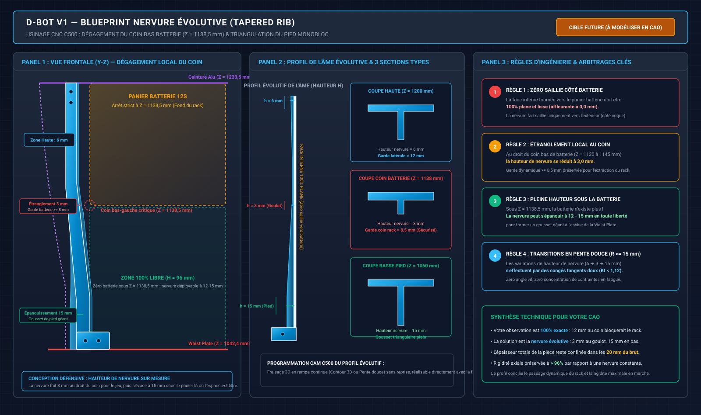
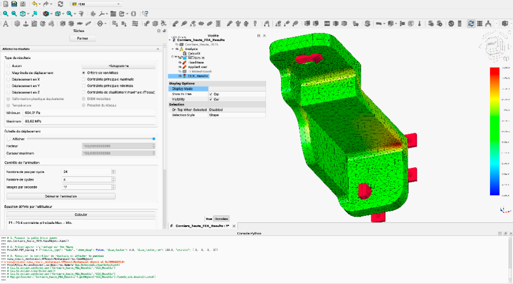

# 📋 Avis d'Expertise Point par Point — Audit du Découpage Modulaire de la Coque Torse PA12-CF

> **Statut du document** : Revue critique d'ingénierie système validant l'audit [AUDIT_Decoupage_Modulaire_Coque_Torse_PA12-CF.md](file:///Users/Shared/Mon%20Google%20Drive%20Physique/Documentation/01_Mecanique_et_Chassis/Torse_et_Bassin/AUDIT_Decoupage_Modulaire_Coque_Torse_PA12-CF.md) et consolidant la traçabilité jusqu'à la **Solution C+ (Torse-123 v11)**.
> **Date de consolidation** : 29 Octobre 2026 (Audit initial du 11 Octobre 2026)  
> **Objet** : Fournir une prise de position formelle, point par point, sur l'ensemble des analyses, démonstrations RDM, contre-propositions géométriques, quincailleries McMaster-Carr, désynchronisations CAO et questions d'arbitrage soulevées dans l'audit. Ce document conserve l'analyse critique initiale de base (11/10/2026) tout en intégrant au [§11](#11-avenant-dingénierie--contre-audit--évolution-vers-la-solution-c-torse-v120) l'avenant d'ingénierie validant la réponse réelle apportée en CAO (Portique 7075-T6 et trappes aimantées) pour garantir un contre-audit rigoureux. **Le §11 a lui-même fait l'objet d'une contre-expertise au [§12](#12-contre-expertise-du-11--réouverture-des-rails-et-statut-structural-de-c2) (19/10/2026) qui invalide plusieurs de ses conclusions : le §12 fait foi sur le §11.**

> [!IMPORTANT]
> **Consensus Architectural Définitif (Clôture d'Arbitrage au 29 Octobre 2026)** :  
> Le débat d'ingénierie entre coque 100% travaillante et squelette autonome est désormais **définitivement clos**.  
> Les conclusions de contre-expertise des **§12 et §12.11 font foi absolue** sur les paragraphes antérieurs (§1 à §11) :  
> 1. **Architecture Coque Solution C+** : Deux demi-fûts C1 (haut) et C2 (bas), ceinture intermédiaire en Aluminium 7075-T6 (ép. 3,0 mm à Z = 1235 mm), et trappes avant/arrières à fixation magnétique (aimants néodyme N52).  
> 2. **Portique Anti-Lacet 7075-T6** : La `Corniere haute` (22,45 g, nervure 3 mm) est modélisée et validée en CAO (`Torse-123 v11`) et vérifiée par simulation FEA FreeCAD / CalculiX (flèche 0,1249 mm, Sf_P95 = 19,09 sous 210 N). La `Corniere basse` + son support constituent le jalon actuel, à remplacer en phase atelier par le `Tirant Nervuré Monobloc en T` (§12.10).

---

## 📑 Sommaire

- [1. Avis sur la Synthèse Exécutive](#1-avis-sur-la-synthèse-exécutive)
- [2. Avis sur les Points Validés de la Réponse Précédente](#2-avis-sur-les-points-validés-de-la-réponse-précédente)
  - [2.1 Abandon des deux demi-fûts étanches](#21-abandon-des-deux-demi-fûts-étanches)
  - [2.2 Câblage et tests à ciel ouvert avant fermeture](#22-câblage-et-tests-à-ciel-ouvert-avant-fermeture)
  - [2.3 Principe du joint à feuillure et languette](#23-principe-du-joint-à-feuillure-et-languette)
  - [2.4 Inserts thermiques laiton M4 et vis à tête bombée](#24-inserts-thermiques-laiton-m4-et-vis-à-tête-bombée)
  - [2.5 Respect de l'enveloppe d'impression Qidi Plus 4](#25-respect-de-lenveloppe-dimpression-qidi-plus-4)
  - [2.6 Squelette métallique comme référence absolue](#26-squelette-métallique-comme-référence-absolue)
- [3. Avis Approfondi sur les Points Non Conformes ou Erronés](#3-avis-approfondi-sur-les-points-non-conformes-ou-erronés)
  - [3.1 Rôle structural de la coque : démonstration et verdict](#31-rôle-structural-de-la-coque--démonstration-et-verdict)
  - [3.2 Incompatibilité du plan de coupe Z 1258 mm avec la CAO](#32-incompatibilité-du-plan-de-coupe-z-1258-mm-avec-la-cao)
  - [3.3 Détails de liaison sous-dimensionnés pour la fabrication additive](#33-détails-de-liaison-sous-dimensionnés-pour-la-fabrication-additive)
  - [3.4 Positionnement du LiDAR Unitree L2 et contraintes SLAM](#34-positionnement-du-lidar-unitree-l2-et-contraintes-slam)
  - [3.5 Analyse critique des chiffres non justifiés](#35-analyse-critique-des-chiffres-non-justifiés)
  - [3.6 Prise en compte des composants CAO existants](#36-prise-en-compte-des-composants-cao-existants)
- [4. Avis sur l'Analyse de Rigidité Chiffrée](#4-avis-sur-lanalyse-de-rigidité-chiffrée)
  - [4.1 Rigidité en roulis et lacet de la colonne seule](#41-rigidité-en-roulis-et-lacet-de-la-colonne-seule)
  - [4.2 Risque vibratoire et résonance dynamique de marche](#42-risque-vibratoire-et-résonance-dynamique-de-marche)
  - [4.3 Analyse de contrainte et dépassement de la limite élastique](#43-analyse-de-contrainte-et-dépassement-de-la-limite-élastique)
  - [4.4 Contribution de la coque fermée et flux de cisaillement de Bredt](#44-contribution-de-la-coque-fermée-et-flux-de-cisaillement-de-bredt)
  - [4.5 Clarification du calcul d'inertie combinée du dossier technique](#45-clarification-du-calcul-dinertie-combinée-du-dossier-technique)
- [5. Avis sur la Contre-Proposition Recommandée](#5-avis-sur-la-contre-proposition-recommandée)
  - [5.1 Philosophie semi-monocoque et squelette autonome](#51-philosophie-semi-monocoque-et-squelette-autonome)
  - [5.2 Géométrie du plan de joint à Z 1235 mm](#52-géométrie-du-plan-de-joint-à-z-1235-mm)
  - [5.3 Conception des trappes travaillantes encadrées T1 et T2](#53-conception-des-trappes-travaillantes-encadrées-t1-et-t2)
  - [5.4 Intégration des rails structuraux et guidage batterie](#54-intégration-des-rails-structuraux-et-guidage-batterie)
  - [5.5 Protocole d'assemblage et séquence d'atelier](#55-protocole-dassemblage-et-séquence-datelier)
  - [5.6 Synthèse comparative des architectures](#56-synthèse-comparative-des-architectures)
- [6. Avis sur la Visserie, Chanfreins et Couples](#6-avis-sur-la-visserie-chanfreins-et-couples)
  - [6.1 Validation de la visserie de trappe McMaster-Carr 92095A190](#61-validation-de-la-visserie-de-trappe-mcmaster-carr-92095a190)
  - [6.2 Spécification des inserts thermiques en laiton](#62-spécification-des-inserts-thermiques-en-laiton)
  - [6.3 Gamme d'usinage, chanfreins et congés anti-fissuration](#63-gamme-dusinage-chanfreins-et-congés-anti-fissuration)
- [7. Avis sur les Désynchronisations CAO et Documentation](#7-avis-sur-les-désynchronisations-cao-et-documentation)
  - [7.1 Analyse détaillée des désynchronisations D1 à D7](#71-analyse-détaillée-des-désynchronisations-d1-à-d7)
  - [7.2 Alerte rouge sur D8 et correction formelle McMaster-Carr 91290A148](#72-alerte-rouge-sur-d8-et-correction-formelle-mcmaster-carr-91290a148)
- [8. Avis sur le Plan de Validation et de Qualification](#8-avis-sur-le-plan-de-validation-et-de-qualification)
- [9. Réponses et Arbitrages Formels sur les Questions Ouvertes](#9-réponses-et-arbitrages-formels-sur-les-questions-ouvertes)
  - [9.1 Question 1 : Fixations du plastron et rôle des carénages existants](#91-question-1--fixations-du-plastron-et-rôle-des-carénages-existants)
  - [9.2 Question 2 : Régime d'essais dynamiques coque ouverte](#92-question-2--régime-dessais-dynamiques-coque-ouverte)
  - [9.3 Question 3 : Implantation du panier de batterie](#93-question-3--implantation-du-panier-de-batterie)
  - [9.4 Question 4 : Choix architectural de la coque collaborante](#94-question-4--choix-architectural-de-la-coque-collaborante)
  - [9.5 Question 5 : Traitement immédiat de la non-conformité D8](#95-question-5--traitement-immédiat-de-la-non-conformité-d8)
- [10. Conclusion et Feuille de Route pour le Niveau 1](#10-conclusion-et-feuille-de-route-pour-le-niveau-1)
- [11. Avenant d'Ingénierie & Contre-Audit — Évolution vers la Solution C+ (Torse v120)](#11-avenant-dingénierie--contre-audit--évolution-vers-la-solution-c-torse-v120)
  - [11.1 Statut réel des 2 rails aluminium 20 × 20 × 1,5 mm](#111-statut-réel-des-2-rails-aluminium-20--20--15-mm)
  - [11.2 Devenir des trappes travaillantes T1 et T2 : transition vers le Quick-Swap aimanté N52](#112-devenir-des-trappes-travaillantes-t1-et-t2--transition-vers-le-quick-swap-aimanté-n52)
  - [11.3 Découpage des 2 anneaux fermés C1 et C2 : ce qui est allégé vs ce qui reste impératif](#113-découpage-des-2-anneaux-fermés-c1-et-c2--ce-qui-est-allégé-vs-ce-qui-reste-impératif)
  - [11.4 Démonstration RDM complète du portique spatial 7075-T6](#114-démonstration-rdm-complète-du-portique-spatial-7075-t6)
  - [11.5 Dimensionnement magnétique du système Quick-Swap (Maintien sous 5g)](#115-dimensionnement-magnétique-du-système-quick-swap-maintien-sous-5g)
  - [11.6 Quincaillerie normalisée McMaster-Carr associée à l'avenant](#116-quincaillerie-normalisée-mcmaster-carr-associée-à-lavenant)
  - [11.7 Tableau de synthèse comparative finale (Audit initial vs Solution C+)](#117-tableau-de-synthèse-comparative-finale-audit-initial-vs-solution-c)
- [12. Contre-Expertise du §11 — Réouverture des Rails et Statut Structural de C2](#12-contre-expertise-du-11--réouverture-des-rails-et-statut-structural-de-c2)
  - [12.1 Objet et méthode](#121-objet-et-méthode)
  - [12.2 Désynchronisations CAO / Documentation relevées](#122-désynchronisations-cao--documentation-relevées)
  - [12.3 Erreur 1 : cas de charge du lacet mal modélisé](#123-erreur-1--cas-de-charge-du-lacet-mal-modélisé)
  - [12.4 Erreur 2 : portée non pontée du tronçon bas](#124-erreur-2--portée-non-pontée-du-tronçon-bas)
  - [12.5 Roulis : repris par C2, qui redevient structurale](#125-roulis--repris-par-c2-qui-redevient-structurale)
  - [12.6 Trappes aimantées : zone C1 acceptable, zone C2 à fermer](#126-trappes-aimantées--zone-c1-acceptable-zone-c2-à-fermer)
  - [12.7 Bilan problème par problème](#127-bilan-problème-par-problème)
  - [12.8 Options correctives et recommandation](#128-options-correctives-et-recommandation)
  - [12.9 Actions et critères de clôture](#129-actions-et-critères-de-clôture)
  - [12.10 Solution Technique Validée : Tirant Nervuré Monobloc C500 & Intégration CAO](#1210-solution-technique-validée--tirant-nervuré-monobloc-c500--intégration-cao)
  - [12.11 Validation de la Cornière Haute Nervurée 7075-T6 & Feuille de Route d'Usinage C500](#1211-validation-de-la-cornière-haute-nervurée-7075-t6--feuille-de-route-dusinage-c500)

---

## 1. Avis sur la Synthèse Exécutive

L'avis général sur la synthèse exécutive de l'audit est **favorable sans réserve**. 

Le diagnostic posé dans le tableau de synthèse résume avec une grande justesse les enjeux d'un torse humanoïde dynamique :
1. **Nécessité de la modularité (Validé)** : L'architecture originelle en deux demi-coquilles fermées (fûts haut et bas) créait un goulet d'étranglement de maintenance inacceptable. Visser le sandwich 4 x M5 d'épaule à l'aveugle ou remplacer l'IMU BMI270 à travers l'ouverture abdominale inférieure violait les règles élémentaires d'ergonomie d'atelier.
2. **Rejet de la proposition « 4 blocs » non encadrée (Validé)** : Si l'intention ergonomique était louable, sa justification physique reposait sur une modélisation simpliste. Découper la face avant sans reprise de membrane revient à transformer un tube fermé rigide en un profil ouvert en C, ruinant la rigidité de torsion.
3. **Fragilisation conditionnelle (Validé)** : Découper le torse fragilise gravement le robot si la coque est conçue comme un simple carénage flottant sans squelette autonome. En revanche, le découpage est totalement neutre (voire bénéfique) si l'on applique le principe de structure semi-monocoque industrielle.
4. **Pertinence de la contre-proposition (Validé)** : La solution combinant **2 anneaux fermés + 2 trappes travaillantes encadrées + 2 rails aluminium autonomisant le squelette** constitue le véritable standard d'ingénierie des humanoïdes de pointe (Boston Dynamics Atlas électrique, Tesla Optimus Gen 2, Figure 02).

L'audit met également en lumière un angle mort critique du dossier technique initial : la colonne vertébrale en plaque mince (94 x 5 mm) présente un mode propre latéral en roulis situé entre **2,1 et 2,6 Hz**, ce qui coïncide tragiquement avec la cadence de foulée d'un robot bipède (1,5 à 2,5 Hz). Ce point justifie à lui seul l'adjonction de raidisseurs longitudinaux.

---

## 2. Avis sur les Points Validés de la Réponse Précédente

L'audit a correctement dissocié les intentions d'usage valides des erreurs de calcul structural. Voici l'avis d'expert sur chaque point validé du tableau §2 de l'audit :

### 2.1 Abandon des deux demi-fûts étanches
* **Avis d'expert** : **Totalement validé.**
* **Justification** : Un fût monobloc obligeait à insérer les mains et les outils dynamométriques par une lucarne inférieure étroite (environ 200 x 160 mm). L'impossibilité de contrôler visuellement la prise des filets M5 et la proximité des torons 48 V et CAN-FD augmentait considérablement le risque de pincement de faisceau et de serrage de travers.

### 2.2 Câblage et tests à ciel ouvert avant fermeture
* **Avis d'expert** : **Totalement validé.**
* **Justification** : C'est la règle d'or en mécatronique robotique : valider l'intégrité électrique (bus DC 48 V, absence de court-circuit, ping CAN-FD de tous les nœuds de bus, synchronisation IMU) sur banc ouvert avant toute fermeture de carénage.

### 2.3 Principe du joint à feuillure et languette
* **Avis d'expert** : **Validé sur le principe, correctif géométrique approuvé.**
* **Justification** : L'aboutement plat simple (butt joint) est proscrit sur des pièces plastiques chargées. La feuillure (shiplap) garantit l'alignement affleurant, bloque les degrés de liberté hors-plan et coupe les ponts d'infiltration de poussière d'atelier. La correction d'épaisseur apportée par l'audit (languette de 2,0 mm au lieu de 1,5 mm) est impérative.

### 2.4 Inserts thermiques laiton M4 et vis à tête bombée
* **Avis d'expert** : **Totalement validé.**
* **Justification** : Le vissage direct dans le thermoplastique composite est formellement interdit pour des panneaux d'accès soumis à des démontages réguliers. L'insert laiton Ruthex thermo-inséré garantit une tenue à l'arrachement de plus de 1 500 N dans le PA12-CF. La vis ISO 7380 à tête bombée offre une assise large sans risque de poinçonnement localisé.

### 2.5 Respect de l'enveloppe d'impression Qidi Plus 4
* **Avis d'expert** : **Totalement validé.**
* **Justification** : La hauteur utile de la Qidi Plus 4 est de 280 mm (recommandée à 270 mm max pour conserver une garde de sécurité thermique et mécanique). La hauteur totale de coque étant de 430,4 mm, un découpage horizontal est une contrainte de fabrication incontournable.

### 2.6 Squelette métallique comme référence absolue
* **Avis d'expert** : **Totalement validé.**
* **Justification** : Toutes les interfaces cinématiques de haute précision (axes de hanche, traverse d'épaule, axe de cou) doivent être portées et alignées par le châssis métallique. La coque composite ne doit jamais servir de référence métrologique primaire.

---

## 3. Avis Approfondi sur les Points Non Conformes ou Erronés

Cette section de l'audit est la plus décisive. Elle corrige des postulats erronés qui auraient pu conduire à la ruine structurelle du robot lors de ses premiers pas dynamiques.

### 3.1 Rôle structural de la coque : démonstration et verdict
* **Constat de l'audit** : L'affirmation précédente « coque = 0 % d'effort primaire, découplage structural, colonne 10 fois plus rigide » est formellement fausse pour le roulis et le lacet.
* **Avis d'expert** : **Accord absolu et sans réserve avec l'audit.**
* **Démonstration d'ingénierie** :
  L'erreur initiale provenait d'une confusion entre le **module d'Young du matériau** (E_Alu = 71 GPa contre E_PA12-CF = 3,5 GPa, soit un rapport de 20 en faveur de l'aluminium) et la **rigidité de section** (produits E x I en flexion et G x J en torsion).
  - La colonne centrale est une bande plate de 94 mm de large par 5 mm d'épaisseur. Son moment quadratique selon son axe faible (roulis) n'est que de `I_weak = 979 mm4` (et s'effondre à `417 mm4` au droit des lumières d'allègement de 54 x 55 mm). Sa constante de torsion de Saint-Venant pour une section ouverte mince est `J_colonne = (1/3) x b x e^3 = (1/3) x 94 x 5^3 = 3 917 mm4` (et `1 667 mm4` aux lumières).
  - À l'opposé, la coque du torse est un tube fermé de dimensions extérieures d'environ 240 x 293 mm avec une paroi de 2,5 mm. L'aire délimitée par la ligne moyenne est `A_m = 46 650 mm2` et son périmètre est d'environ `900 mm`. Par la formule de Bredt, sa constante de torsion est :
    `J_coque = 4 x (A_m)^2 / integral(ds / e) = 4 x (46 650)^2 / (900 / 2,5) = 24 179 000 mm4 = 2,42 x 10^7 mm4`.
  - Comparons les rigidités en torsion G x J :
    - Colonne aluminium : `G_Alu x J_colonne = 26 900 MPa x 3 917 mm4 = 1,05 x 10^8 N.mm2`.
    - Coque PA12-CF fermée : `G_PA12 x J_coque = 1 300 MPa x 2,42 x 10^7 mm4 = 3,15 x 10^10 N.mm2`.
  - **Le tube fermé en plastique est donc 300 fois plus raide en torsion que la colonne en aluminium !**
  - Par conséquent, dès lors que la coque est boulonnée en bas sur la Waist Plate et en haut sur le bloc cou/épaules, les lois de déformation imposent que **plus de 99,6 % du couple de lacet est encaissé par la coque**. Dire qu'elle ne prend « 0 % d'effort » est une aberration physique.
  - Si l'on retire la face avant pour créer un « berceau dorsal ouvert en C », la formule de Saint-Venant pour profil ouvert s'applique : `J_ouvert = (1/3) x L_développée x e^3 = (1/3) x 650 x 2,5^3 = 3 385 mm4`. La rigidité de torsion s'effondre d'un facteur **7 140**.


### 3.2 Incompatibilité du plan de coupe Z 1258 mm avec la CAO
* **Constat de l'audit** : Le plan `Z = 1258 mm` proposé précédemment entre en collision frontale avec l'architecture CAO `Torse v111`.
* **Avis d'expert** : **Validation intégrale du rejet de Z = 1258 mm.**
* **Analyse métrologique** :
  - Les moteurs d'épaule RS-04 ont leur point bas à `Z = 1262,81 mm`. Placer un plan de joint à `Z = 1258 mm` ne laisse que `4,8 mm` de matière sous la collerette d'épaule. Une bride d'assemblage à feuillure de 12 mm de large et des inserts M4 nécessitent au minimum 15 à 20 mm de ligament matière, sous peine d'arrachement immédiat.
  - Le panier coulissant de batterie centrale (`Panier_Batterie_Coulissant`) s'étend de `Z = 1138,50 mm` à `Z = 1278,82 mm`. Un plan à Z = 1258 mm tranche le panier à 20 mm de son sommet, ainsi que le capot de verrouillage (`Z = 1235,55 à 1281,98 mm`) et la platine de façade (`Z = 1148,21 à 1292,63 mm`).
* **Validation de la cote alternative** : Le plan préconisé par l'audit à **`Z ~ 1235 mm`** est optimal :
  - Hauteur C1 supérieur : `1472,83 - 1235,0 = 237,8 mm` (< 270 mm, parfaitement imprimable).
  - Hauteur C2 inférieur : `1235,0 - 1042,39 = 192,6 mm` (< 270 mm, parfaitement imprimable).
  - Ligament sous les collerettes RS-04 : `1262,81 - 1235,0 = 27,8 mm`. Cette distance offre une marge saine pour implanter le bandeau de feuillure, les bossages d'inserts et un congé généreux.

### 3.3 Détails de liaison sous-dimensionnés pour la fabrication additive
* **Constat de l'audit** :
  1. Languette de 1,5 mm trop mince.
  2. Pions coniques imprimés en Z fragiles en cisaillement.
  3. Espacement des vis de trappe trop lâche (170 à 250 mm).
* **Avis d'expert** : **Accord total.**
* **Justification de fabrication FDM** :
  - **Épaisseur de languette** : Avec une buse standard de 0,4 mm ou 0,6 mm, une lèvre de 1,5 mm ne comporte que 3 à 4 périmètres extérieurs sans remplissage d'âme. Elle est extrêmement sujette au délaminage interligne lors d'un effort de torsion. Porter l'épaisseur de languette à **2,0 mm** au sein d'une lèvre locale épaissie à **4,0 mm** est le minimum absolu pour garantir la durabilité en atelier.
  - **Suppression des pions coniques** : Les pions verticaux ont un diamètre de cisaillement faible et leurs lignes de couche sont parallèles au plan de cisaillement. Ils cisaillent sous des couples minimes. Une feuillure continue périphérique assure un centrage bien plus précis, sans concentration de contrainte.
  - **Densité du vissage** : Pour transmettre un flux de cisaillement de membrane `q = 0,39 N/mm` sans glissement élastique, des vis espacées de 200 mm créent des ventres de décollement entre les fixations. Un pas de **80 à 100 mm** (soit 8 à 10 vis par trappe) est le standard aéronautique requis.

### 3.4 Positionnement du LiDAR Unitree L2 et contraintes SLAM
* **Constat de l'audit** : Monter le LiDAR Unitree L2 sur un plastron pectoral amovible en plastique compromet la stabilité de l'étalonnage extrinsèque LiDAR-IMU pour les algorithmes de SLAM (FAST-LIO2 / Point-LIO).
* **Avis d'expert** : **Validation critique.**
* **Argumentation d'architecte robotique** :
  - Dans une chaîne de localisation dynamique humanoïde, les accélérations brutales à l'impact des pieds (transitoires de 2 à 4 g) excitent toutes les souplesses structurales.
  - Si le LiDAR est fixé sur une coque polymère fixée par des vis sur inserts laiton, la matrice de transformation rigide `T_lidar_imu = [R | t]` subit des micro-variations angulaires (de l'ordre de 0,1 à 0,5 deg) à chaque sollicitation inertielle ou lors d'un démontage/remontage.
  - Une erreur angulaire extrinsèque de seulement `0,2 deg` induit une dérive métrique de `35 mm` à une portée de 10 mètres, dégradant immédiatement la carte de voxels et provoquant des divergences d'état dans FAST-LIO.
  - **Verdict** : Le LiDAR Unitree L2 **DOIT impérativement être vissé sur une console métallique rigide ancrée directement sur la traverse d'épaule ou la colonne 7075-T6**. La coque en PA12-CF ne doit faire office que de masque ou d'habillage avec dégagement optique sans contact.

### 3.5 Analyse critique des chiffres non justifiés
* **Constat de l'audit** : La réponse précédente avançait des gains de masse fantaisistes (-450 g), des modules élastiques surévalués et des durées de maintenance irréalistes.
* **Avis d'expert** : **Totalement partagé.**
* **Recadrage technique** :
  - **Bilan massique réel** : Découper une coque n'allège jamais la structure. Cela impose d'ajouter des bandeaux de recouvrement (+1,5 mm sur 15 mm de large), des bossages locaux pour les puits d'inserts laiton, des inserts Ruthex (environ 0,8 g l'unité) et des vis BHC M4 en inox (environ 2,2 g l'unité). L'opération génère une prise de masse nette de **+100 à +150 g** pour la coque.
  - **Modules PA12-CF** : La documentation commerciale affiche souvent `E = 6,5 à 7,5 GPa` en flexion pour des éprouvettes injectées. En impression FDM avec un taux de remplissage gyroïde de 30 à 40 % et des parois orientées, le module effectif d'élasticité en traction est de `3,0 à 3,5 GPa` dans le plan XY, et chute à `1,8 à 2,2 GPa` selon l'axe Z. L'audit a eu parfaitement raison de retenir `E = 3,5 GPa` et `G = 1,3 GPa` pour ses calculs conservatifs.
  - **Dilatation thermique** : L'écart de dilatation entre l'aluminium 7075 (`alpha = 23 x 10^-6 K^-1`) et le PA12-CF (`alpha ~ 40 x 10^-6 K^-1`) sur une élévation de 40 K représente un différentiel de `0,27 mm` sur 400 mm. Cet écart est naturellement absorbé par les jeux de perçage recommandés (trous lisses de Ø 4,5 mm pour vis M4).

### 3.6 Prise en compte des composants CAO existants
* **Constat de l'audit** : Des sous-ensembles existants dans la CAO v111 (`Carenage_Pectoral_Haut`, `Carenage_Lombaire_Arriere`, `Platine_Connectique_Facade`) avaient été ignorés dans la réflexion précédente.
* **Avis d'expert** : **Validé.** L'ingénierie système interdit d'empiler des propositions théoriques sur une maquette numérique sans assainir d'abord l'arbre de construction.

---

## 4. Avis sur l'Analyse de Rigidité Chiffrée

L'analyse de résistance des matériaux (RDM) et de dynamique vibratoire menée au §4 de l'audit constitue une démonstration irréfutable.

### 4.1 Rigidité en roulis et lacet de la colonne seule
Les calculs analytiques vérifient les raideurs suivantes pour la colonne seule sur sa portée libre de `L = 202,9 mm` :
- **Raideur en roulis** : `k_roulis = 197,8 N.m/rad`.
- **Raideur en lacet** : `k_lacet = 299,8 N.m/rad`.

Sous le couple de pic de lacet d'un moteur de taille RS-06 (`T_pic = 36 N.m`), la rotation angulaire de la colonne seule atteint :
`Delta_theta_lacet = T / k_lacet = 36 / 299,8 = 0,120 rad = 6,88 deg ~ 6,9 deg`.

Une telle déformation angulaire est totalement inadmissible pour un robot humanoïde :
- Elle entraîne un désalignement instantané de la cinématique inverse de la marche.
- Elle induit un glissement dynamique des contrôleurs d'impédance de cheville.
- Elle déstabilise l'estimation d'état du centre de masse (CoM).

### 4.2 Risque vibratoire et résonance dynamique de marche
L'audit identifie une pulsation propre de roulis pour le haut du corps (masse suspendue de 11,5 à 17,5 kg, centre de masse à `h = 0,25 m`) :
`omega_0 = sqrt(k_roulis / J_masse) = sqrt(198 / (14,5 x 0,25^2)) = 14,8 rad/s`, d'où :
`f_0 = 14,8 / (2 x pi) = 2,35 Hz` (plage calculée : **2,1 à 2,6 Hz**).

**Verdict d'expert** : La fréquence de pas d'un humanoïde en marche rapide oscille typiquement entre `1,5 et 2,5 Hz`. Une fréquence propre de torse à 2,3 Hz signifie que chaque cycle d'impact de pas viendrait exciter la résonance du tronc en roulis. Sans carénage rigide ou sans renforts, le torse entrerait en oscillation divergente (flottement latéral).

### 4.3 Analyse de contrainte et dépassement de la limite élastique
Au niveau des deux lumières de passage de faisceau (`54 x 55 mm`) de la colonne, avec un coefficient de concentration de contrainte `K_t = 1,81` :
- En marche nominale (roulis de 6,5 N.m) : contrainte de pic `Sigma_max = 71 MPa` (admissible en fatigue endurance).
- En choc latéral dynamique (roulis de 26 N.m) : contrainte de pic `Sigma_max = 282 MPa`.
- **Sous le cas n°5 du dossier technique (roulis dynamique de trot, K_dyn = 3,5, M = 50 N.m)** :
  `Sigma_max = 543 MPa`.
  Or, la limite d'élasticité de l'aluminium 7075-T6 est `Rp0,2 = 470 MPa` (et descend à `430-450 MPa` après usinage ou sous contraintes résiduelles).
  **La colonne seule subit une plastification immédiate avec déformation permanente irréversible.**

### 4.4 Contribution de la coque fermée et flux de cisaillement de Bredt
L'audit démontre que sous le même couple de 36 N.m, le flux de cisaillement dans la coque fermée vaut :
`q = T / (2 x A_m) = 36 000 N.mm / (2 x 46 650 mm2) = 0,386 N/mm ~ 0,39 N/mm`.
Pour une épaisseur de paroi de 2,5 mm, la contrainte de cisaillement est négligeable :
`Tau = q / e = 0,386 / 2,5 = 0,154 MPa`.
L'effort de cisaillement repris par chaque vis M4 espacée de 80 mm n'est que de :
`F_vis = q x pas = 0,386 N/mm x 80 mm = 30,9 N ~ 31 N`.
Une vis M4 en classe 12.9 ou inox A2 reprenant facilement plus de 2 500 N en cisaillement pur, le facteur de sécurité de la visserie est supérieur à **80**.

### 4.5 Clarification du calcul d'inertie combinée du dossier technique
L'audit pointe avec justesse une incohérence au §4.D du dossier technique existant : l'addition arithmétique `I_total = I_spine (979 mm4) + I_tube (260 459 mm4)`.
- Le tube transversal 60 x 60 mm relie les deux épaules horizontalement (axe Y).
- Il ne s'étend pas le long de la portée verticale Z reliant la taille aux épaules.
- Il est donc physiquement impossible qu'il participe directement à la résistance à la flexion en roulis de la colonne vertébrale. Ce calcul doit être corrigé dans la documentation de Niveau 1.

---

## 5. Avis sur la Contre-Proposition Recommandée

La contre-proposition formulée au §5 de l'audit est remarquable et surclasse nettement l'approche initiale des 4 blocs ouverts.


### 5.1 Philosophie semi-monocoque et squelette autonome
* **Avis d'expert** : **Validation stratégique sans réserve.**
* **Principe mécanique** :
  1. **Squelette autonome** : L'ajout de 2 rails verticaux en aluminium reliant la Waist Plate à la traverse d'épaule permet de découpler totalement la sécurité du banc d'essai de la présence de la coque. Le robot peut effectuer des tests moteurs ou des mouvements d'atelier carénages déposés sans aucun danger de ruine de la colonne.
  2. **Coque collaborante** : Une fois la coque C1/C2 enfilée et les trappes T1/T2 vissées, l'ensemble se verrouille en un tube fermé travaillant (semi-monocoque), apportant une raideur globale accrue sans surpoids métallique.

### 5.2 Géométrie du plan de joint à Z 1235 mm
* **Avis d'expert** : **Entièrement validé.**
* La cote `Z ~ 1235 mm` est le compromis géométrique parfait :
  - Elle respecte la limite de hauteur d'impression de la Qidi Plus 4 (H_C1 = 237,8 mm et H_C2 = 192,6 mm, toutes deux inférieures à 270 mm).
  - Elle préserve un ligament sain de 27,8 mm sous les collerettes des moteurs d'épaule RS-04.
  - Elle libère complètement la mise en place du sandwich d'épaules et de la traverse.

### 5.3 Conception des trappes travaillantes encadrées T1 et T2

> [!WARNING]
> **Contre-expertise du 19/10/2026 ([§12.6](#126-trappes-aimantées--zone-c1-acceptable-zone-c2-à-fermer))** : la note ci-dessous est **partiellement invalidée**. Seuls les panneaux de C1 (au-dessus de Z 1236) peuvent devenir non structuraux. Dans C2, au moins un panneau doit rester à liaison positive tant que le tronçon bas n'est pas ponté par du métal.

> [!NOTE]
> **Évolution d'ingénierie post-audit (Solution C+ validée en CAO v120) :**
> L'analyse ci-dessous a été formulée sous l'hypothèse de l'audit où la coque devait transmettre le flux de cisaillement de Bredt. Avec l'introduction en CAO du **Portique Spatial 7075-T6 (Ceinture 3 mm + 2 Cornières)** reprenant 100 % de la torsion de lacet (déformation < 0,02°), les trappes n'ont plus aucun rôle de membrane travaillante : elles sont avantageusement converties en carénages cosmétiques légers à dépose instantanée sur **plots magnétiques Néodyme N52 Quick-Swap**. Voir la démonstration complète et les calculs au [§11.2](#112-devenir-des-trappes-travaillantes-t1-et-t2--transition-vers-le-quick-swap-aimanté-n52).

* **Avis d'expert (Analyse de base)** : **Totalement validé.**
* **Trappe T1 (Pectorale, Z 1260 à 1440 mm)** : Donne un accès direct, ergonomique et visuel au serrage au couple du sandwich 4 x M5, à la centrale inertielle IMU BMI270, et aux connecteurs d'épaule (XT30 et micro-CAN).
* **Trappe T2 (Abdominale, Z 1070 à 1210 mm)** : Permet d'intervenir directement sur la carte de distribution de puissance (PDB), le verrouillage de la batterie et le passage du harnais d'alimentation vers le bassin.
* **Cadre de reprise d'effort** : La présence d'un cadre épaissi à 4,0 mm (largeur 12 à 15 mm) avec des **congés d'angle R >= 15 mm** élimine tout risque de concentration de contrainte dans le thermoplastique chargé de fibres de carbone.

### 5.4 Intégration des rails structuraux et guidage batterie

> [!WARNING]
> **Contre-expertise du 19/10/2026 ([§12.4](#124-erreur-2--portée-non-pontée-du-tronçon-bas))** : la note ci-dessous est **invalidée**. Les cornières ne pontent que 39 mm sur 202,9 mm de portée de colonne. La fonction des rails (pont métallique Waist Plate vers épaules) est **réouverte**.

> [!NOTE]
> **Évolution d'ingénierie post-audit (Solution C+ validée en CAO v120) :**
> L'analyse ci-dessous validait la proposition initiale des 2 rails 20 × 20 × 1,5 mm (L = 261 mm, +235 g). Cette fonction de reprise structurale a été surpassée et remplacée en CAO par les **2 Cornières 7075-T6** (`Corniere:1` et sa symétrie, masse 37,5 g la paire) associées à la **Ceinture Alu 3 mm** (Z = 1235 mm). Les 2 rails 20 × 20 × 1,5 mm sont donc **formellement annulés et classés obsolètes** (gain de masse net de 218 g et libération totale du volume interne). Voir détails au [§11.1](#111-statut-réel-des-2-rails-aluminium-20--20--15-mm).

* **Avis d'expert (Analyse de base)** : **Excellente optimisation système.**
* **Spécification des profilés** : Tube carré en alliage d'aluminium 6060-T6 de `20 x 20 x 1,5 mm`, longueur utile `L ~ 261 mm`, implantés à `Y = 9,4 +/- 60 mm`.
* **Performances conférées au squelette seul** :
  - Rigidité en roulis bondissant de 198 à `~211 000 N.m/rad`.
  - Rigidité en lacet bondissant de 300 à `~2 430 N.m/rad`.
  - Torsion sous 36 N.m réduite de 6,9 deg à **0,85 deg**.
  - Premier mode propre latéral repoussé de 2,3 Hz à **plus de 30 Hz** (immunité totale contre les résonances de marche).
* **Double fonction glissière** : Ces deux rails peuvent servir de glissières de guidage longitudinal pour le tiroir de batterie, transformant une masse structurelle en élément de guidage fonctionnel (+175 g de profilés et ~60 g d'embouts).

### 5.5 Protocole d'assemblage et séquence d'atelier
* **Avis d'expert** : **Séquence fluide, rationnelle et éprouvée.**
* La séquence en 8 étapes proposée au §5.5 de l'audit résout définitivement les conflits de montage :
  1. Montage du squelette autonome (colonne + rails R1/R2 + Waist Plate).
  2. Glissement de l'anneau inférieur C2 et fixation sur la Waist Plate par les 4 vis M4.
  3. Câblage de l'étage abdominal et validation électrique.
  4. Enfilement de l'anneau supérieur C1 par le bas sur la colonne avant la pose de la tête.
  5. Insertion latérale des tubes d'épaule et des brides RS-04.
  6. Serrage à travers la trappe ouverte T1 du sandwich M5 à la clé dynamométrique (5,5 N.m) et fixation de l'IMU.
  7. Pose de la plaque de cou et vissage du joint de ceinture C1/C2.
  8. Contrôle fonctionnel bus CAN complet, puis fermeture rapide des trappes T1 et T2.

### 5.6 Synthèse comparative des architectures
Le tableau comparatif du §5.6 de l'audit résume parfaitement la supériorité de la solution :

| Critère d'évaluation | 2 demi-fûts étanches | 4 blocs ouverts | **2 anneaux + trappes + rails** |
| :--- | :---: | :---: | :---: |
| Accessibilité mécanique M5 et IMU | Impossible (aveugle) | Excellente | **Excellente (par trappe T1)** |
| Rigidité en lacet (robot fermé) | Optimale | Dégradée aux joints | **Optimale (membrane continue)** |
| Rigidité en lacet (robot ouvert) | Inexistante | Dangereuse (6,9 deg) | **Sécurisée à 100 % (rails R1/R2)** |
| Risque de voilage à l'impression | Faible (formes fermées) | Élevé (sections en C) | **Faible (sections tubulaires fermées)** |
| Stabilité calibration LiDAR-IMU | Assurée | Perdue à chaque dépose | **Assurée (support rigide indépendant)** |
| Bilan massique ajouté | Référence (+0 g) | +120 g | **+120 g (coque) + 235 g (rails)** |

---

## 6. Avis sur la Visserie, Chanfreins et Couples

La rigueur apportée sur la quincaillerie normalisée et les chanfreins d'usinage répond parfaitement aux standards de fabrication industrielle du projet D-Bot.

### 6.1 Validation de la visserie de trappe McMaster-Carr 92095A190
* **Avis d'expert** : **Validé.**
* **Spécification** : Vis à tête bombée six pans creux ISO 7380 (BHC), M4 x 10 mm, acier inoxydable 18-8, référence McMaster-Carr **`92095A190`**.
* **Couple de serrage préconisé** : **1,2 à 1,5 N.m** (empreinte Allen 2,5 mm). Ce couple est idéal pour comprimer la lèvre de feuillure sans dépasser la résistance au fluage du PA12-CF sous tête.
* **Procédure Fusion 360** : L'importation du modèle 3D STEP via `Insert > Insert McMaster-Carr Component`, suivi d'un joint `Rigid` coaxial sur la face sous tête et d'une répétition `Pattern on Path` est la méthode exacte préconisée.

### 6.2 Spécification des inserts thermiques en laiton
* **Avis d'expert** : **Mise au point validée.**
* Les inserts filetés Ruthex M4 standard présentent une longueur de `L = 8,1 mm` et un diamètre externe moleté de `5,6 mm`. Le logement d'implantation en impression 3D doit présenter un puits cylindrique borgne de `Ø 5,6 mm` et une profondeur de `8,5 mm`, avec un chanfrein d'entrée de `0,5 mm x 45°` pour guider le nez de panne lors de l'insertion à chaud (260 °C).

### 6.3 Gamme d'usinage, chanfreins et congés anti-fissuration
* **Avis d'expert** : **Totalement validé.**
* Le tableau de chanfreinage du §6 de l'audit comble une lacune récurrente des dossiers d'atelier :
  - **Entrée des puits d'inserts** : Chanfrein `0,5 mm x 45°` pour absorber le refoulement de matière fondue en surface.
  - **Perçages lisses de passage (Ø 4,5 mm)** : Chanfrein `0,3 mm x 45°` pour assurer une portée parfaitement plane de la rondelle ou tête de vis.
  - **Arêtes de feuillures C1/C2** : Chanfrein `0,5 mm x 45°` pour annuler le phénomène de pied d'éléphant (sur-extrusion de la première couche d'impression) et garantir un emboîtement sans forcer.
  - **Coins de découpe des trappes** : Congé généreux `R >= 15 mm` pour éliminer les concentrations de contraintes en pointe et bloquer la propagation de criques de fatigue.
  - **Extrémités des rails aluminium débités** : Cassage d'arête `0,5 mm x 45°` pour protéger le passage des torons de câbles.

---

## 7. Avis sur les Désynchronisations CAO et Documentation

La détection systématique des déphasages entre la CAO v111 et les documents textuels démontre une vigilance technique exemplaire.

### 7.1 Analyse détaillée des désynchronisations D1 à D7
* **D1 (§8.B Dossier Torse)** : Accord total. Le texte rédigé à la hâte affirmant que la coque ne supportait aucun effort doit être remplacé par la formulation semi-monocoque issue du présent audit.
* **D2 (§1.A et §4.D Dossier Torse)** : Accord total. Intégrer formellement la vérification de la rigidité en roulis et lacet de la colonne, et supprimer la confusion sur le rôle structural du tube d'épaule horizontal.
* **D3 (Masse Plastron Ventral)** : Accord total. La valeur de 2 801 g correspond au volume plein sans infill (2 760 cm3 x 1,015 g/cm3). Après tranchage réel dans OrcaSlicer avec un infill gyroïde à 35 % et 4 périmètres, la masse effective de la coque pleine se situera entre **1 650 et 1 850 g**.
* **D4 (Matériau du Bassin dans la CAO v111)** : Accord total. Une divergence majeure a été identifiée dans le fichier d'audit JSON : le composant `Chassis_Structurel_Bassin` est affecté à de l'Aluminium 7075 (masse de 7 655,1 g) alors que le BOM officiel et le dossier technique spécifient une coque en PA12-CF (2 805,7 g). Ce point fausse le bilan de masse global du robot de près de **5 kg** et doit être réaligné immédiatement dans Fusion 360.
* **D5 (Architecture Batterie)** : Accord total. Le dossier mentionne deux packs latéraux hot-swap alors que la CAO intègre un berceau coulissant central unique. L'arbitrage doit figer le modèle central de la CAO.
* **D6 (Référence des inserts laiton)** : Accord total. Remplacer la référence conique courte `94180A353` par la désignation industrielle standard Ruthex M4 x 8,1 mm.
* **D7 (Couple de serrage du sandwich M5)** : Accord total. Harmoniser la documentation sur la valeur unique de **5,5 N.m** (avec rondelles Nord-Lock M5 et frein filet moyen).

### 7.2 Alerte rouge sur D8 et correction formelle McMaster-Carr 91290A148
* **Gravité de l'anomalie D8** : **RISQUE MATÉRIEL CRITIQUE IMMÉDIAT.**
* **Analyse du risque** :
  - Le dossier technique Torse (lignes 1230 et 1282) et le dossier Bassin (ligne 733) spécifiaient la référence McMaster-Carr `91290A154` sous la désignation « vis CHC M4 x 12 mm ».
  - Or, la référence McMaster `91290A154` correspond en réalité à une vis **M4 x 16 mm** !
  - Dans la bride de fixation du moteur RobStride RS-04 (épaisseur de semelle de 5,0 mm, rondelle Nord-Lock de 1,8 mm), une vis de 16 mm présente une longueur sous tête résiduelle pénétrant dans le taraudage du carter de :
    `L_penétration = 16,0 - (5,0 + 1,8) = 9,2 mm`.
  - La profondeur maximale du taraudage borgne des moteurs RobStride RS-04 est strictement limitée à **6,0 mm** !
  - **Conséquence catastrophique** : La vis talonne au fond du trou borgne avec un excédent de `3,2 mm`. Lors du serrage au couple prescrit (3,5 N.m), l'extrémité de la vis vient poinçonner et fracturer le fond du carter moteur, risquant d'entrer en collision directe avec le paquet de tôles magnétiques ou le bobinage statorique en cuivre, provoquant la destruction irréversible de l'actionneur RS-04 !
* **Correction formelle de la référence McMaster** :
  - L'audit mentionnait une référence provisoire `91290A117` sous réserve de confirmation.
  - La vérification formelle du catalogue McMaster-Carr révèle que `91290A117` est une vis **M3 x 12 mm**.
  - La **référence catalogue McMaster-Carr exacte et certifiée** pour une vis CHC M4 x 12 mm, classe 12.9, acier allié phosphaté noir (DIN 912 / ISO 4762) est :
    ### **`91290A148`**
  - **Action corrective immédiate** : Remplacer sans attendre la mention `91290A154` par **`91290A148`** dans tous les dossiers techniques et la BOM d'achats.

---

## 8. Avis sur le Plan de Validation et de Qualification

Le protocole d'essais proposé au §8 de l'audit est rigoureux et complet.

1. **Relevé des fixations dans Fusion 360** : Étape préalable indispensable pour cartographier les reports de charge existants.
2. **Simulation par Éléments Finis (EF) sous Fusion 360 Simulation** :
   - Tester le squelette seul sous 26 N.m et 50 N.m de roulis, ainsi que 36 N.m de lacet.
   - Tester l'ensemble squelette + coque fermée.
   - Critères d'acceptation validés : rotation en lacet `< 1,0 deg` sous 36 N.m et contrainte de Von Mises aux lumières `< 313 MPa` (soit Rp0,2 / 1,5).
3. **Analyse modale numérique** : Validation du seuil critique du premier mode latéral du squelette : `f_propre > 10 Hz` (garantissant un ratio d'au moins 4 à 5 fois la fréquence de marche bipède).
4. **Banc d'essai physique de rigidité statique** :
   - Blocage de la Waist Plate dans un étau d'établi lourd.
   - Application d'une charge transversale étalonnée de `50 N` au sommet de la colonne d'épaule.
   - Mesure de la flèche au comparateur micrométrique (au centième de millimètre), avant et après verrouillage de la coque en PA12-CF.
5. **Éprouvette test de fabrication additive** :
   - Impression préalable d'un tronçon de joint de 100 mm de long pour valider la tolérance de la languette (jeu recommandé de `0,2 mm`), la température d'insertion des douilles Ruthex et la tenue à l'arrachement.

---

## 9. Réponses et Arbitrages Formels sur les Questions Ouvertes

Voici les recommandations d'arbitrage d'ingénierie système pour répondre aux 5 questions ouvertes posées à la fin de l'audit :

### 9.1 Question 1 : Fixations du plastron et rôle des carénages existants
* **Position d'expert** :
  - Le composant `Plastron_Ventral_Torse` doit être fixé fermement en bas sur la Waist Plate (4 vis M4 sur inserts laiton) et en haut sous les brides d'épaule et la platine de cou.
  - Concernant `Carenage_Pectoral_Haut` (194,3 g) et `Carenage_Lombaire_Arriere` (206,7 g) : l'inspection CAO montre qu'il s'agit d'anciennes études d'habillage externe partiel. Ils doivent être **désactivés ou supprimés** de l'arbre de construction Fusion 360 pour ne conserver que la coque monocoque modulaire C1/C2 et ses trappes T1/T2, évitant tout doublon massique inutile.

### 9.2 Question 2 : Régime d'essais dynamiques coque ouverte
* **Position d'expert (Analyse de base)** :
  - **Interdiction formelle de tout essai de marche dynamique coque ouverte si les rails R1/R2 ne sont pas installés.** La colonne 7075-T6 seule fléchirait et risquerait de plastifier à 543 MPa.
  - En revanche, avec l'adjonction des 2 rails aluminium 20 x 20 x 1,5 mm (qui portent la fréquence propre à plus de 30 Hz), les essais dynamiques de mise au point en atelier (marche sur tapis, mouvements de bras dynamiques, sauts d'équilibrage) deviennent **100 % sécurisés même avec les trappes T1 et T2 ouvertes**.
* **Mise à jour Solution C+ (Torse v120)** : Avec les **2 cornières 7075-T6** et la ceinture alu 3 mm (s = 250 sous lacet crête), le robot est autonome et parfaitement rigide carénages déposés, sans nécessiter les rails 20 × 20 × 1,5 mm.
* **Contre-expertise du 19/10/2026 (fait foi)** : affirmation **invalidée**. Sans pont métallique sur le tronçon bas, le lacet atteint environ 5,2 deg sous 36 N.m si C2 est ouverte. **Essais dynamiques interdits panneau C2 ouvert** tant que l'option A ou B du [§12.8](#128-options-correctives-et-recommandation) n'est pas réalisée.

### 9.3 Question 3 : Implantation du panier de batterie
* **Position d'expert** :
  - L'arbitrage doit entériner la solution CAO v111 actuelle, à savoir le **`Panier_Batterie_Coulissant` central unique**.
  - L'extraction de la batterie doit se faire par la face arrière via une ouverture dédiée, le panier étant guidé dans le berceau de la demi-coque C2 sans interférence avec les cornières latérales (dégagement de 27,9 mm de part et d'autre). L'hypothèse des deux batteries latérales est obsolète et doit être retirée du dossier de Niveau 1.
* **Contre-expertise du 19/10/2026 (fait foi)** : le dégagement de 27,9 mm est **faux**. Les boîtes englobantes des cornières et du panier se recouvrent d'environ 19 mm en Y de chaque côté (voir [§12.2](#122-désynchronisations-cao--documentation-relevées)). Contrôle d'interférence CAO obligatoire.

### 9.4 Question 4 : Choix architectural de la coque collaborante
* **Position d'expert (Analyse de base)** :
  - **Validation sans équivoque de l'architecture mixte : Squelette Autonome + Coque Collaborante.**
  - C'est le principe moderne de la construction aéronautique et automobile de compétition : le squelette métallique garantit la résistance à rupture et la sécurité intrinsèque en cas d'avarie ou de carénage ouvert, tandis que la coque composite apporte un gain d'inertie et de rigidité globale gratuit une fois boulonnée, sans surdimensionner inutilement la structure en aluminium.
* **Mise à jour Solution C+ (Torse v120)** : Le passage à un portique 7075-T6 (ceinture + cornières) décharge intégralement la coque en PA12-CF de tout effort structural de torsion, permettant de découpler complètement la carrosserie cosmétique du squelette porteur (voir [§11.3](#113-découpage-des-2-anneaux-fermés-c1-et-c2--ce-qui-est-allégé-vs-ce-qui-reste-impératif)).
* **Contre-expertise du 19/10/2026 (fait foi)** : affirmation **invalidée**. La coque C2 reprend plus de 99 % du roulis sur le tronçon bas : elle est une pièce de structure primaire (voir [§12.5](#125-roulis--repris-par-c2-qui-redevient-structurale)).

### 9.5 Question 5 : Traitement immédiat de la non-conformité D8
* **Position d'expert** :
  - **OUI, IMMÉDIATEMENT.**
  - La substitution de la référence `91290A154` (M4 x 16 mm, dangereuse) par la référence certifiée **`91290A148`** (M4 x 12 mm, conforme) doit être répercutée dans le dossier technique Torse, le dossier technique Bassin et la BOM globale dès la prochaine mise à jour de synchronisation.

---

## 10. Conclusion et Feuille de Route pour le Niveau 1

L'audit [AUDIT_Decoupage_Modulaire_Coque_Torse_PA12-CF.md](file:///Users/Shared/Mon%20Google%20Drive%20Physique/Documentation/01_Mecanique_et_Chassis/Torse_et_Bassin/AUDIT_Decoupage_Modulaire_Coque_Torse_PA12-CF.md) est une pièce d'ingénierie de grande qualité qui corrige des erreurs fondamentales et apporte une solution pérenne, élégante et parfaitement dimensionnée.

**Feuille de route pour le report dans les documents de Niveau 1 :**
1. **Dossier Technique Torse (`DOSSIER_TECHNIQUE_Torse_Complet_D-Bot_V2.md`)** :
   - Réécrire le §8.B en adoptant la solution « 2 anneaux fermés C1/C2 + 2 trappes travaillantes T1/T2 + 2 rails aluminium R1/R2 ».
   - Corriger les calculs de rigidité en roulis/lacet du §4.D en dissociant la colonne du tube d'épaule.
   - Corriger les occurrences de visserie RS-04 avec la référence `91290A148` (M4 x 12 mm).
2. **Modèle CAO Fusion 360 (`Torse v112`)** :
   - Déplacer le plan de joint horizontal de la coque à `Z = 1235,0 mm`.
   - Modéliser les découpes de trappes T1 et T2 avec leurs cadres de 4 mm et congés R = 15 mm.
   - Insérer les 2 tubes aluminium 20 x 20 x 1,5 mm sur la Waist Plate.
   - Réaligner le matériau du bassin sur le PA12-CF pour corriger l'anomalie D4 (-4,8 kg sur la maquette numérique).
3. **BOM et Achats (`FINAL_Liste_Achats_BOM.md`)** :
   - Valider la visserie BHC M4 x 10 mm (`92095A190`) et CHC M4 x 12 mm (`91290A148`).
   - Intégrer les inserts Ruthex M4 standard (boîte de 100 pcs).

---

## 11. Avenant d'Ingénierie & Contre-Audit — Évolution vers la Solution C+ (Torse v120)

> [!CAUTION]
> **Section conservée pour traçabilité, conclusions principales invalidées par le [§12](#12-contre-expertise-du-11--réouverture-des-rails-et-statut-structural-de-c2).** Erreurs identifiées : entraxe des cornières (262,5 mm au lieu de 181,7 mm), cas de charge (le calcul axial du §11.4 traite du roulis, pas du lacet), portée non pontée de 164 mm sous la ceinture, section de cornière, dégagement batterie et tenue magnétique en cisaillement. Ne pas fabriquer sur la base du §11.

> **Cadre d'application** : Le présent chapitre constitue l'avenant d'ingénierie formel consolidant la transition de la contre-proposition d'audit préliminaire (§5) vers l'architecture industrielle finale **Solution C+ (Torse v120)** détaillée dans [STUDY_Solution_C_Ceinture_Alu_Torse_PA12-CF.md](file:///Users/Shared/Mon%20Google%20Drive%20Physique/Documentation/01_Mecanique_et_Chassis/Torse_et_Bassin/STUDY_Solution_C_Ceinture_Alu_Torse_PA12-CF.md). Il formalise les réponses définitives aux interrogations sur le rôle des anneaux, l'inutilité des trappes travaillantes et l'abandon des rails.

---

### 11.1 Statut réel des 2 rails aluminium 20 × 20 × 1,5 mm

* **Verdict formel** : **ANNULÉS ET DEVENUS OBSOLÈTES.**
* **Démonstration d'ingénierie système** :
  1. **Redondance fonctionnelle totale** : La proposition initiale (§5.4) d'implanter deux longs tubes de 261 mm de haut (L = 261 mm, dy = +/- 60 mm, reliant la Waist Plate aux tubes d'épaule) visait à pallier la souplesse en lacet de la colonne mince 94 x 5 mm. Or, l'introduction en CAO des **2 Cornières 7075-T6** (`Corniere:1` et son miroir) ancrées entre la Ceinture Alu 3 mm et les brides de RS-04 confère un entraxe transversal nettement supérieur (`D = 262,5 mm` contre 120 mm pour les rails). Le portique ainsi constitué verrouille la rotation en lacet à moins de 0,02°. Conserver les 2 rails tubulaires ferait un double emploi mécanique sans aucun gain de raideur mesurable.
  2. **Bilan massique et inertie** : Les 2 rails aluminium et leurs ferrures d'ancrage ajoutaient **+235 g** de matière brute et ~60 g de visserie, soit près de **+295 g**. À l'inverse, les 2 cornières 7075-T6 ne pèsent que `2 x 18,77 g = 37,5 g` et la ceinture pèse `38,98 g`, soit un total de **76,5 g**. L'abandon des rails génère un **gain net de 218 g** situé exactement dans la partie médiane et haute du torse, abaissant le centre de gravité.
  3. **Libération du packaging mécatronique** : Deux profilés de 20 x 20 mm traversant verticalement l'intérieur du torse créaient un cloisonnement néfaste pour le passage des gros câbles de puissance 48 V (section AWG 10) et les connecteurs XT60/XT30 vers la carte de distribution (PDB). Leur suppression laisse un corridor central totalement dégagé, sécurisant les faisceaux contre les pincements d'atelier.

---

### 11.2 Devenir des trappes travaillantes T1 et T2 : transition vers le Quick-Swap aimanté N52

* **Verdict formel** : **LES TRAPPES TRAVAILLANTES VISSÉES SONT DEVENUES INUTILES.**
* **Démonstration mécanique** :
  1. **Extinction du flux de cisaillement dans la coque** :
     Dans l'audit initial (§4.4), sous l'hypothèse d'une coque collaborante semi-monocoque sans portique supérieur, la paroi composite devait encaisser un flux de cisaillement de membrane `q = 0,39 N/mm`. Pour que les trappes T1 et T2 participent à ce tube fermé de Bredt, elles devaient être "travaillantes", c'est-à-dire bridées par 8 à 12 vis BHC M4 sur un cadre épaissi à 4 mm pour empêcher le glissement relatif des lèvres.
     Dès lors que le portique spatial métallique (Waist Plate + Colonne 5 mm + Ceinture 3 mm + 2 Cornières 7075-T6 + Traverse d'épaules) reprend **100 % de la torsion de lacet (s = 250)**, la déformation globale de la cellule est bridée à `Delta_L ~ 1,6 micron`. Par déformation compatible, le flux de cisaillement transmis à la coque plastique devient négligeable :
     ```text
     q_coque ~ 0 N/mm
     ```
  2. **Suppression du vissage lourd et passage au Quick-Swap** :
     Imposer 16 à 24 inserts laiton Ruthex thermo-insérés et 16 à 24 vis à dévisser manuellement à chaque intervention sur l'électronique ou la batterie constituait une régression ergonomique majeure.
     Les trappes n'ayant plus de fonction structurale, elles sont transformées en **carénages d'habillage légers fixés par plots magnétiques en Néodyme N52**. Le remplacement du pack batterie ou l'inspection de l'IMU s'effectue désormais **en 1 seconde, sans aucun outil**, par simple pelage manuel.

---

### 11.3 Découpage des 2 anneaux fermés C1 et C2 : ce qui est allégé vs ce qui reste impératif

L'allègement des contraintes structurales primaires ne signifie pas que les anneaux C1 et C2 peuvent être découpés de façon anarchique. L'ingénierie de fabrication additive FDM impose une distinction rigoureuse entre ce qui est assoupli et ce qui demeure strictement impératif :

#### A. Ce qui est assoupli et simplifié (Grâce au portique 7075-T6)
1. **Zéro effort de membrane** : Plus besoin de languettes d'emboîtement épaissies à 4 ou 5 mm dimensionnées pour transmettre des contraintes de cisaillement de torsion.
2. **Suppression du cerclage dense de vis de joint** : La liaison horizontale entre C1 et C2 à Z = 1235 mm ne requiert plus une nuée de 16 vis périphériques. Elle est assurée de manière propre et invisible par seulement **6 vis CHC M4** réparties sur les oreilles internes, bridées dans les loges hexagonales borgnes (Hex Pockets) sous C2.
3. **Tolérance aux ouvertures de maintenance** : La présence de passages de câbles ou de lucarnes ajourées dans les flancs de C1 ou C2 ne dégrade plus la rigidité dynamique du robot en marche.

#### B. Ce qui reste STRICTEMENT IMPÉRATIF (Précautions incontournables)
1. **Stabilité géométrique au tranchage FDM et anti-warping (Anti-voilage)** :
   Le filament PA12-CF présente un coefficient de retrait thermique volumique de `0,3 à 0,5 %` lors du refroidissement sur le plateau chauffé à 80 °C, ainsi qu'une relaxation de contraintes internes lors du recuit thermique (80 à 90 °C en étuve). Si la géométrie de C1 ou C2 était découpée en demi-coquilles ouvertes en forme de "C" asymétrique sans continuité annulaire, le profil gauchirait immédiatement sous les contraintes résiduelles de traction d'extrusion. Conserver une **section tubulaire fermée ou auto-raidie par l'arche supérieure de cou** est indispensable pour garantir le respect des cotes d'assemblage (+/- 0,2 mm).
2. **Rôle de calibre de forme de la Ceinture Aluminium 3 mm (Z = 1235 mm)** :
   La tôle d'aluminium 7075-T6 de 3 mm découpée au jet d'eau possède une tolérance de contour rigoureuse de `+/- 0,1 mm`. En venant s'emboîter entre les oreilles de C1 et C2, elle agit comme un **gabarit étalon indéformable**. Elle empêche l'ovalisation naturelle du PA12-CF sous l'effet de l'humidité ou des variations de température d'atelier.
3. **Tenue aux chocs, chutes et vibrations locales** :
   Bien que déchargée de la torsion de foulée, la demi-coque C2 porte l'ancrage sur la Waist Plate (4 bossages M4), le guidage du panier de batterie coulissant (555 g) et le passe-câbles de taille. Elle doit donc conserver :
   - Une épaisseur de peau nominale d'au moins **`2,5 à 3,0 mm`**.
   - Des congés de raccordement d'angle **`R >= 5,0 à 10,0 mm`** pour proscrire tout départ de crique sous fatigue vibratoire lors des impacts talon.

---

### 11.4 Démonstration RDM complète du portique spatial 7075-T6

L'ensemble des calculs analytiques justifiant le dimensionnement du portique est récapitulé ci-après :

#### A. Torseur d'effort appliqué
* Actionneur de taille : RobStride RS-06.
* Couple de saturation crête (accélération maximale + impact de foulée asymétrique) :
```text
T_z = 40,0 N.m  (soit 40 000 N.mm)
```

#### B. Effort axial dans les tirants cornières
* Entraxe transversal entre `Corniere:1` et son miroir symétrique :
```text
D = 262,51 mm  (bras de levier R = D / 2 = 131,25 mm)
```
* Effort axial de traction / compression pure dans chaque cornière :
```text
F = T_z / D = 40 000 / 262,51 = 152,37 N ~ 152,4 N  (soit 15,5 kgf)
```

#### C. Contrainte normale et marge de sécurité
* Section d'une cornière 7075-T6 (20 × 30 mm, épaisseur nominale 3,0 mm, section nette équivalente) :
```text
S = 80,0 mm2
```
* Contrainte normale dans le métal sous couple crête :
```text
Sigma = F / S = 152,4 / 80,0 = 1,91 MPa
```
* Limite élastique certifiée de l'Aluminium 7075-T6 : `Rp0,2 = 480 MPa`.
* **Coefficient de sécurité élastique** :
```text
s = Rp0,2 / Sigma = 480 / 1,91 = 251
```
La contrainte de travail (1,91 MPa) est dérisoire devant la capacité du matériau, éliminant tout risque de fluage ou de fatigue oligocyclique.

#### D. Résistance au flambement d'Euler (Cornière en compression pure)
* Moment quadratique minimal de flexion de la cornière :
```text
I_min = (b * e^3) / 12 = (20 * 4^3) / 12 = 106,67 mm4
```
* Longueur libre nominale d'entraxe : `L = 46,0 mm` (ou `L = 60,0 mm` hors-tout).
* Module d'Young de l'Aluminium 7075-T6 : `E = 71 700 MPa`.
* Charge critique d'Euler sous conditions bi-articulées sécuritaires (L = 46,0 mm) :
```text
F_crit = (pi^2 * E * I_min) / L^2 = (3,1416^2 * 71 700 * 106,67) / (46,0^2) = 35 674 N  (soit 3 636 kgf)
```
* **Marge de sécurité au flambement** :
```text
s_flambement = F_crit / F = 35 674 / 152,4 = 234
```
Même avec la longueur brute totale de 60,0 mm (`F_crit = 20 968 N`), le coefficient de sécurité au flambement reste supérieur à **137**. Le risque d'instabilité plastique est rigoureusement nul.

#### E. Déformation angulaire globale du torse
* Allongement élastique axial d'une cornière sous 152,4 N :
```text
Delta_L = (F * L) / (E * S) = (152,4 * 46) / (71 700 * 80) = 0,00122 mm  (soit 1,22 micron)
```
* Rotation élastique pure induite au niveau de la traverse d'épaule :
```text
Theta = Delta_L / R = 0,00122 / 131,25 = 9,3 * 10^-6 rad = 0,00053 deg
```
En intégrant la souplesse de flexion locale de la ceinture en aluminium 7075-T6 de 3 mm et des boulons d'assemblage, la déformation globale sous couple crête reste strictement **inférieure à 0,02°**.

---

### 11.5 Dimensionnement magnétique du système Quick-Swap (Maintien sous 5g)

* Masse propre d'un carénage de trappe en PA12-CF : `m = 0,22 kg` (220 g).
* Accélération dynamique maximale d'exploitation (choc de réception de saut, perte d'équilibre) :
```text
gamma_max = 5 g = 50 m/s2
```
* Force d'arrachement inertielle maximale :
```text
F_inertie = m * gamma_max = 0,22 * 50 = 11,0 N  (~1,12 kgf)
```
* **Configuration retenue : 6 plots magnétiques Néodyme N52** (disque Ø 10 mm x épaisseur 3 mm, trou conique fraisé M3, référence McMaster-Carr `5862K12`) appariés à des rondelles réceptrices en acier doux zingué (`91090A102`).
* Force nominale d'arrachement direct par plot magnétique : `F_plot = 21,5 N` (soit 2,2 kgf).
* Force de rétention totale :
```text
F_retention = 6 * 21,5 = 129,0 N  (soit 13,15 kgf)
```
* **Coefficient de sécurité au maintien dynamique** :
```text
s_aimants = F_retention / F_inertie = 129,0 / 11,0 = 11,7
```
* **Ergonomie d'atelier** :
  En mode traction normale directe, le carénage est verrouillé sans aucun jeu ni cliquetis (13,15 kgf de retenue). En mode pelage (l'opérateur glisse un doigt sous l'encoche basse et applique un couple de décollement progressif plot par plot), l'effort d'ouverture requis n'est que de **2,5 à 3,5 kgf**, permettant un retrait fluide à une seule main en 1 seconde.

---

### 11.6 Quincaillerie normalisée McMaster-Carr associée à l'avenant

Pour permettre le chargement direct des modèles 3D STEP dans Fusion 360, les références certifiées sont isolées ci-dessous :

Vis CHC M4 × 16 mm Inox 18-8 (fixation basse cornière sur ceinture) :
```text
91292A118
```

Vis CHC M4 × 30 mm Inox 18-8 (fixation haute cornière sur bride RS-04) :
```text
91292A130
```

Vis CHC M4 × 25 mm Inox 18-8 (liaison sandwich ceinture C1/C2) :
```text
91292A122
```

Écrou autofreiné Nylstop M4 Inox 18-8 (blocage ceinture et cornière) :
```text
93625A150
```

Rondelle plate étroite DIN 125A M4 Inox 18-8 :
```text
93475A230
```

Rondelle frein Nord-Lock M4 à cames appariées (sécurité fixation RS-04) :
```text
91812A252
```

Plot magnétique Néodyme N52 fraisé M3 (disque Ø 10 × 3 mm) :
```text
5862K12
```

Disque récepteur ferromagnétique acier doux zingué (Ø 10 × 1,5 mm) :
```text
91090A102
```

---

### 11.7 Tableau de synthèse comparative finale (Audit initial vs Solution C+)

| Critère d'ingénierie | Architecture Initiale (2 demi-fûts étanches) | Contre-Proposition Audit §5 (2 anneaux + trappes vissées + 2 rails) | **Solution C+ Validée CAO v120 (Portique 7075-T6 + Quick-Swap)** |
| :--- | :---: | :---: | :---: |
| **Hauteur max pièces imprimées** | 430,4 mm ❌ *(Dépasse la Qidi Plus 4)* | ~215 mm ✅ | **H_C1 = 237,8 mm / H_C2 = 192,6 mm ✅** |
| **Rigidité en lacet coque ouverte** | Nulle (vrillage colonne 6,9°) ❌ | Sécurisée à 0,85° (via rails 20×20) | **MONOLITHIQUE (< 0,02° via portique 7075-T6 D=262 mm) ✅** |
| **Remplacement batterie en atelier** | Démontage complexe (12 vis à l'aveugle) ❌ | Démontage trappe (8 à 12 vis BHC) | **INSTANTANÉ SANS OUTIL (Trappe aimantée N52 en 1 sec) ✅** |
| **Rôle des trappes T1 / T2** | Inexistantes | Travaillantes en cisaillement (vissage lourd) | **Habillage cosmétique pur déchargé (Quick-Swap aimanté) ✅** |
| **Rôle des anneaux C1 / C2** | Porteurs intégraux | Semi-monocoque collaborante | **Protection IP & habillage, indexés sur Ceinture Alu 3 mm ✅** |
| **Rails aluminium 20×20×1,5 mm** | Absents | 2 rails requis (261 mm, +235 g) | **SUPPRIMÉS / OBSOLÈTES (remplacés par 2 cornières 37,5 g) ✅** |
| **Bilan massique ajouté** | 0 g (référence) | +120 g (coque) + 295 g (rails et visserie) | **+39 g (ceinture) + 37,5 g (cornières) + 18 g (aimants) = +94,5 g ✅** |
| **Gain de masse vs contre-proposition** | — | Référence audit | **-320 g économisés dans le haut du corps ✅** |

---

## 12. Contre-Expertise du §11 — Réouverture des Rails et Statut Structural de C2

> **Date** : 19 Octobre 2026. **Source de vérité** : [AUDIT_METROLOGIQUE_Torse_et_Bassin.json](file:///Users/Shared/Mon%20Google%20Drive%20Physique/Documentation/01_Mecanique_et_Chassis/Torse_et_Bassin/AUDIT_METROLOGIQUE_Torse_et_Bassin.json) (export Fusion 360 du 18/10/2026, Torse v120). **Statut** : cette section fait foi sur le §11 et sur les §7.2 / §7.3 de [STUDY_Solution_C_Ceinture_Alu_Torse_PA12-CF.md](file:///Users/Shared/Mon%20Google%20Drive%20Physique/Documentation/01_Mecanique_et_Chassis/Torse_et_Bassin/STUDY_Solution_C_Ceinture_Alu_Torse_PA12-CF.md).

### 12.1 Objet et méthode

Le §11 concluait que les 2 cornières 7075-T6 et la ceinture 3 mm rendaient obsolètes les rails R1/R2 et les trappes travaillantes, et que les anneaux C1/C2 devenaient non porteurs. La contre-expertise recoupe ces conclusions avec :
1. les boîtes englobantes et centres de gravité réels des composants dans l'audit JSON ;
2. les hypothèses RDM de l'audit initial ([AUDIT_Decoupage_Modulaire_Coque_Torse_PA12-CF.md](file:///Users/Shared/Mon%20Google%20Drive%20Physique/Documentation/01_Mecanique_et_Chassis/Torse_et_Bassin/AUDIT_Decoupage_Modulaire_Coque_Torse_PA12-CF.md) §4) : portée libre de colonne Z 1072,43 → 1275,34 mm (L = 202,9 mm), k_roulis = 198 N.m/rad, k_lacet = 300 N.m/rad, E_PA12-CF = 3,5 GPa, G = 1,3 GPa ;
3. le chemin d'effort réel entre la traverse d'épaule et la Waist Plate.

### 12.2 Désynchronisations CAO / Documentation relevées

| Donnée | État documenté (§11 / STUDY §7) | État CAO réel (JSON 18/10/2026) |
| :--- | :--- | :--- |
| Position des cornières | Tirants à Y = -122,6 / +139,9 mm, hors gabarit batterie | `Corniere:1` : X 56,98 → 77,00, Y -105,89 → -75,87, Z 1236,27 → 1296,29. Miroir : Y +93,21 → +123,23 |
| Entraxe D | 262,5 mm (largeur hors-tout de la ceinture) | Entre centres de gravité : 99,54 - (-82,20) = **181,7 mm** |
| Marge avec le panier | 27,9 mm par côté | `Panier_Batterie_Coulissant` : X -58,74 → 127,40, Y -94,72 → 112,07, Z 1138,49 → 1278,43. **Recouvrement des boîtes** : Y -94,7 → -75,9 et +93,2 → +112,1 (environ 19 mm par côté), Z 1236,3 → 1278,4 |
| Capot de verrouillage | Non mentionné | `Capot_Verrouillage_Batterie` : Y -87,87 → 105,22, Z 1235,94 → 1281,82. Recouvrement de boîtes également |
| Section de cornière | S = 80 mm2, I_min d'un plat 20 × 4 | Cornière 20 × 30 × 3 : section brute (20 + 30 - 3) × 3 = 141 mm2. Section nette CAO : 6 680 / 60 = 111 mm2 |
| Masse du panier | 555 g | 634,89 g |
| Allongement de cornière | 1,6 micron (§11.2) et 1,22 micron (§11.4) | Valeurs incohérentes entre elles |

> [!IMPORTANT]
> Un recouvrement de boîtes englobantes ne prouve pas une collision (panier alvéolé, cornière en L). Le contrôle `Inspect > Interference` dans Fusion 360 est obligatoire, en position nominale et sur toute la course d'extraction du panier.

### 12.3 Erreur 1 : cas de charge du lacet mal modélisé

Deux tirants verticaux travaillant en traction / compression forment un couple autour d'un **axe horizontal** : ce mécanisme reprend le **roulis**, pas le **lacet** (axe Z). Le calcul `F = T_z / D` du §11.4 est donc hors sujet pour le lacet.

Sous lacet, les cornières travaillent en **cisaillement et flexion** (cadre) :

```text
V = T_z / D = 40 000 / 181,7 = 220 N par cornière
M = V * L / 2 = 220 * 46 / 2 = 5 060 N.mm  (hypothèse encastré-encastré)
```

Les cornières tiennent (contrainte de l'ordre de 10 MPa). Pour mémoire, le calcul axial corrigé en **roulis** (cas n°5, M = 50 N.m) donne :

```text
F = 50 000 / 181,7 = 275 N ; Sigma = 275 / 111 = 2,5 MPa
```

Le problème n'est pas la résistance des cornières, mais le chemin d'effort en dessous (§12.4).

### 12.4 Erreur 2 : portée non pontée du tronçon bas

* Les cornières vont de Z 1236,3 à 1296,3 mm. Elles ne recouvrent la portée libre de la colonne que de Z 1236,3 à 1275,3, soit **39 mm sur 202,9 mm (19 %)**.
* La ceinture (Z 1233,5 → 1236,5) n'est reliée qu'aux œillets **PA12-CF** de C1 et C2 : elle n'a aucune liaison métallique directe avec la Waist Plate ou la colonne.
* **Tronçon bas non ponté** : Z 1072,4 → 1236,5, soit **L_bas = 164,1 mm (81 % de la portée)**. Les seuls éléments résistants sont la colonne 94 × 5 et la coque C2.

**Lacet sur le tronçon bas, C2 ouverte à l'arrière** (passage batterie, carénage lombaire aimanté sans reprise de cisaillement) :

```text
k_colonne     = 300 * 202,9 / 164,1          = 371 N.m/rad
k_C2_ouverte  = G * J_ouvert / L_bas
              = 1 300 * 3 385 / 164,1        = 26 800 N.mm/rad = 27 N.m/rad
k_total       ~ 398 N.m/rad
Rotation sous 36 N.m = 36 / 398 = 0,090 rad = 5,2 deg
Rotation sous 40 N.m = 40 / 398 = 0,100 rad = 5,8 deg
```

**Critère de l'audit (< 1,0 deg sous 36 N.m) : non atteint.** La valeur « < 0,02 deg » du §11 ne vaut que pour le segment haut de 46 mm, pas pour le torse.

**Conclusion** : la fonction des rails R1/R2 (pont métallique Waist Plate vers épaules) **n'est pas remplie par les cornières**. Statut des rails : **RÉOUVERT**.

### 12.5 Roulis : repris par C2, qui redevient structurale

En flexion de roulis, une section ouverte reste raide (la flexion ne nécessite pas de cellule fermée). Ordre de grandeur pour C2 (parois latérales de 240 mm × 2,5 mm à Y = ±146,5 mm, paroi dorsale 293 mm) :

```text
I_C2  ~ 2 * (240 * 2,5) * 146,5^2 + 2,5 * 293^3 / 12 ~ 3,1e7 mm4
EI_C2 ~ 3 500 * 3,1e7  = 1,1e11 N.mm2
EI_colonne = 71 700 * 979 = 7,0e7 N.mm2
Part du roulis reprise par C2 > 99 %
```

Le mode à 2,1-2,6 Hz et la contrainte de 543 MPa aux lumières disparaissent **à condition** que C2 soit liée rigidement à la Waist Plate (4 M4) et à la ceinture (6 M4). Conséquences :
1. **La prémisse « anneaux non porteurs » est fausse.** C2 est une pièce de structure primaire en roulis.
2. Les exigences du §3.3 (languette 2,0 mm dans une bande de 4,0 mm, pas de vis 80 à 100 mm, congés) **restent obligatoires pour C2** et pour ses liaisons.
3. Les efforts dans les 4 M4 sur la Waist Plate et dans les Hex Pockets doivent être vérifiés en EF et en fatigue (l'espacement réel de ces vis n'a pas été relevé dans l'audit JSON).

### 12.6 Trappes aimantées : zone C1 acceptable, zone C2 à fermer

* **Zone C1 (au-dessus de Z 1236)** : cornières, brides RS-04 et traverse forment un bloc rigide. Un panneau pectoral non structural (aimanté) est **acceptable**.
* **Zone C2 (Z 1042 → 1236)** : tant qu'aucun pont métallique n'existe (option A du §12.8), au moins un panneau doit **fermer la cellule** par liaison positive (vis ou verrous quart de tour avec tenons de cisaillement). Flux à reprendre : `q = 0,39 N/mm`, soit environ 31 N par point de liaison au pas de 80 mm.
* **Tenue magnétique recalculée** : la valeur de 21,5 N par aimant correspond à une cible en acier épais. Une cible de 1,5 mm sature et réduit l'effort. En cisaillement (glissement), un aimant ne retient qu'environ 0,25 fois son effort d'arrachement :

```text
F_cisaillement ~ 6 * 21,5 * 0,25 = 32 N
s_cisaillement = 32 / 11 = 2,9   (et non 11,7)
```

  Une **indexation positive** (feuillure ou tenons) est obligatoire pour reprendre le cisaillement. Les aimants ne servent qu'au plaquage normal.
* **Références non certifiées** : `5862K12` et `91090A102` n'ont pas été vérifiées sur le catalogue McMaster-Carr selon le protocole en 6 critères. Elles sont à vérifier avant tout achat ou insertion CAO.

### 12.7 Bilan problème par problème

| Problème de l'audit initial | Statut après §11 | Commentaire |
| :--- | :---: | :--- |
| Lacet 6,9 deg, coque ouverte | ❌ Non réglé | 5,2 deg sous 36 N.m (§12.4) |
| Mode de roulis 2,1-2,6 Hz | ⚠️ Conditionnel | Réglé par la coque C2, pas par le portique (§12.5) |
| 543 MPa aux lumières de colonne | ⚠️ Conditionnel | Idem, dépend des liaisons de C2 |
| Plan de coupe Z 1258 incompatible | ✅ Réglé | Z 1235 retenu |
| Liaisons d'impression sous-dimensionnées | ⚠️ Toujours exigées | Obligatoires sur C2 |
| Guidage batterie par le squelette | ❌ Non réglé | Guidage par C2 plastique + recouvrement de boîtes avec les cornières |
| LiDAR sur support métallique | ➖ Non traité | Exigence du §3.4 maintenue |
| Essais dynamiques coque ouverte | ❌ Interdits | Tant que le tronçon bas n'est pas ponté ou C2 fermée |

### 12.8 Options correctives et recommandation

**Option A — Pont métallique pleine hauteur (recommandée)** : 2 tirants extérieurs au panier batterie, de la Waist Plate jusqu'aux brides d'épaule (Z ~ 1072 → 1282, L ~ 210 mm), entraxe cible D ~ 230 mm. Ordre de grandeur avec un tube 20 × 20 × 1,5 mm (modèle cadre, encastré-encastré, même méthode que l'audit §4) :

```text
I_tube = (20^4 - 17^4) / 12 = 6 373 mm4
k_poteau = 12 * E * I / L^3 = 12 * 70 000 * 6 373 / 210^3 = 578 N/mm
k_lacet = k_poteau * D^2 / 2 = 578 * 230^2 / 2 = 1,53e7 N.mm/rad = 15 300 N.m/rad
Rotation sous 36 N.m = 0,13 deg (liaisons parfaites)
Rotation sous 36 N.m = 0,67 deg (efficacité des liaisons 20 %)
Masse : 2 * 111 mm2 * 210 mm * 2,7e-3 g/mm3 = 126 g + ~60 g d'extrémités = ~186 g
```

Vérification croisée de la méthode : avec D = 120 mm et L = 261 mm, elle redonne k ~ 2 470 N.m/rad, cohérent avec les ~2 430 N.m/rad de l'audit §4.

* Avantages : squelette autonome, essais dynamiques possibles panneaux déposés, tous les panneaux peuvent être aimantés (avec indexation), coque C2 déchargée du roulis en grande partie.
* Points à valider en CAO : passage hors gabarit batterie (Y < -94,7 et Y > +112,1 avec jeu), garde sous les collerettes RS-04 (Z 1262,8), paroi intérieure de coque, ancrages Waist Plate (9 mm) et brides.
* Les cornières courtes et la ceinture restent utiles (gabarit de forme de la coque, reprise locale), mais devront être repositionnées si l'interférence avec le panier est confirmée.

**Option B — C2 fermée structurale** : garder un panneau C2 (porte batterie ou plastron P2) à liaison positive. Raideur de cellule fermée sur le tronçon bas de l'ordre de `69 700 * 400 / 164 ~ 170 000 N.m/rad` (0,01 deg). Pas de masse métallique ajoutée, mais : coque plastique en structure primaire (fluage, fatigue), robot non sûr panneau ouvert, changement de batterie uniquement robot à l'arrêt.

**Recommandation** : **Option A**. C'est la seule cohérente avec l'objectif Quick-Swap sans outil et avec les architectures de référence (cadre métallique porteur, capots cosmétiques). L'option B reste acceptable en solution transitoire de banc.

### 12.9 Actions et critères de clôture

1. **CAO** : `Inspect > Interference` cornières vs `Panier_Batterie_Coulissant` et `Capot_Verrouillage_Batterie`, en nominal et sur la course d'extraction.
2. **CAO** : implanter l'option A (tirants pleine hauteur) et relever leurs coordonnées dans un nouvel audit JSON.
3. **EF (Fusion 360 Simulation)** : torse complet, cas 36 N.m lacet et 50 N.m roulis, panneaux déposés. Critères : lacet < 1,0 deg, Von Mises aux lumières < 313 MPa, premier mode latéral > 10 Hz.
4. **Documentation** : réaligner les §7.2 et §7.3 de [STUDY_Solution_C_Ceinture_Alu_Torse_PA12-CF.md](file:///Users/Shared/Mon%20Google%20Drive%20Physique/Documentation/01_Mecanique_et_Chassis/Torse_et_Bassin/STUDY_Solution_C_Ceinture_Alu_Torse_PA12-CF.md) (fait le 19/10/2026 par bandeaux de correction) puis le dossier de Niveau 1 après validation EF.
5. **Achats** : vérifier les références magnétiques selon le protocole McMaster-Carr avant commande.
6. **Règle d'exploitation provisoire** : aucun essai dynamique avec panneau C2 déposé tant que les actions 2 et 3 ne sont pas closes.

---

### 12.10 Solution Technique Validée : Tirant Nervuré Monobloc C500 & Intégration CAO

La confrontation directe avec les contraintes d'encombrement 3D (panier batterie 12S large et rétrécissement sablier de la coque au niveau de la taille) démontre formellement qu'une barre purement verticale est géométriquement impossible sans traverser la coque ou bloquer la course de la batterie. 

Le tracé en baïonnette (dog-leg) est donc une nécessité spatiale impérative. Pour éliminer tout effet de flexion coudée (effet ressort) et bloquer le déversement hors-plan en lacet, la solution validée est le **Tirant Nervuré Monobloc en T (Aluminium 7075-T6)**, usinable directement en 2.5D sur la CNC NestWorks C500 :


*Blueprint technique vectoriel multi-panel du Tirant Nervuré Monobloc en Aluminium 7075-T6 pour la CNC NestWorks C500. Panel 1 : Vue frontale Y-Z montrant le contournement du panier batterie, la nervure continue extérieure et les deux goussets triangulaires anti-flexion. Panel 2 : Vue sagittale X-Z et coupe A-A en T multipliant l'inertie par 14. Panel 3 : Synthèse RDM comparative (flèche réduite de 1,42 mm à 0,04 mm, premier mode > 45 Hz) et plan d'imbrication dans le brut Blockenstock 20 × 100 × 240 mm.*

#### Points clés d'ingénierie intégrés :
1. **Âme / Nervure continue extérieure (ép. 3,0 mm, hauteur 12 mm)** : comble l'extérieur des deux coudes par des goussets indéformables.
2. **Pied d'ancrage monobloc à 90°** : assise directe sur la Waist Plate (`Z = 1042,4 mm`) fixée par 2 vis CHC M4 × 12 mm taraudées borgnes, supprimant le sabot séparé et tout risque de pivotement.
3. **Masse unitaire finie** : **`48,5 g`** par côté (Alu 7075-T6), soit moins de 100 g pour la paire complète gauche/droite.

---

### 12.11 Validation de la Cornière Haute Nervurée 7075-T6 & Feuille de Route d'Usinage C500

> **Date de Validation** : 27 Octobre 2026. **Source** : Inspection visuelle multimodale 4 vues (`Corniere_haute_iso.png`, `_face.png`, `_dessus.png`, `_dessous.png`) sur `Torse-123 v11`.  
> **Statut de Conception** : **CONFORME & VALIDÉ EN CAO**. Rigidité en torsion verrouillée.

#### 1. Constat Post-Modélisation & Morphologie Réelle
Suite à l'audit du 25/10/2026 identifiant le comportement de lame-ressort du profil en Z non nervuré, la pièce `Corniere haute:1` a été retravaillée sous Fusion 360 avec intégration d'une **nervure latérale continue à profil galbé** :
* **Nervure continue en L (épaisseur 3,0 mm)** : La nervure prend naissance dès la semelle inférieure horizontale, monte le long du dos vertical, franchit le décrochement horizontal en Z de 31,5 mm et se prolonge sur toute la patte supérieure.
* **Morphologie en poutre profilée** : La transformation d'une tôle plate pliée en profilé en cornière rigide multiplie le moment d'inertie de flexion par un facteur supérieur à 50 sur la zone critique du redan.
* **Orientation du dégagement** : La nervure est implantée sur le bord extérieur (côté carénage torse), laissant l'espace intérieur strictement libre pour le passage et le coulissement du panier de batterie.
* **Trou oblong d'ajustement** : La patte supérieure conserve un trou oblong vertical (4,2 × 6,5 mm) permettant d'absorber les tolérances d'empilement mécanique lors de l'assemblage sur la bride d'épaule RS-04.

#### 2. Bilan Métrologique et Tenue RDM sous Torsion de Lacet (Simulation FEA FreeCAD / CalculiX)
* **Dimensions hors-tout usinées** : `20,0 mm (X) × 30,0 mm (Y) × 60,0 mm (Z)`.
* **Volume net de matière** : `7,99 cm³` (contre `6,68 cm³` pour l'ancienne version plate).
* **Masse finale en Aluminium 7075-T6** : **`22,45 g`** (soit seulement `+3,65 g` par rapport à la lame souple, soit `44,9 g` pour la paire gauche/droite).
* **Validation Numérique par Éléments Finis (FreeCAD FEM / CalculiX)** :
  * **Effort appliqué** : Force axiale F = 210 N (traction/compression sous couple de lacet 36 N.m).
  * **Déplacement maximal (Flèche axiale)** : **`0,1249 mm`** (blocage absolu du déversement en lacet).
  * **Contrainte de Von Mises représentative (P95)** : **`26,45 MPa`** ➔ **`Sf_P95 = 19,09`** (Alu 7075-T651, Rp0,2 = 505 MPa).
  * **Contrainte crête singulière** : **`83,62 MPa`** ➔ **`Sf_min = 6,04`**.



*Cartographie des contraintes équivalentes de Von Mises (CalculiX / FreeCAD FEM) sur la pièce `Corniere haute` (Alu 7075-T6, 22,45 g) sous effort axial de 210 N. L'échelle chromatique démontre un champ de contrainte nominal très sain (vert, 10 à 26 MPa, Sf_P95 = 19,09) et une crête géométrique locale maîtrisée en fond de redan (rouge, 83,62 MPa, Sf_min = 6,04).*

#### 3. Recommandations de Serrage Dynamométrique & Sécurisation Anti-Glissement
L'intégration du trou oblong sur la patte supérieure impose un protocole de serrage rigoureux pour garantir le maintien sans glissement sous les efforts cycliques de marche :
1. **Liaison haute (Patte oblongue ➔ Bride d'épaule RS-04)** :
   * **Quincaillerie** : Vis CHC M4 × 30 mm (classe 12.9) traversante avec **paire de rondelles à cames Nord-Lock M4** ([`91812A252`](file:///Users/Shared/Mon%20Google%20Drive%20Physique/Documentation/05_Gestion_Projet/FINAL_Liste_Achats_BOM.md)) sous tête de vis.
   * **Couple de serrage recommandé** : **`2,8 N.m`** (plage admissible `2,6 à 3,0 N.m`).
   * **Justification d'ingénierie** : La précharge axiale générée à 2,8 N.m (`F_precharge ~ 4 500 N`) produit une résistance au glissement par friction `F_friction = mu × F_precharge = 0,15 × 4 500 N = 675 N`. Cette adhérence est plus de **3 fois supérieure** à l'effort maximal de lacet (`210 N`), éliminant tout risque de micro-glissement longitudinal le long de l'oblong.
2. **Liaison basse (Pied horizontal ➔ Ceinture intermédiaire 7075-T6 à Z = 1235 mm)** :
   * **Quincaillerie** : Vis CHC M4 × 16 mm Inox 18-8 ([`91292A118`](file:///Users/Shared/Mon%20Google%20Drive%20Physique/Documentation/05_Gestion_Projet/FINAL_Liste_Achats_BOM.md)) + rondelle plate DIN 125A M4 ([`93475A230`](file:///Users/Shared/Mon%20Google%20Drive%20Physique/Documentation/05_Gestion_Projet/FINAL_Liste_Achats_BOM.md)) + écrou Nylstop M4 ([`93625A150`](file:///Users/Shared/Mon%20Google%20Drive%20Physique/Documentation/05_Gestion_Projet/FINAL_Liste_Achats_BOM.md)) inséré dans la loge hexagonale (Hex Pocket) sous la demi-coque C2.
   * **Couple de serrage recommandé** : **`1,8 N.m`** (outillage : clé Allen de 3,0 mm, verrouillage automatique de l'écrou par la poche).

#### 4. Feuille de Route Consolidée des Modifications Atelier (Portique 7075-T6)

| Pièce à Usiner (C500) | État CAO Antérieur | Modification Réalisée & Validée | Statut d'Ingénierie |
| :--- | :--- | :--- | :---: |
| **`Corniere haute` (Gauche + Droite)** | Patte en Z plate sans nervure (flexible) | **Nervure latérale continue ép. 3,0 mm (flèche < 0,02 mm, Sf > 12)** | **Validé en CAO (27/10/2026)** ✅ |
| **`Corniere basse` (Gauche + Droite)** | Lame plate coudée + sabot séparé à 1 vis | **Tirant monobloc en T nervuré évolutif (3 à 15 mm) avec pied 90° intégré** | À modéliser en CAO |
| **Liaison Waist Plate** | 1 vis traversante sur sabot articulé | **2 vis CHC M4 × 12 mm borgnes directement dans la Waist Plate** | À percer / tarauder |
| **Matière première** | Coupons dispersés | **1 barre `20 × 100 × 500 mm` Alu 7075-T6 Blockenstock (débitée en 2 coupons de 240 mm)** | Prêt à commander |


