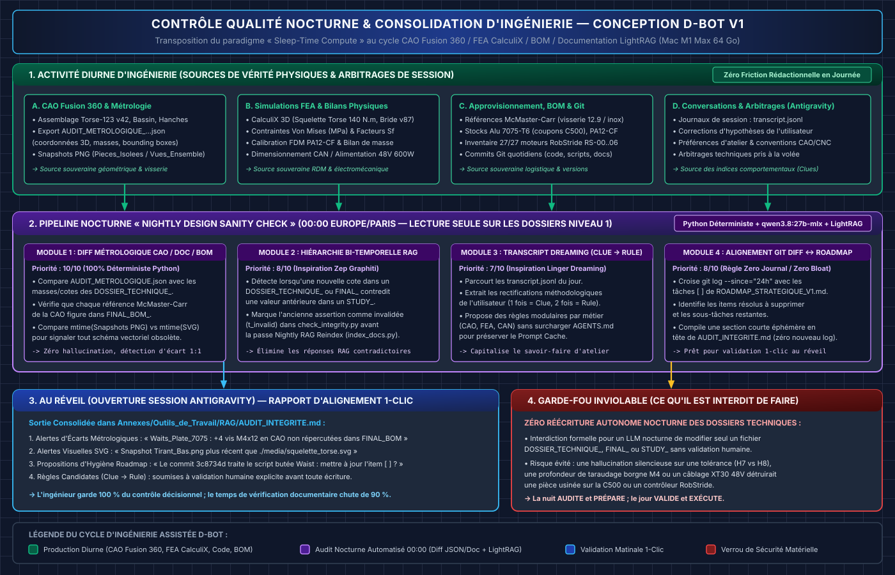

# 🛠️ Étude et Propositions : Application de la Consolidation Nocturne (« Sleep-Time Compute ») au Processus de Conception et d'Ingénierie de D-Bot V1

> **Date de création :** 22 novembre 2026  
> **Statut :** Étude de Méthodologie d'Ingénierie & Automatisation Qualité (`Niveau 2 — STUDY`)  
> **Objet :** Transposition des mécanismes de consolidation mémoire nocturne (`Linger Dreaming`, validité bi-temporelle `Graphiti`, contrôle déterministe des sources) au flux de conception actuel du robot humanoïde **D-Bot V1** (CAO Fusion 360, FEA CalculiX, BOM McMaster-Carr, schémas vectoriels SVG et base LightRAG sur **Mac M1 Max 64 Go**).  
> **Documents liés :**  
> - [STUDY_Architecture_Memoire_Nocturne_et_Cognition_Embodied_D-Bot.md](file:///Users/Shared/Mon%20Google%20Drive%20Physique/Documentation/Annexes/Cognition_et_Memoire_Robot/STUDY_Architecture_Memoire_Nocturne_et_Cognition_Embodied_D-Bot.md)  
> - [ROADMAP_STRATEGIQUE_V1.md](file:///Users/Shared/Mon%20Google%20Drive%20Physique/Documentation/05_Gestion_Projet/ROADMAP_STRATEGIQUE_V1.md)  
> - [FINAL_Architecture_Master_V1_Hybride.md](file:///Users/Shared/Mon%20Google%20Drive%20Physique/Documentation/05_Gestion_Projet/FINAL_Architecture_Master_V1_Hybride.md)  
> - [FINAL_Liste_Achats_BOM.md](file:///Users/Shared/Mon%20Google%20Drive%20Physique/Documentation/05_Gestion_Projet/FINAL_Liste_Achats_BOM.md)  
> - [AUDIT_INTEGRITE.md](file:///Users/Shared/Mon%20Google%20Drive%20Physique/Documentation/Annexes/Outils_de_Travail/RAG/AUDIT_INTEGRITE.md)

---

## 📑 Sommaire

- [1. Diagnostic du Flux de Conception Actuel de D-Bot V1](#1-diagnostic-du-flux-de-conception-actuel-de-d-bot-v1)
  - [1.1 Parallèle entre le Cycle d'un Agent et une Journée d'Ingénierie](#11-parallèle-entre-le-cycle-dun-agent-et-une-journée-dingénierie)
  - [1.2 Le Problème de la Dérive Inter-Sources en Conception Rapide](#12-le-problème-de-la-dérive-inter-sources-en-conception-rapide)
- [2. Schéma d'Architecture du Contrôle Qualité Nocturne](#2-schéma-darchitecture-du-contrôle-qualité-nocturne)
- [3. Quatre Propositions Concrètes pour la Phase de Conception Actuelle](#3-quatre-propositions-concrètes-pour-la-phase-de-conception-actuelle)
  - [3.1 Module 1 de Réconciliation Déterministe CAO vers Markdown et BOM](#31-module-1-de-réconciliation-déterministe-cao-vers-markdown-et-bom)
  - [3.2 Module 2 d'Invalidation Bi-Temporelle avant Indexation LightRAG](#32-module-2-dinvalidation-bi-temporelle-avant-indexation-lightrag)
  - [3.3 Module 3 de Transcript Dreaming et Apprentissage de Règles Métier](#33-module-3-de-transcript-dreaming-et-apprentissage-de-règles-métier)
  - [3.4 Module 4 d'Alignement Automatique Git Diff et Roadmap Stratégique](#34-module-4-dalignement-automatique-git-diff-et-roadmap-stratégique)
- [4. Arbitrage d'Ingénierie Système sur l'Utilité et les Risques](#4-arbitrage-dingénierie-système-sur-lutilité-et-les-risques)
  - [4.1 Ce qu'il Faut Formellement S'Interdire en Conception Matérielle](#41-ce-quil-faut-formellement-sinterdire-en-conception-matérielle)
  - [4.2 Matrice Coût-Bénéfice et Priorisation d'Implémentation](#42-matrice-coût-bénéfice-et-priorisation-dimplémentation)
- [5. Plan d'Intégration Léger dans l'Automation de Minuit](#5-plan-dintégration-léger-dans-lautomation-de-minuit)

---

## 1. Diagnostic du Flux de Conception Actuel de D-Bot V1

### 1.1 Parallèle entre le Cycle d'un Agent et une Journée d'Ingénierie

Au cours de la phase actuelle de finalisation mécanique et électronique de **D-Bot V1** (pré-usinage CNC C500 du torse en Alu 7075-T6, intégration du bassin PA12-CF et du roulement croisé `RB8016`, câblage de la station `48V 600W` et des `27` actionneurs QDD **RobStride** `RS-00` à `RS-06`), chaque journée de travail produit quatre flux de données hétérogènes :

1. **La vérité géométrique 3D (CAO Fusion 360)** : modifications de pièces dans l'assemblage `Torse-123 v42` (`Waist_Plate_7075`, butée de lacet `+/- 95 deg`, tirants bas monoblocs en T, hanches `ASV1_200`), exportées sous forme de métrologie exacte dans [AUDIT_METROLOGIQUE_Torse_et_Bassin.json](file:///Users/Shared/Mon%20Google%20Drive%20Physique/Documentation/01_Mecanique_et_Chassis/Torse_et_Bassin/Audits/AUDIT_METROLOGIQUE_Torse_et_Bassin.json) et de captures PNG dans `Exports_CAO_DBot/01_Torse_et_Bassin/Visual_Snapshots/`.
2. **La vérité physique et RDM (FEA CalculiX & Bilans)** : résultats de contraintes Von Mises (ex. squelette torse sous `140 N.m`, bride épaule `v87` à `85 MPa` pour `Sf = 5,92`) et bilans de masse ([STUDY_Bilan_Masse_Global_et_Opportunite_Waist_Pitch_2DoF.md](file:///Users/Shared/Mon%20Google%20Drive%20Physique/Documentation/01_Mecanique_et_Chassis/Torse_et_Bassin/STUDY_Bilan_Masse_Global_et_Opportunite_Waist_Pitch_2DoF.md)).
3. **La vérité logistique (BOM & Commits Git)** : références de visserie McMaster-Carr, débits de brut Alu 7075-T6 ([FINAL_BOM_Torse_et_Waist_D-Bot.md](file:///Users/Shared/Mon%20Google%20Drive%20Physique/Documentation/01_Mecanique_et_Chassis/Torse_et_Bassin/FINAL_BOM_Torse_et_Waist_D-Bot.md) et [FINAL_Liste_Achats_BOM.md](file:///Users/Shared/Mon%20Google%20Drive%20Physique/Documentation/05_Gestion_Projet/FINAL_Liste_Achats_BOM.md)).
4. **Les arbitrages conversationnels (Sessions Antigravity)** : décisions méthodologiques, corrections de biais et choix d'architecture enregistrés au fil de l'eau dans les journaux `transcript.jsonl`.

### 1.2 Le Problème de la Dérive Inter-Sources en Conception Rapide

Lorsqu'une pièce évolue en fin de journée dans Fusion 360 :
* Le fichier `AUDIT_METROLOGIQUE_Torse_et_Bassin.json` et les snapshots PNG reflètent le nouvel état 3D.
* Mais il arrive fréquemment qu'un tableau de masse dans un fichier `STUDY_`, une quantité de vis CHC M4 dans `FINAL_BOM_` ou un schéma vectoriel `.svg` dans `./media/` conserve l'état précédent.
* Lorsque l'automation nocturne **`Nightly RAG Reindex` (`00:00 Europe/Paris`)** exécute [index_docs.py](file:///Users/Shared/Mon%20Google%20Drive%20Physique/Documentation/Code/rag/index_docs.py), **LightRAG indexe simultanément l'ancienne cote restée dans une étude et la nouvelle cote du dossier technique**, sans savoir laquelle a invalidé l'autre.

---

## 2. Schéma d'Architecture du Contrôle Qualité Nocturne

---

## 3. Quatre Propositions Concrètes pour la Phase de Conception Actuelle

Plutôt que de créer une infrastructure lourde séparée, les mécanismes de « mémoire nocturne » peuvent être greffés directement sur vos outils existants ([check_integrity.py](file:///Users/Shared/Mon%20Google%20Drive%20Physique/Documentation/Code/rag/check_integrity.py), [AUDIT_INTEGRITE.md](file:///Users/Shared/Mon%20Google%20Drive%20Physique/Documentation/Annexes/Outils_de_Travail/RAG/AUDIT_INTEGRITE.md) et `Nightly RAG Reindex` à `00:00`) à travers **quatre modules complémentaires**.

### 3.1 Module 1 de Réconciliation Déterministe CAO vers Markdown et BOM

Ce premier module s'exécute en Python pur (zéro hallucination LLM) à `00:00` dès lors que `AUDIT_METROLOGIQUE_Torse_et_Bassin.json` ou un dossier `Visual_Snapshots/` a été modifié dans la journée :

1. **Contrôle Métrologique (`JSON CAO <-> Dossiers Techniques & Bilan de Masse`)** :
   * Compare la masse, le volume et les dimensions hors-tout (`bounding_box`) de chaque corps exporté depuis Fusion 360 avec les valeurs citées dans [DOSSIER_TECHNIQUE_Torse_Complet_D-Bot_V2.md](file:///Users/Shared/Mon%20Google%20Drive%20Physique/Documentation/01_Mecanique_et_Chassis/Torse_et_Bassin/DOSSIER_TECHNIQUE_Torse_Complet_D-Bot_V2.md), [DOSSIER_TECHNIQUE_Bassin_et_Waist_D-Bot.md](file:///Users/Shared/Mon%20Google%20Drive%20Physique/Documentation/01_Mecanique_et_Chassis/Torse_et_Bassin/DOSSIER_TECHNIQUE_Bassin_et_Waist_D-Bot.md) et [SYNTHESE_METROLOGIQUE_Torse_et_Bassin.md](file:///Users/Shared/Mon%20Google%20Drive%20Physique/Documentation/01_Mecanique_et_Chassis/Torse_et_Bassin/SYNTHESE_METROLOGIQUE_Torse_et_Bassin.md).
   * Signale tout écart supérieur à `1 %` ou `0,1 mm`.
2. **Contrôle de Nomenclature (`Arbre CAO <-> FINAL_BOM`)** :
   * Extrait automatiquement les références McMaster-Carr à 9 caractères présentes dans l'assemblage CAO et vérifie que chacune est répertoriée avec le bon nombre d'occurrences dans [FINAL_BOM_Torse_et_Waist_D-Bot.md](file:///Users/Shared/Mon%20Google%20Drive%20Physique/Documentation/01_Mecanique_et_Chassis/Torse_et_Bassin/FINAL_BOM_Torse_et_Waist_D-Bot.md).
3. **Contrôle de Fraîcheur des Schémas Vectoriels (`Snapshots PNG <-> Fichiers SVG`)** :
   * Compare la date de modification (`mtime`) des captures PNG de `Pieces_Isolees/` et `Vues_Ensemble/` avec celle des schémas `./media/*.svg` associés. Si un snapshot CAO est plus récent que le SVG, le rapport matinal signale que le schéma vectoriel doit être recalibré.

### 3.2 Module 2 d'Invalidation Bi-Temporelle avant Indexation LightRAG

Inspiré de l'architecture **Zep `Graphiti`**, ce module résout les conflits de versions entre documents au sein de LightRAG :

* **Hiérarchie temporelle et documentaire** : lorsqu'une même entité mécanique (ex. `Tirant Bas`, `Bride Epaule RS-04`, `Butée Lacet`) présente deux valeurs différentes entre un document de **Niveau 1 (`FINAL_`, `DOSSIER_TECHNIQUE_`)** modifié récemment et un document de **Niveau 2 (`STUDY_`)** plus ancien, le script nocturne marque explicitement l'extrait du `STUDY_` comme antérieur (`t_invalid`) dans le rapport d'intégrité [AUDIT_INTEGRITE.md](file:///Users/Shared/Mon%20Google%20Drive%20Physique/Documentation/Annexes/Outils_de_Travail/RAG/AUDIT_INTEGRITE.md).
* **Effet immédiat** : vous voyez dès le lendemain matin la ligne exacte du fichier `STUDY_` où subsiste une ancienne cote à mettre à jour ou à archiver via [resolve_audit.py](file:///Users/Shared/Mon%20Google%20Drive%20Physique/Documentation/Code/rag/resolve_audit.py).

### 3.3 Module 3 de Transcript Dreaming et Apprentissage de Règles Métier

Inspiré de l'apprentissage récursif en deux temps (`Clue -> Rule`) et de l'injection *Cache-Safe* de **Linger** :

* **Analyse nocturne des sessions (`transcript.jsonl`)** : chaque nuit, `qwen3.8:27b-mlx` inspecte les transcriptions des conversations de la journée pour repérer les corrections méthodologiques que vous avez formulées à l'agent.
* **Filtrage à deux niveaux (`Clue -> Rule`)** :
  * Une remarque isolée devient un **indice candidat (`Clue`)**.
  * Deux indices convergents (ou une directive explicite du type *« Toujours procéder ainsi »*) génèrent une **proposition de règle (`Rule`)** dans le rapport matinal.
* **Préservation de la légèreté de `AGENTS.md`** : au lieu d'alourdir le prompt système permanent `AGENTS.md` avec des détails ultra-spécifiques, les règles validées sont rangées dans les compétences ou guides spécialisés correspondants (ex. règles FEA CalculiX, règles d'export CAO Fusion 360), consultés uniquement lorsque la tâche l'exige.

### 3.4 Module 4 d'Alignement Automatique Git Diff et Roadmap Stratégique

Pour maintenir [ROADMAP_STRATEGIQUE_V1.md](file:///Users/Shared/Mon%20Google%20Drive%20Physique/Documentation/05_Gestion_Projet/ROADMAP_STRATEGIQUE_V1.md) parfaitement propre tout en respectant la règle **« Zero Journal & Zero Bloat »** :

* La passe de minuit croise les commits Git des dernières 24 heures (`git log --since="24 hours ago" --stat`) avec la liste des tâches ouvertes `[ ]` de la Roadmap.
* Elle inscrit en tête de [AUDIT_INTEGRITE.md](file:///Users/Shared/Mon%20Google%20Drive%20Physique/Documentation/Annexes/Outils_de_Travail/RAG/AUDIT_INTEGRITE.md) un bloc éphémère **`Briefing Matinal d'Alignement`** (écrasé chaque nuit, sans jamais accumuler d'historique) indiquant quelles tâches `[ ]` ont été touchées par les travaux de la veille et peuvent être supprimées ou mises à jour.

---

## 4. Arbitrage d'Ingénierie Système sur l'Utilité et les Risques

### 4.1 Ce qu'il Faut Formellement S'Interdire en Conception Matérielle

En ingénierie mécanique, électronique et robotique, **la frontière entre l'audit automatisé et l'édition autonome est critique** :

> [!CAUTION]
> **Interdiction absolue de réécriture nocturne autonome des documents techniques (`DOSSIER_TECHNIQUE_`, `FINAL_`, `STUDY_`) par un LLM.**  
> Dans un assistant bureautique comme Linger, une erreur de synthèse nocturne sur un courriel est bénigne. Dans le projet **D-Bot V1**, si un modèle local réécrit silencieusement une fiche technique à minuit et altère une tolérance d'alésage de roulement `RB8016`, une longueur de vis `M4x12` dans un trou borgne de `Waist_Plate_7075` ou un brochage `XT30 2+2` en `48V`, la conséquence directe est la destruction d'une pièce usinée sur la CNC C500 ou un court-circuit matériel.  
> **Règle d'or :** *La nuit audite, croise et prépare les correctifs ; l'ingénieur valide en 1 clic le matin.*

De même, il faut éviter le piège de la **distraction d'outillage** : le développement de ce contrôleur nocturne ne doit pas empiéter sur le temps d'atelier dédié à l'usinage des coupons d'Alu 7075-T6, au montage de la station `48V 600W` et à l'intégration des `27` moteurs RobStride.

### 4.2 Matrice Coût-Bénéfice et Priorisation d'Implémentation

| Proposition | Utilité pour D-Bot V1 | Temps de Dév Estimé | Risque | Verdict d'Architecte |
| :--- | :---: | :---: | :---: | :--- |
| **Module 1 : Diff Déterministe `JSON CAO <-> Markdown / BOM / Fraîcheur SVG`** | **10 / 10** (Élimine les erreurs d'usinage et d'oubli de visserie dans la BOM) | **Court (`~2 h`)** (Script Python pur sans LLM) | **Nul** (Lecture seule) | **PRIORITÉ 1 — À implémenter immédiatement** |
| **Module 4 : Alignement Nocturne `Git Diff <-> ROADMAP_STRATEGIQUE_V1.md`** | **8 / 10** (Gain de temps à l'ouverture de session, zéro journal qui gonfle) | **Très court (`~1 h`)** | **Nul** (Section éphémère en tête d'`AUDIT_INTEGRITE.md`) | **PRIORITÉ 1 — À coupler au Module 1** |
| **Module 2 : Invalidation Bi-Temporelle `FINAL_/DOSSIER_ > STUDY_` dans `check_integrity.py`** | **8 / 10** (Supprime la pollution du RAG par d'anciennes cotes d'études) | **Court (`~2 h`)** (Enrichissement de `check_integrity.py`) | **Nul** | **PRIORITÉ 2 — Pertinent dès la fin de la campagne RAG actuelle** |
| **Module 3 : `Transcript Dreaming` (`Clue -> Rule` sur les conversations du jour)** | **7 / 10** (Capitalise vos consignes implicites sans surcharger `AGENTS.md`) | **Modéré (`~4 h`)** | **Faible** (Proposition soumise à validation le matin) | **PRIORITÉ 3 — À déployer dans un second temps** |
| **Réécriture autonome des dossiers techniques par LLM la nuit** | **2 / 10** | Élevé | **Critique** (Risque de corruption de cotes CAO/FEA) | **REJETÉ FORMELLEMENT** |

---

## 5. Plan d'Intégration Léger dans l'Automation de Minuit

Pour obtenir 80 % de la valeur dès maintenant avec un effort minimal et sans créer de nouveau démon permanent en RAM sur le **Mac M1 Max (64 Go)**, l'intégration cible consiste à enrichir la tâche planifiée existante **`Nightly RAG Reindex` (`00:00 Europe/Paris`)** en trois étapes séquentielles :

1. **`00:00` — Passe Déterministe Pré-Indexation (`Module 1 + Module 4`)** :
   * Vérification instantanée (`< 3 secondes`, `0 Go` VRAM) des écarts entre [AUDIT_METROLOGIQUE_Torse_et_Bassin.json](file:///Users/Shared/Mon%20Google%20Drive%20Physique/Documentation/01_Mecanique_et_Chassis/Torse_et_Bassin/Audits/AUDIT_METROLOGIQUE_Torse_et_Bassin.json), les snapshots PNG, les schémas SVG, la BOM et les commits Git de la journée.
2. **`00:01` — Indexation Incrémentale LightRAG (`Nightly RAG Reindex` existant)** :
   * Exécution normale de `index_docs.py --provider auto` sur les documents modifiés dans la journée.
3. **`00:05` — Mise à jour du Briefing Matinal dans `AUDIT_INTEGRITE.md` (`Module 2`)** :
   * Génération en tête de [AUDIT_INTEGRITE.md](file:///Users/Shared/Mon%20Google%20Drive%20Physique/Documentation/Annexes/Outils_de_Travail/RAG/AUDIT_INTEGRITE.md) du résumé des divergences détectées (`CAO vs Doc`, `SVG à rafraîchir`, `Items Roadmap touchés`), prêt à être consulté dès l'ouverture de votre session du matin.
