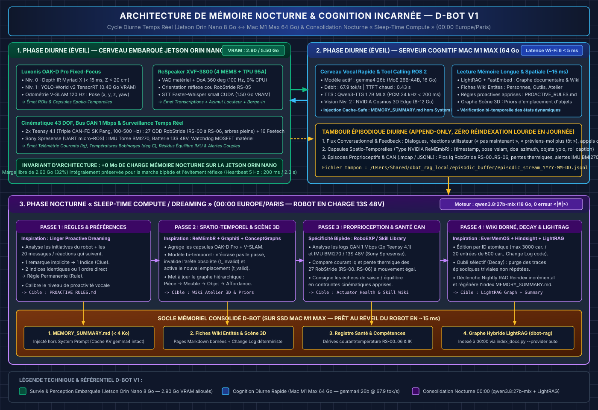

# 🧠 Étude d'Ingénierie : Architecture de Mémoire Nocturne (« Sleep-Time Compute ») et Cognition Incarnée pour le Robot Humanoïde D-Bot V1

> **Date de création :** 22 novembre 2026  
> **Statut :** Étude d'Architecture Cognitive & Benchmark d'État de l'Art (`Niveau 2 — STUDY`)  
> **Périmètre :** Analyse technique de `simplexai-labs/linger` (`PolyStrata`, `Dreaming`), recensement des architectures de mémoire pour robots incarnés (`NVIDIA ReMEmbR`, `Graphiti`, `ConceptGraphs`, `HippoRAG 2`, `EverMemOS`, `Hindsight`, mémoire procédurale CAN/IMU) et spécification d'intégration sur l'architecture hybride **Jetson Orin Nano Super (8 Go) <-> Apple Mac M1 Max (64 Go)**.  
> **Références internes Niveau 1 & 2 :**  
> - [FINAL_Architecture_Master_V1_Hybride.md](file:///Users/Shared/Mon%20Google%20Drive%20Physique/Documentation/05_Gestion_Projet/FINAL_Architecture_Master_V1_Hybride.md)  
> - [FINAL_CONSOLIDE_00_Architecture_Centrale.md](file:///Users/Shared/Mon%20Google%20Drive%20Physique/Documentation/00_Architecture_Centrale/FINAL_CONSOLIDE_00_Architecture_Centrale.md)  
> - [FINAL_CONSOLIDE_03_Intelligence_et_Logiciel.md](file:///Users/Shared/Mon%20Google%20Drive%20Physique/Documentation/03_Intelligence_et_Logiciel/FINAL_CONSOLIDE_03_Intelligence_et_Logiciel.md)  
> - [00_GUIDE_IA_Locale_M1Max_64Go.md](file:///Users/Shared/Mon%20Google%20Drive%20Physique/Documentation/Annexes/Outils_de_Travail/IA_sur_Mac_M1_Pro_Max_64Go/00_GUIDE_IA_Locale_M1Max_64Go.md)  
> - [47_Cerveau_IA_Ollama_LLM.md](file:///Users/Shared/Mon%20Google%20Drive%20Physique/Documentation/Annexes/jetson/brain/47_Cerveau_IA_Ollama_LLM.md)

---

## 📑 Sommaire

- [1. Contexte et Analyse Critique du Projet SimplexAI Linger](#1-contexte-et-analyse-critique-du-projet-simplexai-linger)
  - [1.1 Identité et Architecture Technique de Linger](#11-identité-et-architecture-technique-de-linger)
  - [1.2 Évaluation Factuelle du Moteur PolyStrata et des Benchmarks](#12-évaluation-factuelle-du-moteur-polystrata-et-des-benchmarks)
  - [1.3 Pourquoi Écarter la Pile Linger Complète mais Retenir sa Mémoire Nocturne](#13-pourquoi-écarter-la-pile-linger-complète-mais-retenir-sa-mémoire-nocturne)
- [2. Dissection de la Mémoire Nocturne de Linger](#2-dissection-de-la-mémoire-nocturne-de-linger)
  - [2.1 Fiches Wiki Typées à Taille Bornée et Édition par ID Atomique](#21-fiches-wiki-typées-à-taille-bornée-et-édition-par-id-atomique)
  - [2.2 Préservation Déterministe des Sources et Change Log Applicatif](#22-préservation-déterministe-des-sources-et-change-log-applicatif)
  - [2.3 Injection Cache-Safe hors du System Prompt](#23-injection-cache-safe-hors-du-system-prompt)
  - [2.4 Apprentissage Comportemental Récursif en Deux Temps](#24-apprentissage-comportemental-récursif-en-deux-temps)
- [3. État de l'Art des Architectures de Mémoire pour Robot Humanoïde Bipède](#3-état-de-lart-des-architectures-de-mémoire-pour-robot-humanoïde-bipède)
  - [3.1 NVIDIA ReMEmbR pour la Mémoire Épisodique Spatio-Temporelle ROS 2](#31-nvidia-remembr-pour-la-mémoire-épisodique-spatio-temporelle-ros-2)
  - [3.2 Zep Graphiti et Vectorize Hindsight pour la Validité Bi-Temporelle](#32-zep-graphiti-et-vectorize-hindsight-pour-la-validité-bi-temporelle)
  - [3.3 ConceptGraphs pour les Graphes de Scène 3D et la Permanence des Objets](#33-conceptgraphs-pour-les-graphes-de-scène-3d-et-la-permanence-des-objets)
  - [3.4 Consolidation Proprioceptive et Bibliothèque de Compétences Motrices](#34-consolidation-proprioceptive-et-bibliothèque-de-compétences-motrices)
  - [3.5 EverMemOS et HippoRAG 2 pour l'Oubli Sélectif et l'Indexation Associative](#35-evermemos-et-hipporag-2-pour-loubli-sélectif-et-lindexation-associative)
  - [3.6 Matrice Comparative des Frameworks de Mémoire Agentique et Robotique](#36-matrice-comparative-des-frameworks-de-mémoire-agentique-et-robotique)
- [4. Proposition d'Architecture D-Bot Nightly Dreaming](#4-proposition-darchitecture-d-bot-nightly-dreaming)
  - [4.1 Schéma d'Architecture Globale Diurne et Nocturne](#41-schéma-darchitecture-globale-diurne-et-nocturne)
  - [4.2 Fonctionnement Diurne Sans Impact VRAM sur la Jetson Orin Nano](#42-fonctionnement-diurne-sans-impact-vram-sur-la-jetson-orin-nano)
  - [4.3 Les Quatre Passes de Consolidation Nocturne sur le Mac M1 Max](#43-les-quatre-passes-de-consolidation-nocturne-sur-le-mac-m1-max)
  - [4.4 Structure des Fichiers Mémoriels et Couplage avec LightRAG](#44-structure-des-fichiers-mémoriels-et-couplage-avec-lightrag)
- [5. Feuille de Route d'Implémentation Progressive](#5-feuille-de-route-dimplémentation-progressive)

---

## 1. Contexte et Analyse Critique du Projet SimplexAI Linger

### 1.1 Identité et Architecture Technique de Linger

Publié en novembre 2026 par **Simplex AI** (`SIMPLEX AI TECHNOLOGIES PTE. LTD.`), fondée par **Tony Zhang** (ancien chef de projet de *DeepSeek-VL*), **Linger** est un framework d'agent personnel *Local-First* visant à exécuter un assistant permanent (« *Another Me* ») et une équipe d'agents localement sur ordinateur personnel (macOS Apple Silicon, Windows, Linux).

Référence du dépôt analysé :

```text
https://github.com/simplexai-labs/linger
```

Référence du moteur d'inférence associé :

```text
https://github.com/simplexai-labs/PolyStrata
```

L'architecture de Linger s'articule autour de quatre sous-systèmes :
1. **Moteur d'inférence MoE hiérarchisé (`PolyStrata` / `Strata`)** : sur les architectures *Mixture-of-Experts* (MoE), seuls les experts les plus fréquemment activés résident dans la VRAM du GPU dédié, tandis que les experts secondaires résident en RAM système (calculés par le CPU en parallèle sur PC NVIDIA) et que les experts rares sont paginés depuis le SSD.
2. **Planificateur matériel (`Model Autopilot`)** : sonde la VRAM, la RAM libre et la bande passante mémoire à l'installation pour sélectionner automatiquement un modèle parmi 49 références, sa quantification (`IQ1_M` à `Q8_0`), la précision du cache KV (`q4_0` ou `q8_0`) et la fenêtre de contexte (`64K` à `256K`).
3. **Mémoire compilée en Wiki nocturne (« Dreaming » & `Hindsight`)** : connecte les sources bureautiques (courriels, agenda, Slack, sessions navigateur Chrome, réunions vocales via `LiveKit`) et exécute chaque nuit à `00:00` une passe de consolidation qui met à jour un graphe de pages Wiki par entité tout en réécrivant ses règles de notification proactive.
4. **Orchestration découplée (`TeamHub`)** : permet d'exécuter les agents soit sur le runtime local (`Pi`), soit via un abonnement cloud (`Claude Code`, `Codex`) ou un point de terminaison compatible OpenAI/Anthropic (BYOK).

### 1.2 Évaluation Factuelle du Moteur PolyStrata et des Benchmarks

L'inspection du fichier technique interne `docs/local-inference.md` de Linger met en évidence un écart important entre la promesse commerciale de la page d'accueil et la réalité mesurée :

| Affirmation Vitrine Linger | Réalité Technique Documentée (`docs/local-inference.md`) | Impact pour l'Écosystème D-Bot |
| :--- | :--- | :--- |
| **« Modèle 125B (`Qwen3.8-Flash-Next`) sur GPU 12 Go à 45,5 tok/s »** | Nécessite une quantification extrême à **2 bits (`Q2_0` / `IQ1_M`, 39 Go)**. Sur la configuration `Linux NVIDIA 12 Go + 32 Go RAM`, le débit réel mesuré tombe à **21,3 tok/s** et le **temps avant premier token (TTFT) après un prompt de 62K atteint ~3 minutes** (pagination SSD). Ce modèle n'est pas le choix par défaut de l'installateur. | Une latence TTFT de 3 minutes est rédhibitoire pour la boucle vocale temps réel de D-Bot (cible `< 500 ms`). |
| **Performances élevées sur « Mac 24 Go / 32 Go » et « NVIDIA 8 Go / 12 Go »** | Les notes de protocole précisent que ces paliers ont été **simulés en laboratoire sur un Mac M5 Ultra (256 Go)** et une **carte NVIDIA Pro de 96 Go** bridés logiciellement en quota mémoire, bénéficiant donc d'une bande passante mémoire (`> 800 Go/s`) trois à cinq fois supérieure au matériel grand public réel. | Votre **Mac M1 Max (64 Go, 400 Go/s)** dispose déjà de benchmarks réels certifiés sur votre propre corpus D-Bot ([STUDY_Benchmarks_Indexation_RAG_20261121.md](file:///Users/Shared/Mon%20Google%20Drive%20Physique/Documentation/Annexes/Outils_de_Travail/RAG/STUDY_Benchmarks_Indexation_RAG_20261121.md)). |
| **Gain d'inférence `PolyStrata` sur Mac Apple Silicon** | Sur Mac, la mémoire étant déjà unifiée entre CPU et GPU Metal, le tiering VRAM -> RAM PCIe de `PolyStrata` est sans objet. Linger utilise directement **`llama.cpp` (backend Metal)** pour ses paliers Mac (`Spark-X2.6-4B` sur 16 Go, `Qwen3.8-27B` sur 24/32 Go). | Votre socle actuel **Ollama MLX** (`qwen3.8:27b-mlx` et `gemma4:26b` à `67,9 tok/s`) et **Unsloth Studio** exploite déjà nativement la mémoire unifiée du M1 Max sans surcouche. |
| **« Projet Open-Source »** | Licence **Apache 2.0 modifiée (Source-Available)** interdisant l'hébergement tiers, le retrait du logo dans `apps/web/`, et comportant une clause (`Article 2.a`) autorisant l'éditeur à modifier unilatéralement la licence. | Risque de dépendance propriétaire si l'on adoptait leur serveur `TeamHub`. |

### 1.3 Pourquoi Écarter la Pile Linger Complète mais Retenir sa Mémoire Nocturne

Déployer la pile complète de Linger (`Docker Compose`, serveur `TeamHub`, serveur WebRTC `LiveKit`, daemon de contrôle bureau `Cua`) sur le **Mac M1 Max (64 Go)** ferait doublon avec votre infrastructure existante tout en immobilisant en permanence de la RAM unifiée nécessaire à **Fusion 360**, **LightRAG** et **Qwen3-TTS**.

En revanche, **l'architecture logicielle de sa mémoire nocturne (*Dreaming*)** résout avec une grande élégance trois problèmes fondamentaux de tout système cognitif fonctionnant sur le long cours :
1. **La dérive et l'explosion de la taille du contexte** au fil des semaines d'utilisation.
2. **La corruption de la mémoire par hallucination lors des réécritures automatiques**.
3. **L'invalidation du cache KV (*Prompt Cache*) lors de l'injection de nouveaux souvenirs**.

---

## 2. Dissection de la Mémoire Nocturne de Linger

L'étude détaillée des spécifications de Linger permet d'extraire **quatre patrons de conception (Design Patterns)** directement réutilisables en Python pur dans l'écosystème D-Bot.

### 2.1 Fiches Wiki Typées à Taille Bornée et Édition par ID Atomique

Contrairement à un système qui accumule indéfiniment des résumés de conversations, la mémoire partagée est structurée en **pages Markdown typées** (`Personne`, `Projet`, `Sujet`, `Session`), où chaque entité réelle possède une fiche unique :
* **Plafond strict de taille** : chaque section de synthèse est limitée à **`3 000 caractères`**, et chaque liste structurée est plafonnée à **`20 entrées de 500 caractères maximum`**.
* **Modification chirurgicale par identifiant (`ID`)** : le modèle de langage ne régénère jamais une liste complète. Le code attribue un identifiant unique à chaque entrée (`[ID-01]`, `[ID-02]`), et le modèle émet uniquement des opérations unitaires (`ADD`, `UPDATE id`, `CLOSE id`, `MERGE ids`). Les entrées non mentionnées restent bit à bit intactes.
* **Compactage automatique des entrées anciennes** : lorsqu'une liste dépasse 20 entrées, le cycle nocturne fusionne les entrées les plus anciennes en une seule entrée historique datée.

### 2.2 Préservation Déterministe des Sources et Change Log Applicatif

Pour empêcher qu'un LLM en phase de « rêve » n'efface accidentellement une cote critique ou une décision validée :
* Chaque fait inscrit dans une fiche Wiki doit conserver un **pointeur de source** (identifiant de message, horodatage ou version de fichier).
* Lorsqu'une section de synthèse est réécrite la nuit, un **validateur déterministe en code** compare la nouvelle version à l'ancienne : toute réécriture qui perd une référence source sans fournir un motif explicite de rétractation est rejetée avant écriture sur disque.
* Le **Journal des Modifications (`Change Log`, borné aux 20 dernières lignes)** situé en bas de chaque fiche est généré exclusivement par l'application (date, opération, diff) et jamais par le LLM.

### 2.3 Injection Cache-Safe hors du System Prompt

Dans un système vocal temps réel comme D-Bot où le délai avant le premier mot parlé (*Time-To-First-Token*, `TTFT`) doit rester sous `500 ms` :
* Si l'on modifie le `System Prompt` à chaque fois qu'un souvenir change, le moteur d'inférence (`Ollama MLX` ou `llama.cpp`) doit recalculer tout le cache KV du préfixe système.
* Linger contourne ce goulot en générant à la fin de la consolidation un index ultra-compact **`summary.md`** et en l'attachant comme **note de contexte sur le premier message utilisateur** de la session, laissant le `System Prompt` 100 % statique. Les fiches détaillées (`MEMORY.md`, pages Wiki) ne sont lues qu'à la demande par appel d'outil.

### 2.4 Apprentissage Comportemental Récursif en Deux Temps

Le mécanisme nocturne de Linger ajuste la proactivité de l'agent sans aucun réentraînement de poids (*Zero Fine-Tuning*) en relisant chaque soir les messages initiés par l'agent et les 20 messages suivants :

| Réaction de l'Utilisateur en Journée | Classification Nocturne | Effet sur le Comportement du Lendemain |
| :--- | :--- | :--- |
| Réaction implicite unique (*« Tu aurais dû me prévenir dès l'alerte »* ou *« Pas besoin de me dire ça »*) | **Indice (`Clue`, compteur = 1)** | Stocké dans un tampon d'indices candidats ; **n'altère pas encore** les règles actives (évite de sur-réagir à une humeur ponctuelle). |
| Seconde réaction implicite sur la même catégorie d'événement (`compteur = 2`) | **Promotion en Règle (`Rule`)** | Les deux indices fusionnent en une règle déterministe dans `PROACTIVE_RULES.md` (ex. `Alerte thermique moteur -> Notifier immédiatement`). |
| Consigne directe explicite (*« À partir de maintenant, ne parle pas à voix haute après 22h00 sauf urgence batterie »*) | **Règle Directe (`Rule` immédiate)** | Inscrite dès la première nuit dans `PROACTIVE_RULES.md` avec sa fenêtre horaire ou sa condition de déclenchement. |

---

## 3. État de l'Art des Architectures de Mémoire pour Robot Humanoïde Bipède

Un robot humanoïde bipède comme **D-Bot V1** (43 DOF : `27 actionneurs QDD RobStride` à arbres pleins + `16 servos Feetech` D-Hand) ne vit pas dans une boîte de réception d'e-mails. Il perçoit l'espace en 3D, se déplace, subit des contraintes mécaniques et thermiques, et interagit vocalement avec des interlocuteurs mobiles.

L'investigation menée sur la littérature scientifique et les dépôts open-source de robotique cognitive met en évidence **cinq architectures complémentaires** qui étendent le concept de mémoire nocturne aux besoins spécifiques d'un humanoïde bipède.

### 3.1 NVIDIA ReMEmbR pour la Mémoire Épisodique Spatio-Temporelle ROS 2

Développé par NVIDIA Research en collaboration avec l'USC et l'UT Austin pour **ROS 2 / Isaac ROS** sur plateforme Jetson, **ReMEmbR** (*Retrieval-augmented Memory for Embodied Robots*) répond à la question : *comment un robot peut-il se souvenir de ce qu'il a vu et entendu sur plusieurs jours sans stocker des téraoctets de vidéo brute ?*

Référence du dépôt officiel NVIDIA :

```text
https://github.com/NVIDIA-AI-IOT/remembr
```

* **Fonctionnement** : Au fil de l'eau, chaque événement visuel ou auditif significatif est condensé en une **capsule épisodique spatio-temporelle** associant :
  1. **Vecteur Temporel** : horodatage précis (`timestamp`).
  2. **Vecteur Spatial 3D** : pose odométrique issue du V-SLAM de la caméra **Luxonis OAK-D Pro** (`x, y, z, yaw`) + angle d'arrivée de la voix (`DoA 0-360 deg`) issu du **ReSpeaker XVF-3800**.
  3. **Descripteur Sémantique** : classes détectées par **YOLO-World v2 TensorRT** (`12-15 ms`) ou description concise générée par le VLM du Mac M1 Max (`gemma4:26b` ou `Qwen3.8-27B`) sur une région d'intérêt (ROI) compressée.
* **Synergie avec la consolidation nocturne** : En journée, les capsules sont simplement empilées. La nuit, le cycle de consolidation croise les capsules de la journée pour construire l'historique de localisation des objets et des personnes (*« La clé dynamométrique a été vue sur l'établi à 14h15 puis près de l'imprimante Bambu Lab à 18h30 »*).

### 3.2 Zep Graphiti et Vectorize Hindsight pour la Validité Bi-Temporelle

Un graphe de connaissances documentaire classique (comme **LightRAG** utilisé sur la documentation CAO/FEA) suppose que les faits extraits sont intemporels (*« Le roulement croisé du bassin est un EFANT RB8016 »*). Or, dans l'environnement opérationnel du robot, **l'état du monde change constamment** (*« La batterie 13S est à 82 % »*, *« La pince est sur la table »*).

Références des deux moteurs open-source de référence :

```text
https://github.com/getzep/graphiti
```

```text
https://github.com/vectorize-io/hindsight
```

* **L'apport décisif de `Graphiti` (Modèle Bi-Temporel)** : Chaque relation (arête) du graphe dynamique porte une double temporalité :
  * **Temps de validité dans le monde réel (`t_valid_from`, `t_valid_to`)** : période pendant laquelle le fait physique était vrai.
  * **Temps de transaction système (`t_recorded_at`, `t_invalidated_at`)** : moment où le robot a observé le fait et moment où une nouvelle observation l'a contredit.
* **Synergie avec la consolidation nocturne** : Lorsqu'une nouvelle observation contredit un fait antérieur, le robot n'écrase pas son passé et ne pollue pas ses réponses avec deux vérités contradictoires. La passe de consolidation ferme l'intervalle de validité de l'ancienne arête (`t_valid_to = 2026-11-22T18:30:00`) et ouvre la nouvelle (`t_valid_from = 2026-11-22T18:30:00`). D-Bot devient capable de répondre aussi bien à *« Où est l'outil maintenant ? »* qu'à *« Où était-il hier matin ? »*.

### 3.3 ConceptGraphs pour les Graphes de Scène 3D et la Permanence des Objets

Pour naviguer et manipuler des objets avec ses bras équipés d'actionneurs **RobStride RS-04 / RS-03 / RS-02** et de mains **D-Hand**, D-Bot a besoin d'une représentation géométrique et fonctionnelle de son environnement : un **Graphe de Scène 3D Dynamique (*3D Dynamic Scene Graph*)**.

Référence du dépôt `ConceptGraphs` :

```text
https://github.com/concept-graphs/concept-graphs
```

* **Structure hiérarchique à 4 niveaux** :
  1. **Niveau Bâtiment / Pièce** (ex. `Atelier_Principal`, `Bureau`).
  2. **Niveau Meubles / Ancres Statiques** (ex. `Etabli_CNC`, `Station_Charge_48V`, `Etagere_Composants`) dont les coordonnées 3D sont fixes.
  3. **Niveau Objets Mobiles** (ex. `Multimetre`, `Batterie_13S`, `Tasse`) rattachés par une relation spatiale (`SUR`, `DANS`, `A_COTE_DE`) à une ancre statique.
  4. **Niveau Affordances Physiques** : propriétés d'interaction apprises (`masse_estimee`, `fragile: oui/non`, `prise_recommandee: pince_laterale`).
* **Synergie avec la consolidation nocturne** : En exploitant les reconstructions ponctuelles de **NVIDIA Cosmos 3D Edge** (Niveau 2 de perception déporté sur le Mac M1 Max) accumulées dans la journée, la passe nocturne recalcule les **probabilités d'emplacement a priori (*Semantic Priors*)** : si l'utilisateur demande à D-Bot de chercher un objet qui n'est plus à sa dernière position connue, le robot sait dans quels meubles chercher par ordre de probabilité décroissante.

### 3.4 Consolidation Proprioceptive et Bibliothèque de Compétences Motrices

C'est la brique la plus spécifique à un **robot humanoïde bipède** : contrairement à un chatbot, D-Bot possède un corps mécanique soumis à l'usure, aux jeux articulaires, à l'échauffement Joule et aux lois de l'équilibre dynamique.

En croisant les travaux sur les bibliothèques de compétences robotiques (*RoboEXP*, *Voyager Skill Library*) avec l'architecture matérielle de D-Bot ([FINAL_Architecture_Master_V1_Hybride.md](file:///Users/Shared/Mon%20Google%20Drive%20Physique/Documentation/05_Gestion_Projet/FINAL_Architecture_Master_V1_Hybride.md)) :
* **En journée** : Les **2x Teensy 4.1** (Lower Body et Upper Body sur 3x bus CAN `1 Mbps` à `100-500 Hz`) et la **Sony Spresense** (IMU d'équilibre torse **BMI270**, surveillance batterie `13S 48V` et Watchdog MOSFET) publient via micro-ROS / ROS 2 Humble les télémétries articulaires des **27 moteurs RobStride (`RS-00` à `RS-06`)** et des **16 servos Feetech**.
* **La nuit (« Proprioceptive Dreaming »)** : Un script d'analyse numérique couplé à `qwen3.8:27b-mlx` inspecte les journaux télémétriques (`.mcap` / JSONL) de la journée pour consolider deux fiches vitales :
  1. **Fiche de Santé Prédictive par Actionneur (`Actuator_Health_Wiki.md`)** :
     * Calcul du ratio `Courant Moyen Iq / Couple Commandé` et de la pente d'échauffement thermique (`Delta_T / Delta_t` en `deg C/min`) pour chaque ID CAN (`RS-06` hanches/genoux/waist, `RS-04` épaules, `RS-05` cou, etc.).
     * Détection précoce des anomalies mécaniques : une hausse progressive de `10 à 15 %` du courant à vide ou sous charge nominale sur une articulation signale un point dur, un desserrage ou un frottement anormal de faisceau déporté avant toute casse.
  2. **Mémoire Procédurale et Cinématique (`Skill_Memory_Wiki.md`)** :
     * Tout épisode ayant déclenché une oscillation d'équilibre sur l'IMU **BMI270**, une saturation de couple ou un arrêt réflexe de proximité **OAK-D Pro** (`Z < 20 cm` en `< 15 ms`) est analysé pour extraire une règle paramétrique (ex. *« Lors de la préhension d'une charge > 1,0 kg bras tendu, limiter l'accélération pitch épaule RS-04 à X rad/s2 pour maintenir la marge de stabilité IMU »*).

### 3.5 EverMemOS et HippoRAG 2 pour l'Oubli Sélectif et l'Indexation Associative

Enfin, deux frameworks complètent le cycle de vie biologique de la mémoire à long terme :

Références des dépôts :

```text
https://github.com/EverMind-AI/EverMemOS
```

```text
https://github.com/OSU-NLP-Group/HippoRAG
```

* **`EverMemOS` (Oubli Sélectif Programmé / Courbe de Décroissance)** :
  Inspiré du cycle de vie des engrammes neuronaux, `EverMemOS` segmente les flux continus en cellules épisodiques (*MemCells*) dotées d'un **score de saillance** qui décroît exponentiellement avec le temps s'il n'est ni rappelé, ni associé à un incident, ni renforcé par répétition. Lors de la consolidation nocturne, les traces banales (*« Salutation matinale », « Passage couloir sans obstacle »*) sont purgées après extraction des statistiques globales, garantissant une base mémoire compacte et sans bruit.
* **`HippoRAG 2` (Propagation Associative par Personalized PageRank)** :
  Inspiré de l'indexation hippocampique humaine, `HippoRAG 2` complète la recherche vectorielle et graphe en exécutant un algorithme de **Personalized PageRank (PPR)** sur les noeuds du graphe de connaissances. Cela permet au robot de relier par association multi-sauts un symptôme observé en journée à une règle technique distante dans sa documentation.

### 3.6 Matrice Comparative des Frameworks de Mémoire Agentique et Robotique

| Framework / Concept | Cible Initiale | Structure de Stockage | Point Fort Majeur | Limite Principale | Brique à Retenir pour D-Bot V1 |
| :--- | :--- | :--- | :--- | :--- | :--- |
| **Linger (`Dreaming`)** | Assistant bureautique PC/Mac | Pages Wiki Markdown + FTS PostgreSQL | Édition par `ID` bornée, `Change Log` déterministe, injection *Cache-Safe*, règles `Clue -> Rule` | Aveugle à l'espace 3D, à la robotique ROS 2 et pas d'embeddings vectoriels sur son Wiki | **Gabarit des fiches Wiki bornées, injection hors System Prompt et apprentissage `Clue -> Rule`** |
| **NVIDIA `ReMEmbR`** | Robots mobiles ROS 2 / Jetson | Base vectorielle spatio-temporelle | Couplage natif `(Temps, Pose V-SLAM 3D, Caption VLM)` pour requêtes spatiales longues | Pas de consolidation nocturne en graphe d'entités ni de gestion des contradictions | **Format des capsules épisodiques `(Timestamp, Pose OAK-D, DoA ReSpeaker, Objets)`** |
| **Zep `Graphiti`** | Agents conversationnels temps réel | Graphe de connaissances **bi-temporel** | Gestion native de l'évolution des faits (`t_valid_from` / `t_invalidated_at`) sans écraser l'historique | Conçu pour du texte/JSON, nécessite une adaptation pour les états physiques 3D | **Horodatage bi-temporel et invalidation propre des états obsolètes de l'atelier** |
| **`ConceptGraphs`** | Perception robotique 3D | Graphe de scène 3D hiérarchique | Permanence des objets (`Pièce -> Meuble -> Objet -> Affordance`) | Coûteux à recalculer en continu sur GPU embarqué | **Recalcul différé la nuit sur le Mac M1 Max à partir des ROIs `Cosmos 3D Edge`** |
| **`EverMemOS`** | Agents autonomes longue durée | Cellules épisodiques (*MemCells* / *MemScenes*) | **Oubli sélectif (Decay)** évitant la saturation par les événements triviaux | Complexité accrue si utilisé comme OS complet | **Score de saillance et purge nocturne des traces épisodiques banales** |
| **`LightRAG` (`dbot-rag`)** | Documentation & Ingénierie D-Bot | Graphe Entités/Relations + Vecteurs + Reranker | Déjà en production sur le Mac M1 Max (`~15 ms`), indexation locale validée à `0` erreur avec `qwen3.8:27b-mlx` | Optimisé pour un corpus documentaire statique plutôt que pour un flux temps réel minute par minute | **Moteur central d'indexation nocturne des fiches Wiki consolidées à `00:00`** |

---

## 4. Proposition d'Architecture D-Bot Nightly Dreaming

L'architecture hybride **D-Bot V1** ([FINAL_Architecture_Master_V1_Hybride.md](file:///Users/Shared/Mon%20Google%20Drive%20Physique/Documentation/05_Gestion_Projet/FINAL_Architecture_Master_V1_Hybride.md)) offre un terrain d'intégration idéal : la **Jetson Orin Nano (8 Go)** gère la survie et les réflexes temps réel, tandis que le **Mac M1 Max (64 Go)** dispose de toute la puissance mémoire (`400 Go/s`) et de l'automation nocturne à **`00:00 Europe/Paris`** pour exécuter le cycle de consolidation (« *Dreaming* ») pendant que le robot recharge sa batterie `13S 48V`.

### 4.1 Schéma d'Architecture Globale Diurne et Nocturne



### 4.2 Fonctionnement Diurne Sans Impact VRAM sur la Jetson Orin Nano

Un impératif absolu de sécurité du projet D-Bot V1 est de **ne jamais entamer la marge de sécurité de `2,60 Go` de VRAM (`32 %` libre)** sur la **Jetson Orin Nano Super 8 Go** (`2,90 Go` alloués sur `5,50 Go` utiles en mode headless `multi-user.target`).

En phase d'éveil (journée) :
1. **Sur la Jetson Orin Nano (`+0 Mo` de charge supplémentaire)** :
   * Le pipeline visuel (**OAK-D Pro** Depth IR `< 15 ms` + **YOLO-World v2 TensorRT** `0,40 Go` + V-SLAM `120 Hz`), le pipeline audio (**ReSpeaker XVF-3800** VAD/DoA `360 deg` + **Faster-Whisper small CUDA** `1,50 Go`) et la passerelle micro-ROS / CAN (**Sony Spresense BMI270** + **2x Teensy 4.1**) fonctionnent exactement comme spécifié dans l'Architecture Master V1.
   * Les événements sont déjà transmis au Mac M1 Max via le pont réseau hybride (`ROS 2 DDS UDP Best-Effort` + `gRPC / WebSockets TCP`).
2. **Sur le Mac M1 Max (Lecture Rapide + Écriture Append-Only)** :
   * **Dialogue vocal et Tool Calling ROS 2** : exécutés par **`gemma4:26b`** (`67,9 tok/s`, `TTFT 0,43 s`).
   * **Injection Cache-Safe** : au démarrage d'une session vocale, le serveur Python du Mac attache le fichier compact `MEMORY_SUMMARY.md` (`< 4 Ko`, généré la nuit précédente) sur le premier message utilisateur et non dans le `System Prompt`. Le cache KV de `gemma4:26b` reste ainsi 100 % chaud d'un tour de parole à l'autre.
   * **Recherche à la demande (`~15 ms`)** : si une question nécessite un détail historique ou technique, `gemma4:26b` interroge **LightRAG** (`--mode naive` ou `hybrid`) qui contient à la fois la documentation d'ingénierie et les fiches Wiki consolidées des nuits précédentes.
   * **Tampon Épisodique Append-Only (`0 %` de charge LLM en écriture)** : chaque échange vocal, réaction de l'utilisateur, capsule spatio-temporelle `(Pose, DoA, Objets)` et alerte télémétrique CAN/IMU est simplement ajouté en fin de fichier dans un journal structuré `episodic_stream_YYYY-MM-DD.jsonl` (écriture disque en `< 0,2 ms`, aucune réindexation vectorielle ni extraction de graphe en pleine journée).

### 4.3 Les Quatre Passes de Consolidation Nocturne sur le Mac M1 Max

Chaque nuit à **`00:00 Europe/Paris`**, alors que D-Bot est au repos sur sa ligne d'alimentation `48V` et que la session vocale est inactive, un orchestrateur Python de consolidation (`dbot_nightly_dreaming.py`) démarre sur le **Mac M1 Max** en s'appuyant sur **`qwen3.8:27b-mlx`** (`18 Go`, seul modèle local certifié à `0` erreur de délimiteur `<|#|>` sur le graphe LightRAG).

Le traitement dépile `episodic_stream_YYYY-MM-DD.jsonl` en **quatre passes séquentielles** :

#### Passe 1 — Apprentissage Comportemental et Préférences (`Clue -> Rule`)
* **Entrée** : Toutes les prises de parole proactives ou actions autonomes du robot dans la journée + les 20 messages ou réactions vocales suivant chaque action.
* **Traitement** :
  * Détection des corrections implicites (ajout d'un indice `Clue` dans `pending_clues.json` avec compteur `seen = 1`).
  * Si un indice atteint `seen = 2` sur deux épisodes distincts, ou si l'utilisateur a formulé une directive explicite (*« Quand je suis au téléphone, coupe toutes les annonces vocales »*), promotion en règle active dans **`PROACTIVE_RULES.md`**.
* **Sortie** : Mise à jour de `PROACTIVE_RULES.md` (lu par le gestionnaire de dialogue de D-Bot pour décider entre `Parler immédiatement`, `Différer` ou `Rester silencieux`).

#### Passe 2 — Consolidation Spatio-Temporelle et Graphe de Scène 3D (`ReMEmbR` + `Graphiti` + `ConceptGraphs`)
* **Entrée** : Les capsules spatio-temporelles `(Timestamp, Pose V-SLAM OAK-D, Azimut DoA ReSpeaker, Détections YOLO-World v2 / ROIs Cosmos 3D)`.
* **Traitement** :
  * Agrégation des positions observées des objets et des interlocuteurs.
  * Application de la logique **bi-temporelle (`Graphiti`)** : lorsqu'un outil ou un objet a changé de place dans l'atelier, l'ancienne localisation dans la fiche **`WIKI_Atelier_et_Objets.md`** est marquée `t_valid_to` (archivée dans l'historique de l'objet) et la nouvelle position devient l'état actif `t_valid_from`, tout en mettant à jour la probabilité d'emplacement a priori (*Semantic Prior*) sur le meuble d'accueil.
* **Sortie** : Mise à jour par `ID` atomique de `WIKI_Atelier_et_Objets.md` et des fiches `WIKI_Personnes_et_Projets.md` avec vérification déterministe des sources et écriture du `Change Log`.

#### Passe 3 — Consolidation Proprioceptive et Santé Matérielle (`Proprioceptive Dreaming`)
* **Entrée** : Les résumés statistiques et alertes extraits des journaux CAN `1 Mbps` (**2x Teensy 4.1**, **27 moteurs RobStride `RS-00` à `RS-06`**) et micro-ROS (**Sony Spresense**, IMU **BMI270**, batterie `13S 48V`).
* **Traitement** :
  * Calcul déterministe (NumPy/Python) des indicateurs journaliers par actionneur : courant crête et moyen `Iq`, température maximale de bobinage, pente thermique `deg C/min`, écart de suivi de trajectoire (`tracking error`) et oscillations IMU `BMI270`.
  * Synthèse par `qwen3.8:27b-mlx` comparant les métriques du jour à la moyenne glissante sur 7 jours. Toute dérive supérieure à `10 %` à tâche équivalente génère une entrée de maintenance préventive dans **`WIKI_Sante_Materielle_et_Actionneurs.md`**.
  * Les incidents cinématiques (déclenchement du réflexe matériel OAK-D `Z < 20 cm` ou déséquilibre bipède) sont traduits en contraintes paramétriques dans **`WIKI_Competences_et_Cinematique.md`**.
* **Sortie** : Fiches de santé matérielle et de mémoire procédurale mises à jour.

#### Passe 4 — Oubli Sélectif (`EverMemOS` Decay), Indexation LightRAG et Génération du Résumé Cache-Safe
* **Entrée** : Les fiches Wiki consolidées des passes 1 à 3 + le journal brut `episodic_stream_YYYY-MM-DD.jsonl`.
* **Traitement** :
  * **Validation des bornes** : contrôle déterministe que chaque résumé de fiche respecte la limite de `3 000 caractères` et chaque liste la limite de `20 entrées de 500 caractères` (fusion automatique des entrées historiques excédentaires).
  * **Oubli sélectif (Decay)** : compression et archivage hors-index des traces épisodiques triviales de la journée (salutations, déplacements nominaux sans anomalie).
  * **Génération de `MEMORY_SUMMARY.md` (`< 4 Ko`)** : compilation de l'index ultra-court destiné à l'injection *Cache-Safe* du lendemain matin.
  * **Enchaînement avec `Nightly RAG Reindex`** : exécution de l'indexation incrémentale **`index_docs.py --provider auto`** afin que les nouvelles fiches Wiki modifiées la nuit soient immédiatement intégrées au graphe **LightRAG (`dbot-rag`)**.

### 4.4 Structure des Fichiers Mémoriels et Couplage avec LightRAG

Pour s'intégrer proprement à l'arborescence existante sans polluer la documentation d'ingénierie CAO/FEA de Niveau 1, la mémoire vivante du robot peut être organisée en deux zones distinctes :

| Zone / Fichier | Rôle Fonctionnel | Indexé dans LightRAG ? | Taille Maximale / Règle d'Hygiène |
| :--- | :--- | :---: | :--- |
| `/Users/Shared/dbot_rag_local/episodic_buffer/episodic_stream_YYYY-MM-DD.jsonl` | Tampon brut diurne (dialogues, capsules OAK-D/ReSpeaker, alertes CAN/IMU) | **Non** (exclu du RAG pour éviter le bruit) | Purgé / compressé chaque nuit après la Passe 4 (Decay `EverMemOS`) |
| `MEMORY_SUMMARY.md` | Index mémoire chaud + règles proactives actives (`PROACTIVE_RULES.md`) | **Oui** (+ injecté hors System Prompt au 1er tour) | Strictement `< 4 Ko` (`~1 000 tokens`) pour un `TTFT` de `0,43 s` |
| `WIKI_Personnes_et_Projets.md` | Préférences utilisateur, décisions d'atelier, chantiers en cours | **Oui** (incrémental `00:00`) | `3 000 car.` / résumé + `20 entrées x 500 car.` par liste + `Change Log` |
| `WIKI_Atelier_et_Objets.md` | État bi-temporel de l'atelier, dernière pose 3D connue des outils et priors | **Oui** (incrémental `00:00`) | Arêtes bi-temporelles (`t_valid_from`, `t_valid_to`) + ancres fixes |
| `WIKI_Sante_Materielle_et_Actionneurs.md` | Suivi longitudinal des 27 RobStride (`RS-00..06`), 16 Feetech, IMU `BMI270`, batterie `13S` | **Oui** (incrémental `00:00`) | Tableaux de dérive courant/température + alertes préventives |
| `WIKI_Competences_et_Cinematique.md` | Retours d'expérience moteurs, offsets appris et contraintes de sécurité | **Oui** (incrémental `00:00`) | Règles procédurales validées et horodatées |

---

## 5. Feuille de Route d'Implémentation Progressive

L'adoption de cette architecture peut se faire en **trois étapes modulaires**, sans aucune dépendance lourde tierce :

1. **Étape 1 — Socle Épisodique & Consolidation Conversationnelle (`Linger Dreaming` + Injection Cache-Safe)** :
   * Ajouter dans le serveur compagnon du Mac M1 Max l'écriture `append-only` des échanges vocaux et appels d'outils dans `episodic_stream_YYYY-MM-DD.jsonl`.
   * Développer le script nocturne de **Passe 1 & Passe 4** (extraction des règles `Clue -> Rule`, édition par `ID` de `WIKI_Personnes_et_Projets.md` avec `Change Log` déterministe et génération de `MEMORY_SUMMARY.md` injecté hors `System Prompt` dans `DbotBrainStreaming`).
2. **Étape 2 — Capsules Spatio-Temporelles & Validité Bi-Temporelle (`ReMEmbR` + `Graphiti`)** :
   * Coupler les sorties de **YOLO-World v2 / V-SLAM OAK-D Pro** et l'azimut **DoA ReSpeaker XVF-3800** pour enregistrer des capsules spatio-temporelles légères lors des interactions.
   * Activer la **Passe 2** (mise à jour bi-temporelle de `WIKI_Atelier_et_Objets.md` pour que D-Bot mémorise où se trouvent les outils et comment l'atelier évolue d'un jour à l'autre).
3. **Étape 3 — Consolidation Proprioceptive CAN & Santé Prédictive (`Proprioceptive Dreaming`)** :
   * Connecter les bilans journaliers des **2x Teensy 4.1** (courants/températures des actionneurs **RobStride RS-00 à RS-06**) et de la **Sony Spresense** (IMU **BMI270**, tension `13S 48V`) au tampon épisodique.
   * Activer la **Passe 3** pour doter D-Bot d'un véritable carnet de santé prédictif auto-maintenu chaque nuit à `00:00`.
