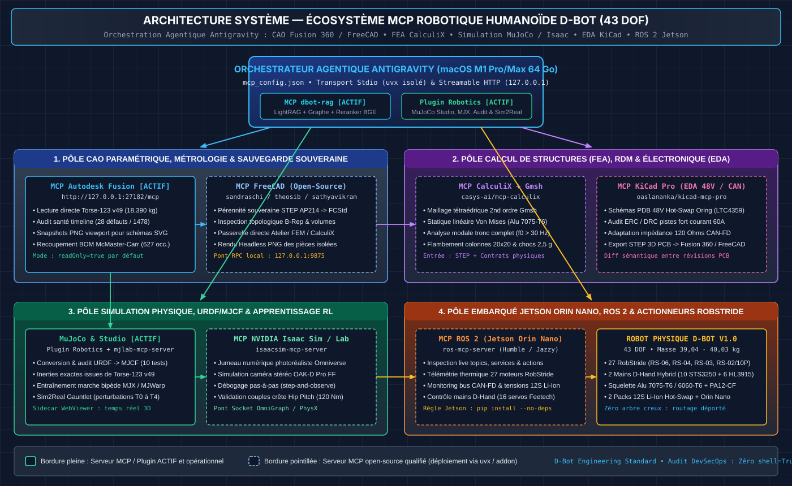

# GUIDE COMPLET - Écosystème MCP pour la Conception d'un Robot Humanoïde Bipède (CAO, FreeCAD, FEA, Simulation & ROS 2)

> **Statut** : Référentiel d'ingénierie système actif (Niveau 1) — Mis à jour le 2026-11-20.
> **Périmètre** : Sélection, architecture et intégration des serveurs **Model Context Protocol (MCP)** et plugins agentiques adaptés au développement complet du robot humanoïde bipède **D-Bot** (43 DOF, `39,04 à 40,03 kg`, 27 actionneurs QDD RobStride, 16 servomoteurs Feetech, Jetson Orin Nano).
> **Document compagnon** : [GUIDE_COMPLET_MCP_Fusion360.md](./GUIDE_COMPLET_MCP_Fusion360.md) et [AUDIT_Sante_Timeline_Torse-123_v49.md](./AUDIT_Sante_Timeline_Torse-123_v49.md).

## 📑 Sommaire

- [1. Vision d'Ingénierie Système : Pourquoi un Écosystème MCP sur D-Bot ?](#1-vision-dingénierie-système--pourquoi-un-écosystème-mcp-sur-d-bot-)
- [2. État des Lieux des Outils Actifs dans l'Environnement Antigravity](#2-état-des-lieux-des-outils-actifs-dans-lenvironnement-antigravity)
- [3. Serveurs MCP pour FreeCAD (Sauvegarde Souveraine & Pont FEM CalculiX)](#3-serveurs-mcp-pour-freecad-sauvegarde-souveraine--pont-fem-calculix)
  - [3.1 Comparatif Technique des 4 Serveurs MCP FreeCAD](#31-comparatif-technique-des-4-serveurs-mcp-freecad)
  - [3.2 Cas d'Usage D-Bot : Pérennité STEP vers FCStd et Inspection B-Rep](#32-cas-dusage-d-bot--pérennité-step-vers-fcstd-et-inspection-b-rep)
  - [3.3 Installation et Configuration Locale FreeCAD MCP sur macOS](#33-installation-et-configuration-locale-freecad-mcp-sur-macos)
- [4. Serveur MCP pour la Simulation FEA & RDM (CalculiX + Gmsh)](#4-serveur-mcp-pour-la-simulation-fea--rdm-calculix--gmsh)
  - [4.1 Le Serveur `mcp-calculix` (Contrats Physiques & Maillage Gmsh)](#41-le-serveur-mcp-calculix-contrats-physiques--maillage-gmsh)
  - [4.2 Intégration avec la Chaîne FEA Souveraine du D-Bot](#42-intégration-avec-la-chaîne-fea-souveraine-du-d-bot)
- [5. Simulation Physique, Cinématique URDF/MJCF et Apprentissage RL](#5-simulation-physique-cinématique-urdfmjcf-et-apprentissage-rl)
  - [5.1 Plugin Officiel Antigravity `Robotics` (MuJoCo, MJX, Audit & Studio)](#51-plugin-officiel-antigravity-robotics-mujoco-mjx-audit--studio)
  - [5.2 Serveurs MCP Complémentaires : `mjlab-mcp-server` et `isaacsim-mcp-server`](#52-serveurs-mcp-complémentaires--mjlab-mcp-server-et-isaacsim-mcp-server)
- [6. Électronique de Puissance 48V, Bus CAN-FD et Middleware Embarqué ROS 2](#6-électronique-de-puissance-48v-bus-can-fd-et-middleware-embarqué-ros-2)
  - [6.1 Conception PCB & Schémas : `kicad-mcp-pro`](#61-conception-pcb--schémas--kicad-mcp-pro)
  - [6.2 Supervision Temps Réel sur Jetson Orin Nano : `ros-mcp-server`](#62-supervision-temps-réel-sur-jetson-orin-nano--ros-mcp-server)
- [7. Matrice de Sélection et Feuille de Route d'Intégration D-Bot](#7-matrice-de-sélection-et-feuille-de-route-dintégration-d-bot)
- [8. Gouvernance DevSecOps et Règles d'Isolation (macOS & Jetson)](#8-gouvernance-devsecops-et-règles-disolation-macos--jetson)

---

## 1. Vision d'Ingénierie Système : Pourquoi un Écosystème MCP sur D-Bot ?

La conception d'un robot humanoïde bipède dynamique de classe `40 kg` tel que le **D-Bot** (calibré sur les standards industriels modernes : structure hybride Aluminium `7075-T6` / `6060-T6` et coques `PA12-CF`, actionneurs QDD **RobStride** à arbres pleins sans aucun passage axial, distribution 48V Hot-Swap Oring) impose une cohérence stricte entre cinq mondes techniques traditionnellement cloisonnés :

1. **La maquette numérique CAO maîtresse** (Autodesk Fusion 360 `Torse-123 v49` et sa sauvegarde souveraine FreeCAD `.FCStd`).
2. **La validation mécanique par éléments finis (FEA)** (CalculiX `ccx` + mailleur `Gmsh` sur les pièces critiques comme la `Bride Epaule v87` ou le squelette pelvien « Pont de Hanches »).
3. **Le modèle cinématique et dynamique de simulation** (fichiers `URDF` et `MJCF` MuJoCo, où chaque gramme et chaque matrice d'inertie conditionnent l'équilibre ZMP et la saturation thermique des moteurs de hanches `RS-04` à `120 N.m` crête et `RS-03` à `60 N.m` crête).
4. **L'électronique de puissance et de communication** (cartes PDB 48V, bus CAN-FD à terminaison `120 Ohms`, harnais à boucle de service libre `L = 150 à 200 mm`).
5. **Le logiciel embarqué temps réel** (ROS 2 sur **NVIDIA Jetson Orin Nano** avec PyTorch compilé CUDA 12.2).

Le protocole ouvert **MCP (Model Context Protocol)** transforme l'assistant Antigravity en un **orchestrateur de boucles d'ingénierie fermées** : au lieu de copier-coller manuellement des masses, des coordonnées ou des journaux d'erreurs, l'agent interroge directement les noyaux géométriques, les solveurs physiques et le middleware robotique.



---

## 2. État des Lieux des Outils Actifs dans l'Environnement Antigravity

À la date du **20 novembre 2026**, trois briques majeures sont déjà installées, connectées et vérifiées dans votre environnement Antigravity :

| Brique Active | Type & Point d'Entrée | Rôle Opérationnel sur le Projet D-Bot |
| :--- | :--- | :--- |
| **`dbot-rag`** | Serveur MCP Stdio (`mcp_lightrag_server.py`) | Base de connaissances souveraine LightRAG (graphe d'entités + recherche vectorielle hybride + reranker Cross-Encoder BGE) indexant l'ensemble des dossiers `FINAL_`, `DOSSIER_TECHNIQUE_` et `STUDY_`. |
| **`fusion`** | Serveur MCP Streamable HTTP (`http://127.0.0.1:27182/mcp`) | Liaison directe avec la session **Autodesk Fusion 360** ouverte (`Torse-123 v49`) : lecture métrologique exacte, audit de santé de la timeline, captures PNG du viewport et exécution de scripts API Python (voir [GUIDE_COMPLET_MCP_Fusion360.md](./GUIDE_COMPLET_MCP_Fusion360.md)). |
| **Plugin `Robotics`** | Plugin officiel Antigravity (`antigravity-plugins-official/plugin/robotics`) | Suite complète de compétences robotiques : simulation **MuJoCo Python / MJX / MJWarp**, édition procédurale `MjSpec`, audit physique d'assets en 10 scénarios (`mujoco-audit`), sidecar 3D temps réel **MuJoCo Studio** et protocole de validation **Sim2Real Gauntlet**. |

---

## 3. Serveurs MCP pour FreeCAD (Sauvegarde Souveraine & Pont FEM CalculiX)

Conformément au protocole établi dans [GUIDE_Sauvegarde_Souveraine_Fusion360_vers_FreeCAD.md](file:///Users/Shared/Mon%20Google%20Drive%20Physique/Documentation/Annexes/Outils_de_Travail/Export_CAO/GUIDE_Sauvegarde_Souveraine_Fusion360_vers_FreeCAD.md), **FreeCAD** constitue votre garantie d'indépendance vis-à-vis du cloud Autodesk et votre pré-processeur naturel pour les analyses **CalculiX**. L'écosystème open-source propose quatre serveurs MCP matures pour FreeCAD.

### 3.1 Comparatif Technique des 4 Serveurs MCP FreeCAD

| Serveur MCP FreeCAD | Dépôt GitHub | Architecture Technique | Outils Exposés & Points Forts | Pertinence D-Bot |
| :--- | :--- | :--- | :--- | :---: |
| **`sandraschi/freecad-mcp`** | `github.com/sandraschi/freecad-mcp` | Serveur Python MCP couplé à l'API interne FreeCAD (`FreeCAD`, `Part`, `ObjectsFem`) | **Plus de 60 outils spécialisés** : modélisation 3D paramétrique, esquisses 2D contraintes, assemblages STEP multi-corps, optimisation topologique et **pilotage direct de l'atelier FEM CalculiX** (maillage, matériaux, charges, lecture Von Mises). | **Maximale (Priorité 1)** |
| **`theosib/FreeCAD-MCP-Server`** | `github.com/theosib/FreeCAD-MCP-Server` | Pont TCP / JSON-RPC vers une session FreeCAD GUI ouverte | **Inspection profonde & débogage** : graphe de dépendances du document, analyse topologique B-Rep (faces, arêtes, coques fermées), diagnostic de santé des esquisses, erreurs de recalcul et captures du viewport. | **Haute (Audit B-Rep)** |
| **`sathyavikram/freecad-mcp`** | `github.com/sathyavikram/freecad-mcp` | Exécution Python Headless (`freecadcmd`) sans fenêtre graphique | **Automatisation batch sans GUI** : exécution de scripts FreeCAD en arrière-plan, génération de vues PNG annotées sous plusieurs angles et extraction de métadonnées géométriques. | **Haute (CI/CD STEP)** |
| **`neka-nat/freecad-mcp`** | `github.com/neka-nat/freecad-mcp` | Addon `FreeCADMCP` dans le dossier `Mod/` + serveur XML-RPC local (port `9875`) | **Simplicité et légèreté** : création/modification d'objets, exécution de code Python arbitraire dans le contexte FreeCAD actif, insertion de pièces depuis une bibliothèque et vue active en base64. | **Moyenne (Prototypage)** |

### 3.2 Cas d'Usage D-Bot : Pérennité STEP vers FCStd et Inspection B-Rep

L'association du serveur **MCP Fusion 360** et d'un serveur **MCP FreeCAD** (`sandraschi/freecad-mcp` ou `theosib/FreeCAD-MCP-Server`) permet d'automatiser trois opérations critiques :

1. **Contrôle de parité métrologique Fusion 360 vs FreeCAD** :
   - Après l'export d'un sous-ensemble en `.STEP` depuis Fusion 360 (ex. `Selle de Pont Pelvis [ASV1_200_10]` de `338,98 g` ou `Bride Epaule` de `202,30 g`), l'agent ouvre le fichier `.STEP` dans FreeCAD via MCP, vérifie que tous les solides B-Rep sont fermés (`isValid() == True`, absence de faces dégénérées) et compare le volume en `cm3` à `0,01 %` près avant de sauvegarder l'archive `.FCStd`.
2. **Préparation géométrique pour CalculiX sans retouche manuelle** :
   - Suppression automatisée des chanfreins cosmétiques ou des filetages hélicoïdaux McMaster-Carr qui alourdissent inutilement le maillage tétraédrique, tout en préservant les diamètres nominaux de perçage (`Ø 4,3 mm`, `Ø 5,3 mm`, alésage `Ø 97 H7`).
3. **Génération automatique de mises en plan cotées et de coupes** :
   - Pilotage de l'atelier `TechDraw` de FreeCAD en complément du script existant `Code/scripts/cad_tools/dxf_to_dimensioned_drawing.py`.

### 3.3 Installation et Configuration Locale FreeCAD MCP sur macOS

Sur macOS, conformément à la règle d'isolation des dépendances du projet D-Bot (aucune pollution du Python système Homebrew), le serveur MCP FreeCAD s'exécute via **`uvx`** en communiquant avec l'application `/Applications/FreeCAD.app`.

1. **Installation de l'addon côté FreeCAD** (exemple avec `neka-nat/freecad-mcp` ou le pont RPC de `sandraschi/freecad-mcp`) dans le répertoire utilisateur macOS :

```bash
mkdir -p ~/Library/Application\ Support/FreeCAD/Mod
```

2. **Entrée type à ajouter dans `/Users/davidsergent/.gemini/antigravity/mcp_config.json`** (lorsque vous souhaiterez l'activer) :

```json
"freecad": {
  "command": "/Users/davidsergent/.local/bin/uvx",
  "args": [
    "freecad-mcp"
  ],
  "env": {
    "FREECAD_BIN": "/Applications/FreeCAD.app/Contents/MacOS/FreeCADCmd"
  }
}
```

---

## 4. Serveur MCP pour la Simulation FEA & RDM (CalculiX + Gmsh)

Vos dossiers techniques de Niveau 1 ([DOSSIER_TECHNIQUE_Calculs_FEA_Torse_et_Bassin.md](file:///Users/Shared/Mon%20Google%20Drive%20Physique/Documentation/01_Mecanique_et_Chassis/Torse_et_Bassin/DOSSIER_TECHNIQUE_Calculs_FEA_Torse_et_Bassin.md) et [STUDY_Calculs_FEA_Bride_Epaule_RS04.md](file:///Users/Shared/Mon%20Google%20Drive%20Physique/Documentation/01_Mecanique_et_Chassis/Torse_et_Bassin/STUDY_Calculs_FEA_Bride_Epaule_RS04.md)) reposent déjà sur le couple industriel open-source **Gmsh + CalculiX (`ccx`)**.

### 4.1 Le Serveur `mcp-calculix` (Contrats Physiques & Maillage Gmsh)

Le serveur open-source **`mcp-calculix`** (`github.com/casys-ai/mcp-calculix`) encapsule Gmsh et CalculiX sous forme d'outils MCP typés par **contrats d'ingénierie** plutôt que par commandes shell brutes :

- **Validation pré-vol du maillage (`preflight`)** : vérification de la qualité des éléments tétraédriques C3D10 (second ordre), détection des jacobiennes négatives et identification des sélections nommées (surfaces d'encastrement, faces de chargement).
- **Analyses supportées** :
  - *Statique linéaire* : calcul du champ de contraintes équivalentes de Von Mises (`Sigma_VM`), des déplacements nodaux (`Delta_max`) et des réactions d'appui.
  - *Analyse modale (valeurs propres)* : extraction des premières fréquences propres de résonance (`f_0`), indispensable pour vérifier le critère de rigidité structurelle du tronc D-Bot (`f_0 > 30 Hz` afin d'éviter tout couplage avec la boucle d'asservissement des actionneurs QDD).
  - *Flambement linéaire (Buckling)* : calcul des facteurs critiques de flambement d'Euler/Timoshenko sur les 4 montants tubulaires `20 x 20 x 2 mm` (`L = 65,77 mm`) du « Pont de Hanches » et sur la colonne vertébrale en réception de saut (`2,5 g`).
  - *Couplage thermo-mécanique stationnaire* : évaluation de la dilatation et de la dissipation thermique des brides aluminium `7075-T6` au contact des stators `RS-04` (`120 N.m` crête) et `RS-06` (`Waist Yaw`).

### 4.2 Intégration avec la Chaîne FEA Souveraine du D-Bot

Le serveur `mcp-calculix` ne remplace pas vos scripts Python validés de génération `.inp` : il les **complète** en permettant à l'agent de lancer une vérification rapide après chaque modification géométrique détectée via le MCP Fusion 360 (par exemple après l'ajout des plots fixes de butée Waist `+/- 95 deg` sur la `Traverse_Renfort_Bassin [ASV1_200_16A]`).

---

## 5. Simulation Physique, Cinématique URDF/MJCF et Apprentissage RL

### 5.1 Plugin Officiel Antigravity `Robotics` (MuJoCo, MJX, Audit & Studio)

Installé au cours de cette session, le plugin officiel **Robotics** d'Antigravity apporte directement dans votre espace de travail une chaîne complète basée sur **MuJoCo** (le moteur physique de référence de Google DeepMind pour les humanoïdes) :

| Compétence (Skill) Incluse | Fonctionnalité Clé | Application Directe au D-Bot V1.0 (43 DOF) |
| :--- | :--- | :--- |
| **`mujoco-spec-editing`** | Édition procédurale de modèles `MjSpec` (`mujoco.MjSpec`), sous-modèles, actionneurs, cônes de frottement elliptiques, `solref`/`solimp`, `armature` rotorique. | Construction et réglage fin du fichier MJCF complet du D-Bot à partir des masses (`18,390 kg` tronc/bassin) et inerties extraites par le MCP Fusion 360. |
| **`mujoco-audit`** | Audit statique en 7 points et **suite de 10 scénarios physiques** (`audit_scenarios.py`) sur les modèles MJCF / `.mjz`. | Détection automatique des auto-collisions, des inerties mal conditionnées, des glissements de contact pied/sol et validation des butées articulaires (`+/- 95 deg` sur Waist Yaw). |
| **`mujoco-studio` & `mujoco-studio-sidecar`** | Visualiseur 3D interactif **MuJoCo Studio** diffusé en direct dans le panneau latéral d'Antigravity avec rechargement à chaud (*hot-reload*). | Inspection visuelle interactive des postures du D-Bot, test des amplitudes articulaires (flexion de hanche `-35 deg` à `+120 deg`) et relecture des trajectoires. |
| **`mujoco-accelerated` & `mujoco-parity`** | Simulation massivement parallèle GPU/TPU (`mujoco.mjx` sous JAX / `mujoco_warp`) et contrôle de parité physique `float64` (CPU) vs `float32` (GPU). | Entraînement des politiques de marche bipède (`2,5 à 5 km/h`) et garantie d'absence de dérive numérique entre l'entraînement GPU et le contrôleur CPU/Jetson. |
| **`sim2real-gauntlet` & `sim2real-iteration`** | Banc d'essai de robustesse Sim2Real à travers 5 paliers de perturbations (`T0` à `T4`) avec journalisation `.mcap` et graines aléatoires appairées. | Validation avant déploiement sur le robot physique de la tenue à la poussée latérale, aux sols irréguliers et au portage de charge bimanuelle (`5 à 15 kg`). |

### 5.2 Serveurs MCP Complémentaires : `mjlab-mcp-server` et `isaacsim-mcp-server`

En complément du plugin `Robotics` intégré :

1. **`mjlab-mcp-server` (Traduction et Critique URDF vers MJCF)** :
   - Serveur MCP communautaire spécialisé dans l'analyse de fichiers `URDF`, leur conversion propre vers le format natif `MJCF` de MuJoCo et la vérification des gains PD (`Kp`, `Kd`) par rapport aux limites de couple des actionneurs (`RS-04` `40 N.m` cont. / `120 N.m` pic ; `RS-03` `20 N.m` cont. / `60 N.m` pic ; `RS-06` `12 N.m` cont. / `36 N.m` pic).
2. **`isaacsim-mcp-server` (Passerelle NVIDIA Isaac Sim / Isaac Lab)** :
   - Utile uniquement lorsque vous basculez sur une station GPU NVIDIA dédiée à **Isaac Sim / Omniverse** : permet à l'agent de charger l'URDF du D-Bot, d'instancier la caméra stéréo `OAK-D Pro FF` dans une scène photoréaliste et d'exécuter un débogage pas-à-pas (*step-and-observe*) des contrôleurs de locomotion.

---

## 6. Électronique de Puissance 48V, Bus CAN-FD et Middleware Embarqué ROS 2

### 6.1 Conception PCB & Schémas : `kicad-mcp-pro`

Si vous concevez ou faites évoluer sous **KiCad** vos cartes électroniques internes (platine de distribution `PDB 48V` avec contrôleurs Ideal Diode `LTC4359` pour le Hot-Swap Oring des 2 batteries Li-Ion 12S, hubs d'adaptation CAN-FD, platines d'interface pour les convertisseurs `DROK 48V -> 12V 25A` et les 16 servomoteurs Feetech des mains `D-Hand`), le serveur **`kicad-mcp-pro`** (`github.com/oaslananka/kicad-mcp-pro`) offre :

- **Audit ERC / DRC automatisé** : vérification des règles électriques et des largeurs de pistes/isolations pour les rails haute puissance `48V / 60A` et la symétrie différentielle des paires CAN-FD (`120 Ohms`).
- **Moteur de diff sémantique entre révisions** : comparaison nette des changements de composants ou d'équipotentielles entre deux versions de PCB sans bruit de coordonnées.
- **Vérification de cohérence BOM et export STEP 3D** : export direct du PCB en `.STEP` pour vérification d'encombrement dans le torse sous Fusion 360 ou FreeCAD.

> [!NOTE]
> Le serveur MCP natif d'Autodesk Fusion expose également un outil `fusion_mcp_electronics_read` (identifié au chapitre 4 de [GUIDE_COMPLET_MCP_Fusion360.md](./GUIDE_COMPLET_MCP_Fusion360.md)) si une partie de vos schémas est gérée dans l'atelier Électronique de Fusion 360.

### 6.2 Supervision Temps Réel sur Jetson Orin Nano : `ros-mcp-server`

Lors des essais sur banc matériel (bring-up des actionneurs **RobStride** sur bus CAN-FD, calibration des mains `D-Hand` ou tests d'intégration sur la **Jetson Orin Nano**), le serveur **`ros-mcp-server`** se connecte directement à l'environnement **ROS 2** sans modifier une seule ligne de vos noeuds C++ ou Python :

- Découverte dynamique des topics, services, actions et types de messages ROS 2.
- Lecture à la demande de la télémétrie des 27 moteurs RobStride (température bobinage/MOSFET, courant `Iq`, erreur de suivi angulaire, tension bus 48V) et des flux résumés de la caméra `OAK-D Pro FF` / IMU.
- Envoi contrôlé de consignes articulaires unitaires lors des séquences de calibration en atelier.

---

## 7. Matrice de Sélection et Feuille de Route d'Intégration D-Bot

Afin d'éviter toute dispersion technique, voici la hiérarchie opérationnelle recommandée pour le projet D-Bot :

| Priorité | Serveur MCP / Plugin | Statut Actuel | Cas d'Usage Immédiat sur D-Bot |
| :---: | :--- | :---: | :--- |
| **P0** | **`dbot-rag`** (LightRAG local) | **Actif** | Source de vérité documentaire obligatoire avant toute décision ou calcul. |
| **P0** | **`fusion`** (Autodesk Fusion MCP) | **Actif** | Audit métrologique en direct de `Torse-123 v49`, réconciliation BOM McMaster-Carr, snapshots PNG pour schémas SVG et diagnostic de la timeline (28 défauts). |
| **P1** | **Plugin `Robotics` Antigravity** | **Actif (Installé)** | Construction et audit physique du modèle **MuJoCo (`MJCF`)** du D-Bot à partir des masses réelles v49, visualisation dans **MuJoCo Studio** et banc Sim2Real. |
| **P2** | **`sandraschi/freecad-mcp`** (ou `theosib`) | Qualifié (à installer au prochain export STEP) | Automatisation de la sauvegarde souveraine `Fusion 360 -> STEP -> FreeCAD (.FCStd)` et vérification B-Rep / FEM CalculiX. |
| **P2** | **`casys-ai/mcp-calculix`** | Qualifié (optionnel) | Exécution contractuelle de campagnes FEA Gmsh + CalculiX (statique Von Mises, modale `f_0 > 30 Hz`, flambement) sur les nouvelles pièces usinées. |
| **P3** | **`ros-mcp-server`** | Qualifié (phase banc matériel) | Diagnostic ROS 2 en direct sur la Jetson Orin Nano lors du bring-up des 27 moteurs RobStride et des mains `D-Hand`. |
| **P3** | **`kicad-mcp-pro`** | Qualifié (si PCB custom KiCad) | Audit ERC/DRC et BOM des cartes PDB 48V Hot-Swap Oring et hubs CAN-FD. |

---

## 8. Gouvernance DevSecOps et Règles d'Isolation (macOS & Jetson)

L'intégration de serveurs MCP tiers dans l'environnement D-Bot est soumise aux quatre règles de sécurité souveraines du projet :

> [!CAUTION]
> Tout serveur MCP exécute du code localement. Aucune installation ni exécution ne doit contourner les garde-fous DevSecOps du dépôt `Documentation/`.

1. **Isolation Stricte sur le Mac (`uvx` obligatoire)** :
   - Ne jamais installer de serveur MCP Python tiers avec `pip install` dans le Python système Homebrew (`/opt/homebrew/bin/python3.11`).
   - Toujours lancer les serveurs MCP tiers via `/Users/davidsergent/.local/bin/uvx <nom-du-serveur>` ou dans un environnement virtuel dédié et isolé.
2. **Protection Absolue du PyTorch GPU sur la Jetson Orin Nano (`--no-deps`)** :
   - Lors du déploiement de `ros-mcp-server` ou d'outils Python sur la Jetson Orin Nano (JetPack 6.1, CUDA 12.2), toute commande `pip install` doit **impérativement** comporter le drapeau `--no-deps` afin de ne jamais écraser les roues NVIDIA PyTorch compilées avec support GPU.
3. **Mode Lecture Seule par Défaut sur la CAO (`readOnly = true`)** :
   - Sur le serveur MCP Fusion 360 comme sur un serveur MCP FreeCAD, toute inspection métrologique ou de timeline s'exécute en lecture seule.
   - Toute écriture géométrique ou réparation de timeline exige une copie de travail dédiée (ex. `Torse-123 v50_test`) et une validation explicite de l'utilisateur.
4. **Conformité SAST et Zéro Secret Hardcodé** :
   - Les configurations `mcp_config.json` et les scripts associés ne doivent contenir aucune clé d'API en clair et aucun appel `subprocess` avec `shell=True`.
   - Tout script Python ajouté dans `Code/` doit passer avec succès l'audit `/opt/homebrew/bin/python3.11 Code/security/audit_dbot_security.py --skip-sca`.
