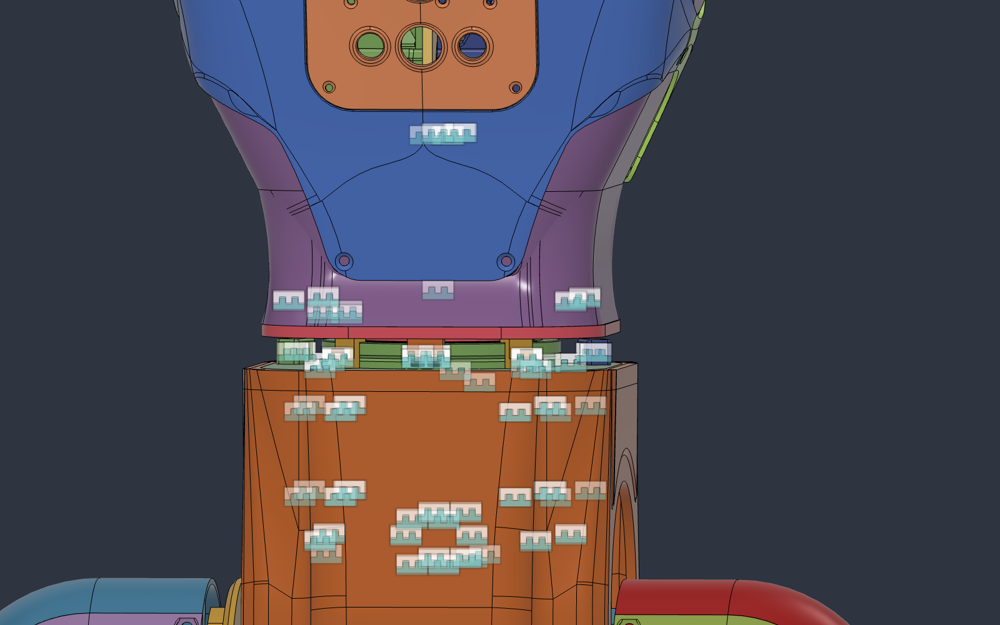

# GUIDE COMPLET - Serveur MCP Autodesk Fusion (pilotage de la CAO par l'agent)

> **Statut** : testé et opérationnel le 2026-11-20 sur Autodesk Fusion 2706.1.17 (macOS), document actif `Torse-123 v49`.
> **Périmètre des tests** : lecture seule uniquement (aucune modification de la CAO, aucune sauvegarde).
> **Documents compagnons** : [AUDIT_Sante_Timeline_Torse-123_v49.md](./AUDIT_Sante_Timeline_Torse-123_v49.md) (diagnostic détaillé des 28 défauts de timeline) et [GUIDE_COMPLET_Ecosysteme_MCP_Robotique_CAO_FEA_D-Bot.md](./GUIDE_COMPLET_Ecosysteme_MCP_Robotique_CAO_FEA_D-Bot.md) (panorama complet des MCP FreeCAD, CalculiX, MuJoCo, Isaac Sim, KiCad et ROS 2 pour le D-Bot).

## 📑 Sommaire

- [1. Objectif](#1-objectif)
- [2. Installation et activation](#2-installation-et-activation)
- [3. Résultats du test du 2026-11-20](#3-résultats-du-test-du-2026-11-20)
- [4. Outils exposés par le serveur](#4-outils-exposés-par-le-serveur)
- [5. Recettes de scripts en lecture seule](#5-recettes-de-scripts-en-lecture-seule)
- [6. Règles de sécurité](#6-règles-de-sécurité)
- [7. Constats sur le modèle Torse-123 v49](#7-constats-sur-le-modèle-torse-123-v49)
  - [7.1 Timeline : 79 éléments non sains sur 1478](#71-timeline--79-éléments-non-sains-sur-1478)
  - [7.2 Recoupement masse CAO v49 vs documentation v42 (réalisé le 2026-11-20)](#72-recoupement-masse-cao-v49-vs-documentation-v42-réalisé-le-2026-11-20)
  - [7.3 Désynchronisations CAO / documentation à arbitrer](#73-désynchronisations-cao--documentation-à-arbitrer)
- [8. Cas d'usage retenus pour D-Bot](#8-cas-dusage-retenus-pour-d-bot)
- [9. Dépannage](#9-dépannage)

---

## 1. Objectif

Autodesk Fusion embarque un serveur MCP (Model Context Protocol) local. Il permet à l'agent (Antigravity, Claude Desktop, Cursor, VS Code) de :

- lire l'état réel de la CAO (document, assemblage, masses, encombrements, timeline) ;
- capturer le viewport en PNG depuis une direction choisie ;
- exécuter des scripts Python de l'API Fusion (lecture ou modification).

Intérêt principal pour D-Bot : disposer d'une **source de vérité CAO interrogeable à la demande**, pour détecter les désynchronisations entre la documentation et la CAO sans export manuel de l'audit métrologique.

## 2. Installation et activation

### 2.1 Activation dans Fusion

Chemin dans l'interface française : Fusion > Préférences > Général > API.

| Paramètre | Valeur |
|---|---|
| Case à cocher | Serveur Fusion MCP (s'exécute localement sur cet appareil) |
| Port | 27182 |
| Endpoint | `http://127.0.0.1:27182/mcp` |

Le serveur n'existe que pendant que l'application Fusion locale est ouverte (le client web n'est pas compatible). Après un changement de préférence, redémarrer Fusion.

### 2.2 Déclaration côté Antigravity

Fichier de configuration : `/Users/davidsergent/.gemini/antigravity/mcp_config.json`

Entrée ajoutée (transport Streamable HTTP, clé `url`) :

```text
"fusion": { "url": "http://127.0.0.1:27182/mcp" }
```

Le serveur `dbot-rag` existant n'est pas modifié. Recharger Antigravity après modification pour rafraîchir la liste des outils.

### 2.3 Vérification rapide en terminal

```bash
lsof -nP -iTCP:27182 -sTCP:LISTEN
```

Une ligne `Autodesk ... TCP 127.0.0.1:27182 (LISTEN)` confirme que le serveur est actif. Une requête GET sur `/mcp` renvoie HTTP 405, ce qui est normal (le serveur attend des POST MCP).

## 3. Résultats du test du 2026-11-20

| Test | Résultat |
|---|---|
| Port 27182 en écoute | OK (processus Autodesk, 127.0.0.1 uniquement) |
| Liste des documents ouverts | OK : 1 document, `Torse-123 v49`, projet `d-bot - Torse` |
| Version Fusion via script | OK : 2706.1.17 |
| Capture du viewport (1600 x 1000, fond opaque) | OK (voir ci-dessous) |
| Script Python en lecture seule | OK (aucune erreur, durée d'environ 25 s pour le parcours complet de la timeline) |



*Capture obtenue avec `fusion_mcp_read` (queryType screenshot, direction current). Les pictogrammes bleutés superposés au modèle sont des marqueurs d'affichage de Fusion présents dans la vue courante.*

### 3.1 Données lues dans le modèle

| Grandeur | Valeur lue |
|---|---|
| Document | Torse-123 v49 |
| Type de design | Paramétrique (historique actif) |
| Éléments de timeline | 1478 |
| Occurrences (tous niveaux) | 627 |
| Corps directement à la racine | 0 |
| Paramètres utilisateur | 0 |
| Unité par défaut | mm |
| Masse totale du composant racine | 18.390 kg |
| Encombrement racine X | -354.7 à 171.3 mm (largeur 526.0 mm) |
| Encombrement racine Y | -245.9 à 241.2 mm (profondeur 487.1 mm) |
| Encombrement racine Z | 688.1 à 1547.1 mm (hauteur 859.0 mm) |

Sous-assemblages de premier niveau identifiés : `Plastron_Ventral_Torse`, `Panier_Batterie_Coulissant`, `Capot_Verrouillage_Batterie`, `Carenage_Lombaire_Arriere`, `Platine_Connectique_Facade`, `Carenage_Pectoral_Haut`, `Waist_Plate_7075`, `Plaque_de_Cou_7075`, `RS04 droit` (et sa symétrie), `EL05 v1`, `Cou - Tube collet`, `Bride Epaule` (et sa symétrie), `colonne vertébrale`, `Bassin_Pelvis [ASV1_200]`, `Ensemble hanche` (et sa symétrie), `Selle de Pont Pelvis [ASV1_200_10]`, ainsi que la quincaillerie McMaster-Carr (vis, rondelles Nord-Lock, rondelles DIN 125A, écrous Nylstop, goupilles ISO 8734).

## 4. Outils exposés par le serveur

Quatre outils sont déclarés côté Antigravity (serveur `fusion`) :

| Outil | Rôle | Testé |
|---|---|---|
| `fusion_mcp_read` | Lecture : documents, projets, licence, documentation API, capture d'écran, commande active | Oui |
| `fusion_mcp_execute` | Exécution : scripts Python API Fusion, ouverture/fermeture/sauvegarde de document, rendu d'image, aperçu | Oui (script en lecture seule) |
| `fusion_mcp_update` | Modification d'entités du modèle (opérations de type CRUD) | Non |
| `fusion_mcp_electronics_read` | Lecture de la partie Électronique de Fusion | Non |

Paramètres utiles de `fusion_mcp_read` pour la capture : `direction` (current, front, back, top, bottom, left, right, iso-top-left, iso-top-right, iso-bottom-left, iso-bottom-right), `width` et `height` (32 à 4096 px), `transparentBackground`, `antiAliasing`.

> [!NOTE]
> Le script exécuté doit définir `def run(_context: str):`. Les `print()` sont renvoyés comme sortie. Ne pas intercepter les exceptions (elles servent au diagnostic).

## 5. Recettes de scripts en lecture seule

Toutes ces recettes utilisent `featureType = script` avec `readOnly = true`. Ce mode est vérifié par Fusion : toute tentative de modification échoue, ce qui garantit l'absence d'effet de bord.

### 5.1 Informations générales du design

```python
import adsk.core, adsk.fusion

def run(_context: str):
    app = adsk.core.Application.get()
    print('Version:', app.version)
    print('Document:', app.activeDocument.name)
    design = adsk.fusion.Design.cast(app.activeProduct)
    root = design.rootComponent
    print('Timeline items:', design.timeline.count)
    print('Occurrences (toutes):', root.allOccurrences.count)
    print('Unite par defaut:', design.unitsManager.defaultLengthUnits)
```

### 5.2 Masse, encombrement et sous-assemblages de premier niveau

```python
import adsk.core, adsk.fusion

def run(_context: str):
    design = adsk.fusion.Design.cast(adsk.core.Application.get().activeProduct)
    root = design.rootComponent
    bb = root.boundingBox
    print('BBox (mm): X %.1f..%.1f Y %.1f..%.1f Z %.1f..%.1f' % (
        bb.minPoint.x*10, bb.maxPoint.x*10,
        bb.minPoint.y*10, bb.maxPoint.y*10,
        bb.minPoint.z*10, bb.maxPoint.z*10))
    print('Masse totale (kg): %.3f' % root.physicalProperties.mass)
    for occ in root.occurrences:
        c = occ.component
        print('%s | corps=%d | sous-occ=%d' % (occ.name, c.bRepBodies.count, c.occurrences.count))
```

> [!WARNING]
> Les coordonnées de l'API Fusion sont en centimètres : multiplier par 10 pour obtenir des millimètres.

### 5.3 Santé de la timeline (références perdues, échecs)

```python
import adsk.core, adsk.fusion

def run(_context: str):
    design = adsk.fusion.Design.cast(adsk.core.Application.get().activeProduct)
    n = 0
    for i in range(design.timeline.count):
        it = design.timeline.item(i)
        if it.healthState != adsk.fusion.FeatureHealthStates.HealthyFeatureHealthState:
            n += 1
            print(it.name, it.errorOrWarningMessage)
    print('Items non sains:', n)
```

### 5.4 Capture de vue normalisée pour les schémas SVG

Appel `fusion_mcp_read` avec les paramètres suivants :

```text
queryType=screenshot, direction=front, width=2000, height=1400, transparentBackground=false
```

Cette capture peut alimenter la calibration des schémas SVG (silhouette, proportions, position des perçages), en complément des snapshots de `Exports_CAO_DBot/01_Torse_et_Bassin/Visual_Snapshots/` et de la métrologie JSON.

## 6. Règles de sécurité

> [!CAUTION]
> `fusion_mcp_execute` (sans `readOnly`) et `fusion_mcp_update` peuvent modifier ou détruire la géométrie du document actif, et `fusion_mcp_execute` peut sauvegarder ou fermer le document.

1. **Lecture seule par défaut** : tout script d'inspection est lancé avec `readOnly = true`.
2. **Aucune modification sans accord explicite** de l'utilisateur, et uniquement sur une version enregistrée ou une copie de travail.
3. **Aucune sauvegarde automatique** : l'opération `save` n'est exécutée que sur demande expresse.
4. **Pas de script pendant une commande ouverte** : un script de modification échoue si une boîte de dialogue de commande est ouverte (seuls les scripts en lecture seule passent).
5. **Surface réseau** : le serveur n'écoute que sur 127.0.0.1 (pas d'exposition réseau). Ne pas le rediriger vers l'extérieur.
6. **Outils hors périmètre** : ne pas utiliser l'achat (`purchase`), la génération PowerPoint ni le rendu d'image (`editImage`, consommation de crédits IA) dans le cadre du projet.

## 7. Constats sur le modèle Torse-123 v49

### 7.1 Timeline : 79 éléments non sains sur 1478

Le contrôle de santé signale 79 éléments en avertissement ou en échec. Les 10 premiers lus :

| Élément | Nature du signalement |
|---|---|
| Groupe10, Groupe12 | Signalés sans message détaillé |
| Plan18, Plan19, Plan20 | Faces de référence manquantes (géométrie en cache utilisée) |
| Axe17 | Face de référence manquante |
| Esquisse21, Esquisse22 | Plan d'esquisse perdu, source de projection perdue, échec de transformation d'occurrence |
| Esquisse24 | Source de projection perdue |
| Chanfrein16 | Référence d'arête perdue (géométrie en cache) |

Conséquence : ces éléments reposent sur de la géométrie en cache. Un recalcul de la timeline ou une modification en amont peut les rendre instables.

> [!NOTE]
> Le décompte de 79 se décompose en **28 éléments réellement en défaut** et **51 groupes** signalés sans message. Le détail complet (liste, composants, priorités, protocole de correction) est dans [AUDIT_Sante_Timeline_Torse-123_v49.md](./AUDIT_Sante_Timeline_Torse-123_v49.md).

### 7.2 Recoupement masse CAO v49 vs documentation v42 (réalisé le 2026-11-20)

Sources comparées : lecture MCP en direct de `Torse-123 v49`, `STUDY_Densites_Apparentes_FDM_PA12-CF_Torse_et_Bassin.md` (masse brute v42 : 18 316,38 g) et `STUDY_Bilan_Masse_Global_et_Opportunite_Waist_Pitch_2DoF.md`.

| Grandeur | Documentation (v42) | CAO v49 (MCP) | Écart |
|---|---|---|---|
| Masse brute racine | 18 316,38 g | 18 390,33 g | +73,95 g (+0,40 %) |
| Selle de Pont `ASV1_200_10` | 338,98 g | 338,98 g | 0 |
| Tube transverse hanches 60x60 | 57,67 g | 57,67 g | 0 |
| Montants de hanche (x4) | 25,71 g pièce | 25,71 g pièce | 0 |
| Inserts hanche (x8) | 9,25 g pièce | 9,25 g pièce | 0 |
| Bride Epaule (x2) | 202,30 g pièce | 202,30 g pièce | 0 |
| Plastron (6 corps PA12-CF) | 2 804,55 g | 2 849,97 g (7 corps) | +45,42 g (7e corps : ceinture alu, non comptée dans la valeur documentée) |
| Paniers batterie | 614,83 g | 614,83 g | 0 |
| Capots verrouillage batterie | 115,09 g | 115,08 g | -0,01 g |
| Carénages lombaire / pectoral / platine façade | 206,71 / 203,84 / 36,27 g | 206,71 / 203,84 / 36,27 g | 0 |
| Cou - Tube collet | 51,90 g | 51,90 g | 0 |
| Traverse Renfort Bassin `16A` | 566,74 g | 565,76 g | -0,98 g |
| Waist Plate 7075 | 433,53 g | 437,09 g | +3,56 g |
| EL05 (Pan) | 228,49 g | 228,46 g | -0,03 g |
| `Chassis_Structurel_Bassin_Last` (coque pelvienne) | 441,36 g | 481,19 g | **+39,83 g** |
| Butée Waist (2 Plots Fixes, 4 vis M4x14, 2 Capuchons) | non présente ("Mod. CAO prévue") | environ 39,4 g | **+39,4 g (nouveau)** |

**Conclusion** : la structure aluminium et toutes les pièces polymères documentées sont identiques entre v42 et v49. L'écart de masse (+73,95 g, soit 0,18 % de la masse robot de 40,03 kg) est négligeable pour le bilan global. Il provient surtout de la coque pelvienne (+39,83 g) et de la butée Waist ajoutée en CAO (environ 39,4 g). Le cumul des écarts identifiés (+81,8 g) dépasse de 7,9 g l'écart total : ce reliquat de -7,9 g n'est pas attribué, faute de référence v42 par pièce pour le reste de l'arborescence.

### 7.3 Désynchronisations CAO / documentation à arbitrer

| Sujet | État documenté | État CAO réel (v49) |
|---|---|---|
| Version de référence | `Torse-123 v42` dans toute la documentation | `Torse-123 v49` ; `AUDIT_METROLOGIQUE_Torse_et_Bassin.json` a déjà été régénéré depuis v49 (horodaté du 2026-11-20) |
| Butées fixes Waist +/- 95 deg (WST-07B/C) | "Mod. CAO prévue" | Plots Fixes (7075) et Capuchons présents dans la CAO |
| Matériau des 2 Capuchons de butée | TPU 95A (WST-07C) | Matériau CAO "Acier" : 11,61 g pièce, donc masse surestimée d'environ 9,8 g pièce si la densité acier (7,85 g/cm3) est bien celle appliquée |
| Vis CHC M4x14 `91290A150` de la butée | 4 vis (butées) et 6 vis (doigt et plots) | 4 vis avec masse (2,09 g) et 6 occurrences placeholders McMaster à 0 g (non résolues en 3D) |
| Coque pelvienne `Chassis_Structurel_Bassin_Last` | 441,36 g (0,700 g/cm3 calibré) | 481,19 g : géométrie ou densité modifiée depuis v42, à confirmer |

Ces points sont à arbitrer avec vous avant toute réécriture des dossiers techniques.

## 8. Cas d'usage retenus pour D-Bot

| Priorité | Cas d'usage | Mode |
|---|---|---|
| 1 | Recoupement masse et encombrement CAO vs documentation (détection de désynchronisation) | Lecture seule |
| 2 | Rapport complet de santé de la timeline (79 éléments à corriger) | Lecture seule |
| 3 | Inventaire de la quincaillerie McMaster-Carr par référence et comparaison avec `FINAL_BOM_Torse_et_Waist_D-Bot.md` | Lecture seule |
| 4 | Captures normalisées (face, dessus, iso) pour la calibration des schémas SVG | Lecture seule |
| 5 | Mise à jour de l'audit métrologique JSON sans export manuel | Lecture seule |
| 6 | Modifications paramétriques ou création de features | Écriture, sur copie uniquement, à valider cas par cas |

## 9. Dépannage

| Symptôme | Cause probable | Action |
|---|---|---|
| Outils `fusion_*` absents | Antigravity non rechargé après modification de `mcp_config.json` | Recharger les serveurs MCP |
| Connexion refusée sur 27182 | Fusion fermé ou case MCP décochée | Ouvrir Fusion, vérifier Préférences > Général > API |
| Script refusé "command dialog open" | Une commande (esquisse, extrusion) est en cours dans Fusion | Fermer la commande, ou utiliser `readOnly = true` pour une lecture |
| Script très lent | Parcours de la timeline (1478 éléments) | Limiter la plage ou filtrer les éléments |
| Port différent de 27182 | Port modifié dans les préférences | Aligner l'URL dans `mcp_config.json` |
| Erreur "Value type not permitted by 'type' constraint" | Observée sur plusieurs scripts de lecture de masse (formatage `%` avec séparateur barre verticale, `itemByName`, `childOccurrences`) ; cause exacte non identifiée | Reformuler : boucle simple, sortie construite par concaténation `str()`, `round()` ; le script équivalent passe |
