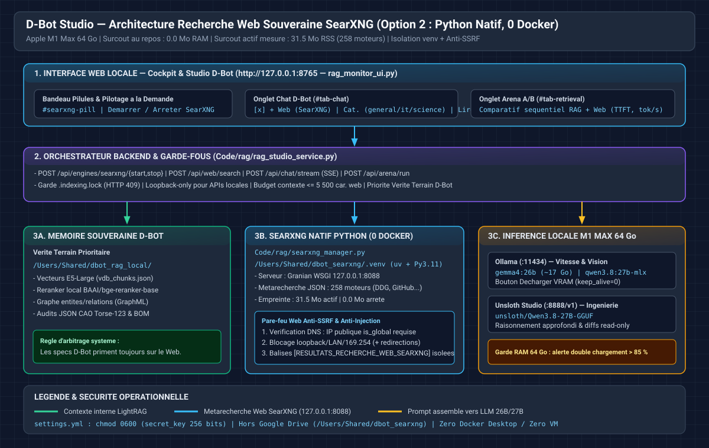

# 🌐 Guide Complet : Recherche Web Souveraine avec SearXNG Natif (Option 2 — 0 Docker)

> **Statut** : Guide Technique de Référence (Niveau 1 — Actif)  
> **Objet** : Connecter les modèles locaux (`gemma4:26b`, `unsloth/Qwen3.8-27B-GGUF`, `qwen3.8:27b-mlx`) à Internet sans Docker Desktop ni quota API, tout en préservant les `64 Go` de RAM unifiée du Mac M1 Max.  
> **Composants associés** : [`searxng_manager.py`](file:///Users/Shared/Mon%20Google%20Drive%20Physique/Documentation/Code/rag/searxng_manager.py), [`rag_studio_service.py`](file:///Users/Shared/Mon%20Google%20Drive%20Physique/Documentation/Code/rag/rag_studio_service.py), [`rag_monitor_ui.py`](file:///Users/Shared/Mon%20Google%20Drive%20Physique/Documentation/Code/rag/rag_monitor_ui.py), [`GUIDE_UTILISATION_RAG.md`](file:///Users/Shared/Mon%20Google%20Drive%20Physique/Documentation/Annexes/Outils_de_Travail/RAG/GUIDE_UTILISATION_RAG.md).

---

## 📑 Sommaire

- [1. Comparatif SearXNG Natif Python vs Docker sur macOS](#1-comparatif-searxng-natif-python-vs-docker-sur-macos)
- [2. Architecture Technique & Flux D-Bot Studio](#2-architecture-technique--flux-d-bot-studio)
- [3. Arborescence d'Installation & Configuration Souveraine](#3-arborescence-dinstallation--configuration-souveraine)
  - [3.1 Emplacement isolé hors Google Drive](#31-emplacement-isolé-hors-google-drive)
  - [3.2 Paramètres de `settings.yml` et sécurité](#32-paramètres-de-settingsyml-et-sécurité)
- [4. Commandes CLI 1-Clic (SearXNG Manager)](#4-commandes-cli-1-clic-searxng-manager)
- [5. Utilisation dans le Cockpit & Studio Web (`:8765`)](#5-utilisation-dans-le-cockpit--studio-web-8765)
- [6. Sécurité : Pare-feu Anti-SSRF, Anti-Injection & Priorité D-Bot](#6-sécurité--pare-feu-anti-ssrf-anti-injection--priorité-d-bot)
- [7. Résultats Mesurés sur M1 Max & Maintenance](#7-résultats-mesurés-sur-m1-max--maintenance)

---

## 1. Comparatif SearXNG Natif Python vs Docker sur macOS

Sur Apple Silicon (macOS), les conteneurs Linux nécessitent une machine virtuelle Linux permanente :

| Architecture | Empreinte RAM au repos | Empreinte RAM active | Dépendance hyperviseur |
| :--- | :---: | :---: | :--- |
| **Docker Desktop** | `2.0 à 4.0 Go` | `2.2 à 4.2 Go` | VM Linux + UI Electron |
| **OrbStack / Colima** | `400 à 700 Mo` | `550 à 850 Mo` | VM Linux (`Virtualization.framework`) |
| **Option 2 : SearXNG natif + Granian (retenue)** | **`0.0 Mo`** *(arrêté)* | **`~31.5 Mo` RSS** *(mesuré)* | **Aucune VM / 0 Docker** |

Le modèle `unsloth/Qwen3.8-27B-GGUF` ou `gemma4:26b` mobilisant déjà `17 à 22 Go` de mémoire unifiée avec leur contexte KV, le déploiement natif Python + serveur WSGI **Granian** (avec bouton Démarrer / Arrêter à la demande dans le cockpit) garantit une empreinte mémoire quasi nulle hors besoin.

---

## 2. Architecture Technique & Flux D-Bot Studio



Le fonctionnement suit un pipeline **Web RAG déterministe** piloté par [`rag_studio_service.py`](file:///Users/Shared/Mon%20Google%20Drive%20Physique/Documentation/Code/rag/rag_studio_service.py) :

1. Lorsque la case **`+ Web (SearXNG)`** est cochée dans `Chat D-Bot` ou `Arena`, le backend interroge `http://127.0.0.1:8088/search?format=json` avec la question et la catégorie (`general`, `it`, `science`, `news`).
2. Si l'option **`Lire pages`** est activée, le backend récupère et nettoie en texte brut le contenu des `3` premières URL publiques (en bloquant toute IP non publique via le filtre anti-SSRF).
3. Le bloc `[RESULTATS_RECHERCHE_WEB_SEARXNG ...]` (plafonné à `5 500` caractères) est fusionné avec le contexte **LightRAG** interne (`hybrid` ou `naive`), ou injecté seul si `context_mode = none`.
4. Le modèle local choisi (`gemma4:26b` ou `unsloth/Qwen3.8-27B-GGUF`) streame sa réponse en SSE avec liens externes cliquables dans le panneau Sources.

---

## 3. Arborescence d'Installation & Configuration Souveraine

### 3.1 Emplacement isolé hors Google Drive

Pour préserver le Python système Homebrew et éviter toute synchronisation Google Drive de milliers de petits fichiers d'environnement virtuel, SearXNG est isolé dans `/Users/Shared/dbot_searxng/` :

| Chemin | Rôle |
| :--- | :--- |
| `/Users/Shared/dbot_searxng/repo/` | Dépôt officiel `searxng/searxng` (`git clone --depth 1`) |
| `/Users/Shared/dbot_searxng/.venv/` | Environnement virtuel Python `3.11` créé par `uv` (`granian` + dépendances SearXNG) |
| `/Users/Shared/dbot_searxng/settings.yml` | Configuration souveraine loopback (`chmod 0600`) |
| `/Users/Shared/dbot_searxng/searxng.pid` | PID du worker `granian` actif (utilisé pour le suivi RSS et l'arrêt propre) |
| `/Users/Shared/dbot_searxng/searxng.log` | Journaux d'exécution WSGI locaux |

### 3.2 Paramètres de `settings.yml` et sécurité

Le fichier `/Users/Shared/dbot_searxng/settings.yml` est généré automatiquement par `write_searxng_settings()` dans [`searxng_manager.py`](file:///Users/Shared/Mon%20Google%20Drive%20Physique/Documentation/Code/rag/searxng_manager.py) :
- `server.bind_address: "127.0.0.1"` et `server.port: 8088` : exposition strictement locale.
- `server.secret_key` : jeton aléatoire 256 bits (`secrets.token_hex(32)`) généré à l'installation, jamais codé en dur dans Git, permissions restreintes `0600`.
- `server.limiter: false` et `server.image_proxy: false` : pas de dépendance Redis ni de proxy image tiers.
- `search.formats: [html, json]` : active l'API JSON requise par le cockpit.

*Variables d'environnement optionnelles dans `.env` : `DBOT_SEARXNG_ROOT` (défaut `/Users/Shared/dbot_searxng`) et `SEARXNG_URL` (défaut `http://127.0.0.1:8088`, validée loopback-only).*

---

## 4. Commandes CLI 1-Clic (SearXNG Manager)

Installer ou mettre à jour SearXNG dans son venv isolé :
```bash
/opt/homebrew/bin/python3.11 "/Users/Shared/Mon Google Drive Physique/Documentation/Code/rag/searxng_manager.py" install
```

Démarrer SearXNG en arrière-plan (`127.0.0.1:8088`) :
```bash
/opt/homebrew/bin/python3.11 "/Users/Shared/Mon Google Drive Physique/Documentation/Code/rag/searxng_manager.py" start
```

Vérifier l'état, le PID et la RAM RSS consommée :
```bash
/opt/homebrew/bin/python3.11 "/Users/Shared/Mon Google Drive Physique/Documentation/Code/rag/searxng_manager.py" status
```

Tester une requête JSON en direct :
```bash
/opt/homebrew/bin/python3.11 "/Users/Shared/Mon Google Drive Physique/Documentation/Code/rag/searxng_manager.py" test-search "RobStride RS-04 actuator"
```

Arrêter SearXNG et libérer `100 %` de sa RAM :
```bash
/opt/homebrew/bin/python3.11 "/Users/Shared/Mon Google Drive Physique/Documentation/Code/rag/searxng_manager.py" stop
```

---

## 5. Utilisation dans le Cockpit & Studio Web (`:8765`)

Lancer le Cockpit D-Bot :
```bash
/opt/homebrew/bin/python3.11 "/Users/Shared/Mon Google Drive Physique/Documentation/Code/rag/rag_monitor_ui.py"
```

1. **Bandeau supérieur (`#searxng-pill` & `Demarrer SearXNG`)** : affiche en temps réel `SearXNG : OFF (0 Mo)` au repos ou `SearXNG : Actif (31.5 Mo)` en fonctionnement. Un clic sur **`Demarrer SearXNG`** / **`Arreter SearXNG`** pilote le processus via `POST /api/engines/searxng/start` et `POST /api/engines/searxng/stop`.
2. **Onglet `Chat D-Bot`** :
   - Cochez **`+ Web (SearXNG)`** et choisissez la catégorie (`Web: general`, `Web: dev / IT`, `Web: science`, `Web: actualites`).
   - Mode **Hybride + Web** : croise automatiquement votre documentation D-Bot (vecteurs + GraphML) avec les résultats Web temps réel.
   - Mode **`Chat libre (0 RAG)` + Web** : recherche Web pure avec `gemma4:26b` ou `unsloth/Qwen3.8-27B-GGUF`.
   - Les URL consultées s'affichent dans le panneau droit (`Sources Web SearXNG`) sous forme de liens cliquables.
3. **Onglet `Test Retrieval & Arena`** : cochez **`+ Web (SearXNG)`** dans le `Comparateur A/B` pour évaluer les réponses et débits (`TTFT`, `tok/s`) de plusieurs modèles sur un même contexte Web (+ RAG optionnel).

---

## 6. Sécurité : Pare-feu Anti-SSRF, Anti-Injection & Priorité D-Bot

Quatre protections natives sont appliquées dans [`rag_studio_service.py`](file:///Users/Shared/Mon%20Google%20Drive%20Physique/Documentation/Code/rag/rag_studio_service.py) :

1. **Validation DNS anti-SSRF (`_is_safe_public_web_url`)** : avant toute lecture HTTP d'un résultat Web, le nom d'hôte est résolu via `socket.getaddrinfo()` et chaque adresse IP est vérifiée (`ip_obj.is_global`). Les réseaux locaux/privés (`127.0.0.0/8`, `10.0.0.0/8`, `172.16.0.0/12`, `192.168.0.0/16`, `169.254.0.0/16`, `.local`, `localhost`) sont systématiquement bloqués.
2. **Blocage anti-SSRF sur redirections HTTP (`_SafeRedirectHandler`)** : une page publique redirigeant (`301`/`302`/`307`) vers une IP privée ou locale est immédiatement rejetée.
3. **Isolation anti-Prompt Injection** : le texte issu du Web est nettoyé de tout script/CSS (`_strip_html_to_text`), borné en volume et encapsulé entre des délimiteurs explicites indiquant au LLM qu'il s'agit de données externes non fiables ne pouvant jamais outrepasser les spécifications locales (`FINAL_*`, JSON CAO).
4. **Loopback-only pour l'API SearXNG** : l'URL configurée dans `SEARXNG_URL` doit obligatoirement passer `_is_loopback_url()`.

---

## 7. Résultats Mesurés sur M1 Max & Maintenance

Relevé réel exécuté lors du déploiement initial sur Mac M1 Max `64 Go` (`25/11/2026`) :
- **Installation isolée** : `/Users/Shared/dbot_searxng` validé (`import searx.webapp` OK, `0` modification du Python système Homebrew).
- **Mémoire active mesurée** : `31.5 Mo` RSS pour `1` worker Granian (`PID 40839`), `258` moteurs référencés sur `/config`.
- **Mémoire après arrêt (`stop`)** : `0.0 Mo` RSS (`reachable: false`).
- **Test de requête live (`RobStride RS-04 actuator`)** : `3` résultats JSON retournés proprement en direct.

Pour mettre à jour le dépôt SearXNG ultérieurement sans modifier `settings.yml` :
```bash
/opt/homebrew/bin/python3.11 "/Users/Shared/Mon Google Drive Physique/Documentation/Code/rag/searxng_manager.py" install --update
```
